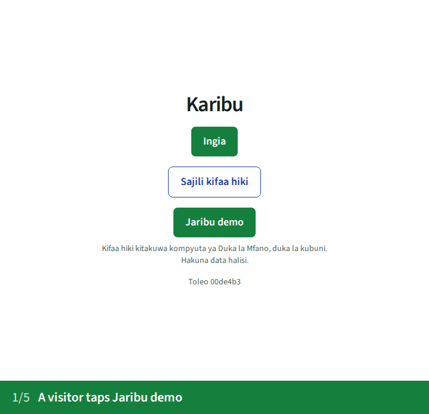

# MPC — a shop system for agro-vet and farm-supply shops

[](https://github.com/jack-bita/mpc/actions/workflows/ci.yml?query=branch%3Amain)

## The problem

- Small agro-vet shops in Tanzania keep sales, debts (*madeni*) and stock in paper books, and many cash sales leave no record at all.
- At closing, the drawers often don't match, and nobody can say where a difference came from. Staff hours and pay are counted by hand.
- Ready-made shop apps need English and a subscription. Many also need steady internet, but the internet and the power often go out.

## What it does

An offline-first, Swahili-first system for the counter and the office: staff attendance and pay, selling, payments (cash, bank, Lipa Namba mobile money), credit (*madeni*) and stock. It is built first for **MPC — Mabatini Pumba Center**, a family agro-vet shop in Usa River, Arusha, Tanzania, and designed from day one for other shops too.



*A clock-in with no internet, on the live demo: saved on the laptop, then sent by itself when the internet comes back. [How it works inside](docs/writeups/01-offline-first-outbox-change-log.md).*

**Status:** in development. Working today:

- The app installs on a laptop or a phone, and opens with no internet. Every screen is in Swahili, or in English for a person who chooses it.
- A manager registers a shop laptop once. Staff then log in at it with a four-digit PIN; after their first login there, that works with no internet too.
- Staff clock in and out. A clock-in made with no internet waits on the laptop and is sent by itself once the internet is back. The server keeps it once, even if it arrives twice.
- Managers log in with a password. The *Device health* page shows each laptop's last sync, what it still holds, its clock and its internet cuts this week.
- CI (automatic checks, tests in a real browser among them) runs on every pull request, and every merge updates the demo.

Pay, selling, payments, debts and stock are not built yet. The [build plan](docs/04-build-plan.md) ticks each task when it merges.

**Demo:** <https://mabatinipumba-demo.onrender.com>, with fake data only. It sleeps when nobody uses it, so the first visit takes about a minute. It holds one made-up shop, *Duka la Mfano*, made fresh every night; the logins are public on purpose:

- **The manager:** after *Jaribu demo*, tap Meneja's tile: the login opens with `meneja@example.com` and `jaribu-demo` already filled, so *Ingia* is one tap. Or, on a phone or a second browser, `/login/` with the same.
- **A seller at a laptop:** tap *Jaribu demo* on the Karibu screen, then a seller's tile, which shows the PIN: Asha (PIN `2580`, Dawa) or Baraka (PIN `1470`, Vyakula). Turn the network off and clock in: it works offline. Or the long way, as a real shop: *Sajili kifaa hiki*, and the manager confirms its code.

## Start here

| Read | For |
|---|---|
| [Product spec](docs/01-product-spec.md) | What it does, and why |
| [Domain model](docs/02-domain-model.md) | The entities and the business rules |
| [Architecture](docs/03-architecture.md) | How it is built |
| [Build plan](docs/04-build-plan.md) | Every task, in order |
| [Decisions](docs/adr/README.md) | One short record for each big decision |
| [Offline-first write-up](docs/writeups/01-offline-first-outbox-change-log.md) | How a record made with no internet reaches the server once: the outbox and the change log |
| [Spike reports](docs/spikes/) | Experiments run before building, with their results |
| [Runbooks](docs/runbooks/) | Step-by-step jobs, such as setting up the demo |
| [Changelog](CHANGELOG.md) | What changed in each release |
| [CLAUDE.md](CLAUDE.md) | How the code is written |

## Stack

- **Backend:** Python 3.14, Django 6.1, Django REST Framework, django-allauth, PostgreSQL 18
- **Frontend:** Next.js 16 as a static PWA (plain files that install like an app), React 19, TypeScript, Tailwind CSS + shadcn/ui, Serwist (the service worker), Dexie (IndexedDB, the browser's own database)
- **Running it:** Docker Compose + Caddy; GitHub Actions for CI and the demo's deploy; the demo on Render

## Run it locally

The app and its API answer at one address, `http://localhost:8080`, as in production: Caddy sends `/api/`, `/admin/`, `/_allauth/` and `/static/` to Django and everything else to Next.js ([ADR-0017](docs/adr/0017-one-address-session-cookies-allauth.md)). PostgreSQL 18 and Caddy run in Docker; Django and Next.js run on your machine, so code changes reload at once.

**You need:** Git, make, Docker with Compose v2 (on Windows: Docker Desktop with WSL integration turned on for your Linux distro), [uv](https://docs.astral.sh/uv/) 0.11.33 exactly (any other version refuses to run here; it installs Python 3.14 itself), and Node.js 24 or newer with pnpm.

**For `make check`, once:** the browser tests drive a real Chromium (Playwright). `make check` downloads it the first time (about 100–150 MB, outside the repo). The Linux libraries it needs come with apt: run `cd frontend && pnpm exec playwright install-deps chromium` once, after `pnpm install`. It asks for your password itself, so don't put `sudo` in front.

```bash
git clone https://github.com/jack-bita/mpc.git
cd mpc
cp .env.example .env              # local settings, with safe development values
(cd frontend && pnpm install)     # the frontend's packages
make hooks                        # git hooks: format and lint each commit, and check its message
make dev                          # PostgreSQL + Caddy in Docker, then Django and Next.js
```

Open <http://localhost:8080> to see *Karibu*, and <http://localhost:8080/api/health/> for `{"status":"ok","version":"dev"}`. The first `make dev` takes longer: Docker downloads two images and uv installs the backend's packages.

**The database tables:** while `make dev` runs, open a second terminal in the repo and run `make migrate`. It creates the tables the first time, and applies each new migration a pull brings.

**Stop:** Ctrl-C stops Django and Next.js; `make down` stops the containers and keeps the database.

**Other commands:** run `make` to list them. `make check` runs everything CI runs; it must pass before every pull request.

**If something goes wrong**
- *`docker: command not found` inside WSL:* start Docker Desktop and wait for "Engine running"; then check Settings → Resources → WSL integration.
- *`port is already allocated` for 5433:* another program holds that port. Set a free one as `DB_PORT` in `.env`.

## How it is built

Each task gets one issue, one branch and one pull request. CI runs on the pull request, and it is squash-merged into `main`. I build it with Claude Code as a pair programmer. I approve every commit, and every pull request ends with what I learned.

## Licence

All rights reserved; see [ADR-0034](docs/adr/0034-no-open-source-licence-yet.md). You are welcome to read the code, but please ask before you reuse it. The two fonts in `frontend/src/fonts/` are not ours: each stays under the Open Font License in the file beside it.
