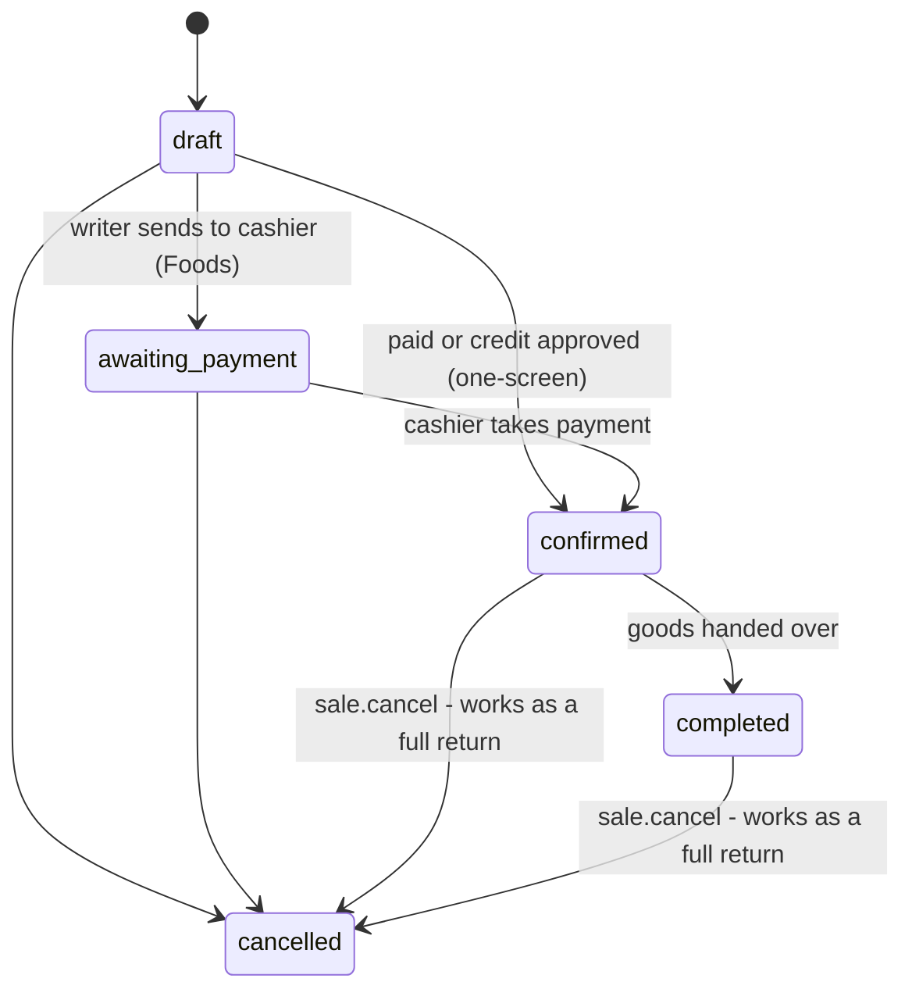
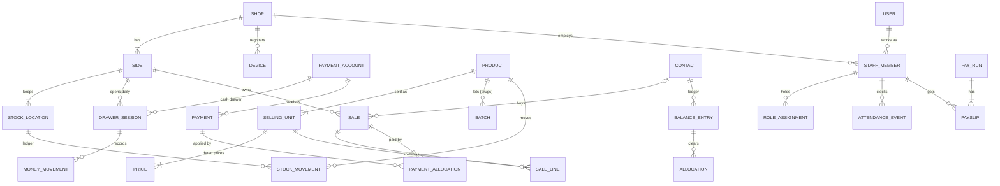

# 02 — Domain Model

**Product:** shop system for agro-vet and farm-supply shops (name to be decided)
**First shop:** MPC — Mabatini Pumba Center, Usa River, Arusha, Tanzania
**Version:** 1.8 · 29 Oct 2026 · Portion 2 of the planning pack
**Built from:** `01-product-spec.md` v1.0; updated by `03-architecture.md` v1.0 (v1.1) and `04-build-plan.md` v1.0 (v1.2)
**Status:** living document. Everything here is decided unless marked *(default)*, which means our best guess and is safe to change while building. The key decisions are in §2 and are recorded as ADRs in `docs/adr/`; small open items are in the parking lot (§20) and are settled while building.

**Changes in v1.1** (18 Oct 2026): applies the changes made by the architecture (`03-architecture.md`, Appendix B). `Device` moves to `people` and gains `DeviceOutage`; `PaymentAllocation` moves to `sales`; new `ContactBalance` cache; a document is one action; payments get `duplicate_of`; opening the drawer works offline; the server fills `unit_cost`; generic links are a type code + UUID; devices get future-dated prices and settings but no PIN hashes; dated-rule rows are insert-only; new Flag kinds; password users need an email; `Sale.paper_receipt_no`; the Foods hand-off is decided. Each change is marked **(v1.1)** below.

**Changes in v1.2** (18 Oct 2026): T2 now lists attendance events among the records that can only be voided, as §12 already described (`04-build-plan.md` Appendix A #3), and names allocations among the append-only rows, as 03 §5.6 does; §2 points to the ADRs. Each change is marked **(v1.2)** below.

**Changes in v1.3** (27 Oct 2026, SHOP-1): two decisions by Jack, made while building SHOP-1. A shop's code is 2–10 capital letters, the short form people already say (`MPC`), and its currency is fixed once the shop exists, because amounts don't carry their own currency. A shop's kind is fixed too, and a practice shop copies only a live shop (ADR-0014). The `Shop` itself is the one shop table without a `shop`: it is the tenant (§1, T1). Marked **(v1.3)**.

**Changes in v1.4** (27 Oct 2026, PPL-2): a staff member's photo is optional (Jack, while planning PPL-2). On the PIN login screen, a person with no photo shows their full name in large letters, with their nickname under it, in the photo's place. §5 also records the staff rules PPL-2 built: a job left is final and a returning worker gets a new one, one current job per person per shop, nicknames unique among current staff, a leaving date never in the future, and the PIN rules; §1 says `created_by` is empty for rows the system makes. Marked **(v1.4)** below.

**Changes in v1.5** (27 Oct 2026, SHOP-2): §4 records the side and account rules SHOP-2 built: a side's letter is one capital, unique within its shop, and a new side starts switched off; one default stock location per side; a payment account's sides are kept as link rows, each with its shop; a cash drawer has no provider and no number, and the other kinds have both. §14 gives a payment account's status: `active` ⇄ `archived`. Marked **(v1.5)**.

**Changes in v1.6** (27 Oct 2026, CORE-3): a payment has no `status` column (§10). It is void once its void stamp is filled, and valid until then. CORE-3's trigger lets a void change the stamp and nothing else (03 §5.6), so a separate status could never be set (Jack, while building CORE-3). Marked **(v1.6)**.

**Changes in v1.7** (27 Oct 2026, CORE-4): a setting and a price have no `set_by` column (§4, §6). Who set a value is the row's `created_by`, which every shop row has (§1): two columns for one fact could one day disagree (Jack, while planning CORE-4). §4 also says each setting key has a scope, as ADR-0013 does. From CORE-4's review, §4 says which row wins on one date, and that a side's row beats even an older shop row, so devices can pick the same row offline. Marked **(v1.7)**.

**Changes in v1.8** (29 Oct 2026, CTRL-1): two decisions by Jack, made while planning CTRL-1. A flag may be resolved or dismissed straight from `open`, always with a note, as a bank's reconciliation queue works. When a flag names several people, each may explain it, and every explanation is kept; a flag's notes are never edited (§13, §14). Marked **(v1.8)**.

---

## 0. How to read this

- A **domain model** lists the things the system knows about (**entities**), how they connect, and the rules that must always be true (**invariants**). It is not the database yet: `03-architecture.md` turns the modules into Django apps and tables. Field lists show the important fields only.
- Names in code are **English**; the UI is **Swahili** (§21).
- Tags: **[R1]** **[R1b]** **[R2]** **[R3]** **[Later]**, as in spec §10. **✚** = added beyond the spec.
- "→" means "belongs to".

## 1. Big ideas

1. **Everything belongs to a shop.** The shop is the tenant. A shop has sides. A record only ever points at records of its own shop.
2. **Documents in, ledgers out.** ✚ People make *documents*: a sale, a delivery, a stock count, a clock-in. When a document is confirmed, the **server** writes *ledger rows*. Documents have a status; ledger rows are never rewritten. A document is everything that happened in one action — a sale with its lines, the payments taken with it, its debt and its approvals — and the server posts it in one transaction **(v1.1)**.
3. **Four ledgers.** Every number the owner cares about is a sum over one of them:
   - **Stock** — `StockMovement`: what came into and left each place.
   - **Money** — `Payment` and `MoneyMovement`: what landed in or left each drawer, Lipa Namba and bank account.
   - **Balances** — `BalanceEntry`: what each customer, partner and supplier owes, or is owed.
   - **Attendance** — `AttendanceEvent`: every clock-in and clock-out.

   Mistakes are fixed with new rows that point at the wrong one (money rows can only be voided, with a reason). History is never rewritten.
4. **Expected vs actual → Flags.** ✚ The system works out what *should* be there; a person records what *is* there. A difference beyond the tolerance becomes a **Flag** in one review queue, with names. Drawers, counts, deliveries, transfers, open bags and production all use it.
5. **Snapshots.** A record copies the values it was made with — price, floor, unit size, buying price, daily rate, rule values, formula version — so changing a setting never changes history.
6. **Dated settings.** Every rule and rate is a row with a start date. A change is a new row; the old one stays.
7. **Offline facts are accepted, then checked.** ✚ A sale made offline already happened: the money changed hands. The server never rejects it. If it breaks a rule only the server can check (stock, a duplicate code, a credit limit, a suspended worker), the server raises a Flag.

### Common fields

Every entity, except the global ones (`User`, `Unit`) and the `Shop` itself, has **(v1.3)**:

| Field | Meaning |
|---|---|
| `id` | UUIDv7 (time-ordered, so database indexes stay fast). Made on the device for counter records, on the server otherwise. |
| `shop` | The tenant. |
| `created_at`, `created_by` | When, and who (a `StaffMember`; empty for rows the system makes **(v1.4)**). |
| `updated_at`, `updated_by`, `version` | For office records that can be edited. An edit sends the `version` it read, so two people editing at once can't overwrite each other. ✚ |

Records made at the counter also have `device`, `device_seq` (a counter per device: a gap means a missing record, and a time that runs backwards against it means a changed clock ✚), `client_time` (the device clock, not trusted) and `received_at` (server time).

**Time:** `occurred_at` = when it happened in the shop; `recorded_at` = when it was entered; `business_date` = the shop's local date (Africa/Dar_es_Salaam). Stored in UTC, shown in shop time.

**Numbers:** money is an exact decimal with 2 places in the shop's currency (TZS), shown without decimals; a line total is rounded half-up to the rounding step *(default: 1 shilling)*. Quantities are exact decimals with 3 places in the product's base unit. Never floats.

**Links:** a generic link — a ledger row's `source`, a flag's `subject` — is stored as a short type code plus a UUID **(v1.1)**. Two infrastructure tables sit outside the domain modules: the change log that devices pull from, and per-shop counters (03 §5.1, §6.4).

## 2. Key decisions

Each is an ADR in `docs/adr/`: D1 = ADR-0001 … D14 = ADR-0014 **(v1.2)**. "Cost" = how hard it is to change later.

**D1 — A side is a section of one shop.** (confirmed)
Sides share products, prices and contacts. Each side has its own stock, drawer, staff roles and debts. A second branch one day = more sides, grouped under a branch.
*Why:* matches how MPC works; cross-side sales and combined debts stay simple. *Cost:* high.

**D2 — Stock is kept per stock location.** ✚
R1 has exactly one location per side, created automatically and hidden in the UI.
*Why:* store-room counts (Later) and transfers come free, with no ledger migration. *Cost:* high.

**D3 — A sale belongs to one side; a bill groups sales.** (confirmed)
When a customer takes goods from both sides and pays once, one **bill** holds one sale per side (R2).
*Why:* each side's stock, money and debts stay separate by design. *Cost:* high.

**D4 — Credit is the unpaid part of a confirmed sale.**
It is posted as a `debt` in the balance ledger, held by a named contact with a phone. The balance ledger only holds debts and what settles them — like the madeni book. Customers, partners and suppliers all use it.
*Why:* spec §8.2; one balance system. *Cost:* high.

**D5 — Repayments clear the oldest debt first.** (confirmed)
Starting on the side where the customer pays; staff can pick specific debts. Each match is stored.
*Why:* exact "who owes what, since when"; ends arguments. *Cost:* high.

**D6 — Anything charged to a customer is a sale.** ✚
Goods, machine services and job charges all go through `Sale`.
*Why:* one path for prices, bargaining, payments, credit, receipts and reports. *Cost:* medium.

**D7 — IDs and numbers are made on the device.**
UUIDv7 IDs, and human numbers like `D2-0457` (side, device, counter).
*Why:* an offline device can't ask the server for the next number, and a printed slip must stay valid. *Cost:* high.

**D8 — Documents in, ledgers out.** ✚
Devices send documents; only the server writes ledger rows.
*Why:* business rules live in one place, and re-sending is safe. *Cost:* high.

**D9 — Stock leaves when goods are handed over.**
For a normal sale that is the moment it is confirmed; "collect later" holds it until pickup. MPC ingredients in a job leave when the job starts.
*Why:* the system matches the shelf, and it works even if loaders have no device. *Cost:* medium.

**D10 — The stock number never blocks a real sale.** *(default)*
Negative stock is warned at once, and flagged if it is still negative at day close.
*Why:* a shop that can't record a real sale stops using the system. *Cost:* low (a setting).

**D11 — Profit uses the last buying price.** *(default)*
For drugs, the batch's own cost. It is copied onto every sale line; no cost = "unknown".
*Why:* simple and honest. Switching to average cost later only affects new lines. *Cost:* low.

**D12 — One person is one user.** ✚
A `User` can belong to several shops; the shop membership (`StaffMember`) holds the PIN. PIN login only works on registered shop devices.
*Why:* the same person can work at MPC and in the demo shop; a PIN is useless off the shop's devices. *Cost:* high — Django's user model must be fixed before the first migration.

**D13 — Every rule is a dated setting.** ✚
*Why:* "a change applies from a date forward" (spec §5) works the same everywhere. *Cost:* medium.

**D14 — Practice mode is a separate practice shop.** ✚
A copy of the shop's products, with fake customers and money.
*Why:* shop isolation already guarantees practice never touches real money. *Cost:* low.

## 3. Map

```
Shop
├── Side (Drugs, Foods)
│   ├── StockLocation ─ StockMovement* ─ StockBalance
│   ├── PaymentAccount (drawer) ─ DrawerSession ─ MoneyMovement*
│   ├── Sale ─ SaleLine;  Payment* ─ PaymentAllocation ─ Sale
│   ├── Delivery, StockCount, Return
│   └── Job, Exchange, ProductionRun, Transfer, BagOpening   (R2)
├── Product ─ SellingUnit ─ Price;  ProductSide;  Batch;  ProductCost
├── Contact ─ BalanceEntry* ─ Allocation;  ContactBalance
├── StaffMember ─ RoleAssignment;  AttendanceEvent*;  PayRate;  Payslip
└── Device ─ DeviceOutage;  Setting, Flag, AuditEvent, Attachment, ImportJob

* = ledger (append-only)
```

A full diagram for GitHub is in Appendix A.

## 4. Shop & setup — module `shops`

**Shop** [R1] — one business (the tenant).
- `name`, `code`, `timezone`, `currency` (TZS), `default_language` (sw)
- `code`: 2–10 capital letters, unique — the short form people already say, like `MPC` (confirmed) **(v1.3)**
- `currency` is fixed once the shop exists: amounts don't carry their own currency, so a change would relabel every one of them (confirmed) **(v1.3)**
- `kind`: `live` | `demo` | `practice` ✚, fixed once the shop exists **(v1.3)**; `practice_of` → a live Shop (ADR-0014) **(v1.3)**
- `status`: `active` | `suspended`

**Side** [R1] → Shop (D1)
- `name`, `code` (one letter used in numbers: D, F)
- `code`: one capital letter, unique within the shop — two sides with one letter would print the same numbers **(v1.5)**
- `sale_flow`: `one_screen` | `writer_cashier_loader`
- `is_live` — each side is switched on in settings (spec §11); a new side starts switched off **(v1.5)**
- [Later] `branch` → Branch, for a second site

**StockLocation** [R1] ✚ → Side (D2)
- `name`, `is_default`. R1: one per side, automatic, hidden. At most one default per side **(v1.5)**.

`Device` moved to module `people` (§5) in v1.1: it is access control.

**PaymentAccount** [R1] → Shop — where money lands.
- `kind`: `cash_drawer` | `mobile_money` | `bank`; `name`, `provider`, `number`, `sides`, `status`
- MPC: one cash drawer per side; one Lipa Namba shared by both sides (each payment still records its side); bank accounts.
- `sides` is kept as one link row per side (`PaymentAccountSide`), each with its shop like every record (T1) **(v1.5)**.
- A cash drawer has no `provider` and no `number`; a Lipa Namba or a bank account has both **(v1.5)**.
- `status`: `active` | `archived` (§14) **(v1.5)**

**Setting** [R1] ✚ → Shop (optional Side) — one dated rule value (D13).
- `key` (from a fixed list in code, each with a type, a default and a scope: one value for the whole shop, or one a side may override **(v1.7)**), `value`, `effective_from`, `note`. Who set it is the row's `created_by` (§1) **(v1.7)**.
- In force on a date = the latest row with `effective_from` ≤ that date. On one date, the row written last wins (`created_at`, then `id`), so a mistake is fixed with a new row **(v1.7)**. A side row beats a shop row, even an older one, and only for a key a side may override **(v1.7)**. Devices need each row's `created_at` to pick the same row offline **(v1.7)**.
- Examples: `attendance.on_time_until` 07:35 · `attendance.late_fine` 1,000 · `cash.tolerance` · `count.tolerance_pct` · `expiry.alert_days` 90 · `stock.block_negative` false · `money.rounding_step` 1

## 5. People & access — module `people`

**User** [R1] — one human, across shops (D12). Global.
- `full_name`, `phone` (optional, unique, +255…), `email` (optional; required for password users, who reset their password by email through django-allauth **(v1.1)**), `password` (optional: only for people who log in from their own phone), `language`

**StaffMember** [R1] → Shop, User — a person's job at one shop.
- `display_name`, `photo` (optional: without one, the PIN login screen shows the full name in large letters with the nickname under it) **(v1.4)**, `pin` (hashed), `job_title`, `started_on`, `left_on`
- `status`: `active` ⇄ `suspended` → `left`. Never deleted. `left` is final: a person who comes back gets a new `StaffMember`, so the old one keeps its history **(v1.4)**.
- One current job (not `left`) per person per shop. Nicknames are unique among a shop's current staff, whatever the letter case: the login screen and receipts show them **(v1.4)**.
- `left_on` is set exactly when the status is `left`: never before `started_on`, and never after the shop's today, because leaving takes effect at once **(v1.4)**.
- PIN: 4 digits, not 1234 and not four of a kind, hashed with Argon2 plus a server secret (03 §5.9). `pin_changed_at` tells devices to drop their offline check. A person who has left gets none **(v1.4)**.

**Role** [R1] → Shop — a named bundle of permissions. Copied from templates (Owner, Manager, Seller, Order writer, Cashier, Worker — spec §6); the owner can edit them.

**RoleAssignment** [R1] → StaffMember — `role` + `side` (empty = all sides).

**PermissionGrant** [R1] → StaffMember — one extra `permission` for one person, optionally on one `side`.

**Permissions** are fixed codes in code (not a table):
`sale.write` · `sale.take_payment` · `sale.hand_over` · `sale.bargain` (down to the floor) · `sale.below_floor_approve` · `sale.jumla_switch` · `sale.cancel` · `sale.refund` · `credit.give` · `credit.approve` · `debt.view` · `debt.adjust` · `price.change` · `cost.view` (buying prices, profit) · `product.manage` · `contact.manage` · `stock.receive` · `stock.loss` · `stock.count` · `stock.count_approve` · `stock.transfer` · `money.expense` · `money.advance` · `money.withdraw` · `drawer.count` · `drawer.confirm` · `drawer.approve` (approve the day) · `staff.manage` · `attendance.manage` · `pay.run` · `pay.approve` · `settings.manage` · `device.manage` · `report.view` · `job.manage` (R2) · `production.run` (R2)

**Approval** [R1] ✚ → Shop — a permitted person says yes on the spot.
- `action`, `subject`, `requested_by`, `approved_by`, `method`: `pin_here` (they type their PIN on the same device; works offline) | [Later] `remote`; `note`
- Used for below-floor prices, credit over a limit, cancellations, refunds, debt adjustments, attendance fixes and backdating.

**Device** [R1] ✚ → Shop — a registered shop laptop or phone. (Moved here from `shops` in v1.1.)
- `name` ("Laptop ya Dawa"), `code` (used in numbers; never reused), `home_side`
- `status`: `pending` → `active` ⇄ `blocked`; `registered_by`, `last_seen_at`, `last_synced_at`, `last_device_seq`; `unsent_count` and `app_version`, reported at each sync **(v1.1)**
- Only active devices allow PIN login and offline work.

**DeviceOutage** [R1] ✚ → Device — one offline period the device recorded: `started_at`, `ended_at`, reported at the next sync **(v1.1)**. Feeds the sync health page and the R2 decision on a local hub (03 AD16).

## 6. Products & prices — module `catalog`

**Unit** [R1] — global, fixed: `kg`, `L`, `pcs`, `m` (pipes, rope ✚).

**Product** [R1] → Shop — one product list per shop.
- `name`, `other_names` (search words in Swahili and English), `kind`: `goods` | `service` (R2), `base_unit`
- `tags`, `barcodes` (scanning Later), `tracks_batches` (drugs), `prescription_only`
- `status`: `active` ⇄ `archived` (with a reason and a name)

**Tag** [R1] → Shop — `group` (`animal` | `use` | `brand` | `type`), `name`, `synonyms`. Powers searches like "dawa ya kupe".

**ProductSide** [R1] → Product, Side — the product on one side: `sold_here`, `shelf_label`, `reorder_level`, `reorder_qty`.

**SellingUnit** [R1] → Product — a way of selling: "Mfuko 50 kg", "Kilo", "Chupa 100 ml".
- `name`, `factor` (base units in one: 50, 1, 0.1), `is_weighed` (decimal quantities), `barcode`, `is_default`, `status`

**Price** [R1] → SellingUnit — a dated price row.
- `retail`, `jumla` (empty = none), `floor` (empty = no bargaining), `effective_from` (can be in the future), `note`. Who set it is the row's `created_by` (§1) **(v1.7)**.
- Current price = the latest row with `effective_from` ≤ now.

**ProductCost** [R1] → Product — a dated buying price per base unit.
- `cost`, `effective_from`, `source`: `delivery` | `opening_count` | `manual` | `import`
- Only `cost.view` sees it. No row = unknown.

**Services** [R2] are products of kind `service`, base unit kg, one selling unit "kg" priced per kg. They never have stock.

## 7. Stock — module `inventory`

**StockMovement** [R1] — the stock ledger. Append-only.
- `location`, `product`, `batch`, `quantity` (signed, base units), `type`, `unit_cost` (per base unit; empty = unknown), `occurred_at`, `source` (the document), `reason`, `recorded_by`, `reverses`

| Type | Sign | Written when | Release |
|---|---|---|---|
| `opening` | + | opening count approved | R1 |
| `receipt` | + | delivery completed | R1 |
| `sale` | − | goods handed over (job: when it starts) | R1 |
| `sale_return` | + | return | R1 |
| `loss` | − | loss button: spilled, damaged, expired, missing, other | R1 |
| `count_adjustment` | ± | count approved | R1 |
| `reversal` | ∓ | fixing any row | R1 |
| `transfer_out` / `transfer_in` | − / + | transfer sent / received | R2 |
| `production_use` / `production_output` | − / + | production run done | R2 |
| `exchange_in` / `exchange_out` | + / − | exchange | R2 |
| `supplier_return` | − | goods sent back to a supplier | Later |

**StockBalance** [R1] ✚ — the running total per location × product × batch, updated in the same database transaction as each movement.
*Why:* adding up a growing ledger on every search gets slow. The ledger stays the truth: the balance can always be rebuilt, and a nightly check flags any mismatch.

**Batch** [R1] → Product — one lot of a batch-tracked product.
- `lot_number`, `expiry_date` (empty = unknown → flagged), `supplier`, `unit_cost`, `first_received_at`. Unique per product + lot + expiry.

**Delivery** [R1] → Side, StockLocation — goods arriving from a supplier.
- `supplier`, `supplier_doc_no`, `arrived_at`, `received_by`, `photos`
- `status`: `pending_details` → `completed` | `cancelled`
- `payment`: `paid` (a `supplier_payment` money movement) | `on_credit` (R1: marked only; R2: posted as `supplier_credit`) | `mixed`
- Lines: `product`, `selling_unit`, `qty_on_paper`, `qty_received`, `cost` (per selling unit), `lot_number` + `expiry_date` (drugs), `note`
- **"Received, pending"** = a photo and a note only. Nothing is posted until it is completed (next morning); its movements are dated at arrival.
- Completing posts `receipt` movements and new `ProductCost` rows, and flags paper-vs-received differences. [R2] If the cost went up, the system suggests a new selling price.

**StockCount** [R1] → StockLocation
- `kind`: `opening` | `daily` | `full` | `spot`; `status`: `open` → `submitted` → `approved` | `cancelled`; blind by default
- Lines: `product`, `batch`, `counted_qty` (the UI can take "bags + kg"), `counted_at`, `counted_by`, `expected_qty` (hidden until submitted), `difference`
- Approval posts `opening` or `count_adjustment` movements; differences beyond tolerance become Flags with the counter's name.
- **Daily 5** *(default)*: the system picks the products not counted for the longest, plus any with negative stock or an open flag.

**RestockRequest** [R1] → ProductSide — the "running low" button: `raised_by`, `note`, `status`: `open` → `ordered` → `closed`.
**Shopping list** = products at or below their reorder level, plus open requests.

**Transfer** [R2] — from one location to another; `status`: `sent` → `received` | `cancelled`; lines with `qty_sent` and `qty_received`. Differences → Flag.

**ProductionRun** [R2] → StockLocation — MPC grinding or mixing its own stock.
- `service`, `formula_version` (optional), inputs (product, batch, kg), `output_product`, `expected_output`, `actual_output`, `operator`; `status`: `planned` → `done` | `cancelled`
- Output cost = input cost ÷ output kg (unknown if any input cost is unknown). Loss beyond tolerance → Flag.

**BagOpening** [R2] → StockLocation — "I opened a new bag for loose sale": `product`, `selling_unit`, `opened_at`, `opened_by`.
Loose kg sold until the next opening is compared with the bag size; beyond tolerance → Flag naming who sold loose kg in that window. It moves no stock (stock is already in kg).

## 8. Contacts & balances — module `contacts`

**Contact** [R1] → Shop — anyone the shop deals with by name. One record can be customer, supplier and partner at once.
- `name`, `phones` (first = main, stored as +255…), `whatsapp`, `place`, `kind`: `person` | `business` | `institution`, `tin`
- `is_customer`, `is_supplier`, `is_partner` (R2), `default_price_tier`: `retail` | `jumla`
- `credit_limit` (empty = none set *(default)*), `notes`, `status`: `active` ⇄ `archived`, `merged_into` (for duplicates made offline)
- [R3] `user` — customer login
- A walk-in sale needs no contact. Credit always needs a contact with a phone.

**BalanceEntry** [R1] → Contact, Side — the balance ledger (D4). Append-only.
- `kind`, `amount` (signed: **+ the contact owes the shop; − the shop owes the contact**), `occurred_at`, `description` (e.g. "2 × Mfuko pumba 50 kg"), `source`, `recorded_by`, `approval`, `reverses`

| Kind | Sign | From | Release |
|---|---|---|---|
| `debt` | + | the unpaid part of a confirmed sale | R1 |
| `repayment` | − | a payment from the contact (one entry per side it clears) | R1 |
| `return_credit` | − | goods returned from a credit sale | R1 |
| `opening_balance` | ± | debts imported at launch (with the original date if known) | R1 |
| `adjustment`, `write_off` | ± | a manual fix, with approval and a reason | R1 |
| `supplier_credit` | − | a delivery taken on credit | R2 |
| `supplier_payment` | + | money paid to a supplier against their credit | R2 |

Balance per side = the sum of its entries; combined = the sum over sides.

**ContactBalance** [R1] ✚ — the running balance per contact × side, updated in the same transaction as each balance entry; rebuilt from the ledger and checked nightly, like `StockBalance` **(v1.1)**. Devices pull it.

**Allocation** [R1] — which settlement cleared which debt (D5).
- `from` (repayment, return credit, write-off) → `to` (debt, opening balance), `amount`
- Default: the oldest open debt on the paying side, then the other sides. Staff can pick instead.
- A device may suggest allocations offline; the server allocates again at posting (oldest first), unless staff picked specific debts **(v1.1)**.
- Open amount of a debt = its amount − its allocations. Aging buckets: 0–30, 31–60, 61–90, 90+ days.
- A repayment with nothing left to clear stays as customer credit (a negative balance) and clears the next debt automatically.
- [R2] Supplier balances work the same way, mirrored.

**Partners** [R2] — a contact with `is_partner`. Goods a partner takes = a sale to the partner on credit. When a partner delivers to a customer and collects the money for MPC, the sale's `debt_holder` is the partner: they owe MPC until they bring the money.

## 9. Selling — module `sales`

**Sale** [R1] → Side — one purchase on one side (D3, D6).
- `number` (e.g. `D2-0457`), `channel`: `counter` | `phone` (R2) | `online` (R3)
- `customer` (empty = walk-in), `customer_name`, `customer_phone`
- `price_tier`: `retail` | `jumla`
- `status`: `draft` → `awaiting_payment` → `confirmed` → `completed` | `cancelled` (§14)
- `written_by`, `confirmed_by`, `handed_over_by`, each with its time
- `handover`: `now` *(default)* | `collect_later`; [R2] `collected_by_name`, `collected_by_phone`
- `debt_holder` (default = the customer), `credit_approval`, `efd_receipt_no`
- `paper_receipt_no` ✚ — set when a sale is entered late from the numbered paper receipt book after a total blackout (03 §6.11) **(v1.1)**
- Totals (stored for speed, always recomputable): `list_total`, `discount_total`, `total`, `paid`, `credit`
- [R2] `bill`, `job`; cancel `reason`, `by`, `approval`

**SaleLine** [R1] → Sale
- `product`, `selling_unit`, `quantity` (in selling units; decimals if weighed), `factor` (copied), `base_qty` = quantity × factor
- `list_price` (copied from the tier's price when the line is written), `floor_price` (copied), `unit_price` (agreed)
- `line_total` = quantity × unit price, rounded; `discount` = (list − unit) × quantity
- `below_floor_approval`, `unit_cost` (copied by the server at posting — devices never hold buying prices **(v1.1)**: the batch cost for drugs, otherwise the latest ProductCost; empty = unknown)
- `batch_picks` (drugs: which batch, how much; earliest expiry first if nobody picks)
- [R2] `handed_over_at` per line

**PaymentAllocation** [R1] → Sale — `payment` → `sale`, `amount`. A sale's `paid` = the sum of its allocations. A payment can be allocated before confirmation (a deposit, e.g. on a job). (Moved here from `money` in v1.1.)

**Bill** [R2] → Shop — groups sales from different sides that one customer pays together. Holds the shared receipt and EFD number. Each sale keeps its own side, number, stock and debt.

**Return** [R1] → Sale
- Lines (sale line, quantity), `condition`: `resellable` | `damaged` (comes back in, then a `loss`), `reason`, `approved_by`
- `resolution`: `refund` (money out) | `exchange` (its value pays a new sale: payment method `returned_goods`) | `reduce_debt` | `deal` (an agreed amount; the difference is recorded)
- Posts `sale_return` movements, plus the money or balance rows needed.

**PrintLog** [R1] ✚ → Sale or Bill — `kind`: `slip` | `receipt`; `channel`: `printer` | `whatsapp`; `copy_no`, `by`, `at`. A reprint says **NAKALA / COPY**.

**Phone orders** [R2] are sales with channel `phone`. Typing the caller's number pulls up the contact: debt, last sale, formulas.

## 10. Money — module `money`

**Payment** [R1] → Side, PaymentAccount — money received from a customer or partner.
- `method`: `cash` | `mobile_money` | `bank` | `returned_goods` (no account)
- `amount` (what landed in the account), `cash_change_given` (cash out of the drawer when a mobile-money or bank payment was too big)
- `transaction_code` (required for mobile money and bank; stored in capitals, no spaces), `payer`, `payer_name`, `payer_phone`, `received_by`, `received_at`, `drawer_session` (for cash, or cash change)
- Void: the one-time void stamp — `voided_at`, `voided_by`, `void_reason`, `void_approval` (03 §5.6). A payment is valid until `voided_at` is filled, and void after it. There is no separate status column: the database lets a void change the stamp and nothing else, so a status could never be set. Voiding reverses everything the payment did **(v1.6)**.
- `duplicate_of` → Payment ✚ — an offline payment whose transaction code was already used is stored, linked to the first payment, and flagged **(v1.1)**
- Applied to sales (PaymentAllocation) and/or debts (repayment entries). Applied total = `amount` − `cash_change_given`.

`PaymentAllocation` lives in module `sales` (§9) since v1.1.

**DrawerSession** [R1] → Side, PaymentAccount (cash drawer) — one drawer's day. Approving it approves the side's day.
- `business_date`, `opened_by`, `opening_cash`
- `status`: `open` → `counted` → `confirmed` → `approved` (the owner can reopen, with a reason)
- `counted_cash` (blind), `counted_by`, `cash_breakdown` (notes and coins, optional), `expected_cash` (worked out at count time), `difference`, `explanation`, `confirmed_by`, `approved_by`
- `report_snapshot` ✚ — the day's numbers, frozen at approval. "Send to boss" uses it.
- `mobile_money_check` (optional): the system's Lipa Namba total vs the phone's statement
- Opening the drawer works offline ✚; two openings of one drawer → a `drawer_conflict` flag **(v1.1)**

**MoneyMovement** [R1] → PaymentAccount (+ DrawerSession for cash) — every other money in or out.
- `kind`: `expense` | `staff_advance` | `withdrawal` (owner takes cash, bank deposit) | `float_in` | `refund` | `supplier_payment` (R1: paying for a delivery; R2: also clears supplier credit) | `salary_payment` (R1b) | `side_transfer` (R2: cash handed from one side's drawer to the other's)
- `amount` (positive; the kind sets the direction), `category` (expenses), `staff` (advances, salaries), `contact`, `description`, `photo`, `recorded_by`, `approval`
- Expense categories are a shop list.

**Expected cash** (spec §8.2) = opening cash + cash payments − cash change given + money in − money out, for the session.

**Inter-side due** [R2] (worked out, not stored) = money one side received for the other side's sales or debts, minus the `side_transfer`s already made.

## 11. Services, jobs, formulas, exchange [R2] — module `services`

**Formula** → Shop — a feed recipe: `name`, `owner` (a contact; empty = MPC's standard), `output_product` (optional), `status`.

**FormulaVersion** → Formula — `version_no`, lines (ingredient, share %; shares add up to 100). Editing a formula makes a new version; jobs keep the version they used. "Same as last time" = the customer's last job.

**Job** → Side — a machine order.
- `number`, `customer` (required), `services` (grinding, mixing, …), `formula_version`, `requested_qty`, `promised_at`, `operator`, `notes`
- `status`: `waiting` → `in_progress` → `ready` → `collected` | `cancelled`
- Inputs: `product`, `kg`, `source`: `customer` (their goods: kept apart, never in MPC stock) | `shop` (MPC stock: becomes lines on the job's sale)
- `output_kg` (weighed) → loss = input − output
- `sale` — the job's bill: service lines (kg × price per kg) + MPC ingredients. Payments any time — a deposit before, a debt after — with the same rules as any sale.
- `collected_by_name`, `collected_by_phone`

**Exchange** → Side — whole maize in, ground maize out, grinding paid.
- `customer` (optional); in: product + kg weighed; out: product + kg (= in × the exchange-rate setting); `sale` (the grinding charge)
- Posts `exchange_in` and `exchange_out`. The swap itself is not a sale, so sales reports stay true.

## 12. Attendance & pay [R1b] — module `staffpay`

**AttendanceEvent** → StaffMember — one clock-in or clock-out. Append-only.
- `kind`: `in` | `out`; `device`, `photo`, `client_time`, `trusted_time`, `time_check`: `server` | `device_ok` | `unverified`
- `entered_by` + `reason` when a manager enters it for someone; `void` (by, reason) — a one-time void stamp; nothing else on the event ever changes (T2) **(v1.2)**
- **Offline time** ✚: an offline event keeps its device time plus evidence — its `device_seq`, the last server time the device saw, and the device's clock error found at the next sync. If time and sequence disagree (a later record with an earlier time), or the clock was wrong at sync, the event is `unverified` and flagged for a manager.

**AttendanceDay** → StaffMember, date — worked out from the events and the rules in force that day.
- `first_in`, `last_out`, `status`: `on_time` | `late` | `half` | `absent` | `off` (Sunday, holiday) | `needs_review`
- `absence_type`: `office_duty` (paid as a full day) | `permission` (unpaid) | `no_show` (unpaid)
- `fine`, `rules_used` (copied), `override` (status, by, reason — the worked-out value stays visible)
- Locked once its pay run is approved.

**PayRate** → StaffMember — `daily_rate`, `effective_from`.

**PayRun** → Shop — one month. `status`: `draft` → `approved` → `paid`. Recalculated freely while draft; approval freezes payslips, attendance days and advances.

**Payslip** → PayRun, StaffMember — day counts, the rate(s) used (a mid-month rate change splits the days), lines (days × rate, fines, advances, other additions or deductions with a reason), `net`, and how it was paid. The worker sees their own.

Advances come from `MoneyMovement` `staff_advance` and are deducted in the next pay run *(default: in full)*.

## 13. Control — module `control`

**Flag** [R1] ✚ — one review queue for every difference and every offline rule break.
- `kind`: `cash_difference` · `count_difference` · `delivery_difference` · `transfer_difference` · `negative_stock` · `duplicate_code` · `late_record` · `unverified_time` · `missing_clock_out` · `suspended_staff_activity` · `device_gap` · `balance_mismatch` · `open_bag_difference` · `production_loss` · `total_mismatch` · `permission_break` · `drawer_conflict` **(v1.1)** · …
- `subject`, `expected`, `actual`, `difference`, `people`, `side`
- `status`: `open` → `explained` → `resolved` | `dismissed` (by, note)
- A manager who finds the reason may resolve or dismiss a flag straight from `open`, with their own note. `resolved` and `dismissed` are final **(v1.8)**.
- Each step is a note, with who and when. Every explanation is kept: each person a flag names may write their own, and none replaces another. Closing a flag needs a note too. Notes are never edited **(v1.8)**.
- Low stock and expiring batches are **alerts** (lists), not flags: nobody has to explain them.

**AuditEvent** [R1] — who did what: `actor`, `device`, `action`, `subject`, `before`, `after`, `reason`, `approval`, `at`. Append-only.

**Attachment** [R1] — a photo or file on any record: supplier paper, expense receipt, clock-in photo. Photos taken offline upload later, Wi-Fi first.

**ImportJob** [R1] — products and selling units, opening stock, contacts, open debts. `status`: `uploaded` → `checked` → `applied`; errors per row; created records point back at the import.

**Notification** [R2] — a message to a side or a person, e.g. "Bill B-0091: prepare 1 × Ivermectin 100 ml"; `seen_by`, `done_by`.

**[R3]** Customer login (`Contact.user`); online sales (channel `online`, status `requested` until staff accept; prescription-only lines need staff confirmation); a message log with consent.

## 14. Lifecycles

### Sale



- **One-screen (Drugs):** draft → confirmed → completed in one tap; it stops at confirmed if "collect later".
- **Writer → cashier → loader (Foods):** the writer sends the sale to the cashier; payment confirms it and prints the slip; handover completes it.
- A draft can stay on the device; the server first sees a sale when it is sent to the cashier or confirmed.
- **Confirming needs:** paid + credit = total; credit > 0 → a debt holder with a phone, `credit.give`, and an approval above their limit; every below-floor line approved.
- A confirmed sale is never edited. Changes are returns, or cancel and rewrite.

### Others
- **Delivery:** `pending_details` → `completed` | `cancelled` (only while pending; a completed delivery is fixed with reversal rows).
- **StockCount:** `open` → `submitted` → `approved` | `cancelled`.
- **DrawerSession:** `open` → `counted` → `confirmed` → `approved`; the owner can reopen with a reason.
- **Transfer** [R2]: `sent` → `received` | `cancelled` (before received).
- **Job** [R2]: `waiting` → `in_progress` → `ready` → `collected`; `cancelled` before ready (the customer's goods go back).
- **PayRun** [R1b]: `draft` → `approved` → `paid`.
- **Flag:** `open` → `explained` → `resolved` | `dismissed`; it may also close straight from `open` **(v1.8)**.
- **StaffMember:** `active` ⇄ `suspended` → `left`. **Product, Contact:** `active` ⇄ `archived`. **PaymentAccount:** `active` ⇄ `archived` **(v1.5)**. **Device:** `pending` → `active` ⇄ `blocked`.

## 15. Calculations

1. **Stock on hand** (location, product, batch) = the sum of movements. Shown in selling units, biggest first.
2. **Waiting to be collected** [R2] = confirmed lines not yet handed over. **Available** = on hand − waiting.
3. **Line total** = quantity × unit price, rounded. **Discount** = (list − unit) × quantity.
4. **Paid** = the sum of allocations. **Credit** at confirmation = total − paid.
5. **Balance** = the sum of entries. **Open debt** = amount − allocations. **Age** = days since `occurred_at`.
6. **Expected cash** = opening + cash payments − cash change given + money in − money out.
7. **Mobile money expected** (account, day) = the sum of payments into it.
8. **Pay** (spec §8.1) = (on-time + late + office-duty days) × rate + half days × rate ÷ 2 − late days × fine − advances ± adjustments.
9. **Line profit** = line total − base qty × unit cost (unknown if the cost is unknown). A period's profit also shows "unknown on N lines worth TZS X".
10. **Open-bag difference** = loose kg sold between two openings − bag kg.
11. **Loss %** (production, jobs) = (input kg − output kg) ÷ input kg.
12. **Expiry:** days left = expiry − today; alert when ≤ `expiry.alert_days`.
13. **Shopping list:** on hand ≤ reorder level, or an open restock request.

## 16. Rules (invariants)

These become database constraints and automated tests.

**Tenancy and history**
- **T1** Every record (except `User`, `Unit` and the `Shop` itself **(v1.3)**) has a shop, and only points at records of the same shop.
- **T2** Stock movements, balance entries, allocations, attendance events and audit events are never edited or deleted; fixes are new rows that point at what they fix. Payments, money movements and attendance events can only be **voided** (who, when, why) — a one-time stamp: a voided payment or money movement reverses everything it did, and a voided attendance event no longer counts towards its day **(v1.2)**. Dated-rule rows — prices, product costs, settings, pay rates — are insert-only too, and the database enforces all of this with triggers **(v1.1)**.
- **T3** Nothing is deleted: cancel, void, suspend, archive — always with who, when and why.
- **T4** Copied values (price, floor, factor, cost, rate, rules, formula version) never change once the record is confirmed.

**Products and stock**
- **P1** A selling unit's factor is above zero and frozen once used; a new size is a new selling unit.
- **P2** floor ≤ jumla ≤ retail *(default)*. Only `price.change` adds price rows, and rows are never edited.
- **S1** Stock = the sum of movements, and `StockBalance` always equals it.
- **S2** Movements use the product's base unit; selling units convert by their factor.
- **S3** A batch-tracked product's movements always name a batch (earliest expiry first if none is picked). Selling from an expired batch needs an extra tap.
- **S4** Every loss, adjustment and reversal has a reason and a name.
- **S5** Opening stock comes only from an approved opening count.

**Selling and money**
- **M1** Money is an exact decimal, never a float.
- **M2** Mobile money and bank payments need a transaction code. A code already used on a valid payment to the same account is refused online, and flagged when it arrives from offline.
- **M3** Every payment is fully applied: to sales, to debts, or as credit for a named contact.
- **M4** Credit is never a payment method.
- **M5** Going below the floor needs an approval; every discount keeps a name.
- **M6** Slips print only for confirmed sales; reprints say COPY and are logged.
- **M7** The count is blind: the expected cash is hidden until the count is submitted.
- **M8** A drawer can't be approved while a device that used it still has unsent records; records arriving after approval raise a `late_record` flag.
- **M9** One open session per drawer.
- **M10** Expenses, advances and withdrawals need a category or reason and a name; advances name the worker.

**Balances**
- **B1** An allocation never exceeds what is open on either end.
- **B2** Adjustments and write-offs need an approval and a reason.
- **B3** A debt always shows the date, contact, phone, items, amount, side and who gave it.

**Attendance and pay**
- **A1** A day uses the rules in force on that date.
- **A2** Manual fixes never hide the original clock events.
- **A3** An approved pay run is frozen; later fixes are adjustments in the next run.
- **A4** Workers see only their own attendance, payslips and cash-ups.

**Access and devices**
- **X1** Permissions are checked per side.
- **X2** PIN login works only on active registered devices. A suspended person can't log in once the device has synced; anything they did offline after suspension is flagged.
- **X3** Every write records the person and the device.

## 17. Offline and sync

- **Works offline (R1):** clock in and out, one-screen sales, payments, debt repayments, quick-add customer (name + phone), drawer money movements, PIN approvals, and opening the drawer **(v1.1)**. Everything else needs the internet *(default)*.
- **Kept on the device:** products, selling units, current and future-dated prices, batches and stock, contacts with balances (as of the last sync), staff names and status, permissions, and the settings in force plus future-dated ones **(v1.1)**. No PIN hashes: each device makes its own offline PIN check the first time a person logs in online on it **(v1.1)**. Buying prices never go to devices.
- **Safe to resend:** each document travels with its UUID; sending it twice changes nothing.
- **Accept, then flag:** the server accepts offline documents and flags what it could only check online — negative stock, a duplicate code, over the credit limit, a suspended worker, an archived product. A price changed meanwhile doesn't matter: the sale keeps the device's price.
- **Missing records:** a gap in a device's `device_seq` → a `device_gap` flag.
- **Foods hand-off** ✚: decided in 03 (AD16) — through the server when there is a network; cashier-only on one screen when there isn't; a local hub only if R1's outage numbers justify it **(v1.1)**.
- **Long power cuts:** when every device is dead, sales go in a numbered paper receipt book and are entered later as late sales, with a manager's approval (03 §6.11) **(v1.1)**.

## 18. Worked examples (these become tests)

Numbers marked *e.g.* are made up.

**E1 — Stock in kg, sold by bag and by kg.** "Pumba ya mahindi", base kg; Mfuko 50 kg (factor 50) and Kilo (factor 1).
Opening count 20 bags +1,000 · sell 3 bags −150 · sell 12.5 kg −12.5 · delivery 10 bags +500 · spilled −2 → **1,335.5 kg = 26 bags + 35.5 kg**.

**E2 — Bargaining.** Bag: retail 65,000, jumla 62,000, floor 60,000 *(e.g.)*. A retail sale at 61,000 → allowed; the 4,000 discount is kept with the writer's name. At 59,000 → needs a manager's PIN; the approval is stored on the line.

**E3 — Lipa Namba overpay.** Sale 43,000. The customer sends 50,000 by Lipa Namba and gets 7,000 cash change → Lipa Namba +50,000, drawer −7,000, and the sale is paid 43,000.

**E4 — Cash-up.** Opening 50,000 + cash payments 450,000 (including 30,000 of debt repayments) − cash change for Lipa Namba overpays 5,000 − expenses 12,000 − advance 20,000 − withdrawal 300,000 = **expected 163,000**. Counted 160,000 → difference −3,000 → a Flag if beyond the tolerance.

**E5 — Debt, oldest first.** A Foods customer. 3 Oct: sale 120,000, paid 50,000 → debt 70,000. 10 Oct: sale 40,000 on credit → debt 40,000. 15 Oct: pays 80,000 by Lipa Namba → clears the 70,000, and 10,000 of the 40,000. On 20 Oct she owes **30,000, 10 days old**.

**E6 — Mixed bill** [R2]. Feed 90,000 (a Foods sale) + dewormer 15,000 (a Drugs sale) on one bill, paid 105,000 cash at the Foods cashier → both sales paid; the Foods drawer expects +105,000; the day shows "Foods holds 15,000 for Drugs" until a `side_transfer`.

**E7 — Exchange** [R2]. 100 kg whole maize in; ground maize out at the exchange rate *(e.g. 0.95 → 95 kg)*; grinding 100 kg × price per kg on the exchange's sale. Stock: whole maize +100, ground maize −95.

**E8 — Production** [R2]. 500 kg whole maize → 485 kg ground: a 3% loss → no flag if the tolerance is 5% *(e.g.)*.

**E9 — Open bag** [R2]. A 50 kg bag opened at 08:00, the next at 16:30; loose kg sold in between: 48.5 → −1.5 kg → a Flag if the tolerance is 1 kg *(e.g.)*, naming who sold loose kg in that window.

**E10 — Payslip** [R1b]. Spec §8.1: 193,000.

## 19. By release

| Module | R1 | R1b | R2 | R3 / Later |
|---|---|---|---|---|
| shops | Shop, Side, StockLocation, PaymentAccount, Setting | | practice shop | Branch |
| people | User, StaffMember, Role, RoleAssignment, PermissionGrant, Approval, Device, DeviceOutage | | | remote approval |
| catalog | Unit, Product, Tag, ProductSide, SellingUnit, Price, ProductCost | | services | jumla by quantity, price per side |
| inventory | StockMovement, StockBalance, Batch, Delivery, StockCount, RestockRequest | | Transfer, ProductionRun, BagOpening | store rooms, supplier returns, purchase orders |
| contacts | Contact, BalanceEntry, Allocation, ContactBalance | | partners, supplier credit | customer login, reminders |
| sales | Sale, SaleLine, PaymentAllocation, Return, PrintLog | | Bill, phone orders, handover per line | online orders, proforma |
| money | Payment, DrawerSession, MoneyMovement | salary payments | side transfers, supplier credit payments | statement matching |
| services | | | Formula, FormulaVersion, Job, Exchange | machines |
| staffpay | | AttendanceEvent, AttendanceDay, PayRate, PayRun, Payslip | | |
| control | Flag, AuditEvent, Attachment, ImportJob | | Notification | message log |

## 20. Parking lot

Small items, each with a default or a setting. Settled while building; most need the owner's answer.

1. Money rounding step: 1 shilling *(default)*, or 50 / 100.
2. Tolerances (cash, counts, deliveries, open bag, production): values to agree with the owner.
3. Credit rules: a default limit for new customers, who approves, what happens on non-payment (spec §14).
4. Machine charge per kg: kg brought in *(default)*, or kg out.
5. Exchange rate (kg out per kg in): one rate, or one per product.
6. Attendance: when late becomes a half day, leaving early, a missing clock-out *(default: needs review)*, Sundays and holidays (spec §14).
7. Advances: deducted in full next month *(default)*, or in parts.
8. Inter-side money: cash handed over at day close, or only shown in the report.
9. Loaders confirming handover on a device (R2), or not.
10. Return time limit *(default: none)*.
11. Expiry alert: 90 days *(default)*.
12. Tax category on products (spec §14: VAT).
13. Rules for merging duplicate customers.

## 21. Language

One word per idea, the same in code, docs and UI. The Swahili is a draft — Jack to correct.

| Code | UI (Swahili) | Meaning |
|---|---|---|
| Shop | Duka | One business using the system |
| Side | Upande | A section of a shop with its own stock, drawer and staff |
| Product | Bidhaa | Something the shop sells |
| SellingUnit | Kipimo | A way of selling a product (bag, kg) |
| Sale | Mauzo / Oda | One purchase on one side |
| Bill | Bili | Sales from several sides paid together (R2) |
| Payment | Malipo | Money received |
| Debt | Deni | The unpaid part of a sale |
| Contact | Mteja · Msambazaji · Mshirika | Customer · supplier · partner |
| Delivery | Mzigo umefika | Goods arriving from a supplier |
| Loss | Upotevu | Stock spilled, damaged or expired |
| StockCount | Kuhesabu mzigo | Counting the real stock |
| DrawerSession | Hesabu ya droo | One drawer's day |
| Expense | Matumizi | Money paid out for the shop |
| Advance | Advansi | Money a worker takes before payday |
| Attendance | Mahudhurio | Clocking in and out |
| PayRun | Mishahara | One month's pay for everyone |
| Job | Kazi ya mashine | A grinding or mixing order |
| Flag | Tofauti | A difference someone must explain |

## Appendix A — Diagram

Renders on GitHub.


