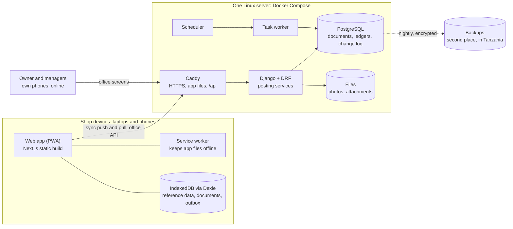
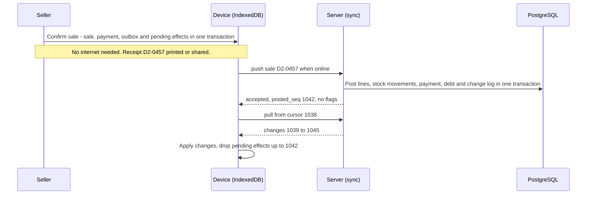

# 03 — Architecture

**Product:** shop system for agro-vet and farm-supply shops (name to be decided)
**First shop:** MPC — Mabatini Pumba Center, Usa River, Arusha, Tanzania
**Version:** 1.2 · 19 Oct 2026 · Portion 3 of the planning pack
**Built from:** `01-product-spec.md` v1.0, `02-domain-model.md` v1.0; updated by `04-build-plan.md` v1.0 (v1.1)
**Status:** living document. Everything here is decided unless marked *(default)*, which means our best guess and is safe to change while building. Key decisions are in §2 (AD3, AD14 and AD16 confirmed with Jack) and are recorded as ADRs 0015–0032 in `docs/adr/`. Small open items are in the parking lot (§18). The changes this doc made to the domain model are listed in Appendix B and applied in `02-domain-model.md` v1.1.

**Changes in v1.2** (19 Oct 2026, REPO-3): the UI message files live in `frontend/messages/`, next to `src/`, as next-intl's guide places them; `src/i18n/` keeps only the next-intl setup (§4, §7.2). The Serwist build is proven in SPIKE-1, not in the first frontend task (§7.7). Each change is marked **(v1.2)**.

**Changes in v1.1** (18 Oct 2026): applies the build plan's Appendix A (`04-build-plan.md`). The custom `User` and the clock-in come first in §16 (BP5, BP6); attendance events also allow the one-time void stamp (AD7, §5.6); role templates live in code and are copied by `create_shop` (§5.8, §9); release-please writes the changelog and tags, and the production deploy runs as a job of the release workflow (§12). Also: attendance is part of the one website and is built first (§1, §15 — BP7); the repo layout gains `.claude/`, the `Makefile`, `docs/spikes/`, `docs/writeups/` and a gitignored `private/` folder (§4); the code rules now live in `CLAUDE.md` (§17). Each change is marked **(v1.1)** below.

---

## 0. How to read this

- **Architecture** = how the system is built: the pieces, where each one runs, how they talk, how data moves, and how we test, ship and run it. Portion 2 said *what* the system knows; this says *how* it works.
- Every key decision (**AD1**, **AD2**…) is an ADR in `docs/adr/`: AD1 = ADR-0015 … AD18 = ADR-0032 **(v1.1)**. "Cost" = how hard it is to change later.
- Tags: **[R1] [R1b] [R2] [R3] [Later]**, as before. **✚** = added beyond the spec and the domain model; veto freely.
- Versions mean "the latest patch of this line when the repo is created" (portion 6 checks them).
- Names follow `02-domain-model.md` §21.

## 1. The big picture



Three ideas carry the whole design:

1. **The counter runs on the device.** Everything a seller needs — products, prices, stock, customers, staff, permissions, settings — is copied onto the device. A sale is saved on the device first, then sent. The internet only changes *when* the server hears about it.
2. **Documents in, ledgers out** (02 D8). Devices send documents. Only the server's posting services write ledger rows, in one database transaction per document. The database itself refuses edits to ledgers.
3. **One server, split cleanly inside.** One Django project with clear modules, one PostgreSQL database, one rented Linux server. Simple to run for one shop; ready for many.

**One repo, one website** (confirmed). The whole MPC — attendance and both sides of the shop, Drugs and Foods — is one repository and one website at one address. Each part is switched on in settings, and the parts are built one after another: attendance first, then the Drugs side, then the Foods side (04 BP7, ADR-0033) **(v1.1)**. The public demo is the same code deployed a second time, with fake data, at its own address.

## 2. Key decisions

**AD1 — A modular monolith.**
One Django project and one database, split into apps that follow the domain modules. Import rules between apps are checked in CI (§5.1).
*Why:* one developer and one shop; separate services would add network failures, more deploys and harder debugging, for no gain. Clean modules keep the door open to split later. *Cost:* high.

**AD2 — The shop app is a static PWA built with Next.js.**
Next.js builds the app into plain files (`output: 'export'`). Every screen renders in the browser. A service worker keeps all app files on the device. There is no Node server in production.
*Why:* the counter must open and work with no internet; anything rendered on a server can't. Plain files are also cheap and fast to serve. *Cost:* medium — server rendering can be added later for public R3 pages without touching the counter.
Note: this is not how Next.js is usually used — no server components at runtime, no server actions, no middleware in the shop app.

**AD3 — One web address, session cookies, and django-allauth for passwords.** (confirmed)
The app files and the API come from the same address (`https://<app-domain>/` and `/api/`). Logins use Django's session cookie (HttpOnly, Secure) with CSRF protection; no tokens are kept in JavaScript. **django-allauth** in headless mode — whose browser client uses exactly these session cookies — handles password login by email or phone, password resets by email, login rate limits and, later, two-factor codes and passkeys for the owner and managers. PIN login on shop devices and device registration are our own small code.
*Why:* the simplest safe setup for our own web app — no CORS, nothing for a bad script to steal, and logging out, suspending a worker or blocking a device takes effect at once — with a mature library for the security-critical password part instead of hand-written code. *Cost:* medium.

**AD4 — Two kinds of identity: devices and people.**
A registered shop **device** holds a device key (an HttpOnly cookie); the sync talks to the device. A **person** is identified by PIN on a shop device, or by password on their own phone for office screens. Every document names the staff member who made it.
*Why:* PINs only work on shop devices (D12), offline work needs a trusted device, and blocking a stolen device stops it at once. *Cost:* high.

**AD5 — Offline data lives in IndexedDB, through Dexie.**
Reference data is copied to the device. Documents are saved locally and queued in an **outbox** in the same local transaction.
*Why:* IndexedDB is the only large, lasting store a browser has; Dexie makes it typed and testable and gives React live queries. *Cost:* medium.

**AD6 — Sync = push documents, pull changes.**
*Push:* outbox documents in device order, safe to resend (idempotent by UUID). *Pull:* reference-data changes after a cursor, from a per-shop change log whose numbers follow commit order.
*Why:* facts are append-only, so they never conflict; reference data is edited online only, so devices just read it. No merge logic. *Cost:* high.

**AD7 — Posting services write the ledgers; the database refuses edits.**
Each document type has one posting function that writes the document and all its ledger rows in one transaction. Ledger tables have a trigger that blocks UPDATE and DELETE (payments, money movements and attendance events allow a one-time void stamp **(v1.1)**).
*Why:* rules T2 and T3 are enforced by the database, not by remembering. *Cost:* high.

**AD8 — Tenancy is enforced in one place; row-level security comes later.** *(default)*
A request-scoped current shop, scoped model managers that fail closed, one base API view and write-time "same shop" checks, all covered by sweep tests. PostgreSQL row-level security (RLS) is added before a second real shop goes live.
*Why:* RLS doesn't stop cross-shop links anyway (foreign-key checks ignore it), and it complicates migrations and connections. Every table already has `shop_id`, so turning RLS on later is mechanical. *Cost:* medium.

**AD9 — PostgreSQL is the only data store in R1. No Redis.** *(default)*
Background jobs use Django's tasks framework with a database backend; a scheduler runs nightly commands.
*Why:* one service fewer to run and back up. A job enqueued inside a posting transaction is stored in that same transaction, so it never runs for a rolled-back document. Redis or Celery can be swapped in if volume ever needs it. *Cost:* low.

**AD10 — Exact numbers everywhere.**
Money and quantities travel as decimal strings in JSON, are `Decimal` in Python and use a decimal library in TypeScript. One rounding rule, written once per language, proven equal by shared test files (§8).
*Why:* devices compute totals offline; device and server must agree to the shilling. *Cost:* high.

**AD11 — The API contract is generated.**
DRF → OpenAPI schema (drf-spectacular) → TypeScript types and a typed client. CI fails if either is out of date.
*Why:* backend and frontend can't drift apart silently. *Cost:* low.

**AD12 — Search runs on the device.** ✚
A small in-browser index (MiniSearch) over names, other names, tags and their synonyms. The server has its own search (PostgreSQL trigrams) for office screens and R3.
*Why:* the sale screen works offline, and search is its strongest part (spec principle 4). *Cost:* low.

**AD13 — The real shop runs on one Linux server, with Docker Compose.**
Caddy, Django (gunicorn), a task worker, a scheduler and PostgreSQL, on one rented server (VPS). One monthly bill covers all of it: PostgreSQL is free software running inside the server. Nothing ties us to a provider.
*Why:* the cheapest setup that is still professional; it builds Docker and Linux skills and moves to any provider, AWS included, unchanged. *Cost:* low to change provider; medium to change the approach.

**AD14 — Real shop data stays in Tanzania, on a Lineserve server in Dar es Salaam.** (confirmed)
The production server is a Lineserve VPS in Dar es Salaam — 2 GB for R1, 4 GB from R2 (§13) — and its backups stay in Tanzania too. The public demo holds fake data only and can be hosted anywhere.
*Why:* Tanzania's Personal Data Protection Act (2022) requires a PDPC permit before personal data is transferred abroad, and customer names, phones and debts, and staff photos, are personal data. Lineserve was the best-value local option found: about TZS 38,000 a month to start, paid by M-Pesa; another local provider cost 6–10 times more. *Cost:* medium.

**AD15 — The demo is a separate deployment with fake data only.**
The same code, deployed a second time on Render's free plan with its own database, filled by a seed script with fake data and reset nightly. Every merge to `main` deploys there first. Production releases are rehearsed on a scratch copy on the production server itself (§12).
*Why:* a recruiter clicking around can never reach real data, even if we ship a tenancy bug, and the demo costs nothing. The free plan's limits — it sleeps after 15 minutes, and its database must be re-created every 30 days — are fine for fake data. A small always-on server (about TZS 16,000 a month) can replace it once recruiters start opening the link. *Cost:* low.

**AD16 — Foods hand-off [R2]: through the server when there is a network, cashier-only when there isn't.** (confirmed)
Power cuts switch off the router, and after a while mobile data and the devices too. When the network is down, the Foods side sells cashier-only on one screen; the writer → cashier → loader flow returns with the network. Every device records its offline time from R1, and a local hub is decided at R2 with those numbers (§6.10, §6.11).
*Why:* a battery router can't help when mobile data goes down too, and a local hub is a whole second server with its own power, HTTPS certificates and sync. Real outage numbers will show whether it's worth building. *Cost:* low to add a hub later — the sync protocol stays the same.

**AD17 — The app's web address is fixed before the first device is registered.** ✚
*Why:* each device's offline data, service worker and device key belong to that address. Changing it later means emptying every outbox and registering every device again. *Cost:* high after go-live. The product name and domain must be chosen before R1 goes live.

**AD18 — UI text lives in the app; the API sends codes.**
Swahili first with next-intl, messages in `sw.json` and `en.json`. API errors carry a code and parameters that the app translates.
*Why:* one place for translations, and it works offline. *Cost:* low.

## 3. Stack

| Layer | Choice | Why |
|---|---|---|
| Language (server) | Python 3.14 | Current release; `uuid.uuid7()` is built in |
| Framework | Django 6.1, then 6.2 LTS when it ships (expected April 2027), staying on LTS after that | 6.1 is current and has the tasks framework; LTS means fewer upgrades |
| API | Django REST Framework, drf-spectacular, django-filter | Standard and well documented |
| Database | PostgreSQL 18 *(default; 17 is fine)* | Exact decimals, constraints, triggers, `uuidv7()` |
| DB driver | psycopg 3 | The current PostgreSQL driver |
| Logins | django-allauth (headless, browser mode): password login, email resets, built-in rate limits, later 2FA and passkeys; Argon2 hashing; our own PIN login | A mature library for the security-critical part (AD3) |
| Background jobs | `django.tasks` + django-tasks-db (`db_worker`) | Built-in API; no Redis |
| Scheduler | supercronic (cron made for containers) running management commands | Simple, visible, logged |
| Files | Django storage API: server disk in R1; S3-compatible later (django-storages) | No code change to move |
| Audit of office edits | django-pghistory *(default)* | Database triggers record every change; nothing can skip it |
| Tests | pytest, pytest-django, factory_boy, Hypothesis | Property tests for ledgers |
| Code quality | ruff, mypy + django-stubs, import-linter | Lint, types, module boundaries |
| Python packages | uv | Fast installs, one lock file |
| App server | gunicorn (WSGI) in R1; uvicorn workers (ASGI) if R2 needs live updates | Simple first |
| Frontend | Next.js 16 (App Router, static export), React 19, TypeScript strict | Used as a static app (AD2) |
| UI | Tailwind CSS v4 + shadcn/ui | Accessible components you own |
| Offline | Dexie 4 (+ dexie-react-hooks), Serwist service worker, Web Locks | §6 |
| Online data | TanStack Query + openapi-fetch (typed client from the schema) | Office screens |
| Forms | React Hook Form + Zod | Typed form validation |
| Translations | next-intl v4, client side | Swahili first (AD18) |
| Decimals, IDs, search | big.js, `uuid` (v7), MiniSearch | Small, focused libraries |
| Frontend tests | Vitest + Testing Library + fake-indexeddb; Playwright | Unit, component and offline end-to-end tests |
| JS packages | pnpm | Fast and strict |
| Infrastructure | Docker Compose, Caddy 2, GitHub Actions, GitHub Container Registry | §12–13 |
| Errors, uptime | Sentry with personal data removed *(default)*; an uptime monitor; heartbeat pings for jobs | §5.17 |

## 4. Repository

```
MPC/                          ← repo name follows the product name
├── CLAUDE.md                 ← rules Claude Code reads every session
├── README.md                 ← portfolio front page: problem, demo link, screenshots, this architecture
├── .env.example              ← every setting, no secrets
├── compose.dev.yml           ← local: PostgreSQL + Caddy (Django and Next.js run natively)
├── Makefile                  ← dev, test, check, fmt, migrate (v1.1)
├── .claude/                  ← Claude Code: settings.json, rules/, skills/, agents/, hooks/ (v1.1)
├── docs/
│   ├── 01-product-spec.md … 04-build-plan.md
│   ├── adr/                  ← one file per key decision (D, AD, BP); README.md is the index (v1.1)
│   ├── runbooks/             ← restore a backup, block a stolen device, …
│   ├── spikes/               ← results of the week-one experiments (v1.1)
│   └── writeups/             ← portfolio write-ups (v1.1)
├── backend/
│   ├── pyproject.toml, uv.lock, manage.py
│   ├── config/               ← settings/{base,dev,test,prod}.py, urls.py, wsgi.py, asgi.py
│   ├── apps/                 ← core, shops, people, control, catalog, contacts,
│   │                            inventory, money, sales, services, staffpay, sync, reports
│   ├── tests/                ← cross-app tests: tenancy sweep, E1–E10, sync
│   └── scripts/              ← seed the demo shop, smoke tests
├── frontend/
│   ├── package.json, next.config.ts
│   ├── src/                  ← app/, features/, offline/, api/, lib/, components/, i18n/
│   ├── messages/             ← sw.json, en.json: every UI string (AD18) (v1.2)
│   ├── public/               ← manifest, icons
│   └── e2e/                  ← Playwright
├── shared/
│   └── test-vectors/         ← JSON cases run by both pytest and Vitest (§8)
├── deploy/
│   ├── Caddyfile
│   ├── compose.prod.yml, compose.demo.yml
│   └── backup/
├── private/                  ← ✚ real shop sheets, on Jack's laptop only: gitignored, never committed (v1.1)
└── .github/workflows/        ← ci.yml, pr-title.yml, release.yml, deploy-prod.yml, deploy-demo.yml (v1.1)
```

## 5. Backend

### 5.1 Apps and layers

An app may import only from layers below it. Same-layer imports are allowed only where listed. import-linter checks this on every pull request.

| Layer | App | Owns |
|---|---|---|
| 0 | `core` ✚ | Base model classes, the current-shop guard, money and quantity helpers, rounding, permission codes, the settings registry, error codes, the change log (`Change`) and per-shop counters (`ShopSequence`) |
| 1 | `shops` | Shop, Side, StockLocation, PaymentAccount, Setting |
| 2 | `people` | User, StaffMember, Role, RoleAssignment, PermissionGrant, Approval, **Device** (moved here: it is access control) |
| 2 | `control` | Flag, AuditEvent, Attachment, ImportJob, Notification [R2]. Everyone writes here; its code imports no domain app |
| 3 | `catalog` | Unit, Product, Tag, ProductSide, SellingUnit, Price, ProductCost |
| 3 | `contacts` | Contact, BalanceEntry, Allocation, ContactBalance ✚ |
| 4 | `inventory` | StockMovement, StockBalance, Batch, Delivery, StockCount, RestockRequest; Transfer, ProductionRun, BagOpening [R2]. May import `money` (deliveries pay suppliers) |
| 4 | `money` | Payment, DrawerSession, MoneyMovement |
| 5 | `sales` | Sale, SaleLine, **PaymentAllocation** (moved here: it links a payment to a sale), Return, PrintLog; Bill [R2] |
| 5 | `services` [R2] | Formula, FormulaVersion, Job, Exchange. May import `sales` (a job's bill is a sale) |
| 5 | `staffpay` [R1b] | AttendanceEvent, AttendanceDay, PayRate, PayRun, Payslip |
| 6 | `sync` ✚ | Push, pull and bootstrap endpoints, device sequence tracking, the document router |
| 6 | `reports` ✚ | Daily report, exports; read-only queries across apps |

Models may point at models in higher layers by name (Django's lazy `"app.Model"` references) — that is not an import. Generic links (a ledger row's `source`, a flag's `subject`) are stored as a short type code plus a UUID ✚: readable, and stable across databases.

### 5.2 Inside an app

```
apps/sales/
├── models.py         tables, plus every rule the database can enforce (constraints)
├── services.py       every write: one function per action (confirm_sale, cancel_sale), each in a transaction
├── selectors.py      every read query used by the API and reports
├── calculations.py   pure functions with no database (totals, discounts); mirrored in TypeScript
├── documents.py      handlers for this app's offline document types
├── permissions.py    the permission codes this app checks
├── api/              serializers.py, views.py, urls.py — thin
├── admin.py
└── tests/
```

- Business logic lives only in services and calculations. Views and serializers stay thin; no logic in `save()`, serializer `create()` or signals.
- Services take explicit arguments (who, which device, which shop) and return results. They raise domain errors with codes (`sale.below_floor`), turned into API errors by one exception handler.
- Every file starts with a short header comment saying what it is for; comments explain *why*.

### 5.3 Base models (in `core`)

- **`ShopScoped`** (abstract): `id` (UUIDv7 primary key), `shop`, `created_at`, `created_by`, and the scoped manager (§5.4).
- **`Editable`** adds `updated_at`, `updated_by`, `version`. An edit sends the version it read; a stale one gets `409 version_conflict`.
- **`CounterRecord`** adds `device`, `device_seq`, `client_time`, `received_at`.
- **`AppendOnly`**: the ORM refuses to update or delete; the database trigger (§5.6) backs it up.
- Every foreign key uses `on_delete=PROTECT`: nothing is deleted (T3).

### 5.4 Tenancy (AD8)

- **Set once per request.** The authentication step (device key or staff session) sets the current shop in a context variable.
- **Fail closed.** The default manager filters every query by the current shop, and raises an error if no shop is set. System jobs use an explicit `system_context()`, named in code; the Django admin uses a separate manager, for superusers only.
- **One base API view** gets its queryset through that manager and checks permissions per side.
- **Writes check links.** Services check that every record they link to belongs to the same shop (T1).
- **IDs from devices.** If a document's UUID already exists in *another* shop, the server rejects it and reveals nothing about the other record ✚.
- **Sweep tests:** every model except `User`, `Unit` and the infrastructure tables has `shop`; every list and detail endpoint, called as shop B, never returns shop A's rows.
- **Later (before shop #2):** RLS policies on every table (the app connects as a database role that can't bypass them) and composite "same shop" foreign keys.

### 5.5 Posting: documents in, ledgers out

**A document is everything that happened in one action** ✚: a sale with its lines, the payments taken with it, its debt and its approvals; a repayment with its allocations; a clock-in. One document = one database transaction on the server.

Confirming a one-screen sale:

1. Open a transaction.
2. Insert the sale and its lines with their copied values (price, floor, factor, rules). The server fills `unit_cost` — devices never hold buying prices ✚.
3. Check the rules: paid + credit = total; credit needs a debt holder with a phone and `credit.give`; below-floor lines need an approval. Online, a broken rule is an error. From offline, it becomes a Flag (big idea 7).
4. Insert payments, allocations and any cash change.
5. Post stock: one movement per line (or per batch picked) and the matching `StockBalance` update.
6. If credit > 0, post the `debt` balance entry and update `ContactBalance`.
7. Raise flags (negative stock, duplicate code…).
8. Record the change-log rows and enqueue any background jobs.
9. Commit. Either all of it is saved, or none of it.

**Locks, so two devices at once can't corrupt the numbers:**
- Balances use atomic increments (`quantity = quantity + change`, insert-or-update), so no update is lost.
- Cash posting locks the drawer's open session row, so cash can't land in a session being approved (M8, M9).
- Repayment allocation locks the contact's open debts, so two repayments can't clear the same debt (B1).
- Change-log numbers are taken last, from the shop's counter row (§6.4).

**Idempotent:** a document UUID already posted in the same shop returns the stored result, exactly as the first time.

**Offline numbers are facts.** The server recomputes the totals. If a device's numbers differ, the ledgers record what the device agreed with the customer, and a `total_mismatch` Flag is raised ✚ — the customer really paid that amount.

**Transaction codes (M2):** a partial unique index on (account, code) for valid payments. An offline duplicate is stored with `duplicate_of` pointing at the first payment (so the index skips it), and flagged ✚.

### 5.6 Append-only, enforced by the database (AD7)

- A migration helper adds a trigger to each ledger table that raises an error on UPDATE or DELETE.
- **Payments, money movements and attendance events** allow exactly one change: filling the void stamp (`voided_at`, `voided_by`, `void_reason`, `void_approval`) once. Every other column must stay equal (the trigger compares the old and new rows as JSON, without those columns). For attendance events this is 02 §12's `void` (by, reason) **(v1.1)**.
- Covered tables: stock movements, balance entries, allocations, attendance events (void only), audit events, the change log, payments and money movements (void only), and the dated-rule tables — prices, product costs, settings, pay rates ✚.
- Tests prove that an UPDATE fails.

### 5.7 Caches and nightly checks

- `StockBalance` (location × product × batch) and `ContactBalance` ✚ (contact × side) are updated in the posting transaction. Both can be rebuilt from their ledger at any time (`manage.py rebuild_balances`).
- **Nightly jobs** (after closing, shop time): compare every cache with its ledger sum → `balance_mismatch` Flag; negative stock still negative at day close → Flag; expiry alerts; device gaps; missing clock-outs [R1b]; old task rows pruned. (The demo resets through a nightly scheduled redeploy instead, §12.)

### 5.8 Settings, prices, permissions, approvals

- **Setting keys** are a registry in code: key, type, default, scope, description. `get_setting(key, shop, side, on=date)` returns the row in force (D13).
- **Devices get future-dated rows too** ✚: prices and settings that start in the next few days, so an offline device switches to the new price or rule on the right day.
- **Permissions** are codes in code (02 §5). **Role templates** (Owner, Manager, Seller, Order writer, Cashier, Worker) live in code next to them; `create_shop` copies them into each new shop as that shop's own `Role` rows, which the owner can then edit — roles belong to a shop, so they are not seeded by a data migration **(v1.1)**. Devices receive each staff member's effective permissions per side for offline checks; the server checks again and flags offline breaks.
- **Approvals (`pin_here`)**: the approver types their PIN on the same device; it works offline and travels inside the document it approves.

### 5.9 Auth and devices (AD3, AD4)

**Users.** A custom `User` model in the very first migration (D12): UUIDv7 id, full name, phone (optional, unique, +255…), email (optional, unique), password (optional — PIN-only staff have none), language. No username: allauth logs people in by email or phone.

**Registering a device** ✚
1. A new device opens the app and taps *Sajili kifaa hiki*. The server creates a pending device and shows an 8-character pairing code (valid 10 minutes).
2. The owner or a manager (`device.manage`), logged in on their own phone, types the code, names the device and picks its home side.
3. The device receives its **device key** as an HttpOnly, Secure cookie (stored hashed on the server), plus its device code for receipt numbers.
4. **Blocking** a device from the owner's phone kills its key at once; its next sync fails and the app locks. Unsent records stay on it, so an unblock can still deliver them.
5. A device that loses its storage registers again and always gets a **new** device code, so receipt numbers stay unique (D7).

**Staff PIN sessions**
- **Online:** device key + staff PIN → a Django session for that person on that device. Idle lock after 15 minutes *(default, a setting)*. Quick switch = another PIN.
- **Offline verifier, made on the device** ✚: the first time a person logs in online on a device, the device stores its own check value for their PIN (PBKDF2 through the browser's WebCrypto, with a per-device salt). PIN hashes never travel from the server. Until a person's first online login on a device, they need the internet to log in there. When a PIN changes, devices drop the old check value.
- **Offline:** the device checks the PIN against that value and starts a local session. Five wrong PINs lock that person on that device for a minute, doubling each time.
- PINs: 4 digits *(default)*, no 0000 or 1234, changed only online. On the server they are hashed with Argon2 plus a server secret, so a stolen database alone doesn't reveal them.
- **Honest limit:** a 4-digit PIN check stored on a stolen device can be guessed by someone with the skills. That is accepted: PINs only work on registered devices, and the answer to a stolen device is blocking it. PINs stop coworkers using each other's names; they don't stop thieves.

**Owner and managers on their own phones** — django-allauth, headless, browser client:
- Login by email or phone + password. It creates the same Django session that DRF reads, so the office screens just work.
- Sign-up is closed: the owner adds people, and a new manager sets a password through a reset link.
- **Password resets go by email** (free). allauth can't reset by phone number yet, so every password user needs an email.
- Built-in rate limits on login and resets. Two-factor codes and passkeys (allauth's MFA) are *Later*.
- PIN login is our own endpoint: after checking the device key and the PIN, it starts the same kind of Django session, so allauth and DRF both recognise it.

**Sessions** are stored in PostgreSQL (no Redis). **CSRF:** the app reads the `csrftoken` cookie and sends `X-CSRFToken`; the device-key authentication enforces CSRF too.

### 5.10 API

| Path | What | Who |
|---|---|---|
| `/api/v1/<app>/…` | Office REST: products, prices, deliveries, counts, contacts, cash-up, reports, staff, settings, flags | Staff session |
| `/api/sync/v1/bootstrap`, `/pull`, `/push`, `/attachments/{id}` | Sync (§6) | Device key |
| `/_allauth/browser/v1/…` | Password login, logout, password reset, session (django-allauth) | — |
| `/api/auth/…` | PIN login, logout, me (our own) | Device key |
| `/api/devices/pairing/…` | Device registration | Device + manager |
| `/api/health/` | Uptime check | Public |
| `/api/docs/` | OpenAPI docs | Public on the demo; staff only in production |

Conventions:
- JSON with snake_case names (the generated TypeScript types use the same names — no translation layer).
- Money and quantities as strings (`"65000.00"`, `"12.500"`); times in ISO 8601 UTC; `business_date` as `YYYY-MM-DD` in shop time; IDs as UUIDv7 strings.
- **Creates are idempotent:** the client sends the new record's UUID, so a retry can't make a duplicate.
- **Edits** send `version`; stale → `409`.
- **One error shape:** `{"code": "sale.below_floor", "message": "…", "fields": {…}, "params": {…}}`.
- Cursor pagination for long lists; throttling on login, PIN and pairing.
- Breaking changes get `v2` routes beside `v1` while devices update.

### 5.11 Background jobs (AD9)

- Tasks use Django's `@task` API with the django-tasks-db backend; one worker container runs `db_worker`.
- The scheduler (supercronic) runs management commands: nightly checks (§5.7), exports, cleanups.
- Rules: every job is safe to run twice, takes IDs (not objects), works one shop at a time, logs its start and end, and pings a heartbeat so a silent failure gets noticed.

### 5.12 Live updates [R2]

The Foods cashier's queue and notifications must update within seconds. Start with polling the sync pull every 3 seconds *(default)* while the queue screen is open. Move to server-sent events under ASGI only if polling proves too slow or too costly in data.

### 5.13 Files and photos

- Stored through Django's storage API: on the server's disk in R1 (included in backups, kept in Tanzania); an S3-compatible bucket later, with no code change.
- **Compressed on the device** before saving: longest side 1,600 px, about 150 KB. Re-encoding also strips location data from the photo ✚.
- **Offline:** the attachment record travels with its document; the image waits in IndexedDB and uploads later (`PUT /api/sync/v1/attachments/{id}`, safe to repeat). Wi-Fi first where the browser can tell; otherwise a device setting.
- Served only through Django, after a permission and shop check. Never public links.
- **Retention** ✚: clock-in photos are removed 90 days after their pay run is approved *(default, a setting)* — keep personal data only as long as it's needed.

### 5.14 Search (AD12)

- **On the device:** MiniSearch over product name, other names, tags and tag synonyms, brand and shelf label. Prefix and typo-tolerant matching, Swahili-friendly normalisation (lowercase, accents removed, spelling variants as synonyms). Products sold on this side, and products this device sells often, rank higher ✚. The index updates after each pull.
- **On the server:** PostgreSQL trigram indexes (`pg_trgm` + `unaccent`) for office screens and R3. PostgreSQL has no Swahili stemmer, so we use its `simple` configuration.

### 5.15 Reports and exports

- The **daily report** is the drawer session's `report_snapshot`, frozen at approval. **"Send to boss"** builds the text on the device and opens WhatsApp with it (`wa.me` link) — no WhatsApp API, no cost.
- **Excel exports** run as background jobs when big; download links expire.
- **Full shop export** (a zip of JSON and CSV) for the owner: the shop owns its data.

### 5.16 Audit

- **Business actions** (cancel, refund, approve, change a price, void) write an `AuditEvent` in the service, with the reason and the approval.
- **Office edits** (products, contacts, staff, roles, devices) are captured by database triggers through django-pghistory *(default)*, with the person and device attached, so no change can skip the audit.

### 5.17 Logs, errors and monitoring

- **Logs:** JSON lines to standard output, each with request id, shop, side, device and staff id. Never customer names, phone numbers or amounts.
- **Errors:** Sentry for server and app, with personal data stripped before sending *(default — or a self-hosted tracker; parking lot)*.
- **Uptime:** an outside check of `/api/health/` every minute; heartbeat pings from backups and nightly jobs; disk and memory alerts.
- **Sync health page** ✚ for owner and managers: each device's last sync, unsent records, clock error and app version.

## 6. Offline and sync

### 6.1 What lives on a device

One IndexedDB database **per shop** on the device ✚, so a practice shop [R2] or the demo never mixes with the live shop.

| Store | Contents |
|---|---|
| `meta` | device id and code, shop, home side, app and schema versions, pull cursor, server-time offset, last server time seen, next `device_seq`, receipt counters |
| Reference (pulled, read-only) | products, selling units, prices (current and future), product sides, tags, batches, stock balances, contacts, contact balances, staff (name, photo, status, PIN-changed time), permissions, settings, payment accounts, sides, open drawer sessions |
| `pin_checks` | the offline PIN check values this device made itself (§5.9) |
| Documents (made here) | sales with lines and payments, repayments, quick customers, drawer money movements, drawer openings, attendance events [R1b], attachments with their image files |
| `outbox` | one row per document to send: id, type, `device_seq`, status, attempts, last error, `posted_seq` |
| `pending_effects` | the stock and balance changes of documents the server hasn't confirmed yet, so screens include them |
| `sent_archive` ✚ | sent documents, kept 30 days *(default)* for replay after a server restore |

Buying prices and payslips never go to shared devices.

### 6.2 Saving a sale on the device

All in **one** Dexie transaction:
1. New UUIDv7s for the sale, its lines and payments.
2. The next `device_seq` and the next receipt number (`D2-0457`).
3. Write the documents.
4. Add the outbox row.
5. Write the pending effects (stock down; the customer's debt up if on credit).

Once that commits, the sale exists, even if the browser closes a moment later. Then the receipt prints or shares, and a sync is triggered.

### 6.3 Push

- `POST /api/sync/v1/push`, authenticated by the device key: `{device_id, app_version, unsent_count, documents: [{id, type, schema_version, device_seq, client_time, created_by, payload}, …]}`, up to 100 documents.
- The server checks the device is active, then posts the documents in `device_seq` order, each in its own transaction, and answers per document:
  - `accepted` — posted; includes `posted_seq` and any flags raised.
  - `duplicate` — already posted; the same answer as the first time.
  - `invalid` — malformed, or a type not allowed offline; the device sets it aside under "needs attention" and the server raises a Flag.
  - `retry` — a server problem; the device stops and tries again later.
- Broken business rules never stop a batch (accept, then flag).
- The server keeps each device's last `device_seq`; a jump raises a `device_gap` Flag (the missing record may still arrive).
- Repayments: the device suggests allocations from its last-known balances; the server allocates again, oldest first, at posting, unless staff picked specific debts ✚.

### 6.4 Pull and the change log

- `GET /api/sync/v1/pull?cursor=N` returns changes numbered above N (up to 1,000), the next cursor, the server time and the minimum app version.
- Each change is `{seq, entity, id, op, data}`, where `op` is `upsert` or `archive`. The device applies a page in one transaction, then moves its cursor.
- **No double counting** ✚: a document's pending effects are dropped once the device's cursor passes that document's `posted_seq`, because the server's balances now include it.
- **Bootstrap** (new or reset device): a snapshot of all reference data plus the cursor it is valid at; then normal pulls. About 1 MB compressed for 5,000 products and 2,000 customers.
- **The change log** (`core.Change`): services record which records changed, in the same transaction. At the end of the transaction the numbers are taken from the shop's counter row, which stays locked until commit — so numbers always appear in commit order, and a device can never skip a change that committed late. The lock is held only for the last moment of each transaction, and only within one shop.
- Pulls read the current rows from the tables, so the log stays small; it is compacted monthly (latest entry per record).

### 6.5 When sync runs

On app start; when the network comes back; 2 seconds after a new document; every 30 seconds while online *(default)*; through Background Sync where the browser supports it (Chrome on Android); and from the *Tuma sasa* (send now) button. Only one sync runs at a time, even with several tabs open (Web Locks). Every sync also reports the device's unsent count and app version — used to stop a drawer approval while a device still holds records (M8) and for the sync health page.

### 6.6 Time

Each pull returns the server time; the device stores its clock offset. Documents carry the device time, `device_seq` and the last server time seen; the server adds `received_at`. Attendance time checks follow 02 §12.

### 6.7 Keeping offline data safe

- The app asks the browser for **persistent storage** and is **installed** on every shop device; if storage isn't persistent, the screen says so.
- **Logging out or clearing data** warns when unsent records exist.
- **Export unsent records** to a file, and import them on another device — a last resort for a dying device ✚.
- **Never reload during a sale:** updates wait for a quiet moment.
- **Replay after a restore** ✚: if the server is restored from a backup, devices resend their sent archive. Resending is safe (idempotent), so nothing is doubled — the devices become a backup of recent documents.
- **Device checklist:** a screen lock and disk encryption on every shop device, because customer phones and debts live on it.

### 6.8 App updates

- The service worker downloads a new version in the background; the app shows *Toleo jipya* and switches when no sale is open.
- Order: send the outbox → update the app → upgrade the local database (Dexie versions).
- Documents carry `schema_version`; the server accepts the current and the previous version ✚. If the server needs a newer app (`min_app_version`), the device sends its outbox first, then updates.

### 6.9 What works offline

As 02 §17: one-screen sales, payments, debt repayments, quick-add customer, drawer money movements, and clock-in and out [R1b]. Also PIN approvals (02 §5) and **opening the drawer** ✚ (selling shouldn't wait for the internet; two openings for one drawer → Flag). Everything else shows *Inahitaji mtandao* (needs internet).

### 6.10 Foods hand-off [R2] (AD16)

Writer, cashier and loaders use different devices. Power cuts switch off the Wi-Fi router, and after a while mobile data and the devices too (confirmed), so the devices lose each other.

| Option | How | Cost | Problems |
|---|---|---|---|
| A. Keep the network up | A battery 4G router, or a small UPS for the current router, keeps Wi-Fi and internet on. Orders go writer → server → cashier in seconds | Router or UPS, plus data | Useless when mobile data also goes down — the shop's case |
| **B. Cashier-only** (decided) | With no network, the cashier writes and takes payment on one screen; writers read the orders out | Nothing | Slower on very busy days |
| C. Local hub (*Later*) | A small always-on box on the shop Wi-Fi passes orders between devices | Box + UPS + build time | HTTPS for a local address, browsers restricting websites from reaching local devices, a second server to update and keep in sync |
| D. QR hand-off (idea) | The writer's screen shows the order as a QR code; the cashier's device scans it | Nothing | The writer must walk the phone over |

Decided: **B** whenever the network is down. Every device records its offline time from R1; at R2 those numbers decide whether C — with a UPS for the hub and the router — is worth building. A is worth another look only if mobile data turns out to stay up during cuts. The server and the sync stay the same either way.

### 6.11 Long power cuts ✚

Cuts can last long enough to drain batteries, so the counter needs a plan beyond offline mode:
- **Measure them.** Every device records when it goes offline and when it comes back, and reports both at the next sync; the sync health page shows the shop's real outage pattern.
- **Keep a counter alive longer.** Register a phone as a second counter device for each side (phones outlast laptops), and keep a power bank charged *(default)*.
- **If every device is dead:** write sales in a numbered paper receipt book. When power returns, a permitted person enters each one as a **late sale** with the book number and the real time; a manager approves it (02 §5: approvals cover backdating). Stock and money land on the right day, and a day already approved gets a `late_record` flag (M8).
- **Missed clock-ins** are entered later by a manager, with a reason (02 §12).

## 7. Frontend

### 7.1 Two data paths — the main rule

- **Counter screens** (sale, payment, repayment, quick customer, drawer, clock-in) read from Dexie with live queries and write documents to the outbox. They never call the API. They behave the same online and offline.
- **Office screens** (products, prices, deliveries, counts, cash-up, reports, staff, settings, devices, flags) call the API through TanStack Query and the typed client. Offline, they show *Inahitaji mtandao*.

This keeps all offline logic in one place.

### 7.2 Structure

```
frontend/src/
├── app/                      routes; every page is a client component
│   ├── layout.tsx            providers: translations, data, session, device
│   ├── (setup)/register-device/
│   ├── (counter)/sale/  clock/  drawer/  customers/new/
│   ├── (office)/products/  prices/  deliveries/  counts/  contacts/  cashup/
│   │            reports/  staff/  settings/  devices/  flags/
│   └── print/slip/  print/receipt/      print-only pages
├── features/<module>/        components and hooks per domain module
├── offline/                  db.ts (schema + versions), outbox.ts, push.ts, pull.ts,
│                             effects.ts, search.ts, pin.ts, clock.ts, storage.ts
├── api/                      schema.d.ts (generated — never edited), client.ts
├── lib/                      decimal.ts, rounding.ts, units.ts, time.ts, ids.ts, format.ts, permissions.ts
├── components/ui/            shadcn components
└── i18n/                     next-intl setup; the messages themselves are in frontend/messages/ (§4) (v1.2)
```

- A static build can't pre-build pages for records that don't exist yet, so record pages use a query string (`/sales/view?id=…`).
- `next/image` runs with `unoptimized: true` (no image server in a static build).
- **Local development mirrors production:** Caddy in Docker serves `localhost:8080`, sending `/api` to Django and everything else to the Next.js dev server, so cookies and paths behave exactly as in production.

### 7.3 Screens and devices

- **Laptops:** keyboard first — `/` jumps to search, Enter adds, number keys set the quantity *(default; settled while building)*.
- **Phones:** big tap targets; a numeric keypad for cash and kg.
- **Supported shop devices:** Chrome (or Edge) on Android and Windows, installed as an app. iPhones work for the owner's office screens online, but aren't recommended as offline shop devices: offline storage is most dependable in installed Chrome apps.

### 7.4 Language

- next-intl v4 on the client: the language follows the logged-in person (no language in the URL). Swahili by default, English switch.
- Money with `Intl.NumberFormat('sw-TZ')`, TZS without decimals; stock as "26 mifuko + 35.5 kg".
- API error codes map to translated messages. Jack reviews the Swahili (02 §21).

### 7.5 Printing [R1 receipts, R2 slips]

- Print pages sized for the slip printer with CSS (`@page { size: 80mm auto; margin: 0 }`, or 58 mm) and `window.print()`.
- On the printer laptop, Chrome can print without the dialog (kiosk printing) ✚: one click per slip.
- Reprints say NAKALA / COPY and are logged (PrintLog). Slips carry a QR code of the sale number ✚, ready for loaders to scan later.
- **Week-one check:** print a slip from Chrome on the real printer (parking lot: model and paper width).

### 7.6 WhatsApp

- **Receipts:** drawn as an image or PDF on the device and shared through the browser's share sheet (Web Share: Chrome on Android and Windows). Fallback: download it and open WhatsApp with a text summary.
- **Send to boss:** a text summary through a `wa.me` link to the owner's number (a setting). No WhatsApp API in R1.

### 7.7 PWA

- **Manifest:** names, icons, standalone display; counter devices start on the sale screen.
- **Service worker (Serwist):** stores every file of the build; never stores `/api` responses (data lives in Dexie); shows the update prompt.
- **Build:** Serwist runs after `next build`, over the exported files, so we don't depend on Next.js bundler plugins (Serwist's Turbopack support is still settling). Proven in SPIKE-1 **(v1.2)**.

## 8. Numbers shared by device and server ✚

- Some calculations happen in both places: line totals and discounts, unit conversion (bags + kg), change and payment allocation to a sale, the drawer summary, open debt amounts.
- Each is written once per language (`calculations.py`, `lib/*.ts`) and tested against the same files in `shared/test-vectors/`: inputs and exact expected outputs, as strings. E1–E5 from 02 §18 become vectors.
- Rounding: half-up to the money rounding step (a setting; default 1 shilling), applied to each line total.

## 9. Database

- **Types:** money `numeric(14,2)`, quantities `numeric(14,3)`, times `timestamptz` in UTC, IDs UUIDv7 (`uuid.uuid7()` in Python 3.14, `uuid` v7 in TypeScript).
- **Indexes lead with `shop`:** stock movements on (shop, location, product, occurred_at); balance entries on (shop, contact, side, occurred_at); the change log on (shop, seq).
- **Rules in the database where possible:** `factor > 0`; floor ≤ jumla ≤ retail *(default)*; one dated row per selling unit and date; one open session per drawer (partial unique index, M9); the transaction-code index (§5.5); the append-only triggers (§5.6).
- **Migrations** are reviewed by hand and never edited once applied. Seeds for global tables (units) are data migrations; role templates live in code and are copied into each shop by `create_shop` (§5.8) **(v1.1)**. Changes that old devices may still rely on go "add the new → move over → remove the old", across releases.
- **Growth path:** indexes and time-ordered IDs carry us to millions of rows; then BRIN indexes on time columns; then ledgers partitioned by shop or month; a read replica for reports; more app containers behind a load balancer (the app keeps no state of its own).

## 10. Security and privacy

| Risk | Answer |
|---|---|
| A stolen shop device | Block it from the owner's phone (its key dies at once); PIN lockout; screen lock and disk encryption on devices |
| A coworker using someone else's name | Personal PINs, idle lock, every record names the person and the device |
| One shop seeing another's data | Tenancy in one place + sweep tests; RLS before shop #2; the demo on its own server |
| A stolen owner password | Argon2, allauth's rate limits, resets by email; two-factor *Later* (allauth MFA) |
| A bad script in the page | HttpOnly cookies (nothing to steal), React escaping, strict headers from Caddy, a content security policy (report-only first) |
| Cross-site requests | Django CSRF + SameSite cookies |
| Real data reaching GitHub | `.env` never committed; fake seed data; real sheets only in the gitignored `private/` folder **(v1.1)**; GitHub secret scanning and push protection on |
| Losing the server | Encrypted backups in a second place, with restores tested (§13) |
| Personal data (PDPA) | Real data in Tanzania (AD14); only the data we need; photo retention; nothing personal in logs or error reports; customers' data behind permissions |

**PDPA notes** (for the owner; not legal advice): organisations that collect personal data must register with the Personal Data Protection Commission (fees depend on the number of employees, from TZS 100,000 for the smallest category, renewed every five years) — probably already true for the paper books. Moving personal data out of Tanzania needs a PDPC permit. A local lawyer or the PDPC can confirm what applies to the shop.

## 11. Testing

| Level | What | Tools |
|---|---|---|
| Calculations | Pure functions, against the shared vectors | pytest, Vitest |
| Services | Posting and every rule in 02 §16; E1–E10 as named tests (`test_e5_debt_clears_oldest_first`) | pytest + factory_boy, real PostgreSQL |
| Properties ✚ | Random sequences of movements: stock always equals the sum; allocations never exceed what is open; rebuilt caches equal the live ones | Hypothesis |
| Database rules | Append-only triggers, constraints, partial unique indexes | pytest |
| API | Permissions per side, the tenancy sweep, idempotent creates, version conflicts, error codes | pytest + DRF test client |
| Sync | The same batch twice, out of order, gaps, offline rule breaks → flags, another shop's UUID, replay after a restore | pytest |
| App units | Outbox, pending effects, PIN check, search ranking, decimals | Vitest + fake-indexeddb |
| End to end | One-screen sale online; the same sale offline, then synced; blind cash-up; device pairing | Playwright (it can switch the browser offline) against the real backend in Docker |

Rules: tests run on real PostgreSQL, never SQLite. Every bug fix adds a test. Coverage of services and calculations ≥ 90% *(default)*; no target for the rest. One seed command builds the demo shop (fake Swahili names, products with selling units, a month of sales) and feeds development, end-to-end tests and the demo.

## 12. CI/CD

- **`ci.yml`** on every pull request: backend (ruff, mypy, import-linter, `makemigrations --check`, schema up to date, pytest with PostgreSQL), frontend (lint, types, Vitest, production build with the service worker), types regenerated with no difference, Playwright end-to-end tests, Docker images build. GitHub Actions is free for public repositories.
- **`pr-title.yml`** ✚ **(v1.1)**: checks that every PR title is a conventional commit — it becomes the one squash commit on `main` and a changelog line (04 BP11). It is its own small workflow, so editing a title re-runs the check.
- **Branch protection:** `main` changes only through pull requests with green CI, even working solo.
- **`deploy-demo.yml`:** every merge to `main` → images to GitHub Container Registry → Render redeploys the demo (deploy hook) → smoke test. A nightly schedule redeploys it again, which resets the fake data.
- **`release.yml`** **(v1.1)**: release-please reads the squash-merged PR titles and keeps a release PR open; merging that PR writes `CHANGELOG.md` and tags the version — `v0.x` until the first go-live, `v1.0.0` at it (04 BP11). When a release is created, the same workflow runs the production deploy as one of its jobs, calling `deploy-prod.yml`: a tag made with the default `GITHUB_TOKEN` starts no other workflow, so the deploy can't wait for a tag event.
- **`deploy-prod.yml`** (a reusable workflow, called by `release.yml`): manual approval (a GitHub environment) → migrations rehearsed on a scratch copy of the production database, **on the production server itself** so real data never leaves it ✚ → deploy → smoke test.
- Dependabot weekly.

## 13. Hosting and operations

| Environment | Where | Data |
|---|---|---|
| Local | Jack's laptop (WSL2): PostgreSQL and Caddy in Docker; Django and Next.js native | Seed data |
| CI | GitHub Actions | Test data |
| Demo | Render free plan (public) | Fake data, reset nightly |
| Production | Lineserve VPS, Dar es Salaam (confirmed) | Real shop data |

**Two images** are built per release: `backend` (Django; also runs the worker and the scheduler) and `web` (Caddy with the built app inside).

**The demo** runs as one free Render web service from the `backend` image, with Django also serving the built app (WhiteNoise), so the app and the API share one address there too *(default)*. Its database is Render's free PostgreSQL.

**Production server** — a Lineserve VPS in Dar es Salaam: **2 GB** (1 vCPU, 40 GB SSD) for R1, resized to **4 GB** (2 vCPU, 80 GB) when the Foods side joins in R2:

| Container | Job |
|---|---|
| `caddy` | HTTPS certificates; the static app (long cache for hashed files, none for pages and the service worker); `/api` to Django; security headers; compression |
| `django` | gunicorn, 2–4 workers |
| `worker` | background tasks |
| `cron` | scheduled commands |
| `postgres` | the database, on a volume |
| `backup` | nightly encrypted backups |

- **Deploying:** pull the new images → run migrations → restart → smoke test. A few seconds offline is harmless: devices just queue ✚.
- **Secrets:** a root-only `.env` on the server; deploy keys in GitHub environment secrets.
- **Hardening:** SSH keys only, a firewall (web ports and SSH only), automatic security updates, containers not running as root.
- **Backups** *(default)*: Lineserve's scheduled server backups, plus every night an encrypted `pg_dump` and the photo folder with restic. Once a week a small script on the shop laptop pulls the latest encrypted copy onto a USB drive — the second place, still in Tanzania. Keep 7 daily, 4 weekly and 12 monthly. **Every week a job restores the latest backup into a scratch database and runs the ledger checks** — a backup only counts once it has been restored. The backup password is kept by the owner and Jack, outside the server. R2: continuous WAL archiving for minute-level recovery. Plus device replay (§6.7).
- **Runbooks** in `docs/runbooks/`: restore a backup, block a stolen device, replace a device, a device stuck with unsent records, rotate secrets.

**Costs** (prices checked 18 Oct 2026; TZS at that day's rates):

| Item | Cost | When |
|---|---|---|
| Production server, Lineserve 2 GB | TZS 32,400 + 18% VAT ≈ **38,000 a month** | R1 |
| Production server, Lineserve 4 GB | TZS 64,800 + 18% VAT ≈ **76,000 a month** | From R2 |
| Backups | Lineserve backup storage (a small fee per GB) and one USB drive | R1 |
| Demo | TZS 0 on Render's free plan; an always-on server later ≈ TZS 16,000 a month (optional) | R1 |
| Domain name | a .com ≈ TZS 34,000 a year; a .co.tz TZS 25,000–45,000 (needs BRELA papers) | Before R1 goes live |
| PDPC registration (the owner) | TZS 100,000 once, renewed every five years | Needed anyway |
| GitHub, CI, error tracking, uptime alerts, HTTPS certificates | TZS 0 | — |

Lineserve takes M-Pesa, bank transfer or card; paying yearly costs ten months for twelve.

## 14. Performance targets ✚

| What | Target |
|---|---|
| Confirming a sale on the device | under 0.3 s |
| Search results (5,000 products) | under 50 ms |
| Sending a day's documents (~200) | under 10 s on 3G |
| Setting up a new device | under 1 minute on 3G |
| Office screens (server time) | 95% of requests under 0.5 s |
| Opening the installed app | under 2 s on a mid-range Android phone |
| Counter screens' code | under 300 KB compressed *(default; checked in CI)* |

## 15. By release

| Area | R1 | R1b | R2 | R3 / Later |
|---|---|---|---|---|
| Offline | Counter documents, bootstrap, push, pull, search, PINs | Attendance events and photos | Foods queue through the server; cashier-only fallback | Local hub if needed; server-sent events |
| Backend | `core` → `sales` for the R1 modules; posting; triggers; tenancy; sync | `staffpay` | `services`; bills; side transfers | RLS before shop #2; customer login |
| Frontend | R1 counter and office screens; receipts; WhatsApp | Clock-in screen; payslips | Writer, cashier and loader screens; slips | Customer side (maybe server-rendered public pages) |
| Operations | Lineserve 2 GB server, CI/CD, demo on Render, backups, monitoring | — | Resize to 4 GB; point-in-time recovery | Always-on demo server; managed database; more servers |

**Build order** (04 BP7, ADR-0033): the shared foundation first, then **R1b → R1 → R2 → R3**. The columns keep the release names **(v1.1)**.

## 16. First tasks ✚

Planned in detail in `04-build-plan.md`, where stages 0–2 have full task cards. Riskiest first **(v1.1)**:

1. Repo skeleton with CI green on empty apps (REPO-1 … REPO-7).
2. **The custom `User` — the very first migration**, before the demo's first deploy, because that deploy runs migrations (02 D12, 04 BP5, PPL-1).
3. The demo deploys itself on every merge (OPS-1, OPS-2).
4. **Spikes:** the static PWA opens offline on a real shop laptop and phone, a Dexie write survives a restart, and the update flow works (SPIKE-1); a slip prints from Chrome on the shop's printer (SPIKE-2).
5. The foundation: `Shop` and sides, the tenancy guard and sweep test, the append-only trigger helper, dated settings, exact numbers, staff and permissions, devices and logins (stage 1).
6. **The walking skeleton, first with the clock-in:** device → outbox → push → posting → ledger → pull, proven end to end on the smallest real document — one table, no money, no stock (04 BP6, SYNC-11).
7. Production server, tested backups and alerts before any real data (stage 3); then attendance goes live (R1b, stage 4).
8. Catalog and prices with bootstrap and pull, then **the walking skeleton again, with the sale** (04 stage 5, SALE-4).

Then payments, the drawer and cash-up, and the rest of R1.

## 17. Code rules ✚

The working copy of these rules is `CLAUDE.md` at the repo root, with area rules in `.claude/rules/` **(v1.1)**. The seeds:

- Business logic lives in services and calculations; views and serializers stay thin.
- Ledger tables are written only by posting services, and never updated or deleted.
- Every model has `shop` (except the global ones); every query goes through the scoped manager.
- Money and quantities: `Decimal` or strings, never floats; round only with the shared rounding function.
- Counter screens use Dexie only; office screens use the API client only.
- A new offline document type needs: a server handler, a schema version, the device side, and tests on both.
- Generated files are never edited by hand.
- Every file starts with a header comment; comments explain *why*.

## 18. Parking lot

1. The printer: model, connection and paper width (58 or 80 mm).
2. Shop devices: which laptops and phones, and one counter device per side?
3. Product name and web address (AD17) — before R1 goes live.
4. Budget sign-off from the owner (§13 costs).
5. An email address for the owner and each manager (allauth password resets).
6. PDPC registration (the owner).
7. PIN length: 4 *(default)* or 6.
8. Idle lock on shared devices: 15 minutes *(default)*.
9. Days to keep sent documents on devices: 30 *(default)*.
10. Clock-in photo retention: 90 days after the pay run *(default)*.
11. Error tracking: Sentry with personal data stripped, or self-hosted.
12. Foods queue polling: every 3 seconds *(default)*.
13. Two-factor login for owner and managers: R1 or Later.
14. A backup phone and a power bank for each side's counter (§6.11).
15. An always-on demo server once recruiters start opening the link.
16. Does the shop have BRELA papers? (Only needed for a .co.tz domain.)

## 19. Glossary

| Term | Meaning |
|---|---|
| PWA | A website that installs like an app and works offline |
| Static export | Next.js building the app into plain files that need no server |
| Service worker | A small script in the browser that keeps the app's files on the device |
| IndexedDB, Dexie | The browser's database on the device; a library that makes it easy to use |
| Outbox | Documents saved on the device, waiting to be sent |
| Push, pull | Sending documents to the server; fetching changes from it |
| Cursor | The number of the last change a device has received |
| Idempotent | Doing it twice has the same effect as doing it once |
| Posting | The server turning a document into ledger rows |
| Change log | The server's numbered list of changed records that devices pull from |
| Modular monolith | One application, split into clear modules |
| Tenancy, RLS | Keeping shops' data apart; a database feature that filters rows per shop |
| VPS | A rented Linux server |
| Docker Compose | Runs the server's parts (web, database, worker) together from one file |
| Caddy | The web server in front: HTTPS, app files, passing `/api` to Django |
| CI/CD | Automatic checks on every change; automatic deploys |
| ADR | A short record of one big decision and why it was made |
| Release-please | A tool that writes the changelog and version tags from PR titles |
| PDPA, PDPC | Tanzania's Personal Data Protection Act; its commission |

## Appendix A — An offline sale, start to finish



## Appendix B — Changes to 02-domain-model

Applied in 02 v1.1 (18 Oct 2026).

1. `Device` moves from `shops` to `people` (access control; avoids a dependency loop).
2. `PaymentAllocation` moves from `money` to `sales` (keeps `money` free of `sales`).
3. New cache `ContactBalance` (contact × side), kept and checked like `StockBalance`.
4. A document is everything that happened in one action; a sale carries the payments taken with it.
5. `Payment.duplicate_of`: an offline duplicate transaction code is stored, linked to the first payment, and flagged.
6. Opening a drawer works offline.
7. `SaleLine.unit_cost` is filled by the server at posting; devices never hold buying prices.
8. Generic links (`source`, `subject`) are a short type code + UUID.
9. New infrastructure tables: `core.Change` (change log) and `core.ShopSequence` (per-shop counters).
10. The server re-runs repayment allocation (oldest first) at posting, unless staff picked debts.
11. Devices receive future-dated prices and settings.
12. Dated-rule tables (prices, costs, settings, pay rates) are append-only in the database.
13. PIN hashes don't sync to devices (02 §17 said they did); each device makes its own offline PIN check at a person's first online login there.
14. New Flag kinds: `total_mismatch`, `permission_break`, `drawer_conflict`.
15. Password users (owner, managers) need an email, for allauth password resets.
16. `Sale.paper_receipt_no` ✚: a sale entered late from the paper receipt book keeps the book number (§6.11).
17. Devices record their offline periods (`DeviceOutage`: start, end) and report them at sync.

## Sources checked (18 Oct 2026)

- Django 6.1 release and Python support — https://djangoproject.com/weblog/2026/aug/05/django-61-released · https://docs.djangoproject.com/en/dev/releases/6.1
- Next.js 16 releases — https://nextjs.org/blog
- Serwist with Next.js (webpack and Turbopack guides) — https://serwist.pages.dev/docs/next/turbo
- Django tasks: no production backend built in — https://pypi.org/project/django-ox/0.4.0/ · database backend — https://github.com/RealOrangeOne/django-tasks-db
- Tanzania PDPA: registration, transfer permits — https://www.dlapiperdataprotection.com/?c=TZ&t=l · https://insights.afriwise.com/blog/regulatory-and-compliance-update-a-guide-to-initial-compliance-with-tanzanias-data-protection-act · https://www.clydeco.com/en/insights/2024/10/cross-border-personal-data-transfers
- Lineserve plans, Dar es Salaam — https://www.lineserve.co.tz/linux-vps · Yatosha — https://yatosha.com/tanzania-vps
- django-allauth headless (browser and app clients) — https://mintlify.wiki/pennersr/django-allauth/headless/authentication · password reset by phone not yet supported — https://zff.dev/allauth/django-allauth/issues/4675
- Render free-plan limits — https://render.com/docs/free
- Hetzner 2026 prices — https://docs.hetzner.com/general/infrastructure-and-availability/price-adjustment/ · https://heise.de/-11333037
- .co.tz domains — https://blog.hostraha.com/?p=17 · exchange rates — https://wise.com/gb/currency-converter/usd-to-tzs-rate?amount=1
- Claude Code: CLAUDE.md, path-scoped rules, hooks, skills, permissions (checked 18 Oct 2026, for `CLAUDE.md` and `.claude/`) — https://code.claude.com/docs/en/memory · https://code.claude.com/docs/en/hooks · https://code.claude.com/docs/en/skills · https://code.claude.com/docs/en/permissions
