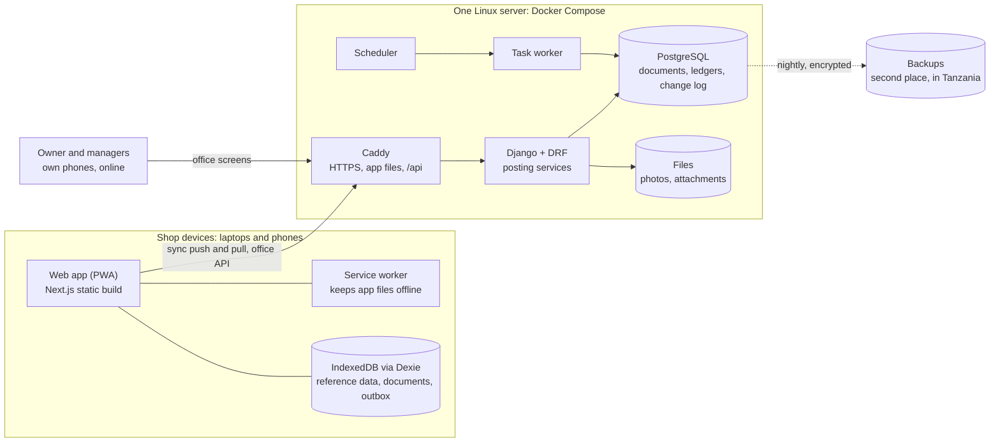
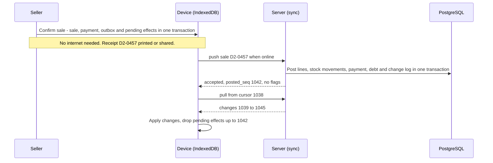

# 03 — Architecture

**Product:** shop system for agro-vet and farm-supply shops (name to be decided)
**First shop:** MPC — Mabatini Pumba Center, Usa River, Arusha, Tanzania
**Version:** 1.39 · 10 Nov 2026 · Portion 3 of the planning pack
**Built from:** `01-product-spec.md` v1.0, `02-domain-model.md` v1.0; updated by `04-build-plan.md` v1.0 (v1.1)
**Status:** living document. Everything here is decided unless marked *(default)*, which means our best guess and is safe to change while building. Key decisions are in §2 (AD3, AD14 and AD16 confirmed with Jack) and are recorded as ADRs 0015–0032 in `docs/adr/`; AD1 is now ADR-0035 **(v1.4)**, then ADR-0041 **(v1.36)**, AD3 ADR-0038 **(v1.16)**, and AD18 ADR-0040 **(v1.30)**. Small open items are in the parking lot (§18). The changes this doc made to the domain model are listed in Appendix B and applied in `02-domain-model.md` v1.1.

**Changes in v1.39** (10 Nov 2026, SYNC-15): a door past the guard may serve a change to a person as well as a login. A person's language, font, name or switch-off travels on their staff row in every shop where they work, so the save finds those shops through the person's door, which now reads every one, in id order, and writes a line in each, one block per shop, one after another. ADR-0042 supersedes ADR-0037 (AD8, §5.4). Marked **(v1.39)**.

**Changes in v1.38** (9 Nov 2026, SYNC-2): how the bootstrap is built (§6.4, 04 v1.53). One registry lists the tables a device keeps a copy of, by their link type codes, with the rows each sends and its fields; the bootstrap reads the shop's last change number first, then those rows, and sends them compressed and never cached, with each rule's kind and default. A device learns its shop's time zone, currency and language from its device check (§5.9). Marked **(v1.38)**.

**Changes in v1.37** (9 Nov 2026, SYNC-1): how the change log is written (§6.4, 04 v1.52). A service saves inside `recording_changes(shop)` and names each record it changed with `record_change(row)`; the block takes all their numbers at its end, at once, from the shop's `change` counter, and a block inside another of the same shop joins it. A line names its record by its table's link type code and its id. A change is named at its block's own level, never inside an `atomic()` within it, and code that calls several saving services opens the block itself. The log is a ledger, so its monthly compaction waits for OPS-7 to square it with the trigger. Marked **(v1.37)**.

**Changes in v1.36** (8 Nov 2026, DATA-1): the demo seed (§4, §5.1, §12, §13, 04 v1.51). It is `manage.py seed_demo`, in a 14th app, `demo`, on a layer of its own above every other: it builds the demo shop through the other apps' services and will need most of them, and the demo's image holds `backend/apps` only, so it can't be a script in `backend/scripts/` (ADR-0041, which supersedes ADR-0035). It wipes the database and makes the demo shop again, only where `DEMO_SEED=yes` is set and no shop but a demo one exists. The demo's start runs it: on the first start of a new day it makes the shop again, and a wake-up the same day keeps it; the nightly redeploy is the start that finds yesterday's shop.

**Changes in v1.35** (8 Nov 2026, UI-9): a person's language and font follow them (§5.10, §7.2, §7.4, 04 v1.49). A person changes their own, and only their own, through `PATCH /api/auth/me/settings/`, which needs no key; `me` answers both. The app shows whoever is logged in in their own, and the laptop's own once nobody is; the bar's language button sets the laptop's own, and shows only while nobody is logged in (Jack). Marked **(v1.35)**.

**Changes in v1.34** (8 Nov 2026, UI-5): the password screens are built (§5.9, §7.2, 04 v1.48). The app reads allauth's own answers into the API's refusal in one place; a login lands on the office's home page, whose frame names the person and their shop, ends a session with Toka, locks the shared laptop and asks a temporary password's owner to choose their own; the email link opens `/password-reset/#<key>`, with the page's slash. From its review: every change waits in one queue, sent in order, so a logout goes after the changes made before it (§7.1); the login offers Toka when another session holds the browser; and a reset link stays in the browser's own history list, an honest limit (§5.9). Marked **(v1.34)**.

**Changes in v1.33** (7 Nov 2026, UI-4): the PIN login's screens are built (§5.9, §7.2, 04 v1.46). A paired device asks for its shop's people online, until sync carries them (§5.10); `me` says how long a PIN's session lasts unused, so the screen keeps an idle lock of its own; each login, logout and quick switch makes the store forget the last person; the logout is sent again until the server hears it. Marked **(v1.33)**.

**Changes in v1.32** (7 Nov 2026, UI-3): the device's side of registering is built (§5.9, 04 v1.45). The app asks the device's `me` as it opens and every few minutes, keeps the answer on the device, and names the shop and the home side in the top bar. Until sync exists, a block shows at the device's next request of any kind, and the lock stays through a reload offline. §7.2's map shows the setup area, `features/devices/` and `features/people/`. From its review, §6.1 says where the device's own identity lives: outside the shop's database, in one place. Marked **(v1.32)**.

**Changes in v1.31** (6 Nov 2026, UI-2): the API's description is committed as `shared/openapi.json`, and CI checks it against the code and the types against it (AD11, §12). §7.1 says how the counter screens are kept off the server, and §7.2's map shows the new parts of `api/`, `i18n/codes.ts` and the error alert (04 v1.44). From its review, a suspicious request answers `bad_request` in the one shape (§5.10), and §7.1 names every way the counter lock refuses. Marked **(v1.31)**.

**Changes in v1.30** (6 Nov 2026, UI-1): choices by Jack, made while building UI-1 (04 v1.43). AD18 is now ADR-0040, which supersedes ADR-0032: the screens get their words through use-intl, next-intl's own core, as next-intl 4.x brings a code compiler and a file watcher that a static app with no language in its address never uses (§3, §7.2, §7.4). In Swahili, stock reads word first, "mifuko 26 + kilo 35.5", and in English number first; each word book holds its order, and the unit words are the shop's own (§7.4). §7.2's map shows the app's own parts in `components/`, each area's layout, `offline/network.ts` and the new test helpers. Marked **(v1.30)**.

**Changes in v1.29** (6 Nov 2026, UI-8): §7.2's map shows the `/design` page, which shows every colour, both fonts and every piece of the look, and `test/`, where the tests that keep the look true share one copy of the contrast sums (ADR-0039, 04 v1.42). §7.3 names the oldest browsers the look works in. Marked **(v1.29)**.

**Changes in v1.28** (5 Nov 2026, UI-7): §7.2's map shows `fonts/`, where the two font files and their licences live (ADR-0039, 04 v1.41). Marked **(v1.28)**.

**Changes in v1.27** (5 Nov 2026, the design-system cards): the app's look is one layer over shadcn, with two fonts inside the app, and a person's font follows them as their language does (ADR-0039, §7.2–§7.4, 04 v1.40). The staff rows on a device carry both. Marked **(v1.27)**.

**Changes in v1.26** (5 Nov 2026, AUTH-8's second review): the lighter lock's one exception is written down (§5.5, 04 v1.39). Marked **(v1.26)**.

**Changes in v1.25** (5 Nov 2026, AUTH-8's review): an office row other rows link to takes a lighter lock, so two managers acting on each other can't deadlock (§5.5, 04 v1.38). What services take is now said one way: the books read the device from the visit's note, and a counter document keeps its own (§5.2). Marked **(v1.25)**.

**Changes in v1.24** (4 Nov 2026, AUTH-8): both books name the device (X3). The trigger becomes `control_record_edit_v2()`, as the old rule's SQL is frozen, and every office table moved to it. An audit line reads the same note the trigger reads (Jack), so no service passes the device (§5.16, 04 v1.37, 02 v1.18). Marked **(v1.24)**.

**Changes in v1.23** (4 Nov 2026, AUTH-4's second review): to the admin's login page and allauth's reset route, a PIN's session is nobody too (§5.9, 04 v1.36). An old number put right. Marked **(v1.23)**.

**Changes in v1.22** (4 Nov 2026, AUTH-4's review): a PIN's session never opens the admin, and allauth's session route treats it as nobody. Each of its visits finds its shop through the device key's door. Who may set a PIN follows the rule for a temporary password (Jack, 02 v1.17). Marked **(v1.22)**.

**Changes in v1.21** (4 Nov 2026, AUTH-4): what building AUTH-4 settled (04 v1.34). PINs are hashed at a password's cost, and every answer costs one full check. A wrong try is counted before its check, in a table of its own. What a PIN's session holds and what each visit checks, including that a new PIN ends the sessions made with the old one (Jack). PIN login has a limit per device (§5.9, §5.10). Marked **(v1.21)**.

**Changes in v1.20** (4 Nov 2026, AUTH-4): choices by Jack, made while planning AUTH-4 (04 v1.33). A PIN lock's wait stops growing at an hour, and a new PIN lifts it. A person on a temporary password can still log in by PIN and sell, while the office routes stay closed. In the plan he approved, a PIN session names its device's shop and the person's job there, and logout and `me` read the session, not the device's key (§5.9, §5.10). The device joins the two books in AUTH-8 (§5.16). Marked **(v1.20)**.

**Changes in v1.19** (4 Nov 2026, AUTH-6): a first or forgotten password is built: who may set one, the mark that closes the office routes, and the one route that ends it (§5.9, 02 v1.15). Marked **(v1.19)**.

**Changes in v1.18** (4 Nov 2026, AUTH-3's review): passwords are stored as Argon2 at a cost set on purpose, as §10 promised and no setting did (§10). One password check per login. allauth's table of addresses stays empty, and a reset link lasts an hour (§5.9). A limit on wrong passwords counts per login name, and reset emails have a limit of their own (§5.9). The rules of who may act live in one place (§5.9). Two old lines that said a password user needs an email are corrected (§18, Appendix). Marked **(v1.18)**.

**Changes in v1.17** (4 Nov 2026, AUTH-3): what building AUTH-3 settled (04 v1.30). A staff session's login has a door of its own, which reads only the shops' ids of the person's current jobs (§5.4). Only the allauth routes the app uses are mounted: its others would let a person change their own email or phone past the owner (§5.9, §5.10). The login takes a phone written `+255…` only, which is allauth's rule (§5.9). A reset link holds its key after the `#`, and the real server sends no email until it has a mail service (§5.9). `default` is the login limits' own cache table, as allauth counts only there, and those limits keep fingerprints, never an address or a phone (§5.10). Marked **(v1.17)**.

**Changes in v1.16** (3 Nov 2026, AUTH-3): choices by Jack, made while planning AUTH-3 (04 v1.29). AD3 is now ADR-0038, which supersedes ADR-0017: a password user needs no email. The owner sets a first or forgotten password face to face, and the person chooses their own at the next login (AUTH-6); an email link is only for people who have one; no SMS for now (§2, §5.9, §10). A password login acts as the person's staff member at their one shop, and the person and the shop are checked on every request; a person with current jobs at two shops is refused until AUTH-7 builds the choice (§5.9). Marked **(v1.16)**.

**Changes in v1.15** (3 Nov 2026, AUTH-5): one choice by Jack, and what building AUTH-5 settled (04 v1.28). The office device list shows a side's devices to whoever works on that side, a seller included; confirming, renaming, blocking or unblocking a device needs `device.manage` on its home side (§5.10). Throttle counts live in Django's database cache, a table in PostgreSQL, with no Redis (ADR-0023); its table is made by `manage.py createcachetable`. The pairing limits read the caller's address as the proxy in front saw it: Caddy's entry in `X-Forwarded-For`, or, on the demo, Cloudflare's `CF-Connecting-IP` (§5.10). After AUTH-5's review: each limit counts in a table of its own, a start by the caller's network, keeping no address, and only real starts and new tries of a code count (§5.10). Marked **(v1.15)**.

**Changes in v1.14** (30 Oct 2026, AUTH-2): choices by Jack, made while planning AUTH-2 (02 v1.12). A device's login finds its shop through one door, which reads only the shop's id of the device that holds the key; the device is then read through the guard, inside that shop. Confirming a pairing moves the key's hash to the device, so it lives in one place (§5.4, §5.9). The key's cookie is SameSite Strict, sent only to `/api/`, and sent again before browsers drop it; the start of a pairing is CSRF-checked, and refused for a device whose key already works (§5.9). Device routes are versioned like sync's, and the manager's confirm is an office route (§5.10). The doors past the guard are a decision of their own, ADR-0037, which supersedes ADR-0022 (AD8). Marked **(v1.14)**.

**Changes in v1.13** (30 Oct 2026, AUTH-1): decisions by Jack, made while planning AUTH-1 (02 v1.11). A new device waits in a `PairingRequest`, which belongs to no shop, and gets its device key at once; the manager's yes makes the `Device` in their own shop and switches the key on. The key is stored as its SHA-256 hash, not with Argon2: it is 32 random bytes, which nobody can guess, and each request finds its device in one index lookup. Unblocking keeps the key, and both block and unblock are written in the audit trail (§5.4, §5.9). Marked **(v1.13)**.

**Changes in v1.12** (29 Oct 2026, PPL-3): a new shop gets its role templates from a `people` service, `set_up_shop`, which makes the shop with `create_shop` and then copies them, in one transaction: `create_shop` lives in `shops`, which may not import `people`, where the `Role` table lives (ADR-0035). A shop made by `create_shop` alone has no roles, so nobody may act there: forgetting fails closed (§5.8, §9). Weighing a delivery as it arrives works offline, with no buying price (Jack, 02 v1.10; §6.9). A new permission code reaches the shops that already have their roles through a data migration (§5.8). Marked **(v1.12)**.

**Changes in v1.11** (29 Oct 2026, CTRL-2): office edits are recorded by a trigger of our own into one append-only table, `control.EditEvent`, not by django-pghistory, whose tables have no shop guard (Jack, while planning CTRL-2; ADR-0036). Each office visit tells PostgreSQL who acts, for that trigger. PostgreSQL 18 is now needed: the trigger makes ids with `uuidv7()` (§3, §5.4, §5.6, §5.16). After CTRL-2's review: the visit also tells PostgreSQL its shop, and the trigger refuses an edit of another shop's row; only the trigger writes the history, at each edit's own time; and every shop table people change keeps one, payment accounts and stock locations included (Jack). Marked **(v1.11)**.

**Changes in v1.10** (29 Oct 2026, CTRL-1): the type codes of generic links are one list in `core`, and each card adds the tables its links point at (§5.1). A flag's notes, and the people it names, are append-only, like the ledgers, and a flag's status moves forward only, in the database too (§5.6, 02 v1.8). A flag's numbers hold money or quantities alike (§9). Marked **(v1.10)**.

**Changes in v1.9** (28 Oct 2026, CORE-7): an app keeps its background tasks in `tasks.py`. With management commands, that is the only code that may open every shop with `system_context()`, and CORE-7's sweep checks it (§5.2, §5.11). Marked **(v1.9)**.

**Changes in v1.8** (28 Oct 2026, CORE-6): login names who acts and the visit's shop, and the base API view opens it around the whole visit; office routes need a staff member (§5.4). The API's conventions as CORE-6 built them: what the error shape means, creates sent twice, edits, pages, and the docs closed in production (§5.10). Marked **(v1.8)**.

**Changes in v1.7** (27 Oct 2026, PPL-2): a PIN may not be 1234 or four of a kind (0000, 1111…), as PPL-2 built it (§5.9, 02 v1.4). Marked **(v1.7)**.

**Changes in v1.6** (27 Oct 2026, SHOP-1): the tenancy sweep allows the `Shop` itself to have no `shop`, because it is the tenant (§5.4, 02 v1.3). Marked **(v1.6)**.

**Changes in v1.5** (22 Oct 2026, REPO-7): release-please runs with a short-lived token from the repo's own GitHub App, because a pull request opened with the default `GITHUB_TOKEN` starts no workflow, so the release PR would never get its required checks on its own. The deploy stays a job of the release workflow, now for its own reason: the release and the deploy follow each other in one run, in a fixed order (§12). Marked **(v1.5)**.

**Changes in v1.4** (21 Oct 2026, REPO-6): `control` moves from layer 2 to layer 0, beside `core`, because every app writes audit events and flags there; every app may import it, and it may import only `core`. ADR-0035 supersedes ADR-0015 (the Status line, §0, §5.1). Each change is marked **(v1.4)**.

**Changes in v1.3** (20 Oct 2026, REPO-4): Caddy sends `/_allauth/` to Django as well as `/api`, on the laptop and in production, because django-allauth's browser login lives there (§5.10, ADR-0017); the local Caddy rules are in `deploy/Caddyfile.dev` (§4, §7.2, §13, §19). Each change is marked **(v1.3)**.

**Changes in v1.2** (19 Oct 2026, REPO-3): the UI message files live in `frontend/messages/`, next to `src/`, as next-intl's guide places them; `src/i18n/` keeps only the next-intl setup (§4, §7.2). The Serwist build is proven in SPIKE-1, not in the first frontend task (§7.7). Each change is marked **(v1.2)**.

**Changes in v1.1** (18 Oct 2026): applies the build plan's Appendix A (`04-build-plan.md`). The custom `User` and the clock-in come first in §16 (BP5, BP6); attendance events also allow the one-time void stamp (AD7, §5.6); role templates live in code and are copied by `create_shop` (§5.8, §9); release-please writes the changelog and tags, and the production deploy runs as a job of the release workflow (§12). Also: attendance is part of the one website and is built first (§1, §15 — BP7); the repo layout gains `.claude/`, the `Makefile`, `docs/spikes/`, `docs/writeups/` and a gitignored `private/` folder (§4); the code rules now live in `CLAUDE.md` (§17). Each change is marked **(v1.1)** below.

---

## 0. How to read this

- **Architecture** = how the system is built: the pieces, where each one runs, how they talk, how data moves, and how we test, ship and run it. Portion 2 said *what* the system knows; this says *how* it works.
- Every key decision (**AD1**, **AD2**…) is an ADR in `docs/adr/`: AD1 = ADR-0015 … AD18 = ADR-0032 **(v1.1)**; AD1 is now ADR-0035, which supersedes ADR-0015 **(v1.4)**; then ADR-0041, which supersedes ADR-0035 to add the demo seed's app on top **(v1.36)**. "Cost" = how hard it is to change later.
- Tags: **[R1] [R1b] [R2] [R3] [Later]**, as before. **✚** = added beyond the spec and the domain model; veto freely.
- Versions mean "the latest patch of this line when the repo is created" (portion 6 checks them).
- Names follow `02-domain-model.md` §21.

## 1. The big picture



Three ideas carry the whole design:

1. **The counter runs on the device.** Everything a seller needs — products, prices, stock, customers, staff, permissions, settings — is copied onto the device. A sale is saved on the device first, then sent. The internet only changes *when* the server hears about it.
2. **Documents in, ledgers out** (02 D8). Devices send documents. Only the server's posting services write ledger rows, in one database transaction per document. The database itself refuses edits to ledgers.
3. **One server, split cleanly inside.** One Django project with clear modules, one PostgreSQL database, one rented Linux server. Simple to run for one shop; ready for many.

**One repo, one website** (confirmed). The whole MPC — attendance and both sides of the shop, Drugs and Foods — is one repository and one website at one address. Each part is switched on in settings, and the parts are built one after another: attendance first, then the Drugs side, then the Foods side (04 BP7, ADR-0033) **(v1.1)**. The public demo is the same code deployed a second time, with fake data, at its own address.

## 2. Key decisions

**AD1 — A modular monolith.**
One Django project and one database, split into apps that follow the domain modules, with the demo seed's app above them all **(v1.36)**. Import rules between apps are checked in CI (§5.1).
*Why:* one developer and one shop; separate services would add network failures, more deploys and harder debugging, for no gain. Clean modules keep the door open to split later. *Cost:* high.

**AD2 — The shop app is a static PWA built with Next.js.**
Next.js builds the app into plain files (`output: 'export'`). Every screen renders in the browser. A service worker keeps all app files on the device. There is no Node server in production.
*Why:* the counter must open and work with no internet; anything rendered on a server can't. Plain files are also cheap and fast to serve. *Cost:* medium — server rendering can be added later for public R3 pages without touching the counter.
Note: this is not how Next.js is usually used — no server components at runtime, no server actions, no middleware in the shop app.

**AD3 — One web address, session cookies, and django-allauth for passwords.** (confirmed; ADR-0038 **(v1.16)**)
The app files and the API come from the same address (`https://<app-domain>/` and `/api/`). Logins use Django's session cookie (HttpOnly, Secure) with CSRF protection; no tokens are kept in JavaScript. **django-allauth** in headless mode — whose browser client uses exactly these session cookies — handles password login by phone or email, login rate limits and, later, two-factor codes and passkeys for the owner and managers. A first or forgotten password is set face to face by the owner, and the person chooses their own at the next login; an email link is only for people who have one **(v1.16)**. PIN login on shop devices and device registration are our own small code.
*Why:* the simplest safe setup for our own web app — no CORS, nothing for a bad script to steal, and logging out, suspending a worker or blocking a device takes effect at once — with a mature library for the security-critical password part instead of hand-written code. *Cost:* medium.

**AD4 — Two kinds of identity: devices and people.**
A registered shop **device** holds a device key (an HttpOnly cookie); the sync talks to the device. A **person** is identified by PIN on a shop device, or by password on their own phone for office screens. Every document names the staff member who made it.
*Why:* PINs only work on shop devices (D12), offline work needs a trusted device, and blocking a stolen device stops it at once. *Cost:* high.

**AD5 — Offline data lives in IndexedDB, through Dexie.**
Reference data is copied to the device. Documents are saved locally and queued in an **outbox** in the same local transaction.
*Why:* IndexedDB is the only large, lasting store a browser has; Dexie makes it typed and testable and gives React live queries. *Cost:* medium.

**AD6 — Sync = push documents, pull changes.**
*Push:* outbox documents in device order, safe to resend (idempotent by UUID). *Pull:* reference-data changes after a cursor, from a per-shop change log whose numbers follow commit order.
*Why:* facts are append-only, so they never conflict; reference data is edited online only, so devices just read it. No merge logic. *Cost:* high.

**AD7 — Posting services write the ledgers; the database refuses edits.**
Each document type has one posting function that writes the document and all its ledger rows in one transaction. Ledger tables have a trigger that blocks UPDATE and DELETE (payments, money movements and attendance events allow a one-time void stamp **(v1.1)**).
*Why:* rules T2 and T3 are enforced by the database, not by remembering. *Cost:* high.

**AD8 — Tenancy is enforced in one place; row-level security comes later.** *(default)*
A request-scoped current shop, scoped model managers that fail closed, one base API view and write-time "same shop" checks, all covered by sweep tests. PostgreSQL row-level security (RLS) is added before a second real shop goes live. Three named ways pass the guard, each kept to its place by the sweep: `system_context()` for system jobs, `all_shops` for the superuser's admin, and the doors, which read the shops' ids a login, or a change to a person that must reach each of their shops, needs (ADR-0042, which supersedes ADR-0037; AUTH-2, SYNC-15) **(v1.14, v1.39)**.
*Why:* RLS doesn't stop cross-shop links anyway (foreign-key checks ignore it), and it complicates migrations and connections. Every table already has `shop_id`, so turning RLS on later is mechanical. *Cost:* medium.

**AD9 — PostgreSQL is the only data store in R1. No Redis.** *(default)*
Background jobs use Django's tasks framework with a database backend; a scheduler runs nightly commands.
*Why:* one service fewer to run and back up. A job enqueued inside a posting transaction is stored in that same transaction, so it never runs for a rolled-back document. Redis or Celery can be swapped in if volume ever needs it. *Cost:* low.

**AD10 — Exact numbers everywhere.**
Money and quantities travel as decimal strings in JSON, are `Decimal` in Python and use a decimal library in TypeScript. One rounding rule, written once per language, proven equal by shared test files (§8).
*Why:* devices compute totals offline; device and server must agree to the shilling. *Cost:* high.

**AD11 — The API contract is generated.**
DRF → OpenAPI schema (drf-spectacular) → TypeScript types and a typed client. CI fails if either is out of date. The schema is committed as `shared/openapi.json`, so a pull request shows any change to the API as a readable diff, and CI's frontend job, which has no Python, checks the types against it **(v1.31)**.
*Why:* backend and frontend can't drift apart silently. *Cost:* low.

**AD12 — Search runs on the device.** ✚
A small in-browser index (MiniSearch) over names, other names, tags and their synonyms. The server has its own search (PostgreSQL trigrams) for office screens and R3.
*Why:* the sale screen works offline, and search is its strongest part (spec principle 4). *Cost:* low.

**AD13 — The real shop runs on one Linux server, with Docker Compose.**
Caddy, Django (gunicorn), a task worker, a scheduler and PostgreSQL, on one rented server (VPS). One monthly bill covers all of it: PostgreSQL is free software running inside the server. Nothing ties us to a provider.
*Why:* the cheapest setup that is still professional; it builds Docker and Linux skills and moves to any provider, AWS included, unchanged. *Cost:* low to change provider; medium to change the approach.

**AD14 — Real shop data stays in Tanzania, on a Lineserve server in Dar es Salaam.** (confirmed)
The production server is a Lineserve VPS in Dar es Salaam — 2 GB for R1, 4 GB from R2 (§13) — and its backups stay in Tanzania too. The public demo holds fake data only and can be hosted anywhere.
*Why:* Tanzania's Personal Data Protection Act (2022) requires a PDPC permit before personal data is transferred abroad, and customer names, phones and debts, and staff photos, are personal data. Lineserve was the best-value local option found: about TZS 38,000 a month to start, paid by M-Pesa; another local provider cost 6–10 times more. *Cost:* medium.

**AD15 — The demo is a separate deployment with fake data only.**
The same code, deployed a second time on Render's free plan with its own database, filled by a seed script with fake data and reset nightly. Every merge to `main` deploys there first. Production releases are rehearsed on a scratch copy on the production server itself (§12).
*Why:* a recruiter clicking around can never reach real data, even if we ship a tenancy bug, and the demo costs nothing. The free plan's limits — it sleeps after 15 minutes, and its database must be re-created every 30 days — are fine for fake data. A small always-on server (about TZS 16,000 a month) can replace it once recruiters start opening the link. *Cost:* low.

**AD16 — Foods hand-off [R2]: through the server when there is a network, cashier-only when there isn't.** (confirmed)
Power cuts switch off the router, and after a while mobile data and the devices too. When the network is down, the Foods side sells cashier-only on one screen; the writer → cashier → loader flow returns with the network. Every device records its offline time from R1, and a local hub is decided at R2 with those numbers (§6.10, §6.11).
*Why:* a battery router can't help when mobile data goes down too, and a local hub is a whole second server with its own power, HTTPS certificates and sync. Real outage numbers will show whether it's worth building. *Cost:* low to add a hub later — the sync protocol stays the same.

**AD17 — The app's web address is fixed before the first device is registered.** ✚
*Why:* each device's offline data, service worker and device key belong to that address. Changing it later means emptying every outbox and registering every device again. *Cost:* high after go-live. The product name and domain must be chosen before R1 goes live.

**AD18 — UI text lives in the app; the API sends codes.** (ADR-0040 **(v1.30)**)
Swahili first with use-intl, next-intl's own core **(v1.30)**, messages in `sw.json` and `en.json`. API errors carry a code and parameters that the app translates.
*Why:* one place for translations, and it works offline. *Cost:* low.

## 3. Stack

| Layer | Choice | Why |
|---|---|---|
| Language (server) | Python 3.14 | Current release; `uuid.uuid7()` is built in |
| Framework | Django 6.1, then 6.2 LTS when it ships (expected April 2027), staying on LTS after that | 6.1 is current and has the tasks framework; LTS means fewer upgrades |
| API | Django REST Framework, drf-spectacular, django-filter | Standard and well documented |
| Database | PostgreSQL 18 (17 lacks `uuidv7()`, which the edit history's trigger uses) **(v1.11)** | Exact decimals, constraints, triggers, `uuidv7()` |
| DB driver | psycopg 3 | The current PostgreSQL driver |
| Logins | django-allauth (headless, browser mode): password login by phone or email, email resets for those who have an email **(v1.16)**, built-in rate limits, later 2FA and passkeys; Argon2 hashing; our own PIN login | A mature library for the security-critical part (AD3) |
| Background jobs | `django.tasks` + django-tasks-db (`db_worker`) | Built-in API; no Redis |
| Scheduler | supercronic (cron made for containers) running management commands | Simple, visible, logged |
| Files | Django storage API: server disk in R1; S3-compatible later (django-storages) | No code change to move |
| Audit of office edits | A trigger of our own, writing one table, `control.EditEvent` **(v1.11)** | Database triggers record every change; nothing can skip it. One table with the shop guard, like every shop table (ADR-0036) |
| Tests | pytest, pytest-django, factory_boy, Hypothesis | Property tests for ledgers |
| Code quality | ruff, mypy + django-stubs, import-linter | Lint, types, module boundaries |
| Python packages | uv | Fast installs, one lock file |
| App server | gunicorn (WSGI) in R1; uvicorn workers (ASGI) if R2 needs live updates | Simple first |
| Frontend | Next.js 16 (App Router, static export), React 19, TypeScript strict | Used as a static app (AD2) |
| UI | Tailwind CSS v4 + shadcn/ui | Accessible components you own |
| Offline | Dexie 4 (+ dexie-react-hooks), Serwist service worker, Web Locks | §6 |
| Online data | TanStack Query + openapi-fetch (typed client from the schema) | Office screens |
| Forms | React Hook Form + Zod | Typed form validation |
| Translations | use-intl v4 (next-intl's core), client side **(v1.30)** | Swahili first (AD18) |
| Decimals, IDs, search | big.js, `uuid` (v7), MiniSearch | Small, focused libraries |
| Frontend tests | Vitest + Testing Library + fake-indexeddb; Playwright | Unit, component and offline end-to-end tests |
| JS packages | pnpm | Fast and strict |
| Infrastructure | Docker Compose, Caddy 2, GitHub Actions, GitHub Container Registry | §12–13 |
| Errors, uptime | Sentry with personal data removed *(default)*; an uptime monitor; heartbeat pings for jobs | §5.17 |

## 4. Repository

```
MPC/                          ← repo name follows the product name
├── CLAUDE.md                 ← rules Claude Code reads every session
├── README.md                 ← portfolio front page: problem, demo link, screenshots, this architecture
├── .env.example              ← every setting, no secrets
├── compose.dev.yml           ← local: PostgreSQL + Caddy (Django and Next.js run natively)
├── Makefile                  ← dev, test, check, fmt, migrate (v1.1)
├── .claude/                  ← Claude Code: settings.json, rules/, skills/, agents/, hooks/ (v1.1)
├── docs/
│   ├── 01-product-spec.md … 04-build-plan.md
│   ├── adr/                  ← one file per key decision (D, AD, BP); README.md is the index (v1.1)
│   ├── runbooks/             ← restore a backup, block a stolen device, …
│   ├── spikes/               ← results of the week-one experiments (v1.1)
│   └── writeups/             ← portfolio write-ups (v1.1)
├── backend/
│   ├── pyproject.toml, uv.lock, manage.py, Dockerfile
│   ├── config/               ← settings/{base,dev,test,prod}.py, urls.py, wsgi.py, asgi.py
│   ├── apps/                 ← core, shops, people, control, catalog, contacts,
│   │                            inventory, money, sales, services, staffpay, sync, reports;
│   │                            demo, the demo seed `manage.py seed_demo` (ADR-0041) (v1.36)
│   └── tests/                ← cross-app tests: tenancy sweep, E1–E10, sync
├── frontend/
│   ├── package.json, next.config.ts
│   ├── src/                  ← app/, features/, offline/, api/, lib/, components/, i18n/
│   ├── messages/             ← sw.json, en.json: every UI string (AD18) (v1.2)
│   ├── public/               ← manifest, icons
│   └── e2e/                  ← Playwright
├── shared/
│   ├── openapi.json          ← the API's description, written by `pnpm gen:api`, read for the app's types (AD11) (v1.31)
│   └── test-vectors/         ← JSON cases run by both pytest and Vitest (§8)
├── deploy/
│   ├── Caddyfile
│   ├── Caddyfile.dev         ← local: /api/ and /_allauth/ to Django, the rest to Next.js (v1.3)
│   ├── compose.prod.yml, compose.demo.yml
│   └── backup/
├── scripts/                  ← repo tools: commit and PR-title checks, GitHub sync, the image smoke test
├── private/                  ← ✚ real shop sheets, on Jack's laptop only: gitignored, never committed (v1.1)
└── .github/workflows/        ← ci.yml, pr-title.yml, release.yml, deploy-prod.yml, deploy-demo.yml (v1.1)
```

## 5. Backend

### 5.1 Apps and layers

An app may import only from layers below it. Same-layer imports are allowed only where listed. import-linter checks this on every pull request.

| Layer | App | Owns |
|---|---|---|
| 0 | `core` ✚ | Base model classes, the current-shop guard, money and quantity helpers, rounding, permission codes, the settings registry, error codes, the change log (`Change`) and per-shop counters (`ShopSequence`) |
| 0 | `control` | Flag, AuditEvent, Attachment, ImportJob, Notification [R2]. Every app writes here, so it sits beside `core`: every app may import it, and it may import only `core` **(v1.4)** |
| 1 | `shops` | Shop, Side, StockLocation, PaymentAccount, Setting |
| 2 | `people` | User, StaffMember, Role, RoleAssignment, PermissionGrant, Approval, **Device** (moved here: it is access control), PairingRequest **(v1.13)** |
| 3 | `catalog` | Unit, Product, Tag, ProductSide, SellingUnit, Price, ProductCost |
| 3 | `contacts` | Contact, BalanceEntry, Allocation, ContactBalance ✚ |
| 4 | `inventory` | StockMovement, StockBalance, Batch, Delivery, StockCount, RestockRequest; Transfer, ProductionRun, BagOpening [R2]. May import `money` (deliveries pay suppliers) |
| 4 | `money` | Payment, DrawerSession, MoneyMovement |
| 5 | `sales` | Sale, SaleLine, **PaymentAllocation** (moved here: it links a payment to a sale), Return, PrintLog; Bill [R2] |
| 5 | `services` [R2] | Formula, FormulaVersion, Job, Exchange. May import `sales` (a job's bill is a sale) |
| 5 | `staffpay` [R1b] | AttendanceEvent, AttendanceDay, PayRate, PayRun, Payslip |
| 6 | `sync` ✚ | Push, pull and bootstrap endpoints, device sequence tracking, the document router |
| 6 | `reports` ✚ | Daily report, exports; read-only queries across apps |
| 7 | `demo` | The demo seed, `manage.py seed_demo` (DATA-1): no tables of its own. It builds the demo shop through the other apps' services, so it may import every app, and no app imports it, so no other app's code calls it. Its own refusals keep it shut on the real server: the sign `DEMO_SEED=yes`, which only the demo sets, and no shop but a demo one (ADR-0041) **(v1.36)** |

Models may point at models in higher layers by name (Django's lazy `"app.Model"` references) — that is not an import. Generic links (a ledger row's `source`, a flag's `subject`) are stored as a short type code plus a UUID ✚: readable, and stable across databases. The codes are one list in `core` (`apps/core/links.py`), as the setting keys are: a code, once stored, never changes or names another table, and each card adds the tables its links point at. Not Django's content types, whose ids differ from one database to the next **(v1.10)**.

### 5.2 Inside an app

```
apps/sales/
├── models.py         tables, plus every rule the database can enforce (constraints)
├── services.py       every write: one function per action (confirm_sale, cancel_sale), each in a transaction
├── selectors.py      every read query used by the API and reports
├── calculations.py   pure functions with no database (totals, discounts); mirrored in TypeScript
├── documents.py      handlers for this app's offline document types
├── permissions.py    the permission codes this app checks
├── tasks.py          background tasks (§5.11) (v1.9)
├── api/              serializers.py, views.py, urls.py — thin
├── admin.py
└── tests/
```

- Business logic lives only in services and calculations. Views and serializers stay thin; no logic in `save()`, serializer `create()` or signals.
- Services take explicit arguments (who, which shop) and return results. A counter document's own `device` is a fact of the document, and arrives with it. The audit trail's two books name the visit's device from its note, not from an argument (§5.16) **(v1.25)**. Services raise domain errors with codes (`sale.below_floor`), turned into API errors by one exception handler.
- Every file starts with a short header comment saying what it is for; comments explain *why*.

### 5.3 Base models (in `core`)

- **`ShopScoped`** (abstract): `id` (UUIDv7 primary key), `shop`, `created_at`, `created_by`, and the scoped manager (§5.4).
- **`Editable`** adds `updated_at`, `updated_by`, `version`. An edit sends the version it read; a stale one gets `409 version_conflict`.
- **`CounterRecord`** adds `device`, `device_seq`, `client_time`, `received_at`.
- **`AppendOnly`**: the ORM refuses to update or delete; the database trigger (§5.6) backs it up.
- Every foreign key uses `on_delete=PROTECT`: nothing is deleted (T3).

### 5.4 Tenancy (AD8)

- **Set once per request.** Login (device key or staff session) names who acts and the shop: it leaves an Actor in `request.auth`, with a `shop_id` and a `staff_id`: a staff member, or a device alone, which is no person (its `staff_id` is None). Right after login, the base API view opens that shop in the context variable, keeps it open for the whole visit, and closes it however the visit ends. Office routes need a staff member, the one recorded as who made or changed a row **(v1.8)**. A device's key names no shop, so its login finds the shop through one door, which reads only the shop's id of the device that holds the key, by the key's hash; the device itself is then read through the guard, inside that shop (AUTH-2) **(v1.14)**. A staff session names a person, who belongs to no shop, so its login has a door too, which reads only the shops' ids of the person's current jobs; the job itself is then read through the guard (AUTH-3) **(v1.17)**. The same door serves a change to the person that every shop's laptops show (their language, font, name, or switch-off): it reads every shop where they work, by id, and the save opens each shop in turn, in that order, to write its line (SYNC-15) **(v1.39)**. The view also tells PostgreSQL who acts, and the visit's shop, so the trigger that records office edits can name them, and refuses an edit of another shop's row (§5.16) **(v1.11)**.
- **Fail closed.** The default manager filters every query by the current shop, and raises an error if no shop is set. System jobs use an explicit `system_context()`, named in code; the Django admin uses a separate manager, for superusers only; and a login, or a change to a person, that must find its shops before any is open uses a door, in `apps/people/login_doors.py`, which reads shops' ids and nothing else (ADR-0042) **(v1.14, v1.39)**.
- **One base API view** gets its queryset through that manager and checks permissions per side.
- **Writes check links.** Services check that every record they link to belongs to the same shop (T1).
- **IDs from devices.** If a document's UUID already exists in *another* shop, the server rejects it and reveals nothing about the other record ✚ (`id.taken`, CORE-6 **(v1.8)**).
- **Sweep tests:** every model except `User`, `Unit`, the `Shop` itself **(v1.6)**, a `PairingRequest` (a device no shop has said yes to yet, §5.9) **(v1.13)** and the infrastructure tables has `shop`; every list and detail endpoint, called as shop B, never returns shop A's rows.
- **Later (before shop #2):** RLS policies on every table (the app connects as a database role that can't bypass them) and composite "same shop" foreign keys. The demo seed empties every table with TRUNCATE once a day (ADR-0041, DATA-1): on the demo, the role it runs as must keep that right, or every day's first start stops at the seed **(v1.36)**.

### 5.5 Posting: documents in, ledgers out

**A document is everything that happened in one action** ✚: a sale with its lines, the payments taken with it, its debt and its approvals; a repayment with its allocations; a clock-in. One document = one database transaction on the server.

Confirming a one-screen sale:

1. Open a transaction.
2. Insert the sale and its lines with their copied values (price, floor, factor, rules). The server fills `unit_cost` — devices never hold buying prices ✚.
3. Check the rules: paid + credit = total; credit needs a debt holder with a phone and `credit.give`; below-floor lines need an approval. Online, a broken rule is an error. From offline, it becomes a Flag (big idea 7).
4. Insert payments, allocations and any cash change.
5. Post stock: one movement per line (or per batch picked) and the matching `StockBalance` update.
6. If credit > 0, post the `debt` balance entry and update `ContactBalance`.
7. Raise flags (negative stock, duplicate code…).
8. Record the change-log rows and enqueue any background jobs.
9. Commit. Either all of it is saved, or none of it.

**Locks, so two devices at once can't corrupt the numbers:**
- Balances use atomic increments (`quantity = quantity + change`, insert-or-update), so no update is lost.
- Cash posting locks the drawer's open session row, so cash can't land in a session being approved (M8, M9).
- Repayment allocation locks the contact's open debts, so two repayments can't clear the same debt (B1).
- Change-log numbers are taken last, from the shop's counter row (§6.4).
- An office row other rows link to is locked with `select_for_update(no_key=True)` **(v1.25)**. Two edits of it still take turns, but a new row that only links to it doesn't wait. A link is checked at its commit with a light lock, which a full lock would block, so two managers acting on each other's devices or jobs would each wait for the other (`editing()`, `_locked`, AUTH-8). One exception: a save that changes a plain unique column takes the full lock anyway, as PostgreSQL counts it as part of the row's key. No service does that today **(v1.26)**.

**Idempotent:** a document UUID already posted in the same shop returns the stored result, exactly as the first time.

**Offline numbers are facts.** The server recomputes the totals. If a device's numbers differ, the ledgers record what the device agreed with the customer, and a `total_mismatch` Flag is raised ✚ — the customer really paid that amount.

**Transaction codes (M2):** a partial unique index on (account, code) for valid payments. An offline duplicate is stored with `duplicate_of` pointing at the first payment (so the index skips it), and flagged ✚.

### 5.6 Append-only, enforced by the database (AD7)

- A migration helper adds a trigger to each ledger table that raises an error on UPDATE or DELETE.
- **Payments, money movements and attendance events** allow exactly one change: filling the void stamp (`voided_at`, `voided_by`, `void_reason`, `void_approval`) once. Every other column must stay equal (the trigger compares the old and new rows as JSON, without those columns). For attendance events this is 02 §12's `void` (by, reason) **(v1.1)**.
- Covered tables: stock movements, balance entries, allocations, attendance events (void only), audit events, the edit history **(v1.11)**, flag notes and the people a flag names **(v1.10)**, the change log, payments and money movements (void only), and the dated-rule tables — prices, product costs, settings, pay rates ✚.
- A flag is not a ledger, but it keeps its facts the same way: a trigger of its own (`control_flag_forward_only`) lets only its status change, and only forward, and refuses a DELETE (02 §13) **(v1.10)**.
- Tests prove that an UPDATE fails.

### 5.7 Caches and nightly checks

- `StockBalance` (location × product × batch) and `ContactBalance` ✚ (contact × side) are updated in the posting transaction. Both can be rebuilt from their ledger at any time (`manage.py rebuild_balances`).
- **Nightly jobs** (after closing, shop time): compare every cache with its ledger sum → `balance_mismatch` Flag; negative stock still negative at day close → Flag; expiry alerts; device gaps; missing clock-outs [R1b]; old task rows pruned. (The demo resets through a nightly scheduled redeploy instead, §12.)

### 5.8 Settings, prices, permissions, approvals

- **Setting keys** are a registry in code: key, type, default, scope, description. `get_setting(key, shop, side, on=date)` returns the row in force (D13).
- **Devices get future-dated rows too** ✚: prices and settings that start in the next few days, so an offline device switches to the new price or rule on the right day.
- **Permissions** are codes in code (02 §5). **Role templates** (Owner, Manager, Seller, Order writer, Cashier, Worker) live in code next to them; each new shop gets them as that shop's own `Role` rows, which the owner can then edit — roles belong to a shop, so they are not seeded by a data migration **(v1.1)**. `set_up_shop`, a `people` service, makes the shop with `create_shop` and copies them in, in one transaction: `shops` may not import `people` (ADR-0035), so `create_shop` can't. A shop made by `create_shop` alone has no roles, so nobody may act there **(v1.12)**. A card that adds a permission code also adds it, in a data migration, to the Owner role of every shop that already has its roles, and to the Manager's unless it is one of the owner's own four: otherwise nobody there holds it, and under the giver rule (02 §5) nobody there could ever give it **(v1.12)**. Devices receive each staff member's effective permissions per side for offline checks; the server checks again and flags offline breaks.
- **Approvals (`pin_here`)**: the approver types their PIN on the same device; it works offline and travels inside the document it approves.

### 5.9 Auth and devices (AD3, AD4)

**Users.** A custom `User` model in the very first migration (D12): UUIDv7 id, full name, phone (optional, unique, +255…), email (optional, unique), password (optional — PIN-only staff have none), a "must change password" mark **(v1.19)**, language. No username: allauth logs people in by email or phone.

**Registering a device** ✚
1. A new device opens the app and taps *Sajili kifaa hiki*. The server makes a **pairing request**, which belongs to no shop yet, with an 8-character pairing code (valid 10 minutes, no look-alikes such as 0/O or 1/I). The device gets its **device key** at once, as an HttpOnly, Secure cookie; the key opens nothing until a manager says yes **(v1.13)**. The start is CSRF-checked, and refused when the device's cookie already opens a device (`pairing.already_paired`): otherwise another website could make a paired laptop ask again, and the new cookie would wipe its working key for good **(v1.14)**.
2. The owner or a manager (`device.manage` on the home side they pick), logged in on their own phone, types the code, names the device and picks its home side. The device is made in their shop, with the next device code from the shop's counter (`ShopSequence`), and its key works from then on **(v1.13)**. The key's hash moves from the request to the device, so it lives in one place **(v1.14)**.
3. The device learns its shop and its device code for receipt numbers (`GET /api/devices/v1/me/`), with the shop's time zone, currency and language, which an offline device needs to tell today's rules **(v1.38)**, and shows the shop's name, so a code claimed by the wrong shop's manager is seen at once **(v1.14)**. The app asks it as it opens, when its window comes back to the front, when the network returns and every 5 minutes, keeps the answer on the device, so the top bar names the shop and the home side offline too, and forgets it when the key opens no device **(v1.32)**.
4. **Blocking** a device from the owner's phone stops its key at once; its next sync fails and the app locks. Until sync exists, its next request of any kind does: the device's own check, or any read or change the app sends through its store of server answers. The block is kept on the device, so a reload with no network stays locked; honest limit: a device kept offline from before its block learns of it only at its next request **(v1.32)**. Unsent records stay on it, and unblocking brings back the same key, so they can still be delivered. Both need a reason, written in the audit trail **(v1.13)**.
5. A device that loses its storage registers again and always gets a **new** device code, so receipt numbers stay unique (D7).

**The device key is stored as its SHA-256 hash** **(v1.13)**. It is 32 random bytes: nobody can guess it, so a fast hash is safe, and each request finds its device in one index lookup. A slow hash such as Argon2 is for what people choose and others can guess, PINs and passwords; on every request it would cost about 40 ms and 19 MiB **(v1.23)**.

**The device key's cookie** **(v1.14)** is `device_key`: HttpOnly, Secure, SameSite Strict (the app and the API share one address, so it never needs to go to another site), and sent only to `/api/`. Django's error pages hide a cookie whose name holds `KEY`. Browsers keep a cookie 400 days at most, so the server sends it again whenever the device's `last_seen_at` moves, at most every 5 minutes; that write skips the edit history. A blocked device is refused with `401 device.blocked`, and is still seen, so a stolen phone that keeps calling shows when.

**Staff PIN sessions**
- **Online:** device key + staff PIN → a Django session for that person on that device. Idle lock after 15 minutes *(default, a setting)*. Quick switch = another PIN. Five wrong PINs lock that person on that device for a minute, doubling each time, up to an hour **(v1.20)**: someone typing wrong PINs on purpose can't keep a coworker out for days. A new PIN lifts the lock at once.
- **On the screen** **(v1.33)**: the home page of a registered device asks "Wewe ni nani?" with a tile for each person who can log in today, from `GET /api/devices/v1/staff/` (names only, A to Z, never whether a person has a PIN), until sync carries the staff rows (SYNC-10); the 4th digit of the PIN sends it. Selling uses the device's key, not the session, so it never pushes the server's idle time forward: the screen keeps an idle lock of its own, for `me`'s `idle_minutes`, which come from the session itself, so both last as long, though the server counts from the session's last visit and the screen from the last tap (a password gets the shop's setting, as a shared laptop's screen locks the same); it looks at the clock, not a countdown, so a laptop that slept locks as it opens. *Badilisha mtu*, *Toka* and the idle lock all end the session on the server first, sent again until the server hears it, with the person hidden from the press. Each login, logout and quick switch makes the store of server answers forget the last person: every read reset and every change dropped, the PIN among them (`forgetTheLastPerson`).
- **Which job** **(v1.20)**: the session names the device's shop and the person's job there, so a person with jobs at two shops isn't asked to choose at the counter.
- **On a temporary password** **(v1.20)**: the PIN still works and the person can sell. The office routes stay closed (`password.must_change`) until they choose their own, and `me` says so, so the app can tell them why.
- **What a session holds** **(v1.21)**: the shop, the person's job, the device, and when the PIN was set. A new login always starts a new session, and deletes the one this browser held, whoever's it was. Each visit checks, in this order: this device's key is beside it, and the device key's door names the shop the session names (`session.wrong_device`, first, so someone who copied its number reads no row and learns nothing about the person) **(v1.22)**; the shop is active; the device isn't blocked; the person still has that job, with that PIN; they aren't suspended; they have a password of their own. So a suspension, a block or a new PIN stops the very next click. Use pushes the idle time forward, at most once a minute, or at half a short idle time **(v1.23)**. Logout needs only the session and the CSRF token, so it works whatever has happened to the person or the device. These checks run on `/api/`, and the device's cookie goes nowhere else, so elsewhere a PIN's session is treated as nobody **(v1.22, v1.23)**. The Django admin refuses it, whoever's it is; its login page names no one, and a password typed there, with its CSRF token, starts a clean session. allauth's `auth/session` and reset route, which answer with a name and an email, name no one. `auth/login` answers 409 and changes nothing. The change of one's own password still takes it, and always asks for the current password. Honest limit: a PIN login moves the person's `last_login`, which Django's reset key is made from, so a reset link already sent stops working; it fails safe **(v1.23)**.
- **The check and the lock** **(v1.21)**: every answer costs one full check, a person with no PIN and anyone not found at this shop included, and gets the same `pin.wrong`, so neither the words nor the time tell them apart. A suspended person is told so, with no check: the device already holds their status. A try is counted before its check, holding the row's lock, in one `PinLock` row per person per device, so tries sent at once can't pass five, and a crash in the check gives no free try. A locked person is refused with no check, so a flood costs no memory. Honest limit **(v1.22)**: the fifth wrong try answers `pin.locked` for a real person and stays `pin.wrong` for someone not found, so five tries can tell them apart, though another shop's person looks like a made-up one.
- **Who may set a PIN** **(v1.22)**: a PIN logs in as the whole person, so it follows the rule for a temporary password, with codes of its own (`pin.own`, `pin.superuser_only`, `pin.more_keys`): someone with `staff.manage` on the whole shop, who holds every key the person was given; never their own; an owner's, or a person's who can open the admin, only by the superuser. Honest limit: whoever sets a PIN knows it, and nothing makes the person change it, so the screen should let the person type it themselves (PPL-4).
- **Offline verifier, made on the device** ✚: the first time a person logs in online on a device, the device stores its own check value for their PIN (PBKDF2 through the browser's WebCrypto, with a per-device salt). PIN hashes never travel from the server. Until a person's first online login on a device, they need the internet to log in there. When a PIN changes, devices drop the old check value.
- **Offline:** the device checks the PIN against that value and starts a local session. Five wrong PINs lock that person on that device for a minute, doubling each time, up to an hour **(v1.20)**.
- PINs: 4 digits *(default)*, not 1234 and not four of a kind (0000, 1111…) **(v1.7)**, changed only online. On the server they are hashed with Argon2 plus a server secret, at a password's cost of 19 MiB **(v1.21)**, so a stolen database alone doesn't reveal them. An old hash moves to today's cost at the person's next login, with no change to `pin_changed_at` **(v1.21)**.
- **Honest limit:** a 4-digit PIN check stored on a stolen device can be guessed by someone with the skills. That is accepted: PINs only work on registered devices, and the answer to a stolen device is blocking it. PINs stop coworkers using each other's names; they don't stop thieves. Online too **(v1.21)**: a coworker at the counter can try about 150 PINs a day on one name, and that person is locked out for most of the day, so they will notice. Nobody is told of a lock yet.

**Owner and managers on their own phones** — django-allauth, headless, browser client:
- Login by email or phone + password. It creates the same Django session that DRF reads, so the office screens just work. allauth takes a phone written `+255…` only and refuses `0712…`, so the app writes the number out in full before it sends it **(v1.17)**.
- **On the screen** **(v1.34)**: a phone that is only its owner's opens on *Karibu*, with *Ingia*. The login has one box, *Simu au barua pepe*, and the password; every password box has an eye that shows what is typed. allauth answers in its own shape, so the app reads it into the API's one refusal in one place (`src/api/allauth.ts`), and names the three answers that carry no code (409, 401, 429). A login forgets the last person and lands on the office's home page, a big button for each office screen the person may open. The office's frame names the person and their shop, sends anyone not logged in to the way in (the password login on a phone, the PIN login at a registered laptop), ends a session with *Toka*, sent again until the server hears it, locks a registered laptop after `me`'s idle minutes, and shows *Chagua nenosiri lako* while `me` says the password is temporary. A forgotten password says first to ask the owner; the email link's page takes its key out of the address and the tab's entry each time, checks it, then sets the new password, and keeps no password in the store after. The login reads whose session holds the browser: the person's own goes on to the office; a PIN's at the shared laptop, or one refused for a reason, gets *Toka* first, as a login would meet it (409). The laptop's tiles offer *Ingia kwa nenosiri*, for an owner with no PIN. Honest limit: the browser's own list of pages visited keeps a reset link as it was opened, key and all, which no page can reach; the key works once, for an hour.
- **Only the routes the app uses** **(v1.17)**: allauth's own list has no setting to leave a route out, and it would let a logged-in person change their own email or phone, past the owner and the audit trail. So we mount session, login, the two reset routes and the change of one's own password **(v1.19)**, each allauth's own view; any other address there answers 404, and a route a newer allauth adds stays closed until a card lists it (`apps/people/api/password_urls.py`).
- **Which shop** **(v1.16)**: an office route reads the session as the person's staff member at their one shop, and checks on every request that the person and the shop are still active, so a suspension stops the next request. A person with current jobs at two shops is refused (`staff.choose_shop`) until AUTH-7 lets them choose, before a second real shop joins. These rules live in one place (`job_of_person`, `check_shop_active`, `apps/people/selectors.py`), so every login follows the same ones **(v1.18)**.
- Sign-up is closed: the owner adds people, and sets a new manager's first password face to face **(v1.16)**.
- **A forgotten password is reset face to face** **(v1.16)**: the owner types a temporary one, and the person must choose their own at the next login (AUTH-6); the owner's own is reset by the superuser. Anyone who has an email may also use an email link. Most of the shop's people have no email, and an SMS code costs money for each message: it may come later (ADR-0038).
- **A temporary password** **(v1.19)**: `POST /api/v1/people/staff/{id}/temporary-password/`, with the password and a reason, answers 204 and nothing else. Spaces around it come off, as allauth's login takes them off what is typed, so one stored with them could never log in. It goes through the password checker, and no answer, log, error report or audit line holds it: every variable on the way is hidden from error reports, not only those named `password`, as the library at the bottom of the hash names it `secret`, and the login's checker has a wrapper of its own (`PasswordBackend`), as Django's `authenticate()` narrows what is hidden below it. The audit line names who, for whom and why (`staff.temporary_password`). Who may: 02 §5. It ends the person's sessions and any reset link already sent, and lifts their count of wrong passwords, all or nothing. Who may is asked before the slow hash, so a refused try pays for none, and again after it, with both people's rows locked lightly and in id order, so a giver suspended meanwhile sets nothing, and a key given at the same moment can't deadlock with it. While it is open, a key its setter lacks waits (`staff.temporary_password_open`), or the setter could log in as the person and hold it. It looks across the person's jobs at this shop, as the password belongs to the person, and someone who left and came back has a new job.
- **The mark** **(v1.19)**: a password someone else typed puts `must_change_password` on, and every office route then answers 403 `password.must_change`. It lives in `check_own_password`, after the suspension's check, which a password's session and a PIN's both ask, so every login meets it; `me` alone stays open, and says so (AUTH-4) **(v1.22)**. allauth's routes aren't office routes, so `account/password/change` stays open: it asks for the current password, always, and refuses the temporary one as the new one (`password.same_as_temporary`), as a reset link does. Either way of choosing takes the mark off, in one save with the new password. A password typed in the admin, first or reset, puts the mark on too, so the superuser doesn't go on knowing it, and the admin's own password page follows the rules of choosing one's own. Honest limits: a reset in the admin is kept in Django's admin log, not in the shop's audit trail, as a person belongs to no one shop; a reset in the admin writes no audit line, so an earlier setter's line still holds a key back, which fails safe; Django's `changepassword` command sets no mark and keeps spaces around the password, so use the admin; a temporary password has no time limit; a request sent twice writes two audit lines; a setter who logs in as the person and chooses a new password themselves takes the mark off, and no system can tell who typed it, so before giving a big key the owner sets a fresh one; the temporary one is refused as typed, so the same in other capitals passes, which also takes the mark off with a password the setter can guess, and once the mark is off a person may go back to it; a person with a job at another shop isn't looked at until AUTH-7; an owner editing a role later isn't checked against an open temporary password until PPL-4 builds that edit.
- **The email link** **(v1.17)** opens the app at `/password-reset/#<key>`, the page's own address with its slash **(v1.34)**. The key sits after the `#`, which a browser never sends to a server, so it stays out of the logs. It works once, for one hour **(v1.18)**, and a new password ends the person's other sessions and lifts their count of wrong passwords. Changing a person's email ends any link already sent **(v1.18)**. Asked about an unknown email, the server answers the same and sends nothing, so nobody learns who has an account, and nobody can make us mail a stranger. The real server sends no email until it has a mail service (`MAIL_BACKEND`, OPS-5); the demo prints it to its log, as its people are fake.
- **allauth's table of addresses stays empty** **(v1.18)**: our User holds the email, but allauth's login and reset also trust a table of its own, and its default reset key copies the email there whenever anyone asks for a link. A copy outlives a change of email, so an old mailbox would keep working links and a reused address would open its old owner's account. So we use Django's reset key, which writes nothing, and the table is off the admin.
- **One password check per login** **(v1.18)**: allauth's checker alone, for the admin's login too. With two, Django tries each until one says yes, so a wrong password is hashed twice and a right one once: the answer's time would show a right password, and the admin's login has no limit yet (04, DATA-1).
- Built-in rate limits on login and resets **(v1.17)**: 5 wrong passwords in 5 minutes per login name, so a person with an email and a phone has a count for each **(v1.18)**, and 10 a minute per caller's network *(allauth's defaults)*; past either, even the right password waits. Reset emails: 3 an hour to one address, as allauth's default would let a stranger send 7,200 a day **(v1.18)**. Honest limit: a stranger who knows a person's phone can keep them locked out, by typing five wrong passwords every five minutes. Two-factor codes and passkeys (allauth's MFA) are *Later*.
- PIN login is our own endpoint: after checking the device key and the PIN, it starts the same kind of Django session, so allauth and DRF both recognise it.

**Sessions** are stored in PostgreSQL (no Redis). **CSRF:** the app reads the `csrftoken` cookie and sends `X-CSRFToken`; the device-key authentication enforces CSRF too.

### 5.10 API

| Path | What | Who |
|---|---|---|
| `/api/v1/<app>/…` | Office REST: products, prices, deliveries, counts, contacts, cash-up, reports, staff, settings, flags, devices (a manager confirms a pairing there, AUTH-5) **(v1.14)**, and lists, renames, blocks and unblocks them; the list shows a side's devices to whoever works on that side, and every change needs `device.manage` on the device's home side (Jack, AUTH-5) **(v1.15)** | Staff session |
| `/api/sync/v1/bootstrap`, `/pull`, `/push`, `/attachments/{id}` | Sync (§6) | Device key |
| `/_allauth/browser/v1/…` | Password login, logout, password reset, session (django-allauth): only these, and they answer in allauth's own shape, not the API's one error shape **(v1.17)** | — |
| `/api/auth/…` | PIN login, logout, me (our own); and `me/settings/`, where a person changes their own language and font, with no key (UI-9) **(v1.35)** | PIN login: device key. Logout and me: the session, so logout works on a blocked device, and me serves a password login too **(v1.20)**. My settings: the office routes' login, so a suspended person is refused **(v1.35)** |
| `/api/devices/v1/pairing/`, `/api/devices/v1/me/`, `/api/devices/v1/staff/` | A new device asks to join; a paired device learns its shop. Versioned like sync: devices are the slowest to update **(v1.14)**. A paired device lists its shop's people for the PIN screen, names only, until sync carries them (UI-4) **(v1.33)** | Device key (none yet, to ask) |
| `/api/health/` | Uptime check | Public |
| `/api/schema/`, `/api/docs/` | The OpenAPI description, and its docs page | Open on the demo and on a laptop; closed in production, where the page would run a CDN's code beside the superuser's login **(v1.8)** |

Conventions:
- JSON with snake_case names (the generated TypeScript types use the same names — no translation layer).
- Money and quantities as strings (`"65000.00"`, `"12.500"`); times in ISO 8601 UTC; `business_date` as `YYYY-MM-DD` in shop time; IDs as UUIDv7 strings.
- **Creates are idempotent:** the client sends the new record's UUID, so a retry can't make a duplicate. The UUID must be a UUIDv7 (`id.not_uuid7`). A retry gets the stored row as it is now, with the same `201`, whatever else it carries; an id already used in another shop is refused as `id.taken` **(v1.8)**.
- **Edits** (`PATCH`) send the `version` they read; stale → `409 version_conflict`. No `PUT`, which could send old values back for fields the person never touched, and no `DELETE`: nothing is deleted **(v1.8)**.
- **One error shape:** `{"code": "sale.below_floor", "message": "…", "fields": {…}, "params": {…}}`. `code` is the first problem with the whole request, or `invalid` when only fields are wrong; `fields` maps each wrong field to its codes (`lines.1.quantity` inside a list); `params` holds what the message needs; `message` is English, for developers and logs. A bug stays a 500, so it is logged. Under `/api/`, an address no route matches answers `not_found` and a crash `server_error`, in the same shape **(v1.8)**, and a request Django finds suspicious, like a host it doesn't serve, `bad_request` **(v1.31)**.
- Cursor pagination for long lists, newest first, 50 rows a page *(default)* **(v1.8)**; throttling on login, PIN and pairing.
- **Throttles** **(v1.15)** count in Django's database cache, tables in PostgreSQL shared by every server worker, with no Redis (ADR-0023); `manage.py createcachetable` makes them on each deploy. Each limit has a table of its own, and `default` is the login limits' own, as allauth counts only there, 100,000 rows *(default)* **(v1.17)**: a full table loses a third of its rows by their keys' ABC order, not their age, so in a shared one a flood of one kind would clear every other kind's counts. Pairing allows 10 starts an hour per caller's network (its IPv4 address, or its IPv6 `/64`) and 10 tries of a code an hour per person *(default)*. PIN login allows 30 tries a minute per device *(default)*, as each costs a full check and a flood of made-up people meets no lock **(v1.21)**. What counts: a start the shop really sent (a POST that passed its CSRF check) and a new try of a code, a wrong one included; never a confirm sent again, nor a send with no code. Over the limit, `429 throttled` with `wait`. A device's other calls are never slowed down **(v1.21)**. The network is the one the proxy in front saw, never one the caller wrote: Caddy's entry at the end of `X-Forwarded-For` (`NUM_PROXIES`, 1), or, on the demo, where Render puts two proxies in front, Cloudflare's `CF-Connecting-IP` (`CLIENT_IP_HEADER`); the tables keep a fingerprint of it, made with the server's secret key, never the address. The login limits read the same network, and count a person by a fingerprint of their login name, so that table holds no address and no phone **(v1.17)**.
- Breaking changes get `v2` routes beside `v1` while devices update.

### 5.11 Background jobs (AD9)

- Tasks use Django's `@task` API with the django-tasks-db backend; one worker container runs `db_worker`.
- Each app keeps its tasks in `tasks.py` (or a `tasks/` package). A task answers no visit, so with management commands it is the only code that may open every shop with `system_context()`; CORE-7's sweep checks that it appears nowhere else **(v1.9)**.
- The scheduler (supercronic) runs management commands: nightly checks (§5.7), exports, cleanups.
- Rules: every job is safe to run twice, takes IDs (not objects), works one shop at a time, logs its start and end, and pings a heartbeat so a silent failure gets noticed.

### 5.12 Live updates [R2]

The Foods cashier's queue and notifications must update within seconds. Start with polling the sync pull every 3 seconds *(default)* while the queue screen is open. Move to server-sent events under ASGI only if polling proves too slow or too costly in data.

### 5.13 Files and photos

- Stored through Django's storage API: on the server's disk in R1 (included in backups, kept in Tanzania); an S3-compatible bucket later, with no code change.
- **Compressed on the device** before saving: longest side 1,600 px, about 150 KB. Re-encoding also strips location data from the photo ✚.
- **Offline:** the attachment record travels with its document; the image waits in IndexedDB and uploads later (`PUT /api/sync/v1/attachments/{id}`, safe to repeat). Wi-Fi first where the browser can tell; otherwise a device setting.
- Served only through Django, after a permission and shop check. Never public links.
- **Retention** ✚: clock-in photos are removed 90 days after their pay run is approved *(default, a setting)* — keep personal data only as long as it's needed.

### 5.14 Search (AD12)

- **On the device:** MiniSearch over product name, other names, tags and tag synonyms, brand and shelf label. Prefix and typo-tolerant matching, Swahili-friendly normalisation (lowercase, accents removed, spelling variants as synonyms). Products sold on this side, and products this device sells often, rank higher ✚. The index updates after each pull.
- **On the server:** PostgreSQL trigram indexes (`pg_trgm` + `unaccent`) for office screens and R3. PostgreSQL has no Swahili stemmer, so we use its `simple` configuration.

### 5.15 Reports and exports

- The **daily report** is the drawer session's `report_snapshot`, frozen at approval. **"Send to boss"** builds the text on the device and opens WhatsApp with it (`wa.me` link) — no WhatsApp API, no cost.
- **Excel exports** run as background jobs when big; download links expire.
- **Full shop export** (a zip of JSON and CSV) for the owner: the shop owns its data.

### 5.16 Audit

- **Business actions** (cancel, refund, approve, change a price, void; suspend a staff member, bring one back, mark one as left **(v1.11)**) write an `AuditEvent` in the service, with the reason and the approval. It is written in the action's own transaction, so the action and its line are kept together or not at all; the approval joins with the Approval table **(v1.11)**.
- **Office edits** (products, contacts, staff, roles, devices, sides, payment accounts and stock locations) are captured by database triggers, so no change can skip the audit **(v1.11)**:
  - One trigger function of our own, `control_record_edit_v2()` **(v1.24)**, runs after every UPDATE of an office table and writes one row of `control.EditEvent`: the shop, who, from which device **(v1.24)**, when (the edit's own time, `clock_timestamp()`), the row (a type code and its UUID, §5.1), and the columns that changed, before and after, every value as text. Nothing visible changed, nothing written. A PIN hash, or any column named as a secret, is never copied. Only that trigger writes the table: a guard refuses any other INSERT, `bulk_create` and SQL typed by hand included.
  - Who: each office visit tells PostgreSQL the staff member acting and the visit's shop (`set_config`, `apps/core/acting.py`), and the trigger reads both: it names the person, and refuses an edit of another shop's row (T1). A service that passes its own `by` (`editing()`, the staff actions) tells PostgreSQL too, so the history names the same person as `updated_by` or the audit line. Outside a visit (a nightly job, the seed) nobody is named and no shop is checked: the system.
  - The device (X3) **(v1.24)**: a visit tells PostgreSQL its device too (`mpc.device_id`), and the trigger names it. A PIN's session names the device it stands at, and a device's own visit names itself. A password names none, even on a paired laptop, and a nightly job names none: the link stays empty. An inner `acting_as(by)`, which `editing()` and the staff actions open mid-visit, keeps the visit's device. An audit line reads the same note (`current_device_id`), so no service passes the device, none can forget it, and the two books can't name different devices for one action (Jack, AUTH-8).
  - Every shop table that is not a ledger gets the trigger in its migration (`RecordEditsV2` **(v1.24)**; the tables older than AUTH-8 list `RecordEdits`, then `MoveRecordEditsToV2`), unless `NO_EDIT_HISTORY` lists it with its reason (a flag keeps its notes; an account–side link is never edited). A test turns CI red for a table without it, built wrong, or copying a secret column. Its SQL is frozen once on `main`, as the ledgers' rules are (§5.6).
  - Not django-pghistory, the first default: its tables, one per tracked table, have no shop guard and no PROTECT links, and CORE-7's sweep refuses them (ADR-0036).

### 5.17 Logs, errors and monitoring

- **Logs:** JSON lines to standard output, each with request id, shop, side, device and staff id. Never customer names, phone numbers or amounts.
- **Errors:** Sentry for server and app, with personal data stripped before sending *(default — or a self-hosted tracker; parking lot)*.
- **Uptime:** an outside check of `/api/health/` every minute; heartbeat pings from backups and nightly jobs; disk and memory alerts.
- **Sync health page** ✚ for owner and managers: each device's last sync, unsent records, clock error and app version.

## 6. Offline and sync

### 6.1 What lives on a device

One IndexedDB database **per shop** on the device ✚, so a practice shop [R2] or the demo never mixes with the live shop.

| Store | Contents |
|---|---|
| `meta` | app and schema versions, pull cursor, server-time offset, last server time seen, next `device_seq`, receipt counters; the device's own id, code, shop and home side live outside, below **(v1.32)** |
| Reference (pulled, read-only) | products, selling units, prices (current and future), product sides, tags, batches, stock balances, contacts, contact balances, staff (name, photo, status, PIN-changed time, language and font **(v1.27)**), permissions, settings, payment accounts, sides, open drawer sessions |
| `pin_checks` | the offline PIN check values this device made itself (§5.9) |
| Documents (made here) | sales with lines and payments, repayments, quick customers, drawer money movements, drawer openings, attendance events [R1b], attachments with their image files |
| `outbox` | one row per document to send: id, type, `device_seq`, status, attempts, last error, `posted_seq` |
| `pending_effects` | the stock and balance changes of documents the server hasn't confirmed yet, so screens include them |
| `sent_archive` ✚ | sent documents, kept 30 days *(default)* for replay after a server restore |

**Which device this is** **(v1.32)** lives outside every shop's database, in the browser's own storage (`mpc.device`, `src/features/devices/this-device.ts`): the device's id, name and code, its shop and home side, as `GET /api/devices/v1/me/` last said, and whether it is blocked. Outside, because the shop must be known before its database can be opened, and the lock must hold before any shop's data is read. It is kept in one place only: receipt numbers read the device's code from there, and `meta` keeps no copy (SYNC-6).

Buying prices and payslips never go to shared devices.

### 6.2 Saving a sale on the device

All in **one** Dexie transaction:
1. New UUIDv7s for the sale, its lines and payments.
2. The next `device_seq` and the next receipt number (`D2-0457`).
3. Write the documents.
4. Add the outbox row.
5. Write the pending effects (stock down; the customer's debt up if on credit).

Once that commits, the sale exists, even if the browser closes a moment later. Then the receipt prints or shares, and a sync is triggered.

### 6.3 Push

- `POST /api/sync/v1/push`, authenticated by the device key: `{device_id, app_version, unsent_count, documents: [{id, type, schema_version, device_seq, client_time, created_by, payload}, …]}`, up to 100 documents.
- The server checks the device is active, then posts the documents in `device_seq` order, each in its own transaction, and answers per document:
  - `accepted` — posted; includes `posted_seq` and any flags raised.
  - `duplicate` — already posted; the same answer as the first time.
  - `invalid` — malformed, or a type not allowed offline; the device sets it aside under "needs attention" and the server raises a Flag.
  - `retry` — a server problem; the device stops and tries again later.
- Broken business rules never stop a batch (accept, then flag).
- The server keeps each device's last `device_seq`; a jump raises a `device_gap` Flag (the missing record may still arrive).
- Repayments: the device suggests allocations from its last-known balances; the server allocates again, oldest first, at posting, unless staff picked specific debts ✚.

### 6.4 Pull and the change log

- `GET /api/sync/v1/pull?cursor=N` returns changes numbered above N (up to 1,000), the next cursor, the server time and the minimum app version.
- Each change is `{seq, entity, id, op, data}`, where `op` is `upsert` or `archive`. The device applies a page in one transaction, then moves its cursor.
- **No double counting** ✚: a document's pending effects are dropped once the device's cursor passes that document's `posted_seq`, because the server's balances now include it.
- **Bootstrap** (new or reset device): a snapshot of all reference data plus the cursor it is valid at; then normal pulls. About 1 MB compressed for 5,000 products and 2,000 customers. How it is built **(v1.38)**: `GET /api/sync/v1/bootstrap/`, with the device's key, answers `cursor`, the shop's last change number (0 for none), then one list per table in the registry (`apps/sync/registry.py`), by the table's link type code (today `side`, `payment_account`, `staff` and `setting`), then `setting_keys`, each rule's kind and default, as a new shop has no rule rows. The cursor is read first: each query sees what had committed when it started, and numbers come in commit order, so every change up to the cursor is in the rows read after it, and one that lands in between is pulled again, which does no harm. The registry names each table's rows and its fields one by one; tests prove that nothing secret is on it. Gzip on this route alone, as it holds no secret and nothing a stranger can choose (BREACH); and never cached, as it holds the shop's whole staff list. The lists are read one after another, so one answer can be slightly out of step with itself, such as a drawer naming a side added between two reads, and the next pull, right after, mends it (Jack, SYNC-2's review). A card that sends a new table gives it a link type code, an entry in the registry and a list in the answer's shape (`BootstrapAnswer`), and its services record each change.
- **The change log** (`core.Change`): services record which records changed, in the same transaction. At the end of the transaction the numbers are taken from the shop's counter row, which stays locked until commit — so numbers always appear in commit order, and a device can never skip a change that committed late. The lock is held only for the last moment of each transaction, and only within one shop. How it is built **(v1.37)**: a service saves inside `with recording_changes(shop):` (`apps/core/changes.py`) in place of `transaction.atomic()`, and calls `record_change(row)` after each change (`archive` when the record leaves the lists). The block collects the records and, as its last step, takes all their numbers at once (`next_numbers`, `apps/core/sequences.py`: one lock, one write) and writes one line each: the shop, the number, the table's link type code (`apps/core/links.py`), the record's id and the `op`, never the record's data. One line per record per transaction, with the last `op`. A block inside another of the same shop joins it, so the numbers come once, at the outer end; a block that recorded nothing takes no lock. A change is named at its block's own level, never inside an `atomic()` or `editing()` part within it, which could roll back alone; and code that calls several saving services opens the block itself, never a plain `atomic()`, or the first block to end would hold the shop's counter until the commit.
- Pulls read the current rows from the tables, so the log stays small; it is compacted monthly (latest entry per record). The log is a ledger whose trigger refuses every DELETE, so OPS-7 decides how, or whether, it compacts **(v1.37)**.

### 6.5 When sync runs

On app start; when the network comes back; 2 seconds after a new document; every 30 seconds while online *(default)*; through Background Sync where the browser supports it (Chrome on Android); and from the *Tuma sasa* (send now) button. Only one sync runs at a time, even with several tabs open (Web Locks). Every sync also reports the device's unsent count and app version — used to stop a drawer approval while a device still holds records (M8) and for the sync health page.

### 6.6 Time

Each pull returns the server time; the device stores its clock offset. Documents carry the device time, `device_seq` and the last server time seen; the server adds `received_at`. Attendance time checks follow 02 §12.

### 6.7 Keeping offline data safe

- The app asks the browser for **persistent storage** and is **installed** on every shop device; if storage isn't persistent, the screen says so.
- **Logging out or clearing data** warns when unsent records exist.
- **Export unsent records** to a file, and import them on another device — a last resort for a dying device ✚.
- **Never reload during a sale:** updates wait for a quiet moment.
- **Replay after a restore** ✚: if the server is restored from a backup, devices resend their sent archive. Resending is safe (idempotent), so nothing is doubled — the devices become a backup of recent documents.
- **Device checklist:** a screen lock and disk encryption on every shop device, because customer phones and debts live on it.

### 6.8 App updates

- The service worker downloads a new version in the background; the app shows *Toleo jipya* and switches when no sale is open.
- Order: send the outbox → update the app → upgrade the local database (Dexie versions).
- Documents carry `schema_version`; the server accepts the current and the previous version ✚. If the server needs a newer app (`min_app_version`), the device sends its outbox first, then updates.

### 6.9 What works offline

As 02 §17: one-screen sales, payments, debt repayments, quick-add customer, drawer money movements, and clock-in and out [R1b]. Also PIN approvals (02 §5) and **opening the drawer** ✚ (selling shouldn't wait for the internet; two openings for one drawer → Flag). Also **weighing a delivery as it arrives**, a few sacks at a time, added up on the device, with no buying price (02 §7) **(v1.12)**. Everything else shows *Inahitaji mtandao* (needs internet).

### 6.10 Foods hand-off [R2] (AD16)

Writer, cashier and loaders use different devices. Power cuts switch off the Wi-Fi router, and after a while mobile data and the devices too (confirmed), so the devices lose each other.

| Option | How | Cost | Problems |
|---|---|---|---|
| A. Keep the network up | A battery 4G router, or a small UPS for the current router, keeps Wi-Fi and internet on. Orders go writer → server → cashier in seconds | Router or UPS, plus data | Useless when mobile data also goes down — the shop's case |
| **B. Cashier-only** (decided) | With no network, the cashier writes and takes payment on one screen; writers read the orders out | Nothing | Slower on very busy days |
| C. Local hub (*Later*) | A small always-on box on the shop Wi-Fi passes orders between devices | Box + UPS + build time | HTTPS for a local address, browsers restricting websites from reaching local devices, a second server to update and keep in sync |
| D. QR hand-off (idea) | The writer's screen shows the order as a QR code; the cashier's device scans it | Nothing | The writer must walk the phone over |

Decided: **B** whenever the network is down. Every device records its offline time from R1; at R2 those numbers decide whether C — with a UPS for the hub and the router — is worth building. A is worth another look only if mobile data turns out to stay up during cuts. The server and the sync stay the same either way.

### 6.11 Long power cuts ✚

Cuts can last long enough to drain batteries, so the counter needs a plan beyond offline mode:
- **Measure them.** Every device records when it goes offline and when it comes back, and reports both at the next sync; the sync health page shows the shop's real outage pattern.
- **Keep a counter alive longer.** Register a phone as a second counter device for each side (phones outlast laptops), and keep a power bank charged *(default)*.
- **If every device is dead:** write sales in a numbered paper receipt book. When power returns, a permitted person enters each one as a **late sale** with the book number and the real time; a manager approves it (02 §5: approvals cover backdating). Stock and money land on the right day, and a day already approved gets a `late_record` flag (M8).
- **Missed clock-ins** are entered later by a manager, with a reason (02 §12).

## 7. Frontend

### 7.1 Two data paths — the main rule

- **Counter screens** (sale, payment, repayment, quick customer, drawer, clock-in) read from Dexie with live queries and write documents to the outbox. They never call the API. They behave the same online and offline.
- **Office screens** (products, prices, deliveries, counts, cash-up, reports, staff, settings, devices, flags) call the API through TanStack Query and the typed client. Offline, they show *Inahitaji mtandao*.

This keeps all offline logic in one place. A lint rule refuses, in `app/(counter)/`, the API client, TanStack Query, `openapi-fetch`, and the browser's own ways to call a server (`fetch`, `XMLHttpRequest`, `WebSocket`, `EventSource`, `navigator.sendBeacon`); tests there may still watch `fetch`. It reads a screen's own code, so a shared part that calls the server, and a dynamic `import()` of a package, still need review **(v1.31)**.

### 7.2 Structure

```
frontend/src/
├── app/                      routes; every page is a client component
│   ├── layout.tsx            providers: translations, data, session, device (the device's check and lock, v1.32)
│   ├── page.tsx              Karibu on a new device; on a registered one, the PIN login, in AppFrame's login area (v1.33)
│   ├── (setup)/register-device/   Sajili kifaa hiki, in AppFrame with the offline banner, outside the counter lock (v1.32)
│   ├── (login)/login/  forgot-password/  password-reset/   the owner's and managers' password pages, in AppFrame's
│   │                         login area, outside the counter lock (v1.34)
│   ├── (counter)/sale/  clock/  drawer/  customers/new/
│   ├── (office)/products/  prices/  deliveries/  counts/  contacts/  cashup/
│   │            reports/  staff/  settings/  devices/  flags/   (devices/ is the first, v1.32)
│   │            office/: the office's home page, a button for each screen (v1.34)
│   │            my-settings/: Mipangilio yangu, a person's own language and font, for everyone (v1.35)
│   │            each area's layout.tsx puts its screens in AppFrame; the office one adds the offline banner (v1.30),
│   │            through features/office/office-frame.tsx: who is here, Toka, the way in, the idle lock (v1.34)
│   ├── print/slip/  print/receipt/      print-only pages
│   └── design/               every colour, both fonts and every piece of the look, to check by eye (v1.29)
├── features/<module>/        components and hooks per domain module: devices/ (the device's check, its saved copy and
│                             lock, and the registration screens), people/ (who is logged in (v1.32), Mipangilio
│                             yangu, and the app following the person (v1.35)), login/ (the PIN
│                             screen on a registered device's home page: picker, pad, logout, idle lock) (v1.33), and the
│                             password forms: login, choose your own, forgotten, the email link's (v1.34); office/ (the
│                             office's frame and home page) (v1.34)
├── offline/                  db.ts (schema + versions), outbox.ts, push.ts, pull.ts,
│                             effects.ts, search.ts, pin.ts, clock.ts, storage.ts, network.ts (online or not) (v1.30)
├── api/                      schema.d.ts (generated — never edited), client.ts (the typed client and its CSRF token),
│                             refusal.ts (a refusal, or no answer at all, thrown for TanStack Query), query-client.ts and provider.tsx (the store
│                             of server answers, and forgetting the last person at a login, v1.33), errors.ts (what a failed call shows) (v1.31),
│                             allauth.ts (allauth's password routes, their answers read as a refusal) (v1.34)
├── lib/                      decimal.ts, rounding.ts, units.ts, time.ts, ids.ts, format.ts, permissions.ts
├── components/               the app's own parts, built from our pieces: app-frame.tsx (the top bar and the page's <main>),
│                             language-button.tsx, offline-banner.tsx, update-prompt.tsx (v1.30), api-error-alert.tsx (v1.31)
├── components/ui/            shadcn components
├── components/design/        our own pieces in the shop's look; screens use only these (v1.27); password-field.tsx,
│                             a password box with its eye (v1.34)
├── fonts/                    the two font files and their licences, loaded by fonts.ts (v1.28)
├── test/                     helpers for tests only: look.ts reads globals.css and does the contrast sums (v1.29);
│                             render.tsx gives a screen the word books, language.ts finds Swahili left in English,
│                             vectors.ts reads the answer books in shared/test-vectors/ (v1.30); router.ts stands in for
│                             Next.js's router in every test (v1.34)
└── i18n/                     the word books' setup and the language switch; the messages themselves are in frontend/messages/ (§4) (v1.2, v1.30);
                              codes.ts turns a server's code into its sentence, for office and counter screens alike, and blanks.ts reads which values a sentence fills in (v1.31)
```

- A static build can't pre-build pages for records that don't exist yet, so record pages use a query string (`/sales/view?id=…`).
- `next/image` runs with `unoptimized: true` (no image server in a static build).
- **Local development mirrors production:** Caddy in Docker serves `localhost:8080`, sending `/api` and `/_allauth/` to Django and everything else to the Next.js dev server (`deploy/Caddyfile.dev`), so cookies and paths behave exactly as in production **(v1.3)**.

### 7.3 Screens and devices

- **Laptops:** keyboard first — `/` jumps to search, Enter adds, number keys set the quantity *(default; settled while building)*.
- **Phones:** big tap targets; a numeric keypad for cash and kg.
- **The look (ADR-0039) (v1.27):** colours, corners and control heights are tokens in `src/app/globals.css`. Two fonts live inside the app, so they work offline. Screens use the pieces in `components/design/`, never shadcn's `components/ui/` directly. Light only for now.
- **Supported shop devices:** Chrome (or Edge) on Android and Windows, installed as an app. Version 111 or newer (March 2023), and Safari 16.4 or newer, as Tailwind 4 draws the look's tints and darker hovers with a colour mix older browsers lack: there a 5% tint can show as the full colour, and blue words would sit on solid blue (UI-8) **(v1.29)**. iPhones work for the owner's office screens online, but aren't recommended as offline shop devices: offline storage is most dependable in installed Chrome apps.

### 7.4 Language

- use-intl v4 on the client, next-intl's own core: the language follows the logged-in person (no language in the URL). Swahili by default, English switch, on the top bar. Until UI-9 the browser keeps the choice (ADR-0040) **(v1.30)**; since UI-9, the two layers below **(v1.35)**.
- The font follows the person too: `default` or `second`, and only the person changes it (UI-9, ADR-0039) **(v1.27)**.
- **Two layers (v1.35):** while someone is logged in, the app shows their own language and font, saved on them and changed in *Mipangilio yangu*, so they follow the person to every device. While nobody is, it shows the laptop's own: its language from the top bar's switch, kept on this browser, and the default font. The switch shows only while nobody is logged in, for the tiles and the login pages: once someone is in, *Mipangilio yangu* is the one place to change theirs (Jack, UI-9). The person's language is never saved as the laptop's, so the next person at the tiles never meets it.
- Money with `Intl.NumberFormat('sw-TZ')`, TZS without decimals; stock in selling units, in each language's order: Swahili word first, "mifuko 26 + kilo 35.5", English number first, "26 mifuko + 35.5 kilo". The unit words are the shop's own, from its catalog, so only the order changes **(v1.30)**.
- API error codes map to translated messages. Jack reviews the Swahili (02 §21).

### 7.5 Printing [R1 receipts, R2 slips]

- Print pages sized for the slip printer with CSS (`@page { size: 80mm auto; margin: 0 }`, or 58 mm) and `window.print()`.
- On the printer laptop, Chrome can print without the dialog (kiosk printing) ✚: one click per slip.
- Reprints say NAKALA / COPY and are logged (PrintLog). Slips carry a QR code of the sale number ✚, ready for loaders to scan later.
- **Week-one check:** print a slip from Chrome on the real printer (parking lot: model and paper width).

### 7.6 WhatsApp

- **Receipts:** drawn as an image or PDF on the device and shared through the browser's share sheet (Web Share: Chrome on Android and Windows). Fallback: download it and open WhatsApp with a text summary.
- **Send to boss:** a text summary through a `wa.me` link to the owner's number (a setting). No WhatsApp API in R1.

### 7.7 PWA

- **Manifest:** names, icons, standalone display; counter devices start on the sale screen.
- **Service worker (Serwist):** stores every file of the build; never stores `/api` responses (data lives in Dexie); shows the update prompt.
- **Build:** Serwist runs after `next build`, over the exported files, so we don't depend on Next.js bundler plugins (Serwist's Turbopack support is still settling). Proven in SPIKE-1 ([the report](spikes/01-pwa-offline.md)) **(v1.2)**.

## 8. Numbers shared by device and server ✚

- Some calculations happen in both places: line totals and discounts, unit conversion (bags + kg), change and payment allocation to a sale, the drawer summary, open debt amounts.
- Each is written once per language (`calculations.py`, `lib/*.ts`) and tested against the same files in `shared/test-vectors/`: inputs and exact expected outputs, as strings. E1–E5 from 02 §18 become vectors.
- Rounding: half-up to the money rounding step (a setting; default 1 shilling), applied to each line total.

## 9. Database

- **Types:** money `numeric(14,2)`, quantities `numeric(14,3)` (a flag's `expected` and `actual` are `numeric(15,3)`, wide enough for either, and its `difference` `numeric(16,3)` **(v1.10)**), times `timestamptz` in UTC, IDs UUIDv7 (`uuid.uuid7()` in Python 3.14, `uuid` v7 in TypeScript).
- **Indexes lead with `shop`:** stock movements on (shop, location, product, occurred_at); balance entries on (shop, contact, side, occurred_at); the change log on (shop, seq).
- **Rules in the database where possible:** `factor > 0`; floor ≤ jumla ≤ retail *(default)*; one dated row per selling unit and date; one open session per drawer (partial unique index, M9); the transaction-code index (§5.5); the append-only triggers (§5.6).
- **Migrations** are reviewed by hand and never edited once applied. Seeds for global tables (units) are data migrations; role templates live in code and are copied into each shop as it is made (§5.8) **(v1.1)**, by `set_up_shop` in `people` **(v1.12)**. Changes that old devices may still rely on go "add the new → move over → remove the old", across releases.
- **Growth path:** indexes and time-ordered IDs carry us to millions of rows; then BRIN indexes on time columns; then ledgers partitioned by shop or month; a read replica for reports; more app containers behind a load balancer (the app keeps no state of its own).

## 10. Security and privacy

| Risk | Answer |
|---|---|
| A stolen shop device | Block it from the owner's phone (its key dies at once); PIN lockout; screen lock and disk encryption on devices |
| A coworker using someone else's name | Personal PINs, idle lock, every record names the person and the device |
| One shop seeing another's data | Tenancy in one place + sweep tests; RLS before shop #2; the demo on its own server |
| A stolen owner password | Argon2 at 19 MiB, OWASP's minimum, set to fit a small server; an older hash moves to it at the next login (`apps/people/hashers.py`) **(v1.18)**; allauth's rate limits, resets face to face or by email **(v1.16)**; two-factor *Later* (allauth MFA) |
| A bad script in the page | HttpOnly cookies (nothing to steal), React escaping, strict headers from Caddy, a content security policy (report-only first) |
| Cross-site requests | Django CSRF + SameSite cookies |
| Real data reaching GitHub | `.env` never committed; fake seed data; real sheets only in the gitignored `private/` folder **(v1.1)**; GitHub secret scanning and push protection on |
| Losing the server | Encrypted backups in a second place, with restores tested (§13) |
| Personal data (PDPA) | Real data in Tanzania (AD14); only the data we need; photo retention; nothing personal in logs or error reports; customers' data behind permissions |

**PDPA notes** (for the owner; not legal advice): organisations that collect personal data must register with the Personal Data Protection Commission (fees depend on the number of employees, from TZS 100,000 for the smallest category, renewed every five years) — probably already true for the paper books. Moving personal data out of Tanzania needs a PDPC permit. A local lawyer or the PDPC can confirm what applies to the shop.

## 11. Testing

| Level | What | Tools |
|---|---|---|
| Calculations | Pure functions, against the shared vectors | pytest, Vitest |
| Services | Posting and every rule in 02 §16; E1–E10 as named tests (`test_e5_debt_clears_oldest_first`) | pytest + factory_boy, real PostgreSQL |
| Properties ✚ | Random sequences of movements: stock always equals the sum; allocations never exceed what is open; rebuilt caches equal the live ones | Hypothesis |
| Database rules | Append-only triggers, constraints, partial unique indexes | pytest |
| API | Permissions per side, the tenancy sweep, idempotent creates, version conflicts, error codes | pytest + DRF test client |
| Sync | The same batch twice, out of order, gaps, offline rule breaks → flags, another shop's UUID, replay after a restore | pytest |
| App units | Outbox, pending effects, PIN check, search ranking, decimals | Vitest + fake-indexeddb |
| End to end | One-screen sale online; the same sale offline, then synced; blind cash-up; device pairing | Playwright (it can switch the browser offline) against the real backend in Docker |

Rules: tests run on real PostgreSQL, never SQLite. Every bug fix adds a test. Coverage of services and calculations ≥ 90% *(default)*; no target for the rest. One seed command builds the demo shop (fake Swahili names, products with selling units, a month of sales) and feeds development, end-to-end tests and the demo.

## 12. CI/CD

- **`ci.yml`** on every pull request: backend (ruff, mypy, import-linter, `makemigrations --check`, schema up to date, pytest with PostgreSQL), frontend (lint, types, Vitest, production build with the service worker), types regenerated with no difference (`test_committed_schema_matches_the_code` in the backend job, `pnpm check:api` in the frontend job, UI-2) **(v1.31)**, Playwright end-to-end tests, Docker images build. GitHub Actions is free for public repositories.
- **`pr-title.yml`** ✚ **(v1.1)**: checks that every PR title is a conventional commit — it becomes the one squash commit on `main` and a changelog line (04 BP11). It is its own small workflow, so editing a title re-runs the check.
- **Branch protection:** `main` changes only through pull requests with green CI, even working solo.
- **`deploy-demo.yml`:** every merge to `main` → images to GitHub Container Registry → Render redeploys the demo (deploy hook) → smoke test. A nightly schedule redeploys it again, which resets the fake data: at 00:30 in Arusha, the same run as a merge's, whose start finds the demo shop made on an earlier day and makes it again **(v1.36)**.
- **`release.yml`** **(v1.1)**: release-please reads the squash-merged PR titles and keeps a release PR open; merging that PR writes `CHANGELOG.md` and tags the version — `v0.x` until the first go-live, `v1.0.0` at it (04 BP11). When a release is created, the same workflow runs the production deploy as one of its jobs, calling `deploy-prod.yml`, so the release and the deploy follow each other in one run, in a fixed order, with no tag trigger to keep in step. release-please runs with a short-lived token from the repo's own GitHub App, not the default `GITHUB_TOKEN`: a pull request opened with the default token starts no workflow, so the release PR would never get its required checks on its own **(v1.5)**.
- **`deploy-prod.yml`** (a reusable workflow, called by `release.yml`): manual approval (a GitHub environment) → migrations rehearsed on a scratch copy of the production database, **on the production server itself** so real data never leaves it ✚ → deploy → smoke test.
- Dependabot weekly.

## 13. Hosting and operations

| Environment | Where | Data |
|---|---|---|
| Local | Jack's laptop (WSL2): PostgreSQL and Caddy in Docker; Django and Next.js native | Seed data |
| CI | GitHub Actions | Test data |
| Demo | Render free plan (public) | Fake data, reset nightly |
| Production | Lineserve VPS, Dar es Salaam (confirmed) | Real shop data |

**Two images** are built per release: `backend` (Django; also runs the worker and the scheduler) and `web` (Caddy with the built app inside).

**The demo** runs as one free Render web service from the `backend` image, with Django also serving the built app (WhiteNoise), so the app and the API share one address there too *(default)*. Its database is Render's free PostgreSQL. Its start runs the migrations, then the demo seed (`backend/start-demo.sh`, ADR-0041): on a new database, or on the first start of a new day in Arusha, the seed wipes it and makes the demo shop again; a wake-up from the free plan's sleep the same day keeps it, so a visitor back from a break meets the PIN lock with their work still there. The seed runs only where `DEMO_SEED=yes` is set (the demo, the browser tests, `make seed` on a laptop), never on the real server, and refuses any database with a shop that isn't a demo **(v1.36)**.

**Production server** — a Lineserve VPS in Dar es Salaam: **2 GB** (1 vCPU, 40 GB SSD) for R1, resized to **4 GB** (2 vCPU, 80 GB) when the Foods side joins in R2:

| Container | Job |
|---|---|
| `caddy` | HTTPS certificates; the static app (long cache for hashed files, none for pages and the service worker); `/api` and `/_allauth/` to Django **(v1.3)**; security headers; compression |
| `django` | gunicorn, 2–4 workers |
| `worker` | background tasks |
| `cron` | scheduled commands |
| `postgres` | the database, on a volume |
| `backup` | nightly encrypted backups |

- **Deploying:** pull the new images → run migrations → restart → smoke test. A few seconds offline is harmless: devices just queue ✚.
- **Secrets:** a root-only `.env` on the server; deploy keys in GitHub environment secrets.
- **Hardening:** SSH keys only, a firewall (web ports and SSH only), automatic security updates, containers not running as root.
- **Backups** *(default)*: Lineserve's scheduled server backups, plus every night an encrypted `pg_dump` and the photo folder with restic. Once a week a small script on the shop laptop pulls the latest encrypted copy onto a USB drive — the second place, still in Tanzania. Keep 7 daily, 4 weekly and 12 monthly. **Every week a job restores the latest backup into a scratch database and runs the ledger checks** — a backup only counts once it has been restored. The backup password is kept by the owner and Jack, outside the server. R2: continuous WAL archiving for minute-level recovery. Plus device replay (§6.7).
- **Runbooks** in `docs/runbooks/`: restore a backup, block a stolen device, replace a device, a device stuck with unsent records, rotate secrets.

**Costs** (prices checked 18 Oct 2026; TZS at that day's rates):

| Item | Cost | When |
|---|---|---|
| Production server, Lineserve 2 GB | TZS 32,400 + 18% VAT ≈ **38,000 a month** | R1 |
| Production server, Lineserve 4 GB | TZS 64,800 + 18% VAT ≈ **76,000 a month** | From R2 |
| Backups | Lineserve backup storage (a small fee per GB) and one USB drive | R1 |
| Demo | TZS 0 on Render's free plan; an always-on server later ≈ TZS 16,000 a month (optional) | R1 |
| Domain name | a .com ≈ TZS 34,000 a year; a .co.tz TZS 25,000–45,000 (needs BRELA papers) | Before R1 goes live |
| PDPC registration (the owner) | TZS 100,000 once, renewed every five years | Needed anyway |
| GitHub, CI, error tracking, uptime alerts, HTTPS certificates | TZS 0 | — |

Lineserve takes M-Pesa, bank transfer or card; paying yearly costs ten months for twelve.

## 14. Performance targets ✚

| What | Target |
|---|---|
| Confirming a sale on the device | under 0.3 s |
| Search results (5,000 products) | under 50 ms |
| Sending a day's documents (~200) | under 10 s on 3G |
| Setting up a new device | under 1 minute on 3G |
| Office screens (server time) | 95% of requests under 0.5 s |
| Opening the installed app | under 2 s on a mid-range Android phone |
| Counter screens' code | under 300 KB compressed *(default; checked in CI)* |

## 15. By release

| Area | R1 | R1b | R2 | R3 / Later |
|---|---|---|---|---|
| Offline | Counter documents, bootstrap, push, pull, search, PINs | Attendance events and photos | Foods queue through the server; cashier-only fallback | Local hub if needed; server-sent events |
| Backend | `core` → `sales` for the R1 modules; posting; triggers; tenancy; sync | `staffpay` | `services`; bills; side transfers | RLS before shop #2; customer login |
| Frontend | R1 counter and office screens; receipts; WhatsApp | Clock-in screen; payslips | Writer, cashier and loader screens; slips | Customer side (maybe server-rendered public pages) |
| Operations | Lineserve 2 GB server, CI/CD, demo on Render, backups, monitoring | — | Resize to 4 GB; point-in-time recovery | Always-on demo server; managed database; more servers |

**Build order** (04 BP7, ADR-0033): the shared foundation first, then **R1b → R1 → R2 → R3**. The columns keep the release names **(v1.1)**.

## 16. First tasks ✚

Planned in detail in `04-build-plan.md`, where stages 0–2 have full task cards. Riskiest first **(v1.1)**:

1. Repo skeleton with CI green on empty apps (REPO-1 … REPO-7).
2. **The custom `User` — the very first migration**, before the demo's first deploy, because that deploy runs migrations (02 D12, 04 BP5, PPL-1).
3. The demo deploys itself on every merge (OPS-1, OPS-2).
4. **Spikes:** the static PWA opens offline on a real shop laptop and phone, a Dexie write survives a restart, and the update flow works (SPIKE-1); a slip prints from Chrome on the shop's printer (SPIKE-2).
5. The foundation: `Shop` and sides, the tenancy guard and sweep test, the append-only trigger helper, dated settings, exact numbers, staff and permissions, devices and logins (stage 1).
6. **The walking skeleton, first with the clock-in:** device → outbox → push → posting → ledger → pull, proven end to end on the smallest real document — one table, no money, no stock (04 BP6, SYNC-11).
7. Production server, tested backups and alerts before any real data (stage 3); then attendance goes live (R1b, stage 4).
8. Catalog and prices with bootstrap and pull, then **the walking skeleton again, with the sale** (04 stage 5, SALE-4).

Then payments, the drawer and cash-up, and the rest of R1.

## 17. Code rules ✚

The working copy of these rules is `CLAUDE.md` at the repo root, with area rules in `.claude/rules/` **(v1.1)**. The seeds:

- Business logic lives in services and calculations; views and serializers stay thin.
- Ledger tables are written only by posting services, and never updated or deleted.
- Every model has `shop` (except the global ones); every query goes through the scoped manager.
- Money and quantities: `Decimal` or strings, never floats; round only with the shared rounding function.
- Counter screens use Dexie only; office screens use the API client only.
- A new offline document type needs: a server handler, a schema version, the device side, and tests on both.
- Generated files are never edited by hand.
- Every file starts with a header comment; comments explain *why*.

## 18. Parking lot

1. The printer: model, connection and paper width (58 or 80 mm).
2. Shop devices: which laptops and phones, and one counter device per side?
3. Product name and web address (AD17) — before R1 goes live.
4. Budget sign-off from the owner (§13 costs).
5. ~~An email address for the owner and each manager (allauth password resets).~~ Not needed: a password user needs no email (ADR-0038) **(v1.18)**.
6. PDPC registration (the owner).
7. PIN length: 4 *(default)* or 6.
8. Idle lock on shared devices: 15 minutes *(default)*.
9. Days to keep sent documents on devices: 30 *(default)*.
10. Clock-in photo retention: 90 days after the pay run *(default)*.
11. Error tracking: Sentry with personal data stripped, or self-hosted.
12. Foods queue polling: every 3 seconds *(default)*.
13. Two-factor login for owner and managers: R1 or Later.
14. A backup phone and a power bank for each side's counter (§6.11).
15. An always-on demo server once recruiters start opening the link.
16. Does the shop have BRELA papers? (Only needed for a .co.tz domain.)

## 19. Glossary

| Term | Meaning |
|---|---|
| PWA | A website that installs like an app and works offline |
| Static export | Next.js building the app into plain files that need no server |
| Service worker | A small script in the browser that keeps the app's files on the device |
| IndexedDB, Dexie | The browser's database on the device; a library that makes it easy to use |
| Outbox | Documents saved on the device, waiting to be sent |
| Push, pull | Sending documents to the server; fetching changes from it |
| Cursor | The number of the last change a device has received |
| Idempotent | Doing it twice has the same effect as doing it once |
| Posting | The server turning a document into ledger rows |
| Change log | The server's numbered list of changed records that devices pull from |
| Modular monolith | One application, split into clear modules |
| Tenancy, RLS | Keeping shops' data apart; a database feature that filters rows per shop |
| VPS | A rented Linux server |
| Docker Compose | Runs the server's parts (web, database, worker) together from one file |
| Caddy | The web server in front: HTTPS, app files, passing `/api` and `/_allauth/` to Django **(v1.3)** |
| CI/CD | Automatic checks on every change; automatic deploys |
| ADR | A short record of one big decision and why it was made |
| Release-please | A tool that writes the changelog and version tags from PR titles |
| PDPA, PDPC | Tanzania's Personal Data Protection Act; its commission |

## Appendix A — An offline sale, start to finish



## Appendix B — Changes to 02-domain-model

Applied in 02 v1.1 (18 Oct 2026).

1. `Device` moves from `shops` to `people` (access control; avoids a dependency loop).
2. `PaymentAllocation` moves from `money` to `sales` (keeps `money` free of `sales`).
3. New cache `ContactBalance` (contact × side), kept and checked like `StockBalance`.
4. A document is everything that happened in one action; a sale carries the payments taken with it.
5. `Payment.duplicate_of`: an offline duplicate transaction code is stored, linked to the first payment, and flagged.
6. Opening a drawer works offline.
7. `SaleLine.unit_cost` is filled by the server at posting; devices never hold buying prices.
8. Generic links (`source`, `subject`) are a short type code + UUID.
9. New infrastructure tables: `core.Change` (change log) and `core.ShopSequence` (per-shop counters).
10. The server re-runs repayment allocation (oldest first) at posting, unless staff picked debts.
11. Devices receive future-dated prices and settings.
12. Dated-rule tables (prices, costs, settings, pay rates) are append-only in the database.
13. PIN hashes don't sync to devices (02 §17 said they did); each device makes its own offline PIN check at a person's first online login there.
14. New Flag kinds: `total_mismatch`, `permission_break`, `drawer_conflict`.
15. Password users (owner, managers) need an email, for allauth password resets. *No longer: a password user needs no email (ADR-0038)* **(v1.18)**.
16. `Sale.paper_receipt_no` ✚: a sale entered late from the paper receipt book keeps the book number (§6.11).
17. Devices record their offline periods (`DeviceOutage`: start, end) and report them at sync.

## Sources checked (18 Oct 2026)

- Django 6.1 release and Python support — https://djangoproject.com/weblog/2026/aug/05/django-61-released · https://docs.djangoproject.com/en/dev/releases/6.1
- Next.js 16 releases — https://nextjs.org/blog
- Serwist with Next.js (webpack and Turbopack guides) — https://serwist.pages.dev/docs/next/turbo
- Django tasks: no production backend built in — https://pypi.org/project/django-ox/0.4.0/ · database backend — https://github.com/RealOrangeOne/django-tasks-db
- Tanzania PDPA: registration, transfer permits — https://www.dlapiperdataprotection.com/?c=TZ&t=l · https://insights.afriwise.com/blog/regulatory-and-compliance-update-a-guide-to-initial-compliance-with-tanzanias-data-protection-act · https://www.clydeco.com/en/insights/2024/10/cross-border-personal-data-transfers
- Lineserve plans, Dar es Salaam — https://www.lineserve.co.tz/linux-vps · Yatosha — https://yatosha.com/tanzania-vps
- django-allauth headless (browser and app clients) — https://mintlify.wiki/pennersr/django-allauth/headless/authentication · password reset by phone not yet supported — https://zff.dev/allauth/django-allauth/issues/4675
- Render free-plan limits — https://render.com/docs/free
- Hetzner 2026 prices — https://docs.hetzner.com/general/infrastructure-and-availability/price-adjustment/ · https://heise.de/-11333037
- .co.tz domains — https://blog.hostraha.com/?p=17 · exchange rates — https://wise.com/gb/currency-converter/usd-to-tzs-rate?amount=1
- Claude Code: CLAUDE.md, path-scoped rules, hooks, skills, permissions (checked 18 Oct 2026, for `CLAUDE.md` and `.claude/`) — https://code.claude.com/docs/en/memory · https://code.claude.com/docs/en/hooks · https://code.claude.com/docs/en/skills · https://code.claude.com/docs/en/permissions
