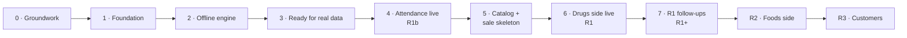

# 04 — Build Plan

**Product:** shop system for agro-vet and farm-supply shops (name to be decided)
**First shop:** MPC — Mabatini Pumba Center, Usa River, Arusha, Tanzania
**Version:** 1.10 · 25 Oct 2026 · Portion 4 of the planning pack, updated in portion 5
**Built from:** `01-product-spec.md` v1.0, `02-domain-model.md` v1.1, `03-architecture.md` v1.0 — now v1.1, v1.2 and v1.1, with Appendix A applied
**Status:** living document. Everything here is decided unless marked *(default)* — our best guess, safe to change at a stage review. Small open items are in the parking lot (§20). The changes this plan made to the other docs are listed in Appendix A (applied). BP7 and BP16 are ADRs in `docs/adr/`; the working rules for Claude Code are in `CLAUDE.md`.

**Changes in v1.10** (25 Oct 2026, SPIKE-1): SPIKE-1's findings (`docs/spikes/01-pwa-offline.md`) reach the cards that build on them. SYNC-13 starts from the update bar SPIKE-1 built, adds regular update checks, and gains a *Watch out* line; SYNC-12 and SYNC-6 gain one each. The parking lot gains the workers' iPhone question, for Jack to decide, and what SPIKE-1 left untested. Marked **(v1.10)**.

**Changes in v1.9** (25 Oct 2026, SPIKE-1): two decisions by Jack, made while planning SPIKE-1. The card ships in two PRs: the demo deploys only from `main`, so the device tests need the spike's code there first, and the second PR's deploy tests the update prompt. The card also gains the *Learn* line its drill starts from. Marked **(v1.9)**.

**Changes in v1.8** (23 Oct 2026, OPS-2): DATA-1 gains a *Watch out* line from PPL-1's review. Django's `/admin/login/` has no rate limit yet. The demo goes public with OPS-2, but it has no accounts, and the free plan has no shell to make one, so there is nothing to guess. DATA-1's seed makes the first account with a password, so the limit, or keeping that account out of the admin, comes with it. Marked **(v1.8)**.

**Changes in v1.7** (23 Oct 2026, OPS-1): the image job becomes the fourth required check on `main`, Jack's decision while planning OPS-1. From OPS-2 on, every merge to `main` deploys the demo, so an image that doesn't build or serve must block the merge, not break the demo after it. OPS-1's *Build* line and *Done when* say so. OPS-2 also gains a *Watch out* line from OPS-1's review: on the demo, Render's proxy is the way in, not Caddy, and the image's cache and compression settings are still open. Marked **(v1.7)**.

**Changes in v1.6** (23 Oct 2026, PPL-1): two decisions by Jack, made while planning PPL-1. PPL-1 asks an email only of the superuser, because most of the shop's people have a phone but no email, so AUTH-3 gains a *Decide first* line on logins and lost passwords without email. Each group gets its own web address on one server: parking lot item 11, to become an ADR with OWN-3. Marked **(v1.6)**.

**Changes in v1.5** (22 Oct 2026, CORE-1): PPL-1 gains a *Watch out* line on the admin's `id`: CORE-1 keeps the id editable on purpose, so DRF keeps the id a client sends (ADR-0007). Marked **(v1.5)**.

**Changes in v1.4** (22 Oct 2026, REPO-7): release-please runs with a token from the repo's own GitHub App, so its release PR runs CI like any other (03 v1.5). REPO-7's *Build* line says so, and OPS-6 gives the deploy its new reason for being a job of the release workflow. OPS-1's note on job names also lists `pr-title`, the third required check. Marked **(v1.4)**.

**Changes in v1.3** (21 Oct 2026, REPO-6): `control` sits on layer 0, beside `core` (ADR-0035, 03 v1.4), so REPO-6 lists three exceptions; CORE-2 and PPL-3 gain a *Watch out* line on what the layer contract refuses. After REPO-5, OPS-1 also adds a Dependabot entry for its `Dockerfile` and keeps its job name clear of the required checks. Marked **(v1.3)**.

**Changes in v1.2** (20 Oct 2026, REPO-4): OPS-5's Caddyfile also sends `/_allauth/` to Django, so password login works in production as it does locally (ADR-0017, 03 v1.3). Marked **(v1.2)**.

**Changes in v1.1** (18 Oct 2026, portion 5): Claude Code makes every commit, but only after Jack says yes, and every commit message carries a `Why:` line (BP11, §3.3–§3.5, REPO-5 — confirmed with Jack); a task starts with `/start-task` and ends with `/finish-task` (§3.3); a changed decision is a new ADR that supersedes the old one (§3.2, §19); REPO-1, REPO-3 and REPO-4 gain the Claude Code setup, the script names and the guard tests; Appendix A is applied. Each change is marked **(v1.1)**.

---

## 0. How to read this

- A **build plan** turns the spec, the domain model and the architecture into an ordered list of small tasks, so building becomes "do the next task".
- **Stage** = a group of tasks that ends in something you can see: a demo, a deploy or a go-live. **Epic** = one feature area, a parent issue on GitHub (e.g. `SYNC`). **Task** = the smallest piece of work: one issue, one branch, one pull request, one Claude Code session.
- **Task IDs** are an epic code plus a number (`CORE-2`, `SYNC-8`). Once the issues exist they never change, even when a task moves to another stage. The codes are listed in §4.
- **Sizes:** `S` ≈ 1–2 hours, `M` ≈ 2–4 hours. Nothing bigger — it is split first (BP3).
- **Modes:** *Jack-led* or *Claude-led* (BP10).
- **Order:** every stage lists its tasks in build order — take them top to bottom.
- **Detail:** stages 0–2 have full task cards (§5–§7). Stages 3–7 have one line per task; their cards are written at the review that ends the stage before (BP2). R2 and R3 are outlines.
- Tags **[R1] [R1b] [R2] [R3] [Later]** as before, plus **[R1+]**: the R1 follow-ups shipped in the weeks after the Drugs go-live (BP8). **✚** = added beyond the three docs; veto freely.

## 1. The plan on one page



| Stage | Ends with | Milestone | Rough hours |
|---|---|---|---|
| 0 Groundwork | CI green, the demo deploys itself, the two biggest unknowns answered | Foundation | 30–45 |
| 1 Foundation | Pair a device and log in with a PIN; shops can't see each other; ledgers refuse edits | Foundation | 65–90 |
| 2 Offline engine | A clock-in made offline reaches the server exactly once; anyone can try it on the demo | Foundation | 50–65 |
| 3 Ready for real data | Production server, tested backups and alerts — before any real data | Foundation | 25–35 |
| 4 Attendance live (R1b) | Every worker clocks in; the first month's pay is calculated | R1b · Attendance | 45–60 |
| 5 Catalog + sale skeleton | Products searchable offline; one sale from the device to the ledgers and back | R1 · Drugs | 40–55 |
| 6 Drugs side live (R1) | The Drugs side runs on it; SmartMauzo and the paper books stop | R1 · Drugs | 100–140 |
| 7 R1 follow-ups (R1+) | Returns, daily counts, shopping list, exports — the weeks after go-live | R1+ | 25–35 |

Hours = task sizes plus up to 40% for learning, debugging and review: about **350–490 hours** to the Drugs go-live. They are replaced by real numbers after the first ten tasks (§19).

**Rough calendar.** Building starts in early November 2026, after portions 5 and 6, at about 8 hours a day, 5 days a week (Jack, 18 Oct). *Ready* means the part works on the real server; the shop starts using it when the owner agrees (BP7). Attendance starts on the 1st of a month (§16). The offline demo — the part worth showing recruiters — is ready at the end of stage 2.

| Hours a week | Offline demo | Attendance ready | Drugs side ready |
|---|---|---|---|
| **40** *(8 h × 5 days)* | **early December 2026** | **mid-December 2026 — in use from January** | **late January 2027** |
| 30 | mid-December 2026 | end of December 2026 — in use from January | mid-February 2027 |
| 20 | end of December 2026 | end of January 2027 — in use from February | early April 2027 |

The Foods side (R2) isn't sized yet; at 40 hours a week it is ready around March–April 2027. Eight hours a day next to shop work is a lot, so the real hours are checked after the first ten tasks and the dates move with them (§19).

## 2. Key decisions

BP7 and BP16 are ADR-0033 and ADR-0034 (BP5 is covered by ADR-0012, D12's ADR); the others are working rules in `CLAUDE.md` and in this plan **(v1.1)**.

**BP1 — Stages end in something you can see.**
Stages 0–3 build the base once. From stage 4, each stage ends in a go-live or a demo, then a short review.
*Why:* progress you can show to the owner and to recruiters, and a fixed point to stop and re-plan.

**BP2 — Near work in detail, far work in outline.** ✚
Stages 0–2 have full cards now. Later stages have one line per task; their cards are written at the review that ends the stage before.
*Why:* "many things will change while building" — cards for month five would be stale by then.

**BP3 — One task = one branch = one PR = one Claude Code session, and it fits one sitting.**
`S` ≈ 1–2 h, `M` ≈ 2–4 h; anything bigger is split before it starts.
*Why:* a task fits an evening after the shop closes, and small PRs are easy to review and to learn from.

**BP4 — Vertical slices after the foundation.**
Each task goes through every layer it needs — model, service, API, screen, tests — and works when merged.
*Why:* nothing half-built waits for months; every merge can be shown.

**BP5 — The custom `User` comes before any `migrate`, in stage 0.** ✚
It lands before the demo's first deploy, because that deploy runs migrations.
*Why:* Django can't swap its user model after the first migration (02 D12). *Cost:* very high if missed.

**BP6 — The clock-in is the first offline document.** ✚
The sync engine is proven end to end with a clock-in (SYNC-11); the sale then reuses it (SALE-4).
*Why:* it is the smallest real document — one table, no money, no stock — so the hardest part (sync) is learned on simple ground. This holds whichever release goes first.

**BP7 — One website with everything, built one part after another: attendance first.** ✚
The website holds every part — attendance, the Drugs side and the Foods side — in one repo, at one address (confirmed with Jack). The parts are built in this order: attendance (R1b), then the Drugs side (R1), then the Foods side (R2). Each part is switched on in settings; the shop starts using it once the owner agrees, at the review before its go-live *(default: as soon as it is ready)*.
*Why attendance first:* it is the smallest real feature; every worker on both sides uses it daily; it fixes problem #2 (spec §4); and it tests the devices, PINs, offline storage and power cuts on real shop days before any money depends on them — while the Drugs product data is prepared.
*Cost:* the Drugs side (problem #1) is ready a few weeks later than if it were built first; the product name, the web address and the PDPC registration are needed sooner (§15).
*If the shop prefers to start several parts on the same day:* the build order stays the same; only the go-live dates in §16 move.

**BP8 — R1 goes live in two steps.** ✚ *(default)*
**R1** is what replaces SmartMauzo and the paper books on the Drugs side. **R1+** — partial returns, daily counts, reorder levels and the shopping list, WhatsApp receipts, exports, debt aging, debt adjustments, merging duplicate customers and the Lipa Namba check — follows in the weeks after go-live, with normal deploys (§12).
*Why:* real use sooner; none of R1+ is needed on day one (a full return is a cancel). If the printer spike fails, WhatsApp receipts move into R1.

**BP9 — Tests first where the answer is known.**
Calculations, posting, rules and sync are written test-first; screens get tests alongside. The worked examples (02 §18) and the attendance table (spec §8.1) become named tests, and E1–E5 also become shared test vectors (03 §8).
*Why:* the docs already hold the expected numbers.

**BP10 — Jack-led and Claude-led tasks.** ✚
The first task of each new kind is *Jack-led*: a short drill on the idea first (the card's **Learn** line), then Claude writes the tests and explains, Jack writes the main code, and Claude reviews. The rest are *Claude-led*: Claude Code writes; Jack reviews and explains it back in the PR. About one task in four is Jack-led.
*Why:* job interviews ask you to explain and write code yourself, not only to ship it; it also matches "drill, then apply the same day".

**BP11 — GitHub flow, squash merge, conventional commits.**
Short branches from `main`. The PR title is a conventional commit, checked in CI. Squash-merge puts one commit per task on `main`; the small commits stay visible inside each PR. release-please ✚ writes the changelog and the version tags from those titles (REPO-7): `v0.x` until the first go-live, `v1.0.0` at it.
**Every commit is approved by Jack** (confirmed with Jack) **(v1.1)**: Claude Code makes the commits in both modes, but before each one it says plainly what was done and why, and it commits only after Jack says yes. Every commit message carries a `Why:` line with a strong reason (§3.5); a `commit-msg` hook refuses a message without one (REPO-5).
*Why:* a history anyone can read, releases with no manual bookkeeping, and every step of the history understood and approved by Jack.

**BP12 — This file is the plan; GitHub tracks the status.**
Issues are created by script for the current and the next stage only.
*Why:* 150 issues created today would go stale and bury the next task.

**BP13 — Data preparation and baselines start now.** ✚
The product, customer, debt and staff sheets (Appendix B) are fixed today, so the shop can fill them in while the code is built. Baselines (spec §12) are measured before each go-live — starting with this month's month-end pay.
*Why:* entering hundreds of products with selling units often takes longer than building the import, and the "before" numbers vanish at go-live.

**BP14 — The production server is rented just before the first go-live.** ✚
Stage 3 always sits right before it.
*Why:* no rent for an idle server; the demo covers everything before that.

**BP15 — The demo opens without pairing.** ✚
On the demo only, *Jaribu demo* registers the visitor's browser as a device and shows the demo staff with their PINs (OPS-3).
*Why:* a recruiter will not pair a device, and the offline counter is the part worth showing.

**BP16 — No open-source licence yet.** ✚ *(default)*
The repo is public, with all rights reserved and one line in the README saying so.
*Why:* it is the only reversible choice — code released under an open licence stays open forever, and the product may be sold to other shops later. Revisit before R3 or a first outside contributor.

## 3. How every task runs

### 3.1 The task card

```markdown
### CORE-2 · Tenancy guard that fails closed
`M` · Jack-led · after SHOP-1 · branch `feat/core-2-tenancy-guard`
**Learn:** what you will understand afterwards (the drill, for Jack-led tasks).
**Build:** what to make, in a few lines.
**Done when:**
- [ ] checks anyone can verify
**Tests:** `test_names_to_write_first`
**Commits:** `test(core): …` → `feat(core): …`
```

- **after** = tasks that must be merged first. **needs** = an answer from the owner or the shop (§15).
- **Done when** is the task's acceptance test: when every box is ticked, it is done.
- **Commits** is a suggested order of small commits, one tested step each.

### 3.2 Ready and done

**Ready** — a task can start when the tasks it comes after are merged, its card is clear, any owner answer it needs is in (or a default is agreed), and it fits one sitting.

**Done** — a task is done when:
1. Every *Done when* box is ticked.
2. Its tests pass in CI; worked examples have their named tests.
3. Every file has a header comment, and comments explain *why* — generously, for learning.
4. Logic sits only in services and calculations; import-linter passes; services and calculations keep at least 90% test coverage (03 §11).
5. Migrations have been read line by line; `makemigrations --check` is clean.
6. The API schema and the TypeScript types are regenerated, with no difference.
7. New screen text is in `sw.json` and `en.json`; Jack has checked the Swahili.
8. The demo seed covers the feature, if it needs data.
9. If a decision changed: a new ADR that supersedes the old one, plus the matching change to 02, 03 or this plan, in a `docs:` commit (ADR-0000) **(v1.1)**.
10. The PR is squash-merged with green CI, the card is ticked in this file, and the hours are noted in the PR.

### 3.3 A Claude Code session, step by step

1. Take the next *Ready* card on the board and move it to *In progress*.
2. Create the branch (§3.4, steps 1–2).
3. Start Claude Code — it opens in **plan mode** — and type `/start-task CORE-2`. It reads CLAUDE.md and the card, checks the card is *Ready*, and plans small steps, each ending in a commit with its reason. Nothing is written yet **(v1.1)**.
4. Read the plan, ask *why* until every step makes sense, then approve. A *Jack-led* task starts with a 15-minute drill on the idea; then Claude writes the tests, Jack writes the main code, and Claude reviews.
5. Build step by step — tests first where the card says so. After each green step, Claude Code says plainly what was done and why, shows the commit message, and commits only after Jack says **yes** **(v1.1)**.
6. Type `/finish-task`: it runs `make check` (everything CI runs), goes through the Done list, asks the `reviewer` subagent for a fresh review, helps write **What I learned** in 3–5 lines, and drafts the PR **(v1.1)**.
7. Push, open the PR and fill in the template.
8. When CI is green: squash-merge, tick the card here, note the hours, `/clear`.

If a task runs past twice its size: stop, write what blocks it in the issue, then split it or bring it to a chat.

### 3.4 The git routine

```bash
# 1. Start from the latest main
git switch main
git pull --ff-only

# 2. One branch per task, named on its card
git switch -c feat/core-2-tenancy-guard

# 3. Commit each small, tested step. Claude Code does this after your "yes";
#    by hand it looks like this (the second -m is the reason, §3.5):
git status                 # what changed?
git add -p                 # pick the pieces that belong together (or: git add <file>)
git commit -m "test(core): a query without a shop raises" \
           -m "Why: forgetting the shop must fail loudly, not leak another shop's rows (ADR-0022)."

# 4. Run every check CI runs
make check

# 5. Push the branch and open the pull request (the template opens in the browser)
git push -u origin feat/core-2-tenancy-guard
gh pr create --web

# 6. If main moved while you worked, bring its changes in (no force-push needed)
git fetch origin
git merge origin/main

# 7. CI is green: squash-merge, delete the branch, update main
gh pr merge --squash --delete-branch
git switch main
git pull --ff-only
```

### 3.5 Commit messages

`type(scope): what it does, in the present tense` — then a blank line and a `Why:` line **(v1.1)**.

- **Types:** `feat` (new behaviour), `fix`, `test`, `refactor` (same behaviour, better code), `docs`, `chore` (tooling), `ci`, `build`, `perf`.
- **Scope:** the app or area — `core`, `people`, `sync`, `sales`, `frontend`, `deploy`…
- **Why:** one or two sentences on why this change is needed now — the rule, test or *Done when* item it serves — not a repeat of the subject. Every commit has one (confirmed with Jack), and a `commit-msg` hook refuses a commit without it (REPO-5). No strong reason means the change belongs in another commit **(v1.1)**.
- **Subject examples:** `feat(people): custom User with phone and email` · `test(sync): same batch twice posts once` · `fix(money): expected cash ignored cash change`.
- The PR title uses the same format: it becomes the one commit on `main`, and release-please reads it.

## 4. GitHub setup

Done in portion 6.

- **Milestones:** `Foundation` (stages 0–3) · `R1b · Attendance` · `R1 · Drugs` · `R1+` · `R2 · Foods` · `R3 · Customers`.
- **Epics:** one parent issue per code below, with its tasks as sub-issues. R2 adds its own epics (§13) at the stage 7 review.

| Code | Epic | Code | Epic |
|---|---|---|---|
| `REPO` | Repository, tooling, CI | `ATT` | Attendance |
| `SPIKE` | Questions answered by a quick experiment | `WAGE` | Pay runs and payslips |
| `CORE` | Base models, tenancy, triggers, settings, numbers | `CAT` | Products and prices |
| `SHOP` | Shops, sides, locations, accounts, settings screen | `STK` | Stock |
| `PPL` | Users, staff, roles | `SALE` | Selling |
| `AUTH` | Devices, PIN and password logins | `MONEY` | Payments |
| `CTRL` | Flags, audit, attachments | `CASH` | Drawers and cash-up |
| `UI` | App foundations and shared screens | `DEBT` | Customers and credit |
| `SYNC` | The offline engine | `RPT` | Reports and exports |
| `DATA` | Imports and the demo seed | `OPS` | Images, servers, deploys, backups, monitoring |
| `LIVE` | Going live (mostly not code) | `FOLIO` | Portfolio |

- **Issue title:** `CORE-2 · Tenancy guard that fails closed`; the body is the card. A task issue template matches the card.
- **Labels:** `size:S` `size:M` · `mode:jack-led` `mode:claude-led` · `type:feat|fix|chore|docs|spike|ops` · `needs-owner` (waiting for an answer) · `owner` (the shop and owner track, §15) · `blocked`.
- **Project board:** Backlog → Ready → In progress → In review → Done, with the fields *Stage*, *Size*, *Mode* and *Hours*.
- **PR template:** task ID and `Closes #…`; what and why; how it was tested; screenshots; *What I learned*; the Done checklist; hours.
- **Protection:** `main` changes only through PRs with green CI, for admins too; squash-merge only; no force-push; secret scanning and push protection on; Dependabot weekly.
- **Issues are created by a script** using `gh`, from the cards of the current and the next stage (BP12); the owner track (§15) becomes issues labelled `owner`.

## 5. Stage 0 — Groundwork

**Goal:** an empty but real repo — CI green, the demo deploying itself, and the two biggest unknowns (offline on the shop's own devices, and printing) answered in the first weeks.
**Done when:** a PR runs CI green; merging deploys the demo; both spike reports are in `docs/spikes/`.
**You'll learn:** uv and a Django project layout; Next.js as a static app; Docker Compose and a reverse proxy; GitHub Actions; container images; service workers; printing with CSS.
**Needs:** OWN-1 (printer details), OWN-2 (which shop devices).
**Order:** top to bottom. SPIKE-2 and FOLIO-1 can move anywhere after OPS-2.

### REPO-1 · Repository and GitHub setup
Done in **portion 6**, in chat — not with Claude Code.
**Done when:**
- [x] A public GitHub repo with the layout of 03 §4, docs 01–04, the ADRs, `CLAUDE.md` and `.claude/` (unpacked from the portion 5 bundles), a README stub and `.editorconfig` **(v1.1)**.
- [x] `.gitignore` covers `.env` and `.env.*` (but not `.env.example`), `private/`, `CLAUDE.local.md`, `.claude/settings.local.json`, `__pycache__/`, `node_modules/`, `.next/` and `frontend/out/` **(v1.1)**.
- [x] Templates, labels, milestones and the issues for stages 0 and 1 exist (§4).
- [x] `main` is protected; secret scanning and push protection are on.

### REPO-2 · Backend skeleton
`M` · Claude-led · after REPO-1 · branch `chore/repo-2-backend-skeleton`
**Learn:** a uv project; a Django project with settings split by environment; how pytest-django finds them.
**Build:** `backend/` with Python 3.14, Django 6.1 and DRF through uv; `config/settings/{base,dev,test,prod}.py` reading environment variables; the 13 empty apps of 03 §5.1 under `apps/`, each with a header saying what it owns; `GET /api/health/` → `{"status": "ok"}`; ruff, mypy + django-stubs, pytest + pytest-django.
**⚠ Don't run `migrate` on any database until PPL-1 is merged** (BP5).
**Done when:**
- [x] `uv run pytest`, `ruff check` and `mypy` pass; `manage.py check` is clean.
- [x] Every app says in one line what it owns.
**Tests:** `test_health_returns_ok`
**Commits:** `chore(backend): uv project with Django 6.1` → `chore(backend): settings per environment` → `chore(backend): empty domain apps` → `chore(backend): ruff, mypy and pytest` → `feat(core): health endpoint`

### REPO-3 · Frontend skeleton
`M` · Claude-led · after REPO-1 · branch `chore/repo-3-frontend-skeleton`
**Learn:** Next.js used as a static app (`output: 'export'`) and why the counter needs that (03 AD2).
**Build:** `frontend/` with pnpm, Next.js 16 (static export, `images.unoptimized`), React 19, TypeScript strict, Tailwind v4, shadcn/ui, ESLint, Prettier, Vitest; a *Karibu* page; the scripts `dev`, `build`, `test`, `lint` and `typecheck` (`.claude/rules/frontend.md`) **(v1.1)**.
**Done when:**
- [x] `pnpm build` writes plain files to `out/` that open with no Node server.
- [x] Lint, type check and one Vitest test pass.
**Commits:** `chore(frontend): next.js static export` → `chore(frontend): tailwind and shadcn` → `chore(frontend): lint, format and vitest`

### REPO-4 · Local development like production
`M` · Claude-led · after REPO-2, REPO-3 · branch `chore/repo-4-local-dev`
**Learn:** Docker Compose; a reverse proxy; why one address matters for cookies.
**Build:** `compose.dev.yml` with PostgreSQL 18 and Caddy on `localhost:8080` (`/api/` and `/_allauth/` to Django on your machine, everything else to the Next.js dev server); a `Makefile` (`dev`, `test`, `check`, `fmt`, `migrate` — `check` also runs the guard's tests: `python3 -m unittest discover -s .claude/hooks` **(v1.1)**); `.env.example` with every setting; "Run it locally" in the README.
**Watch out:** Caddy runs in Docker while Django and Next.js run on your machine, so Caddy reaches them through `host.docker.internal` (on Linux, add `extra_hosts: ["host.docker.internal:host-gateway"]`). Still no `migrate` until PPL-1.
**Done when:**
- [x] From a fresh clone, following the README, `localhost:8080` shows *Karibu* and `localhost:8080/api/health/` answers from the same address.
- [x] Django connects to the PostgreSQL in Compose.
- [x] `make check` runs the guard's tests too **(v1.1)**.
**Commits:** `chore(dev): postgres and caddy in compose` → `chore(dev): make commands` → `docs: run it locally`

### REPO-5 · CI and branch protection
`M` · Claude-led · after REPO-4 · branch `ci/repo-5-ci`
**Learn:** GitHub Actions jobs, service containers and caching; why `main` is protected even when you work alone.
**Build:** `ci.yml` — a backend job (uv, ruff, mypy, `makemigrations --check`, pytest with a coverage report on a PostgreSQL 18 service) and a frontend job (pnpm, lint, types, Vitest, `pnpm build`); pre-commit hooks (ruff, Prettier) and a `commit-msg` hook that refuses a message without a conventional subject and a `Why:` line (§3.5) **(v1.1)**; Dependabot weekly for uv, pnpm, Actions and Docker; branch protection (§4), with no bypass for admins.
**Done when:**
- [x] A PR shows two green checks; a lint error turns it red.
- [x] A direct push to `main` is refused — your own included.
- [x] A commit without a `Why:` line is refused on Jack's machine **(v1.1)**.
**Commits:** `ci: backend checks` → `ci: frontend checks` → `ci: require both checks on main` → `chore: pre-commit hooks` → `chore: commit message check` → `ci: dependabot`

### REPO-6 · Module boundaries in CI
`S` · Jack-led · after REPO-5 · branch `ci/repo-6-import-linter`
**Learn:** a layered architecture, turned into a test.
**Build:** import-linter contracts for the layers in 03 §5.1, with the allowed exceptions (`control` → `core`, `inventory` → `money`, `services` → `sales`); every app may import `control`, which imports only `core` (ADR-0035) **(v1.3)**.
**Done when:**
- [x] CI runs the contracts; a test commit where `core` imports `sales` goes red, then is removed.
**Commits:** `ci(backend): layer contracts`

### REPO-7 · Changelog and version tags
`S` · Claude-led · after REPO-5 · branch `ci/repo-7-release-please`
**Learn:** semantic versioning; how a changelog is written from commit messages (BP11).
**Build:** a CI check that PR titles follow the commit format (§3.5); release-please reading the squash-merged titles, starting at `v0.1.0`. It runs with a token from the repo's own GitHub App, so the release PR gets its required checks **(v1.4)**.
**Done when:**
- [x] A PR titled "update stuff" fails the title check.
- [x] After a `feat:` merge, release-please opens a release PR; merging it writes `CHANGELOG.md` and tags `v0.1.0`.
**Commits:** `ci: check pull request titles` → `ci: require the title check on main` → `ci: release-please` → `docs: release-please runs with an app token` → `docs: correct what release-please reads from a pull request` → `test: more pull request title shapes`

### CORE-1 · Base model classes
`S` · Jack-led · after REPO-2 · branch `feat/core-1-base-models`
**Learn:** abstract models; UUIDv7 and why time-ordered IDs keep indexes fast.
**Build:** in `core`: `UUIDModel` (primary key from `uuid.uuid7()`) and `TimeStamped` (`created_at`). Abstract only: no tables.
**Done when:**
- [x] A model built on them gets version-7 ids that sort by creation time.
- [x] `makemigrations --check` finds nothing to do.
**Tests:** `test_ids_are_uuid_version_7` · `test_ids_sort_by_creation_time` · `test_serializers_keep_the_id_a_client_sends`
**Commits:** `test(core): uuid7 primary keys` → `feat(core): abstract base models` → `fix(core): keep the id a client sends` → `docs(core): true comments on the base models`

### PPL-1 · Custom User — the first migration
`M` · Jack-led · after CORE-1, REPO-4 · branch `feat/ppl-1-custom-user`
**Learn:** why the user model must be swapped before the first migration; user managers without usernames; phone numbers in international form.
**Build:** `people.User` (02 §5): UUIDv7 id, `full_name`, `phone` (optional, unique, stored as `+255…`), `email` (optional, unique whatever the letter case), password optional (PIN-only staff have none), `language`; no username; a manager with `create_user` and `create_superuser` (by email); `AUTH_USER_MODEL = "people.User"`; the admin; a phone normaliser in `core` (the `phonenumbers` library ✚, default region TZ).
**Watch out:** list `id` in the admin's `readonly_fields`. CORE-1 keeps the id editable on purpose: with `editable=False`, DRF would drop the id a client sends (ADR-0007). An id changed in the admin would save a copy of the row **(v1.5)**.
**Done when:**
- [x] On an empty database, `make migrate` creates `people.User` before `admin`, and `createsuperuser` works by email.
- [x] `0712 345 678` is stored as `+255712345678`.
- [x] Two users can't share a phone, or an email in any letter case; a user can exist without a password.
**Tests:** `test_phone_stored_as_plus255` · `test_email_unique_ignoring_case` · `test_user_without_password` · `test_superuser_needs_email`
**Commits:** `test(people): user rules` → `feat(core): phone normaliser` → `feat(people): custom User model` → `feat(people): user manager and admin`

### OPS-1 · The backend image
`M` · Claude-led · after PPL-1, REPO-5 · branch `build/ops-1-backend-image`
**Learn:** Docker images and multi-stage builds; why containers shouldn't run as root.
**Build:** a multi-stage `Dockerfile`: build the frontend, copy `out/` in, Django serves it with WhiteNoise (the demo's setup, 03 §13); gunicorn; a non-root user; CI builds the image on every PR (03 §12). Add a `docker` entry to `.github/dependabot.yml` for the new `Dockerfile` (REPO-5 watches only the compose images), and name the image job none of `backend`, `frontend` and `pr-title`: those are the required checks **(v1.3, v1.4)**. Then make the image job the fourth required check (`.github/rulesets/main.json`, applied with `protect`): every merge will deploy the demo (OPS-2), so a broken image must block the merge **(v1.7)**.
**Done when:**
- [x] `docker run` of the image serves *Karibu* and `/api/health/` from one address.
- [x] The image builds in CI on every PR.
- [x] A PR whose image check is red can't merge **(v1.7)**.
**Commits:** `build: backend image with the static app` → `ci: build the image on pull requests` → `ci: dependabot watches the backend image` → `ci: require the image check on main` **(v1.7)**

### OPS-2 · The demo deploys itself
`M` · Claude-led · after OPS-1 · branch `ci/ops-2-demo-deploy`
**Learn:** container registries; deploy hooks; smoke tests.
**Build:** `deploy-demo.yml`: merge to `main` → push the image to GitHub Container Registry → Render deploy hook → smoke test `/api/health/`; a free Render web service with free PostgreSQL (fake data only); migrations run when the service starts; `docs/runbooks/demo.md`, including re-creating the free database every 30 days (03 AD15).
**Watch out:** on the demo, Render's proxy is the way in, not Caddy. `prod.py` trusts `X-Forwarded-Proto` because "Caddy is the one way in": check that Render's proxy also overwrites that header, and make the comment true. The image serves every file with a 60-second cache and no compression; long caching for the hashed `_next/static/` files (`WHITENOISE_IMMUTABLE_FILE_TEST`) and compressed admin files are still open **(v1.7)**.
**Done when:**
- [ ] A merge to `main` updates the demo with no manual step; a failing smoke test turns the workflow red.
- [x] The demo shows *Karibu* over HTTPS.
**Commits:** `ci: deploy the demo on merge` → `docs: demo runbook and link`

### SPIKE-1 · Offline on the real shop devices
`M` · Jack-led · after OPS-2 · needs OWN-2 · branch `spike/spike-1-pwa-offline`, then `spike/spike-1-results` **(v1.9)**
**Learn:** what makes a website installable as an app; how a service worker keeps the app's files and gets a new version; storage inside the browser, and why the browser may delete it **(v1.9)**.
**Question:** does the static app install, open with no internet and keep its data on the shop's own laptop and phone?
**Build:** manifest and icons; the Serwist service worker built after `next build` over `out/`; a throwaway `/spike` page that writes and reads a Dexie row and shows the result of `navigator.storage.persist()`; a visible version number.
**Watch out:** the demo deploys only from `main` (OPS-2), so the device tests need the spike's code merged first. The card ships in two PRs: the first brings the Serwist setup and the `/spike` page to the demo; after the device tests, the second removes the page and adds the report, and its deploy is the new deploy the update box needs. The shop's devices change, so the spike tests the laptops and the phone the shop uses at the time, and the report names them (OWN-2) **(v1.9)**. Jack tested one laptop and the phone; what was left untested is in the parking lot (§20) **(v1.10)**.
**Done when** (from the demo address, on the shop laptop and one Android phone):
- [ ] It installs as an app and opens in airplane mode.
- [ ] A Dexie row survives closing the browser and restarting the device.
- [ ] Persistent storage is granted, or the reason it isn't is written down.
- [ ] A new deploy shows an update prompt and switches.
- [ ] Results, device models and Chrome versions are in `docs/spikes/01-pwa-offline.md`. The Serwist setup stays; the `/spike` page is removed.
**Commits:** the first PR: `docs: spike-1 card gets a learn line and two pull requests` → `feat(frontend): manifest and icons` → `feat(frontend): serwist service worker` → `feat(frontend): update prompt` → `feat(frontend): visible app version` → `feat(frontend): spike page for offline storage`; the second PR: `chore(frontend): remove the spike page` → `docs(spikes): offline results` **(v1.9)**

### SPIKE-2 · A slip from Chrome on the shop printer
`S` · Jack-led · after OPS-2 · needs OWN-1 · branch `spike/spike-2-printing`
**Question:** can Chrome print a readable slip on the shop's printer in one click?
**Build:** a print page sized for the printer (`@page { size: 80mm auto; margin: 0 }`, or 58 mm) with Swahili text, a bold total and a QR code, opened from the demo address on the printer laptop; normal printing first, then Chrome kiosk printing (`--kiosk-printing`).
**Done when:**
- [ ] A readable slip prints in one click.
- [ ] Model, driver, paper width, working margins and a photo are in `docs/spikes/02-printing.md`.
- [ ] If it fails, the fallback is written down (WhatsApp receipts move into R1; a fix is needed before R2's slips).
**Commits:** `feat(frontend): slip print page` → `docs(spikes): printing results`

### FOLIO-1 · README, first version
`S` · Claude-led · after OPS-2 · branch `docs/folio-1-readme`
**Done when:**
- [ ] The README states the problem in three lines, the status ("in development"), the stack, links to the docs, the demo link and the CI badge.
- [ ] It holds no real shop data.
**Commits:** `docs: readme first version`

## 6. Stage 1 — Foundation

**Goal:** the backbone every feature stands on — shops and sides, tenancy that fails closed, append-only tables, dated settings, exact numbers, staff and permissions, devices and logins.
**Done when:** the Playwright test *pair a device → PIN login → idle lock → logout* passes in CI (UI-6); the tenancy sweep and the trigger tests are green.
**You'll learn:** abstract models and migrations; multi-tenancy; PostgreSQL triggers; decimals and rounding; DRF conventions; permissions; cookies, sessions and CSRF; django-allauth; hashing; end-to-end tests.
**Order:** top to bottom. CORE-5 can move anywhere — a good break from the database.

### SHOP-1 · The Shop
`S` · Claude-led · after PPL-1 · branch `feat/shop-1-shop`
**Build:** `shops.Shop` (02 §4): name, code, timezone (Africa/Dar_es_Salaam), currency (TZS), default language (sw), `kind` (live, demo, practice), `practice_of`, `status`; the admin.
**Done when:**
- [ ] `kind` and `status` accept only their values (database check constraints); the code is unique.
**Tests:** `test_shop_kind_must_be_known` · `test_shop_code_unique`
**Commits:** `test(shops): shop rules` → `feat(shops): Shop model`

### CORE-2 · Tenancy guard that fails closed
`M` · Jack-led · after SHOP-1 · branch `feat/core-2-tenancy-guard`
**Learn:** context variables; custom model managers; why "fail closed" beats "remember to filter" (03 §5.4).
**Build:** a `current_shop` context variable with `shop_context(shop)` and `system_context()`; the `ShopScoped` abstract base (UUIDv7 id, `shop`, `created_at`; `created_by` comes in PPL-2, empty for rows the system makes) whose default manager filters by the current shop and raises when none is set; a separate unscoped manager for the superuser admin.
**Watch out:** `core` is layer 0, so the layer contract refuses any import of `shops` from it, also in tests and in `if TYPE_CHECKING:` blocks (REPO-6, ADR-0035). Give the tests their shops through fixtures in `backend/conftest.py`, which is outside `apps`, and decide here whether type-only imports should count (`exclude_type_checking_imports` in `backend/pyproject.toml`) **(v1.3)**.
**Done when:**
- [ ] A scoped query with no current shop raises `NoShopSelected`.
- [ ] Inside `shop_context(A)` only A's rows come back.
- [ ] Reading across shops works only inside `system_context()`, which is easy to search for in the code.
**Tests:** `test_query_without_shop_raises` · `test_shop_context_filters_rows` · `test_system_context_reads_all_shops`
**Commits:** `test(core): tenancy guard` → `feat(core): current shop context` → `feat(core): ShopScoped base and manager`

### PPL-2 · Staff members and PINs
`M` · Jack-led · after CORE-2 · branch `feat/ppl-2-staff`
**Learn:** a membership versus a user (02 D12); hashing with a server secret (a "pepper"); Argon2.
**Build:** `StaffMember` (02 §5): user, display name, photo, job title, `started_on`, `left_on`, `status` (active ⇄ suspended → left), PIN hash, `pin_changed_at`; `created_by` added to `ShopScoped` now that staff exist; services `add_staff`, `set_pin` (4 digits; no 0000, 1234 or four of a kind; Argon2 + server pepper), `suspend`, `unsuspend`, `mark_left`.
**Done when:**
- [ ] One user can be staff in two shops.
- [ ] A weak PIN is refused; a stored PIN can't be checked without the server secret.
- [ ] A person who has left can't be given a PIN.
**Tests:** `test_one_user_staff_in_two_shops` · `test_weak_pin_refused` · `test_pin_check_needs_pepper` · `test_left_staff_cannot_get_pin`
**Commits:** `test(people): staff rules` → `feat(people): StaffMember model` → `feat(people): PIN hashing with pepper` → `feat(core): created_by on shop records`

### SHOP-2 · Sides, stock locations and cash drawers
`M` · Claude-led · after PPL-2 · branch `feat/shop-2-sides`
**Build:** `Side` (name, one-letter code unique per shop, `sale_flow`, `is_live` off by default), `StockLocation` (one hidden default per side), `PaymentAccount` (kind, name, provider, number, sides, status); service `create_shop(name, code, sides)` → the shop, its sides, one default location and one cash drawer per side, in one transaction.
**Done when:**
- [ ] `create_shop` with sides D and F makes 2 sides, 2 hidden locations and 2 cash drawers — or nothing at all if any step fails.
- [ ] Side codes are unique within a shop; a new side starts switched off.
**Tests:** `test_create_shop_makes_location_and_drawer_per_side` · `test_create_shop_all_or_nothing` · `test_side_code_unique_within_shop` · `test_side_starts_switched_off`
**Commits:** `test(shops): create_shop` → `feat(shops): Side, StockLocation and PaymentAccount` → `feat(shops): create_shop service`

### CORE-3 · Append-only tables, enforced by PostgreSQL
`M` · Jack-led · after CORE-2 · branch `feat/core-3-append-only`
**Learn:** database triggers; why the database is the last line of defence (03 AD7, 02 T2).
**Build:** a migration operation that adds a trigger refusing UPDATE and DELETE on a table; a variant that allows filling the void stamp (`voided_at`, `voided_by`, `void_reason`, `void_approval`) once and nothing else; a model mixin that refuses the same in Python with a clear message.
**Done when:**
- [ ] On a test table, `UPDATE` and `DELETE` fail in the database itself, not only in Django.
- [ ] On a void table, the stamp can be filled once; a second change fails; changing any other column fails.
**Tests:** `test_append_only_update_fails_in_database` · `test_append_only_delete_fails` · `test_void_stamp_set_once` · `test_void_cannot_change_other_columns`
**Commits:** `test(core): append-only rules` → `feat(core): append-only trigger operation` → `feat(core): void-stamp variant` → `feat(core): append-only model mixin`

### CORE-4 · Dated settings
`M` · Claude-led · after CORE-3, SHOP-2 · branch `feat/core-4-settings`
**Build:** the settings registry in `core` (key, type, default, scope, description — 02 D13); `shops.Setting` rows (key, value, `effective_from`, optional side, `set_by`, note), insert-only; `get_setting(key, shop, side=None, on=date)`; the keys R1 and R1b need — e.g. `attendance.on_time_until` 07:35, `attendance.late_fine` 1,000, `money.rounding_step` 1, `cash.tolerance`, `count.tolerance_pct`, `expiry.alert_days` 90, `stock.block_negative` off, `session.idle_minutes` 15.
**Done when:**
- [ ] With no rows, the default comes back; the latest row on or before the date wins; a side row beats a shop row; tomorrow's row is ignored today.
- [ ] A value of the wrong type is refused; rows can't be edited.
**Tests:** `test_default_when_no_rows` · `test_latest_row_on_or_before_date_wins` · `test_side_row_beats_shop_row` · `test_future_row_ignored_until_its_day` · `test_setting_type_checked`
**Commits:** `test(core): setting rules` → `feat(core): settings registry` → `feat(shops): dated Setting rows`

### CORE-5 · Exact money and quantities
`M` · Jack-led · after REPO-2 · branch `feat/core-5-numbers`
**Learn:** why floats lose shillings; half-up rounding; one source of truth for two languages (03 §8).
**Build:** `core/numbers.py`: money (2 places) and quantity (3 places) helpers on `Decimal`; `round_money(amount, step)`, half-up; `shared/test-vectors/` files with inputs and expected outputs as strings (`rounding.json`, `units.json` — E1's numbers among them); a pytest runner that loads every vector file.
**Done when:**
- [ ] Every vector passes.
- [ ] E1's 1,335.5 kg shows as 26 bags of 50 kg + 35.5 kg.
- [ ] A lint rule or a test stops `float` from appearing in calculation code.
**Tests:** `test_vectors_rounding` · `test_vectors_units` · `test_e1_shown_as_bags_and_kg`
**Commits:** `test(core): rounding and unit vectors` → `feat(core): money and quantity helpers` → `ci: no floats in calculations`

### CORE-6 · API conventions
`M` · Claude-led · after SHOP-2 · branch `feat/core-6-api`
**Build:** domain errors with codes and one exception handler (`{"code", "message", "fields", "params"}` — 03 §5.10); base views (tenancy and a per-side permission hook); idempotent creates (the client sends the UUID); the `Editable` base with `version` (stale → `409 version_conflict`); cursor pagination; drf-spectacular at `/api/schema/` and `/api/docs/` (public on the demo, staff only in production).
**Done when:**
- [ ] The Side endpoints show every behaviour above in tests.
- [ ] The schema builds with no warnings.
**Tests:** `test_error_shape` · `test_create_twice_with_same_uuid_makes_one_row` · `test_stale_version_gets_409` · `test_docs_hidden_in_production`
**Commits:** `feat(core): error codes and handler` → `feat(core): base views and idempotent create` → `feat(core): version conflicts` → `feat(core): openapi schema`

### CORE-7 · The tenancy sweep
`M` · Claude-led · after CORE-6 · branch `test/core-7-tenancy-sweep`
**Build:** one test module that finds every model and every list and detail route of our apps by itself: every model has `shop` (outside an allowed list: `User`, `Unit` and the infrastructure tables); every foreign key uses `PROTECT` (T3); every route called as shop B returns none of shop A's rows (03 §5.4).
**Done when:**
- [ ] A new model without `shop`, a foreign key that cascades, or a route that leaks turns CI red — with no change to the test.
**Tests:** `test_every_model_has_shop` · `test_every_foreign_key_protects` · `test_no_route_leaks_across_shops`
**Commits:** `test: model sweep` → `test: route sweep`

### CTRL-1 · Flags
`S` · Claude-led · after CORE-2 · branch `feat/ctrl-1-flags`
**Build:** `control.Flag` (02 §13): kind from a code list, subject (type code + UUID), expected, actual, difference, people, side, status (open → explained → resolved | dismissed), notes; `raise_flag()` and `resolve_flag()` services.
**Done when:**
- [ ] Unknown kinds are refused; the status only moves forward; a flag's subject loads from its type code and UUID.
**Tests:** `test_raise_flag_records_subject_and_people` · `test_flag_status_only_moves_forward`
**Commits:** `test(control): flag rules` → `feat(control): Flag model and services`

### CTRL-2 · Audit trail
`M` · Claude-led · after CTRL-1, PPL-2 · branch `feat/ctrl-2-audit`
**Build:** `control.AuditEvent` (append-only) and `audit(...)`; django-pghistory on office-edited models, with the person and device attached from the request; staff status changes audited.
**Done when:**
- [ ] Suspending a staff member writes one audit event with the reason.
- [ ] Editing a staff member leaves a history row naming the person and the device.
- [ ] Audit rows can't be edited.
**Tests:** `test_suspend_writes_audit_event` · `test_office_edit_recorded_with_person_and_device` · `test_audit_rows_append_only`
**Commits:** `feat(control): AuditEvent and audit()` → `feat(control): pghistory for office edits`

### PPL-3 · Roles and permissions per side
`M` · Jack-led · after PPL-2, SHOP-2 · branch `feat/ppl-3-permissions`
**Learn:** role-based permissions, scoped by side (02 §5, rule X1).
**Build:** the permission codes in `core`; `Role`, `RoleAssignment` (role + side, or all sides) and `PermissionGrant`; the role templates (Owner, Manager, Seller, Order writer, Cashier, Worker) kept in code and copied into each new shop by `create_shop` (Appendix A); `effective_permissions(staff, side)` and `require(staff, permission, side)`.
**Watch out:** `create_shop` lives in `shops` (layer 1), which may not import `people` (layer 2): the layer contract refuses it (REPO-6, ADR-0035). Decide here how a new shop gets its roles, for example a `people` service that calls `create_shop` and then copies the templates **(v1.3)**.
**Done when:**
- [ ] A Worker can't `sale.bargain`; a Manager on all sides has the Manager permissions on both.
- [ ] An extra grant on one side works only there.
- [ ] A suspended member has no permissions.
**Tests:** `test_worker_cannot_bargain` · `test_all_sides_role_covers_both_sides` · `test_grant_limited_to_its_side` · `test_suspended_member_has_no_permissions`
**Commits:** `test(people): permission rules` → `feat(core): permission codes` → `feat(people): roles, assignments and grants` → `feat(shops): role templates in create_shop`

### AUTH-1 · Devices and pairing
`M` · Claude-led · after PPL-3 · branch `feat/auth-1-devices`
**Build:** `core.ShopSequence` (named per-shop counters, locked while used); `people.Device` and `DeviceOutage` (02 §5); services `start_pairing()` (a pending device and an 8-character code valid 10 minutes, with no look-alike characters such as 0/O or 1/I), `confirm_pairing(code, name, home_side, by)` (needs `device.manage`; gives the device code from `ShopSequence` and a device key stored hashed), `block` and `unblock`.
**Done when:**
- [ ] A code works once and expires after 10 minutes.
- [ ] Device codes are never reused, even after a block and a new pairing.
- [ ] Only `device.manage` can confirm; the key is stored hashed.
**Tests:** `test_pairing_code_expires` · `test_pairing_code_single_use` · `test_device_code_never_reused` · `test_confirm_needs_device_manage` · `test_device_key_stored_hashed`
**Commits:** `feat(core): per-shop counters` → `test(people): pairing rules` → `feat(people): Device and DeviceOutage` → `feat(people): pairing services`

### AUTH-2 · Device key login
`M` · Claude-led · after AUTH-1, CORE-6 · branch `feat/auth-2-device-key`
**Build:** the pairing endpoints (`/api/devices/pairing/…`); the device key as an HttpOnly, Secure cookie; a DRF authentication class that reads it, sets the current shop and enforces CSRF; a blocked device gets `401 device.blocked`; throttling on pairing.
**Done when:**
- [ ] Requests from a paired device carry its shop; a blocked device is refused on its next request.
- [ ] A request without the CSRF token is refused; repeated pairing attempts are throttled.
**Tests:** `test_device_key_sets_current_shop` · `test_blocked_device_refused` · `test_device_requests_need_csrf` · `test_pairing_throttled`
**Commits:** `feat(people): pairing endpoints` → `feat(people): device key authentication` → `feat(people): pairing throttle`

### AUTH-3 · Passwords for the owner and managers
`M` · Claude-led · after PPL-1, CORE-6 · branch `feat/auth-3-allauth`
**Check first:** the installed django-allauth supports login by phone with no username (03 AD3).
**Decide first:** PPL-1 asks an email only of the superuser: most of the shop's people have a phone but no email (Jack, 23 Oct). Before building, choose how the owner and managers log in and get back a lost password without email (an SMS code, a first password the owner sets face to face, or the owner registering their phone as a device, then a PIN), and record it as a new ADR that supersedes 02 §5's email rule and ADR-0017's resets by email **(v1.6)**.
**Build:** django-allauth headless, browser client: login by email or phone + password, logout, password reset by email (printed to the console in dev), sign-up closed, login rate limits; sessions stored in PostgreSQL.
**Done when:**
- [ ] A manager logs in by email or by phone and gets a session that DRF accepts.
- [ ] A reset link from the console sets a new password; sign-up is refused; repeated wrong passwords are slowed down.
**Tests:** `test_login_by_email` · `test_login_by_phone` · `test_signup_closed` · `test_password_reset_by_email` · `test_login_rate_limited`
**Commits:** `feat(people): allauth headless setup` → `feat(people): phone login adapter` → `test(people): password flows`

### AUTH-4 · PIN login and "me"
`M` · Jack-led · after AUTH-2, PPL-3 · branch `feat/auth-4-pin-login`
**Learn:** one session per person on a shared device; lockouts that double.
**Build:** `POST /api/auth/pin-login` (device key + staff + PIN → a session for that person on that device; idle lock from settings; five wrong PINs lock that person on that device for a minute, doubling each time); `POST /api/auth/logout`; `GET /api/auth/me` (user, staff, shop, device, home side, permissions per side).
**Done when:**
- [ ] A PIN works only on an active device of the same shop; a suspended person is refused.
- [ ] The lockout doubles; logging out ends the session at once.
- [ ] `me` lists the permissions per side.
**Tests:** `test_pin_login_only_on_active_device` · `test_suspended_staff_cannot_log_in` · `test_pin_lockout_doubles` · `test_me_lists_permissions_per_side`
**Commits:** `test(people): pin login rules` → `feat(people): pin login and logout` → `feat(people): me endpoint`

### UI-1 · App foundations: Swahili, numbers, layout
`M` · Claude-led · after REPO-3, CORE-5 · branch `feat/ui-1-foundations`
**Build:** next-intl (Swahili by default, English switch) with `sw.json` and `en.json`; money and quantity formatting (`sw-TZ`, TZS without decimals, "26 mifuko + 35.5 kg"); big.js and a TypeScript `roundMoney` that pass the **same** `shared/test-vectors`; a layout with a counter area and an office area; the *Inahitaji mtandao* banner on office screens when offline.
**Done when:**
- [ ] The same vector files pass in pytest and in Vitest.
- [ ] Switching to English changes every visible string.
- [ ] Office pages show the banner offline.
**Tests:** `vectors.rounding.test.ts` · `vectors.units.test.ts` · `format.money.test.ts`
**Commits:** `feat(frontend): swahili and english messages` → `feat(frontend): decimals and rounding from shared vectors` → `feat(frontend): app layout`

### UI-2 · Typed API client
`M` · Claude-led · after CORE-6, UI-1 · branch `feat/ui-2-api-client`
**Build:** `pnpm gen:api` (schema → `openapi-typescript` → `src/api/schema.d.ts`); an `openapi-fetch` client that sends `X-CSRFToken`; TanStack Query; API error codes shown as translated messages; a CI step that regenerates both and fails on any difference (03 AD11).
**Done when:**
- [ ] Changing a serializer without regenerating turns CI red.
- [ ] An API error shows its Swahili message.
**Commits:** `build(frontend): generate api types` → `feat(frontend): typed api client` → `ci: api types up to date`

### UI-3 · Device registration screens
`M` · Claude-led · after AUTH-2, UI-2 · branch `feat/ui-3-device-screens`
**Build:** *Sajili kifaa hiki* (shows the pairing code and waits); the manager's *Sajili kifaa* screen (code, name, home side); the device list (block, unblock, rename).
**Done when:**
- [ ] A device registers end to end between two browsers.
- [ ] A blocked device's app locks on its next request, with a clear message.
**Commits:** `feat(frontend): register this device` → `feat(frontend): manager device screens`

### UI-4 · PIN login screen
`M` · Jack-led · after AUTH-4, UI-3 · branch `feat/ui-4-pin-login`
**Learn:** React state for a PIN pad; component tests with Testing Library.
**Build:** a staff picker with photos and a big PIN pad; quick switch; idle lock; logout.
**Done when:**
- [ ] By hand, between two browsers: pair → PIN login → idle lock → log in again → log out.
- [ ] Component tests cover a wrong PIN, the lockout message and quick switch.
**Tests:** `PinPad.test.tsx` · `StaffPicker.test.tsx`
**Commits:** `feat(frontend): pin pad and staff picker` → `feat(frontend): idle lock and quick switch` → `test(frontend): pin login components`

### UI-5 · Password login screens
`S` · Claude-led · after AUTH-3, UI-2 · branch `feat/ui-5-password-login`
**Build:** login (email or phone + password), forgot password, set a new password from the email link, logout — the first forms, with React Hook Form + Zod.
**Done when:**
- [ ] A manager logs in from a phone browser, resets a password through the console email and reaches the office area.
**Commits:** `feat(frontend): password login and reset`

### UI-6 · End-to-end tests in CI
`M` · Claude-led · after UI-4, OPS-1 · branch `test/ui-6-e2e`
**Build:** Playwright in CI against the backend image and PostgreSQL in Docker (03 §11); the first test: pair a device → PIN login → idle lock → log in again → log out.
**Done when:**
- [ ] The test runs on every PR, and a broken login turns CI red.
**Tests:** `e2e/pair-and-pin-login.spec.ts`
**Commits:** `test(e2e): playwright in ci` → `test(e2e): pair and pin login`

### DATA-1 · Demo seed, first version
`S` · Claude-led · after PPL-3, OPS-2 · branch `feat/data-1-demo-seed`
**Build:** `manage.py seed_demo`: a demo shop with sides D and F, staff with made-up Swahili names, roles and PINs, and a manager with a password; each demo deploy — and a nightly scheduled redeploy — resets and reseeds it (03 §12); development and E2E tests use it too.
**Watch out:** the manager is the demo's first account with a password, and `/admin/login/` has no rate limit yet (PPL-1 review), so anyone could try passwords there without end. Before the seed runs on the demo, limit the login attempts, or keep that manager out of the admin (`is_staff` off) **(v1.8)**.
**Done when:**
- [ ] The seed builds the same shop every time (fixed random seed).
- [ ] It refuses to run against a shop that isn't a demo.
**Tests:** `test_seed_demo_refuses_live_shop` · `test_seed_demo_is_repeatable`
**Commits:** `feat(data): demo seed command` → `ci: reseed the demo nightly and on deploy`

## 7. Stage 2 — Offline engine

**Goal:** a document made offline on a shop device reaches the server exactly once and in order; reference data flows back; the app updates without losing anything. The clock-in is the first document (BP6).
**Done when:** the Playwright test *offline clock-in → reload → online → exactly one event on the server, and pushing again changes nothing* passes (SYNC-11); a visitor can try it on the demo.
**You'll learn:** IndexedDB and Dexie; the outbox pattern; idempotency; row locks and commit order; WebCrypto; Web Locks; testing offline with Playwright.
**Order:** top to bottom. The server side (SYNC-1 to ATT-1) and the device side (SYNC-6 to SYNC-10) can be interleaved.

### SYNC-1 · Change log in commit order
`M` · Claude-led · after AUTH-1 · branch `feat/sync-1-change-log`
**Learn:** why change numbers must follow commit order, not start order (03 §6.4); row locks.
**Build:** `core.Change` (shop, seq, entity, record id, op: upsert or archive), append-only; `record_change()` collects changes during a transaction and, as the last step inside it, takes their numbers from the shop's locked `ShopSequence` row — through a context manager that every service uses.
**Done when:**
- [ ] Two overlapping transactions in one shop get numbers in the order they commit (tested with two database connections).
- [ ] A rolled-back transaction leaves no change rows and no gap.
- [ ] Shops never wait for each other.
**Tests:** `test_change_numbers_follow_commit_order` · `test_rollback_leaves_no_changes` · `test_shops_do_not_block_each_other`
**Commits:** `test(core): commit-order numbering` → `feat(core): Change model` → `feat(core): record_change context manager`

### SYNC-2 · Bootstrap
`M` · Claude-led · after SYNC-1, AUTH-4 · branch `feat/sync-2-bootstrap`
**Build:** a registry of syncable entities (a queryset plus the fields devices may see); `GET /api/sync/v1/bootstrap` (device key) → a snapshot of sides, payment accounts, staff (name, photo, status, `pin_changed_at`), permissions per side, and settings in force and future-dated — plus the cursor it is valid at, compressed.
**Done when:**
- [ ] A new device gets everything its counter needs in one response.
- [ ] A test proves that no buying price, PIN hash or password ever leaves the server.
- [ ] The snapshot and its cursor come from one consistent read.
**Tests:** `test_bootstrap_has_reference_data` · `test_bootstrap_never_sends_costs_or_pins` · `test_bootstrap_cursor_consistent`
**Commits:** `feat(sync): syncable registry` → `feat(sync): bootstrap endpoint` → `test(sync): nothing secret leaves`

### SYNC-3 · Pull
`M` · Claude-led · after SYNC-2 · branch `feat/sync-3-pull`
**Build:** `GET /api/sync/v1/pull?cursor=N` → up to 1,000 changes after N with the current row data, the next cursor, the server time and the minimum app version; archived records arrive as `archive`.
**Done when:**
- [ ] Pulling repeatedly gives every change once, in order.
- [ ] Archived records arrive as `archive`; every page carries the server time.
**Tests:** `test_pull_returns_changes_after_cursor` · `test_pull_pages_of_1000` · `test_pull_sends_archive_ops`
**Commits:** `test(sync): pull rules` → `feat(sync): pull endpoint`

### SYNC-4 · Push: idempotent documents in device order
`M` · Jack-led · after SYNC-1, CTRL-1, AUTH-2 · branch `feat/sync-4-push`
**Learn:** idempotency; one document = one transaction (03 §5.5, §6.3).
**Build:** the `CounterRecord` base (device, `device_seq`, `client_time`, `received_at`); `POST /api/sync/v1/push` (up to 100 documents); a document-type registry (type + schema version → handler and the permission it needs); posting in `device_seq` order, each document in its own transaction, recording the person and the device (X3); answers `accepted` (with `posted_seq` and flags), `duplicate` (the stored answer), `invalid` (plus a flag) and `retry` (stop here); a UUID that exists in another shop → `invalid`, revealing nothing.
**Done when:**
- [ ] The same batch sent twice posts once and gets the same answers.
- [ ] Documents post in device order, even when sent out of order.
- [ ] One invalid document doesn't stop the others; a server error stops the batch at that document.
**Tests:** `test_same_batch_twice_posts_once` · `test_posts_in_device_seq_order` · `test_invalid_document_flagged_and_skipped` · `test_uuid_from_other_shop_rejected_silently` · `test_server_error_answers_retry`
**Commits:** `test(sync): push matrix` → `feat(core): CounterRecord base` → `feat(sync): document registry` → `feat(sync): push endpoint`

### SYNC-5 · Push checks: device health, gaps and rule breaks
`M` · Claude-led · after SYNC-4 · branch `feat/sync-5-push-checks`
**Build:** each push records `unsent_count`, `app_version`, the last `device_seq` and the sync times; a jump in `device_seq` raises a `device_gap` flag that resolves itself if the missing record arrives; reported offline periods become `DeviceOutage` rows; the maker's permission is checked again (`permission_break` flag); a document made after its maker was suspended is kept and flagged (`suspended_staff_activity`, X2).
**Done when:**
- [ ] A gap raises one flag, and the late record resolves it.
- [ ] Reported outages appear on the device.
- [ ] A document beyond its maker's permissions, or made after a suspension, is accepted and flagged.
**Tests:** `test_device_seq_gap_raises_flag` · `test_late_record_resolves_gap_flag` · `test_outages_recorded` · `test_offline_permission_break_flagged` · `test_document_after_suspension_flagged`
**Commits:** `feat(sync): device health and gaps` → `feat(sync): outage reports` → `feat(sync): permission and suspension checks`

### ATT-1 · The first document: clock in and out
`M` · Jack-led · after SYNC-5, PPL-2 · branch `feat/att-1-clock-events`
**Learn:** device clocks can't be trusted, so we keep evidence instead (02 §12).
**Build:** `staffpay.AttendanceEvent` (append-only, with the one-time void stamp — Appendix A): kind (in, out), device, photo (added in ATT-3), `client_time`, `trusted_time`, `time_check` (server, device_ok, unverified), `entered_by` + reason; the handler for the clock document; the time check from the evidence (`device_seq` order, the last server time the device saw, its clock error at sync); an `unverified_time` flag.
**Done when:**
- [ ] An online clock-in gets the server's time.
- [ ] An offline one keeps the device time and is `device_ok` when the evidence agrees.
- [ ] A device clock moved backwards makes it `unverified`, with a flag.
- [ ] A suspended worker's offline clock-in is stored and flagged.
**Tests:** `test_online_clock_in_uses_server_time` · `test_offline_clock_in_kept_when_evidence_agrees` · `test_clock_moved_back_is_unverified` · `test_suspended_worker_clock_in_flagged`
**Commits:** `test(staffpay): clock event rules` → `feat(staffpay): AttendanceEvent` → `feat(staffpay): clock document handler`

### SYNC-6 · The device database
`M` · Jack-led · after UI-1 · branch `feat/sync-6-dexie`
**Learn:** IndexedDB, Dexie and database versions inside the browser (03 §6.1).
**Build:** `offline/db.ts`: one database per shop with the stores `meta`, the reference stores, `pin_checks`, documents, `outbox`, `pending_effects` and `sent_archive`; typed tables; version 1; Vitest with fake-indexeddb.
**Watch out:** `dexie` and `dexie-react-hooks` (03 §3) are new dependencies again. SPIKE-1 added Dexie for its test page and removed it with the page, so both need Jack's yes before `pnpm add` **(v1.10)**.
**Done when:**
- [ ] Two shops in one browser get two separate databases.
- [ ] A version bump runs its upgrade.
**Tests:** `db.stores.test.ts` · `db.versions.test.ts`
**Commits:** `test(frontend): device database` → `feat(frontend): dexie schema`

### SYNC-7 · Device pull and bootstrap
`M` · Claude-led · after SYNC-3, SYNC-6 · branch `feat/sync-7-device-pull`
**Build:** bootstrap on a new device; each pull page applied in one Dexie transaction before the cursor moves; the server-time offset kept in `meta`; live-query hooks for reference data.
**Done when:**
- [ ] A fresh device fills itself; a change made in the office shows on the device after the next pull.
- [ ] Closing the tab in the middle of a page leaves the cursor where it was.
**Tests:** `bootstrap.test.ts` · `pull.apply.test.ts`
**Commits:** `feat(frontend): bootstrap a device` → `feat(frontend): apply pull pages`

### SYNC-8 · Device outbox and push loop
`M` · Jack-led · after SYNC-4, SYNC-7 · branch `feat/sync-8-outbox`
**Learn:** the outbox pattern; one local transaction per document (03 §6.2).
**Build:** `saveDocument()` writes the document, the next `device_seq` and the outbox row in one Dexie transaction; the push loop sends in order, handles the four answers, retries with backoff and stops on `retry`; a *needs attention* list for invalid documents.
**Done when:**
- [ ] Documents saved offline go out in order when the push runs.
- [ ] An invalid document goes to *needs attention* and the rest continue.
- [ ] A `retry` answer stops the batch, and the next attempt waits longer.
**Tests:** `outbox.save.test.ts` · `push.loop.test.ts` · `push.backoff.test.ts`
**Commits:** `test(frontend): outbox rules` → `feat(frontend): saveDocument` → `feat(frontend): push loop`

### SYNC-9 · When sync runs
`M` · Claude-led · after SYNC-8, SPIKE-1 · branch `feat/sync-9-sync-triggers`
**Build:** sync runs on app start, when the network comes back, 2 s after a new document, every 30 s while online, and from *Tuma sasa* (03 §6.5); one sync at a time across tabs (Web Locks); Background Sync on Chrome for Android, so records leave even after the app is closed.
**Done when:**
- [ ] Two tabs never push at once.
- [ ] On the shop Android phone, a record saved offline, with the app then closed, reaches the server when the network returns.
- [ ] Browsers without Background Sync carry on as before.
**Tests:** `sync.triggers.test.ts` · `sync.single-tab.test.ts`
**Commits:** `feat(frontend): sync triggers` → `feat(frontend): one sync at a time` → `feat(frontend): background sync`

### SYNC-10 · Offline PIN check
`M` · Jack-led · after AUTH-4, SYNC-6 · branch `feat/sync-10-offline-pin`
**Learn:** key derivation (PBKDF2) with WebCrypto; salts; lockouts (03 §5.9).
**Build:** at a person's first online PIN login on this device, store a PBKDF2 check value with a per-device salt; offline, check the PIN against it and start a local session; five wrong PINs lock that person here for a minute, doubling; a PIN changed on the server (`pin_changed_at`) drops the check value at the next pull; a person suspended on the server can't log in offline once the device has pulled (X2).
**Done when:**
- [ ] Someone who logged in once online can log in offline; someone who never did can't.
- [ ] The lockout doubles.
- [ ] After a PIN change or a suspension, the old PIN stops working offline once the device has pulled.
**Tests:** `pin.check.test.ts` · `pin.lockout.test.ts` · `pin.changed.test.ts` · `pin.suspended.test.ts`
**Commits:** `test(frontend): offline pin rules` → `feat(frontend): pin check values` → `feat(frontend): offline session`

### SYNC-11 · Clock-in screen — the walking skeleton
`M` · Jack-led · after ATT-1, SYNC-9, SYNC-10, UI-6 · branch `feat/sync-11-clock-screen`
**Learn:** how the device and server halves meet; testing offline with Playwright.
**Build:** the counter screen *Mahudhurio*: pick yourself, enter your PIN, tap *Ingia* or *Toka*; today's list of who is in; it reads only from Dexie; a CI budget for the counter code (under 300 KB compressed — 03 §14).
**Done when:**
- [ ] The exit test passes: offline → clock in → reload → still there → online → exactly one event on the server; pushing again changes nothing.
- [ ] The counter code stays under its size budget in CI.
**Tests:** `e2e/clock-in-offline.spec.ts`
**Commits:** `feat(frontend): clock-in screen` → `test(e2e): offline clock-in` → `ci: counter bundle budget`

### SYNC-12 · Keeping offline data safe
`M` · Claude-led · after SYNC-8 · branch `feat/sync-12-data-safety`
**Build:** ask for persistent storage and show its state; install guidance; a warning before logout or clearing data while records are unsent; export unsent records to a file and import them on another device of the same shop (03 §6.7).
**Watch out:** on `localhost`, Chrome refused persistent storage even to the installed app, and granted it on the demo address (SPIKE-1's report). So the *not persistent* state shows in development and in the end-to-end tests (UI-6); only the demo or a real device proves the granted state **(v1.10)**.
**Done when:**
- [ ] The warning stops an accidental logout with unsent records.
- [ ] An exported file, imported on another device, posts each record once.
**Commits:** `feat(frontend): persistent storage and install` → `feat(frontend): unsent warning` → `feat(frontend): export and import unsent`

### SYNC-13 · Safe app updates
`M` · Claude-led · after SYNC-8, SPIKE-1 · branch `feat/sync-13-updates`
**Build:** the *Toleo jipya* bar SPIKE-1 built (`frontend/src/components/update-prompt.tsx`) switches only when no counter screen is busy; the app checks for a new version regularly, because the browser checks only when a page loads *(default: every hour, and when the network comes back)* **(v1.10)**; the order: send the outbox → update → upgrade the device database; documents carry `schema_version`, and the server accepts the current and the previous one; `min_app_version` from pull makes an old app send its outbox, then update (03 §6.8).
**Watch out:** from SPIKE-1's report. A waiting version also takes over, with no bar, when every window of the app is closed. After a switch, an old tab is served by the new service worker, which has deleted the old version's code, so a tab that needs code it never loaded fails until it reloads **(v1.10)**.
**Done when:**
- [ ] An update never interrupts a busy counter screen.
- [ ] An app below `min_app_version` sends its outbox, then updates.
- [ ] A counter left open all day still gets the *Toleo jipya* bar after a deploy, with no reload **(v1.10)**.
**Commits:** `feat(frontend): updates wait for a quiet counter` → `feat(frontend): regular update checks` → `feat(sync): schema versions` → `feat(frontend): minimum app version` **(v1.10)**

### SYNC-14 · Outage log and sync health page
`M` · Claude-led · after SYNC-5, SYNC-8 · branch `feat/sync-14-sync-health`
**Build:** the device records when it goes offline and comes back, and reports it at sync; the office page *Hali ya vifaa* shows each device's last sync, unsent records, clock error, app version and outages this week (03 §5.17, §6.11).
**Done when:**
- [ ] Ten minutes offline shows as one outage of about ten minutes after the next sync.
- [ ] A device that hasn't synced today is highlighted.
**Commits:** `feat(frontend): record offline periods` → `feat(frontend): device health page`

### OPS-3 · One-tap demo
`S` · Claude-led · after SYNC-11, DATA-1 · branch `feat/ops-3-demo-device`
**Build:** where the only shop is a demo shop, *Jaribu demo* registers the visitor's browser as a demo device, and the PIN screen shows the demo staff with their PINs (BP15); throttled; switched off whenever a live shop exists.
**Done when:**
- [ ] A visitor goes from the demo link to an offline clock-in in under a minute.
- [ ] A test proves it is refused when a live shop exists.
**Tests:** `test_one_tap_demo_refused_with_live_shop`
**Commits:** `feat(people): one-tap demo device` → `feat(frontend): demo pin hints`

### FOLIO-2 · Show the offline engine
`S` · Claude-led · after OPS-3 · branch `docs/folio-2-offline`
**Done when:**
- [ ] The README has a short GIF: offline clock-in → back online → synced.
- [ ] A first write-up is drafted in `docs/writeups/`: *Offline-first with an outbox and a commit-ordered change log*.
**Commits:** `docs: offline demo gif` → `docs: first write-up draft`

## 8. Stage 3 — Ready for real data

**Goal:** the production server, deploys, backups and alerts all work — and a restore has been tested — before any real data exists (BP14).
**Done when:** a release deploys to production after approval; the weekly restore test passes; an alert reaches Jack's phone.
**You'll learn:** a Linux server and its security; Docker in production; HTTPS with Caddy; backups you can trust; monitoring.
**Needs:** OWN-3 (name and web address), OWN-4 (budget sign-off).
**Order:** top to bottom.

| ID | Task | Size | After | Done when |
|---|---|---|---|---|
| OPS-4 | Production server — Lineserve 2 GB, Dar es Salaam *(Jack-led)* | M | OPS-1 | SSH keys only, firewall (web and SSH), automatic security updates, Docker; `docs/runbooks/server-setup.md` |
| OPS-5 | `compose.prod.yml`, the Caddyfile and the `web` image | M | OPS-4 | HTTPS on the real address; long cache for hashed files, none for pages and the service worker; `/api` and `/_allauth/` to Django **(v1.2)**; security headers; CSP report-only; no container runs as root |
| OPS-6 | `deploy-prod.yml` | M | OPS-5, REPO-7 | A release waits for approval, rehearses migrations on a scratch copy on the server, deploys and smoke-tests; it runs as a job of the release workflow, so the release and the deploy follow each other in one run, in a fixed order **(v1.4)**; secrets in a GitHub environment; `docs/runbooks/rotate-secrets.md` |
| OPS-7 | Worker and scheduler | M | OPS-5 | The django-tasks-db worker and supercronic run; jobs ping a heartbeat; a job run twice does no harm; the first jobs prune old task rows and compact the change log monthly (03 §6.4) |
| OPS-8 | Backups *(Jack-led)* | M | OPS-5 | Lineserve's server backups on; nightly encrypted `pg_dump` + photos with restic; 7 daily, 4 weekly and 12 monthly kept; the weekly USB copy script runs on the shop laptop; the password is held by the owner and Jack |
| OPS-9 | Restore test | M | OPS-8 | Every week the latest backup is restored into a scratch database and checked (the ledger checks too, once they exist); a failure alerts; `docs/runbooks/restore.md` |
| OPS-10 | Monitoring | M | OPS-5 | JSON logs with no personal data; Sentry with personal data stripped; an uptime check every minute; disk and memory alerts; `/api/health/` checks the database and the worker heartbeat |
| OPS-11 | Replay after a restore | M | OPS-9, SYNC-8 | Devices keep sent documents 30 days and resend them after a restore, with nothing doubled; runbooks for a stolen device, a replaced device and stuck unsent records |
| OPS-12 | Dress rehearsal | S | OPS-11, SYNC-11 | On the real server with a scratch shop: pair a shop device, clock in offline, restore a backup, replay; on throttled 3G, 200 documents push in under 10 s and a new device sets up in under a minute (03 §14); then the scratch shop is removed |

## 9. Stage 4 — Attendance live (R1b)

**Goal:** every worker on both sides clocks in and out on a shop device; the month's pay is calculated; workers see their own payslips.
**Done when:** the first full month runs in production, and the system's payslips match the hand-calculated ones — or every difference is explained.
**You'll learn:** business rules written test-first; time and clocks; dated rules; photos taken offline; office screens and forms.
**Needs:** OWN-5 (PDPC), OWN-6 (emails), OWN-7 (attendance rules), OWN-8 (workers and daily rates).
**Order:** top to bottom.

| ID | Task | Size | After | Done when |
|---|---|---|---|---|
| SHOP-3 | Settings screen | M | CORE-4, UI-2 | One screen for every registry key: the value in force, its history, and a new value from a chosen date (`settings.manage`); each side's on/off switch (`is_live`) |
| ATT-2 | Attendance rules and holidays | S | SHOP-3 | The answers from OWN-7 as dated settings; holiday dates; Sundays off; an `attendance.enabled` switch, off until the go-live (BP7) |
| CTRL-3 | Attachments | M | SYNC-8 | `Attachment`: files upload later (Wi-Fi first where the browser can tell); served only through Django after a permission and shop check; a hook for retention rules |
| PPL-4 | Staff screens *(Jack-led)* | M | UI-2, PPL-3, CTRL-3 | The first office screen: add a worker (photo, job title, roles per side); set or reset a PIN online; suspend; mark as left |
| ATT-3 | Clock-in photo *(Jack-led)* | M | CTRL-3, SYNC-11 | Camera capture, compressed on the device (1,600 px, ~150 KB, location removed); the photo travels with the event |
| ATT-4 | Attendance day calculation *(Jack-led)* | M | ATT-1, ATT-2 | `AttendanceDay`: events + the rules of that day → on time, late, half, absent, off or needs review, with the fine and the rules used; every row of spec §8.1 is a named test, e.g. `test_arrives_0750_full_day_minus_fine` |
| ATT-5 | Attendance month view | M | ATT-4 | A month grid per worker and a *needs review* list |
| ATT-6 | Fixes and absences | M | ATT-5 | A manager enters a missed clock-in with a reason; absence types (office duty, permission, no-show); overrides with a reason; the original events stay visible (A2) |
| CTRL-4 | Flags review screen | M | CTRL-1, UI-2 | List and filter by kind, side and status; explain, resolve or dismiss with a note |
| WAGE-1 | Pay rates | S | PPL-4 | `PayRate`: dated daily rates in the staff screen; a mid-month change splits the days |
| WAGE-2 | Pay run calculation *(Jack-led)* | M | ATT-4, WAGE-1 | A draft `PayRun` per month with its `Payslip` lines; recalculates freely while draft; `test_e10_payslip_193000` |
| WAGE-3 | Approve and pay | M | WAGE-2 | Approval freezes payslips, days and deductions; later fixes go to the next run (A3); until the drawer exists (CASH-2), advances are payslip deduction lines with a reason; *paid* records how each payslip was paid |
| ATT-7 | Nightly attendance jobs | M | ATT-4, WAGE-3, OPS-7 | Missing clock-outs flagged (needs review by default); days recomputed; clock-in photos removed 90 days after their pay run is approved (03 §5.13) |
| WAGE-4 | My attendance and payslips | M | WAGE-3, UI-4 | After a PIN login, online, a worker sees only their own days and payslips (A4); payslips are never stored on shared devices |
| WAGE-5 | Pay run export | S | WAGE-3 | An Excel file of the pay run and printable payslips in Swahili |
| DATA-2 | Demo seed, second version | S | WAGE-3 | A month of fake clock-ins and a pay run on the demo |
| LIVE-1 | Attendance go-live | — | all of the above | §16 |
| FOLIO-3 | Pay baseline and write-up | S | LIVE-1 | "Month-end pay took X hours by hand; now Y minutes" with real numbers, if the owner agrees (OWN-14) |

## 10. Stage 5 — Catalog and the sale skeleton

**Goal:** products and prices are managed online and found instantly offline; one cash sale travels from the device to the ledgers and back (03 §16, step 7).
**Done when:** the Playwright test *offline sale → online → stock reduced on the server → pending effect dropped on the device* passes, and the same sale made online; the demo shows it.
**You'll learn:** search indexes; ledgers with running totals; property-based tests; posting several ledgers in one transaction.
**Order:** top to bottom.

| ID | Task | Size | After | Done when |
|---|---|---|---|---|
| CAT-1 | Units, products, tags, product sides | M | CORE-6, SHOP-2 | `Unit` seeded (kg, L, pcs, m); `Product` with other names, tags, a barcodes field, `tracks_batches`, `prescription_only`, archive with a reason; `Tag` with synonyms; `ProductSide` with shelf label and reorder level |
| CAT-2 | Selling units, prices and buying prices | M | CAT-1 | `SellingUnit`: factor above zero, frozen once used (P1); `Price`: dated, insert-only rows, future dates allowed; floor ≤ jumla ≤ retail (P2); `ProductCost` visible only with `cost.view` |
| CAT-3 | Product list with server search | M | CAT-2, UI-2 | `pg_trgm` + `unaccent` search by name, other names and tags |
| CAT-4 | Add and edit a product | M | CAT-3 | One form for a product with its selling units and prices, done in under a minute; archive |
| CAT-5 | Price changes | M | CAT-4 | Change prices with `price.change`, today or a future date; full history; buying prices entered with `cost.view` |
| CAT-6 | Catalog sync | S | CAT-2, SYNC-3 | Products, selling units, current and future prices, tags and product sides in bootstrap and pull; a test proves costs never leave |
| CAT-7 | Search on the device *(Jack-led)* | M | CAT-6, SYNC-7 | MiniSearch over names, other names, tags and synonyms, brand and shelf; Swahili normalising; this side's products and frequent items rank higher; 5,000 products answer in under 50 ms |
| STK-1 | Stock ledger, balances and batches *(Jack-led)* | M | CAT-2, CORE-3 | `Batch` (lot and expiry, unique per product); `StockMovement` (append-only) and `StockBalance` (location × product × batch) updated in the same transaction; `test_e1_stock_in_kg_sold_by_bag_and_kg`; a Hypothesis test: the balance always equals the sum (S1, S2) |
| STK-2 | Stock on the device | S | STK-1, SYNC-7 | Stock balances and batches in bootstrap and pull; shown in selling units ("26 mifuko + 35.5 kg") |
| MONEY-1 | Cash payment | S | SHOP-2 | `Payment` (cash only); the drawer session link comes with CASH-1 |
| SALE-1 | Sale calculations *(Jack-led)* | M | CORE-5 | Line totals, discounts, paid and credit as pure functions in Python and TypeScript; E2's numbers become a shared vector |
| SALE-2 | Sale document and posting | M | SALE-1, STK-1, MONEY-1, SYNC-4 | `Sale`, `SaleLine` and `PaymentAllocation` with copied values (T4); `post_sale()` writes lines, stock, payment, allocation and changes in one transaction; idempotent; `unit_cost` filled by the server; a `total_mismatch` flag when device and server disagree |
| SALE-3 | Sale screen, first version | M | CAT-7, STK-2, SYNC-8 | Search → add a line (selling unit, quantity) → total → cash; keyboard first on laptops, big targets on phones |
| SALE-4 | Confirm offline — the sale skeleton *(Jack-led)* | M | SALE-2, SALE-3 | One tap confirms; receipt number like `D2-0457`; pending effects lower the stock on screen; confirm under 0.3 s; the stage's exit test passes, online and offline |
| FOLIO-4 | Show the sale | S | SALE-4 | A GIF of an offline sale syncing; a write-up draft: *Documents in, ledgers out* |

## 11. Stage 6 — Drugs side live (R1)

**Goal:** the Drugs side sells, takes every kind of payment, gives credit, receives deliveries and closes the drawer on the system; SmartMauzo and the paper books stop after the parallel run.
**Done when:** two weeks of real use with paper alongside, the drawer difference explained every day, and the owner agrees to stop the paper.
**You'll learn:** money flows; approvals; allocation algorithms; imports; reports.
**Needs:** OWN-9 (product sheet), OWN-10 (madeni book transcribed), OWN-11 (tolerances, credit and discount rules), OWN-12 (SmartMauzo), OWN-13 (backup phone and power bank).
**Order:** top to bottom, through the groups.

**Selling**

| ID | Task | Size | After | Done when |
|---|---|---|---|---|
| SALE-5 | Bargaining down to the floor | M | SALE-4 | Unit price editable down to the floor with `sale.bargain`; each discount keeps a name; `test_e2_bargain_to_floor_allowed` |
| SALE-6 | PIN approvals on the spot *(Jack-led)* | M | SALE-5, SYNC-10 | `Approval` (`pin_here`): the approver types a PIN on the same device, offline too — they must have logged in online on it once — and the approval travels inside the document; `test_e2_below_floor_needs_approval` (M5) |
| SALE-7 | Weighed quantities | S | SALE-4 | Decimal quantities for weighed units; a numeric keypad; stock shown as bags + kg |
| SALE-8 | Batches on a sale | M | STK-2, SALE-4 | Earliest expiry picked unless staff choose; an expired batch needs an extra tap (S3); the batch cost used for profit |
| SALE-9 | Printed receipts and the EFD number | M | SALE-4, SPIKE-2 | Receipt page for the shop printer; `PrintLog`; reprints say NAKALA / COPY (M6); a field for the EFD receipt number |

**Payments**

| ID | Task | Size | After | Done when |
|---|---|---|---|---|
| MONEY-2 | Payment accounts screen | S | SHOP-2, UI-2 | Lipa Namba numbers and bank accounts, assigned to sides |
| MONEY-3 | Mobile money and bank payments | M | MONEY-2, SALE-4 | Transaction code required, stored in capitals without spaces; a used code is refused online; an offline duplicate is stored with `duplicate_of` and flagged (M2) |
| MONEY-4 | Split payments and cash change | M | MONEY-3 | Several payments per sale; cash change for a mobile-money overpay; E3 as a shared vector; `test_e3_lipa_namba_overpay_cash_change` (M3) |

**The drawer**

| ID | Task | Size | After | Done when |
|---|---|---|---|---|
| CASH-1 | Open the drawer | M | MONEY-1, SYNC-8 | `DrawerSession` opened offline too; one open session per drawer (M9); two openings → `drawer_conflict` flag; cash payments link to the open session |
| CASH-2 | Money in and out | M | CASH-1 | `MoneyMovement` documents, offline too: expenses (categories), advances (name the worker), withdrawals, float, supplier payments and refunds, each with a reason and a name (M10) |
| CASH-3 | Blind count and expected cash *(Jack-led)* | M | CASH-2, SHOP-3 | The expected cash stays hidden until the count is submitted (M7); E4 as a shared vector; `test_e4_cash_up_expected_163000`; a `cash_difference` flag beyond the tolerance; `e2e/blind-cash-up.spec.ts` |

**Customers and credit**

| ID | Task | Size | After | Done when |
|---|---|---|---|---|
| DEBT-1 | Contacts | M | CORE-6, UI-2 | `Contact` with phones stored as `+255…`, kinds, customer/supplier flags, price tier, credit limit, notes, archive; office list, search and form |
| DEBT-2 | Balance ledger *(Jack-led)* | M | DEBT-1, CORE-3 | `BalanceEntry` (append-only), `ContactBalance` updated in the same transaction, `Allocation`; a Hypothesis test: an allocation never exceeds what is open (B1) |
| DEBT-3 | Customers on the device | M | DEBT-2, SYNC-7, SALE-3 | Contacts and their balances in bootstrap and pull; pick a customer on the sale screen by name or phone; balances shown as of the last sync |
| DEBT-4 | Quick-add customer at the counter | S | DEBT-3, SYNC-8 | Name + phone, offline; possible duplicates marked for merging later |
| DEBT-5 | Credit on a sale | M | DEBT-3, SALE-6 | Credit needs a debt holder with a phone, `credit.give`, and an approval above their limit (M4); posts a debt with date, items and who gave it (B3) |
| DEBT-6 | Repayments *(Jack-led)* | M | DEBT-5, MONEY-3 | An offline document; oldest debt first on the paying side, then the other sides; staff can pick debts; the server re-allocates unless picked, locking the open debts; a leftover stays as customer credit; E5 as a shared vector; `test_e5_debt_clears_oldest_first` |
| DEBT-7 | Debts screens | M | DEBT-6 | Per customer: open debts with items, dates, ages and who gave them; per side and combined |
| SALE-10 | Jumla prices | S | SALE-5, DEBT-3 | A customer's default tier; switching a sale with `sale.jumla_switch`; list prices copied from the tier |

**Stock**

| ID | Task | Size | After | Done when |
|---|---|---|---|---|
| STK-3 | Deliveries: posting | M | STK-1, CASH-2 | `Delivery`: paper vs received quantities, cost per selling unit, lot and expiry for drugs (an unknown expiry raises a flag); completing posts receipts and new `ProductCost` rows and flags differences; paid (a supplier payment) or marked on credit |
| STK-4 | Deliveries: screen | M | STK-3, CTRL-3 | Receive a delivery quickly — search, quantity, cost, batch — with a photo of the supplier's paper |
| STK-5 | "Received, pending" | S | STK-4 | A photo and a note now, completed the next morning; movements dated at arrival |
| STK-6 | Losses | S | STK-1, UI-2 | The loss button: spilled, damaged, expired, missing or other, with a reason and a name (S4) |
| STK-7 | Opening count | M | STK-1, UI-2 | `StockCount` (opening): blind, by shelf, in bags + kg, with batches for drugs; a printable count sheet; approval posts the opening stock (S5) |
| STK-8 | Negative stock | S | SALE-4, OPS-7 | A warning on the sale screen at once; a flag if still negative at day close (D10) |
| STK-9 | Nightly cache checks | S | STK-1, DEBT-2, OPS-7 | `StockBalance` and `ContactBalance` checked against their ledgers → `balance_mismatch` flag; a `rebuild_balances` command |
| STK-10 | Stock screen | M | STK-1, UI-2 | Stock per product and side in selling units; batches with expiry dates |
| STK-11 | Expiry list | S | STK-1 | Batches expiring within `expiry.alert_days` (90 by default), soonest first |

**Fixing mistakes and closing the day**

| ID | Task | Size | After | Done when |
|---|---|---|---|---|
| SALE-11 | Cancel a sale | M | SALE-6, DEBT-5, CASH-2 | With a reason and an approval; works as a full return, reversing stock, money (a refund from the drawer) and debt |
| CASH-4 | Confirm and approve the day | M | CASH-3, SYNC-5, CTRL-4 | Confirmed by a manager, approved by the owner; blocked while a device holds unsent records (M8); the owner can reopen with a reason; the report snapshot is frozen |
| CASH-5 | Daily report and *Send to boss* | M | CASH-4, STK-11 | The report per side from the snapshot: sales by method, credit given, debts collected, expenses, expected vs counted cash, items expiring soon; a `wa.me` text to the owner's number; a worker sees their own cash-ups (A4) |
| SALE-12 | Late sales from the paper book | S | SALE-6, CASH-4 | Entered with the book number and the real time, approved by a manager; a `late_record` flag if the day is already approved |
| WAGE-6 | Advances and salaries from the drawer | S | CASH-2, WAGE-3 | Drawer advances are deducted in the next pay run, replacing the manual lines; paying a payslip from a drawer records a `salary_payment` |
| CTRL-5 | Audit coverage | S | CTRL-2, SALE-11 | Cancels, approvals, price changes and voids write audit events; an audit trail view per record for the owner |

**Imports and go-live**

| ID | Task | Size | After | Done when |
|---|---|---|---|---|
| DATA-3 | Import framework *(Jack-led)* | M | CORE-6, CTRL-1, CTRL-3 | `ImportJob`: upload an Excel or CSV file → check (row errors in Swahili) → apply; created records point back at the import |
| DATA-4 | Products import | M | DATA-3, CAT-2 | The product sheet in Appendix B imported **exactly as it is**: products, selling units, prices, buying prices and tags |
| DATA-5 | Contacts import | S | DATA-3, DEBT-1 | The customer sheet in Appendix B imported |
| DATA-6 | Opening count import | S | DATA-3, STK-7 | The filled-in count sheet imported as an opening count waiting for approval (S5) |
| DEBT-8 | Opening balances import | M | DEBT-2, DATA-3 | The madeni sheet (Appendix B) imported with original dates where known; every row checked before it is applied |
| DATA-7 | Demo seed, third version | M | CASH-5, DEBT-7, STK-4 | Products, a month of sales, debts, deliveries and drawer days on the demo |
| LIVE-2 | Drugs side go-live | — | all of the above, PPL-4 | §16 |
| FOLIO-5 | Case study, first version | S | LIVE-2 | Before and after: drawer differences, time per sale, debts with phone numbers and ages (with OWN-14) |

## 12. Stage 7 — R1 follow-ups (R1+)

Shipped in the weeks after the Drugs go-live, one normal deploy at a time (BP8). **Order:** top to bottom, or whatever the shop asks for first.

| ID | Task | Size | After | Done when |
|---|---|---|---|---|
| SALE-13 | Partial returns *(Jack-led)* | M | SALE-11 | `Return` with lines; condition resellable or damaged (damaged comes back, then a loss); refund, exchange, reduce debt or an agreed deal; with an approval |
| SALE-14 | WhatsApp receipts | M | SALE-9 | The receipt drawn as an image on the device and shared with the share sheet; fallback: download plus a `wa.me` text; moves into R1 if SPIKE-2 fails |
| STK-12 | Daily 5 and spot counts *(Jack-led)* | M | STK-7 | Five products picked daily (not counted longest, negative or flagged); blind; `count_difference` flags with the counter's name |
| STK-13 | Reorder levels and the shopping list | M | STK-10, CASH-5 | `RestockRequest`: the *running low* button; reorder levels per side; the shopping list; low stock in the daily report |
| DEBT-9 | Debt aging | S | DEBT-7 | 0–30, 31–60, 61–90 and 90+ days, per side and combined |
| DEBT-10 | Adjustments and write-offs | S | DEBT-7, SALE-6 | With an approval and a reason (B2) |
| DEBT-11 | Merge duplicate customers | M | DEBT-4 | Two contacts made offline merged into one, history kept (`merged_into`) |
| RPT-1 | Excel exports | M | OPS-7 | Sales, payments, debts and stock as background jobs, with download links that expire |
| RPT-2 | Full shop export | S | RPT-1 | A zip of JSON and CSV for the owner: the shop owns its data |
| MONEY-5 | Lipa Namba check | S | CASH-4 | On the drawer day, the system's Lipa Namba total next to the phone statement's total |

## 13. R2 — Foods side (outline)

Cards are written at the stage 7 review, with their own epic codes. Epics in a likely order:

- **FLOW — Writer → cashier → loader:** sales waiting for payment; the writer's screen; the cashier's queue (pull every 3 s while open); slips printed only after payment, with a QR code (M6); handover per line and *collect later*; *collected by* name and phone; cashier-only selling when the network is down (03 AD16).
- **BILL — One customer, both sides:** bills grouping one sale per side; a notification to the other side; the inter-side amount and `side_transfer`; `test_e6_mixed_bill_foods_holds_15000_for_drugs`.
- **PHONE — Phone orders:** the caller's number brings up debts, the last sale and formulas.
- **SVC, FORM, EXCH — Services, jobs, formulas, exchange:** services priced per kg; the job list and its statuses; the customer's goods kept apart from shop stock; formulas with versions and "same as last time"; `test_e7_exchange_maize`.
- **PROD, BAG, XFER — Production, open bags, transfers:** `test_e8_production_loss_within_tolerance`; `test_e9_open_bag_difference_flagged`; transfers between sides with difference flags.
- **PART — Partners and supplier credit:** a partner as debt holder; `supplier_credit` and `supplier_payment`; supplier balances.
- **RPT — Weekly and monthly reports:** best and slowest sellers; monthly profit with unknown costs shown as unknown; attendance and pay.
- **PRAC — Practice shop:** a copy of the products with fake customers and money (02 D14).
- **Price suggestions** when a delivery's cost goes up.
- **Decision — a local hub or not**, from the outage numbers collected since stage 2 (03 AD16).
- **OPS:** resize the server to 4 GB; continuous WAL archiving; **LIVE-3** Foods side go-live.

## 14. R3 and Later (outline)

**R3 — Customer side**, in this order (spec §7.10): a price list with in-stock status, by animal and problem → order now, collect later → my debts and payments (customer login) → a message when my job is ready → debt reminders. Pilot with 5–10 regular customers. PostgreSQL row-level security is switched on before a second real shop joins (03 AD8).

**Later** (spec §10): online payments, automatic WhatsApp and SMS, VFD receipts, barcode scanning, proforma and invoice PDFs, sign-up and billing for other shops, counts per store room, two-factor login for the owner and managers.

## 15. Shop and owner track

Things only Jack, the owner or the shop can do, each with the task that waits for it. None of them is code; each becomes an issue labelled `owner` (§4).

| ID | What | Who | Needed by |
|---|---|---|---|
| OWN-1 | Printer: model, connection, paper width (58 or 80 mm) | Jack | SPIKE-2 |
| OWN-2 | Shop devices: which laptops and phones, their Chrome versions; one counter device per side | Jack | SPIKE-1 |
| OWN-3 | Product name and web address — fixed before the first real device is paired (03 AD17) | Jack + owner | OPS-5 |
| OWN-4 | Budget sign-off: server, domain, backup phones, power banks (03 §13) | Owner | OPS-4 |
| OWN-5 | PDPC registration (TZS 100,000) | Owner | LIVE-1 |
| OWN-6 | An email address for the owner and each manager (password resets) | Owner, managers | LIVE-1 |
| OWN-7 | Attendance rules: when late becomes a half day, leaving early, a missing clock-out, Sundays and holidays (02 §20 #6) | Owner | ATT-2 |
| OWN-8 | The worker list with daily rates (staff sheet, Appendix B) | Owner | LIVE-1 |
| OWN-9 | The product sheet filled in, Drugs side first — **start in stage 1** | Jack + siblings | DATA-4 |
| OWN-10 | The madeni book copied into the debt sheet | Jack + siblings | DEBT-8 |
| OWN-11 | Tolerances, credit rules, discount and floor limits, who sees buying prices, who may cancel or refund (spec §14) | Owner | SALE-5, CASH-3, DEBT-5 |
| OWN-12 | SmartMauzo: the next payment date, and whether it can export products, stock and customers | Jack | DATA-4; whether to renew SmartMauzo |
| OWN-13 | A backup phone and a power bank for each counter (03 §6.11) | Owner | LIVE-2 |
| OWN-14 | Permission to use the shop's name and numbers in the portfolio | Owner | FOLIO-3 |
| OWN-15 | BRELA papers — only if the address is a `.co.tz` | Owner | OWN-3 |
| OWN-16 | Baselines (spec §12): how long month-end pay takes — **measure it this October** — customers on a busy Foods day, open debts, how often stock is counted | Jack | before each go-live |

## 16. Going live

**Every go-live** follows the same checklist:

*Two weeks before*
- [ ] The stage's features are done and shown to the owner.
- [ ] The dress rehearsal (OPS-12) has passed; a restore test passed in the last seven days; alerts are on.
- [ ] Devices are paired and installed as apps, with persistent storage granted; every shop device has a screen lock and disk encryption (03 §6.7).
- [ ] Staff have practised on the demo (the practice shop comes in R2).
- [ ] Data is imported and checked; baselines are recorded (OWN-16).

*Day one and the first weeks*
- [ ] Paper runs alongside the whole time — so stopping is always possible.
- [ ] Jack checks *Hali ya vifaa* and the flags at midday and at closing.
- [ ] Problems become `fix` tasks at the top of the board.

*Stopping the paper*
- [ ] When the agreed period has run, every difference is explained, and the owner agrees.

**LIVE-1 · Attendance (R1b)**
- Start on the **1st of a month**, so the first pay run covers a whole month.
- Each worker logs in once, online, on each clock-in device; that creates the device's offline PIN check (03 §5.9).
- 10 minutes of training per worker.
- The notebook runs alongside for the first month. At month end, the system's payslips are compared with the hand-calculated ones — that comparison is the real acceptance test.

**LIVE-2 · Drugs side (R1)**
- Products imported from the product sheet (DATA-4); the opening count done on paper on a quiet evening or a Sunday, imported (DATA-6), then approved.
- Open debts imported (DEBT-8); the biggest ones confirmed with the customers.
- The laptop and the backup phone paired; a power bank charged; the paper receipt book numbered (03 §6.11).
- Managers trained by Jack (30–60 minutes each).
- Paper books alongside for two weeks; SmartMauzo kept for reference only, and not renewed.

## 17. Portfolio track

The project is also the portfolio, so showing it is part of the plan.

| When | What | Why it matters to a recruiter |
|---|---|---|
| Stage 0 | README with the problem, stack, docs and a CI badge (FOLIO-1) | A clear first page; proof of a working pipeline |
| Stage 1 | Write-up: *Append-only ledgers enforced by PostgreSQL triggers* | Shows database depth |
| Stage 2 | GIF of the offline clock-in; write-up on offline sync (FOLIO-2); the one-tap demo (OPS-3) | The hardest part, visible in a minute |
| Stage 3 | Write-up: *A Django app on a VPS, with backups that are tested* | Shows operations, not only code |
| Stage 4 | The pay baseline: hours by hand vs minutes now (FOLIO-3) | Real impact, real numbers |
| Stage 5 | GIF of an offline sale; write-up: *Documents in, ledgers out* (FOLIO-4) | Domain design |
| Stage 6 | Case study, first version (FOLIO-5) | A real shop running on your code |
| Any time | Write-up: *The same numbers in Python and TypeScript* | Careful engineering |

- Every PR has a **What I learned** note: the raw material for the write-ups, and practice for explaining your work in interviews.
- Write-ups are drafted in `docs/writeups/` and posted where recruiters look (LinkedIn, dev.to), linked from the README.
- Real shop data never goes public; numbers in the case study need the owner's permission (OWN-14).

## 18. Risks

| Risk | Early signal | What we do | Retired by |
|---|---|---|---|
| Offline storage is unreliable on the shop's devices | SPIKE-1 fails on a device | Installed Chrome apps; persistent storage; a different device | SPIKE-1, SYNC-12 |
| Chrome can't print on the shop printer | SPIKE-2 fails | WhatsApp receipts move into R1 (SALE-14); a fix or a new printer before R2 | SPIKE-2 |
| Sync bugs corrupt the ledgers | Flags like `balance_mismatch` or `device_gap` | Idempotent push, commit-order numbering, append-only tables, nightly checks, property tests | SYNC-1, SYNC-4, STK-9 |
| Device and server disagree on money | `total_mismatch` flags | Shared test vectors; one rounding rule | CORE-5, UI-1, SALE-1 |
| Data preparation takes longer than the code | The product sheet fills slowly | Start in stage 1; siblings help; Drugs side first | OWN-9 |
| Long power cuts | Outages on *Hali ya vifaa* | Backup phones, power banks, the paper receipt book; outage numbers decide the R2 hub | SYNC-14, OWN-13 |
| Workers resist clock-in | Missing clock-ins, complaints | The owner's backing; a two-tap screen; workers see their own records (spec principle 7) | LIVE-1 |
| Jack's time | Velocity falls | Small tasks; a weekly rhythm; cut scope, never tests | §19 |
| Scope creep | Ideas arrive mid-stage | Parking lot, R1+ and Later; changes only at a stage review | §19 |
| A fast-moving library breaks something | Dependabot PRs fail | Pinned versions; weekly Dependabot; upgrades as their own tasks | REPO-5 |
| The VPS provider is unreliable | Uptime alerts | Tested backups off the server (USB); Docker Compose moves to another provider unchanged | OPS-8, OPS-9 |

## 19. Tracking and re-planning

- **Hours:** every PR notes the time spent. After ten tasks, the hours in §1 and the calendar are recalculated from real numbers.
- **Weekly:** update the board; look at the next three cards.
- **End of each stage:** a 20-minute review — what went well, what to change — then the next stage's cards are written and its issues created (BP2, BP12).
- **Changes:** a new idea goes to the parking lot, R1+ or Later; it enters a stage only at a review. A changed decision is a new ADR that supersedes the old one, plus the change to 02, 03 or this plan, in a `docs:` commit **(v1.1)**.
- **Version:** this file moves to 1.0 when Jack approves it, and to 1.x at each stage review.

## 20. Parking lot

1. Real hours a week, checked after the first ten tasks (§19).
2. The day the shop starts using each part — decided at the review before each go-live (BP7).
3. SmartMauzo's next payment date and export options (OWN-12).
4. Who fills in the product sheet, and by when (OWN-9).
5. Which devices are clock-in devices: one per side, or one at the entrance.
6. Two-factor login for the owner and managers: R1 or Later *(default: Later)*.
7. When the demo moves to an always-on server (03 §18 #15).
8. Licence review before R3 or a first outside contributor (BP16).
9. A short demo video for each release.
10. Practice mode before R2, if new Drugs staff need it (the demo covers it until then).
11. Four web addresses, one server: `admin.<domain>` (Jack), `owner.<domain>` (the owner), `staff.<domain>` (managers and workers), `<domain>` (customers, R3) — Jack, 23 Oct. Written as an ADR with OWN-3, before OPS-5's Caddyfile **(v1.6)**.
12. Workers' own iPhones: does the app need them, or only the shop's devices? On an iPhone every browser is Safari inside: it may delete a site's data after some days without use, hides installing in the Share menu, and has no Background Sync (03 §7.3, SPIKE-1's report). Until Jack decides, iPhones are for the owner's office screens, online **(v1.10)**.
13. Not tested by SPIKE-1: a second laptop, and Edge offline. Both are checked when the shop's devices are paired and installed before go-live (§16) **(v1.10)**.

## Appendix A — Changes to the other docs

Applied in portion 5 (18 Oct 2026) in spec v1.1, domain model v1.2 (where T2 now lists attendance events among the records that can only be voided) and architecture v1.1 **(v1.1)**:

1. **Spec §10 and §11:** attendance (R1b) is built before the Drugs side (R1); every part is in the one website and is switched on when the shop starts using it (BP7).
2. **03 §16:** the custom `User` moves into stage 0, before the demo's first deploy (BP5); the walking skeleton is proven first with the clock-in, then with the sale (BP6).
3. **03 §5.6:** attendance events also allow the one-time void stamp, as 02 §12 describes (`void`: by, reason).
4. **03 §5.8 and §9:** role templates live in code and are copied into each new shop by `create_shop` (roles belong to a shop), instead of being seeded by a data migration.
5. **03 §12:** release-please writes the changelog and the version tags (BP11); the production deploy runs as a job of the release workflow (OPS-6).

## Appendix B — Data sheets to start filling now

One spreadsheet per sheet. The imports (DATA-4, DATA-5, DEBT-8) must accept these columns as they are.

**Products** — one row per selling unit; repeat the product name on each row.

| Column | Example | Notes |
|---|---|---|
| Side | D | D, F or both |
| Product | Ivermectin 1% | |
| Other names | ivomec, dawa ya minyoo | Words customers use, separated by commas |
| Tags | ng'ombe, mbuzi, minyoo | Animal, use, brand, type |
| Base unit | L | kg, L, pcs or m |
| Batches | yes | yes for drugs |
| Prescription only | no | |
| Selling unit | Chupa 100 ml | |
| Factor | 0.1 | Base units in one selling unit |
| Weighed | no | yes for loose kg |
| Retail | 12,000 | Made-up example |
| Jumla | 11,000 | Empty if none |
| Floor | 10,500 | Empty if no bargaining |
| Buying price | 9,000 | Per selling unit; empty if unknown |
| Shelf | A3 | |
| Reorder level | 5 | In selling units |

**Customers:** name · phone(s) · place · person, business or institution · customer / supplier · retail or jumla · notes.

**Debts (madeni book):** customer name · phone · side · date of the debt · amount · items · notes.

**Staff:** name · phone · job title · side(s) · role(s) · daily rate · started on. Entered by hand in the staff screen (PPL-4); the sheet only collects the details.

The opening count sheet is printed by the system once products are in (STK-7), so it isn't needed yet.

## Appendix C — Where each rule is built

Every rule in 02 §16 has a task that builds it and tests that prove it.

| Rule | Task | Rule | Task |
|---|---|---|---|
| T1 | CORE-2, CORE-7 | M4 | SALE-2, DEBT-5 |
| T2 | CORE-3 | M5 | SALE-5, SALE-6 |
| T3 | CORE-7, CTRL-2 | M6 | SALE-9 (R2 slips) |
| T4 | SALE-2 | M7 | CASH-3 |
| P1 | CAT-2 | M8 | CASH-4, SALE-12 |
| P2 | CAT-2 | M9 | CASH-1 |
| S1 | STK-1, STK-9 | M10 | CASH-2 |
| S2 | STK-1 | B1 | DEBT-2, DEBT-6 |
| S3 | SALE-8 | B2 | DEBT-10 |
| S4 | STK-6, STK-7 | B3 | DEBT-5 |
| S5 | STK-7, DATA-6 | A1 | ATT-4 |
| M1 | CORE-5 | A2 | ATT-6 |
| M2 | MONEY-3 | A3 | WAGE-3 |
| M3 | MONEY-4, DEBT-6 | A4 | WAGE-4, CASH-5 |
| X1 | PPL-3 | X2 | AUTH-4, SYNC-5, SYNC-10 |
| X3 | SYNC-4, CTRL-2 | | |
