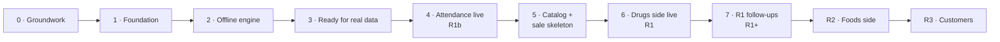

# 04 — Build Plan

**Product:** shop system for agro-vet and farm-supply shops (name to be decided)
**First shop:** MPC — Mabatini Pumba Center, Usa River, Arusha, Tanzania
**Version:** 1.45 · 7 Nov 2026 · Portion 4 of the planning pack, updated in portion 5
**Built from:** `01-product-spec.md` v1.0, `02-domain-model.md` v1.1, `03-architecture.md` v1.0 — now v1.1, v1.2 and v1.1, with Appendix A applied
**Status:** living document. Everything here is decided unless marked *(default)* — our best guess, safe to change at a stage review. Small open items are in the parking lot (§20). The changes this plan made to the other docs are listed in Appendix A (applied). BP7 and BP16 are ADRs in `docs/adr/`; the working rules for Claude Code are in `CLAUDE.md`.

**Changes in v1.45** (7 Nov 2026, UI-3): one choice by Jack, made while planning UI-3: the top bar names a side in words only, with no band under it, until a side says which look it gets. A new task, SHOP-4, after the settings screen in stage 4, gives each side its band (Jack chose a task over the parking lot; §20, item 19). The UI-3 card says what it built: the device's check of who it is, kept on the device; the lock a block brings at the device's next request; *Sajili kifaa hiki*, with a countdown on the server's clock; the manager's *Vifaa* screen, with *Sajili kifaa* and the device list; ids made on the phone; and two new pieces, `ButtonLink` and `Choice` (03 v1.32). Notes for UI-4 and UI-5. Marked **(v1.45)**.

**Changes in v1.44** (6 Nov 2026, UI-2): one choice by Jack, made while planning UI-2: a lint rule keeps the counter screens off the API client and TanStack Query (rule 5). The UI-2 card says what it built: the description committed as `shared/openapi.json`, every route's error answer in it, the client and its CSRF token, the store's rule for asking again, 67 codes in the shop's words with the list that keeps them, and the two CI checks (03 v1.31). Its review, all fixed by Jack's choice, adds 6 codes, the counter lock's two holes closed, `bad_request` under `/api/`, `NoConnection`, and notes for UI-4, UI-5 and PPL-4. A new task, CORE-8, first in stage 5, checks the server's codes against the list (Jack chose a card of its own over growing UI-2). A second review, fixed the next day, closes a drop halfway through an answer, plural sentences and four more ways round the counter lock. Marked **(v1.44)**.

**Changes in v1.43** (6 Nov 2026, UI-1): two choices by Jack, made while building UI-1. The screens get their words through use-intl, next-intl's own core, as next-intl 4.x brings a code compiler and a file watcher a static app never uses: ADR-0040 supersedes ADR-0032 (03 v1.30). In Swahili, stock reads word first, "mifuko 26 + kilo 35.5", as Swahili counts; English reads number first. The UI-1 card says what it built: the strict big.js copy, the bar kind of button, the top bar, the frame of both areas and the banner's box. For CAT-2: a selling unit's word is written beside its count, so it needs a form for one and for many ("mfuko 1", "mifuko 2"). STK-2's example follows the Swahili order. CAT-2 also decides whether a price may have cents, as `formatMoney` refuses them. §20 #21: the two roundings part on amounts with dozens of places. Marked **(v1.43)**.

**Changes in v1.42** (6 Nov 2026, UI-8): one choice by Jack, made while planning UI-8: the side band is colour only, and the side's name stays in words in the top bar. The UI-8 card says what it built: `@base-ui/react` pinned, `components/ui/` kept as shadcn wrote it, heights written so `cn()` knows them, the blue ring on a box with an error, a lint rule that follows real paths, the alert's two kinds, the `/design` page, and one copy of the contrast sums, with 03 v1.29 showing the new folders. For UI-1: the band carries no words, the top bar sets `--ring` to white, and what sits on the bar needs a button kind of its own. From UI-8's review: the lint lock covers screens written in JavaScript, the colour checks read every state, a status box is read when its text changes (not when it appears), and the guard refuses edits to shadcn's files. For UI-9: the default font has its own rule too. Marked **(v1.42)**.

**Changes in v1.41** (5 Nov 2026, UI-7): one choice by Jack, made while planning UI-7. The edge of a box you type in gets its own darker colour, `#7D8C83`, because a white box on a white screen shows only its edge, and the pale line read at 1.31:1 where WCAG asks 3:1. The UI-7 card says what it built: the tokens shadcn needs that its table left out, the chart and sidebar tokens gone, the digit widths read from the font files, and `fonts.test.ts`, with 03 v1.28 showing the new folder. From UI-7, for UI-8: a full-strength focus ring, limits on the danger and main buttons' hover colours, a white ring on green, and what to do if `shadcn add` writes greys back. For UI-1: a white ring on the green top bar. For SPIKE-2: its report names the font. Marked **(v1.41)**.

**Changes in v1.40** (5 Nov 2026, the design-system cards): choices by Jack, made while trying a preview of the screens. The app gets its own look, taken from the shop, in three new cards: UI-7 (colours, fonts, shapes, icon), UI-8 (the pieces) and UI-9 (each person's language and font). UI-1 now comes after UI-8. SYNC-2 and SYNC-10 carry a person's language and font; until now nothing saved a person's language at all (ADR-0039, 03 v1.27, 02 v1.20). Marked **(v1.40)**.

**Changes in v1.39** (5 Nov 2026, AUTH-8's second review): a choice by Jack. When two managers suspend each other, the first wins and the second is refused, as a suspended person can't act; PPL-4 builds it. A role takes the lighter lock too, and tests now fail if an office edit's locks are removed (03 v1.26). Marked **(v1.39)**.

**Changes in v1.38** (5 Nov 2026, AUTH-8's review): the review found two managers acting on each other could deadlock, on devices because of this card, and on staff before it (Jack: fix both). The card names the fixes, their tests and their commits (03 v1.25, 02 v1.19). SYNC-5's note says its skip-list test moves too. Marked **(v1.38)**.

**Changes in v1.37** (4 Nov 2026, AUTH-8): a choice by Jack, made while planning AUTH-8. An audit line reads the device from the same note the edit history's trigger reads, instead of each service passing it by hand, so no service can forget it and the two books can't disagree (03 v1.24, 02 v1.18). The card names what it built. SYNC-5 gets a note: its new device columns need a form of `ChangeRecordEdits` that writes the new rule. Marked **(v1.37)**.

**Changes in v1.36** (4 Nov 2026, AUTH-4's second review): the admin's login page and allauth's reset route still named the person of a badge, and three tests could pass with their rule broken. The card names the fixes, their tests and their commits (03 v1.23). UI-5 gets a note. Marked **(v1.36)**.

**Changes in v1.35** (4 Nov 2026, AUTH-4's review): the review of AUTH-4 found that a PIN could open the admin, and that a copied badge could read a name and an email through allauth. The card names the fixes, their tests and their commits (03 v1.22, 02 v1.17). Jack's answer: who may set a PIN follows the rule for a temporary password, and only the superuser sets an owner's. UI-2, PPL-4 and OPS-10 get notes. Marked **(v1.35)**.

**Changes in v1.34** (4 Nov 2026, AUTH-4): the card names the tests and the commits it built, and what building it settled (03 v1.21, 02 v1.16). One addition by Jack: a new PIN ends the sessions made with the old one. UI-2, UI-4, UI-5, AUTH-8, PPL-4 and SYNC-10 get notes. Marked **(v1.34)**.

**Changes in v1.33** (4 Nov 2026, AUTH-4): choices by Jack, made while planning AUTH-4 (03 v1.20). The card was twice its size, so the device joining the two books (X3) moves to a new card, AUTH-8, right after it: no shop's real records are written yet, so nothing is lost by waiting. A PIN lock's wait stops growing at an hour, online and offline (SYNC-10), and a new PIN lifts it. A person on a temporary password can still log in by PIN and sell; the office routes stay closed until they choose their own, and `me` says so. In the plan he approved, a PIN session names its device's shop and the person's job there. CTRL-2's and X3's pointers move to AUTH-8. Marked **(v1.33)**.

**Changes in v1.32** (4 Nov 2026, AUTH-6): Jack's answers to who may set a temporary password, and what building it and its two reviews settled, which the card names with its tests and commits (02 v1.15, 03 v1.19). AUTH-4, AUTH-7, UI-2, UI-5 and PPL-4 get notes. Marked **(v1.32)**.

**Changes in v1.31** (4 Nov 2026, AUTH-3's review): the review of AUTH-3 found two security holes the tests missed, and passwords that were never Argon2. The card names the fixes, their tests and their commits (03 v1.18), and corrects an honest limit it had too small. AUTH-4, AUTH-6, UI-5, OPS-5 and OPS-7 get notes, and OWN-6 no longer asks everyone for an email. Marked **(v1.31)**.

**Changes in v1.30** (4 Nov 2026, AUTH-3): the card names the tests and the commits it built, and what building it settled (03 v1.17). Only the allauth routes the app uses are mounted. allauth counted every phone login as one person, which our adapter fixes. `default` is the login limits' own cache table. A reset link holds its key after the `#`, and the real server sends no email until OPS-5. AUTH-4, AUTH-6, UI-5 and OPS-5 get notes. Marked **(v1.30)**.

**Changes in v1.29** (3 Nov 2026, AUTH-3): three choices by Jack, made while planning AUTH-3. A first or forgotten password is set face to face: the owner types a temporary one, and the person chooses their own at the next login; an email link is only for people who have one; no SMS for now (ADR-0038, which supersedes ADR-0017; 02 v1.14, 03 v1.16). With that job, AUTH-3 would be more than twice its size (§3.3), so it moves to a new card, AUTH-6, right after it; until then, the superuser sets passwords in the admin. A person with current jobs at two shops is refused safely until a new task, AUTH-7, lets them choose, before a second real shop joins (§14). AUTH-3 checks a shop's status at every login, a device's included, as AUTH-2 left for it. UI-5 waits for AUTH-6, reads allauth's own error shape and sends a person with no email to the owner; PPL-4's staff screen sets a temporary password through AUTH-6; OPS-5 notes the real server's email. Marked **(v1.29)**.

**Changes in v1.28** (3 Nov 2026, AUTH-5): one choice by Jack, and what building AUTH-5 settled (03 v1.15). The device list shows a side's devices to whoever works on that side, a seller included, who changes none of them: the card's third *Done when* said a manager sees only the sides they hold `device.manage` on, which PPL-5's routes can't do for a show action yet, and a device's name and last call are no secret. On Render the demo reads the caller's address from Cloudflare's `CF-Connecting-IP`, Render's own advice, since two proxies stand in front there. OPS-6's deploy makes the throttles' cache tables. Built in five commits, each with its own tests, so each passes `make check`. The review's fourteen fixes are on the card: each limit in a table of its own, a start counted by the caller's network and keeping no address, only real starts and new tries of a code counting, and one answer for a taken id wherever it is taken (03 v1.15, 02 v1.13). AUTH-3's *Watch out* gains the cache's trap for allauth's login limits. Marked **(v1.28)**.

**Changes in v1.27** (30 Oct 2026, AUTH-2): four choices by Jack, made while planning AUTH-2 (02 v1.12, 03 v1.14). AUTH-2 was twice its size, so the manager's confirm, the throttles and the office device routes UI-3 needs, which no card built, move to a new card, AUTH-5, right after it; UI-3 waits for AUTH-5. A confirmed pairing moves its key's hash to the device, so the hash lives in one place, and the login finds a key's shop through one named door that reads only the shop's id; the device is then read through the guard. The throttles count in PostgreSQL, in Django's database cache, shared by every worker (ADR-0023). AUTH-2 also settles the key's cookie (SameSite Strict, `/api/` only, sent again before browsers drop it after 400 days), CSRF on the start of a pairing, a start refused for a key that already opens a device, and versioned device routes. Built, the card names its tests and what it settled: a key is hidden from every error page, Django's own `set_cookie` included; a refused device keeps its cookie alive; the sweep calls every device route as a device of each shop and with no key. At AUTH-2's review, Jack chose a new ADR for the login door: ADR-0037 supersedes ADR-0022, naming the three ways past the shop guard. Marked **(v1.27)**.

**Changes in v1.26** (30 Oct 2026, AUTH-1): eight choices by Jack, made while planning AUTH-1 (02 v1.11, 03 v1.13). A new device belongs to no shop until a manager says yes, so it waits in a `PairingRequest` with no shop, a new exception to T1; the `Device` is made in the manager's shop when they confirm. The device gets its key when it asks, and the manager's yes switches it on, so the key never passes through the manager's phone. The key is stored as its SHA-256 hash. The per-shop counter keeps no edit history. Blocking and unblocking need a reason, written in the audit trail, and `device.manage` on the device's home side; unblocking keeps the key. `DeviceOutage` and the sync columns move to SYNC-5, `last_seen_at` to AUTH-2: nothing in AUTH-1 writes them. The card's commits follow. After AUTH-1's review, the card lists its fixes, one commit each: the key never shows in a printout; every new database rule has a test, as do a suspended manager, another shop's manager and a blank unblock reason; two pairings at the same moment are tested with two connections. AUTH-2 gets four notes: the path from a key to its device past the guard, a confirm sent twice, the key kept out of error pages, and the device showing its shop. Marked **(v1.26)**.

**Changes in v1.25** (30 Oct 2026, PPL-5): three choices by Jack, made while planning PPL-5. Every route names the permission each of its actions needs, and an action it doesn't name is refused, so no route is ever open by forgetting. A visit reads the person's permissions once, so a list costs the same few queries however many sides a shop has. A show action (a list, a read) needs only its side to be visible for now; one that needs a key of its own, such as buying prices (`cost.view`), debts (`debt.view`) or reports (`report.view`), is refused until the first card that shows rows behind one builds it: CAT-2 gets a note. The card's commit that gives the sweep's staff the Owner role moves up, before the hooks, so no test that passed before turns red on the way; the card's own tests come first and fail until the hooks pass them. Built, the card names its tests and what it settled: every read of a route keeps to the person's sides, its own @actions included; a change to a whole list needs its key on the whole shop; a create sent twice is answered as a read. After PPL-5's review, the card lists its fixes, one commit each: a create that doesn't ask for itself is asked on the whole shop; a method a route doesn't answer, OPTIONS included, is 405 again; a change to one row is checked before its action runs; routes add to their rows in `base_rows()`; a change always names a key of its own; a repeat runs the route's own checks. Marked **(v1.25)**.

**Changes in v1.24** (29 Oct 2026, PPL-3): one decision made while planning PPL-3: a new shop gets its role templates from a `people` service, `set_up_shop`, which makes the shop with `create_shop` and then copies them, in one transaction, because `shops` may not import `people` (ADR-0035, 03 v1.12). A shop made by `create_shop` alone has no roles, so nobody may act there: forgetting fails closed. The card's last commit is renamed to match. CORE-6's two side hooks move to a new card, PPL-5, right after PPL-3 (Jack): with them, PPL-3 would be twice its size (§3.3). AUTH-3 and AUTH-4 wait for PPL-5, so no login comes before the routes check permissions. Deliveries are weighed as they arrive, offline, by anyone with `stock.weigh` (Jack, 02 v1.10): STK-3 and STK-4 carry it. The card names the tests and the commits it built, and what it settled: the six templates as Jack chose them, and who may give a role (Jack); PPL-4, PPL-5, AUTH-1, AUTH-4, DATA-1, CAT-1 and CAT-2 get notes. After PPL-3's review, the card lists its fixes, one commit each: the giver check reads the role as stored; a person of a shop that isn't open is refused loudly; a new code reaches the shops that already have roles. PPL-4's row says what taking a role away needs, and CAT-1 asks Jack whether a product is checked on any of its sides or on every one. Marked **(v1.24)**.

**Changes in v1.23** (29 Oct 2026, CTRL-2): one decision by Jack, made while planning CTRL-2: office edits are recorded by a trigger of our own into one append-only table, `control.EditEvent`, not by django-pghistory, whose tables CORE-7's sweep refuses (ADR-0036, 03 v1.11). No device exists yet, so the history and the audit trail name the person, and AUTH-4 adds the device. CORE-7's sweep gets a list of the files allowed to run raw SQL, with one file. The card names the tests and the commits it built, and CTRL-5's row names both books. After CTRL-2's review, the card lists its fixes, one commit each: the trigger refuses an edit of another shop's row, keeps each edit's own time, and alone writes the history; services that pass their own `by` tell PostgreSQL too; every shop table people change keeps a history, payment accounts and stock locations included (Jack). CTRL-5, PPL-4, AUTH-1 and AUTH-4 get notes. Marked **(v1.23)**.

**Changes in v1.22** (29 Oct 2026, CTRL-1): three decisions by Jack, made while building CTRL-1 (02 v1.8): a flag may close straight from open, always with a note; every explanation is kept; and a person a flag names may explain it but never close it. CTRL-4 checks who may close one (`flag.review`). After CTRL-1's review, the card lists the tests and the fixes it built, one commit each, and CTRL-4's row gets two notes for its screen. So the card also builds the flag's notes and four actions, not two, and keeps its people as link rows: it is `M`, not `S`. Its services take Actors and rows, as CORE-6's do, not ids. The type codes of generic links are one list in `core`, empty until a card points at its own tables (03 v1.10). Marked **(v1.22)**.

**Changes in v1.21** (28–29 Oct 2026, CORE-7): the card names the tests and the commits it built. The guard's checks got a commit of their own, between the model sweep and the route sweep. Two reviews made the sweep stricter, one fix per commit. It refuses two routes with one name; looks for shop A's names and amounts as well as its ids, in any answer it can read, and reports one it can't (a PDF) unless the route has a leak test of its own; looks as shop A first, who must see its own rows; tries edits, voids (POST) and deletes as well as reads, each answered as for an id no shop has; follows pages up to a limit; and scans for raw SQL, hand-built queries and Django's base manager beside the two doors. Two things were settled in CORE-7: tests may use `all_shops` too, as CORE-2's own test of the admin's door does; and the two link tables Django makes for `User`'s admin permissions, which have no `shop` and CASCADE, sit on the sweep's list of infrastructure tables (Jack: they hold Django's admin data, never a shop's). The sweep is never loosened, nor edited, to let something pass: what grows is its data, in `backend/tests/conftest.py`, and its allowed lists, in `backend/tests/sweep_lists.py`. For later cards: a route over a new table gives the sweep's two shops a row of it, with values only shop A has; PPL-3 gives both shops' sweep staff all of their own shop; a route under `api/` that reads a shop's tables but is not an office route, such as pairing (AUTH-2), PIN login (AUTH-4) or sync (SYNC-2 on), is refused by the sweep until a reviewed change teaches the sweep to call it; SALE-2's lines keep their side through their sale, which the side check can't name yet. Background tasks live in each app's `tasks.py` (03 v1.9). Marked **(v1.21)**.

**Changes in v1.20** (28 Oct 2026, CORE-6): the card names the tests and the commits it built. It made three more commits than it listed: a taken shop code got its own, the base views and the creates were split in two, and this docs commit closes it. After the review, Jack chose to close the API docs in production: the page runs code from a CDN on our address; the demo and a laptop keep them open. What CORE-6 decided, for later cards: login names who acts and the shop, as an Actor in `request.auth` with a `shop_id` and a `staff_id`, and the base view opens that shop around the whole visit; office routes need a staff member, so a device alone is refused (AUTH-2, AUTH-3, AUTH-4). Two side hooks, `visible_sides()` and `check_side_permission()`, wait for PPL-3. A client-made id must be a UUIDv7. An id taken in another shop is refused as `id.taken`, revealing nothing (SYNC-4). The error shape still needs its place in the schema, and every error code a message (UI-2). Marked **(v1.20)**.

**Changes in v1.19** (28 Oct 2026, CORE-5): the card names a test for each *Done when* line and the runner's own checks. Its float check is a test, not CI config, so its commit is `test:`, not `ci:`. The card also names `split_into_units`, the helper behind E1's "26 bags + 35.5 kg". UI-1 gains a *Watch out* on the traps the shared vectors pin, which the TypeScript side must match. Marked **(v1.19)**.

**Changes in v1.18** (27 Oct 2026, CORE-4): CORE-4's `Setting` has no `set_by` column. Who set a value is the row's `created_by`, which every shop row has had since PPL-2 (Jack, while planning CORE-4; 02 v1.7). The two tolerances default to 0 until the owner agrees values (02 §20, item 2). The card names a test for its last *Done when* line and the extra tests its plan added, and splits its last commit in two: the dated rows, then the lookup. From CORE-4's review, for later cards: SHOP-3's row says what its write service checks and two choices it makes (backdated values; a side going back to the shop's value); CAT-2's row names the clash between one price row per date (03 §9) and a same-day fix. Marked **(v1.18)**.

**Changes in v1.17** (27 Oct 2026, CORE-3's tick): CORE-7's *Watch out* says which tables really lose the shop guard: an abstract base with a fresh `Meta`, or a table with managers of its own. A table that only writes a fresh `Meta` keeps it, as CORE-3's review showed and `core/models.py` now says. Marked **(v1.17)**.

**Changes in v1.16** (27 Oct 2026, CORE-3): the card builds an `AppendOnly` base model, not a mixin, as the plan Jack approved says; 03 §5.3 already calls it a base. From CORE-3's review, for the cards that build void tables: a *Watch out* on CORE-3 lists the two rules each void table adds itself (a complete stamp, in its own shop), how a void is written, and why the trigger's SQL never changes once on `main`; MONEY-1, CASH-2 and ATT-1 point to it. Marked **(v1.16)**.

**Changes in v1.15** (27 Oct 2026, SHOP-2): one decision by Jack, made at SHOP-2's review. The admin's *Add shop* page keeps saving a bare shop, with no sides; making it use `create_shop` is a later task, in the parking lot (§20, item 16). SHOP-2's *Watch out* records the answer it chose: `create_shop` takes no "who". From SHOP-2's review, for later cards: DATA-1 adds a `kind` argument to `create_shop`; CORE-6 also turns a taken shop code into a code of our own; CORE-7 sweeps many-to-many links and the tables Django makes for them; a cash drawer serves exactly one side, which MONEY-2 checks (§20, item 17). Marked **(v1.15)**.

**Changes in v1.14** (27 Oct 2026, PPL-2): two decisions by Jack, made while planning PPL-2. A staff member's photo is optional, and it arrives with PPL-4, which already waits for the file storage a photo needs (CTRL-3); with no photo, UI-4's staff picker shows the full name in large letters with the nickname under it (02 v1.4). PPL-2 builds no admin page: a staff admin page is its own task, in the parking lot (§20, item 15). From PPL-2's review, for later cards: `created_by` reaches SHOP-2's and CTRL-1's tables; PPL-3 also covers people who have left; AUTH-4 sets Argon2's cost on purpose; PPL-4 waits for CTRL-2, so a suspension's reason is stored. Marked **(v1.14)**.

**Changes in v1.13** (27 Oct 2026, CORE-2): the card's last *Done when* line names the admin's own manager, `all_shops`, beside `system_context()`. The card builds both, and both read every shop, so a line naming only one was not true. What the guard means for later cards is in their new *Watch out* lines: PPL-2 (writes and admin pages need a current shop; the test-only table follows `ShopScoped`), CORE-6 and SYNC-4 (an id already taken in another shop), CORE-7 (sweep the guard itself). Marked **(v1.13)**.

**Changes in v1.12** (27 Oct 2026, SHOP-1): CORE-7's allowed list names the `Shop`: it is the tenant, so it has no `shop`, and the sweep must pass with no change to the test (02 v1.3, 03 v1.6). Marked **(v1.12)**.

**Changes in v1.11** (26 Oct 2026, SPIKE-2): decisions by Jack, made while planning SPIKE-2. The card gains the *Learn* line its drill starts from, and a *Tests* line. Its page size, `size: 80mm auto`, is not valid CSS, so Chrome would drop it: the page measures the slip and sets the height itself. The card ships in two PRs, as SPIKE-1 did, because the demo deploys only from `main`. OWN-1 is answered: an Epson receipt printer on USB, with 80 mm paper. The QR code is left out of the spike, because the shop doesn't use QR codes yet; whether R2's slips carry one becomes parking-lot item 14. Marked **(v1.11)**.

**Changes in v1.10** (25 Oct 2026, SPIKE-1): SPIKE-1's findings (`docs/spikes/01-pwa-offline.md`) reach the cards that build on them. SYNC-13 starts from the update bar SPIKE-1 built, adds regular update checks, and gains a *Watch out* line; SYNC-12 and SYNC-6 gain one each. The parking lot gains the workers' iPhone question, for Jack to decide, and what SPIKE-1 left untested. Marked **(v1.10)**.

**Changes in v1.9** (25 Oct 2026, SPIKE-1): two decisions by Jack, made while planning SPIKE-1. The card ships in two PRs: the demo deploys only from `main`, so the device tests need the spike's code there first, and the second PR's deploy tests the update prompt. The card also gains the *Learn* line its drill starts from. Marked **(v1.9)**.

**Changes in v1.8** (23 Oct 2026, OPS-2): DATA-1 gains a *Watch out* line from PPL-1's review. Django's `/admin/login/` has no rate limit yet. The demo goes public with OPS-2, but it has no accounts, and the free plan has no shell to make one, so there is nothing to guess. DATA-1's seed makes the first account with a password, so the limit, or keeping that account out of the admin, comes with it. Marked **(v1.8)**.

**Changes in v1.7** (23 Oct 2026, OPS-1): the image job becomes the fourth required check on `main`, Jack's decision while planning OPS-1. From OPS-2 on, every merge to `main` deploys the demo, so an image that doesn't build or serve must block the merge, not break the demo after it. OPS-1's *Build* line and *Done when* say so. OPS-2 also gains a *Watch out* line from OPS-1's review: on the demo, Render's proxy is the way in, not Caddy, and the image's cache and compression settings are still open. Marked **(v1.7)**.

**Changes in v1.6** (23 Oct 2026, PPL-1): two decisions by Jack, made while planning PPL-1. PPL-1 asks an email only of the superuser, because most of the shop's people have a phone but no email, so AUTH-3 gains a *Decide first* line on logins and lost passwords without email. Each group gets its own web address on one server: parking lot item 11, to become an ADR with OWN-3. Marked **(v1.6)**.

**Changes in v1.5** (22 Oct 2026, CORE-1): PPL-1 gains a *Watch out* line on the admin's `id`: CORE-1 keeps the id editable on purpose, so DRF keeps the id a client sends (ADR-0007). Marked **(v1.5)**.

**Changes in v1.4** (22 Oct 2026, REPO-7): release-please runs with a token from the repo's own GitHub App, so its release PR runs CI like any other (03 v1.5). REPO-7's *Build* line says so, and OPS-6 gives the deploy its new reason for being a job of the release workflow. OPS-1's note on job names also lists `pr-title`, the third required check. Marked **(v1.4)**.

**Changes in v1.3** (21 Oct 2026, REPO-6): `control` sits on layer 0, beside `core` (ADR-0035, 03 v1.4), so REPO-6 lists three exceptions; CORE-2 and PPL-3 gain a *Watch out* line on what the layer contract refuses. After REPO-5, OPS-1 also adds a Dependabot entry for its `Dockerfile` and keeps its job name clear of the required checks. Marked **(v1.3)**.

**Changes in v1.2** (20 Oct 2026, REPO-4): OPS-5's Caddyfile also sends `/_allauth/` to Django, so password login works in production as it does locally (ADR-0017, 03 v1.3). Marked **(v1.2)**.

**Changes in v1.1** (18 Oct 2026, portion 5): Claude Code makes every commit, but only after Jack says yes, and every commit message carries a `Why:` line (BP11, §3.3–§3.5, REPO-5 — confirmed with Jack); a task starts with `/start-task` and ends with `/finish-task` (§3.3); a changed decision is a new ADR that supersedes the old one (§3.2, §19); REPO-1, REPO-3 and REPO-4 gain the Claude Code setup, the script names and the guard tests; Appendix A is applied. Each change is marked **(v1.1)**.

---

## 0. How to read this

- A **build plan** turns the spec, the domain model and the architecture into an ordered list of small tasks, so building becomes "do the next task".
- **Stage** = a group of tasks that ends in something you can see: a demo, a deploy or a go-live. **Epic** = one feature area, a parent issue on GitHub (e.g. `SYNC`). **Task** = the smallest piece of work: one issue, one branch, one pull request, one Claude Code session.
- **Task IDs** are an epic code plus a number (`CORE-2`, `SYNC-8`). Once the issues exist they never change, even when a task moves to another stage. The codes are listed in §4.
- **Sizes:** `S` ≈ 1–2 hours, `M` ≈ 2–4 hours. Nothing bigger — it is split first (BP3).
- **Modes:** *Jack-led* or *Claude-led* (BP10).
- **Order:** every stage lists its tasks in build order — take them top to bottom.
- **Detail:** stages 0–2 have full task cards (§5–§7). Stages 3–7 have one line per task; their cards are written at the review that ends the stage before (BP2). R2 and R3 are outlines.
- Tags **[R1] [R1b] [R2] [R3] [Later]** as before, plus **[R1+]**: the R1 follow-ups shipped in the weeks after the Drugs go-live (BP8). **✚** = added beyond the three docs; veto freely.

## 1. The plan on one page



| Stage | Ends with | Milestone | Rough hours |
|---|---|---|---|
| 0 Groundwork | CI green, the demo deploys itself, the two biggest unknowns answered | Foundation | 30–45 |
| 1 Foundation | Pair a device and log in with a PIN; shops can't see each other; ledgers refuse edits | Foundation | 65–90 |
| 2 Offline engine | A clock-in made offline reaches the server exactly once; anyone can try it on the demo | Foundation | 50–65 |
| 3 Ready for real data | Production server, tested backups and alerts — before any real data | Foundation | 25–35 |
| 4 Attendance live (R1b) | Every worker clocks in; the first month's pay is calculated | R1b · Attendance | 45–60 |
| 5 Catalog + sale skeleton | Products searchable offline; one sale from the device to the ledgers and back | R1 · Drugs | 40–55 |
| 6 Drugs side live (R1) | The Drugs side runs on it; SmartMauzo and the paper books stop | R1 · Drugs | 100–140 |
| 7 R1 follow-ups (R1+) | Returns, daily counts, shopping list, exports — the weeks after go-live | R1+ | 25–35 |

Hours = task sizes plus up to 40% for learning, debugging and review: about **350–490 hours** to the Drugs go-live. They are replaced by real numbers after the first ten tasks (§19).

**Rough calendar.** Building starts in early November 2026, after portions 5 and 6, at about 8 hours a day, 5 days a week (Jack, 18 Oct). *Ready* means the part works on the real server; the shop starts using it when the owner agrees (BP7). Attendance starts on the 1st of a month (§16). The offline demo — the part worth showing recruiters — is ready at the end of stage 2.

| Hours a week | Offline demo | Attendance ready | Drugs side ready |
|---|---|---|---|
| **40** *(8 h × 5 days)* | **early December 2026** | **mid-December 2026 — in use from January** | **late January 2027** |
| 30 | mid-December 2026 | end of December 2026 — in use from January | mid-February 2027 |
| 20 | end of December 2026 | end of January 2027 — in use from February | early April 2027 |

The Foods side (R2) isn't sized yet; at 40 hours a week it is ready around March–April 2027. Eight hours a day next to shop work is a lot, so the real hours are checked after the first ten tasks and the dates move with them (§19).

## 2. Key decisions

BP7 and BP16 are ADR-0033 and ADR-0034 (BP5 is covered by ADR-0012, D12's ADR); the others are working rules in `CLAUDE.md` and in this plan **(v1.1)**.

**BP1 — Stages end in something you can see.**
Stages 0–3 build the base once. From stage 4, each stage ends in a go-live or a demo, then a short review.
*Why:* progress you can show to the owner and to recruiters, and a fixed point to stop and re-plan.

**BP2 — Near work in detail, far work in outline.** ✚
Stages 0–2 have full cards now. Later stages have one line per task; their cards are written at the review that ends the stage before.
*Why:* "many things will change while building" — cards for month five would be stale by then.

**BP3 — One task = one branch = one PR = one Claude Code session, and it fits one sitting.**
`S` ≈ 1–2 h, `M` ≈ 2–4 h; anything bigger is split before it starts.
*Why:* a task fits an evening after the shop closes, and small PRs are easy to review and to learn from.

**BP4 — Vertical slices after the foundation.**
Each task goes through every layer it needs — model, service, API, screen, tests — and works when merged.
*Why:* nothing half-built waits for months; every merge can be shown.

**BP5 — The custom `User` comes before any `migrate`, in stage 0.** ✚
It lands before the demo's first deploy, because that deploy runs migrations.
*Why:* Django can't swap its user model after the first migration (02 D12). *Cost:* very high if missed.

**BP6 — The clock-in is the first offline document.** ✚
The sync engine is proven end to end with a clock-in (SYNC-11); the sale then reuses it (SALE-4).
*Why:* it is the smallest real document — one table, no money, no stock — so the hardest part (sync) is learned on simple ground. This holds whichever release goes first.

**BP7 — One website with everything, built one part after another: attendance first.** ✚
The website holds every part — attendance, the Drugs side and the Foods side — in one repo, at one address (confirmed with Jack). The parts are built in this order: attendance (R1b), then the Drugs side (R1), then the Foods side (R2). Each part is switched on in settings; the shop starts using it once the owner agrees, at the review before its go-live *(default: as soon as it is ready)*.
*Why attendance first:* it is the smallest real feature; every worker on both sides uses it daily; it fixes problem #2 (spec §4); and it tests the devices, PINs, offline storage and power cuts on real shop days before any money depends on them — while the Drugs product data is prepared.
*Cost:* the Drugs side (problem #1) is ready a few weeks later than if it were built first; the product name, the web address and the PDPC registration are needed sooner (§15).
*If the shop prefers to start several parts on the same day:* the build order stays the same; only the go-live dates in §16 move.

**BP8 — R1 goes live in two steps.** ✚ *(default)*
**R1** is what replaces SmartMauzo and the paper books on the Drugs side. **R1+** — partial returns, daily counts, reorder levels and the shopping list, WhatsApp receipts, exports, debt aging, debt adjustments, merging duplicate customers and the Lipa Namba check — follows in the weeks after go-live, with normal deploys (§12).
*Why:* real use sooner; none of R1+ is needed on day one (a full return is a cancel). If the printer spike fails, WhatsApp receipts move into R1.

**BP9 — Tests first where the answer is known.**
Calculations, posting, rules and sync are written test-first; screens get tests alongside. The worked examples (02 §18) and the attendance table (spec §8.1) become named tests, and E1–E5 also become shared test vectors (03 §8).
*Why:* the docs already hold the expected numbers.

**BP10 — Jack-led and Claude-led tasks.** ✚
The first task of each new kind is *Jack-led*: a short drill on the idea first (the card's **Learn** line), then Claude writes the tests and explains, Jack writes the main code, and Claude reviews. The rest are *Claude-led*: Claude Code writes; Jack reviews and explains it back in the PR. About one task in four is Jack-led.
*Why:* job interviews ask you to explain and write code yourself, not only to ship it; it also matches "drill, then apply the same day".

**BP11 — GitHub flow, squash merge, conventional commits.**
Short branches from `main`. The PR title is a conventional commit, checked in CI. Squash-merge puts one commit per task on `main`; the small commits stay visible inside each PR. release-please ✚ writes the changelog and the version tags from those titles (REPO-7): `v0.x` until the first go-live, `v1.0.0` at it.
**Every commit is approved by Jack** (confirmed with Jack) **(v1.1)**: Claude Code makes the commits in both modes, but before each one it says plainly what was done and why, and it commits only after Jack says yes. Every commit message carries a `Why:` line with a strong reason (§3.5); a `commit-msg` hook refuses a message without one (REPO-5).
*Why:* a history anyone can read, releases with no manual bookkeeping, and every step of the history understood and approved by Jack.

**BP12 — This file is the plan; GitHub tracks the status.**
Issues are created by script for the current and the next stage only.
*Why:* 150 issues created today would go stale and bury the next task.

**BP13 — Data preparation and baselines start now.** ✚
The product, customer, debt and staff sheets (Appendix B) are fixed today, so the shop can fill them in while the code is built. Baselines (spec §12) are measured before each go-live — starting with this month's month-end pay.
*Why:* entering hundreds of products with selling units often takes longer than building the import, and the "before" numbers vanish at go-live.

**BP14 — The production server is rented just before the first go-live.** ✚
Stage 3 always sits right before it.
*Why:* no rent for an idle server; the demo covers everything before that.

**BP15 — The demo opens without pairing.** ✚
On the demo only, *Jaribu demo* registers the visitor's browser as a device and shows the demo staff with their PINs (OPS-3).
*Why:* a recruiter will not pair a device, and the offline counter is the part worth showing.

**BP16 — No open-source licence yet.** ✚ *(default)*
The repo is public, with all rights reserved and one line in the README saying so.
*Why:* it is the only reversible choice — code released under an open licence stays open forever, and the product may be sold to other shops later. Revisit before R3 or a first outside contributor.

## 3. How every task runs

### 3.1 The task card

```markdown
### CORE-2 · Tenancy guard that fails closed
`M` · Jack-led · after SHOP-1 · branch `feat/core-2-tenancy-guard`
**Learn:** what you will understand afterwards (the drill, for Jack-led tasks).
**Build:** what to make, in a few lines.
**Done when:**
- [ ] checks anyone can verify
**Tests:** `test_names_to_write_first`
**Commits:** `test(core): …` → `feat(core): …`
```

- **after** = tasks that must be merged first. **needs** = an answer from the owner or the shop (§15).
- **Done when** is the task's acceptance test: when every box is ticked, it is done.
- **Commits** is a suggested order of small commits, one tested step each.

### 3.2 Ready and done

**Ready** — a task can start when the tasks it comes after are merged, its card is clear, any owner answer it needs is in (or a default is agreed), and it fits one sitting.

**Done** — a task is done when:
1. Every *Done when* box is ticked.
2. Its tests pass in CI; worked examples have their named tests.
3. Every file has a header comment, and comments explain *why* — generously, for learning.
4. Logic sits only in services and calculations; import-linter passes; services and calculations keep at least 90% test coverage (03 §11).
5. Migrations have been read line by line; `makemigrations --check` is clean.
6. The API schema and the TypeScript types are regenerated, with no difference.
7. New screen text is in `sw.json` and `en.json`; Jack has checked the Swahili.
8. The demo seed covers the feature, if it needs data.
9. If a decision changed: a new ADR that supersedes the old one, plus the matching change to 02, 03 or this plan, in a `docs:` commit (ADR-0000) **(v1.1)**.
10. The PR is squash-merged with green CI, the card is ticked in this file, and the hours are noted in the PR.

### 3.3 A Claude Code session, step by step

1. Take the next *Ready* card on the board and move it to *In progress*.
2. Create the branch (§3.4, steps 1–2).
3. Start Claude Code — it opens in **plan mode** — and type `/start-task CORE-2`. It reads CLAUDE.md and the card, checks the card is *Ready*, and plans small steps, each ending in a commit with its reason. Nothing is written yet **(v1.1)**.
4. Read the plan, ask *why* until every step makes sense, then approve. A *Jack-led* task starts with a 15-minute drill on the idea; then Claude writes the tests, Jack writes the main code, and Claude reviews.
5. Build step by step — tests first where the card says so. After each green step, Claude Code says plainly what was done and why, shows the commit message, and commits only after Jack says **yes** **(v1.1)**.
6. Type `/finish-task`: it runs `make check` (everything CI runs), goes through the Done list, asks the `reviewer` subagent for a fresh review, helps write **What I learned** in 3–5 lines, and drafts the PR **(v1.1)**.
7. Push, open the PR and fill in the template.
8. When CI is green: squash-merge, tick the card here, note the hours, `/clear`.

If a task runs past twice its size: stop, write what blocks it in the issue, then split it or bring it to a chat.

### 3.4 The git routine

```bash
# 1. Start from the latest main
git switch main
git pull --ff-only

# 2. One branch per task, named on its card
git switch -c feat/core-2-tenancy-guard

# 3. Commit each small, tested step. Claude Code does this after your "yes";
#    by hand it looks like this (the second -m is the reason, §3.5):
git status                 # what changed?
git add -p                 # pick the pieces that belong together (or: git add <file>)
git commit -m "test(core): a query without a shop raises" \
           -m "Why: forgetting the shop must fail loudly, not leak another shop's rows (ADR-0022)."

# 4. Run every check CI runs
make check

# 5. Push the branch and open the pull request (the template opens in the browser)
git push -u origin feat/core-2-tenancy-guard
gh pr create --web

# 6. If main moved while you worked, bring its changes in (no force-push needed)
git fetch origin
git merge origin/main

# 7. CI is green: squash-merge, delete the branch, update main
gh pr merge --squash --delete-branch
git switch main
git pull --ff-only
```

### 3.5 Commit messages

`type(scope): what it does, in the present tense` — then a blank line and a `Why:` line **(v1.1)**.

- **Types:** `feat` (new behaviour), `fix`, `test`, `refactor` (same behaviour, better code), `docs`, `chore` (tooling), `ci`, `build`, `perf`.
- **Scope:** the app or area — `core`, `people`, `sync`, `sales`, `frontend`, `deploy`…
- **Why:** one or two sentences on why this change is needed now — the rule, test or *Done when* item it serves — not a repeat of the subject. Every commit has one (confirmed with Jack), and a `commit-msg` hook refuses a commit without it (REPO-5). No strong reason means the change belongs in another commit **(v1.1)**.
- **Subject examples:** `feat(people): custom User with phone and email` · `test(sync): same batch twice posts once` · `fix(money): expected cash ignored cash change`.
- The PR title uses the same format: it becomes the one commit on `main`, and release-please reads it.

## 4. GitHub setup

Done in portion 6.

- **Milestones:** `Foundation` (stages 0–3) · `R1b · Attendance` · `R1 · Drugs` · `R1+` · `R2 · Foods` · `R3 · Customers`.
- **Epics:** one parent issue per code below, with its tasks as sub-issues. R2 adds its own epics (§13) at the stage 7 review.

| Code | Epic | Code | Epic |
|---|---|---|---|
| `REPO` | Repository, tooling, CI | `ATT` | Attendance |
| `SPIKE` | Questions answered by a quick experiment | `WAGE` | Pay runs and payslips |
| `CORE` | Base models, tenancy, triggers, settings, numbers | `CAT` | Products and prices |
| `SHOP` | Shops, sides, locations, accounts, settings screen | `STK` | Stock |
| `PPL` | Users, staff, roles | `SALE` | Selling |
| `AUTH` | Devices, PIN and password logins | `MONEY` | Payments |
| `CTRL` | Flags, audit, attachments | `CASH` | Drawers and cash-up |
| `UI` | App foundations and shared screens | `DEBT` | Customers and credit |
| `SYNC` | The offline engine | `RPT` | Reports and exports |
| `DATA` | Imports and the demo seed | `OPS` | Images, servers, deploys, backups, monitoring |
| `LIVE` | Going live (mostly not code) | `FOLIO` | Portfolio |

- **Issue title:** `CORE-2 · Tenancy guard that fails closed`; the body is the card. A task issue template matches the card.
- **Labels:** `size:S` `size:M` · `mode:jack-led` `mode:claude-led` · `type:feat|fix|chore|docs|spike|ops` · `needs-owner` (waiting for an answer) · `owner` (the shop and owner track, §15) · `blocked`.
- **Project board:** Backlog → Ready → In progress → In review → Done, with the fields *Stage*, *Size*, *Mode* and *Hours*.
- **PR template:** task ID and `Closes #…`; what and why; how it was tested; screenshots; *What I learned*; the Done checklist; hours.
- **Protection:** `main` changes only through PRs with green CI, for admins too; squash-merge only; no force-push; secret scanning and push protection on; Dependabot weekly.
- **Issues are created by a script** using `gh`, from the cards of the current and the next stage (BP12); the owner track (§15) becomes issues labelled `owner`.

## 5. Stage 0 — Groundwork

**Goal:** an empty but real repo — CI green, the demo deploying itself, and the two biggest unknowns (offline on the shop's own devices, and printing) answered in the first weeks.
**Done when:** a PR runs CI green; merging deploys the demo; both spike reports are in `docs/spikes/`.
**You'll learn:** uv and a Django project layout; Next.js as a static app; Docker Compose and a reverse proxy; GitHub Actions; container images; service workers; printing with CSS.
**Needs:** OWN-1 (printer details), OWN-2 (which shop devices).
**Order:** top to bottom. SPIKE-2 and FOLIO-1 can move anywhere after OPS-2.

### REPO-1 · Repository and GitHub setup
Done in **portion 6**, in chat — not with Claude Code.
**Done when:**
- [x] A public GitHub repo with the layout of 03 §4, docs 01–04, the ADRs, `CLAUDE.md` and `.claude/` (unpacked from the portion 5 bundles), a README stub and `.editorconfig` **(v1.1)**.
- [x] `.gitignore` covers `.env` and `.env.*` (but not `.env.example`), `private/`, `CLAUDE.local.md`, `.claude/settings.local.json`, `__pycache__/`, `node_modules/`, `.next/` and `frontend/out/` **(v1.1)**.
- [x] Templates, labels, milestones and the issues for stages 0 and 1 exist (§4).
- [x] `main` is protected; secret scanning and push protection are on.

### REPO-2 · Backend skeleton
`M` · Claude-led · after REPO-1 · branch `chore/repo-2-backend-skeleton`
**Learn:** a uv project; a Django project with settings split by environment; how pytest-django finds them.
**Build:** `backend/` with Python 3.14, Django 6.1 and DRF through uv; `config/settings/{base,dev,test,prod}.py` reading environment variables; the 13 empty apps of 03 §5.1 under `apps/`, each with a header saying what it owns; `GET /api/health/` → `{"status": "ok"}`; ruff, mypy + django-stubs, pytest + pytest-django.
**⚠ Don't run `migrate` on any database until PPL-1 is merged** (BP5).
**Done when:**
- [x] `uv run pytest`, `ruff check` and `mypy` pass; `manage.py check` is clean.
- [x] Every app says in one line what it owns.
**Tests:** `test_health_returns_ok`
**Commits:** `chore(backend): uv project with Django 6.1` → `chore(backend): settings per environment` → `chore(backend): empty domain apps` → `chore(backend): ruff, mypy and pytest` → `feat(core): health endpoint`

### REPO-3 · Frontend skeleton
`M` · Claude-led · after REPO-1 · branch `chore/repo-3-frontend-skeleton`
**Learn:** Next.js used as a static app (`output: 'export'`) and why the counter needs that (03 AD2).
**Build:** `frontend/` with pnpm, Next.js 16 (static export, `images.unoptimized`), React 19, TypeScript strict, Tailwind v4, shadcn/ui, ESLint, Prettier, Vitest; a *Karibu* page; the scripts `dev`, `build`, `test`, `lint` and `typecheck` (`.claude/rules/frontend.md`) **(v1.1)**.
**Done when:**
- [x] `pnpm build` writes plain files to `out/` that open with no Node server.
- [x] Lint, type check and one Vitest test pass.
**Commits:** `chore(frontend): next.js static export` → `chore(frontend): tailwind and shadcn` → `chore(frontend): lint, format and vitest`

### REPO-4 · Local development like production
`M` · Claude-led · after REPO-2, REPO-3 · branch `chore/repo-4-local-dev`
**Learn:** Docker Compose; a reverse proxy; why one address matters for cookies.
**Build:** `compose.dev.yml` with PostgreSQL 18 and Caddy on `localhost:8080` (`/api/` and `/_allauth/` to Django on your machine, everything else to the Next.js dev server); a `Makefile` (`dev`, `test`, `check`, `fmt`, `migrate` — `check` also runs the guard's tests: `python3 -m unittest discover -s .claude/hooks` **(v1.1)**); `.env.example` with every setting; "Run it locally" in the README.
**Watch out:** Caddy runs in Docker while Django and Next.js run on your machine, so Caddy reaches them through `host.docker.internal` (on Linux, add `extra_hosts: ["host.docker.internal:host-gateway"]`). Still no `migrate` until PPL-1.
**Done when:**
- [x] From a fresh clone, following the README, `localhost:8080` shows *Karibu* and `localhost:8080/api/health/` answers from the same address.
- [x] Django connects to the PostgreSQL in Compose.
- [x] `make check` runs the guard's tests too **(v1.1)**.
**Commits:** `chore(dev): postgres and caddy in compose` → `chore(dev): make commands` → `docs: run it locally`

### REPO-5 · CI and branch protection
`M` · Claude-led · after REPO-4 · branch `ci/repo-5-ci`
**Learn:** GitHub Actions jobs, service containers and caching; why `main` is protected even when you work alone.
**Build:** `ci.yml` — a backend job (uv, ruff, mypy, `makemigrations --check`, pytest with a coverage report on a PostgreSQL 18 service) and a frontend job (pnpm, lint, types, Vitest, `pnpm build`); pre-commit hooks (ruff, Prettier) and a `commit-msg` hook that refuses a message without a conventional subject and a `Why:` line (§3.5) **(v1.1)**; Dependabot weekly for uv, pnpm, Actions and Docker; branch protection (§4), with no bypass for admins.
**Done when:**
- [x] A PR shows two green checks; a lint error turns it red.
- [x] A direct push to `main` is refused — your own included.
- [x] A commit without a `Why:` line is refused on Jack's machine **(v1.1)**.
**Commits:** `ci: backend checks` → `ci: frontend checks` → `ci: require both checks on main` → `chore: pre-commit hooks` → `chore: commit message check` → `ci: dependabot`

### REPO-6 · Module boundaries in CI
`S` · Jack-led · after REPO-5 · branch `ci/repo-6-import-linter`
**Learn:** a layered architecture, turned into a test.
**Build:** import-linter contracts for the layers in 03 §5.1, with the allowed exceptions (`control` → `core`, `inventory` → `money`, `services` → `sales`); every app may import `control`, which imports only `core` (ADR-0035) **(v1.3)**.
**Done when:**
- [x] CI runs the contracts; a test commit where `core` imports `sales` goes red, then is removed.
**Commits:** `ci(backend): layer contracts`

### REPO-7 · Changelog and version tags
`S` · Claude-led · after REPO-5 · branch `ci/repo-7-release-please`
**Learn:** semantic versioning; how a changelog is written from commit messages (BP11).
**Build:** a CI check that PR titles follow the commit format (§3.5); release-please reading the squash-merged titles, starting at `v0.1.0`. It runs with a token from the repo's own GitHub App, so the release PR gets its required checks **(v1.4)**.
**Done when:**
- [x] A PR titled "update stuff" fails the title check.
- [x] After a `feat:` merge, release-please opens a release PR; merging it writes `CHANGELOG.md` and tags `v0.1.0`.
**Commits:** `ci: check pull request titles` → `ci: require the title check on main` → `ci: release-please` → `docs: release-please runs with an app token` → `docs: correct what release-please reads from a pull request` → `test: more pull request title shapes`

### CORE-1 · Base model classes
`S` · Jack-led · after REPO-2 · branch `feat/core-1-base-models`
**Learn:** abstract models; UUIDv7 and why time-ordered IDs keep indexes fast.
**Build:** in `core`: `UUIDModel` (primary key from `uuid.uuid7()`) and `TimeStamped` (`created_at`). Abstract only: no tables.
**Done when:**
- [x] A model built on them gets version-7 ids that sort by creation time.
- [x] `makemigrations --check` finds nothing to do.
**Tests:** `test_ids_are_uuid_version_7` · `test_ids_sort_by_creation_time` · `test_serializers_keep_the_id_a_client_sends`
**Commits:** `test(core): uuid7 primary keys` → `feat(core): abstract base models` → `fix(core): keep the id a client sends` → `docs(core): true comments on the base models`

### PPL-1 · Custom User — the first migration
`M` · Jack-led · after CORE-1, REPO-4 · branch `feat/ppl-1-custom-user`
**Learn:** why the user model must be swapped before the first migration; user managers without usernames; phone numbers in international form.
**Build:** `people.User` (02 §5): UUIDv7 id, `full_name`, `phone` (optional, unique, stored as `+255…`), `email` (optional, unique whatever the letter case), password optional (PIN-only staff have none), `language`; no username; a manager with `create_user` and `create_superuser` (by email); `AUTH_USER_MODEL = "people.User"`; the admin; a phone normaliser in `core` (the `phonenumbers` library ✚, default region TZ).
**Watch out:** list `id` in the admin's `readonly_fields`. CORE-1 keeps the id editable on purpose: with `editable=False`, DRF would drop the id a client sends (ADR-0007). An id changed in the admin would save a copy of the row **(v1.5)**.
**Done when:**
- [x] On an empty database, `make migrate` creates `people.User` before `admin`, and `createsuperuser` works by email.
- [x] `0712 345 678` is stored as `+255712345678`.
- [x] Two users can't share a phone, or an email in any letter case; a user can exist without a password.
**Tests:** `test_phone_stored_as_plus255` · `test_email_unique_ignoring_case` · `test_user_without_password` · `test_superuser_needs_email`
**Commits:** `test(people): user rules` → `feat(core): phone normaliser` → `feat(people): custom User model` → `feat(people): user manager and admin`

### OPS-1 · The backend image
`M` · Claude-led · after PPL-1, REPO-5 · branch `build/ops-1-backend-image`
**Learn:** Docker images and multi-stage builds; why containers shouldn't run as root.
**Build:** a multi-stage `Dockerfile`: build the frontend, copy `out/` in, Django serves it with WhiteNoise (the demo's setup, 03 §13); gunicorn; a non-root user; CI builds the image on every PR (03 §12). Add a `docker` entry to `.github/dependabot.yml` for the new `Dockerfile` (REPO-5 watches only the compose images), and name the image job none of `backend`, `frontend` and `pr-title`: those are the required checks **(v1.3, v1.4)**. Then make the image job the fourth required check (`.github/rulesets/main.json`, applied with `protect`): every merge will deploy the demo (OPS-2), so a broken image must block the merge **(v1.7)**.
**Done when:**
- [x] `docker run` of the image serves *Karibu* and `/api/health/` from one address.
- [x] The image builds in CI on every PR.
- [x] A PR whose image check is red can't merge **(v1.7)**.
**Commits:** `build: backend image with the static app` → `ci: build the image on pull requests` → `ci: dependabot watches the backend image` → `ci: require the image check on main` **(v1.7)**

### OPS-2 · The demo deploys itself
`M` · Claude-led · after OPS-1 · branch `ci/ops-2-demo-deploy`
**Learn:** container registries; deploy hooks; smoke tests.
**Build:** `deploy-demo.yml`: merge to `main` → push the image to GitHub Container Registry → Render deploy hook → smoke test `/api/health/`; a free Render web service with free PostgreSQL (fake data only); migrations run when the service starts; `docs/runbooks/demo.md`, including re-creating the free database every 30 days (03 AD15).
**Watch out:** on the demo, Render's proxy is the way in, not Caddy. `prod.py` trusts `X-Forwarded-Proto` because "Caddy is the one way in": check that Render's proxy also overwrites that header, and make the comment true. The image serves every file with a 60-second cache and no compression; long caching for the hashed `_next/static/` files (`WHITENOISE_IMMUTABLE_FILE_TEST`) and compressed admin files are still open **(v1.7)**.
**Done when:**
- [x] A merge to `main` updates the demo with no manual step; a failing smoke test turns the workflow red.
- [x] The demo shows *Karibu* over HTTPS.
**Commits:** `ci: deploy the demo on merge` → `docs: demo runbook and link`

### SPIKE-1 · Offline on the real shop devices
`M` · Jack-led · after OPS-2 · needs OWN-2 · branch `spike/spike-1-pwa-offline`, then `spike/spike-1-results` **(v1.9)**
**Learn:** what makes a website installable as an app; how a service worker keeps the app's files and gets a new version; storage inside the browser, and why the browser may delete it **(v1.9)**.
**Question:** does the static app install, open with no internet and keep its data on the shop's own laptop and phone?
**Build:** manifest and icons; the Serwist service worker built after `next build` over `out/`; a throwaway `/spike` page that writes and reads a Dexie row and shows the result of `navigator.storage.persist()`; a visible version number.
**Watch out:** the demo deploys only from `main` (OPS-2), so the device tests need the spike's code merged first. The card ships in two PRs: the first brings the Serwist setup and the `/spike` page to the demo; after the device tests, the second removes the page and adds the report, and its deploy is the new deploy the update box needs. The shop's devices change, so the spike tests the laptops and the phone the shop uses at the time, and the report names them (OWN-2) **(v1.9)**. Jack tested one laptop and the phone; what was left untested is in the parking lot (§20) **(v1.10)**.
**Done when** (from the demo address, on the shop laptop and one Android phone):
- [x] It installs as an app and opens in airplane mode.
- [x] A Dexie row survives closing the browser and restarting the device.
- [x] Persistent storage is granted, or the reason it isn't is written down.
- [x] A new deploy shows an update prompt and switches.
- [x] Results, device models and Chrome versions are in `docs/spikes/01-pwa-offline.md`. The Serwist setup stays; the `/spike` page is removed.
**Commits:** the first PR: `docs: spike-1 card gets a learn line and two pull requests` → `feat(frontend): manifest and icons` → `feat(frontend): serwist service worker` → `feat(frontend): update prompt` → `feat(frontend): visible app version` → `feat(frontend): spike page for offline storage`; the second PR: `chore(frontend): remove the spike page` → `docs(spikes): offline results` **(v1.9)**

### SPIKE-2 · A slip from Chrome on the shop printer
`S` · Jack-led · after OPS-2 · needs OWN-1 · branch `spike/spike-2-printing`, then `spike/spike-2-results` **(v1.11)**
**Learn:** CSS for paper: print styles, `@page` and sizes in millimetres; how Chrome sends a page to the printer's driver; printing with no print window (kiosk printing) **(v1.11)**.
**Question:** can Chrome print a readable slip on the shop's printer in one click?
**Build:** a print page for 80 mm paper (OWN-1: an Epson receipt printer on USB) with Swahili text and a bold total, opened from the demo address on the printer laptop; normal printing first, then Chrome kiosk printing (`--kiosk-printing`) **(v1.11)**.
**Watch out:** CSS can't size a page "as long as the slip": `size: 80mm auto` is not valid CSS, so Chrome drops the whole line. The page measures the slip and sets `@page { size: 80mm <height>; margin: 0 }` itself; whether the driver's own roll-paper size works better is part of the answer. The demo deploys only from `main` (OPS-2), so the card ships in two PRs, as SPIKE-1 did: the first brings the page to the demo; after the printer test, the second removes it and adds the report. The shop's printer and laptop can change, so the report names the ones tested. The QR code is left out: the shop doesn't use one yet (§20, item 14) **(v1.11)**. From UI-7 **(v1.41)**: the slip now prints in Source Sans 3, so the report names the font too. If a real slip prints too thin, look at the font first.
**Done when:**
- [ ] A readable slip prints in one click.
- [ ] Model, driver, paper width, working margins and a photo are in `docs/spikes/02-printing.md`.
- [ ] If it fails, the fallback is written down (WhatsApp receipts move into R1; a fix is needed before R2's slips).
**Tests:** `the slip's words are in Swahili` · `the total is bold` · `the button prints` · `the page is as tall as the slip` **(v1.11)**
**Commits:** the first PR: `docs: spike-2 card gets a learn line and a valid page size` → `test(frontend): what a printed slip shows` → `feat(frontend): slip print page`; the second PR: `chore(frontend): remove the slip print page` → `docs(spikes): printing results` **(v1.11)**

### FOLIO-1 · README, first version
`S` · Claude-led · after OPS-2 · branch `docs/folio-1-readme`
**Done when:**
- [x] The README states the problem in three lines, the status ("in development"), the stack, links to the docs, the demo link and the CI badge.
- [x] It holds no real shop data.
**Commits:** `docs: readme first version` → `docs: readme runs migrate now that ppl-1 is merged` → `docs: readme matches the repo today` → `docs: readme in shorter sentences, with terms explained`

## 6. Stage 1 — Foundation

**Goal:** the backbone every feature stands on — shops and sides, tenancy that fails closed, append-only tables, dated settings, exact numbers, staff and permissions, devices and logins.
**Done when:** the Playwright test *pair a device → PIN login → idle lock → logout* passes in CI (UI-6); the tenancy sweep and the trigger tests are green.
**You'll learn:** abstract models and migrations; multi-tenancy; PostgreSQL triggers; decimals and rounding; DRF conventions; permissions; cookies, sessions and CSRF; django-allauth; hashing; end-to-end tests.
**Order:** top to bottom. CORE-5 can move anywhere — a good break from the database.

### SHOP-1 · The Shop
`S` · Claude-led · after PPL-1 · branch `feat/shop-1-shop`
**Build:** `shops.Shop` (02 §4): name, code, timezone (Africa/Dar_es_Salaam), currency (TZS), default language (sw), `kind` (live, demo, practice), `practice_of`, `status`; the admin.
**Done when:**
- [x] `kind` and `status` accept only their values (database check constraints); the code is unique.
**Tests:** `test_shop_kind_must_be_known` · `test_shop_code_unique`
**Commits:** `test(shops): shop rules` → `feat(shops): Shop model`

### CORE-2 · Tenancy guard that fails closed
`M` · Jack-led · after SHOP-1 · branch `feat/core-2-tenancy-guard`
**Learn:** context variables; custom model managers; why "fail closed" beats "remember to filter" (03 §5.4).
**Build:** a `current_shop` context variable with `shop_context(shop)` and `system_context()`; the `ShopScoped` abstract base (UUIDv7 id, `shop`, `created_at`; `created_by` comes in PPL-2, empty for rows the system makes) whose default manager filters by the current shop and raises when none is set; a separate unscoped manager for the superuser admin.
**Watch out:** `core` is layer 0, so the layer contract refuses any import of `shops` from it, also in tests and in `if TYPE_CHECKING:` blocks (REPO-6, ADR-0035). Give the tests their shops through fixtures in `backend/conftest.py`, which is outside `apps`, and decide here whether type-only imports should count (`exclude_type_checking_imports` in `backend/pyproject.toml`) **(v1.3)**.
**Done when:**
- [x] A scoped query with no current shop raises `NoShopSelected`.
- [x] Inside `shop_context(A)` only A's rows come back.
- [x] Reading across shops works only inside `system_context()` or through the admin's own `all_shops` manager; both are easy to search for in the code **(v1.13)**.
**Tests:** `test_query_without_shop_raises` · `test_shop_context_filters_rows` · `test_system_context_reads_all_shops`
**Commits:** `test(core): tenancy guard` → `feat(core): current shop context` → `feat(core): ShopScoped base and manager`

### PPL-2 · Staff members and PINs
`M` · Jack-led · after CORE-2 · branch `feat/ppl-2-staff`
**Learn:** a membership versus a user (02 D12); hashing with a server secret (a "pepper"); Argon2.
**Build:** `StaffMember` (02 §5): user, display name, job title, `started_on`, `left_on`, `status` (active ⇄ suspended → left), PIN hash, `pin_changed_at` (the optional photo comes with PPL-4 **(v1.14)**); `created_by` added to `ShopScoped` now that staff exist; services `add_staff`, `set_pin` (4 digits; no 0000, 1234 or four of a kind; Argon2 + server pepper), `suspend`, `unsuspend`, `mark_left`.
**Watch out:** `StaffMember` is the first real `ShopScoped` table (CORE-2). Only `save()` works with no current shop: `create()`, `get_or_create()`, `update()` and `full_clean()` read through the guarded `objects`, so services and tests run inside `shop_context(shop)`. The guard doesn't stop a row being written for another shop, so the services check it (T1). `created_by` on `ShopScoped` also changes the test-only `probe.Note` table: make its next migration with the test settings, or `make check` stays red **(v1.13)**. No admin page here: a staff admin page is its own task (§20, item 15) **(v1.14)**.
**Done when:**
- [x] One user can be staff in two shops.
- [x] A weak PIN is refused; a stored PIN can't be checked without the server secret.
- [x] A person who has left can't be given a PIN.
**Tests:** `test_one_user_staff_in_two_shops` · `test_weak_pin_refused` · `test_pin_check_needs_pepper` · `test_left_staff_cannot_get_pin`
**Commits:** `test(people): staff rules` → `feat(people): StaffMember model` → `feat(people): PIN hashing with pepper` → `feat(core): created_by on shop records`

### SHOP-2 · Sides, stock locations and cash drawers
`M` · Claude-led · after PPL-2 · branch `feat/shop-2-sides`
**Build:** `Side` (name, one-letter code unique per shop, `sale_flow`, `is_live` off by default), `StockLocation` (one hidden default per side), `PaymentAccount` (kind, name, provider, number, sides, status); service `create_shop(name, code, sides)` → the shop, its sides, one default location and one cash drawer per side, in one transaction.
**Watch out:** `ShopScoped` now carries `created_by`, a link to `people.StaffMember` (PPL-2), so these tables' migrations depend on `people`'s. `shops` is layer 1 and may not import `people`, not even as a type (`exclude_type_checking_imports` is off): `create_shop` sets `created_by_id`, or a `people` service does the write, as PPL-3 already asks for the roles **(v1.14)**. Settled in SHOP-2: `create_shop` takes no "who". A brand-new shop has no staff yet, so every row it makes has `created_by` empty, like any row the system makes (02 §1) **(v1.15)**.
**Done when:**
- [x] `create_shop` with sides D and F makes 2 sides, 2 hidden locations and 2 cash drawers — or nothing at all if any step fails.
- [x] Side codes are unique within a shop; a new side starts switched off.
**Tests:** `test_create_shop_makes_location_and_drawer_per_side` · `test_create_shop_all_or_nothing` · `test_side_code_unique_within_shop` · `test_side_starts_switched_off`
**Commits:** `test(shops): create_shop` → `feat(shops): Side, StockLocation and PaymentAccount` → `feat(shops): create_shop service`

### CORE-3 · Append-only tables, enforced by PostgreSQL
`M` · Jack-led · after CORE-2 · branch `feat/core-3-append-only`
**Learn:** database triggers; why the database is the last line of defence (03 AD7, 02 T2).
**Build:** a migration operation that adds a trigger refusing UPDATE and DELETE on a table; a variant that allows filling the void stamp (`voided_at`, `voided_by`, `void_reason`, `void_approval`) once and nothing else; an `AppendOnly` base model, built on `ShopScoped`, that refuses the same in Python with a clear message. A base, not a mixin: a mixin can be listed in the wrong place, and then it never runs or drops the shop guard **(v1.16)**.
**Watch out** (for the cards that build void tables: MONEY-1, CASH-2, ATT-1) **(v1.16)**: `VoidStampTrigger` names the stamp's columns, so a void table uses exactly `voided_at`, `voided_by`, `void_reason` and `void_approval`. The trigger only checks that `voided_at` is filled once and that nothing else changes, so each table adds two rules of its own: a check constraint that a filled stamp is complete (a reason, and who: T3), and a check that `voided_by` and `void_approval` belong to the row's shop (T1). The void service fills the stamp with one guarded `update()` (`filter(pk=…, voided_at__isnull=True)`), never `save()`, which `AppendOnly` refuses. If it updates 0 rows, the row was already voided (a retry, or someone else first), so it returns the stored result (03 §5.5). The trigger's SQL is frozen once on `main`: a change is a new rule (`core_void_stamp_only_v2`) with new migrations. A later migration that must update ledger rows lifts the trigger on purpose, in a reviewed step.
**Done when:**
- [x] On a test table, `UPDATE` and `DELETE` fail in the database itself, not only in Django.
- [x] On a void table, the stamp can be filled once; a second change fails; changing any other column fails.
**Tests:** `test_append_only_update_fails_in_database` · `test_append_only_delete_fails` · `test_void_stamp_set_once` · `test_void_cannot_change_other_columns`
**Commits:** `test(core): append-only rules` → `feat(core): append-only trigger operation` → `feat(core): void-stamp variant` → `feat(core): append-only base model` **(v1.16)**

### CORE-4 · Dated settings
`M` · Claude-led · after CORE-3, SHOP-2 · branch `feat/core-4-settings`
**Build:** the settings registry in `core` (key, type, default, scope, description — 02 D13); `shops.Setting` rows (key, value, `effective_from`, optional side, note), insert-only; who set a value is the row's `created_by`, which every shop row has had since PPL-2, so there is no `set_by` column **(v1.18)**; `get_setting(key, shop, side=None, on=date)`; the keys R1 and R1b need — e.g. `attendance.on_time_until` 07:35, `attendance.late_fine` 1,000, `money.rounding_step` 1, `cash.tolerance` 0, `count.tolerance_pct` 0, `expiry.alert_days` 90, `stock.block_negative` off, `session.idle_minutes` 15. The two tolerances are 0 *(default)* until the owner agrees values (02 §20, item 2): every difference is flagged, and a new row changes them with no deploy **(v1.18)**.
**Done when:**
- [x] With no rows, the default comes back; the latest row on or before the date wins; a side row beats a shop row; tomorrow's row is ignored today.
- [x] A value of the wrong type is refused; rows can't be edited.
**Tests:** `test_default_when_no_rows` · `test_latest_row_on_or_before_date_wins` · `test_side_row_beats_shop_row` · `test_future_row_ignored_until_its_day` · `test_setting_type_checked` · `test_setting_rows_cannot_be_edited` · `test_same_day_fix_wins` · `test_setting_key_checked` · `test_get_setting_refuses_wrong_arguments` · `test_every_default_is_a_valid_value` · `test_value_kinds_read_and_write_text` **(v1.18)**
**Commits:** `docs: created_by records who set a setting or a price` → `test(core): setting rules` → `feat(core): settings registry` → `feat(shops): dated Setting rows` → `feat(shops): get_setting reads the rule in force` **(v1.18)**

### CORE-5 · Exact money and quantities
`M` · Jack-led · after REPO-2 · branch `feat/core-5-numbers`
**Learn:** why floats lose shillings; half-up rounding; one source of truth for two languages (03 §8).
**Build:** `core/numbers.py`: money (2 places) and quantity (3 places) helpers on `Decimal`; `round_money(amount, step)`, half-up; `split_into_units(quantity, factors)`, stock as whole selling units, biggest first, plus the rest in the base unit **(v1.19)**; `shared/test-vectors/` files with inputs and expected outputs as strings (`rounding.json`, `units.json` — E1's numbers among them); a pytest runner that loads every vector file.
**Done when:**
- [x] Every vector passes.
- [x] E1's 1,335.5 kg shows as 26 bags of 50 kg + 35.5 kg.
- [x] A lint rule or a test stops `float` from appearing in calculation code.
**Tests:** `test_vectors_rounding` · `test_vectors_units` · `test_e1_shown_as_bags_and_kg` · `test_no_floats_in_calculation_code` · `test_every_vector_file_is_run` · `test_bare_numbers_refused` **(v1.19)**
**Commits:** `test(core): rounding and unit vectors` → `feat(core): money and quantity helpers` → `test: no floats in calculation code` → `docs: core-5 card names the tests it built` **(v1.19)**

### CORE-6 · API conventions
`M` · Claude-led · after SHOP-2 · branch `feat/core-6-api`
**Build:** domain errors with codes and one exception handler (`{"code", "message", "fields", "params"}` — 03 §5.10); base views (tenancy and a per-side permission hook); idempotent creates (the client sends the UUID); the `Editable` base with `version` (stale → `409 version_conflict`); cursor pagination; drf-spectacular at `/api/schema/` and `/api/docs/` (public on the demo and on a laptop, closed in production **(v1.20)**).
**Watch out:** the guard checks the shop when a read is built (CORE-2). So the base view sets the current shop after DRF has authenticated the visit, around the whole view, and builds its rows in `get_queryset()`: `queryset = Side.objects.all()` in a class body raises as the module loads. DRF's unique check on `id` reads through the guarded manager, so it sees the current shop only: an id already taken in another shop passes it and fails at the insert (`IntegrityError`, a 500). Request code may not read across shops, so decide here how that failure becomes a clean refusal that reveals nothing (03 §5.4) **(v1.13)**. A shop code that is already taken still comes back with Django's generic `unique` code, not one of ours: `Shop.code`'s `unique=True` (SHOP-1) gives no way to name it. Give it a `shop.code_taken` code with the others **(v1.15)**.
**Done when:**
- [x] The Side endpoints show every behaviour above in tests.
- [x] The schema builds with no warnings.
**Tests:** `test_error_shape` · `test_shop_code_taken_has_its_own_code` · `test_side_list_shows_only_the_current_shops_sides` · `test_another_shops_side_is_not_found` · `test_side_routes_need_a_shop_login` · `test_shop_closed_after_the_visit` · `test_side_list_is_paged_with_a_cursor` · `test_side_permission_hook_checks_each_side` · `test_create_twice_with_same_uuid_makes_one_row` · `test_two_copies_at_the_same_moment_make_one_row` · `test_uuid_of_another_shop_refused_revealing_nothing` · `test_stale_version_gets_409` · `test_device_alone_cannot_act_on_office_routes` · `test_list_shows_only_the_sides_a_person_may_see` · `test_another_shops_side_cannot_be_renamed` · `test_create_needs_a_uuid7` · `test_crash_answers_in_the_error_shape_and_is_logged` · `test_docs_hidden_in_production` · `test_docs_public_on_the_demo` · `test_schema_builds_without_warnings` **(v1.20)**
**Commits:** `feat(core): error codes and handler` → `feat(shops): a taken shop code gets its own error code` → `feat(core): base views open the visit's shop` → `feat(core): idempotent creates` → `feat(core): version conflicts` → `feat(core): openapi schema` → `docs: core-6 card names the tests it built` **(v1.20)**

### CORE-7 · The tenancy sweep
`M` · Claude-led · after CORE-6 · branch `test/core-7-tenancy-sweep`
**Build:** one test module that finds every model and every list and detail route of our apps by itself: every model has `shop` (outside an allowed list: `User`, `Unit`, `Shop` **(v1.12)** and the infrastructure tables); every foreign key uses `PROTECT` (T3); every route called as shop B returns none of shop A's rows (03 §5.4).
**Watch out:** sweep the guard itself too (CORE-2). Every `ShopScoped` table's default manager and its `objects` must be a `ShopScopedManager`: an abstract base that writes a fresh `Meta` (its tables get `all_shops`), or a table that declares managers of its own (its own `objects`, or any manager beside a fresh `Meta`), drops the guard with no error. A table whose only change is a fresh `Meta` keeps it: Django takes the name from its first parent (CORE-3's review) **(v1.17)**. Also check that `all_shops` appears only in `admin.py` files, and `system_context(` only in jobs, management commands and the seed; today only a search finds them **(v1.13)**. Tests may use `system_context(` too: `test_create_shop_all_or_nothing` (SHOP-2) counts every shop's rows after a failed `create_shop`. A many-to-many field, such as `PaymentAccount.sides` (SHOP-2), has no `on_delete` of its own: skip it, and check its link table's foreign keys instead. List the models with `get_models(include_auto_created=True)`, so a link table Django makes by itself, with no `shop` and with CASCADE, turns CI red **(v1.15)**. Two more checks from CORE-6 **(v1.20)**: every table's primary-key rule keeps PostgreSQL's name, `<table>_pkey`, which the create relies on to tell a taken id from other clashes; and every route over a table that links a side names that link in `side_field` (None for a table of the whole shop). Settled in CORE-7 **(v1.21)**: tests may use `all_shops` too, as CORE-2's `test_admin_manager_reads_all_shops` tests the admin's door itself. The two link tables Django makes for `User`'s admin permissions (`people_user_groups`, `people_user_user_permissions`) have no `shop` and CASCADE; they sit on the sweep's list of infrastructure tables, because they hold Django's admin data, never a shop's: their CASCADE only tidies that data, as when an admin group is deleted (Jack, 28 Oct 2026). The sweep is never loosened, nor edited, to let a table or a route pass. What grows instead: the two shops it sends its visitors between, filled in `backend/tests/conftest.py`, which gets a row of each new route's table and the query parameters a route may need (`sweep_queries`); and the tables, routes and files allowed to break a rule, listed in `backend/tests/sweep_lists.py`, each with its reason. Teaching the sweep something new, such as calling the sync routes with a device's key, is a new check, in a reviewed change. Every route under `api/` must be an office route, or sit on that file's short list of routes that read no shop's table (health, schema, docs), so none escapes the sweep. After the first review, the route sweep also refuses two routes with one name, finds shop A's names and amounts as well as its ids, tries each edit a route takes, and stops after 20 pages; and the scan also finds Django's base manager, which only tests may use. After the second: it looks as shop A first, who must see its own rows through each route; sends POST too (a void, and a create sent an id of A's); wants each of A's rows answered exactly as an id no shop has; reads a download sent in pieces, and a CSV cell by cell; reports an answer it can't read, such as a PDF, unless `OWN_LEAK_TESTS` names the route's own leak test; needs a key only shop A has; and the scan also finds raw SQL and hand-built queries, which only the files in `HAND_BUILT_QUERIES` may build.
**Done when:**
- [x] A new model without `shop`, a foreign key that cascades, or a route that leaks turns CI red — with no change to the test.
**Tests:** `test_every_model_has_shop` · `test_every_foreign_key_protects` · `test_every_primary_key_keeps_its_postgres_name` · `test_every_shop_table_keeps_the_guard` · `test_all_shops_only_in_admin` · `test_system_context_only_in_system_code` · `test_base_manager_only_in_tests` · `test_raw_sql_only_in_migrations_and_system_code` · `test_hand_built_queries_only_where_listed` · `test_no_route_leaks_across_shops` · `test_every_side_link_is_named_on_its_route` · `test_every_api_route_is_swept` · `test_every_route_left_to_its_own_test_has_one`; and the checks' own: `test_sweep_lists_every_kind_of_table` · `test_shop_check_finds_tables_without_shop` · `test_link_check_finds_links_that_act_on_delete` · `test_primary_key_check_finds_a_key_with_another_name` · `test_primary_key_check_skips_database_views_only` · `test_guard_check_finds_tables_that_lose_the_guard` · `test_door_check_finds_every_use` · `test_call_check_finds_every_call` · `test_call_check_skips_types_and_plain_names` · `test_door_check_skips_comments_strings_and_the_definition` · `test_doors_are_allowed_only_in_their_places` · `test_door_check_reads_our_code` · `test_route_sweep_finds_the_side_routes` · `test_marks_leave_out_choice_words_and_zero_amounts` · `test_sweep_reads_shop_a_rows_past_every_manager` · `test_route_check_finds_a_route_that_leaks` · `test_route_check_needs_rows_to_look_for` · `test_route_check_tells_every_route_apart` · `test_route_check_finds_a_leak_that_shows_no_ids` · `test_route_check_reads_answers_that_are_not_json` · `test_route_check_reads_json_written_with_escape_codes` · `test_route_check_reads_a_csv_cell_by_cell` · `test_route_check_reads_a_download_sent_in_pieces` · `test_route_check_reports_an_answer_it_cannot_read` · `test_own_leak_test_check_finds_stale_names` · `test_route_check_sends_the_parameters_a_route_needs` · `test_route_check_needs_shop_a_to_see_its_own_rows` · `test_route_check_reports_a_list_it_cannot_look_in` · `test_route_check_tries_edits_of_shop_a_rows` · `test_route_check_sends_a_delete_last` · `test_a_crash_on_a_shared_key_turns_the_sweep_red` · `test_route_check_takes_an_edit_that_checks_what_was_sent_first` · `test_route_check_sends_posts_too` · `test_route_check_lets_a_shared_key_answer_with_shop_b_row` · `test_route_check_needs_a_key_only_shop_a_has` · `test_route_check_reads_every_page_and_stops` · `test_side_check_finds_routes_that_misname_the_side` · `test_side_check_sees_routes_that_only_make_rows` · `test_api_route_check_finds_a_route_off_the_base` **(v1.21)**
**Commits:** `test: model sweep` → `test: guard sweep` → `test: route sweep` → `docs: core-7 card names the tests it built`, then the review's fixes, one commit each, and `docs: the core-7 card and its notes follow the review`; then a second review's fixes, one commit each, and `docs: the core-7 card follows the second review` **(v1.21)**

### CTRL-1 · Flags
`M` · Claude-led · after CORE-2 · branch `feat/ctrl-1-flags` **(v1.22)**
**Build:** `control.Flag` (02 §13): kind from a code list, subject (type code + UUID), expected, actual, difference, people, side, status (open → explained → resolved | dismissed), notes; `raise_flag()` and `resolve_flag()` services. Also **(v1.22)**: the type codes, one list in `core` (`apps/core/links.py`, 03 §5.1), with `link_type_of(row)` and `load_link(code, id)`, which loads through the shop guard; the people as link rows (`FlagPerson`); the notes as append-only rows (`FlagNote`: who, when, the step and the words); and `explain_flag()` and `dismiss_flag()` beside the two services. After the review **(v1.22)**: each step names a person, never a device alone, and takes the phone's id for its note, so a step sent twice is written once; the people a flag names are append-only too; and a trigger of the flag table's own (`apps/control/operations.py`) keeps a flag's facts as raised and lets its status move forward only, in the database too.
**Watch out:** `Flag` is `ShopScoped`, so it carries `created_by`, a link to `people.StaffMember` (PPL-2), and its migration depends on `people`'s. `control` is layer 0 and may not import `people`, not even as a type **(v1.14)**; how its services take staff members instead was settled in CTRL-1, below **(v1.22)**. Settled in CTRL-1 **(v1.22)**: since CORE-6, who acts is an `Actor` (`apps/core/tenancy.py`), so the services take the people as Actors too, and the subject and the side as rows: each T1 check compares `shop_id`s, with no query. A generic link has no foreign key, so `raise_flag` checks that the subject is a saved row of the flag's shop. `FlagPerson` links to `StaffMember` twice (`staff`, and `created_by` from `ShopScoped`), so `Flag.people` names its `through_fields`. The list of type codes starts empty: no table a flag is about exists yet. A card that raises flags about its rows adds their code, and a code, once stored, never changes.
**Done when:**
- [x] Unknown kinds are refused; the status only moves forward; a flag's subject loads from its type code and UUID.
- [x] A flag can close straight from open, always with a note; every explanation is kept, and none can be edited (Jack, 29 Oct 2026; 02 v1.8) **(v1.22)**.
- [x] A person a flag names can explain it but never close it (Jack, at CTRL-1's review) **(v1.22)**.
**Tests:** `test_raise_flag_records_subject_and_people` · `test_flag_status_only_moves_forward` · `test_flag_closes_without_explanation` · `test_named_person_cannot_close_their_own_flag` · `test_every_explanation_is_kept` · `test_unknown_flag_kind_refused` · `test_flag_numbers_come_in_pairs` · `test_flag_subject_loads_from_its_type_code_and_uuid` · `test_flag_links_stay_in_one_shop` · `test_nightly_job_raises_each_shops_flags` · `test_flag_note_required` · `test_every_step_names_its_person` · `test_a_retried_step_is_written_once` · `test_a_step_checks_only_what_it_changes` · `test_flag_notes_cannot_be_edited` · `test_flag_people_cannot_be_changed` · `test_database_refuses_what_the_services_check_first`; the flag table's trigger: `test_flag_status_moves_forward_only_in_database` · `test_flag_facts_never_change_in_database` · `test_flag_never_deleted_in_database` · `test_flag_trigger_removed_when_migrated_back` · `test_flag_trigger_sql_never_changes_once_on_main`; and the type codes': `test_row_named_by_its_type_code` · `test_link_loads_its_row_inside_its_shop` · `test_table_without_type_code_refused` · `test_type_code_must_name_a_shop_table` · `test_every_type_code_fits_where_it_is_stored` · `test_type_code_check_finds_bad_codes` **(v1.22)**
**Commits:** `docs: flags close with a note and keep every explanation` → `feat(core): rows named by a type code and a UUID` → `test(control): flag rules` → `feat(control): Flag, its people and its notes` → `feat(control): raise, explain, resolve and dismiss a flag`, then the review's fixes, one commit each (two of them a docs commit and its fix, for Jack's own-flag rule), and `docs: the ctrl-1 card and its notes follow the review` **(v1.22)**

### CTRL-2 · Audit trail
`M` · Claude-led · after CTRL-1, PPL-2 · branch `feat/ctrl-2-audit`
**Build:** `control.AuditEvent` (append-only) and `audit(...)`; staff status changes audited. Office edits are recorded by a trigger of our own, `control_record_edit()`, into one append-only table, `control.EditEvent`: who, when, which row, and the columns that changed, before and after. The person comes from the visit, which tells PostgreSQL who acts (`apps/core/acting.py`) **(v1.23)**.
**Watch out** **(v1.23)**: Settled in CTRL-2 (Jack, 29 Oct 2026; ADR-0036): not django-pghistory, as this card first said. By default its tables, one per tracked table, are not built on `ShopScoped`, link with `DO_NOTHING` and have no guard, and its context table has no shop: CORE-7's sweep refuses them all, rightly. No device exists yet (AUTH-1), and a visit knows its device only from AUTH-4: the history and the audit trail name the person, and AUTH-8 adds the device **(v1.33)**. `approval` waits for the Approval table. The visit tells PostgreSQL who acts with `set_config`, which is raw SQL: CORE-7's sweep gets a list of the files allowed to run it, `RAW_SQL` in `backend/tests/sweep_lists.py`, with one file and its reason. The trigger makes ids with `uuidv7()`, so PostgreSQL 18 is needed (03 §3); its SQL is frozen once on `main`, as core's is. A PIN hash is never copied into the history. After the review **(v1.23)**: the visit also tells PostgreSQL its shop, and the trigger refuses an edit of another shop's row (T1); a guard refuses any history row the trigger didn't write; each row keeps its edit's own time (`clock_timestamp()`); `RecordEdits` checks its skip list against the table; services that pass their own `by` (`editing()`, the staff actions) tell PostgreSQL too, so the history agrees with `updated_by` and the audit line. Every shop table that is not a ledger keeps a history unless `NO_EDIT_HISTORY` lists it with its reason: payment accounts and stock locations keep one (Jack, at CTRL-2's review); flags (their notes) and account–side links (never edited) don't. A column named as a secret (`*_hash`, `*_key`, `*secret*`, `*password*`, `*token*`) must be on its table's skip list.
**Done when:**
- [x] Suspending a staff member writes one audit event with the reason; so do bringing one back and marking one as left **(v1.23)**.
- [x] Editing a staff member, or renaming a side through its route, leaves a history row naming the person; the device joins in AUTH-8 **(v1.23, v1.33)**.
- [x] Audit rows and history rows can't be edited or deleted, in Django and in PostgreSQL **(v1.23)**.
- [x] Every shop table people change records its edits, payment accounts and stock locations included: a new one that doesn't, or a secret column it would copy, turns CI red **(v1.23)**.
**Tests:** the audit events: `test_audit_records_who_what_and_why` · `test_suspend_writes_audit_event` · `test_unsuspend_and_leave_write_audit_events` · `test_refused_action_writes_no_audit_event` · `test_audit_needs_a_reason` · `test_audit_stays_in_one_shop` · `test_audit_needs_a_transaction` · `test_unknown_audit_action_refused` · `test_database_refuses_bad_audit_rows` · `test_audit_rows_append_only`; who acts: `test_acting_as_puts_back_who_acted_before` · `test_office_visit_tells_the_database_who_acts`; the history: `test_edit_recorded_with_person_and_changes` · `test_office_edit_recorded_with_person` · `test_staff_edit_recorded_with_person` · `test_pin_hash_never_copied_to_history` · `test_edit_outside_a_visit_names_nobody` · `test_edit_that_changes_nothing_writes_no_history` · `test_history_rows_append_only` · `test_edit_trigger_removed_when_migrated_back` · `test_record_edits_checks_its_names` · `test_edit_trigger_sql_never_changes_once_on_main` · `test_every_office_table_records_its_edits` · `test_history_check_finds_tables_that_lose_it`; and the review's: `test_only_the_trigger_writes_history` · `test_edit_of_another_shops_row_refused` · `test_each_edit_keeps_its_own_time` · `test_record_edits_checks_the_table_it_is_put_on` · `test_payment_account_number_change_recorded` · `test_history_check_finds_a_secret_that_would_be_copied` · `test_acting_as_leaves_a_failed_transaction_to_its_rollback` · `test_acting_as_leaves_a_broken_atomic_block_to_its_rollback` · `test_acting_as_costs_two_queries` · `test_audit_refuses_floats` · `test_service_edit_names_its_by_outside_a_visit` · `test_staff_action_names_its_by_outside_a_visit` **(v1.23)**
**Commits:** `docs: office edits are recorded by our own trigger` → `test(control): audit rules` → `feat(control): AuditEvent and audit()` → `feat(people): staff status changes write audit events` → `feat(core): each office visit tells the database who acts` → `feat(control): edit history written by the database` → `feat: staff members and sides keep their edit history` → `docs: the ctrl-2 card names the tests it built`, then the review's fixes, one commit each, and `docs: the ctrl-2 card and its notes follow the review` **(v1.23)**

### PPL-3 · Roles and permissions per side
`M` · Jack-led · after PPL-2, SHOP-2 · branch `feat/ppl-3-permissions`
**Learn:** role-based permissions, scoped by side (02 §5, rule X1).
**Build:** the permission codes in `core`; `Role`, `RoleAssignment` (role + side, or all sides) and `PermissionGrant`; the role templates (Owner, Manager, Seller, Order writer, Cashier, Worker) kept in code and copied into each new shop (Appendix A) by `set_up_shop`, a `people` service that makes the shop with `create_shop` **(v1.24)**; `effective_permissions(staff, side)` and `require(staff, permission, side)`. Also **(v1.24)**: `copy_role_templates(shop)`; `assign_role` and `grant_permission`, which only someone with `staff.manage` on that side may use, and only to give what they hold there themselves (Jack); a new code, `stock.weigh`, on every template (02 v1.10).
**Watch out:** `create_shop` lives in `shops` (layer 1), which may not import `people` (layer 2): the layer contract refuses it (REPO-6, ADR-0035). Decide here how a new shop gets its roles, for example a `people` service that calls `create_shop` and then copies the templates **(v1.3)**. Settled in PPL-3 **(v1.24)**: `set_up_shop(name, code, sides)` in `people` makes the shop with `create_shop`, then copies the templates, in one transaction. A shop made by `create_shop` alone has no roles, so nobody may act there: forgetting fails closed. CORE-6's two side hooks, and the sweep's staff, moved to a card of their own, PPL-5 (Jack, while planning PPL-3) **(v1.24)**. Also settled in PPL-3 **(v1.24)**: the six templates hold what Jack chose for MPC (`apps/core/permissions.py`): the Owner every code; the Manager all but the owner's four (`drawer.approve`, `pay.approve`, `settings.manage`, `staff.manage`); the Seller, Order writer, Cashier and Worker as spec §6, with credit and returns for the Seller, and products and prices for the Order writer; weighing for all. A role's codes are one PostgreSQL array (`django.contrib.postgres` is now an installed app), checked by the database against the list, so a new code comes with a migration. Asked about the whole shop (`side=None`), only roles and grants on every side count. `effective_permissions` reads the person's status in its own query, so a copy loaded before a suspension holds nothing. After the review **(v1.24)**: the giver check reads the role as stored, locked, never the copy handed in; asking about a person of a shop that isn't open fails loudly (`ShopMismatch`); a role's name is trimmed; and a card that adds a code also adds it, in a data migration, to the Owner and Manager roles of every shop that already has its roles (03 §5.8).
**Done when:**
- [x] A Worker can't `sale.bargain`; a Manager on all sides has the Manager permissions on both.
- [x] An extra grant on one side works only there.
- [x] A suspended member, or one who has left, has no permissions **(v1.14)**.
**Tests:** the card's rules: `test_worker_cannot_bargain` · `test_all_sides_role_covers_both_sides` · `test_grant_limited_to_its_side` · `test_suspended_member_has_no_permissions` · `test_require_refuses_with_permission_denied` · `test_whole_shop_needs_all_sides` · `test_member_brought_back_holds_their_roles_again` · `test_side_of_another_shop_refused`; the codes and templates: `test_every_code_fits_where_it_is_stored` · `test_every_template_names_known_codes` · `test_owner_template_holds_every_code`; the tables: `test_role_permissions_must_be_known` · `test_one_role_per_template_per_shop` · `test_role_given_once_per_side` · `test_extra_permission_known_and_given_once`; giving: `test_shop_gets_its_own_copy_of_each_template` · `test_templates_copied_once_per_shop` · `test_role_assignment_stays_in_one_shop` · `test_left_staff_gets_no_role` · `test_role_given_keeps_who_gave_it` · `test_giving_a_role_needs_staff_manage` · `test_manager_cannot_make_himself_owner`; a new shop: `test_new_shop_gets_the_six_roles` · `test_set_up_shop_all_or_nothing` · `test_shops_roles_are_copies`; and the review's: `test_giver_check_reads_the_role_as_stored` · `test_suspended_or_departed_giver_gives_nothing` · `test_database_refuses_a_role_that_breaks_a_rule` · `test_person_of_a_shop_not_open_refused` · `test_everyone_may_weigh_what_arrives` · `test_manager_holds_all_but_the_owners_four` · `test_role_name_trimmed` **(v1.24)**
**Commits:** `docs: a people service gives each new shop its roles` → `docs: office routes check permissions in a card of their own` → `test(people): permission rules` → `docs: deliveries are weighed as they arrive, by anyone, offline` → `feat(core): permission codes` → `feat(people): roles, assignments and grants` → `feat(people): give a person a role or an extra permission` → `feat(people): effective permissions per side` → `feat(people): nobody gives more than they hold` → `feat(people): a new shop gets its role templates` → `docs: the ppl-3 card names the tests it built`, then the review's fixes, one commit each, and `docs: the ppl-3 card and its notes follow the review` **(v1.24)**

### PPL-5 · Office routes check permissions per side
`M` · Claude-led · after PPL-3 · branch `feat/ppl-5-route-permissions` **(v1.24)**
**Build:** CORE-6's two side hooks read PPL-3's permissions. `visible_sides(request)` gives the sides the person acting holds any permission on, or None when one of their roles or grants covers all sides. `check_side_permission(request, side_id)` asks for the permission the route names for the action, on the row's side, or on the whole shop when `side_id` is None; a read needs only the side to be visible. Each route names the permission each action needs; the side routes ask for `settings.manage` to add or rename a side. `core` may not import `people` (ADR-0035), so the person in `request.auth` answers for their own permissions, as the `Actor` already answers for its shop (`apps/core/tenancy.py`). Also, as Jack chose while planning PPL-5 **(v1.25)**: each route names, in one list, the permission each of its actions needs (`action_permissions`), and an action missing from it is refused with a server error, never let through; a test walks every route and finds it first. A visit reads the person's permissions once and keeps them on the view, which lives for that visit only. A show action needs only its side to be visible; one that names a key of its own is refused for now.
**Watch out:** CORE-6's base view (`backend/apps/core/api/base.py`) has two side hooks, which allow everything until this card fills them in (from PPL-3, which held these notes until v1.24) **(v1.20)**. `visible_sides(request)` narrows every read, so a list leaves the other sides out and their rows are "not found". `check_side_permission(request, side_id)` asks about the action (`self.action`) for each row handed out one at a time: read, edited, made (with the new row's side, None for the whole shop), and a create's repeat as a read. A route names where its rows keep their side in `side_field`. A suspended member, or one who has left, gets nothing from either. CORE-7's sweep calls every route as `staff_a` and `staff_b`, the two shops' staff members, who have no role: once the hooks refuse a person with no permission, give each all of their own shop in the sweep's shops (`backend/tests/conftest.py`), or the sweep's look as shop A, who must see its own rows, and its check that shop B sees its own sides, fail **(v1.21)**. The other tests that call routes as `staff_client_a` or `staff_client_b` (`backend/conftest.py`) need a person who holds the route's permission too. A row of the whole shop (`side_field` None) has no side to hide it, so a person who sees no side at all, such as one suspended, must see none of those rows either. From PPL-3 **(v1.24)**: the hooks ask `effective_permissions(staff, side)` (`apps/people/permissions.py`) through the person in `request.auth`. `shop_a` and `shop_b` (`backend/conftest.py`) are bare Shop rows with no roles, so the fixtures copy them in (`copy_role_templates`) and give their staff the Owner role on every side (`assign_role`, `by=None`). Settled while planning PPL-5 **(v1.25)**: the permissions are kept on the view, never on the person in `request.auth`. Tests send the same `StaffMember` object to visit after visit, and a login may too, so a copy kept on it would outlive a suspension. The rule for what a person holds on a side (02 §5) moves into one calculation in `core`, which PPL-3's `effective_permissions` uses too, so it is written once. Show actions with a key of their own wait for the first card that shows rows behind one: buying prices (`cost.view`, CAT-2), debts (`debt.view`, DEBT-7), reports (`report.view`). That card decides how a list keeps to the sides where the key is held, and whether a row without it is "not found" or refused. Settled while building PPL-5 **(v1.25)**: the sides a person sees are kept to in `get_queryset()`, where every read of a route starts, not in DRF's `filter_queryset()`, so a route's own @action that reads rows directly, as an export may, shows a person only their sides too. A change sent to a whole list, which names no row, needs its key on the whole shop; an action on one row finds it with `get_object()`, which checks that row's side. A create sent twice gets its row back as a read, without asking for the create's key again. OPTIONS, which DRF answers for every route by itself (`metadata`), needs no name. `StaffMember.held_permissions()` imports `apps/people/permissions.py` inside the method: that file imports the models, so at the top each would wait for the other. After the review **(v1.25)**: a change to one row is found and checked in `initial()`, before its action runs, so an @action that finds its row another way is still checked; a create other than CreateOnceMixin's, which asks for itself, is asked on the whole shop; a method a route doesn't answer gets 405, OPTIONS too, since it would describe a route's forms to anyone; a route adds to its rows in `base_rows()`, and a test refuses one that writes over `get_queryset()`; a change named `SEES_THE_SIDE` is refused, the mirror of the show-action rule; a repeated create goes through the route's own row checks, only the side check treating it as a read.
**Done when:**
- [x] A person sees only the sides they hold a permission on; another side's row is "not found".
- [x] An action without the permission its route names is refused (403 `permission_denied`) and writes nothing.
- [x] A suspended member, or one who has left, gets nothing from any office route.
- [x] The tenancy sweep passes with its two staff holding all of their own shop, with no change to its checks.
- [x] Every action of every route names its permission; an action that doesn't is refused, and CI turns red **(v1.25)**.
- [x] A visit reads the person's permissions once: a list of five sides costs the same queries as a list of two **(v1.25)**.
- [x] A show action that names a key of its own is refused until a card builds it **(v1.25)**.
**Tests:** the routes (`backend/tests/test_route_permissions.py`): `test_list_shows_only_sides_with_a_permission` · `test_action_needs_its_permission` · `test_side_routes_name_their_permissions` · `test_suspended_member_gets_nothing_from_routes` · `test_who_sees_no_side_sees_no_whole_shop_rows` · `test_every_read_of_a_route_keeps_to_the_persons_sides` · `test_change_to_a_whole_list_needs_its_key_on_every_side` · `test_every_route_names_a_permission_for_each_action` · `test_permission_check_finds_what_breaks_its_rules` · `test_unnamed_action_refused` · `test_show_action_with_a_key_stopped_for_now` · `test_permissions_read_once_per_visit`; and the review's: `test_a_create_that_does_not_ask_needs_its_key_on_every_side` · `test_methods_a_route_does_not_answer_get_405` · `test_a_change_to_one_row_is_checked_before_it_runs` · `test_a_route_adds_to_its_rows_without_losing_the_side_check` · `test_no_route_writes_over_get_queryset` · `test_rows_check_finds_a_route_that_writes_over_get_queryset` · `test_change_with_no_key_of_its_own_refused` · `test_a_create_sent_twice_keeps_the_routes_own_checks` · `test_a_key_on_one_side_opens_only_that_side` · `test_a_create_sent_twice_is_answered_as_a_read`; what a person holds (`apps/core/tests/test_held_permissions.py`): `test_a_side_adds_the_every_side_codes` · `test_whole_shop_counts_only_every_side_codes` · `test_a_code_on_every_side_shows_every_side` · `test_sides_seen_are_those_with_a_code` · `test_a_side_with_no_codes_is_not_seen` · `test_nothing_held_sees_no_side`; and the person who answers for them: `test_staff_member_answers_for_their_permissions` **(v1.25)**
**Commits:** `docs: the ppl-5 card names each action's permission and reads them once per visit` → `test(core): routes check permissions` → `test: sweep staff hold all of their own shop` → `feat(core): the person acting answers for their permissions` → `feat(core): side hooks read the permissions` → `docs: the ppl-5 card names the tests it built`, then the review's fixes, one commit each, `docs: comments say what the hooks do now`, and `docs: the ppl-5 card and its notes follow the review`. The sweep's staff get their roles before the hooks, not after: with the hooks first, every route test would fail until the last commit **(v1.25)**

### AUTH-1 · Devices and pairing
`M` · Claude-led · after PPL-3 · branch `feat/auth-1-devices`
**Build:** `core.ShopSequence` (named per-shop counters, locked while used); `people.Device` and `people.PairingRequest` (02 §5) **(v1.26)**; services `start_pairing()` (a waiting pairing request, with no shop, an 8-character code valid 10 minutes, with no look-alike characters such as 0/O or 1/I, and the device's key, given to it at once and stored as its hash **(v1.26)**), `confirm_pairing(code, name, home_side, by)` (needs `device.manage`; makes the Device in the manager's shop, with the device code from `ShopSequence` and the key's hash, which switches the key on **(v1.26)**), `block` and `unblock` (a reason and an audit line each **(v1.26)**).
**Done when:**
- [x] A code works once and expires after 10 minutes.
- [x] Device codes are never reused, even after a block and a new pairing.
- [x] Only `device.manage` can confirm; the key is stored hashed.
- [x] Blocking and unblocking need a reason and write an audit line (Jack, 30 Oct 2026) **(v1.26)**.
**Watch out** **(v1.23)**: CTRL-2's history check covers every shop table that is not a ledger, so `people.Device`'s migration lists `RecordEdits`, with the key's hash column on its skip list: a column named like a secret (`*_hash`, `*_key`…) left off it turns CI red (`backend/tests/test_edit_history.py`). From PPL-3 **(v1.24)**: `confirm_pairing` checks `require(by, Permission.DEVICE_MANAGE, home_side)` (`apps/people/permissions.py`), which refuses with Django's `PermissionDenied`. Settled while planning AUTH-1 (Jack, 30 Oct 2026) **(v1.26)**: a new device belongs to no shop until a manager says yes, so it waits in `PairingRequest`, which has no shop and sits on the sweep's `NO_SHOP` list (`backend/tests/sweep_lists.py`); the `Device` is born `active` in the manager's shop, so it is never `pending` (02 v1.11). The key is made in `start_pairing`, because the device asks there: the manager's phone never holds it, and the server never keeps it in plain text. It is 32 random bytes, stored as its SHA-256 hash, not with Argon2: nobody can guess it, and AUTH-2 finds the device by its hash on every request. `ShopSequence` keeps no edit history (`NO_EDIT_HISTORY`): only the system moves it, each number is kept on the row that took it, and from SYNC-1 it moves on every sale. Blocking and unblocking need `device.manage` on the device's home side; unblocking keeps the key, so a device that comes back can still send what it holds. `DeviceOutage` and the sync columns (`last_synced_at`, `last_device_seq`, `unsent_count`, `app_version`) move to SYNC-5, and `last_seen_at` to AUTH-2: nothing here writes them. Who confirmed a device is its `created_by`, so it has no `registered_by` (as CORE-4's `Setting` has no `set_by`). Settled while building AUTH-1 **(v1.26)**: every pairing code ever given stays taken (unique), so `start_pairing` draws again on a clash, and stops loudly after five. A code is stored as typed, not hashed: it lives 10 minutes and works once, and a code this short could be guessed offline even from a hash. `confirm_pairing` asks for the permission before it reads the code, so someone without it learns nothing about codes. A device's name is unique in its shop, in any letter case, blocked devices included. The key's hash has a unique index of its own, not led by `shop`: a request that brings a key names no shop yet. A block goes through `editing()` with the version it has just read, never one a screen sent: it must not be refused because someone renamed the device a moment ago. New error codes for UI-2's messages: `pairing.code_unknown`, `pairing.code_used`, `pairing.code_expired`, `device.name_taken`, `device.not_active`, `device.not_blocked`, `device.reason_required`. After the review **(v1.26)**: the key never shows in a printout (`NewPairing.key` has `repr=False`, and `start_pairing` is marked `@sensitive_variables("key")` for Django's error pages), and a pairing request prints as its id, never its waiting code. Tests that need two transactions at once use `backend/tests/concurrency.py`, which asks `pg_locks` who waits: inside one transaction PostgreSQL shows `pg_stat_activity` as at the first look, like a photo, so a connection that starts waiting later never shows there. The review's other ideas were left for later (Jack): triggers that let a counter only go up and keep a confirmed request as it is, a device's own `device.other_shop` code, and one dependency Django added to `control`'s 0004.
**Tests:** the counters (`apps/core/tests/test_sequences.py`): `test_counter_starts_at_one_and_counts_up` · `test_each_shop_counts_alone` · `test_rolled_back_number_is_given_again` · `test_unknown_counter_name_refused` · `test_counter_of_another_shop_refused` · `test_counter_needs_a_transaction` · `test_counter_row_locked_until_commit`; pairing (`apps/people/tests/test_pairing.py`): `test_start_pairing_belongs_to_no_shop` · `test_pairing_code_has_no_look_alikes` · `test_pairing_code_clash_draws_again` · `test_device_key_stored_hashed` · `test_device_made_in_the_confirmers_shop` · `test_pairing_code_single_use` · `test_pairing_code_expires` · `test_unknown_code_refused` · `test_typed_code_is_cleaned` · `test_confirm_needs_device_manage` · `test_confirm_checks_permission_before_the_code` · `test_home_side_of_another_shop_refused` · `test_device_names_unique_in_a_shop`; blocking (`apps/people/tests/test_blocking.py`): `test_block_writes_audit_with_reason` · `test_block_needs_a_reason` · `test_only_an_active_device_is_blocked` · `test_unblock_keeps_the_key` · `test_block_needs_device_manage` · `test_device_code_never_reused`; and the review's: `test_device_key_never_printed` · `test_manager_who_cannot_act_cannot_confirm` · `test_two_managers_confirm_one_code_at_once` · `test_manager_who_cannot_act_cannot_block` · `test_manager_of_another_shop_cannot_block` · `test_first_numbers_at_once_make_one_counter` · `test_database_keeps_one_counter_per_name`, and the database's own rules (`apps/people/tests/test_device_rules.py`): `test_database_refuses_a_device_that_breaks_a_rule` · `test_database_refuses_a_device_that_repeats_another` · `test_database_refuses_a_request_that_breaks_a_rule` · `test_database_refuses_a_request_confirmed_without_a_time` · `test_database_refuses_a_request_that_repeats_another` **(v1.26)**
**Commits:** `docs: a pairing request belongs to no shop until a manager confirms it` → `feat(core): per-shop counters` → `test(people): pairing rules` → `feat(people): Device and PairingRequest` → `feat(people): pairing services` → `feat(people): block and unblock a device` → `docs: the auth-1 card names the tests it built`, then the review's fixes, one commit each, and `docs: the auth-1 card and its notes follow the review` **(v1.26)**

### AUTH-2 · Device key login
`M` · Claude-led · after AUTH-1, CORE-6 · branch `feat/auth-2-device-key`
**Build:** the device key as an HttpOnly, Secure cookie, `device_key`: SameSite Strict, sent only to `/api/`, kept 400 days and sent again as the device is seen **(v1.27)**; a DRF authentication class that reads it, returns the device as `request.auth`, an Actor with its `shop_id` and a `staff_id` of None, since a device is not a person (CORE-6's office routes refuse it; the sync routes open its shop) **(v1.20)**, and enforces CSRF; a blocked device gets `401 device.blocked`; the Device's `last_seen_at`, moved here from AUTH-1 **(v1.26)**. Also **(v1.27)**: `DeviceView`, the base of every route a device calls with its key, which opens the device's shop for the whole visit; the two routes a device calls before and after a manager's yes, `POST /api/devices/v1/pairing/` (start a pairing: sets the key's cookie) and `GET /api/devices/v1/me/` (the device's shop, name, code and home side); and the sweep taught to call every device route as a device of each shop. The manager's confirm, the throttles and the office device routes move to AUTH-5 (Jack).
**Done when:**
- [x] Requests from a paired device carry its shop; a blocked device is refused on its next request.
- [x] A request without the CSRF token is refused, a start included; the throttle moves to AUTH-5 **(v1.27)**.
- [x] A key's hash lives in one place: on its waiting request, then on its device **(v1.27)**.
- [x] A device that already holds a working key can't be given another **(v1.27)**.
- [x] `last_seen_at` is written at most every 5 minutes and never fills the edit history **(v1.27)**.
- [x] A device route that shows shop A's rows to shop B's device turns CI red, with no change to the existing checks **(v1.27)**.
**Watch out** **(v1.20)**: DRF answers 401 only when the first login class names itself in `authenticate_header()`; without it, a refused login is a 403 (CORE-6's `test_error_shape`). For `401 device.blocked`, give the device key's class one. CORE-7's sweep refuses a route under `api/` that is not an office route (`test_every_api_route_is_swept`), because it can't call it as another shop. Only a route that reads no shop's table may sit on the sweep's `NOT_SHOP_ROUTES` (`backend/tests/sweep_lists.py`), with its reason. A pairing route that a device calls before it has a key reads a shop's tables while it acts for no shop yet: decide here how the sweep calls it, and teach the sweep in a reviewed change. PIN login (AUTH-4) and the sync routes (SYNC-2 on) read a shop's tables with a device's key: teach the sweep to call them as a device of shop B **(v1.21)**. From AUTH-1 **(v1.26)**: the device gets its key from `start_pairing`, before any shop is known, and keeps it; the key is found by its SHA-256 hash (`key_hash`, unique), on the `PairingRequest` while it waits (no shop) and on the `Device` once confirmed. Decide here how the login class finds the device's shop without a door the sweep refuses (`system_context()` is for system jobs only). Write `last_seen_at` without filling the edit history at every request: a column changed alone and on the skip list writes no history row (`RecordEdits`, `apps/control/operations.py`). From AUTH-1's review **(v1.26)**: a confirmed `PairingRequest` keeps its key's hash and names its device, so key → request → device is a path past the shop guard. Decide whether the login finds a device through it, as the one door, or whether `confirm_pairing` empties the request's hash, a column then empty only once confirmed. A confirm sent twice, by a double tap or after a lost answer, is refused as `pairing.code_used` though the device was paired: let the route take the new device's id from the phone (a UUIDv7, CORE-6's `CreateOnceMixin`), so a repeat is answered as a read. The key passes through the pairing route: keep it out of error pages there too, as `start_pairing` does (`@sensitive_variables`). Once paired, the device shows its shop's name, so a code claimed by the wrong shop's manager is seen at once. Settled while planning AUTH-2 (Jack, 30 Oct 2026) **(v1.27)**: the card was twice its size, so the manager's confirm, with the note above on a confirm sent twice, the throttles, and the office device routes UI-3 needs move to AUTH-5. `confirm_pairing` moves the key's hash from the request to the device: one fact in one place (02 v1.7), so key → request → device is no path past the guard, and a request's hash is empty exactly once it is confirmed. The login finds a key's shop through one door, `shop_of_device_key` (`apps/people/login_doors.py`), which reads only a device's `shop_id`, by the key's hash, in that hash's own index; its file is on the sweep's `HAND_BUILT_QUERIES`, with its reason. The device itself is then read through the guard, inside that shop. A key that opens no device, or still waits for a manager, is no login (401 `not_authenticated`). The start is CSRF-checked too, and refuses a key that already opens a device (`pairing.already_paired`): otherwise another website could make a shop laptop ask again, and the new cookie would wipe its working key for good. A blocked device is still seen, so a stolen phone that keeps calling shows when. `last_seen_at` moves at most every 5 minutes, by `.update()`, so the row's `version` never moves and a rename screen is never refused for it; the device's history skips it, through a new migration step that puts the frozen trigger back with a longer skip list. Chrome keeps a cookie 400 days at most, so the cookie is sent again whenever `last_seen_at` moves. The cookie is named `device_key`: Django's error pages hide a cookie whose name holds `KEY`. Device routes are versioned, as sync's are: devices are the slowest clients to update. New error codes for UI-2: `device.blocked`, `pairing.already_paired`. Settled while building AUTH-2 **(v1.27)**: the start's key is hidden from error pages by `set_key_cookie` (`apps/people/api/authentication.py`), marked `@sensitive_variables()` with no names: Django hides a variable in every frame below a marked one, by name, and its own `set_cookie` holds the key as `value`, so a mark by name would have let a crash there print it. The login's object for each visit notes whether it saw the device (`seen`), and `DeviceView` reads it from `request.authenticators` as the answer leaves, to send the cookie again; a refused device, a blocked one included, still has its cookie sent again, so its key outlives a long block. A CSRF refusal keeps DRF's own code, `permission_denied`, as a session's does. The door's one query reads `shop_id` alone, which `test_key_door_reads_only_a_shop_id` pins. The test fixture `give_role` skips a role already given, so the sweep's devices and the staff clients can both give the Owner role. The sweep's probe app has three device routes (honest, leaky, blind) to prove the device check. The database refuses a confirmed request that keeps a hash, and a waiting one with none (`pairing.key_misplaced`). The device routes' operations keep their version in their names (`devices_v1_me_retrieve`), so a later `v2` gets names of its own. After the review **(v1.27)**: the whole login is marked `@sensitive_variables()`, so neither the key nor its hash shows in an error report, in its frame or below it (Django hides marked variables only with DEBUG off; cookies whose name holds KEY always); only an active device logs in, asked as "not active", so a status a later card adds fails closed; a probe device route that reads through the guard proves each visit opens its device's shop, and closes it; the sweep reads a ViewSet's methods from its router, reports a device route it can send nothing to, and wants a leak test of its own, named in `DEVICE_ROUTES_WITHOUT_A_LOOK`, for one with no GET; `start_pairing(replacing=...)` takes the key the cookie holds now, locks its waiting request as `confirm_pairing` does, and retires its code, or refuses a key that already opens a device, a rule that moved from the view into the service; `ChangeRecordEdits` refuses a migration that isn't atomic; 0007's SQL is tested both ways; ADR-0037 supersedes ADR-0022 (Jack). Left for later: `ChangeRecordEdits` trusts its `was` list rather than reading the trigger's own arguments; `HAND_BUILT_QUERIES` names `login_doors.py` whole, so AUTH-3's door brings its own test that it reads a shop's id alone; a suspended shop's devices still log in, since nothing checks a shop's status yet: the card that adds that check covers the device login too.
**Tests:** `test_pairing_throttled` moves to AUTH-5 **(v1.27)**. The login (`apps/people/tests/test_device_login.py`): `test_device_key_sets_current_shop` · `test_blocked_device_refused` · `test_device_requests_need_csrf` · `test_start_pairing_needs_csrf` · `test_unknown_key_opens_nothing` · `test_waiting_key_opens_nothing` · `test_device_key_opens_no_office_route`; its parts (`test_device_authentication.py`): `test_key_door_reads_only_a_shop_id` · `test_login_finds_the_device_in_its_own_shop` · `test_device_is_an_actor_of_its_shop` · `test_blocked_device_still_seen` · `test_device_key_cookie_hidden_on_error_pages`; the two routes and the cookie (`test_pairing_routes.py`): `test_start_pairing_sets_the_key_cookie` · `test_key_cookie_secure_in_production` · `test_paired_device_cannot_start_again` · `test_blocked_device_cannot_start_again` · `test_waiting_device_may_ask_again` · `test_start_pairing_keeps_the_key_out_of_error_pages` · `test_cookie_sent_again_when_seen` · `test_cookie_not_sent_again_while_fresh` · `test_blocked_device_keeps_its_cookie` · `test_paired_device_learns_its_shop_and_code` · `test_me_hands_out_the_csrf_cookie`; the key's one place (`test_pairing.py`, `test_device_rules.py`): `test_device_key_stored_hashed` (changed) · `test_confirm_moves_the_key_to_the_device` · `test_refused_confirm_keeps_the_key_waiting` · `test_database_refuses_a_confirmed_request_that_keeps_its_key` · `test_database_refuses_a_waiting_request_without_a_key`; last seen (`test_device_seen.py`): `test_last_seen_written_at_most_every_five_minutes` · `test_last_seen_writes_no_history` · `test_seen_device_keeps_its_version`; the history's skip list (`apps/control/tests/test_edit_history.py`): `test_change_record_edits_skips_the_new_column` · `test_change_record_edits_puts_the_old_list_back` · `test_change_record_edits_checks_its_names`; and the sweep (`backend/tests/test_tenancy_sweep.py`): `test_device_route_sweep_finds_the_device_routes` · `test_device_route_check_finds_a_leak` · `test_no_device_route_leaks_across_shops` **(v1.27)**; and the review's: `test_login_keeps_the_key_out_of_error_reports` · `test_device_visit_opens_its_own_shop` · `test_device_visit_closes_its_shop` · `test_every_device_route_without_a_look_has_its_test` · `test_asking_again_retires_the_old_code` · `test_asking_again_with_a_working_key_refused` · `test_asking_again_while_a_manager_confirms` · `test_a_manager_confirms_while_the_device_asks_again` · `test_change_record_edits_needs_an_atomic_migration` · `test_migration_0007_moves_the_hashes_both_ways` **(v1.27)**
**Commits:** `docs: a device's key moves to it when confirmed, and its login finds the shop by one door` → `test(people): device key login rules` → `feat(people): a confirmed pairing moves its key to the device` → `feat(control): a table's edit history can skip one more column` → `feat(people): a device records when it was last seen` → `feat(people): device key authentication` → `test: the sweep calls device routes as a device of each shop` → `feat(people): a new device asks to pair and gets its key cookie` → `feat(people): a paired device learns its shop` → `feat(people): the key cookie is sent again before browsers drop it` → `docs: the auth-2 card names the tests it built`, then the review's fixes, one commit each, `docs: ADR-0037 supersedes ADR-0022, naming the doors past the shop guard`, and `docs: the auth-2 card and its notes follow the review`. The sweep is taught before the first device route, so no commit leaves it red **(v1.27)**

### AUTH-5 · Office device routes
`M` · Claude-led · after AUTH-2, PPL-5 · branch `feat/auth-5-device-routes` **(v1.27)**
**Build:** the office routes for a shop's devices, `/api/v1/people/devices/`, on CORE-6's `ShopViewSet` with `side_field = "home_side"`: the manager's confirm as a create, with the new device's id made on the phone (a UUIDv7, `CreateOnceMixin`); the device list, with `last_seen_at`; rename, through a new `rename_device` service and `editing()`; block and unblock, each with a reason, calling AUTH-1's services. Throttles on pairing: the start, per address, and the confirm, per person, counted in Django's database cache (`DatabaseCache`), in PostgreSQL (Jack, 30 Oct 2026; ADR-0023).
**Watch out:** From AUTH-2 **(v1.27)**: a confirm sent twice, by a double tap or after a lost answer, is refused as `pairing.code_used` though the device was paired. `confirm_pairing` takes the id the phone sent, so `CreateOnceMixin` finds the device and answers the repeat as a read. Each action names its permission (`action_permissions`, PPL-5): `device.manage` on the device's home side for every change; the list only sees the side. A device's row never shows its key's hash. The database cache needs its table: the deploy runs `manage.py createcachetable` (OPS), as Django does by itself for the test database; a test that counts a throttle starts from an empty cache. DRF finds who asks by the address in `X-Forwarded-For` only when `NUM_PROXIES` says how many proxies stand in front (Caddy, or Render's proxy on the demo); without it, a phone could send any address it likes and never be slowed down. Every device of a shop shares the shop's one public address, so the start's limit counts the whole shop: a few devices an hour is plenty. A device's own calls to `me` are not throttled. CORE-7's sweep needs a device row in each sweep shop (`backend/tests/conftest.py`): AUTH-2's `sweep_device_clients` pairs them. allauth's login limits (AUTH-3) count in the same cache. Settled while building AUTH-5 **(v1.28)**: the list shows a side's devices to whoever works on that side, a seller included, who changes none of them (`SEES_THE_SIDE`; Jack, 2 Nov 2026). The confirm takes the code as `pairing_code`: a device's `code` is its number in receipt numbers, which the answer shows. The home side comes through `SideField` (`apps/shops/api/fields.py`), which keeps to the visit's shop and the sides the person sees, so a hidden side is `does_not_exist`, never a 403 that tells it exists. Block and unblock are actions of their own (`devices/{id}/block/`, `unblock/`), each naming its form for the schema: `RouteSchema` reads every POST of a route as its create. A blank reason reaches the service and comes back as `device.reason_required`. The confirm's limit counts per User, so one person working at two shops has one count, and only the create: the list, a rename or a block are never slowed down. `NUM_PROXIES` comes from the environment, 1 (Caddy). On the demo, Render puts Cloudflare and its own load balancer in front, so the start's limit reads Cloudflare's `CF-Connecting-IP` instead (`CLIENT_IP_HEADER`, `render.yaml`), Render's own advice; a request without it counts with the proxy's address, so it is slowed down sooner, never let through. The cache keeps up to 10,000 counts *(default)*. `createcachetable` runs in `start-demo.sh` and `make migrate`; on the real server, OPS-6's deploy. The sweep's two shops pair their devices before `sweep_shops` is ready (`sweep_sides` → `sweep_device_keys`), so the office sweep finds a device in each. After the review **(v1.28)**: a start counts by the caller's network, an IPv6 address by its `/64`, where a phone takes new addresses at will, and an IPv4 address written as IPv6 as itself; the counts keep a fingerprint of it, made with the server's secret key, never the address. Each limit counts in a cache table of its own (`throttle_pairing_start`, `throttle_pairing_confirm`), 10,000 rows each: a full table loses a third of its rows by their keys' ABC order, so in one shared table a flood of starts cleared the managers' counts. Only a start the shop really sent counts, a POST that passed its CSRF check, which `DeviceView` now makes in `check_permissions()`, before DRF counts: before, a web page's hidden requests used up the shop's starts. Only a new try of a code counts (`DeviceViewSet.get_throttles()`): a confirm sent again gets its device, never "wait", and a send with no code is not counted. A taken id gets one answer, the same for a hidden side's row and another shop's: `CreateOnceMixin` leaves full_clean's "unique" on the id out, as if unseen (`apps/core/api/base.py`). The device's status keeps its own name in the schema, `DeviceStatusEnum`. Every test that uses the database starts with empty caches (`backend/conftest.py`): a committing test's counts outlive Django's clean-up, and pytest-django runs those tests last. Two honest limits, written in `apps/people/api/throttles.py`: two requests at the same instant on two workers can both pass on one count; and refused tries count only while requests don't each run in one transaction (`ATOMIC_REQUESTS`).
**Done when:**
- [x] A confirm sent twice makes one device, and the second answer is the first's.
- [x] Repeated starts from one address, and a manager's repeated confirms, are slowed down (429 `throttled`, with `wait`).
- [x] The device list shows the devices of the sides a person sees, a seller's included, and no others; only `device.manage` on a device's home side renames, blocks or unblocks it (Jack, 2 Nov 2026) **(v1.28)**.
**Tests:** `test_pairing_throttled` · `test_confirm_sent_twice_makes_one_device` · `test_device_routes_name_their_permissions` · `test_device_list_keeps_to_the_persons_sides`. Built **(v1.28)**: the confirm with the phone's id (`test_pairing.py`): `test_confirm_keeps_the_phones_id`; the rename (`test_rename_device.py`): `test_rename_device_needs_device_manage_on_its_side` · `test_rename_device_refuses_a_stale_version` · `test_rename_device_refuses_a_name_taken`; the routes (`test_device_routes.py`): `test_manager_confirms_a_waiting_device` · `test_confirm_sent_twice_at_once_makes_one_device` · `test_confirm_needs_device_manage_on_the_home_side` · `test_confirm_on_a_side_not_seen_finds_no_side` · `test_confirm_refuses_another_shops_side` · `test_seller_sees_the_list` · `test_device_rows_never_show_the_key_hash` · `test_manager_renames_a_device` · `test_manager_blocks_and_unblocks_with_a_reason` · `test_block_needs_a_reason` · `test_seller_cannot_rename_block_or_unblock` · `test_other_sides_manager_cannot_change_the_device`; the limits (`test_pairing_throttles.py`): `test_confirm_throttled_per_person` · `test_start_throttle_reads_the_address_behind_the_proxy` · `test_start_throttle_reads_cloudflares_header_on_the_demo` · `test_only_pairing_is_throttled`; and the review's **(v1.28)**: `test_start_throttle_counts_an_ipv6_network_as_one` · `test_start_throttle_counts_an_ipv4_address_written_as_ipv6_as_itself` · `test_caller_network` · `test_start_counts_keep_no_address` · `test_a_flood_of_starts_never_clears_a_managers_count` · `test_refused_requests_never_use_up_the_shops_starts` · `test_a_confirm_sent_again_is_never_slowed_down` · `test_a_send_with_no_code_does_not_count` · `test_start_without_cloudflares_header_counts_with_the_proxys_address` · `test_a_taken_id_is_refused_alike_wherever_it_is_taken` · `test_a_manager_of_one_side_changes_only_its_devices` · `test_a_manager_who_may_not_work_gets_nothing` · `test_a_fields_choices_keep_a_name_of_their_own` (`apps/core/tests/test_api_docs.py`) · `test_a_committing_test_leaves_a_count_behind` · `test_the_next_test_finds_no_count` (`backend/tests/test_caches.py`)
**Commits:** `test(people): device route rules` → `feat(people): confirm a pairing with the phone's id` → `feat(people): office device routes` → `feat(people): pairing throttles in the database cache`. Built **(v1.28)**, each commit with its own tests: `feat(people): confirm a pairing with the phone's id` → `feat(people): rename a device` → `feat(people): managers confirm and list devices` → `feat(people): managers rename, block and unblock devices` → `feat(people): slow pairing down, counting in the database cache` → `docs: record auth-5's device list and pairing limits`; then the review's fourteen, one per finding, each with its own test (`fix(people)`, `fix(core)`, `test(people)`, `test`, `docs`) **(v1.28)**

### AUTH-3 · Passwords for the owner and managers
`M` · Claude-led · after PPL-1, CORE-6, PPL-5 **(v1.24)** · branch `feat/auth-3-allauth`
**Check first:** the installed django-allauth supports login by phone with no username (03 AD3).
**Decide first:** PPL-1 asks an email only of the superuser: most of the shop's people have a phone but no email (Jack, 23 Oct). Before building, choose how the owner and managers log in and get back a lost password without email (an SMS code, a first password the owner sets face to face, or the owner registering their phone as a device, then a PIN), and record it as a new ADR that supersedes 02 §5's email rule and ADR-0017's resets by email **(v1.6)**. Decided (Jack, 3 Nov 2026) **(v1.29)**: the owner sets a first or forgotten password face to face, and the person chooses their own at the next login; an email link is only for people who have one; no SMS for now (ADR-0038). Not the owner's phone paired as a device, then a PIN: a paired device keeps an offline copy of the shop's prices, costs and debts, which a personal phone shouldn't hold. Setting a temporary password is its own card, AUTH-6: with it, this card would be more than twice its size. Until then, the superuser sets passwords in the admin. How the shop is chosen: a person with one current job works at that job's shop; a person with current jobs at two shops is refused (`staff.choose_shop`) until AUTH-7 lets them choose, before a second real shop joins. Nobody works at two shops today.
**Watch out** **(v1.20)**: CORE-6's office routes need the staff member acting in `request.auth`, with its `shop_id` and `staff_id` (a StaffMember has both). allauth's session alone leaves it empty, so those routes answer 403 `not_authenticated`. A login must name the staff member it acts as, and one person can work at two shops (02 D12): decide how the shop is chosen. Check on every visit, not only at login, that the staff member is still active and the shop too: a suspension takes effect at once (ADR-0017). From AUTH-5 **(v1.28)**: allauth's login limits count in the `default` cache, a table in PostgreSQL (CACHES). A full database cache table loses a third of its rows by their keys' ABC order, not their age, so a flood of failed logins from many addresses could clear other callers' counts in it, a guesser's own included: decide whether the login limits get a table of their own, as each pairing limit has, and test a flood. Count by the caller's network, never the raw address, as `caller_network` does (`apps/people/api/throttles.py`): an IPv6 phone takes new addresses at will. Settled while building **(v1.30)**: allauth 65.21.1, with no extras: the `headless` extra brings `pyjwt` and `cryptography` for mobile-app tokens, which we don't use. Only the routes the app uses are mounted (`apps/people/api/password_urls.py`): allauth's own list has no setting to leave one out, and would let a person change their own email or phone past the owner. The change of one's own password waits for AUTH-6. A login takes a phone only as `+255…`: allauth's own field refuses `0712…` before it asks us. No phone in `ACCOUNT_SIGNUP_FIELDS`, so allauth's stage that checks a phone by SMS never starts, and nothing reaches the hooks that would send one. allauth keyed its count of wrong passwords on the email or username, so every phone login shared one count, and five wrong passwords for anyone's phone locked out every phone user; our adapter keys it on the login name, whichever it is (`_get_login_attempts_cache_key`, a private method, which `test_wrong_passwords_count_per_phone` pins). allauth counts only in the `default` cache, with no setting to change it, so `default` is the login limits' own table, `throttle_login`, 100,000 rows; nothing else may count there; a database made earlier keeps an empty `django_cache`. The counts keep fingerprints made with the server's secret key: of the caller's network (`caller_fingerprint`, shared with pairing) and of the login name, as allauth would have kept the address itself, and a plain hash of a phone, which can be worked back by trying every number. Only a pairing flood can clear login counts in a shared table, as allauth's keys sort first, so the flood test goes that way. A reset lifts the person's count, by phone and by email (`set_password`): allauth's own clean-up looks only in its table of addresses, which we leave empty. A login's door: `shops_of_person`, which reads the shops' ids of a person's current jobs, two at most. The person's job counts as current when suspended, so the login can say why it refuses. New error codes for UI-2: `staff.suspended`, `shop.suspended`, `staff.choose_shop`, and allauth's own, in its shape (UI-5). Two tests marked a person as leaving on the UTC date, which from midnight to 3 a.m. in Tanzania is before they started; they now use the start date. Honest limits: a stranger who knows a person's phone can keep them locked out, by five wrong passwords every five minutes; a flood of about 2,000 networks at once could clear a guesser's own count; a reset request's count keeps a plain hash of the email, emails strangers typed included, until its row is read again or pruned (OPS-7), as allauth's route offers no hook, so a backup could show who was asked about **(v1.31)**; a person with an email and a phone has a count of wrong passwords for each, so ten tries, not five **(v1.31)**; the reset email's text is allauth's own, in English. Settled by the review **(v1.31)**: allauth's default reset key copied the email into its own table of addresses, which its login and reset trust, so an old mailbox kept working links and a reused address opened its old owner's account: we use Django's key, and the table stays empty and off the admin. Two password checkers hashed a wrong password twice and a right one once, which timing at the admin's unlimited login could show: allauth's checker alone now, which reads the admin's form too. A person's session on the demo's admin ends once at that deploy, as a session names its checker. Passwords were PBKDF2, though 03 said Argon2: now Argon2 at 19 MiB, 2 passes, 1 lane, OWASP's minimum, to fit the demo's 512 MB and two workers (`apps/people/hashers.py`), and an older hash moves at its next login. Reset emails: 3 an hour per address (`ACCOUNT_RATE_LIMITS`), as allauth's default allows 7,200 a day; a link lasts an hour (`PASSWORD_RESET_TIMEOUT`), not 3 days. The rules of who may act live in `apps/people/selectors.py`, and the login classes only translate them. The API docs routes read no login: a suspended person's session got 403 on pages open to everyone.
**Build:** django-allauth headless, browser client: login by email or phone + password, logout, password reset by email for those who have one (printed to the console in dev), sign-up closed, login rate limits; sessions stored in PostgreSQL. The office routes' login reads the session as the person's staff member at their shop, through a login door that reads only a shop's id, and checks the person and the shop on every visit **(v1.29)**. A suspended shop's devices are refused too, as AUTH-2 left for the first card that checks a shop's status **(v1.29)**.
**Done when:**
- [x] A manager logs in by email or by phone and gets a session that DRF accepts.
- [x] A reset link from the console sets a new password; sign-up is refused; repeated wrong passwords are slowed down.
- [x] A suspended person, or a suspended shop, is stopped on the next request **(v1.29)**.
- [x] A person at two shops is refused safely until AUTH-7 lets them choose **(v1.29)**.
**Tests:** `test_login_by_email` · `test_login_by_phone` · `test_signup_closed` · `test_password_reset_by_email` · `test_login_rate_limited`. Built **(v1.30)**, each file with its own: the login (`apps/people/tests/test_password_login.py`): those, and `test_login_by_email_any_case` · `test_phone_login_needs_the_country_code` · `test_phone_login_sends_no_sms` · `test_wrong_passwords_count_per_phone` · `test_login_needs_csrf` · `test_logout_ends_session` · `test_password_too_like_the_person_is_refused`. The office session (`test_staff_session.py`): `test_password_session_reaches_office_routes` · `test_password_session_changes_need_csrf` · `test_password_session_shows_only_its_own_shop` · `test_suspended_staff_stopped_at_next_request` · `test_staff_who_left_is_refused` · `test_switched_off_person_is_refused` · `test_suspended_shop_stops_its_staff` · `test_two_shops_must_choose` · `test_superuser_session_stays_out_of_office` · `test_logout_stops_office_routes` · `test_person_door_reads_only_a_shop_id`. A device (`test_device_login.py`): `test_device_of_suspended_shop_refused`. The limits (`test_login_limits.py`): `test_a_caller_guessing_many_people_is_slowed_down` · `test_right_passwords_never_count` · `test_login_limit_counts_by_network` · `test_login_limit_reads_the_address_behind_the_proxy` · `test_login_limit_reads_cloudflares_header_on_the_demo` · `test_login_counts_keep_no_address_and_no_login_name` · `test_pairing_flood_keeps_login_counts`. The reset (`test_password_reset.py`): `test_password_reset_with_no_phone` · `test_reset_link_works_once` · `test_reset_ends_old_sessions` · `test_new_password_must_pass_the_checks` · `test_reset_tells_nobody_who_has_an_account` · `test_reset_request_needs_csrf` · `test_reset_lifts_the_wrong_password_count` · `test_reset_requests_are_slowed_down`. From the review **(v1.31)**: the login: `test_login_takes_one_hash_whatever_is_typed` · `test_routes_not_on_our_list_do_not_exist` · `test_only_the_routes_on_our_list_are_mounted` · `test_switched_off_person_cannot_log_in`. The office session: `test_email_session_reaches_office_routes` · `test_api_docs_answer_the_same_for_a_suspended_session`. The reset: `test_setting_the_new_password_needs_csrf` · `test_reset_keeps_no_copy_of_the_email` · `test_old_email_opens_nothing_after_a_change` · `test_a_reused_email_opens_only_its_new_owner` · `test_reset_link_ends_after_an_hour`. Hashing (`test_password_hashing.py`): `test_a_new_password_is_stored_as_argon2_at_our_cost` · `test_an_older_hash_logs_in_and_moves_to_our_cost` · `test_a_wrong_password_moves_no_hash`. The admin (`test_admin.py`): `test_admin_login_takes_one_hash_whatever_is_typed` · `test_allauth_table_of_addresses_is_not_in_the_admin`. Who may act (`test_selectors.py`): `test_one_job_is_that_job` · `test_no_job_is_none` · `test_someone_who_left_has_no_job` · `test_a_job_gone_after_the_door_is_no_job` · `test_two_shops_are_never_guessed` · `test_a_suspended_person_is_told_so` · `test_a_suspended_shop_is_named_before_the_person` · `test_a_shop_status_nobody_has_named_is_refused`
**Commits:** `feat(people): allauth headless setup` → `feat(people): phone login adapter` → `test(people): password flows`. Built **(v1.30)**, each commit with its own tests: `docs: owners reset passwords face to face (ADR-0038)` → `feat(people): allauth headless setup` → `feat(people): phone login adapter` → `test(people): leaving dates follow the person's start date` → `feat(people): a password session acts as its staff member` → `feat(people): a suspended shop's devices are refused` → `feat(people): login limits count by network in their own table` → `refactor(people): the adapter keeps only what the login reaches` → `feat(people): password reset by email` → `docs: the auth-3 card names what it built`. From the review **(v1.31)**: `fix(people): a reset keeps no copy of a person's email` → `fix(people): every login takes one password hash` → `fix(people): passwords are stored as Argon2` → `fix(people): reset emails and links have tighter limits` → `fix(people): allauth's address table leaves the admin` → `fix(core): the API docs read no login` → `test(people): pin the closed routes and the login's refusals` → `refactor(people): the rules of who may act move to selectors` → `docs(people): comments say what the login really does` → `docs: the auth-3 card names what the review changed`

### AUTH-6 · The owner sets a password face to face
`M` · Claude-led · after AUTH-3, CTRL-2 · branch `feat/auth-6-temporary-password` **(v1.29)**
**Decide first:** who may set one: the owner only, or also a manager the owner gives `staff.manage`, under the giver rule (02 §5), so a manager can never set the owner's. Decided (Jack, 4 Nov 2026) **(v1.32)**: also someone the owner gives `staff.manage`, on the whole shop, for someone who holds no key they lack, and never for the owner. No new ADR: ADR-0038 says the owner sets it, this card left open whether the owner may hand the job over, and the key is the owner's own to hand over. The rule is in 02 §5.
**Build:** a "must change password" mark on `User`, in a migration; a service that sets a person's temporary password and the mark together, with an audit line (CTRL-2) that names who did it and never holds the password; an office route for it; while the mark is on, every office route answers `password.must_change`, and the person reaches only allauth's change of password, which clears the mark. The superuser resets the owner's in the admin, which sets the same mark (ADR-0038).
**Watch out:** the temporary password goes through the password checker like any other, and once sent it is never shown again: no answer, log or audit line holds it. Changing a password ends the person's other sessions (Django's session check), so a lost phone that was logged in is logged out. From AUTH-3 **(v1.30)**: mount allauth's `account/password/change` in `apps/people/api/password_urls.py`, which AUTH-3 left out, so a person can choose their own; add it to `test_only_the_routes_on_our_list_are_mounted`, and take it off `test_routes_not_on_our_list_do_not_exist` **(v1.31)**. A password allauth sets lifts the person's count of wrong passwords (`AccountAdapter.set_password`); a temporary one set by our own service doesn't go through it, so lift it there too, or a person who typed it wrong five times waits 5 minutes for the owner's new one. Settled while building **(v1.32)**: a password opens the whole person, so the key is asked on the whole shop, and a key on one side isn't enough. Added to the card, each with its test: the new password can't be the temporary one (`password.same_as_temporary`), by the change route or a reset link, or the owner would go on knowing it. A person who can open the admin goes to the superuser (`password.superuser_only`), as the admin reads every shop's rows. So does an owner, suspended or not, and between two owners too. The comparison reads what a person was given, whatever their status (`given_permissions`, `HeldPermissions.covers`): a suspended person holds nothing, so a manager would otherwise look stronger than them, and hold their login when they came back (`password.more_keys`). Nobody sets their own (`password.own`): a thief holding a logged-in phone would skip the current password. The change route always asks for the current password (`ChangeOwnPasswordView`), as allauth's own skips it for someone with no password, which AUTH-4's PIN sessions would reach. A reason is needed (`staff.reason_required`), as `audit()` asks for one (T3). A first password typed in the admin sets the mark too, as ADR-0038 says "first or forgotten"; disabling a password there takes it off. `lift_wrong_password_count` lifts only the person's own count, per login name, through allauth's internal helpers, as `ratelimit.clear` needs a request for its count per network, and a service has none; a test pins it. The route answers 204 with no body, and takes 128 characters at most, so a huge password can't reach the slow hash. Settled by the review (Jack, 4 Nov 2026): spaces around a password come off, in the service, the route and the admin's forms, as allauth's login takes them off what is typed, so one stored with them could never log in, and a test that read only the stored hash hid it; its tests now log in for real. A job at another shop isn't looked at: reading that shop's rows during a visit passes the guard, which ADR-0037 keeps for a login before any shop is open, and nothing is lost until AUTH-7, as a person at two shops is refused at every office route. Who may is asked before the hash, so a refused try pays for none, and again after it, with both people's rows locked in id order, so a giver suspended meanwhile sets nothing. The lock is `no_key`: a key given at the same moment needs a light lock on the giver's row at its commit, and a full lock here would deadlock with it. While a temporary password is open, a key its setter lacks waits (`staff.temporary_password_open`, read from the last audit line across the person's jobs at this shop, as someone who left and came back has a new job and the same password): the person chooses their own first, or someone holding that key sets a new one. A password typed in the admin writes no line, so it holds no key back by itself, and a reset there leaves an earlier setter's line counting, which fails safe. A person with no phone and no email is refused (`password.no_login_name`). The admin's own password page (`/admin/password_change/`) follows the rules of choosing one's own (`ChooseOwnPasswordForm`): spaces come off inside the field, before its "required" check, as its parent has no second check, so spaces alone would store an empty password and lock the person out. Every variable on a password's way is hidden from error reports, as the library at the bottom of the hash names it `secret`: the service, the route, the admin's forms, each allauth route (`_route`, `password_urls.py`), and the login's checker (`PasswordBackend`, `apps/people/accounts.py`), as Django's `authenticate()` hides only `credentials` and the nearest rule wins; for the same reason the own page writes `clean_old_password` out, with no call to Django's. A narrower rule of Django's own can still sit below our wrappers, such as the password checks on the admin's forms. Nothing sends these reports yet (no `ADMINS` or `LOGGING`), which OPS-10 changes. That new checker's name ends each person's session once, at its deploy. Choosing a password, by the change route, a link or the admin's own page, saves only the password and the mark, as a whole-row save could undo a switch-off made meanwhile. A failed lift of the count undoes the temporary password. `lift_wrong_password_count` lives in `apps/people/login_counts.py`. Not fixed: someone who can open the admin and also has a job can disable their own password there to take the mark off; they hold the whole admin anyway. Honest limits: a reset in the admin is kept in Django's admin log, not in the shop's audit trail, as a person belongs to no one shop; Django's `changepassword` command sets no mark and keeps spaces around the password, so use the admin; a temporary password has no time limit; a request sent twice writes two audit lines, and the person has one temporary password, the one typed; a setter who logs in as the person and chooses a new password themselves takes the mark off, and no system can tell who typed it (Jack, 4 Nov 2026), so before giving a big key the owner sets a fresh one (PPL-4 says so on its screen), and a PIN-only worker wouldn't even notice; the temporary one is refused as typed, so the same in other capitals passes, which also takes the mark off with a password the setter can guess, and once the mark is off a person may go back to it; an owner editing a role later isn't checked against an open temporary password until PPL-4 builds that edit.
**Done when:**
- [x] The owner sets a temporary password; the person logs in with it and must choose their own before any office screen opens.
- [x] Only someone allowed may set one, never for the owner; the audit line names who did it, and holds no password.
**Tests:** `test_owner_sets_temporary_password` · `test_must_change_blocks_office_routes` · `test_change_clears_the_mark` · `test_manager_cannot_reset_owner` · `test_audit_line_holds_no_password`. Built **(v1.32)**, each file with its own. The service (`apps/people/tests/test_temporary_password.py`): those, and `test_a_person_with_only_a_phone_gets_one_too` · `test_manager_with_the_key_sets_a_workers` · `test_manager_without_the_key_is_refused` · `test_the_key_on_one_side_is_not_enough` · `test_an_owner_cannot_reset_another_owner` · `test_a_suspended_owner_is_still_the_owner` · `test_someone_holding_more_keys_is_refused` · `test_a_suspended_person_counts_for_what_they_were_given` · `test_keys_on_another_side_count_as_more` · `test_a_job_at_another_shop_is_not_looked_at_until_auth_7` · `test_a_person_nobody_can_log_in_as_is_refused` · `test_someone_who_can_open_the_admin_goes_to_the_superuser` · `test_nobody_sets_their_own` · `test_someone_who_left_is_refused` · `test_a_suspended_worker_may_be_given_one` · `test_a_person_of_another_shop_is_refused` · `test_temporary_password_goes_through_the_checker` · `test_a_reason_is_needed` · `test_password_and_line_are_kept_together` · `test_password_stays_out_of_error_reports` · `test_temporary_password_ends_old_sessions` · `test_temporary_password_lifts_the_wrong_password_count` · `test_a_second_temporary_password_replaces_the_first` · `test_spaces_around_a_password_are_taken_off` · `test_a_password_of_only_spaces_is_too_short` · `test_a_failed_lift_undoes_the_password` · `test_temporary_password_ends_a_reset_link_already_sent` · `test_a_giver_suspended_during_the_hash_sets_nothing` · `test_a_key_given_during_the_hash_counts` · `test_a_suspension_on_its_way_is_waited_for` · `test_a_refused_try_pays_for_no_hash` · `test_a_key_the_setter_lacks_waits_for_the_persons_own_password` · `test_a_key_the_setter_holds_is_given_at_once` · `test_the_owner_who_set_it_may_give_anything` · `test_a_new_temporary_password_from_the_owner_opens_the_way` · `test_a_setter_who_stopped_working_holds_nothing` · `test_a_password_typed_in_the_admin_holds_no_key_back` · `test_a_worker_who_came_back_still_waits` · `test_a_key_waits_by_the_side_the_setter_holds_it_on` · `test_a_key_stays_held_back_after_a_reset_in_the_admin` · `test_a_key_given_at_the_same_moment_causes_no_deadlock` · `test_a_key_being_given_right_now_is_counted` · `test_a_password_being_set_right_now_holds_the_key_back` · `test_both_jobs_are_locked_lightly_and_in_id_order` · `test_a_person_with_only_an_email_gets_one_too`. The route (`test_temporary_password_route.py`): `test_the_whole_story`, this card's first Done when, start to end · `test_route_answers_nothing_back` · `test_refused_password_is_not_in_the_answer` · `test_spaces_around_a_password_still_log_in` · `test_spaces_inside_a_password_are_kept` · `test_a_password_of_only_spaces_is_refused` · `test_password_stays_out_when_the_hash_itself_fails` · `test_staff_routes_name_their_permissions` · `test_route_refuses_without_the_key` · `test_route_opens_for_a_manager_handed_the_key` · `test_route_says_why_it_refuses` · `test_someone_who_must_change_sets_nothing` · `test_route_needs_csrf` · `test_route_needs_a_login` · `test_another_shops_person_is_not_found` · `test_route_shows_nothing_to_a_read`. The change (`test_password_change.py`): `test_new_password_cannot_be_the_temporary_one` · `test_new_password_must_pass_the_checks` · `test_change_needs_the_current_password` · `test_a_person_with_no_password_cannot_set_one_alone` · `test_change_ends_other_sessions` · `test_change_needs_csrf` · `test_change_needs_a_login` · `test_change_is_slowed_down` · `test_a_change_with_no_mark_is_an_ordinary_change` · `test_choosing_a_password_leaves_the_rest_of_the_row_alone` · `test_passwords_stay_out_of_error_reports`. The login (`test_password_login.py`): `test_every_password_route_hides_its_variables` · `test_login_keeps_the_password_out_of_error_reports`. A reset link (`test_password_reset.py`): `test_reset_link_clears_the_mark` · `test_reset_link_cannot_keep_the_temporary_password` · `test_reset_keeps_the_password_out_of_error_reports`. The office session (`test_staff_session.py`): `test_must_change_leaves_the_admin_open`. Who may act (`test_selectors.py`): `test_a_person_who_must_change_their_password_is_told_so` · `test_a_suspension_is_named_before_the_mark` · `test_no_job_is_none_with_the_mark_too`. Comparing keys (`apps/core/tests/test_held_permissions.py`, `test_permissions.py`): `test_more_keys_cover_fewer` · `test_a_key_on_one_side_does_not_cover_it_on_every_side` · `test_a_key_on_one_side_does_not_cover_it_on_another` · `test_keys_from_a_side_and_from_every_side_add_up` · `test_everyone_covers_someone_with_no_keys` · `test_given_permissions_ignore_the_status` · `test_given_permissions_read_only_the_open_shop`. The admin (`test_admin.py`): `test_superuser_resets_the_owners_password` · `test_admin_reset_sets_the_mark` · `test_admin_first_password_sets_the_mark` · `test_admin_adding_with_no_password_sets_no_mark` · `test_admin_disabling_a_password_clears_the_mark` · `test_admin_reset_lifts_the_wrong_password_count` · `test_admin_shows_the_mark_read_only` · `test_admin_first_password_on_the_persons_page_sets_the_mark` · `test_admin_takes_the_spaces_off_a_password` · `test_admin_first_password_loses_its_spaces_too` · `test_admin_refuses_a_password_of_only_spaces` · `test_own_password_page_clears_the_mark` · `test_own_password_page_refuses_the_temporary_one` · `test_own_password_page_takes_the_spaces_off` · `test_own_password_page_lifts_the_wrong_password_count` · `test_admin_keeps_a_password_out_of_error_reports` · `test_own_password_page_refuses_what_leaves_nothing` · `test_own_password_page_leaves_the_rest_of_the_row_alone` · `test_own_password_page_still_refuses_a_wrong_old_password` · `test_own_password_page_keeps_the_old_password_out_of_error_reports` · `test_own_password_page_keeps_the_new_password_out_of_error_reports` · `test_reset_page_keeps_the_password_out_of_error_reports_in_its_checks`
**Commits:** `feat(people): must-change-password mark` → `feat(people): set a temporary password` → `feat(people): office route for a temporary password`. Built **(v1.32)**, each commit with its own tests: `feat(people): must-change-password mark` → `feat(people): a person changes their own password` → `feat(people): compare what two people were given` → `feat(people): set a temporary password` → `feat(people): office route for a temporary password` → `feat(people): passwords set in the admin are temporary too` → `docs: the auth-6 card names what it built`. From the review **(v1.32)**: `fix(people): spaces around a password no longer lock a person out` → `fix(people): a temporary password reads no other shop's rows` → `fix(people): who may set a password is asked again after the hash` → `fix(people): a key waits while its setter knows the person's password` → `fix(people): the admin's own password page follows the mark` → `fix(people): no error report shows a password` → `fix(people): no temporary password for a person nobody can log in as` → `fix(people): choosing a password saves only the password and the mark` → `fix(people): a failed lift of the count undoes the temporary password` → `refactor(people): the count of wrong passwords gets its own file` → `test(people): pin an old reset link dying and a first password's mark` → `docs(people): comments say what the mark really does` → `docs: the auth-6 card names what the review changed`. From a second review **(v1.32)**: `fix(people): spaces alone are no password on the admin's own page` → `fix(people): a worker who came back still waits for a key` → `fix(people): the admin's own page hides the old password from error reports` → `fix(people): setting a password beside another action can't deadlock` → `test(people): pin what the second review could break unseen` → `fix(people): the admin's own page saves only the password and the mark` → `docs: the auth-6 card names what the second review changed`

### AUTH-4 · PIN login and "me"
`M` · Jack-led · after AUTH-2, PPL-5 **(v1.24)** · branch `feat/auth-4-pin-login`
**Learn:** one session per person on a shared device; lockouts that double.
**Build:** `POST /api/auth/pin-login` (device key + staff + PIN → a session for that person on that device; idle lock from settings; five wrong PINs lock that person on that device for a minute, doubling each time, up to an hour **(v1.33)**); `POST /api/auth/logout`; `GET /api/auth/me` (user, staff, shop, device, home side, permissions per side).
**Watch out:** PINs are hashed with Django's `Argon2PasswordHasher` at its default cost, about 100 MiB of memory per check (`apps/people/pins.py`): set the cost on purpose for the demo's 512 MB and two workers, and re-hash old PINs when it changes (`must_update`). Passwords already have theirs, 19 MiB (`apps/people/hashers.py`, AUTH-3 **(v1.31)**), and PINs don't go through it. A PIN session follows the same rules of who may act: `job_of_person` and `check_shop_active` (`apps/people/selectors.py`), never a second copy **(v1.31)**. `pin_matches` answers at once for a person with no PIN but takes about 0.1 s otherwise, so the timing shows who has one; and a malformed hash raises. Refuse people who have left as well as suspended ones (PPL-2) **(v1.14)**. The PIN session's login class returns the staff member as `request.auth`, which names the visit's shop for CORE-6's base view; it checks on every visit that the member and the shop are still active, so a suspension stops the next request **(v1.20)**. From CTRL-2 **(v1.23)**: here a visit first knows its device, so the session keeps it; the two books learn it in AUTH-8 **(v1.33)**. Settled while planning (Jack, 4 Nov 2026) **(v1.33)**: a lock's wait stops growing at an hour, as someone typing wrong PINs on purpose could otherwise keep a coworker out for days, and a new PIN lifts the lock at once. From PPL-3 **(v1.24)**: `me` lists `effective_permissions` for each side, and for the whole shop (`side=None`). From AUTH-3 **(v1.30)**: `StaffSessionAuthentication` (`apps/people/api/staff_session.py`) reads any Django session as the person's one job, and checks the person and the shop on every visit, so a PIN session passes through it too. A PIN knows its device's shop, so the session names that shop and the person's job there, and a person with jobs at two shops isn't asked to choose at the counter; AUTH-7 still covers a password **(v1.33)**. From AUTH-6 **(v1.32)**: the mark closes the office routes in `job_of_person`, so a PIN session meets it too: someone on a temporary password logs in by PIN, and the office routes answer `password.must_change` until they choose their own, while the counter, on the device's key, goes on working. Decided (Jack, 4 Nov 2026) **(v1.33)**: yes, that is what it should say. The PIN works and the person can sell; the office routes stay closed until they choose their own; `me` stays open and says so, so the app can tell them why. The change route asks for the current password of everyone (`ChangeOwnPasswordView`), so a PIN session can't give a PIN-only worker a password. Settled while building **(v1.34)**: PINs use the same hasher as passwords (`ShopArgon2PasswordHasher`), 19 MiB. An old hash moves over at the person's next login, in one UPDATE of `pin_hash` alone: `pin_changed_at` stays, so devices keep their offline check, the history skips the column, and it happens only if the hash is still the one just checked, so a new PIN set meanwhile is kept. Each answer costs one full check: a person with no PIN is checked against a made-up hash (`_nobodys_hash`), and so is anyone the guard doesn't find, so neither the words nor the time tell them apart. A damaged hash matches nothing, writes one log line with no hash in it, and doesn't crash. Every variable on a PIN's way is hidden from error reports. The lock is `people.PinLock`, one row per person per device, on `NO_EDIT_HISTORY`: only the system moves it, and it names nobody. A try is counted before its check, holding the row's lock, so tries sent at once can't pass five, and the lock is dropped before the slow check. The row keeps `next_lock_minutes` itself, not a count of locks, so nothing can grow past the limit. A suspended person is neither counted nor checked. Routes end in a slash, as all of ours do. `pin-login` answers 204 with nothing; 400 `pin.wrong`, or `pin.locked` with `params.wait` in whole seconds, rounded up; 403 `staff.suspended`. Someone who left, a person switched off, another shop's person and a made-up id all get `pin.wrong`. 16 characters at most reach the service. A limit of 30 tries a minute per device *(default)*, in a cache table of its own (`pin_login`), as made-up people meet no lock. The route is on `DEVICE_ROUTES_WITHOUT_A_LOOK`. The session (`apps/people/api/pin_session.py`) is always a new one: the old row is deleted, even if it was the same person's. It names the shop, the job, the device and `pin_set_at`. `job_of_pin_session` (`apps/people/selectors.py`) checks on every visit, in this order: the device's key beside it (`session.wrong_device`, first, so a copied number learns nothing about the person), the shop, the device (`device.blocked`), the person and the PIN's time (no job: `not_authenticated`), the status, the mark. A new PIN ends its badges (Jack). The idle time is read at login, and a visit that passes pushes it forward, at most once a minute. `DEVICE_KEY_COOKIE` moved to `apps/people/device_keys.py`: DRF loads `staff_session.py` while DRF itself is starting, when `authentication.py`'s imports can't load yet. Logout is a plain `APIView` on DRF's own session login, so it works whatever has happened to the person or the device, with its CSRF check, and it is on `NOT_SHOP_ROUTES`. `me` is a `ShopViewSet` with one action, so the sweep calls it; its login, `MeSessionAuthentication`, skips only the mark. Both name their cookie to the schema by hand (`auth=[{"cookieAuth": []}]`), as drf-spectacular warns of two classes under one name, and its type hint for that argument is wrong. Honest limits: a coworker at the counter can try about 150 PINs a day on one name, and that person is locked out for most of the day, so they will notice; more if that person keeps logging in, as the right PIN starts the waits again. PINs stop coworkers using each other's names, not a determined thief (03 §5.9). Nobody is told of a lock yet. A badge can end up to a minute early, or half its idle time at a short one. A change of `session.idle_minutes` counts from the next login. Anyone at a device can learn that a person is suspended, with no PIN: the device already holds the status. After the review (Jack, 4 Nov 2026) **(v1.35)**: a badge never opens the Django admin, whoever's it is, as the admin reads every shop's rows and none of a badge's checks runs there (`_not_by_pin`, `apps/people/admin.py`); a password typed in the admin over a badge starts a clean session, as Django's login would keep the mark. allauth's `auth/session` treats a badge as nobody (`PasswordSessionView`, `apps/people/api/password_urls.py`), as it answers with the name and the email, and the device's cookie doesn't reach it; logging out through it still works. The idle time is pushed at half its length when that is under a minute, as at the 1-minute setting a badge in use always ended first. `check_pin` asks that the open shop is theirs (T1). Each visit of a PIN's session finds its shop through the device key's door, and it must be the shop the badge names, so rule 1 holds as written and a mismatch reads no shop's row. A damaged hash's log line gives the staff id. Who may set a PIN (Jack): the rule for a temporary password, through one check, `_check_may_act_as`, with codes of its own: `pin.own`, `pin.superuser_only`, `pin.more_keys`, and asked again under the locks after the hash; `by=None` is the system or the superuser, the only one who sets an owner's. More honest limits: the fifth wrong try answers `pin.locked` for a real person and stays `pin.wrong` for someone not found, so five tries can tell them apart, though another shop's person looks like a made-up one; the first no-PIN answer on each server worker costs a second hash, once; whoever sets a PIN knows it, and a PIN has no mark that makes the person choose their own, so PPL-4's screen should let the person type it themselves. After the second review (Jack, 4 Nov 2026) **(v1.36)**: to the admin's login page, and to allauth's reset route, a badge is nobody too, as each answers with whoever `request.user` is; only a POST with its CSRF token ends a badge at the admin, never a plain visit, which any link can cause. One more honest limit: a PIN login moves the person's `last_login`, which Django's reset key is made from, so a reset link already sent stops working; it fails safe, and the person asks for a new one. Left as they are, as nothing can reach or break them today: a badge with a field missing answers a server error, and only `start_pin_session` writes badges; the order of the checks in `job_of_pin_session`, and its `user=user`, aren't pinned by a test.
**Done when:**
- [x] A PIN works only on an active device of the same shop; a suspended person is refused.
- [x] The lockout doubles; logging out ends the session at once.
- [x] `me` lists the permissions per side.
**Tests:** `test_pin_login_only_on_active_device` · `test_suspended_staff_cannot_log_in` · `test_pin_lockout_doubles` · `test_me_lists_permissions_per_side`. Built **(v1.34)**, each file with its own, those among them. The PIN itself (`apps/people/tests/test_pins.py`): `test_pin_cost_is_set_on_purpose` · `test_old_pin_hash_still_checks_and_is_seen_as_old` · `test_no_pin_takes_as_long_as_a_wrong_one` · `test_broken_pin_hash_never_matches` · `test_pin_stays_out_of_error_reports`. The lock (`apps/people/tests/test_pin_lock.py`): `test_four_wrong_tries_lock_nobody` · `test_pin_lock_stops_growing_at_an_hour` · `test_locked_person_is_refused_even_with_the_right_pin` · `test_right_pin_clears_the_lock` · `test_new_pin_lifts_the_lock` · `test_lock_is_per_person_per_device` · `test_person_with_no_pin_gets_the_same_answers` · `test_person_of_another_shop_is_refused` · `test_tries_sent_at_once_cannot_pass_five` · `test_database_refuses_impossible_numbers` · `test_one_row_per_person_per_device`. The login (`apps/people/tests/test_pin_login.py`): `test_right_pin_starts_a_session_on_the_device` · `test_session_lasts_the_shops_idle_minutes` · `test_waiting_device_cannot_log_anyone_in` · `test_left_staff_cannot_log_in` · `test_switched_off_person_cannot_log_in` · `test_another_shops_staff_cannot_log_in` · `test_made_up_person_costs_a_full_check` · `test_wrong_pins_answer_wrong_then_locked` · `test_second_pin_replaces_the_first_session` · `test_same_person_gets_a_new_session` · `test_old_pin_hash_moves_to_the_new_cost` · `test_new_pin_set_meanwhile_is_kept` · `test_pin_login_is_limited_per_device` · `test_pin_login_needs_csrf` · `test_badly_shaped_try_is_refused_before_any_check` · `test_pin_stays_out_of_error_reports` · `test_pin_login_answers_hold_nothing_of_any_shop`. The badge and logout (`apps/people/tests/test_pin_session.py`): `test_pin_session_reaches_office_routes` · `test_suspension_stops_the_next_click` · `test_blocked_device_stops_its_sessions` · `test_suspended_shop_stops_its_sessions` · `test_person_who_left_has_no_session` · `test_switched_off_person_has_no_session` · `test_session_copied_to_another_device_is_refused` · `test_idle_session_ends` · `test_use_keeps_the_session_alive` · `test_session_is_saved_at_most_once_a_minute` · `test_refused_click_does_not_keep_the_session_alive` · `test_new_pin_ends_the_session` · `test_pin_session_meets_the_password_mark` · `test_pin_session_names_its_shop` · `test_pin_session_changes_need_csrf` · `test_device_key_stays_out_of_error_reports` · `test_logout_ends_the_session_at_once` · `test_suspended_person_can_log_out` · `test_logout_works_on_a_blocked_device` · `test_logout_needs_csrf` · `test_logout_with_no_session_is_fine` · `test_logout_ends_a_password_session`. `me` (`apps/people/tests/test_me.py`): `test_me_leaves_out_a_side_she_holds_nothing_on` · `test_me_lists_every_side_for_a_key_on_every_side` · `test_me_names_who_and_where` · `test_me_holds_no_secret` · `test_me_on_a_phone_has_no_device` · `test_me_tells_about_the_temporary_password` · `test_me_refuses_a_suspended_person` · `test_me_refuses_a_blocked_device` · `test_me_refuses_a_copied_badge` · `test_me_needs_a_person` · `test_me_only_answers_reads` · `test_me_names_its_permissions`. From the review **(v1.35)**: `test_broken_pin_hash_still_costs_a_full_check` (`test_pins.py`); `test_person_and_device_of_a_shop_not_open_are_refused` · `test_damaged_pin_is_logged_with_its_person` (`test_pin_lock.py`); `test_pin_session_cannot_open_the_admin` · `test_admin_login_over_a_badge_starts_clean` · `test_allauths_session_route_answers_no_badge` · `test_allauths_session_route_still_answers_a_password` · `test_allauths_logout_still_ends_a_badge` · `test_short_idle_time_survives_use` · `test_badge_beside_another_shops_key_is_refused` · `test_temporary_password_ends_a_badge` · `test_password_login_over_a_badge_changes_nothing` (`test_pin_session.py`). Who sets a PIN (`apps/people/tests/test_who_sets_a_pin.py`): `test_manager_with_the_key_sets_a_workers_pin` · `test_owner_sets_a_workers_pin` · `test_setting_a_pin_needs_the_key` · `test_key_on_one_side_is_not_enough` · `test_nobody_sets_their_own_pin` · `test_nobody_at_the_shop_sets_the_owners_pin` · `test_a_suspended_owner_is_still_the_owner` · `test_nobody_at_the_shop_sets_an_admin_persons_pin` · `test_manager_cannot_set_a_stronger_persons_pin` · `test_someone_who_left_gets_no_pin` · `test_the_system_may_set_anyones_pin` · `test_who_may_is_asked_before_the_hash` · `test_a_giver_suspended_during_the_hash_sets_nothing` · `test_a_key_given_during_the_hash_counts`. From the second review **(v1.36)**: `test_admin_login_page_shows_no_one_to_a_badge` · `test_admin_login_needs_csrf_before_it_ends_a_badge` · `test_allauths_reset_route_names_no_badge` (`test_pin_session.py`); `test_device_of_another_shop_is_refused` (`test_pin_lock.py`); `test_both_jobs_are_locked_lightly_and_in_id_order` (`test_who_sets_a_pin.py`).
**Commits:** `test(people): pin login rules` → `feat(people): pin login and logout` → `feat(people): me endpoint`. Built **(v1.34)**, each commit with its own tests: `docs(plan): move the device in the two books to AUTH-8` → `feat(people): pins cost what passwords cost and hide who has one` → `feat(people): a wrong pin locks that person on that device` → `feat(people): pin login starts a session on the device` → `feat(people): a pin session is checked on every visit` → `feat(people): logout ends the session at once` → `feat(people): me says who is logged in here` → `docs(plan): auth-4 names what it built`. From the review **(v1.35)**: `fix(people): a pin session cannot open the admin` → `fix(people): allauth's session route answers no pin session` → `fix(people): a short idle time survives use` → `fix(people): only someone who holds a person's keys sets their pin` → `fix(people): check_pin checks the open shop` → `fix(people): a pin session finds its shop through the door` → `fix(people): a damaged pin's log line names the person` → `test(people): the pin tests prove what they say` → `docs(people): comments and docs say what the review settled`. From the second review **(v1.36)**: `fix(people): the admin's login page shows no one's email to a badge` → `fix(people): allauth's reset route names no badge's person` → `test(people): three pin rules can't break unseen` → `docs(people): comments and docs say what the second review settled`.

### AUTH-8 · The two books name the device
`M` · Claude-led · after AUTH-4, CTRL-2 · branch `feat/auth-8-device-in-the-books`
**Build:** `control.AuditEvent` and `control.EditEvent` get a `device` link (empty for a visit with no device, PROTECT), `audit()` reads the device from the visit's note **(v1.37; it first said: takes the device as it takes who)**, and `acting_as` (`apps/core/acting.py`) tells PostgreSQL the device too. The trigger that records an edit is frozen once on `main`, so it reads the device in a new function, `control_record_edit_v2()`, which every office table's trigger moves to in a reviewed migration; the history check's function name (`RECORD_EDIT_FUNCTION`, `backend/tests/test_edit_history.py`) moves with them (X3).
**Watch out** **(v1.33)**: split from AUTH-4 (Jack, 4 Nov 2026): together they were twice a card's size (§3.3). `control` is layer 0, so it names the device by string (`"people.Device"`), and its services take it as they take an Actor (ADR-0035) **(changed, v1.37: `audit()` takes no device, below)**. A visit knows its device from a PIN session or a device's key; a password on a person's own phone names none, and the link stays empty. From AUTH-4 **(v1.34)**: a PIN's session already names its device (`PIN_SESSION`, `apps/people/api/pin_session.py`), and `job_of_pin_session` has checked it by the time a route runs; `request.auth` stays the staff member. A device's own visit is `request.auth` itself (`DeviceView`). Settled while planning (Jack, 4 Nov 2026) **(v1.37)**: `audit()` takes no device. It reads the note the trigger reads (`current_device_id`, `apps/core/acting.py`), one small query per line, and one more when it names a device, as `full_clean` checks the link **(v1.38)**. Handed in by each service, as this card first said, a forgotten one would be silent, and the two books would disagree on one action. ADR-0035 still holds: `control` imports only `core`. Settled while building **(v1.37)**: `acting_as(actor, device=…)` writes the third setting, `mpc.device_id`, in its one query, so a visit still costs two. Left out, the device stays as told, as `editing()` and `_save` open an inner block for `by` mid-visit, and wiping it would lose the device on nearly every edit. `None` says "no device". The device stays only inside its own shop, a device of another shop is refused with no query, and `current_device_id` refuses a row of another shop than the visit's, as the trigger does (T1). `job_of_pin_session` hands back the device it already loaded, and the login object keeps it (`StaffSessionAuthentication.device`), where `ShopViewSet` reads it by name, as `core` may not import `people`. Old migrations keep `RecordEdits`, on the frozen rule; a new table lists `RecordEditsV2`; the 8 office tables moved with `MoveRecordEditsToV2` (`people/0011`, `shops/0008`), built on `ChangeRecordEdits` for its one transaction and its undo. `RAW_SQL`'s file stays, with its reason widened to `mpc.*`. Honest limit: a password names no device, even on a paired laptop whose key cookie is there, as a password's session never reads the key (`test_password_on_a_paired_laptop_names_no_device`). After the review (Jack, 5 Nov 2026) **(v1.38)**: a book line naming a device links to that device's row, and its link is checked at commit with a light lock. So two managers blocking each other's devices at once would deadlock, and one would get a server error. `editing()` and `_set_device_status` lock with `select_for_update(no_key=True)`: two edits still take turns. The same clash, older than this card, was found for two managers suspending each other, and Jack chose to fix it here (`_locked`). A visit says which device it has even when it has none, and a test plants a stale device to pin it. After the second review (Jack, 5 Nov 2026) **(v1.39)**: the lock change keeps every promise tested, on real PostgreSQL. A role takes the lighter lock too, as it had no reason not to. New tests fail if a lock in `editing()`, `_set_device_status` or `assign_role` is removed; the first thread tests only catch a lock too strong. Honest limit: a save that changes a plain unique column takes the full lock anyway (no service does); a device's rename doesn't count, as its name's rule is on `Lower("name")`, and rewriting that rule as plain columns would bring the clash back. Two managers suspending each other both end up suspended today, as `suspend` has no check of who may yet: not the rule (PPL-4).
**Done when:**
- [x] An edit made in a PIN session names the person and the device, in both books.
- [x] A visit with no device leaves the link empty.
- [x] Every office table's trigger runs the new function; the history check finds any left behind.
**Tests:** `test_edit_history_names_the_device` · `test_audit_line_names_the_device` · `test_visit_without_a_device_names_none`. Built too **(v1.38)**: `test_pin_session_names_the_person_and_the_device_in_both_books` · `test_password_on_a_paired_laptop_names_no_device` · `test_visit_with_no_device_clears_one_left_on_the_connection` · `test_visit_leaves_no_device_on_the_connection` · `test_inner_block_keeps_the_visits_device` · `test_outer_device_survives_a_failed_inner_block` · `test_audit_line_of_another_shop_never_names_the_device` · `test_move_to_v2_undone_puts_the_old_rule_back` · `test_the_move_to_v2_kept_each_skip_list` · `test_two_managers_blocking_each_others_devices_both_go_through` · `test_two_managers_suspending_each_other_both_go_through` · `test_two_edits_of_one_device_take_turns_the_second_is_refused` · `test_block_waits_for_a_rename_and_still_goes_through` · `test_two_owners_giving_each_other_one_role_take_turns` **(v1.39)**
**Commits:** `feat(control): the two books have a device link` → `feat(control): the edit trigger reads the device` → `feat(people): a visit tells postgres its device`. Built **(v1.37)**, each commit with its own tests: `feat(control): the two books have a device link` → `feat(core): acting_as tells postgres the device` → `feat(control): the edit trigger reads the device` → `feat(control): an audit line names the device` → `feat(people): a visit tells postgres its device` → `docs(plan): auth-8 names what it built`. From the review **(v1.38)**: `fix(core): a lock on a row no longer blocks rows that link to it` → `fix(people): two managers acting on each other no longer deadlock` → `test(people): a visit with no device clears a stale one` → `test(core): the device survives a failed step and leaves with the visit` → `docs(control): comments say what the review settled` → `docs(plan): auth-8 says what the review settled`. From the second review **(v1.39)**: `test(people): tests fail if an office edit's locks are removed` → `fix(people): a role takes the same lighter lock as other office rows` → `docs(people): comments name the lock each step really takes` → `docs(plan): auth-8 says what the second review settled`.

### UI-7 · The look: colours, fonts, shapes and icon
`M` · Jack-led · after REPO-3 **(v1.40)** · branch `feat/ui-7-the-look`
**Learn:** what a design token is and how Tailwind turns it into classes; why an offline app keeps its fonts inside itself; what contrast means.
**Build:** replace shadcn's placeholders in `globals.css` with the shop's own look (ADR-0039): the green godown and container, the blue at the godown's back, the white and faded-red Foods bags.

| Token | Colour | Used for |
|---|---|---|
| `--primary` | green `#15803D` | main buttons, top bar |
| `--secondary`, `--ring` | blue `#1E40AF` | links, what is selected, focus ring |
| `--background`, `--card` | white `#FFFFFF` | screens |
| `--destructive` | faded red `#AD5145` | warnings only |
| `--foreground` | `#17231B` | text |
| `--muted` / `--muted-foreground` | `#F3F7F4` / `#566559` | pale panels, quiet text |
| `--border` | `#D9E3DC` | lines |
| `--input` | `#7D8C83` **(v1.41)** | the edge of a box you type in |
| `--radius` | 8 px | corners |
| control heights | 52 px big, 44 px normal | buttons, inputs |

Fonts: Source Sans 3 by default and Atkinson Hyperlegible Next as the second, both Latin-only files in `src/fonts/` with their licence, loaded by `next/font/local`. `data-font="second"` on `<html>` changes the font; a lint rule refuses `next/font/google`. Buttons show the hand pointer. The dark colours are removed. `make-icons.mjs` draws the godown: a green square, a white building, a blue door, no letters.
**Watch out:** keep the `@custom-variant dark` line. Without it, shadcn's `dark:` classes follow the device's setting, and a phone in dark mode gets half-dark screens. Check that both font files have same-width digits (`tnum`), which is not yet confirmed for Atkinson; if one fails, stop and bring the choice to Jack. Downloading the two font files (about 29 KB and 34 KB) needs Jack's yes first. `/spike/slip` takes the new font, so print it once and compare with SPIKE-2. The faded red is a touch darker than the first try (`#B3574B`), which read at only 4.43:1 on a pale panel. Settled while planning (Jack, 5 Nov 2026) **(v1.41)**: `--input` is `#7D8C83`, not the pale line. A white box on a white screen shows only its edge, and the pale line read at 1.31:1, where WCAG asks 3:1 for the edge of a box. `tokens.test.ts` checks `--input` and `--ring` at 3:1; `--border` only decorates, so it isn't checked. Settled while building **(v1.41)**: the table leaves out seven tokens that shadcn's parts read. `--primary-foreground` and `--secondary-foreground` are white, `--card` and `--popover` are white with the normal text colour, and `--accent` is the pale panel with the normal text colour. The chart and sidebar tokens are gone, as no screen uses them; the card that needs them gives them the shop's colours. The page's default outline is `--ring` at full strength, as half strength reads at only 2.57:1. Digit widths, read from the files: Source Sans 3 is even as it stands (all 497 at weight 400; the file's own table says 472, as its default weight is 200), and it has no `tnum` feature, which it doesn't need. Atkinson runs from 407 to 648, and is all 632 with `tnum`. So `font-variant-numeric: tabular-nums` is on `<html>`, and no screen can forget it. Both were measured in Chrome at weights 400, 600 and 700. The files come from Fontsource at fixed versions, with their fingerprints in `fonts.test.ts`, so a changed file fails and says to measure again. Fontsource's Source Sans licence names Google Inc., and its Atkinson licence repeats its first line and names a file we don't ship, so each of our copies starts with the owner's notice from the font's own record, above the unchanged licence text. The README says the fonts stay under that licence (ADR-0034 still holds for our own code). The Source Sans licence reserves the name "Source", so we use the files as they come. Atkinson's Latin file lacks the modifier apostrophe (U+02BC); the plain `'` and `’` are in both. The Android icon draws the godown at 80%, as the preview's drawing reaches past the safe circle, and a test reads the file's pixels to keep it inside. Two checks wait for the real world. The demo deploys only from `main`, so the phone check comes after the merge, before the card is ticked: uninstall the old app first, as Chrome may keep an old icon for a while. The slip passed print preview, and its real print joins SPIKE-2's next shop visit. From the review (Jack, 5 Nov 2026) **(v1.41)**: `color-scheme: only light` on `:root` asks Chrome's Auto Dark Theme not to darken the page, as the contrast checks only hold for our own colours; the image check counts two fonts in the service worker's list, until UI-6's browser tests; and the *Toleo jipya* bar has `print:hidden`, as it could otherwise come out on a customer's receipt.
**Done when:**
- [x] No placeholder grey is left in `globals.css`.
- [x] Every text and background pair passes 4.5:1.
- [x] With the network off, both fonts still show, and no request goes to Google.
- [x] Money lines up in both fonts.
- [x] A button on a laptop shows the hand pointer.
- [x] Installed on a phone, the new icon isn't cut by Android's mask.
**Tests:** `tokens.test.ts` (contrast, no placeholder left) · `manifest.test.ts` (theme colour equals `--primary`; the icon files' pixels **(v1.41)**) · `fonts.test.ts` (the files, their fingerprints and licences, that the page receives both fonts, the font switch, same-width digits, the lint rule) **(v1.41)** · `pointer.test.ts` (the hand pointer's selector, on real elements) **(v1.41)** · `scripts/smoke_image.sh` (both fonts in the service worker's list) **(v1.41)**
**Commits:** `feat(frontend): the shop's colours and shapes` → `feat(frontend): two fonts inside the app` → `fix(frontend): buttons show the hand pointer` → `feat(frontend): the godown icon` → `docs(plan): ui-7 says what it built` **(v1.41)**. From the review **(v1.41)**: `test(frontend): a changed font file fails a test` → `test(frontend): the page must receive both fonts` → `test(frontend): the look can't drift from the card` → `fix(frontend): only what can be pressed shows the hand pointer` → `test(frontend): the startup screen stays the shop's green` → `fix(frontend): each font keeps its own licence and owner` → `fix(frontend): browsers leave the light look alone` → `test(deploy): the image check finds both fonts` → `fix(frontend): the update bar stays off the paper` → `chore(frontend): comments and rule order follow the new look` → `docs(plan): ui-7's review leaves notes for later cards`

### UI-8 · The pieces: button, input, label, card, alert
`M` · Claude-led · after UI-7 **(v1.40)** · branch `feat/ui-8-the-pieces`
**Build:** `pnpm shadcn add button input label card alert`, left untouched in `components/ui/`. One piece of ours in `components/design/` for each part, setting the look (ADR-0039): the button has kinds `main` (green), `second` (blue outline) and `danger` (faded-red outline), and sizes `big` (the default) and `normal`; a field ties its label and error to its input. `SideBand` is blue, or striped white and faded red. A lint rule lets only `components/design/` import `components/ui/`, so no screen can skip the look, and `.claude/rules/frontend.md` says so. A `/design` page shows every colour, both fonts and each piece in each state, with its text in `sw.json` and `en.json`.
**Watch out:** shadcn's parts need `@base-ui/react`, a new dependency, so Jack's yes comes first (rule 12). Read what the shadcn command changes after each add. From UI-7 **(v1.41)**: if a part fades its focus ring with `ring-ring/50`, ours sets it to full strength, as half strength reads at only 2.57:1 on white. On green, the blue ring reads at only 1.74:1, so anything you can focus on green uses a white ring (5.02:1). The danger button's hover tint stays at 5% or less, as the button can sit on a pale panel: `--destructive` on its own 5% tint reads at 4.52:1 there, and on 10% at 4.21:1 (10% only passes on white, at 4.55:1). The main button gets darker on hover and never fades: white on green faded to 90% reads at 4.17:1, and on green darkened to 88% at 6.10:1. `button.test.tsx` checks both limits. `h-control-big` and `h-control-normal` give the two heights. `data-font` changes the font only where `font-sans` is on the same element, as `<html>` works out the font and passes it down, so `/design`'s second-font sample needs both. `--input` is now a dark edge colour: if a part paints a switched-off box with it (shadcn may use `disabled:bg-input/50`, which would give a heavy grey), ours picks a paler colour. If `shadcn add` writes oklch greys or chart and sidebar tokens back into `globals.css`, `tokens.test.ts` fails: remove them. Settled while planning (Jack, 6 Nov 2026) **(v1.42)**: the side band is colour only, with no words. The side's name stays in words in the top bar (UI-1), so nobody has to tell colours apart, and no word sits on red and white stripes. So the band is hidden from screen readers and needs no contrast check. Its `look` is `blue` or `striped`, and a screen must always give it, as §20 item 19 is still open. The 5 Nov preview page no longer opens, so this card is the reference. Settled while building **(v1.42)**: `@base-ui/react` is pinned at 1.9.0 (Jack's yes); `shadcn add` changed no token and kept `cn` at its version. shadcn's parts import `cn` from the package itself, not from `src/lib/utils.ts`, and `cn` doesn't know our height names: `cn("h-8", "h-control-big")` keeps both, and CSS order decides. So our pieces write `h-(--control-big)`, a spelling it knows is a height. `components/ui/` stays as shadcn wrote it: Prettier skips it, as the commit hook would rewrite it, and its `README.md` is its header. The outline kinds start from shadcn's `outline`, not its `destructive`, which is a pink fill with a faint red focus ring; the blue outline keeps the 5% limit too, so the two match. Tailwind writes shadcn's `aria-invalid:ring-destructive/20` after `focus-visible:ring-ring`, so a focused box with an error would show only the pink ring: `aria-invalid:focus-visible:ring-ring` comes later and keeps the blue one (read in the built CSS). The lint rule is eslint-plugin-import's `no-restricted-paths`, which comes with Next's rule sets: it follows the file an import points to, so every spelling is caught, and it leaves the font ban alone. The alert has two kinds: `info`, a blue edge with `role="status"`, and `danger`, faded red with `role="alert"`. A field shows its label, hint and error above the box, as GOV.UK's design system does, so a phone's keyboard can't cover the error. `/design` shows switched-off and error samples, and hover, press and focus are tried live: Jack checked all of them, and the Swahili, on 6 Nov 2026. The contrast sums moved to `src/test/look.ts`, shared by `tokens.test.ts`, `pointer.test.ts` and the pieces' tests. From the review (Jack, 6 Nov 2026) **(v1.42)**: the lint lock first read only `.ts` and `.tsx`, so a `page.jsx` passed; it now takes Next's own list (`js, jsx, mjs, ts, tsx, mts, cts`), as Next loads the import plugin only for those, and a `.cjs` file can't be a page. The button's colour checks read every state the button has a colour for, whatever its name, refuse faded text and any fade but switching off, and keep each kind's own text colour; four tests feed them a broken class and expect them to fail. A button switched off but kept reachable by Tab (`focusableWhenDisabled`) has no `disabled` attribute, so shadcn's fade missed it: ours fades on Base UI's `data-disabled`. `role="status"` is read when its text changes, and a box that appears with its text may not be read at all; `role="alert"` is read when it appears. `[data-font="default"]` sets the default font back, so `/design`'s default sample stays true once a person picks the second. A field's hint is 16 px, and its `className` styles the whole field. The card title keeps `leading-snug`, which `text-lg` had dropped. A focused button with an error keeps the blue ring, as the box does. The card footer's text is checked on the pale panel. 03 §7.3 names the oldest browsers the look works in: Chrome and Edge 111, Safari 16.4. `guard.py` refuses edits to shadcn's files, and CLAUDE.md's rule 8 names them. Two commit subjects, "side band" and "design page", stay as this card named them: the squash merge keeps only the PR title.
**Done when:**
- [x] `/design` shows each piece normal, hovered, focused, pressed, disabled and with an error.
- [x] Tabbing through the page shows a focus ring on every piece.
- [x] A screen importing `components/ui/` fails lint.
**Tests:** `button.test.tsx` · `field.test.tsx` · `side-band.test.tsx` · `import-rule.test.ts`. Built too **(v1.42)**: `card.test.tsx` · `alert.test.tsx` · `src/app/design/page.test.tsx` (a swatch for every colour token, every word from the message files, every line in English too). From the review **(v1.42)**: the colour checks' own tests in `button.test.tsx` (`catch faded text on hover`, `catch a state they have no name for`, `catch a button faded by opacity`, `catch an outline whose text turns dark on hover`) · `test_shadcn_part_refused` (`.claude/hooks/test_guard.py`)
**Commits:** `build(frontend): shadcn's first components` → `feat(frontend): button in the shop's look` → `feat(frontend): field, card and alert` → `feat(frontend): side band` → `chore(frontend): screens import only our pieces` → `feat(frontend): design page` → `docs(plan): ui-8 says what it built` **(v1.42)**. From the review **(v1.42)**: `fix(frontend): the import lock covers javascript screens too` → `test(frontend): the button's colour checks cover every state` → `fix(frontend): a switched-off button looks switched off even when tab reaches it` → `docs(frontend): the info alert says when a screen reader reads it` → `fix(frontend): the default font sample stays the default font` → `test(frontend): the alert's colour checks compare whole class names` → `fix(frontend): a two-line card title keeps its lines close` → `fix(frontend): a field's hint is 16 px like every other word` → `test(frontend): the card footer's text is checked on the pale panel` → `fix(frontend): a focused button with an error keeps the blue ring` → `docs(frontend): comments say what the review found true` → `docs(arch): the oldest browsers the look works in are named` → `chore(claude): the guard refuses edits to shadcn's own files` → `docs(plan): ui-8 says what the review settled`

### UI-1 · App foundations: Swahili, numbers, layout
`M` · Claude-led · after REPO-3, CORE-5, UI-8 **(v1.40)** · branch `feat/ui-1-foundations`
**Build:** next-intl (Swahili by default, English switch) with `sw.json` and `en.json`; money and quantity formatting (`sw-TZ`, TZS without decimals, "26 mifuko + 35.5 kg"); big.js and a TypeScript `roundMoney` that pass the **same** `shared/test-vectors`; a layout with a counter area and an office area, under a green top bar with `SideBand` **(v1.40)**; the *Inahitaji mtandao* banner on office screens when offline, built on the alert piece **(v1.40)**. The English switch keeps its choice on this browser until UI-9 saves it on the person **(v1.40)**.
**Done when:**
- [x] The same vector files pass in pytest and in Vitest.
- [x] Switching to English changes every visible string.
- [x] Office pages show the banner offline.
**Watch out** **(v1.19)**: the vectors pin three traps, so the TypeScript side must give the same text as Python (`backend/apps/core/numbers.py`). A half goes away from zero: −2.5 → −3, while JavaScript's `Math.round(-2.5)` gives −2 (big.js `Big.roundHalfUp` is right). A zero answer is written `0.00` or `0.000`, never with a minus. The split cuts toward zero: −120 kg is −2 bags and −20 kg (big.js `Big.roundDown`), not `Math.floor`'s −3 bags and +30 kg. A factor of 1 is refused: the base unit's own selling unit (E1's Kilo) is the rest, so it is left out. The Vitest loader refuses a bare JSON number, as pytest's does, because `JSON.parse` reads it as a float. From UI-7 **(v1.41)**: on the green top bar, the blue focus ring reads at only 1.74:1, so anything you can focus there uses a white ring (5.02:1). From UI-8 **(v1.42)**: the side band carries no words, so the top bar writes the side's name. Our pieces read `--ring`, so the bar sets `--ring` to white for what sits on it, and no piece changes. None of the three button kinds can sit on the green (a green button vanishes, and the blue outline reads at 1.74:1), so what sits on the bar needs a kind of its own, built in `components/design/` with its sums in `button.test.tsx`. The offline banner is `Alert kind="info"` (`role="status"`), which a screen reader reads when its text changes, not when it appears: keep the banner's box on office screens, and give it its text when the network drops. Settled while building (Jack, 6 Nov 2026) **(v1.43)**: the words come through use-intl, next-intl's own core, pinned at 4.14.9: next-intl 4.14 brings a code compiler (`@swc/core`) and a file watcher, both with install scripts, for tools a static app never uses (ADR-0040 supersedes ADR-0032). big.js is pinned at 7.0.1 with `@types/big.js` 7.0.0, as it has no types of its own (Jack's yes for all three). Our copy of big.js, `Decimal` in `src/lib/decimal.ts`, is strict: a JavaScript number anywhere is refused, and it caught one while building. `splitIntoUnits` counts with big.js's exact `mod`, so no division is cut at 40 places. In Swahili, stock reads word first, "mifuko 26 + kilo 35.5", and in English number first, "26 mifuko + 35.5 kilo": each book holds its order (`stock.part`), and the unit words are the shop's own, so only the order changes. A part that is zero is left out, nothing at all is "kilo 0", and stock below zero reads "-(mifuko 2 + kilo 20)", as a minus on each part reads like a sum. `formatMoney` refuses cents rather than round them away. `TopBar` sets only the look: `ON_GREEN` paints the green and sets `--ring` to white for what sits on it. The button's fourth kind, `bar`, is the main button with a white edge (5.02:1 on the green). `LanguageButton` names the other language in that language, with `lang` on the word, and `AppFrame` puts both in each area's layout and gives the page its one `<main>`. Until UI-3, the bar names no shop or side and shows no band. On `/design` the band samples are real top bars, with a working language button, and the live banner sits under the alerts. The banner's box is hidden while online by an `sr-only` wrapper: `sr-only` on the box itself would clash with the box's own position, padding and border. A lint rule, `react/jsx-no-literals`, refuses a word typed into a screen, and `no-restricted-syntax` refuses one typed into an attribute a person sees or hears (`aria-label`, `aria-description`, `placeholder`, `title`, `alt`); `language.test.tsx` also opens every page in English and looks for any Swahili left. Both books carry the same keys and parts to fill in (`messages.test.ts`). The language choice is kept under `mpc.language`. A file that asks use-intl for words starts with `"use client"`: the area layouts are built as server components, and a part they import without the line stops `next build` at the first page in an area ("createContext is not a function"), which no Vitest test sees; `use-client.test.ts` reads every such file. The *Toleo jipya* bar sits on `ON_GREEN` too, with a `bar` button, and its status box stays on the page, empty, until a new version is ready.
**Tests:** `vectors.rounding.test.ts` · `vectors.units.test.ts` · `format.money.test.ts`. Built **(v1.43)**, those, and: `vectors.test.ts` (every answer-book file has its runner; the reader refuses bare numbers and twin names) · `decimal.test.ts` · `rounding.test.ts` · `units.test.ts` · `format.stock.test.ts` · `messages.test.ts` · `language.test.tsx` · `text-rule.test.ts` · `top-bar.test.tsx` · `language-button.test.tsx` · `app-frame.test.tsx` · `offline-banner.test.tsx` · `use-client.test.ts` · `update-prompt.test.tsx`; `button.test.tsx` checks the bar kind on the green.
**Commits:** `feat(frontend): swahili and english messages` → `feat(frontend): decimals and rounding from shared vectors` → `feat(frontend): app layout`. Built as six, one idea each **(v1.43)**: those three, with `feat(frontend): money and stock as people read them`, `feat(frontend): a button kind for the green bar` and `feat(frontend): office screens say when they need the internet` beside them.

### UI-2 · Typed API client
`M` · Claude-led · after CORE-6, UI-1 · branch `feat/ui-2-api-client`
**Build:** `pnpm gen:api` (schema → `openapi-typescript` → `src/api/schema.d.ts`); an `openapi-fetch` client that sends `X-CSRFToken`; TanStack Query; API error codes shown as translated messages; a CI step that regenerates both and fails on any difference (03 AD11).
**Watch out** **(v1.20)**: CORE-6's schema says what each route takes and answers, not how it refuses. Add the error shape (`code`, `message`, `fields`, `params`) as every operation's `default` answer, so `openapi-fetch` types the error. Every code the backend sends needs a message in `sw.json` and `en.json`: ours (`side.code_taken`, `invalid`, `version_conflict`, `id.taken`, `id.not_uuid7`, `server_error`…) and DRF's (`required`, `not_found`, `not_authenticated`…). A test that lists them keeps that true. From AUTH-6 **(v1.32)**: the API's `password.must_change`, `password.own`, `password.superuser_only`, `password.more_keys`, `password.no_login_name`, `staff.temporary_password_open`, `staff.reason_required`, and the password checker's `password_too_short`, `password_too_common`, `password_entirely_numeric`, `password_too_similar`. From AUTH-4 **(v1.34)**: `pin.wrong`, `pin.locked` (with `wait`, in seconds), `session.wrong_device`; and on a session's routes, `device.blocked`, as a 403. From AUTH-4's review **(v1.35)**: `pin.own`, `pin.superuser_only`, `pin.more_keys`, for the staff screen that sets a PIN (PPL-4). Settled while planning (Jack, 6 Nov 2026) **(v1.44)**: a lint rule keeps the counter screens off the API client and TanStack Query, as a sale screen that called the server would work in testing and stop at the shop the day the network drops (rule 5). Settled while building **(v1.44)**: the description is committed as `shared/openapi.json`, beside the answer books, as the backend writes it and the frontend reads it. `pnpm gen:api` writes it with `manage.py spectacular --skip-checks`, as Django's checks ask PostgreSQL about itself and the description needs no database, then writes `src/api/schema.d.ts` with openapi-typescript 7.13.0, a dev tool, which asks for TypeScript 5 and works with our 6 (Jack's yes). The guard refuses hand edits to both. Every route's `default` answer is the error shape, `ApiError` (`RouteSchema._get_response_bodies`, `apps/core/api/schema.py`: the private method drf-spectacular's FAQ points to, and a test fails if a new version stops calling it); its `params` hold text, whole numbers, yes or no, or nothing, as `_json_safe` lets through. The client is openapi-fetch 0.17.0 (Jack's yes): `api` in `src/api/client.ts` reads the `csrftoken` cookie on every change, as a login gives a new token, sends no header before there is one, and keeps calls on the page's own address. Tests make their own client with a full address and a fake fetch (`createApiClient`), as Node can't call a relative one. TanStack Query 5.106.1 (Jack's yes) wraps every page in the root layout, as the device's registration and PIN login need the server too (UI-3, UI-4). openapi-fetch hands a refusal back as a value, and TanStack sees only what is thrown, so office screens call through `answerOf()` (`src/api/refusal.ts`), which throws an `ApiRefusal` with the status and the shape; a body that isn't the shape, like the proxy's 502 page while the server restarts (Caddy on the real server, Render's on the demo), reads as `server_error`. A read refused under 500 is never asked again, as TanStack's default of 3 more tries would keep the person waiting about 7 seconds for the same no; a dropped network or a 5xx is asked twice more; a change keeps TanStack's default and is never sent again by itself. The sentences live under `errors` in both books, nested by the code's dots (`errors.pin.locked`), and `errorFallback` covers no answer at all, a code with no sentence, which is named so a worker can read it out to the owner (a newer server can meet an older app), and anything else thrown. `pin.locked`'s `wait` reads in minutes, rounded up. `errors.test.ts` lists 67 codes by hand: every code a route can send today, and the PIN screen's three. No test can find them all in the backend, as some are built as the server runs (`f"{secret}.own"`); codes that only stop a bug, like `device.key_not_hashed`, are left to the general sentence. A card that adds a code adds it to that list with its two sentences, and the list and the books must match both ways. `ApiErrorAlert` shows the sentence on the danger alert. Jack checked the Swahili on 6 Nov 2026. The counter lock is two rules: a second zone of `import/no-restricted-paths` (nothing in `app/(counter)/` imports `src/api/`, by any path), and `no-restricted-imports` for `@tanstack/*`, which lists the font ban again, as ESLint keeps only a rule's last settings for a file. Honest limit: it reads a counter screen's own imports, so a shared part that calls the server, imported by a counter screen, still needs review to catch it. CI checks both halves: `test_committed_schema_matches_the_code` in the backend job compares the description built from the code with the committed file, as text, and `pnpm check:api` in the frontend job, which has no Python, compares the types with that file (openapi-typescript's `--check`). Shown by hand: a made-up serializer field failed the first, and a description regenerated alone failed the second. From the review (Jack, 6 Nov 2026) **(v1.44)**: no must-fix, and Jack chose to fix everything else. A sentence's value the server didn't send never shows a raw key: a wait sent as text ("300") counts, the shortest wait reads "dakika 1", a sentence missing only its wait says to wait with no number (`errorFallback.waitAWhile`), and one missing any other value names its code. `throttled` says its minutes too. The counter lock also refuses `openapi-fetch` and `fetch` (`window.`, `globalThis.`, `self.`); honest limit: a dynamic `import("@tanstack/react-query")` passes, as the rule that could catch it is set again for every file by the text rule. A request Django finds suspicious, like a host it doesn't serve, answers in the one shape under `/api/` (`bad_request`, `handler400`), as 404 and 500 already did. The CSRF cookie is read as it is, as decoding a broken one threw on every change. The client throws `NoConnection` when no answer came at all, so a bug's `TypeError` reads as "Kuna hitilafu" and isn't asked again, and a read cancelled as its screen closes stays a cancel. Only all four keys, each of its kind, count as the shape. A code's sentence moved to `src/i18n/codes.ts`, outside the counter lock, as sync's refusals will carry codes the counter must show. The list grew to 73 codes: `bad_request`, DRF's `max_string_length`, `null_characters_not_allowed`, `surrogate_characters_not_allowed`, and PPL-4's `pin.not_four_digits` and `pin.too_easy`; it holds every code a route, or a model rule behind it, can send today, and the PIN screen's. Jack checked the new Swahili. The error shape's note is a comment, as drf-spectacular put its docstring on the public docs page. `pnpm gen:api` runs `uv run --locked`, so it never rewrites `uv.lock`. `.editorconfig` leaves `shared/openapi.json` as the generator wrote it, and `.gitattributes` says why it stays unfolded. Notes went to UI-4 (clear the store at login; the PIN screen lives outside `(counter)/`), UI-5 (allauth's routes need the CSRF header by hand) and PPL-4. Nothing checks the backend's codes against the list yet: Jack chose a task of its own for that, CORE-8, first in stage 5, over growing this card. From the second review (Jack, 7 Nov 2026) **(v1.44)**: no must-fix, and Jack chose to fix everything but one commit's scope, as the squash merge keeps only the PR title. The network check reads the whole answer, on a copy, so a 3G signal lost halfway through a list reads as `NoConnection`, not a bug. `client.ts` shares `fetchOrNoConnection` and `csrfHeader()` for routes the typed client can't call, and UI-5's note names them. Which values a sentence fills in is read by one scan, `src/i18n/blanks.ts`, which counts braces, so a sentence that counts ("{minutes, plural, one {minute} other {minutes}}") is filled in, not shown as a code; `messages.test.ts` uses the same scan. The counter lock also refuses `XMLHttpRequest`, `WebSocket`, `EventSource` and `navigator.sendBeacon`, and lets a counter screen's test watch `fetch`. A test pins the wait-a-little fallback to the sentences about tries, `pin.locked` and `throttled`. A code finds only the book's own sentences (`Object.hasOwn`), so `constructor.name` reads as unknown, not "Object". Honest limits, in the code's comments: a time limit added to a read later (`AbortSignal.timeout()`) would read as a bug until it maps to `NoConnection`, and a single call given its own `fetch` skips the check.
**Done when:**
- [x] Changing a serializer without regenerating turns CI red.
- [x] An API error shows its Swahili message.
**Tests** **(v1.44)**: `test_every_route_refuses_in_the_error_shape` · `test_committed_schema_matches_the_code` (`apps/core/tests/test_api_docs.py`) · `test_api_description_refused` (`.claude/hooks/test_guard.py`) · `client.test.ts` · `refusal.test.ts` · `query-client.test.ts` · `provider.test.tsx` · `errors.test.ts` (every code, both books, both ways) · `api-error-alert.test.tsx` (the second Done line: a 409 through the real client shows its Swahili sentence) · `import-rule.test.ts` (the counter rule). From the review **(v1.44)**: `test_suspicious_api_request_answers_in_the_error_shape` · `test_suspicious_page_outside_the_api_keeps_djangos_page` (`test_error_handler.py`) · `src/i18n/codes.test.ts` (a code's sentence, the wait, the fallbacks) · in `client.test.ts`, a broken cookie, `NoConnection` and a cancelled read · in `query-client.test.ts`, a bug isn't asked again · in `refusal.test.ts`, all four keys · in `import-rule.test.ts`, `openapi-fetch`, `fetch` and `@/i18n/codes` on a counter screen. From the second review **(v1.44)**: in `client.test.ts`, a drop halfway through an answer, `csrfHeader` and `fetchOrNoConnection` · `src/i18n/blanks.test.ts` · in `codes.test.ts`, a sentence that counts, JavaScript's hidden names, and the wait-a-little sentence's list · in `import-rule.test.ts`, the four more ways to call a server, `self.fetch`, and a counter screen's test watching `fetch`
**Commits:** `build(frontend): generate api types` → `feat(frontend): typed api client` → `ci: api types up to date`. Built as eight, one idea each **(v1.44)**: `feat(core): every route names the error shape in the schema` → `build(frontend): generate api types` → `feat(frontend): typed api client` → `feat(frontend): office screens share one store of server answers` → `feat(frontend): api errors in the shop's words` → `chore(frontend): counter screens cannot import the api client` → `ci: api types up to date` → `docs(plan): ui-2 says what it built`. From the review **(v1.44)**: `fix(frontend): a wait the server didn't send never shows a raw key` → `fix(frontend): the counter lock also refuses openapi-fetch and fetch` → `fix(core): a request django finds suspicious answers in the one shape` → `fix(frontend): a broken csrf cookie can't stop every change` → `fix(frontend): a bug isn't shown as a lost connection` → `fix(frontend): only the whole error shape counts as a refusal of ours` → `refactor(frontend): a code's sentence lives beside the word books, for counter screens too` → `feat(frontend): a throttled request says how many minutes to wait` → `feat(frontend): sentences for five more codes the api can send` → `fix(core): the error shape's note stays off the public docs page` → `fix(frontend): gen:api never rewrites uv.lock on its own` → `chore: editors leave the api description as gen:api wrote it` → `docs(frontend): comments say what is true now` → `docs(plan): ui-2 says what the review settled` → `docs(plan): a task to check the server's codes against the list`. From the second review **(v1.44)**: `fix(frontend): a drop halfway through an answer reads as a lost connection` → `feat(frontend): login forms share the client's network check and csrf reader` → `fix(frontend): a sentence that counts is filled in, not shown as a code` → `fix(frontend): the counter lock also refuses xmlhttprequest, websocket, eventsource and sendbeacon` → `fix(frontend): a counter screen's test may check that nothing called the server` → `test(frontend): the wait-a-little sentence stands in only for tries` → `fix(frontend): a code finds only the book's own sentences` → `docs(frontend): comments count right and keep their width` → `docs(plan): ui-2 says what the second review settled`

### UI-3 · Device registration screens
`M` · Claude-led · after AUTH-5, UI-2 **(v1.27)** · branch `feat/ui-3-device-screens`
**Build:** *Sajili kifaa hiki* (shows the pairing code and waits); the manager's *Sajili kifaa* screen (code, name, home side); the device list (block, unblock, rename).
**Done when:**
- [ ] A device registers end to end between two browsers.
- [ ] A blocked device's app locks on its next request, with a clear message.
**Watch out** **(v1.45)**: Settled while planning (Jack, 7 Nov 2026): the top bar names the shop and the device's home side in words, with no band, as no side says which look it gets yet; SHOP-4 gives a side its band (Jack chose a task of its own over the parking lot). Settled while building: the device asks `GET /api/devices/v1/me/` as the app opens, when its window comes back to the front, when the network returns, and every 5 minutes (`DeviceCheck`, `src/features/devices/device-check.tsx`), beside every page in the root layout. That is the device asking about itself, not a counter screen asking for the shop's data (rule 5), and offline it keeps its last answer. The answer is kept on the device as `mpc.device` (`this-device.ts`, which never calls the server, so a counter screen may read the device's number for receipt numbers later); a "not registered" (401 `not_authenticated`) forgets it. A block, 401 or 403 `device.blocked`, from the check or from any read or change through the store (`noticeBlock`, which watches both of TanStack's caches), is kept there too, and `DeviceLock` puts the lock in place of every page, through a reload with no network as well; an unblock opens it at the next check, or at once with *Jaribu tena*. Honest limit: a device kept offline from before its block hears of it only at its next request. *Sajili kifaa hiki* lives at `/register-device/`, in a `(setup)` area of its own (the top bar and *Inahitaji mtandao*), outside the counter lock. It asks `me` every 3 seconds while its code works, and stops once the code expires. The countdown runs on the server's clock: a shop laptop's clock is often wrong, so the code's life is measured from the answer's `Date` header, less the second the header cuts off. A tap faster than the app's first `me` asks it for the CSRF cookie first. The code reads in two groups, `K7QM-4RXT`. The manager's screen is `/devices/` (*Vifaa*), an office screen. *Sajili kifaa* sends an id made on the phone (`src/lib/ids.ts`, a UUIDv7 of our own, no new package), one per form, so a tap sent again makes one device. It offers only the sides where the person holds `device.manage`, read from `me` (`src/features/people/who-is-here.ts`), and picks a lone one already. A refusal of the whole form that is about one box (`pairing.*`, `device.name_*`, `device.reason_required`) shows above that box. The list shows every device the person sees, by number, with when it was last seen ("Kilionekana dakika 3 zilizopita"), and rename, *Zuia* and *Fungua* only on the devices of the sides the person manages; a rename sends the version it read, and a conflict asks the list again. Device names are level-2 headings. Two pieces joined `components/design/`: `ButtonLink`, a real link with exactly the button's classes, as Base UI's docs say its button must not be a link; and `Choice`, a big row per option, over shadcn's `radio-group` (Jack's yes for the download; no new package). The test `render` gives each screen a store of its own, and `src/test/fake-server.ts` lets a screen's test call the real client against a fake server. Shown by hand between two browsers (Jack, 7 Nov 2026): a code, the manager's yes, the shop's name on the laptop, a block, the lock at the laptop's next request, an unblock. The local database was six migrations behind before it: check `showmigrations` before a hand test. Until UI-5, a manager logs in for such a test with one line in the browser's Console, through allauth's login route.
**Tests** **(v1.45)**: `ids.test.ts` · `this-device.test.ts` · `device-check.test.tsx` · `device-lock.test.tsx` (the second Done line) · `pairing.test.ts` · `register-this-device.test.tsx` · `confirm-device.test.tsx` · `device-list.test.tsx` · `choice.test.tsx` · in `button.test.tsx`, `ButtonLink`'s classes · in `app/page.test.tsx`, the home page's way to register · in `app-frame.test.tsx`, the setup area · in `design/page.test.tsx`, the choice samples
**Commits:** `feat(frontend): register this device` → `feat(frontend): manager device screens`. Built as eight, one idea each **(v1.45)**: `feat(frontend): ids made on the device are uuidv7` → `feat(frontend): the app knows which device it is` → `feat(frontend): a blocked device locks the app` → `feat(frontend): register this device` → `feat(frontend): a choice piece in the shop's look` → `feat(frontend): managers register a waiting device` → `feat(frontend): managers rename, block and unblock devices` → `docs(plan): ui-3 says what it built`

### UI-4 · PIN login screen
`M` · Jack-led · after AUTH-4, UI-3 · branch `feat/ui-4-pin-login`
**Learn:** React state for a PIN pad; component tests with Testing Library.
**Build:** a staff picker (each person's photo; with no photo, their full name in large letters with the nickname under it **(v1.14)**) and a big PIN pad; quick switch; idle lock; logout.
**Watch out** **(v1.34)**: from AUTH-4: `POST /api/auth/pin-login/` sends `staff` and `pin`, with `X-CSRFToken`, and answers 204 with nothing, so ask `GET /api/auth/me/` next. A login gives the browser a new CSRF token, so read the `csrftoken` cookie again before the next change. `pin.locked` carries `wait`, in seconds. `me` says `must_change_password` for someone on a temporary password: they may sell, and the office pages are closed until they choose their own. Selling at the counter uses the device's key, not the session, so it doesn't push the server's idle time forward: the screen keeps an idle timer of its own, and a `me` that answers `not_authenticated` means ask for a PIN again. `POST /api/auth/logout/` works on a blocked device and for a suspended person. A person with no PIN gets the same answers as a wrong PIN, so the picker can't tell them apart either. From UI-2 **(v1.44)**: the store of server answers (`src/api/provider.tsx`) lives as long as the page, and everyone who logs in on the device shares it: call `useQueryClient().clear()` after each PIN login, logout and quick switch, or Juma sees Asha's rows from her last screen, offline too, where the new read waits. The counter lock refuses `src/api/`, TanStack Query, `openapi-fetch` and `fetch` in `app/(counter)/`, so the PIN screen and quick switch, which call the server, live outside it, in a group of their own such as `app/(login)/`; loosening the lock needs a decision on this card. Show a refusal with `ApiErrorAlert`: `pin.locked` reads its `wait` in minutes, and `pin.wrong` has its sentence. From UI-3 **(v1.45)**: the home page `/` shows a registered device's name: the PIN screen goes there. The device's saved copy (`mpc.device`) lives outside the store, so clearing the store at a login keeps the device known. Send the PIN login through the store (`useMutation`): a `device.blocked` there then locks the app by itself (`noticeBlock`, `src/features/devices/device-check.tsx`), and a call sent around the store would not. Ask `me` through `useWhoIsHere()` (`src/features/people/who-is-here.ts`). The top bar shows the device's home side until someone logs in: show the side they work on then.
**Done when:**
- [ ] By hand, between two browsers: pair → PIN login → idle lock → log in again → log out.
- [ ] Component tests cover a wrong PIN, the lockout message and quick switch.
**Tests:** `PinPad.test.tsx` · `StaffPicker.test.tsx`
**Commits:** `feat(frontend): pin pad and staff picker` → `feat(frontend): idle lock and quick switch` → `test(frontend): pin login components`

### UI-5 · Password login screens
`S` · Claude-led · after AUTH-3, AUTH-6 **(v1.29)**, UI-2 · branch `feat/ui-5-password-login`
**Build:** login (email or phone + password), forgot password, set a new password from the email link, logout — the first forms, with React Hook Form + Zod. Forgot password tells a person with no email to ask the owner, who sets a temporary one face to face (ADR-0038); a temporary password leads straight to a "choose your own password" form (AUTH-6). allauth's routes (`/_allauth/`) answer in allauth's own error shape, not the API's one shape (CORE-6): the forms read its codes **(v1.29)**. From AUTH-3 **(v1.30)**: a login takes a phone only as `+255…`, and refuses `0712…` as `invalid_phone`, so the form writes the number out in full before it sends it. A reset link opens `/password-reset#<key>`: the form reads the key from `location.hash`, and sends it back in `key`. The codes: `email_password_mismatch`, `phone_password_mismatch` (an unknown phone too), `invalid_phone`, `phone.invalid`, `too_many_login_attempts`, `invalid_password_reset`. From AUTH-3's review **(v1.31)**: `+255 712 345 678` with spaces is refused as `invalid_phone` too, so the form takes the spaces out. Logging in while already logged in answers 409. A limit can answer 429, and a switched-off person with the right password gets 401, both with no error code to read. Once the form has read the reset key, it clears it from the browser's history (`history.replaceState`). From AUTH-6 **(v1.32)**: any office route answering 403 `password.must_change` opens the "choose your own password" form, which sends `current_password` and `new_password` to `POST /_allauth/browser/v1/account/password/change`. A 200 keeps this session and opens the screens, with no second login. Its codes: `required`, `enter_current_password`, `password.same_as_temporary` (the reset link's form meets this one too), and the checker's. A limit answers 429 after 5 tries in a minute. From AUTH-4 **(v1.34)**: `GET /api/auth/me/` also answers for a password's session, with `device` and `home_side` empty, and says `must_change_password`, while every other office route answers 403 `password.must_change`. `POST /api/auth/logout/` ends a password's session too; allauth's own way still works. From AUTH-4's second review **(v1.36)**: on a browser holding a PIN's session, `auth/session` answers 401 but `auth/login` answers 409, so the form sees nobody, tries, and gets a bare conflict: log out first. From UI-2 **(v1.44)**: allauth's routes aren't in the API's description, so the typed client (`api`) can't call them: call them with `fetchOrNoConnection`, so a form offline says "check the internet" and not "something went wrong", and put `csrfHeader()` on each change, the client's own reader of the `csrftoken` cookie (both in `src/api/client.ts`, from UI-2's second review). Clear the store of server answers (`useQueryClient().clear()`) after a login and a logout, as one browser may serve two people. Office routes' refusals show with `ApiErrorAlert`, and `password.must_change` has its sentence. From UI-3 **(v1.45)**: until this form, a manager logs in for a hand test with one line in the browser's Console, through allauth's login route. *Vifaa* (`/devices/`) reads the person's keys from `me` (`useWhoIsHere()`), so the store's clearing at a login makes it read the new person's. Nothing links to *Vifaa* yet, though the new laptop tells the manager to open it: after a login the manager lands in the office area, whose menu shows *Vifaa* to whoever holds `device.manage` (Jack, 7 Nov 2026, at UI-3's review).
**Done when:**
- [ ] A manager logs in from a phone browser, resets a password through the console email and reaches the office area.
**Commits:** `feat(frontend): password login and reset`

### UI-9 · Each person's language and font
`M` · Claude-led · after UI-4, UI-8 **(v1.40)** · branch `feat/ui-9-language-and-font`
**Build:** `User.font` holds `default` or `second`, with a database rule like the one on language. `PATCH /api/auth/me/` changes only your own `language` and `font`, and `me` answers both. A screen *Mipangilio yangu* changes them at once; offline it shows *Inahitaji mtandao*. A login or a quick switch applies that person's choices (ADR-0039).
**Watch out:** the font is stored by its role, not its name, so swapping a font later changes no rows. Office routes ask every change for a key, but your own settings need none: build this route beside `LogoutView`. The staff rows sent to a device must carry both, so an offline PIN login still shows the person's choices (SYNC-2, SYNC-10). A reload may show the default font for a moment; that is accepted. From UI-8 **(v1.42)**: `globals.css` has a rule for each role, `[data-font="default"]` and `[data-font="second"]`, and `data-font` changes the font only where `font-sans` is on the same element; `/design` shows both side by side.
**Done when:**
- [ ] Asha picks the second font, and it follows her to another device.
- [ ] Juma logs in after her on the same laptop and sees his own choices.
- [ ] Nobody can change another person's settings.
**Tests:** `test_person_changes_own_language_and_font` · `test_unknown_font_refused` · `test_suspended_person_cannot_change_settings` · `my-settings.test.tsx`
**Commits:** `feat(people): a person's font` → `feat(people): a person changes their own language and font` → `feat(frontend): my settings screen` → `feat(frontend): the app follows the person`

### UI-6 · End-to-end tests in CI
`M` · Claude-led · after UI-4, OPS-1 · branch `test/ui-6-e2e`
**Build:** Playwright in CI against the backend image and PostgreSQL in Docker (03 §11); the first test: pair a device → PIN login → idle lock → log in again → log out.
**Done when:**
- [ ] The test runs on every PR, and a broken login turns CI red.
**Tests:** `e2e/pair-and-pin-login.spec.ts`
**Commits:** `test(e2e): playwright in ci` → `test(e2e): pair and pin login`

### DATA-1 · Demo seed, first version
`S` · Claude-led · after PPL-3, OPS-2 · branch `feat/data-1-demo-seed`
**Build:** `manage.py seed_demo`: a demo shop with sides D and F, staff with made-up Swahili names, roles and PINs, and a manager with a password; each demo deploy — and a nightly scheduled redeploy — resets and reseeds it (03 §12); development and E2E tests use it too.
**Watch out:** the manager is the demo's first account with a password, and `/admin/login/` has no rate limit yet (PPL-1 review), so anyone could try passwords there without end. Before the seed runs on the demo, limit the login attempts, or keep that manager out of the admin (`is_staff` off) **(v1.8)**. Make the shop with `create_shop` (SHOP-2), which today makes only live shops: add a `kind` argument, so the shop the seed makes is a demo one. A live one would be refused by the seed itself at its next run, since it refuses a shop that isn't a demo **(v1.15)**. From PPL-3 **(v1.24)**: make the shop with `set_up_shop` (`apps/people/services.py`), which calls `create_shop` and copies the six roles in, so the `kind` argument goes on both; give the staff their roles with `assign_role`.
**Done when:**
- [ ] The seed builds the same shop every time (fixed random seed).
- [ ] It refuses to run against a shop that isn't a demo.
**Tests:** `test_seed_demo_refuses_live_shop` · `test_seed_demo_is_repeatable`
**Commits:** `feat(data): demo seed command` → `ci: reseed the demo nightly and on deploy`

## 7. Stage 2 — Offline engine

**Goal:** a document made offline on a shop device reaches the server exactly once and in order; reference data flows back; the app updates without losing anything. The clock-in is the first document (BP6).
**Done when:** the Playwright test *offline clock-in → reload → online → exactly one event on the server, and pushing again changes nothing* passes (SYNC-11); a visitor can try it on the demo.
**You'll learn:** IndexedDB and Dexie; the outbox pattern; idempotency; row locks and commit order; WebCrypto; Web Locks; testing offline with Playwright.
**Order:** top to bottom. The server side (SYNC-1 to ATT-1) and the device side (SYNC-6 to SYNC-10) can be interleaved.

### SYNC-1 · Change log in commit order
`M` · Claude-led · after AUTH-1 · branch `feat/sync-1-change-log`
**Learn:** why change numbers must follow commit order, not start order (03 §6.4); row locks.
**Build:** `core.Change` (shop, seq, entity, record id, op: upsert or archive), append-only; `record_change()` collects changes during a transaction and, as the last step inside it, takes their numbers from the shop's locked `ShopSequence` row — through a context manager that every service uses.
**Done when:**
- [ ] Two overlapping transactions in one shop get numbers in the order they commit (tested with two database connections).
- [ ] A rolled-back transaction leaves no change rows and no gap.
- [ ] Shops never wait for each other.
**Tests:** `test_change_numbers_follow_commit_order` · `test_rollback_leaves_no_changes` · `test_shops_do_not_block_each_other`
**Commits:** `test(core): commit-order numbering` → `feat(core): Change model` → `feat(core): record_change context manager`

### SYNC-2 · Bootstrap
`M` · Claude-led · after SYNC-1, AUTH-4 · branch `feat/sync-2-bootstrap`
**Build:** a registry of syncable entities (a queryset plus the fields devices may see); `GET /api/sync/v1/bootstrap` (device key) → a snapshot of sides, payment accounts, staff (name, photo, status, `pin_changed_at`, `language` and `font` **(v1.40)**), permissions per side, and settings in force and future-dated — plus the cursor it is valid at, compressed.
**Done when:**
- [ ] A new device gets everything its counter needs in one response.
- [ ] A test proves that no buying price, PIN hash or password ever leaves the server.
- [ ] The snapshot and its cursor come from one consistent read.
**Tests:** `test_bootstrap_has_reference_data` · `test_bootstrap_never_sends_costs_or_pins` · `test_bootstrap_cursor_consistent`
**Commits:** `feat(sync): syncable registry` → `feat(sync): bootstrap endpoint` → `test(sync): nothing secret leaves`

### SYNC-3 · Pull
`M` · Claude-led · after SYNC-2 · branch `feat/sync-3-pull`
**Build:** `GET /api/sync/v1/pull?cursor=N` → up to 1,000 changes after N with the current row data, the next cursor, the server time and the minimum app version; archived records arrive as `archive`.
**Done when:**
- [ ] Pulling repeatedly gives every change once, in order.
- [ ] Archived records arrive as `archive`; every page carries the server time.
**Tests:** `test_pull_returns_changes_after_cursor` · `test_pull_pages_of_1000` · `test_pull_sends_archive_ops`
**Commits:** `test(sync): pull rules` → `feat(sync): pull endpoint`

### SYNC-4 · Push: idempotent documents in device order
`M` · Jack-led · after SYNC-1, CTRL-1, AUTH-2 · branch `feat/sync-4-push`
**Learn:** idempotency; one document = one transaction (03 §5.5, §6.3).
**Build:** the `CounterRecord` base (device, `device_seq`, `client_time`, `received_at`); `POST /api/sync/v1/push` (up to 100 documents); a document-type registry (type + schema version → handler and the permission it needs); posting in `device_seq` order, each document in its own transaction, recording the person and the device (X3); answers `accepted` (with `posted_seq` and flags), `duplicate` (the stored answer), `invalid` (plus a flag) and `retry` (stop here); a UUID that exists in another shop → `invalid`, revealing nothing.
**Watch out:** inside the push's shop context, a lookup by id sees the current shop only (CORE-2), so a UUID from another shop looks new until the insert fails on the primary key. Request code may not read across shops, so that failure, caught for the one document, is what becomes `invalid`; follow what CORE-6 decided **(v1.13)**. CORE-6 decided **(v1.20)**: after any refusal, a rule's check or the primary key, look the id up again in this shop only. A twin that finished while this copy was checking makes its checks refuse too, so the look comes after every refusal, not only the primary key's. Found: two copies of one document raced, and the stored answer is the answer: for a document, its stored result (03 §5.5), not the row as it is now, which is what an office route's repeat returns. Not found, with a primary-key clash (psycopg's `constraint_name` is `<table>_pkey`): another shop has the id, and the document is refused without a word about that row (`CreateOnceMixin`, `backend/apps/core/api/base.py`).
**Done when:**
- [ ] The same batch sent twice posts once and gets the same answers.
- [ ] Documents post in device order, even when sent out of order.
- [ ] One invalid document doesn't stop the others; a server error stops the batch at that document.
**Tests:** `test_same_batch_twice_posts_once` · `test_posts_in_device_seq_order` · `test_invalid_document_flagged_and_skipped` · `test_uuid_from_other_shop_rejected_silently` · `test_server_error_answers_retry`
**Commits:** `test(sync): push matrix` → `feat(core): CounterRecord base` → `feat(sync): document registry` → `feat(sync): push endpoint`

### SYNC-5 · Push checks: device health, gaps and rule breaks
`M` · Claude-led · after SYNC-4 · branch `feat/sync-5-push-checks`
**Build:** each push records `unsent_count`, `app_version`, the last `device_seq` and the sync times; a jump in `device_seq` raises a `device_gap` flag that resolves itself if the missing record arrives; reported offline periods become `DeviceOutage` rows; the table and the Device's sync columns (`last_synced_at`, `last_device_seq`, `unsent_count`, `app_version`) are built here, moved from AUTH-1: an outage is reported in the device's own time, so its shape is chosen with the push it arrives in, and columns changed at every sync stay out of the edit history (skip list) **(v1.26)**; the maker's permission is checked again (`permission_break` flag); a document made after its maker was suspended is kept and flagged (`suspended_staff_activity`, X2).
**Watch out** **(v1.37)**: from AUTH-8: the Device's sync columns move at each push, so its edit history must skip them, or each push writes a history row. `ChangeRecordEdits` changes a skip list, but writes the old rule, which names no device, and it stays that way as old migrations list it. So this card adds a form of it that writes `control_record_edit_v2()`, as `RecordEditsV2` does for `RecordEdits`. Using the old one turns the history check red (`backend/tests/test_edit_history.py`). `test_the_move_to_v2_kept_each_skip_list` in that file pins the device's list, so it changes with the migration **(v1.38)**.
**Done when:**
- [ ] A gap raises one flag, and the late record resolves it.
- [ ] Reported outages appear on the device.
- [ ] A document beyond its maker's permissions, or made after a suspension, is accepted and flagged.
**Tests:** `test_device_seq_gap_raises_flag` · `test_late_record_resolves_gap_flag` · `test_outages_recorded` · `test_offline_permission_break_flagged` · `test_document_after_suspension_flagged`
**Commits:** `feat(sync): device health and gaps` → `feat(sync): outage reports` → `feat(sync): permission and suspension checks`

### ATT-1 · The first document: clock in and out
`M` · Jack-led · after SYNC-5, PPL-2 · branch `feat/att-1-clock-events`
**Learn:** device clocks can't be trusted, so we keep evidence instead (02 §12).
**Build:** `staffpay.AttendanceEvent` (append-only, with the one-time void stamp — Appendix A): kind (in, out), device, photo (added in ATT-3), `client_time`, `trusted_time`, `time_check` (server, device_ok, unverified), `entered_by` + reason; the handler for the clock document; the time check from the evidence (`device_seq` order, the last server time the device saw, its clock error at sync); an `unverified_time` flag.
**Watch out:** the void stamp as CORE-3's *Watch out* says: a complete stamp, in the event's own shop, filled by one guarded `update()` **(v1.16)**.
**Done when:**
- [ ] An online clock-in gets the server's time.
- [ ] An offline one keeps the device time and is `device_ok` when the evidence agrees.
- [ ] A device clock moved backwards makes it `unverified`, with a flag.
- [ ] A suspended worker's offline clock-in is stored and flagged.
**Tests:** `test_online_clock_in_uses_server_time` · `test_offline_clock_in_kept_when_evidence_agrees` · `test_clock_moved_back_is_unverified` · `test_suspended_worker_clock_in_flagged`
**Commits:** `test(staffpay): clock event rules` → `feat(staffpay): AttendanceEvent` → `feat(staffpay): clock document handler`

### SYNC-6 · The device database
`M` · Jack-led · after UI-1 · branch `feat/sync-6-dexie`
**Learn:** IndexedDB, Dexie and database versions inside the browser (03 §6.1).
**Build:** `offline/db.ts`: one database per shop with the stores `meta`, the reference stores, `pin_checks`, documents, `outbox`, `pending_effects` and `sent_archive`; typed tables; version 1; Vitest with fake-indexeddb.
**Watch out:** `dexie` and `dexie-react-hooks` (03 §3) are new dependencies again. SPIKE-1 added Dexie for its test page and removed it with the page, so both need Jack's yes before `pnpm add` **(v1.10)**. From UI-3 **(v1.45)**: which device this is (its id, name, code, shop, home side, and a block) already lives in `mpc.device` (`src/features/devices/this-device.ts`), outside every shop's database, as the shop must be known before its database opens (03 §6.1). `meta` keeps no copy of it, so receipt numbers read the device's code from one place.
**Done when:**
- [ ] Two shops in one browser get two separate databases.
- [ ] A version bump runs its upgrade.
**Tests:** `db.stores.test.ts` · `db.versions.test.ts`
**Commits:** `test(frontend): device database` → `feat(frontend): dexie schema`

### SYNC-7 · Device pull and bootstrap
`M` · Claude-led · after SYNC-3, SYNC-6 · branch `feat/sync-7-device-pull`
**Build:** bootstrap on a new device; each pull page applied in one Dexie transaction before the cursor moves; the server-time offset kept in `meta`; live-query hooks for reference data.
**Watch out:** From UI-3 **(v1.45)**: a bootstrap or pull refused with `device.blocked` must lock the app (03 §5.9, step 4). Sync's calls run outside TanStack Query, so the store's watcher (`noticeBlock`, `src/features/devices/device-check.tsx`) never sees them: call `saveBlocked()` (`src/features/devices/this-device.ts`) on that code. On `not_authenticated`, the key opens no device: `saveDevice(null)`.
**Done when:**
- [ ] A fresh device fills itself; a change made in the office shows on the device after the next pull.
- [ ] Closing the tab in the middle of a page leaves the cursor where it was.
**Tests:** `bootstrap.test.ts` · `pull.apply.test.ts`
**Commits:** `feat(frontend): bootstrap a device` → `feat(frontend): apply pull pages`

### SYNC-8 · Device outbox and push loop
`M` · Jack-led · after SYNC-4, SYNC-7 · branch `feat/sync-8-outbox`
**Learn:** the outbox pattern; one local transaction per document (03 §6.2).
**Build:** `saveDocument()` writes the document, the next `device_seq` and the outbox row in one Dexie transaction; the push loop sends in order, handles the four answers, retries with backoff and stops on `retry`; a *needs attention* list for invalid documents.
**Watch out:** From UI-3 **(v1.45)**: a push refused with `device.blocked` calls `saveBlocked()`, as a pull does (SYNC-7), and leaves the outbox as it is: an unblock brings back the same key, so its records can still arrive (03 §5.9, step 4).
**Done when:**
- [ ] Documents saved offline go out in order when the push runs.
- [ ] An invalid document goes to *needs attention* and the rest continue.
- [ ] A `retry` answer stops the batch, and the next attempt waits longer.
**Tests:** `outbox.save.test.ts` · `push.loop.test.ts` · `push.backoff.test.ts`
**Commits:** `test(frontend): outbox rules` → `feat(frontend): saveDocument` → `feat(frontend): push loop`

### SYNC-9 · When sync runs
`M` · Claude-led · after SYNC-8, SPIKE-1 · branch `feat/sync-9-sync-triggers`
**Build:** sync runs on app start, when the network comes back, 2 s after a new document, every 30 s while online, and from *Tuma sasa* (03 §6.5); one sync at a time across tabs (Web Locks); Background Sync on Chrome for Android, so records leave even after the app is closed.
**Watch out:** From UI-3 **(v1.45)**: Background Sync runs in the service worker, which has no `localStorage`, so it can't call `saveBlocked()`: a block it meets must reach the page another way, a message to the open pages, or a mark in Dexie that `this-device.ts` reads too. Decide here.
**Done when:**
- [ ] Two tabs never push at once.
- [ ] On the shop Android phone, a record saved offline, with the app then closed, reaches the server when the network returns.
- [ ] Browsers without Background Sync carry on as before.
**Tests:** `sync.triggers.test.ts` · `sync.single-tab.test.ts`
**Commits:** `feat(frontend): sync triggers` → `feat(frontend): one sync at a time` → `feat(frontend): background sync`

### SYNC-10 · Offline PIN check
`M` · Jack-led · after AUTH-4, SYNC-6 · branch `feat/sync-10-offline-pin`
**Learn:** key derivation (PBKDF2) with WebCrypto; salts; lockouts (03 §5.9).
**Build:** at a person's first online PIN login on this device, store a PBKDF2 check value with a per-device salt; offline, check the PIN against it and start a local session; five wrong PINs lock that person here for a minute, doubling, up to an hour **(v1.33)**; a PIN changed on the server (`pin_changed_at`) drops the check value at the next pull; a person suspended on the server can't log in offline once the device has pulled (X2); a local session shows the person's own language and font, from their staff row (UI-9) **(v1.40)**.
**Watch out** **(v1.34)**: the same three numbers as the server's, in `apps/people/pins.py`: 5 tries, a first lock of 1 minute, a longest of 60. The server counts a try before it checks it (AUTH-4), which the device should do too, so a crash in the check can't give a free try.
**Done when:**
- [ ] Someone who logged in once online can log in offline; someone who never did can't.
- [ ] The lockout doubles.
- [ ] After a PIN change or a suspension, the old PIN stops working offline once the device has pulled.
**Tests:** `pin.check.test.ts` · `pin.lockout.test.ts` · `pin.changed.test.ts` · `pin.suspended.test.ts`
**Commits:** `test(frontend): offline pin rules` → `feat(frontend): pin check values` → `feat(frontend): offline session`

### SYNC-11 · Clock-in screen — the walking skeleton
`M` · Jack-led · after ATT-1, SYNC-9, SYNC-10, UI-6 · branch `feat/sync-11-clock-screen`
**Learn:** how the device and server halves meet; testing offline with Playwright.
**Build:** the counter screen *Mahudhurio*: pick yourself, enter your PIN, tap *Ingia* or *Toka*; today's list of who is in; it reads only from Dexie; a CI budget for the counter code (under 300 KB compressed — 03 §14).
**Done when:**
- [ ] The exit test passes: offline → clock in → reload → still there → online → exactly one event on the server; pushing again changes nothing.
- [ ] The counter code stays under its size budget in CI.
**Tests:** `e2e/clock-in-offline.spec.ts`
**Commits:** `feat(frontend): clock-in screen` → `test(e2e): offline clock-in` → `ci: counter bundle budget`

### SYNC-12 · Keeping offline data safe
`M` · Claude-led · after SYNC-8 · branch `feat/sync-12-data-safety`
**Build:** ask for persistent storage and show its state; install guidance; a warning before logout or clearing data while records are unsent; export unsent records to a file and import them on another device of the same shop (03 §6.7).
**Watch out:** on `localhost`, Chrome refused persistent storage even to the installed app, and granted it on the demo address (SPIKE-1's report). So the *not persistent* state shows in development and in the end-to-end tests (UI-6); only the demo or a real device proves the granted state **(v1.10)**.
**Done when:**
- [ ] The warning stops an accidental logout with unsent records.
- [ ] An exported file, imported on another device, posts each record once.
**Commits:** `feat(frontend): persistent storage and install` → `feat(frontend): unsent warning` → `feat(frontend): export and import unsent`

### SYNC-13 · Safe app updates
`M` · Claude-led · after SYNC-8, SPIKE-1 · branch `feat/sync-13-updates`
**Build:** the *Toleo jipya* bar SPIKE-1 built (`frontend/src/components/update-prompt.tsx`) switches only when no counter screen is busy; the app checks for a new version regularly, because the browser checks only when a page loads *(default: every hour, and when the network comes back)* **(v1.10)**; the order: send the outbox → update → upgrade the device database; documents carry `schema_version`, and the server accepts the current and the previous one; `min_app_version` from pull makes an old app send its outbox, then update (03 §6.8).
**Watch out:** from SPIKE-1's report. A waiting version also takes over, with no bar, when every window of the app is closed. After a switch, an old tab is served by the new service worker, which has deleted the old version's code, so a tab that needs code it never loaded fails until it reloads **(v1.10)**.
**Done when:**
- [ ] An update never interrupts a busy counter screen.
- [ ] An app below `min_app_version` sends its outbox, then updates.
- [ ] A counter left open all day still gets the *Toleo jipya* bar after a deploy, with no reload **(v1.10)**.
**Commits:** `feat(frontend): updates wait for a quiet counter` → `feat(frontend): regular update checks` → `feat(sync): schema versions` → `feat(frontend): minimum app version` **(v1.10)**

### SYNC-14 · Outage log and sync health page
`M` · Claude-led · after SYNC-5, SYNC-8 · branch `feat/sync-14-sync-health`
**Build:** the device records when it goes offline and comes back, and reports it at sync; the office page *Hali ya vifaa* shows each device's last sync, unsent records, clock error, app version and outages this week (03 §5.17, §6.11).
**Done when:**
- [ ] Ten minutes offline shows as one outage of about ten minutes after the next sync.
- [ ] A device that hasn't synced today is highlighted.
**Commits:** `feat(frontend): record offline periods` → `feat(frontend): device health page`

### OPS-3 · One-tap demo
`S` · Claude-led · after SYNC-11, DATA-1 · branch `feat/ops-3-demo-device`
**Build:** where the only shop is a demo shop, *Jaribu demo* registers the visitor's browser as a demo device, and the PIN screen shows the demo staff with their PINs (BP15); throttled; switched off whenever a live shop exists.
**Done when:**
- [ ] A visitor goes from the demo link to an offline clock-in in under a minute.
- [ ] A test proves it is refused when a live shop exists.
**Tests:** `test_one_tap_demo_refused_with_live_shop`
**Commits:** `feat(people): one-tap demo device` → `feat(frontend): demo pin hints`

### FOLIO-2 · Show the offline engine
`S` · Claude-led · after OPS-3 · branch `docs/folio-2-offline`
**Done when:**
- [ ] The README has a short GIF: offline clock-in → back online → synced.
- [ ] A first write-up is drafted in `docs/writeups/`: *Offline-first with an outbox and a commit-ordered change log*.
**Commits:** `docs: offline demo gif` → `docs: first write-up draft`

## 8. Stage 3 — Ready for real data

**Goal:** the production server, deploys, backups and alerts all work — and a restore has been tested — before any real data exists (BP14).
**Done when:** a release deploys to production after approval; the weekly restore test passes; an alert reaches Jack's phone.
**You'll learn:** a Linux server and its security; Docker in production; HTTPS with Caddy; backups you can trust; monitoring.
**Needs:** OWN-3 (name and web address), OWN-4 (budget sign-off).
**Order:** top to bottom.

| ID | Task | Size | After | Done when |
|---|---|---|---|---|
| OPS-4 | Production server — Lineserve 2 GB, Dar es Salaam *(Jack-led)* | M | OPS-1 | SSH keys only, firewall (web and SSH), automatic security updates, Docker; `docs/runbooks/server-setup.md` |
| OPS-5 | `compose.prod.yml`, the Caddyfile and the `web` image | M | OPS-4 | HTTPS on the real address; long cache for hashed files, none for pages and the service worker; `/api` and `/_allauth/` to Django **(v1.2)**; security headers; CSP report-only; no container runs as root; outgoing email for reset links, through a mail service's settings in the environment, or none at all, since resets are face to face (ADR-0038): never the console, which would write reset links into the server's logs **(v1.29)**; the setting is `MAIL_BACKEND` (`config/settings/prod.py`), today Django's dummy backend, which sends nothing, and the console only on the demo (`render.yaml`) **(v1.30)**; send it outside the request, or a slow mail service would answer late for a known email and at once for an unknown one, telling a stranger who has an account; and set `DEFAULT_FROM_EMAIL`, today `webmaster@localhost` **(v1.31)** |
| OPS-6 | `deploy-prod.yml` | M | OPS-5, REPO-7 | A release waits for approval, rehearses migrations on a scratch copy on the server, deploys and smoke-tests; it runs as a job of the release workflow, so the release and the deploy follow each other in one run, in a fixed order **(v1.4)**; after the migrations, `manage.py createcachetable`, for the throttles' cache (AUTH-5) **(v1.28)**; secrets in a GitHub environment; `docs/runbooks/rotate-secrets.md` |
| OPS-7 | Worker and scheduler | M | OPS-5 | The django-tasks-db worker and supercronic run; jobs ping a heartbeat; a job run twice does no harm; the first jobs prune old task rows and compact the change log monthly (03 §6.4); and prune expired rows from the cache tables, which keep a hash of each email asked about until then, and old sessions (`clearsessions`) **(v1.31)** |
| OPS-8 | Backups *(Jack-led)* | M | OPS-5 | Lineserve's server backups on; nightly encrypted `pg_dump` + photos with restic; 7 daily, 4 weekly and 12 monthly kept; the weekly USB copy script runs on the shop laptop; the password is held by the owner and Jack |
| OPS-9 | Restore test | M | OPS-8 | Every week the latest backup is restored into a scratch database and checked (the ledger checks too, once they exist); a failure alerts; `docs/runbooks/restore.md` |
| OPS-10 | Monitoring | M | OPS-5 | JSON logs with no personal data; Sentry with personal data stripped; an uptime check every minute; disk and memory alerts; `/api/health/` checks the database and the worker heartbeat; from AUTH-6 **(v1.32)**: passwords are hidden from Django's own error reports by `sensitive_variables`, which only Django's reporter obeys, and Sentry reads a crash's variables itself: set `include_local_variables=False`, or prove with a crash in the hash that no password reaches it. Today a crash on a server leaves no report at all (no `ADMINS` or `LOGGING`), though `apps/core/api/errors.py` says it is logged: this card makes that true; from AUTH-4's review **(v1.35)**: Django's error reports print the `sessionid` cookie, as its name holds no word its filter hides, unlike `device_key`, and a session alone is a login: hide it before any report is sent, by renaming the cookie or with a filter of our own |
| OPS-11 | Replay after a restore | M | OPS-9, SYNC-8 | Devices keep sent documents 30 days and resend them after a restore, with nothing doubled; runbooks for a stolen device, a replaced device and stuck unsent records |
| OPS-12 | Dress rehearsal | S | OPS-11, SYNC-11 | On the real server with a scratch shop: pair a shop device, clock in offline, restore a backup, replay; on throttled 3G, 200 documents push in under 10 s and a new device sets up in under a minute (03 §14); then the scratch shop is removed |

## 9. Stage 4 — Attendance live (R1b)

**Goal:** every worker on both sides clocks in and out on a shop device; the month's pay is calculated; workers see their own payslips.
**Done when:** the first full month runs in production, and the system's payslips match the hand-calculated ones — or every difference is explained.
**You'll learn:** business rules written test-first; time and clocks; dated rules; photos taken offline; office screens and forms.
**Needs:** OWN-5 (PDPC), OWN-6 (emails), OWN-7 (attendance rules), OWN-8 (workers and daily rates).
**Order:** top to bottom.

| ID | Task | Size | After | Done when |
|---|---|---|---|---|
| SHOP-3 | Settings screen | M | CORE-4, UI-2 | One screen for every registry key: the value in force, its history, and a new value from a chosen date (`settings.manage`); each side's on/off switch (`is_live`). Its write service runs `full_clean` before saving (the checks live in `Setting.clean()`, which `objects.create` skips) and checks the side's shop (T1). Decide whether a value may start before the shop's today: a backdated row changes what past days answer, so a draft pay run would change. Decide how a side goes back to the shop's value: a side row beats even a newer shop row (CORE-4) **(v1.18)** |
| SHOP-4 | A side's band | S | SHOP-3, UI-3 | Each side says which band it shows under the top bar, blue or striped, and the owner sets it with the side; the top bar, the device's saved copy and `me` carry it. Decide here whether it is a field of the side or a setting of the side (§20, item 19; Jack, 7 Nov 2026) **(v1.45)** |
| ATT-2 | Attendance rules and holidays | S | SHOP-3 | The answers from OWN-7 as dated settings; holiday dates; Sundays off; an `attendance.enabled` switch, off until the go-live (BP7) |
| CTRL-3 | Attachments | M | SYNC-8 | `Attachment`: files upload later (Wi-Fi first where the browser can tell); served only through Django after a permission and shop check; a hook for retention rules |
| PPL-4 | Staff screens *(Jack-led)* | M | UI-2, PPL-3, CTRL-2, CTRL-3, AUTH-6 **(v1.29)** | The first office screen: add a worker (photo, optional **(v1.14)**; job title; roles per side); set or reset a PIN online; suspend; mark as left; the reasons go to CTRL-2's audit trail **(v1.14)**; a route-level test that a suspension from the screen writes both books, naming the person (CTRL-2's review) **(v1.23)**; a role or an extra permission is given through `assign_role` and `grant_permission`, with their checks; taking one away is an edit, which the edit history records (both tables carry `RecordEdits`), and it follows the giver rule, so a manager handed `staff.manage` can't take the Owner's role away; an ended row stops counting in `effective_permissions`, and the two `*_once` unique rules become partial (over rows not ended), so a role can be given again after it ended; nothing links to these two tables, so PROTECT never stops a delete and the history trigger ignores DELETE: add a trigger that refuses DELETE, as the ledgers have (rule 7); a route that gives a role sends the client's id (ADR-0007), as `add_side` takes `side_id`, so a retried request gets the stored row back instead of `role.already_given`; a copied role's name is its template's code, translated in `sw.json` and `en.json` **(v1.24)**; for a person who works from their own phone, a temporary password, through AUTH-6's route **(v1.29)**: `POST /api/v1/people/staff/{id}/temporary-password/`, with the password and a reason box, answering 204; its refusals `password.superuser_only` ("ask the superuser"), `password.more_keys`, `password.own`, `password.no_login_name`, `staff.left`, `staff.reason_required`; giving a role can answer `staff.temporary_password_open` ("they choose their own first"); before a big key, the screen tells the owner to set a fresh password himself, as a setter who chose a new one for the person can't be told apart; `StaffViewSet` takes the staff routes this card adds; an ended role must stop counting in `_check_may_set_password`'s read of the Owner role, and in `given_permissions`; an edit that adds keys to a role must ask `_check_no_open_temporary_password` for each person holding it, as giving one does, and the Owner role must not pass that check just because an edit cut it down to keys the setter holds **(v1.32)**; a PIN set through `set_pin` also lifts that person's lock on every device, and ends the sessions made with the old PIN, so the screen can say so (AUTH-4) **(v1.34)**; `set_pin` already asks who may, as for a temporary password (`pin.own`, `pin.superuser_only`, `pin.more_keys`), so pass the person acting as `by`, and let the person type their own PIN on the screen, face to face, as whoever types it knows it and nothing makes them change it; before giving a big key to someone whose PIN a weaker manager set, the owner sets a fresh one; an owner's PIN is the superuser's alone (`by=None`), and nothing offers that yet, so this card adds the way **(v1.35)**; from AUTH-8 (Jack, 5 Nov 2026): when two managers suspend each other at once, the first wins and the second is refused, as a suspended person can't act: `suspend` gets its check of who may here, with `_locked_pair` as `set_temporary_password` does, and `test_two_managers_suspending_each_other_both_go_through` changes with it **(v1.39)**; from UI-2: every code this screen meets has its sentence, `pin.not_four_digits` and `pin.too_easy` included; show a refusal with `ApiErrorAlert`, and each box's code with `useApiErrorWords().fieldMessages`; a code it adds gets its two sentences and a line in `errors.test.ts` **(v1.44)** |
| ATT-3 | Clock-in photo *(Jack-led)* | M | CTRL-3, SYNC-11 | Camera capture, compressed on the device (1,600 px, ~150 KB, location removed); the photo travels with the event |
| ATT-4 | Attendance day calculation *(Jack-led)* | M | ATT-1, ATT-2 | `AttendanceDay`: events + the rules of that day → on time, late, half, absent, off or needs review, with the fine and the rules used; every row of spec §8.1 is a named test, e.g. `test_arrives_0750_full_day_minus_fine` |
| ATT-5 | Attendance month view | M | ATT-4 | A month grid per worker and a *needs review* list |
| ATT-6 | Fixes and absences | M | ATT-5 | A manager enters a missed clock-in with a reason; absence types (office duty, permission, no-show); overrides with a reason; the original events stay visible (A2) |
| CTRL-4 | Flags review screen | M | CTRL-1, UI-2 | List and filter by kind, side and status; explain, resolve or dismiss with a note. Closing needs `flag.review` on the flag's side (X1); the services already refuse a person the flag names (CTRL-1). Who may explain: the people it names and anyone with `flag.review` *(default)*. A flag keeps money and quantities alike with 3 places (03 §9): show money with 2, quantities with 3, by its kind. Load the list's subjects one query per table (`table_of`, `apps/core/links.py`), not `flag.subject` row by row **(v1.22)** |
| WAGE-1 | Pay rates | S | PPL-4 | `PayRate`: dated daily rates in the staff screen; a mid-month change splits the days |
| WAGE-2 | Pay run calculation *(Jack-led)* | M | ATT-4, WAGE-1 | A draft `PayRun` per month with its `Payslip` lines; recalculates freely while draft; `test_e10_payslip_193000` |
| WAGE-3 | Approve and pay | M | WAGE-2 | Approval freezes payslips, days and deductions; later fixes go to the next run (A3); until the drawer exists (CASH-2), advances are payslip deduction lines with a reason; *paid* records how each payslip was paid |
| ATT-7 | Nightly attendance jobs | M | ATT-4, WAGE-3, OPS-7 | Missing clock-outs flagged (needs review by default); days recomputed; clock-in photos removed 90 days after their pay run is approved (03 §5.13) |
| WAGE-4 | My attendance and payslips | M | WAGE-3, UI-4 | After a PIN login, online, a worker sees only their own days and payslips (A4); payslips are never stored on shared devices |
| WAGE-5 | Pay run export | S | WAGE-3 | An Excel file of the pay run and printable payslips in Swahili |
| DATA-2 | Demo seed, second version | S | WAGE-3 | A month of fake clock-ins and a pay run on the demo |
| LIVE-1 | Attendance go-live | — | all of the above | §16 |
| FOLIO-3 | Pay baseline and write-up | S | LIVE-1 | "Month-end pay took X hours by hand; now Y minutes" with real numbers, if the owner agrees (OWN-14) |

## 10. Stage 5 — Catalog and the sale skeleton

**Goal:** products and prices are managed online and found instantly offline; one cash sale travels from the device to the ledgers and back (03 §16, step 7).
**Done when:** the Playwright test *offline sale → online → stock reduced on the server → pending effect dropped on the device* passes, and the same sale made online; the demo shows it.
**You'll learn:** search indexes; ledgers with running totals; property-based tests; posting several ledgers in one transaction.
**Order:** top to bottom.

| ID | Task | Size | After | Done when |
|---|---|---|---|---|
| CORE-8 | Every code the server sends has its sentences | S | UI-2 | The list of codes the API sends moves from `errors.test.ts` to `shared/error-codes.json`, beside the answer books, with a section for codes that only stop a bug (`device.key_not_hashed`) and need no sentence; a backend test gathers every literal `code="…"` and `violation_error_code="…"` under `apps/`, and the codes `_check_may_act_as` builds from `{secret}` (`pin.own`, `password.own`…), and fails on any missing from the file; `errors.test.ts` reads the same file, so a card that adds a code fails until both books hold its sentence. From UI-2's review (Jack, 6 Nov 2026): today a new code passes every test and shows only "Seva imekataa. Msimbo: …"; first in this stage, as the catalog and sales cards add codes **(v1.44)** |
| CAT-1 | Units, products, tags, product sides | M | CORE-6, SHOP-2 | `Unit` seeded (kg, L, pcs, m); `Product` with other names, tags, a barcodes field, `tracks_batches`, `prescription_only`, archive with a reason; `Tag` with synonyms; `ProductSide` with shelf label and reorder level; `product.manage` is checked on the product's sides (`ProductSide`), not on the whole shop, so an Order writer on Vyakula alone may add a Vyakula product, as Jack chose for the template (PPL-3): a whole-shop check needs the code on every side. *Decide first*, with Jack: a product on both sides (one price for both, spec §6) is checked on *any* of its sides, so the Vyakula writer may change it for Dawa too, or on *every* one, so only someone who holds the code on both may **(v1.24)** |
| CAT-2 | Selling units, prices and buying prices | M | CAT-1 | `SellingUnit`: factor above zero, frozen once used (P1); `Price`: dated, insert-only rows, future dates allowed; floor ≤ jumla ≤ retail (P2); `ProductCost` visible only with `cost.view`. 03 §9's "one dated row per selling unit and date" stops a same-day price typo being fixed with a new row, the way a setting is fixed (CORE-4, `test_same_day_fix_wins`): decide which rule wins **(v1.18)**; `price.change` is checked on the product's sides, any or every one as CAT-1 decides for `product.manage` (PPL-3) **(v1.24)**; PPL-5 refuses a show action that names a key of its own: if buying prices get a route of their own, behind `cost.view`, build that check here, for every route (PPL-5's *Watch out*) **(v1.25)**; stock is written with each selling unit's word beside its count ("mifuko 26", UI-1's `formatStock`), so a unit needs a form for one and for many ("mfuko 1", "mifuko 2"): decide how the shop gives both **(v1.43)**; `formatMoney` shows whole shillings and refuses cents (UI-1), so a price with cents, like 1,335.50 a kg, can't be shown: decide whether a price holds whole shillings only, or screens show cents **(v1.43)** |
| CAT-3 | Product list with server search | M | CAT-2, UI-2 | `pg_trgm` + `unaccent` search by name, other names and tags |
| CAT-4 | Add and edit a product | M | CAT-3 | One form for a product with its selling units and prices, done in under a minute; archive |
| CAT-5 | Price changes | M | CAT-4 | Change prices with `price.change`, today or a future date; full history; buying prices entered with `cost.view` |
| CAT-6 | Catalog sync | S | CAT-2, SYNC-3 | Products, selling units, current and future prices, tags and product sides in bootstrap and pull; a test proves costs never leave |
| CAT-7 | Search on the device *(Jack-led)* | M | CAT-6, SYNC-7 | MiniSearch over names, other names, tags and synonyms, brand and shelf; Swahili normalising; this side's products and frequent items rank higher; 5,000 products answer in under 50 ms |
| STK-1 | Stock ledger, balances and batches *(Jack-led)* | M | CAT-2, CORE-3 | `Batch` (lot and expiry, unique per product); `StockMovement` (append-only) and `StockBalance` (location × product × batch) updated in the same transaction; `test_e1_stock_in_kg_sold_by_bag_and_kg`; a Hypothesis test: the balance always equals the sum (S1, S2) |
| STK-2 | Stock on the device | S | STK-1, SYNC-7 | Stock balances and batches in bootstrap and pull; shown in selling units ("mifuko 26 + kilo 35.5", UI-1's `formatStock`) **(v1.43)** |
| MONEY-1 | Cash payment | S | SHOP-2 | `Payment` (cash only); the drawer session link comes with CASH-1; the void stamp as CORE-3's *Watch out* says **(v1.16)** |
| SALE-1 | Sale calculations *(Jack-led)* | M | CORE-5 | Line totals, discounts, paid and credit as pure functions in Python and TypeScript; E2's numbers become a shared vector |
| SALE-2 | Sale document and posting | M | SALE-1, STK-1, MONEY-1, SYNC-4 | `Sale`, `SaleLine` and `PaymentAllocation` with copied values (T4); `post_sale()` writes lines, stock, payment, allocation and changes in one transaction; idempotent; `unit_cost` filled by the server; a `total_mismatch` flag when device and server disagree; the lines keep their side through their sale, which CORE-7's side check and the base view's `side_field` can't name yet (both read a direct link to a side): extend both for the lines' route **(v1.21)** |
| SALE-3 | Sale screen, first version | M | CAT-7, STK-2, SYNC-8 | Search → add a line (selling unit, quantity) → total → cash; keyboard first on laptops, big targets on phones |
| SALE-4 | Confirm offline — the sale skeleton *(Jack-led)* | M | SALE-2, SALE-3 | One tap confirms; receipt number like `D2-0457`; pending effects lower the stock on screen; confirm under 0.3 s; the stage's exit test passes, online and offline |
| FOLIO-4 | Show the sale | S | SALE-4 | A GIF of an offline sale syncing; a write-up draft: *Documents in, ledgers out* |

## 11. Stage 6 — Drugs side live (R1)

**Goal:** the Drugs side sells, takes every kind of payment, gives credit, receives deliveries and closes the drawer on the system; SmartMauzo and the paper books stop after the parallel run.
**Done when:** two weeks of real use with paper alongside, the drawer difference explained every day, and the owner agrees to stop the paper.
**You'll learn:** money flows; approvals; allocation algorithms; imports; reports.
**Needs:** OWN-9 (product sheet), OWN-10 (madeni book transcribed), OWN-11 (tolerances, credit and discount rules), OWN-12 (SmartMauzo), OWN-13 (backup phone and power bank).
**Order:** top to bottom, through the groups.

**Selling**

| ID | Task | Size | After | Done when |
|---|---|---|---|---|
| SALE-5 | Bargaining down to the floor | M | SALE-4 | Unit price editable down to the floor with `sale.bargain`; each discount keeps a name; `test_e2_bargain_to_floor_allowed` |
| SALE-6 | PIN approvals on the spot *(Jack-led)* | M | SALE-5, SYNC-10 | `Approval` (`pin_here`): the approver types a PIN on the same device, offline too — they must have logged in online on it once — and the approval travels inside the document; `test_e2_below_floor_needs_approval` (M5) |
| SALE-7 | Weighed quantities | S | SALE-4 | Decimal quantities for weighed units; a numeric keypad; stock shown as bags + kg |
| SALE-8 | Batches on a sale | M | STK-2, SALE-4 | Earliest expiry picked unless staff choose; an expired batch needs an extra tap (S3); the batch cost used for profit |
| SALE-9 | Printed receipts and the EFD number | M | SALE-4, SPIKE-2 | Receipt page for the shop printer; `PrintLog`; reprints say NAKALA / COPY (M6); a field for the EFD receipt number |

**Payments**

| ID | Task | Size | After | Done when |
|---|---|---|---|---|
| MONEY-2 | Payment accounts screen | S | SHOP-2, UI-2 | Lipa Namba numbers and bank accounts, assigned to sides |
| MONEY-3 | Mobile money and bank payments | M | MONEY-2, SALE-4 | Transaction code required, stored in capitals without spaces; a used code is refused online; an offline duplicate is stored with `duplicate_of` and flagged (M2) |
| MONEY-4 | Split payments and cash change | M | MONEY-3 | Several payments per sale; cash change for a mobile-money overpay; E3 as a shared vector; `test_e3_lipa_namba_overpay_cash_change` (M3) |

**The drawer**

| ID | Task | Size | After | Done when |
|---|---|---|---|---|
| CASH-1 | Open the drawer | M | MONEY-1, SYNC-8 | `DrawerSession` opened offline too; one open session per drawer (M9); two openings → `drawer_conflict` flag; cash payments link to the open session |
| CASH-2 | Money in and out | M | CASH-1 | `MoneyMovement` documents, offline too: expenses (categories), advances (name the worker), withdrawals, float, supplier payments and refunds, each with a reason and a name (M10); the void stamp as CORE-3's *Watch out* says **(v1.16)** |
| CASH-3 | Blind count and expected cash *(Jack-led)* | M | CASH-2, SHOP-3 | The expected cash stays hidden until the count is submitted (M7); E4 as a shared vector; `test_e4_cash_up_expected_163000`; a `cash_difference` flag beyond the tolerance; `e2e/blind-cash-up.spec.ts` |

**Customers and credit**

| ID | Task | Size | After | Done when |
|---|---|---|---|---|
| DEBT-1 | Contacts | M | CORE-6, UI-2 | `Contact` with phones stored as `+255…`, kinds, customer/supplier flags, price tier, credit limit, notes, archive; office list, search and form |
| DEBT-2 | Balance ledger *(Jack-led)* | M | DEBT-1, CORE-3 | `BalanceEntry` (append-only), `ContactBalance` updated in the same transaction, `Allocation`; a Hypothesis test: an allocation never exceeds what is open (B1) |
| DEBT-3 | Customers on the device | M | DEBT-2, SYNC-7, SALE-3 | Contacts and their balances in bootstrap and pull; pick a customer on the sale screen by name or phone; balances shown as of the last sync |
| DEBT-4 | Quick-add customer at the counter | S | DEBT-3, SYNC-8 | Name + phone, offline; possible duplicates marked for merging later |
| DEBT-5 | Credit on a sale | M | DEBT-3, SALE-6 | Credit needs a debt holder with a phone, `credit.give`, and an approval above their limit (M4); posts a debt with date, items and who gave it (B3) |
| DEBT-6 | Repayments *(Jack-led)* | M | DEBT-5, MONEY-3 | An offline document; oldest debt first on the paying side, then the other sides; staff can pick debts; the server re-allocates unless picked, locking the open debts; a leftover stays as customer credit; E5 as a shared vector; `test_e5_debt_clears_oldest_first` |
| DEBT-7 | Debts screens | M | DEBT-6 | Per customer: open debts with items, dates, ages and who gave them; per side and combined |
| SALE-10 | Jumla prices | S | SALE-5, DEBT-3 | A customer's default tier; switching a sale with `sale.jumla_switch`; list prices copied from the tier |

**Stock**

| ID | Task | Size | After | Done when |
|---|---|---|---|---|
| STK-3 | Deliveries: posting | M | STK-1, CASH-2 | `Delivery`: paper vs received quantities, cost per selling unit, lot and expiry for drugs (an unknown expiry raises a flag); completing posts receipts and new `ProductCost` rows and flags differences; paid (a supplier payment) or marked on credit; a line's received kg is the sum of its weighings, made offline with `stock.weigh` (02 §7): a new offline document type, so it needs its server handler, schema version, device side and tests on both sides **(v1.24)** |
| STK-4 | Deliveries: screen | M | STK-3, CTRL-3 | Receive a delivery quickly — search, quantity, cost, batch — with a photo of the supplier's paper; at the scale, anyone with `stock.weigh` adds weighings (sacks + kg) offline and sees the total at once, with no buying price on that screen (Jack: 3 + 2 + 1 sacks → 6 sacks, 303.9 kg) **(v1.24)** |
| STK-5 | "Received, pending" | S | STK-4 | A photo and a note now, completed the next morning; movements dated at arrival |
| STK-6 | Losses | S | STK-1, UI-2 | The loss button: spilled, damaged, expired, missing or other, with a reason and a name (S4) |
| STK-7 | Opening count | M | STK-1, UI-2 | `StockCount` (opening): blind, by shelf, in bags + kg, with batches for drugs; a printable count sheet; approval posts the opening stock (S5) |
| STK-8 | Negative stock | S | SALE-4, OPS-7 | A warning on the sale screen at once; a flag if still negative at day close (D10) |
| STK-9 | Nightly cache checks | S | STK-1, DEBT-2, OPS-7 | `StockBalance` and `ContactBalance` checked against their ledgers → `balance_mismatch` flag; a `rebuild_balances` command |
| STK-10 | Stock screen | M | STK-1, UI-2 | Stock per product and side in selling units; batches with expiry dates |
| STK-11 | Expiry list | S | STK-1 | Batches expiring within `expiry.alert_days` (90 by default), soonest first |

**Fixing mistakes and closing the day**

| ID | Task | Size | After | Done when |
|---|---|---|---|---|
| SALE-11 | Cancel a sale | M | SALE-6, DEBT-5, CASH-2 | With a reason and an approval; works as a full return, reversing stock, money (a refund from the drawer) and debt |
| CASH-4 | Confirm and approve the day | M | CASH-3, SYNC-5, CTRL-4 | Confirmed by a manager, approved by the owner; blocked while a device holds unsent records (M8); the owner can reopen with a reason; the report snapshot is frozen |
| CASH-5 | Daily report and *Send to boss* | M | CASH-4, STK-11 | The report per side from the snapshot: sales by method, credit given, debts collected, expenses, expected vs counted cash, items expiring soon; a `wa.me` text to the owner's number; a worker sees their own cash-ups (A4) |
| SALE-12 | Late sales from the paper book | S | SALE-6, CASH-4 | Entered with the book number and the real time, approved by a manager; a `late_record` flag if the day is already approved |
| WAGE-6 | Advances and salaries from the drawer | S | CASH-2, WAGE-3 | Drawer advances are deducted in the next pay run, replacing the manual lines; paying a payslip from a drawer records a `salary_payment` |
| CTRL-5 | Audit coverage | S | CTRL-2, SALE-11 | Cancels, approvals, price changes and voids write audit events; an audit trail view per record for the owner, from both of CTRL-2's books: `AuditEvent` (what a person did, and why) and `EditEvent` (what changed) **(v1.23)**. Merging them by time, allow a small gap: an audit line's time comes from the app server's clock, a history line's from the database's, two machines on the demo (CTRL-2's review) **(v1.23)** |

**Imports and go-live**

| ID | Task | Size | After | Done when |
|---|---|---|---|---|
| DATA-3 | Import framework *(Jack-led)* | M | CORE-6, CTRL-1, CTRL-3 | `ImportJob`: upload an Excel or CSV file → check (row errors in Swahili) → apply; created records point back at the import |
| DATA-4 | Products import | M | DATA-3, CAT-2 | The product sheet in Appendix B imported **exactly as it is**: products, selling units, prices, buying prices and tags |
| DATA-5 | Contacts import | S | DATA-3, DEBT-1 | The customer sheet in Appendix B imported |
| DATA-6 | Opening count import | S | DATA-3, STK-7 | The filled-in count sheet imported as an opening count waiting for approval (S5) |
| DEBT-8 | Opening balances import | M | DEBT-2, DATA-3 | The madeni sheet (Appendix B) imported with original dates where known; every row checked before it is applied |
| DATA-7 | Demo seed, third version | M | CASH-5, DEBT-7, STK-4 | Products, a month of sales, debts, deliveries and drawer days on the demo |
| LIVE-2 | Drugs side go-live | — | all of the above, PPL-4 | §16 |
| FOLIO-5 | Case study, first version | S | LIVE-2 | Before and after: drawer differences, time per sale, debts with phone numbers and ages (with OWN-14) |

## 12. Stage 7 — R1 follow-ups (R1+)

Shipped in the weeks after the Drugs go-live, one normal deploy at a time (BP8). **Order:** top to bottom, or whatever the shop asks for first.

| ID | Task | Size | After | Done when |
|---|---|---|---|---|
| SALE-13 | Partial returns *(Jack-led)* | M | SALE-11 | `Return` with lines; condition resellable or damaged (damaged comes back, then a loss); refund, exchange, reduce debt or an agreed deal; with an approval |
| SALE-14 | WhatsApp receipts | M | SALE-9 | The receipt drawn as an image on the device and shared with the share sheet; fallback: download plus a `wa.me` text; moves into R1 if SPIKE-2 fails |
| STK-12 | Daily 5 and spot counts *(Jack-led)* | M | STK-7 | Five products picked daily (not counted longest, negative or flagged); blind; `count_difference` flags with the counter's name |
| STK-13 | Reorder levels and the shopping list | M | STK-10, CASH-5 | `RestockRequest`: the *running low* button; reorder levels per side; the shopping list; low stock in the daily report |
| DEBT-9 | Debt aging | S | DEBT-7 | 0–30, 31–60, 61–90 and 90+ days, per side and combined |
| DEBT-10 | Adjustments and write-offs | S | DEBT-7, SALE-6 | With an approval and a reason (B2) |
| DEBT-11 | Merge duplicate customers | M | DEBT-4 | Two contacts made offline merged into one, history kept (`merged_into`) |
| RPT-1 | Excel exports | M | OPS-7 | Sales, payments, debts and stock as background jobs, with download links that expire |
| RPT-2 | Full shop export | S | RPT-1 | A zip of JSON and CSV for the owner: the shop owns its data |
| MONEY-5 | Lipa Namba check | S | CASH-4 | On the drawer day, the system's Lipa Namba total next to the phone statement's total |

## 13. R2 — Foods side (outline)

Cards are written at the stage 7 review, with their own epic codes. Epics in a likely order:

- **FLOW — Writer → cashier → loader:** sales waiting for payment; the writer's screen; the cashier's queue (pull every 3 s while open); slips printed only after payment (M6), with a QR code if the shop wants one (§20, item 14) **(v1.11)**; handover per line and *collect later*; *collected by* name and phone; cashier-only selling when the network is down (03 AD16).
- **BILL — One customer, both sides:** bills grouping one sale per side; a notification to the other side; the inter-side amount and `side_transfer`; `test_e6_mixed_bill_foods_holds_15000_for_drugs`.
- **PHONE — Phone orders:** the caller's number brings up debts, the last sale and formulas.
- **SVC, FORM, EXCH — Services, jobs, formulas, exchange:** services priced per kg; the job list and its statuses; the customer's goods kept apart from shop stock; formulas with versions and "same as last time"; `test_e7_exchange_maize`.
- **PROD, BAG, XFER — Production, open bags, transfers:** `test_e8_production_loss_within_tolerance`; `test_e9_open_bag_difference_flagged`; transfers between sides with difference flags.
- **PART — Partners and supplier credit:** a partner as debt holder; `supplier_credit` and `supplier_payment`; supplier balances.
- **RPT — Weekly and monthly reports:** best and slowest sellers; monthly profit with unknown costs shown as unknown; attendance and pay.
- **PRAC — Practice shop:** a copy of the products with fake customers and money (02 D14).
- **Price suggestions** when a delivery's cost goes up.
- **Decision — a local hub or not**, from the outage numbers collected since stage 2 (03 AD16).
- **OPS:** resize the server to 4 GB; continuous WAL archiving; **LIVE-3** Foods side go-live.

## 14. R3 and Later (outline)

**R3 — Customer side**, in this order (spec §7.10): a price list with in-stock status, by animal and problem → order now, collect later → my debts and payments (customer login) → a message when my job is ready → debt reminders. Pilot with 5–10 regular customers. PostgreSQL row-level security is switched on before a second real shop joins (03 AD8). So is **AUTH-7 · "Which shop?" at login** **(v1.29)**: a person with current jobs at two shops picks one after logging in, and the session keeps it until they switch; until then AUTH-3 refuses them safely (`staff.choose_shop`). From AUTH-6 **(v1.32)**: a person with jobs at two shops has one password, so when they can work, a manager at one shop must not be able to reset it, and the mark must reach them: `job_of_person` refuses `staff.choose_shop` before the mark, so UI-5's form never opens for them. That check must not read the other shop's rows during a visit, which ADR-0037 keeps for a login before any shop is open: `test_a_job_at_another_shop_is_not_looked_at_until_auth_7` says what to change.

**Later** (spec §10): online payments, automatic WhatsApp and SMS, VFD receipts, barcode scanning, proforma and invoice PDFs, sign-up and billing for other shops, counts per store room, two-factor login for the owner and managers.

## 15. Shop and owner track

Things only Jack, the owner or the shop can do, each with the task that waits for it. None of them is code; each becomes an issue labelled `owner` (§4).

| ID | What | Who | Needed by |
|---|---|---|---|
| OWN-1 | Printer: model, connection, paper width (58 or 80 mm) | Jack | SPIKE-2 |
| OWN-2 | Shop devices: which laptops and phones, their Chrome versions; one counter device per side | Jack | SPIKE-1 |
| OWN-3 | Product name and web address — fixed before the first real device is paired (03 AD17) | Jack + owner | OPS-5 |
| OWN-4 | Budget sign-off: server, domain, backup phones, power banks (03 §13) | Owner | OPS-4 |
| OWN-5 | PDPC registration (TZS 100,000) | Owner | LIVE-1 |
| OWN-6 | An email address for the owner or a manager who has one: optional, for reset links, as nobody needs one (ADR-0038) | Owner, managers | LIVE-1 |
| OWN-7 | Attendance rules: when late becomes a half day, leaving early, a missing clock-out, Sundays and holidays (02 §20 #6) | Owner | ATT-2 |
| OWN-8 | The worker list with daily rates (staff sheet, Appendix B) | Owner | LIVE-1 |
| OWN-9 | The product sheet filled in, Drugs side first — **start in stage 1** | Jack + siblings | DATA-4 |
| OWN-10 | The madeni book copied into the debt sheet | Jack + siblings | DEBT-8 |
| OWN-11 | Tolerances, credit rules, discount and floor limits, who sees buying prices, who may cancel or refund (spec §14) | Owner | SALE-5, CASH-3, DEBT-5 |
| OWN-12 | SmartMauzo: the next payment date, and whether it can export products, stock and customers | Jack | DATA-4; whether to renew SmartMauzo |
| OWN-13 | A backup phone and a power bank for each counter (03 §6.11) | Owner | LIVE-2 |
| OWN-14 | Permission to use the shop's name and numbers in the portfolio | Owner | FOLIO-3 |
| OWN-15 | BRELA papers — only if the address is a `.co.tz` | Owner | OWN-3 |
| OWN-16 | Baselines (spec §12): how long month-end pay takes — **measure it this October** — customers on a busy Foods day, open debts, how often stock is counted | Jack | before each go-live |

## 16. Going live

**Every go-live** follows the same checklist:

*Two weeks before*
- [ ] The stage's features are done and shown to the owner.
- [ ] The dress rehearsal (OPS-12) has passed; a restore test passed in the last seven days; alerts are on.
- [ ] Devices are paired and installed as apps, with persistent storage granted; every shop device has a screen lock and disk encryption (03 §6.7).
- [ ] Staff have practised on the demo (the practice shop comes in R2).
- [ ] Data is imported and checked; baselines are recorded (OWN-16).

*Day one and the first weeks*
- [ ] Paper runs alongside the whole time — so stopping is always possible.
- [ ] Jack checks *Hali ya vifaa* and the flags at midday and at closing.
- [ ] Problems become `fix` tasks at the top of the board.

*Stopping the paper*
- [ ] When the agreed period has run, every difference is explained, and the owner agrees.

**LIVE-1 · Attendance (R1b)**
- Start on the **1st of a month**, so the first pay run covers a whole month.
- Each worker logs in once, online, on each clock-in device; that creates the device's offline PIN check (03 §5.9).
- 10 minutes of training per worker.
- The notebook runs alongside for the first month. At month end, the system's payslips are compared with the hand-calculated ones — that comparison is the real acceptance test.

**LIVE-2 · Drugs side (R1)**
- Products imported from the product sheet (DATA-4); the opening count done on paper on a quiet evening or a Sunday, imported (DATA-6), then approved.
- Open debts imported (DEBT-8); the biggest ones confirmed with the customers.
- The laptop and the backup phone paired; a power bank charged; the paper receipt book numbered (03 §6.11).
- Managers trained by Jack (30–60 minutes each).
- Paper books alongside for two weeks; SmartMauzo kept for reference only, and not renewed.

## 17. Portfolio track

The project is also the portfolio, so showing it is part of the plan.

| When | What | Why it matters to a recruiter |
|---|---|---|
| Stage 0 | README with the problem, stack, docs and a CI badge (FOLIO-1) | A clear first page; proof of a working pipeline |
| Stage 1 | Write-up: *Append-only ledgers enforced by PostgreSQL triggers* | Shows database depth |
| Stage 2 | GIF of the offline clock-in; write-up on offline sync (FOLIO-2); the one-tap demo (OPS-3) | The hardest part, visible in a minute |
| Stage 3 | Write-up: *A Django app on a VPS, with backups that are tested* | Shows operations, not only code |
| Stage 4 | The pay baseline: hours by hand vs minutes now (FOLIO-3) | Real impact, real numbers |
| Stage 5 | GIF of an offline sale; write-up: *Documents in, ledgers out* (FOLIO-4) | Domain design |
| Stage 6 | Case study, first version (FOLIO-5) | A real shop running on your code |
| Any time | Write-up: *The same numbers in Python and TypeScript* | Careful engineering |

- Every PR has a **What I learned** note: the raw material for the write-ups, and practice for explaining your work in interviews.
- Write-ups are drafted in `docs/writeups/` and posted where recruiters look (LinkedIn, dev.to), linked from the README.
- Real shop data never goes public; numbers in the case study need the owner's permission (OWN-14).

## 18. Risks

| Risk | Early signal | What we do | Retired by |
|---|---|---|---|
| Offline storage is unreliable on the shop's devices | SPIKE-1 fails on a device | Installed Chrome apps; persistent storage; a different device | SPIKE-1, SYNC-12 |
| Chrome can't print on the shop printer | SPIKE-2 fails | WhatsApp receipts move into R1 (SALE-14); a fix or a new printer before R2 | SPIKE-2 |
| Sync bugs corrupt the ledgers | Flags like `balance_mismatch` or `device_gap` | Idempotent push, commit-order numbering, append-only tables, nightly checks, property tests | SYNC-1, SYNC-4, STK-9 |
| Device and server disagree on money | `total_mismatch` flags | Shared test vectors; one rounding rule | CORE-5, UI-1, SALE-1 |
| Data preparation takes longer than the code | The product sheet fills slowly | Start in stage 1; siblings help; Drugs side first | OWN-9 |
| Long power cuts | Outages on *Hali ya vifaa* | Backup phones, power banks, the paper receipt book; outage numbers decide the R2 hub | SYNC-14, OWN-13 |
| Workers resist clock-in | Missing clock-ins, complaints | The owner's backing; a two-tap screen; workers see their own records (spec principle 7) | LIVE-1 |
| Jack's time | Velocity falls | Small tasks; a weekly rhythm; cut scope, never tests | §19 |
| Scope creep | Ideas arrive mid-stage | Parking lot, R1+ and Later; changes only at a stage review | §19 |
| A fast-moving library breaks something | Dependabot PRs fail | Pinned versions; weekly Dependabot; upgrades as their own tasks | REPO-5 |
| The VPS provider is unreliable | Uptime alerts | Tested backups off the server (USB); Docker Compose moves to another provider unchanged | OPS-8, OPS-9 |

## 19. Tracking and re-planning

- **Hours:** every PR notes the time spent. After ten tasks, the hours in §1 and the calendar are recalculated from real numbers.
- **Weekly:** update the board; look at the next three cards.
- **End of each stage:** a 20-minute review — what went well, what to change — then the next stage's cards are written and its issues created (BP2, BP12).
- **Changes:** a new idea goes to the parking lot, R1+ or Later; it enters a stage only at a review. A changed decision is a new ADR that supersedes the old one, plus the change to 02, 03 or this plan, in a `docs:` commit **(v1.1)**.
- **Version:** this file moves to 1.0 when Jack approves it, and to 1.x at each stage review.

## 20. Parking lot

1. Real hours a week, checked after the first ten tasks (§19).
2. The day the shop starts using each part — decided at the review before each go-live (BP7).
3. SmartMauzo's next payment date and export options (OWN-12).
4. Who fills in the product sheet, and by when (OWN-9).
5. Which devices are clock-in devices: one per side, or one at the entrance.
6. Two-factor login for the owner and managers: R1 or Later *(default: Later)*.
7. When the demo moves to an always-on server (03 §18 #15).
8. Licence review before R3 or a first outside contributor (BP16).
9. A short demo video for each release.
10. Practice mode before R2, if new Drugs staff need it (the demo covers it until then).
11. Four web addresses, one server: `admin.<domain>` (Jack), `owner.<domain>` (the owner), `staff.<domain>` (managers and workers), `<domain>` (customers, R3) — Jack, 23 Oct. Written as an ADR with OWN-3, before OPS-5's Caddyfile **(v1.6)**.
12. Workers' own iPhones: does the app need them, or only the shop's devices? On an iPhone every browser is Safari inside: it may delete a site's data after some days without use, hides installing in the Share menu, and has no Background Sync (03 §7.3, SPIKE-1's report). Until Jack decides, iPhones are for the owner's office screens, online **(v1.10)**.
13. Not tested by SPIKE-1: a second laptop, and Edge offline. Both are checked when the shop's devices are paired and installed before go-live (§16) **(v1.10)**.
14. QR codes on the Foods side slips (03 §7.5 ✚): does the shop want workers to scan a paid slip instead of reading its number? The shop doesn't use QR codes today, so SPIKE-2 left the QR code out (Jack, 26 Oct). Decided when R2 is planned; if yes, check first that the shop's printer prints one a phone can read **(v1.11)**.
15. An admin page for staff members, as its own task (Jack, 27 Oct). The first admin page of a shop table lists its rows through `all_shops`, but its add and change pages fill and check their form through `objects` (drop-downs, unique checks), so they raise `NoShopSelected` (CORE-2). It needs one admin base in `core` that runs those pages inside the row's own `shop_context`, with the shop picked first on an add page **(v1.14)**.
16. The admin's *Add shop* page through `create_shop` (Jack, 27 Oct). Today it saves the Shop row alone: no sides, stock locations or cash drawers, so a shop added there can't work (SHOP-2). It needs the sides on the add form, or a management command instead. No shop exists yet, so none is missing its sides **(v1.15)**.
17. A cash drawer serves exactly one side (ADR-0001), while a Lipa Namba may serve several. The database can't hold this: the link table has no `kind`. `create_shop` makes one drawer per side; the service that adds accounts (MONEY-2) checks it **(v1.15)**.
18. Each shop's own colours: today every shop has the one look (ADR-0039). The tokens make a second look possible *(default: Later)* **(v1.40)**.
19. Which side gets the striped band: `SideBand` draws both, but a side has no field that says which. Decide with the first screen that shows a side **(v1.40)**. UI-3 shows a side in words only, with no band, and SHOP-4 gives a side its band (Jack, 7 Nov 2026) **(v1.45)**.
20. Dark mode: off for now (ADR-0039). Every colour would need a second shade, and every screen a second check *(default: Later)* **(v1.40)**.
21. The two roundings agree on every amount the shop makes today, but not on an amount with dozens of places: `round_money` keeps 40 digits in all, and `roundMoney` 40 places after the point, so 458.4999… with 38 places rounds to 459 on the server and 458 on a device (found in UI-1's review). Every amount comes from text with two or three places, and a price × kg has five, so none comes near. If a sum ever divides before it rounds, add a vector for it, and decide then: both sides refuse an amount with too many places, or both cut at the same place **(v1.43)**.

## Appendix A — Changes to the other docs

Applied in portion 5 (18 Oct 2026) in spec v1.1, domain model v1.2 (where T2 now lists attendance events among the records that can only be voided) and architecture v1.1 **(v1.1)**:

1. **Spec §10 and §11:** attendance (R1b) is built before the Drugs side (R1); every part is in the one website and is switched on when the shop starts using it (BP7).
2. **03 §16:** the custom `User` moves into stage 0, before the demo's first deploy (BP5); the walking skeleton is proven first with the clock-in, then with the sale (BP6).
3. **03 §5.6:** attendance events also allow the one-time void stamp, as 02 §12 describes (`void`: by, reason).
4. **03 §5.8 and §9:** role templates live in code and are copied into each new shop by `create_shop` (roles belong to a shop), instead of being seeded by a data migration.
5. **03 §12:** release-please writes the changelog and the version tags (BP11); the production deploy runs as a job of the release workflow (OPS-6).

## Appendix B — Data sheets to start filling now

One spreadsheet per sheet. The imports (DATA-4, DATA-5, DEBT-8) must accept these columns as they are.

**Products** — one row per selling unit; repeat the product name on each row.

| Column | Example | Notes |
|---|---|---|
| Side | D | D, F or both |
| Product | Ivermectin 1% | |
| Other names | ivomec, dawa ya minyoo | Words customers use, separated by commas |
| Tags | ng'ombe, mbuzi, minyoo | Animal, use, brand, type |
| Base unit | L | kg, L, pcs or m |
| Batches | yes | yes for drugs |
| Prescription only | no | |
| Selling unit | Chupa 100 ml | |
| Factor | 0.1 | Base units in one selling unit |
| Weighed | no | yes for loose kg |
| Retail | 12,000 | Made-up example |
| Jumla | 11,000 | Empty if none |
| Floor | 10,500 | Empty if no bargaining |
| Buying price | 9,000 | Per selling unit; empty if unknown |
| Shelf | A3 | |
| Reorder level | 5 | In selling units |

**Customers:** name · phone(s) · place · person, business or institution · customer / supplier · retail or jumla · notes.

**Debts (madeni book):** customer name · phone · side · date of the debt · amount · items · notes.

**Staff:** name · phone · job title · side(s) · role(s) · daily rate · started on. Entered by hand in the staff screen (PPL-4); the sheet only collects the details.

The opening count sheet is printed by the system once products are in (STK-7), so it isn't needed yet.

## Appendix C — Where each rule is built

Every rule in 02 §16 has a task that builds it and tests that prove it.

| Rule | Task | Rule | Task |
|---|---|---|---|
| T1 | CORE-2, CORE-7 | M4 | SALE-2, DEBT-5 |
| T2 | CORE-3 | M5 | SALE-5, SALE-6 |
| T3 | CORE-7, CTRL-2 | M6 | SALE-9 (R2 slips) |
| T4 | SALE-2 | M7 | CASH-3 |
| P1 | CAT-2 | M8 | CASH-4, SALE-12 |
| P2 | CAT-2 | M9 | CASH-1 |
| S1 | STK-1, STK-9 | M10 | CASH-2 |
| S2 | STK-1 | B1 | DEBT-2, DEBT-6 |
| S3 | SALE-8 | B2 | DEBT-10 |
| S4 | STK-6, STK-7 | B3 | DEBT-5 |
| S5 | STK-7, DATA-6 | A1 | ATT-4 |
| M1 | CORE-5 | A2 | ATT-6 |
| M2 | MONEY-3 | A3 | WAGE-3 |
| M3 | MONEY-4, DEBT-6 | A4 | WAGE-4, CASH-5 |
| X1 | PPL-3, PPL-5 | X2 | AUTH-4, SYNC-5, SYNC-10 |
| X3 | SYNC-4, CTRL-2, AUTH-8 **(v1.33)** | | |
