# 04 — Build Plan

**Product:** shop system for agro-vet and farm-supply shops (name to be decided)
**First shop:** MPC — Mabatini Pumba Center, Usa River, Arusha, Tanzania
**Version:** 1.170 · 21 Nov 2026 · Portion 4 of the planning pack, updated in portion 5
**Built from:** `01-product-spec.md` v1.0, `02-domain-model.md` v1.1, `03-architecture.md` v1.0 — now v1.1, v1.2 and v1.1, with Appendix A applied
**Status:** living document. Everything here is decided unless marked *(default)* — our best guess, safe to change at a stage review. Small open items are in the parking lot (§20). The changes this plan made to the other docs are listed in Appendix A (applied). BP7 and BP16 are ADRs in `docs/adr/`; the working rules for Claude Code are in `CLAUDE.md`.

**Changes in v1.170** (21 Nov 2026, ATT-13 built): the ATT-13 card says what it built, in the plan Jack approved, its ten commits after the card's as the card named them. Building it found the card's story one time wrong: the shop closes at 18:40, so a Toka at 18:30 is "left early" and the day would still wait; Juma leaves at 18:45, as the card now says. 02 §12 and 03 §5.8 follow (02 v1.55, 03 v1.94). Marked **(v1.170)**.

**Changes in v1.169** (21 Nov 2026, ATT-13): `/start-task ATT-13` found it a row, so its card is written (BP2), as Jack approved its screens: the laptop offers no *Ingia kazini* after a Toka and says *Umeshatoka leo. Mwambie meneja.*; from the day under a worker's calendar, a manager or the owner crosses out a wrong tap (*Batilisha*) and adds a forgotten one (*Ongeza Ingia au Toka*), each with a reason, in ATT-6's sheet; the crossed-out tap stays, struck through (A2). One choice by Jack: a fix keeps a decided day's decision, and the day says its taps changed (A). A tap entered in the office is an `AttendanceEvent` with no laptop, its maker `created_by` and a reason, its time trusted (`entered`), and no photo (`entered`): 02 §12 follows when it is built. The row's notes move into the card. Marked **(v1.169)**.

**Changes in v1.168** (21 Nov 2026, ATT-6 ticked): merged as #329 (Hours 2), its issue #328 made by `github_sync.py issues --stage 4` and closed by it; every CI job green at the first run, and the demo's deploy. Checked by Jack on the live demo (the comment on #329). Its seven boxes ticked. ATT-13 is next, a row: its card is drafted first (BP2). Marked **(v1.168)**.

**Changes in v1.167** (21 Nov 2026, ATT-6's review): the reviewer found no rule broken, one bug and fourteen smaller findings; Jack chose to fix all (A), each in its own commit, and his two: a day whose time is in doubt is decided with no fine (A), and the demo gives three days to decide (A), so DATA-8's counts move. The ATT-6 card says so, and its route answers the decision; WAGE-3's row gets a note on old copies of the rules. 02 §12 and 03 §5.8 follow (02 v1.54, 03 v1.93). Marked **(v1.167)**.

**Changes in v1.166** (20 Nov 2026, ATT-6 built): the ATT-6 card says what it built, in the plan Jack approved, with one commit more than planned: a worker's month names each day's id, which the sheet sends its decision to. One choice by Jack while building: on the demo a reason is one of three ready ones (A). The card's tests and commits as they are. 02 §12 and 03 §5.8 follow (02 v1.53, 03 v1.92). Marked **(v1.166)**.

**Changes in v1.165** (20 Nov 2026, ATT-6): `/start-task ATT-6` found it a row, and two cards' work, so Jack chose to split it (A): ATT-6 becomes a full card (BP2), deciding a day, as Jack pictured it and approved as screens; ATT-13, a new row right after it, fixes the taps (a forgotten one added, a wrong one crossed out) and the counter's *Umeshatoka leo*, and takes the row's notes about them. Jack's choices: short actions open in a sheet with *Ghairi* and a main button, ATT-6's `Sheet`, which ATT-13 reuses; nobody decides their own day (A). A2 is proven by both cards; §20, item 23 names ATT-13. Marked **(v1.165)**.

**Changes in v1.164** (20 Nov 2026, ATT-12 ticked): merged as #325 (Hours 2), its issue #324 made by `github_sync.py issues --stage 4` and closed by it; every CI job green at the first run, and the demo's deploy. The board's fields came out empty again (the known gap) and were filled by hand: Done, Hours 2, stage 4, M, Claude-led. Checked by Jack on the live demo (his comment on #325). Marked **(v1.164)**.

**Changes in v1.163** (20 Nov 2026, ATT-12's review): the reviewer found no rule broken and nothing of another shop shown, one bug (a month typed into the address, `9999-12`, a server error) and smaller things; Jack chose to fix all (A), each in its own commit. The card's field names now match the answer (`reason`, and `worker` holding the name and the counts), and ATT-6's row notes that a tap a manager enters has no laptop, which this answer must then allow. `make check` met a flaky browser test once, the login page moving to the office twice, which passed on its rerun: noted for a card of its own. 03 §5.8 follows (03 v1.91). Marked **(v1.163)**.

**Changes in v1.162** (20 Nov 2026, ATT-12 built): the ATT-12 card says what it built, in the plan Jack approved, in the four commits it named after the card's. One change from the card, found while building: the route names its worker in its address (`attendance-worker/{id}/`), not in the query string, so another shop's worker is "not found", as an id no shop has, and the tenancy sweep asks it about each of shop A's workers as it asks any route of one row: a list route must answer shop B 200 (`list_problems`, `backend/tests/test_tenancy_sweep.py`), which a refusal under `staff` could not. Each day of the answer carries the two taps the rule read too, for "alifika saa 09:10". 03 §5.8 and §5.10 follow (03 v1.90). Marked **(v1.162)**.

**Changes in v1.161** (20 Nov 2026, ATT-12): `/start-task ATT-12` found it a row, so its card is written (BP2), as Jack approved its screens: a worker's name on *Mahudhurio ya mwezi* opens their month as a calendar, Monday first, and a day tapped opens under it with its status, why, its fine, and each tap with its time, laptop and photo, or why it has none; today's taps as they come. One new route answers a worker's month, days and taps together; whether a tap is in doubt is one helper the book and the route share. The row's notes move into the card. Marked **(v1.161)**.

**Changes in v1.160** (20 Nov 2026, DATA-8 ticked): merged as #322 (Hours 2), its issue #321 made by `github_sync.py issues --stage 4` and closed by it; every CI job green at the first run, and the demo's deploy. The board's fields came out empty again (the known gap) and were filled by hand: Done, Hours 2, stage 4, M, Claude-led. Checked by Jack on the live demo (his comment on #322). Marked **(v1.160)**.

**Changes in v1.159** (20 Nov 2026, DATA-8's review): the reviewer found no never-broken rule broken but four untrue comments, one bug (a reset across midnight in Arusha) and ten smaller things; Jack chose to fix all but three (A), each in its own commit. Marked **(v1.159)**.

**Changes in v1.158** (20 Nov 2026, DATA-8 built): the DATA-8 card says what it built, in the plan Jack approved, in the four commits it named after the card's. Two things found on the way: the taps cost the seed some 3 seconds, so the demo's own tests make the shop without its weeks unless a test asks for them; and the browser test of the shop's rules now finds the seed's 500 from three weeks back. Marked **(v1.158)**.

**Changes in v1.157** (20 Nov 2026, DATA-8): `/start-task DATA-8` found it a row, so its card is written (BP2), as Jack approved it: the demo's reset gives the shop the 21 days before today, Asha, Baraka and Meneja clocking in and out on a demo laptop, *Laptop ya Dawa*, whose taps reach the server through the push at the laptop's time; the shop's rules, first days and rates start that far back, which `set_setting` lets the system do on the demo alone. Sized `M`, not `S`, with its browser test. Marked **(v1.157)**.

**Changes in v1.156** (20 Nov 2026, ATT-5 ticked): merged as #319 (Hours 2), its issue #318 made by `github_sync.py issues --stage 4` and closed by it; every CI job green at the first run, `image` and `e2e` among them. The board's fields came out empty again (the known gap) and were filled by hand: Done, Hours 2, stage 4, M, Claude-led. Checked by Jack on the live demo (his comment on #319). Marked **(v1.156)**.

**Changes in v1.155** (20 Nov 2026, ATT-5's review): the reviewer found no rule broken and nothing of another shop shown, two bugs and eleven smaller things; Jack chose to fix all thirteen (A), each in its own commit, and to leave a person hired again within a month showing on two lines of one name, which ATT-12's row now notes. The two bugs: on a month's first days the page said nobody is paid by the day, and a page left open into a new month mixed November's table with December's today. 03 §5.8 follows (03 v1.88). Marked **(v1.155)**.

**Changes in v1.154** (20 Nov 2026, ATT-5 built): the ATT-5 card says what it built, in the plan Jack approved, in the four commits it named after the card's: the reason a day needs a decision, kept by the book; the month's route; the page and its button; the days to decide at its top. Two things found on the way: the page reads the clock once, as it opens, as React's rules forbid reading it while drawing; and the route's key tests sit with every route's, in `test_route_permissions.py`. 02 §12 and 03 §5.8, §5.10 and §6.6 say how (02 v1.51, 03 v1.87). Marked **(v1.154)**.

**Changes in v1.153** (20 Nov 2026, ATT-5): `/start-task ATT-5` found its row two pages' work, so Jack chose to split it (A): ATT-5 becomes a full card (BP2), the month page, with the reason a day needs a decision kept by the book beside the day; ATT-12, a new row after it, is a worker's month and a day's taps, and takes the row's notes about them. The demo is made again each morning with no day before today, so the month page would show nobody there: Jack chose a small card right after ATT-5 (A), DATA-8, three weeks of made-up taps, which takes DATA-2's clock-ins and their two notes; DATA-2 keeps meal money and the pay run. ATT-6 comes after ATT-12 too, as a day is decided where its taps show *(default)*. Marked **(v1.153)**.

**Changes in v1.152** (20 Nov 2026, WAGE-1 ticked): merged as #316 (Hours 2), its issue #315 made by `github_sync.py issues --stage 4` and closed by it; every CI job green at the first run, `image` and `e2e` among them. The board: `github_sync.py board --stage 4` added the WAGE epic (#314) and #315 with its fields, as the WAGE epic was new; Hours set by hand. Checked by Jack on the live demo (his comment on #316). PPL-12's two boxes left open, #1 and #3, checked by Jack by hand on `make dev` the same morning and ticked. Marked **(v1.152)**.

**Changes in v1.151** (20 Nov 2026, WAGE-1's review): the reviewer found nothing that must be fixed and no rule broken; Jack chose to fix all, four worth fixing and seven small ones (A), each in a commit of its own, after bringing main in with PPL-12 (`chore: bring main into wage-1`, WAGE-1's change lines renumbered above PPL-12's, as this plan's rule says). One choice by Jack: seeing a worker's pay needs the same two keys as changing it (A). ATT-5's and WAGE-2's rows say what they inherit; 02 §5 and §12 and 03 §5.8 follow (02 v1.50, 03 v1.86). Marked **(v1.151)**.

**Changes in v1.150** (20 Nov 2026, WAGE-1 built): the WAGE-1 card says what it built, in the plan Jack approved, in the six commits it named, with one migration (staffpay 0006). One fix found while building the page: the route's list was described as a list of answers, not one, and is fixed in the page's commit, the first to read its type. 03 §5.8 and §5.10 say how (03 v1.85). Marked **(v1.150)**.

**Changes in v1.149** (19 Nov 2026, WAGE-1): `/start-task ATT-5` found ATT-5 a row (BP2), and Jack approved his picture of its month page. But the page lists only workers with a daily pay rate (ATT-10's review), and no rate existed yet, so Jack chose to build WAGE-1 first (A): ATT-5 now comes after it, and its row keeps the picture. WAGE-1's row becomes a full card, `M` from `S`, as it has a server half and a page: each worker's daily rate, dated, on the worker's page. Jack's picture of the worker's page goes further: the month so far, line by line, to the total to pay today, which WAGE-2's row now says; and an advance is one thing, money given before payday, typed on the day it is given, which WAGE-3's row now says. 02 §5 and §12 say who may set a rate and when it is in force (02 v1.49). Marked **(v1.149)**.

**Changes in v1.148** (19 Nov 2026, PPL-12 ticked): merged as #312 (Hours 2), built in a web session of its own; its issue #297 closed by it; every CI job green on its head, `image` and `e2e` too, which the session couldn't run. Four of its six boxes ticked, each proven by its tests; #1 and #3, a laptop's tile after its sync and a phone's login with the temporary password, stay open until Jack tries them by hand on `make dev`, as the demo can show neither (Jack: A). The board's Status and Hours are set by hand, as the web session can't reach the board. Marked **(v1.148)**.

**Changes in v1.147** (19 Nov 2026, PPL-12's review): the reviewer found no rule broken and no secret shown, three things that should be fixed and seven smaller ones; Jack chose to fix all ten (A), each in a commit of its own, the comments' in one. The worst: the boxes said `autoComplete="off"`, which phones ignore on a hidden box, so one tap could have put the owner's own saved password on a worker; `new-password` now. The line after Weka PIN promised "now" for every laptop, though one with no network keeps its lock and the old PIN until it syncs (Jack approved its new Swahili). The Built paragraph's count of tests made true. Marked **(v1.147)**.

**Changes in v1.146** (19 Nov 2026, PPL-12): the PPL-12 card says what it built, in the plan Jack approved, in the three commits it named before this one: the PIN's route and `has_pin`, Weka PIN, and Nenosiri la muda, on a card of their own, Kuingia. Jack's four choices of its plan are on the card: Kuingia between the status buttons and the roles; the line under Ongeza kazi for any worker with a PIN; the demo asked as the buttons show; no phone a hint, not a block. Two honest notes: the backend tests ran on PostgreSQL 16 with a stand-in `uuidv7()`, and the browser test did not run, so CI's run is the real one for both. Marked **(v1.146)**.

**Changes in v1.145** (19 Nov 2026, ATT-11 ticked): merged as #310 (Hours 2), its issue #309 made by `github_sync.py issues --stage 4` and closed by it; every CI job green at the first run, `image` and `e2e` among them. The board's fields came out empty again (the known gap) and were filled by hand: Done, Hours 2, stage 4, M, Claude-led. No screen, so nothing to try on the live demo: its tests prove each box. Marked **(v1.145)**.

**Changes in v1.144** (19 Nov 2026, ATT-11's review): the reviewer found no rule broken and no day paid wrongly; Jack chose to fix all ten findings (A): a test that another shop's taps never send this shop's day, the comments made true, a rescued tap keeping no record, two tests from the push to the book, and the docs: 01 says a tap the server timed is never in doubt (01 v1.9), 02 §12 that a day before a moved first day is read again when tapped on (02 v1.48), 03 §6.6 which of `sync`'s facts the book reads by name (03 v1.84), and ATT-5's and ATT-6's rows that the review list is the book's answer. Marked **(v1.144)**.

**Changes in v1.143** (19 Nov 2026, ATT-11 built): the ATT-11 card says what it built, in the plan Jack approved, in the four commits it named after the card's, with two migrations: the column a tap keeps, and its small index. One change from the card, found while writing its tests: only a tap timed by the laptop's clock is in doubt for a disagreement, as the server's time can't be the wrong one. ATT-5's, ATT-6's and WAGE-2's rows say what they inherit. 02 §12 and 03 §6.6 say how (02 v1.47, 03 v1.83). Marked **(v1.143)**.

**Changes in v1.142** (19 Nov 2026, ATT-11): ATT-11's row becomes a full card (BP2): the taps the book of days can't take as they are, each sending its day to review for a manager or the owner to decide: a suspended or gone worker's tap, the tap a later one's time disagrees with, and a tap outside its job's first and last day. Two choices by Jack: the tap a later one disagrees with sends its day to review too, as its time can be the wrong one (A); a tap before a job's first day, or after its last, sends its day to review, rather than counting for nothing (A) (01 v1.8, 02 v1.46). Marked **(v1.142)**.

**Changes in v1.141** (19 Nov 2026, ATT-10 ticked): merged as #307 (Hours 2), its issue #306 made by `github_sync.py issues --stage 4` and closed by it; every CI job green at the first run, `image` and `e2e` among them, which never ran on the laptop. The board's fields came out empty again (the known gap) and were filled by hand: Done, Hours 2, stage 4, M, Claude-led. No screen, so nothing to try on the live demo: its tests prove each box. Marked **(v1.141)**.

**Changes in v1.140** (19 Nov 2026, ATT-10's review): the reviewer found no rule broken and no day paid wrongly in normal running; Jack chose to fix all thirteen findings (A), each in its own commit, three of them in one as they touched the same lines. One run of the book per shop at a time, the shop's jobs locked; the book writes as nobody; the rules and the switch read once for a span; each kept day comes with its worker; only an off day keeps no rules, as a database rule; true comments on why a day changes and on two runs; four more proofs. One choice by Jack: the book keeps a day for every job, the owner's too, and the month page and the pay show only workers with a daily pay rate (A), which ATT-5's and WAGE-2's rows now say. 02 §12 and 03 §6.6 follow (02 v1.45, 03 v1.82). Marked **(v1.140)**.

**Changes in v1.139** (19 Nov 2026, ATT-10 built): the ATT-10 card says what it built, in the plan Jack approved, in the six commits it named: the table with its two rules and two triggers, the index a month of taps is read by, the day's rules from one list, and the book, whose race between two runs a test found and the build fixed. A closed day with a tap keeps its taps' minutes and its rules (Claude's default, said before its step). The tenancy sweep needs no row of the table, as no route reads it yet. 02 §12 and 03 §6.6 say how the book works (02 v1.44, 03 v1.81). Marked **(v1.139)**.

**Changes in v1.138** (19 Nov 2026, ATT-10): ATT-10's row becomes a full card (BP2): the book of days, every worker's day worked out by ATT-4's rule and kept, one row per worker per day, worked out again freely until its pay run is approved. Jack chose to split the row, as the book and the taps the server flagged are twice a card together: ATT-10 is the book; ATT-11, a new row in its place in the table, takes the flagged taps, and WAGE-2 comes after it too (A). One choice by Jack: a tap on a closed day sends its day to review, for the owner or a manager to decide (01 v1.7, 02 v1.43). Marked **(v1.138)**.

**Changes in v1.137** (19 Nov 2026, PPL-8 ticked): merged as #303 (Hours 2), built in a web session of its own; its issue #296 closed by it; every CI job green on its head, `image` and `e2e` too. Jack checked it on the live demo: as Meneja he gave a fake worker *Muuzaji* on Dawa, with no *Mmiliki* offered, took it away with a reason, and found no buttons on his own page. Marked **(v1.137)**.

**Changes in v1.136** (19 Nov 2026, PPL-8's review): the reviewer's fresh look found no hole, four things that should be fixed and eleven smaller ones; Jack chose to fix them (A), each in a commit of its own, and the PPL-8 card says what changed, two of its Built line's sentences mended. `.claude/rules/frontend.md` says to hand a read down as the values the page reads, never TanStack's whole result. Marked **(v1.136)**.

**Changes in v1.135** (19 Nov 2026, PPL-8): the PPL-8 card says what it built, in the plan Jack approved, in the four commits it named after the card's. Three slips in the card are mended (Jack: yes): the keys come in eight groups, not nine, as `permissions.py` has them; an empty *Sababu* is `staff.reason_required`, the code the server sends for a blank reason, never `blank`; a stock count is *Kuhesabu mzigo*, as 02 §21 has it, not *stoo*. Jack's three choices of its plan are on the card: the keys as eight `Choice` groups (A), no side picked at first, and the roles card under the status buttons. Notes for PPL-12. Marked **(v1.135)**.

**Changes in v1.134** (19 Nov 2026, PPL-13 ticked): merged as #302 (Hours 2), its issue #298 closed by it, every CI job green at the first run: `image` and `e2e` too, which the web session couldn't run, as a Docker build there can't reach PyPI. No screen, so nothing to try on the live demo: its tests prove each box. The board's Done and Hours come from VS Code, as the web session can't reach the project board. Marked **(v1.134)**.

**Changes in v1.133** (19 Nov 2026, PPL-13's review): the reviewer found nothing that must be fixed, and Jack chose to fix all fourteen of its other findings (A), in eight commits: the PPL-13 card's Reviewed line says what they changed. Two facts in its Built line corrected. Parking lot item 29 added (Jack: A): no screen renames or adds a side. Marked **(v1.133)**.

**Changes in v1.132** (19 Nov 2026, PPL-13): the PPL-13 card says what it built, in the plan Jack approved, in the six commits it named, with four choices of Jack's while building (A each): everything shown once more before the yes; a PIN its rule refuses asked again at once; an owner with no phone allowed, with a warning; `owner take` ends every Owner row of the person, and only a working Owner counts as another. Parking lot item 16 settled; items 27 and 28 added (Jack: A). OPS-5's row names the runbook's command. Marked **(v1.132)**.

**Changes in v1.131** (19 Nov 2026, ATT-4 ticked): merged as #300 (Hours 2), its issue #299 made by `github_sync.py issues --stage 4` with PPL-8, PPL-12 and PPL-13's (#296–#298). Its e2e job failed once on Ubuntu's package server and passed when run again. No screen, so nothing to try on the live demo: its tests prove each box. Marked **(v1.131)**.

**Changes in v1.130** (19 Nov 2026, ATT-4's review): the ATT-4 card follows its review, every finding fixed by Jack's choice (A): Toka ends the day, a choice of Jack's, so the answer keeps the first Toka; a tap refuses seconds; three proofs; true comments; the book's jobs name ATT-10. ATT-10's row says a day reads each event's `trusted_time`; ATT-6's row gets the counter's *Umeshatoka leo* (Jack: A) and a decided day's fine; WAGE-2's asks whether a day's pay stops at 0 (01 v1.6, 02 v1.42, 03 v1.80). Marked **(v1.130)**.

**Changes in v1.129** (19 Nov 2026, ATT-4 built): the ATT-4 card says what it built, in the five commits of the plan Jack approved, Claude writing the code by Jack's choice; its test list matches the tests written (03 v1.80). Marked **(v1.129)**.

**Changes in v1.128** (19 Nov 2026, ATT-4): ATT-4's row becomes a full card (BP2): the rule that says what one worker's day was, from its taps and its rules, with no database and no clock, every row of spec §8.1 a named test. Jack chose to split the row, as the rule and the book that keeps each day are twice a card together: ATT-4 is the rule, Jack-led; ATT-10, a new row in its place in the table, is the book, and takes every note the row had for it; ATT-5, WAGE-7, WAGE-2 and ATT-7 come after ATT-10, and A1 is built by both. The owner answered ATT-2's question, through Jack: a late arrival who leaves for the morning's half day loses the fine too (01 v1.6, 02 v1.42). Marked **(v1.128)**.

**Changes in v1.127** (19 Nov 2026, PPL-8): PPL-8's row, some three sittings of work, becomes three full cards (BP2, BP3), each to be built by Jack in a Claude Code web session of its own while other cards go on in VS Code (Jack: A): PPL-8, roles and keys on the worker's page; PPL-12, the PIN and the temporary password there, with the PIN's one route; PPL-13, the superuser's commands to open a real shop and set up its owner, which takes parking lot item 16 too (Jack: A). Each screen as Jack pictured it; on the demo, no PIN or password for anyone (A). A note before PPL-8 says how the web sessions stay clear of other work. LIVE-1 names PPL-13's runbook. Marked **(v1.127)**.

**Changes in v1.126** (19 Nov 2026, PPL-7 ticked): merged as #291 (Hours 2.5), built in a session of its own; its issue, #288, made after its pull request opened, closed by hand with a note. No screen shows roles until PPL-8, so nothing to try on the live demo: its tests prove each box, green in CI on #291. Jack checked the Swahili of its codes. Marked **(v1.126)**.

**Changes in v1.125** (19 Nov 2026, ATT-3 ticked): merged as #290 (Hours 2.5); the photo's upload checked by hand on Jack's laptop, not the demo, with its real webcam, and the camera on the live demo, where no photo leaves the laptop. Marked **(v1.125)**.

**Changes in v1.124** (19 Nov 2026, PPL-7's review): the card's default for a key given after a record made offline gains its exception, which the reviewer found (Jack: fix all): it counts unless the same key had been taken away by then (02 v1.41). The Built line says what the review fixed, in six commits, and what it leaves for PPL-8. Marked **(v1.124)**.

**Changes in v1.123** (19 Nov 2026, PPL-7): the PPL-7 card says what it built, in the plan Jack approved, in the five commits it named. On the way: the give's id is looked for after the worker's lock, in the service; a row to end is found only among the worker's own rows; `id_taken` moved to `apps/core/api/ids.py`, the one copy for every route that makes a row with the client's id. Notes for PPL-8. Marked **(v1.123)**.

**Changes in v1.122** (19 Nov 2026, ATT-3's review): the ATT-3 card follows its review, every finding fixed by Jack's choice (A): a retry after a failed save keeps the photo, a photo's trouble never stops a tap, one 5-second deadline, the demo's third lock on the laptop, and the rest. DATA-2's and ATT-6's rows get a note on `no_photo`. 03 §5.13 names the third lock (03 v1.79). Marked **(v1.122)**.

**Changes in v1.121** (19 Nov 2026, ATT-3 built): the ATT-3 card says what it built, in the plan Jack approved, with one commit more: a laptop knows it belongs to the demo, offline too. The clock-in's version 2, the photo shrunk on the laptop, the camera hook, the screen, app number 2, the browser test on the demo. One default the card adds: a tap waits at most 5 seconds for a camera still starting. 03 §5.13 follows (03 v1.78). Marked **(v1.121)**.

**Changes in v1.120** (19 Nov 2026, ATT-3): ATT-3's row becomes a full card (BP2), from Jack's picture of the camera moment: the camera is live above the button as *Mahudhurio* opens, one tap takes the photo and saves the tap, the photo shows after it, and *Toka kazini* works the same way. Two choices by Jack: a camera missing, blocked or broken never stops a tap, which is saved with no photo and its reason (A); on the demo, a visitor's photo never leaves their laptop (A). The clock document's shape gets version 2. ATT-5's row gets a note; 02 §12 and spec §7.8 say so (02 v1.40, 01 v1.5). Marked **(v1.120)**.

**Changes in v1.119** (19 Nov 2026, PPL-7): PPL-7's row becomes a full card (BP2), written with Jack before it is built in a session of its own: the server's half of giving and taking away roles and extra keys. Taking one away is an edit of its row, with who, when and why; an ended row counts nowhere, and can be given again as a new row. Two choices by Jack: taking away follows the PIN's rule, as *Simamisha* does, not the giver rule the row named (A); the Owner role is given and taken away only by the superuser (A), whose way to do it comes with PPL-8. A record made offline is checked against the keys its maker held when it was made *(default)*. 02 §5 says so (02 v1.39). Parking lot item 26 gets a note. Marked **(v1.119)**.

**Changes in v1.118** (18 Nov 2026, PPL-11 ticked): merged as #285 (Hours 2.5); checked on the live demo by Jack: a worker a visitor added is marked left and hired again, and no worker gets a phone on *Ongeza* there. Marked **(v1.118)**.

**Changes in v1.117** (18 Nov 2026, PPL-11's review): no must-fix and no rule broken; Jack chose to fix every finding, each in its own commit, and the PPL-11 card says what changed: ADR-0045 names *Ongeza*'s phone check too, and the rules name ADR-0045; more proofs of what a phone and a refusal never tell; a nickname taken at the same moment answers as taken on an add; *Ongeza* keeps whom the phone found until *Simu* changes; a person switched off may be hired again and stays off (Jack: A, 02 v1.38). Marked **(v1.117)**.

**Changes in v1.116** (18 Nov 2026, PPL-11 built): the PPL-11 card says what it built, in the eight commits of the plan Jack approved, and its test list matches the tests written. Marked **(v1.116)**.

**Changes in v1.115** (18 Nov 2026, PPL-11): PPL-11's row becomes a full card (BP2), from a picture of the page Jack said yes to: a worker who left comes back as the same person, with a new job, through *Mwajiri tena* on the page of a job that ended, or a *Simu* box on *Ongeza* that finds them; a phone of anyone else is refused as in use and joins nobody. One choice by Jack: the old job stays under *Walioondoka* once they are back (A). Who may is the add's *(default)*; 02 §5 says so (02 v1.38). ATT-4's row gets a note on a day two jobs share. Marked **(v1.115)**.

**Changes in v1.114** (18 Nov 2026, PPL-10 ticked): merged as #282 (Hours 3); checked on the live demo by Jack: a worker a visitor added is fixed, the seed's are refused, and no worker gets a phone there. Marked **(v1.114)**.

**Changes in v1.113** (18 Nov 2026, PPL-10's review): no must-fix and no rule broken; Jack chose to fix every finding, each in its own commit, and the PPL-10 card says what changed: the who-may sentences cover a worker's details; a phone that is someone's only way in can't be taken off (02 v1.37); two fixes saving one phone or nickname at once answer as taken; the admin saves only what its form changed; a form closes on another worker's page; a moved first day is asked about only when far from both today and the day it was; five more proofs. Marked **(v1.113)**.

**Changes in v1.112** (18 Nov 2026, PPL-10's review): the person's door may be read inside a shop's visit, when that visit changes the person, as a fix of a worker's full name does: ADR-0044 supersedes ADR-0042, and 03 §5.4 follows (03 v1.76). AUTH-7's and PPL-11's rows note what that leaves open for a person who works at two shops: who may change their name and phone, and each shop's audit line. Marked **(v1.112)**.

**Changes in v1.111** (18 Nov 2026, PPL-10): the PPL-10 card says what it built, in the plan Jack approved, in four commits as planned: the worker's row keeps a version, `change_worker` with who may, the reason and its audit line, the office's route, and *Badilisha* on the worker's page. Marked **(v1.111)**.

**Changes in v1.110** (18 Nov 2026, PPL-10): PPL-10's row becomes a full card (BP2), from Jack's picture of the page: *Badilisha* on the worker's page fixes a worker's full name, nickname, job title and first day, and adds, changes or takes off their phone. Three choices by Jack: the row's "a worker who comes back" goes to a new row, PPL-11, right after it, as both jobs are twice a card; every change asks *Sababu* and writes an audit line, as the full name and the phone are the person's and no shop's edit history can keep them; on the demo, no worker gets a phone. Who may is the PIN's rule *(default)*, which 02 §5 now says (02 v1.36). ATT-4's row gets a note on a first day moved. Marked **(v1.110)**.

**Changes in v1.109** (18 Nov 2026, OPS-13 ticked): checked on the live demo; the card names the honest limit Jack saw on his installed app, a laptop tapped in before the deploy keeping no login until the next daily reset (Jack: A, no code change). Marked **(v1.109)**.

**Changes in v1.108** (18 Nov 2026, OPS-13's review): no rule broken and the password path found safe; one slip and five smaller findings, which Jack chose to fix all, each in its own commit, and the OPS-13 card says what changed: a kept demo login answers only to its own staff id; the login's arrow waits while the login is on its way; the demo shows no password button before its first sync; a seller with a PIN keeps the pad, now proven; a redirect is no move inside the app for the arrow; and comments that named the old *Rudi* name the arrow. Marked **(v1.108)**.

**Changes in v1.107** (18 Nov 2026, OPS-13): the OPS-13 card says what it built, in the plan Jack approved, in nine commits as planned: the one-tap answer's `logins`, Meneja's tile, the password button's one place, the filled login page, and the back arrow on seven places, whose part learned to go back one step inside a page, to wait while a PIN is on its way, and to leave the arrow out for the goodbye. The frontend rules say every page reached from another wears it; the backend rules and 03 §5.9 name the demo's public login as the one password that leaves the server (03 v1.75). Marked **(v1.107)**.

**Changes in v1.106** (18 Nov 2026, OPS-13): a new card, in stage 4 after PPL-6, drafted with Jack (BP2): the demo's manager gets his tile back on *Wewe ni nani?*, on the demo only (Jack: A). One tap on *Jaribu demo* also hands over Meneja's public login; his tile opens the password login, never the PIN pad, with both boxes filled. A real shop keeps PPL-4's rule, a tile only for someone with a PIN. The password button leaves the PIN pad, and the demo's tiles. Every page reached from another gets the back arrow, seven places on this card (Jack: B). Marked **(v1.106)**.

**Changes in v1.105** (18 Nov 2026, PPL-6's review): one hole and eight smaller findings; Jack chose to fix them all, each in its own commit, and the PPL-6 card says what changed: a logout no longer brings the last person's copy of a worker back; four refusals get their tests; *Ongeza* keeps its form while the list is read again; *Ghairi* reads the worker again; the pages wait through the store's own tries; the frontend rules say where an office screen asks its reads. Notes for PPL-10 and on issue #272. Marked **(v1.105)**.

**Changes in v1.104** (18 Nov 2026, PPL-6): the PPL-6 card says what it built, in the plan Jack approved. On the way: a new piece of our look, `TextLink`, for a worker's name; a loop found and fixed, a part that mounts on a failed read asking the server again and again, which the settings page has too (issue #272); a refusal that says someone else changed the worker first closes the form and reads them again; a service's refusal of a box, which comes with no field, shows beside its box by its code. Marked **(v1.104)**.

**Changes in v1.103** (18 Nov 2026, PPL-6): PPL-6's row becomes a full card (BP2), from Jack's picture of the page at PPL-4: the list, *Ongeza*, the worker's own page and its three buttons. It adds four defaults: those who left sit under their own heading at the bottom; a first day more than 30 days from today asks once more; the line about the laptop tile comes once, after the add, as no field says who has a PIN; extra keys show as a count, their names coming with PPL-8. The six role templates' words move from PPL-8's row to this card, as this page shows roles first. Nothing changes on the server. Marked **(v1.103)**.

**Changes in v1.102** (18 Nov 2026, PPL-4's review): one hole and ten smaller findings; Jack chose to fix them, each in its own commit, and the PPL-4 card says what changed: a create sent again asks the key to read its row; a laptop shows a tile only for someone with a PIN, so a visitor's made-up workers stay off the demo's laptops (Jack: A, over a cap of five a day); the list says who the superuser switched off; four more proofs. Notes for PPL-6, PPL-8 and PPL-10. 03 §5.9 follows (03 v1.74). Marked **(v1.102)**.

**Changes in v1.101** (18 Nov 2026, PPL-4): the PPL-4 card says what it built, in the plan Jack approved, with one commit more: the comments that named PPL-4 for a photo, a role or the PIN screen now name the card that does it. On the way: the leaving day is sent, never guessed *(default)*; a nickname taken is a code of the whole request; the list comes newest first. Notes for PPL-6 and PPL-7. Marked **(v1.101)**.

**Changes in v1.100** (17 Nov 2026, PPL-4): PPL-4's row, some five sittings of work, becomes a full card and five rows (BP2, BP3), split by Jack's choice: PPL-4, the server's half of the workers' page (the list, adding a worker, and suspending, bringing back or marking a worker left, each with its check of who may); PPL-6, the page, as Jack pictured it (tap a worker's name and see everything of theirs, with the buttons); PPL-10, fixing a worker's details, which no part of the row held (Jack: A); PPL-7, giving and taking away roles on the server; PPL-8, roles, the PIN and the temporary password on the page; PPL-9, the worker's photo. Each row keeps its notes from the old row, with their marks. On the demo, visitors may use the page (Jack: A): Meneja gets `staff.manage`, and the seed's people stay as made. Jack wants a worker's pay so far on their page, so the owner pays one who leaves at once: WAGE-2's row says so, and WAGE-1 waits for the page. Editing a role's keys goes to the parking lot (item 26). 02 §5 says who may suspend (02 v1.35). Marked **(v1.100)**.

**Changes in v1.99** (17 Nov 2026, CTRL-6's review): no rule broken; Jack chose to fix every finding, each in its own commit. The CTRL-6 card says what changed: the photos go once the laptop is noted back, and their trouble no longer fails a sync; a photo the server still can't find after some two days is set aside; a photo's bytes have a drawer of their own; only a 204 takes a photo off the laptop; a sync's photos are counted by size, 1.5 MB; a photo too big is refused before it is read. Notes for ATT-3 and STK-4. 03 §5.13, §6.1 and §6.5 follow (03 v1.72). Marked **(v1.99)**.

**Changes in v1.98** (17 Nov 2026, CTRL-6): the CTRL-6 card says what it built, in the plan Jack approved: a photo is kept as its bytes, not a `Blob`; it is labelled before it is saved, and its record must name it; it goes at the end of a sync, after the pull, at most 10 a sync, and each failed send waits longer, 1 minute up to an hour, to spare the shop's bundles; Wi-Fi first as the card said, with Jack's yes to its default. Notes for ATT-3, STK-4 and OPS-11. 03 §5.13, §6.1 and §6.5 follow (03 v1.71). Marked **(v1.98)**.

**Changes in v1.97** (17 Nov 2026, CTRL-3's review): Jack chose to fix every finding, and the CTRL-3 card says what they changed: a removal always deletes its photo's own name and one failed delete stops no other; the demo's file rows may be deleted, written as a decision; an upload with no length is asked to send again (411); a photo removed while opened says so; the refusal names nothing of the photo; and the card's two overclaims are put right. Notes for CTRL-6 and ATT-7. 03 §5.13 follows (03 v1.70). Marked **(v1.97)**.

**Changes in v1.96** (17 Nov 2026, CTRL-3): the CTRL-3 card says what it built, in the plan Jack approved, with one commit more: the tenancy sweep learned to ask a device route about each of shop A's rows by its id before the photo's upload route came (Jack, 17 Nov 2026). Where files live, the row, the two doors and the removal, with what changed on the way: `expect_attachment` takes no shop; a photo that never came may be removed; the removal names its remover in the edit history. Notes for CTRL-6, ATT-3, ATT-7 and PPL-4. 03 §5.10 and §5.13 say how files work (03 v1.69); 02 §13 names an attachment's fields (02 v1.34). Marked **(v1.96)**.

**Changes in v1.95** (17 Nov 2026, CTRL-3): CTRL-3's row becomes two full cards (BP2), split by Jack's choice: CTRL-3, the server's half (where files are kept, the laptop's door in, the office's door out, and the hook that removes a file), and CTRL-6, new, the laptop's half (a photo waits with its record and goes up later). Defaults the cards add: on the demo, files are kept in a table of the database, as Render's free plan loses its disk; two kinds to start, the clock-in photo and the worker's photo, each with the key that opens it; 1 MB at most, JPEG or WebP; where a laptop can't tell Wi-Fi from mobile data, the photos go, in place of 03's device setting. ATT-3 and STK-4 wait for CTRL-6 too. Marked **(v1.95)**.

**Changes in v1.94** (17 Nov 2026, ATT-9's review): Jack chose to fix every finding, and the ATT-9 card says what they changed: an unchanged last day sends nothing; a clash reads the list again; each change shows on the page at once; a whole-form refusal shows beside a box's; an already-removed closure says so in the server's words; each form reads the list as it opens, and the section says a closure gone while its form is open. Marked **(v1.94)**.

**Changes in v1.93** (17 Nov 2026, ATT-9): the ATT-9 card says what it built, in the plan Jack approved, with what it found on the way: each button came with its own form; the section says each change in one status line, as a closure can leave the list with its line; a last day moved to yesterday ends the closure; and a move of a closure someone else cancelled is said by the section. 03's folder map names the closed days (03 v1.68). Marked **(v1.93)**.

**Changes in v1.92** (17 Nov 2026, ATT-9): ATT-9's row becomes a full card (BP2), from Jack's picture of the page; it adds two defaults, *Hadi* left empty is one day and *Kuanzia* starts empty, and says where each of ATT-8's codes shows. Nothing changes on the server. Marked **(v1.92)**.

**Changes in v1.91** (16 Nov 2026, ATT-8's review): Jack chose to fix every finding, each in its own commit, and the ATT-8 card says what they changed: the database refuses to delete a closure (`NoDeleteTrigger`, which PPL-4's row now names for its two role tables); `closure.date_past` reads right beside either date box; two proofs and two route checks more; the Swahili's "already" in one form. ATT-9's row reads a repeated cancel as done. 03 §5.8 names the delete guard (03 v1.67). Marked **(v1.91)**.

**Changes in v1.90** (16 Nov 2026, ATT-8): the ATT-8 card says what it built, in the plan Jack approved, with three changes it found on the way: a closure's own check files the name and the days' order under their boxes, as the overlap rule can't read a last day before the first; moving a last day takes the shop's row first, as an add does; and a list of closures reads them through `coming_closures`. 03 §5.8 says how closed days work (03 v1.67). Marked **(v1.90)**.

**Changes in v1.89** (16 Nov 2026, ATT-8): ATT-8's row becomes a full card (BP2). Jack widened it: a closure is a span of days, from a first day to a last, as the shop also closes for a family funeral; its last day can move, earlier or later; every closed day is off and not paid. He split it in two, as both jobs together are twice a card: ATT-8, the server, and ATT-9, the page, a new row right after it. 02's `Holiday` becomes `Closure` (02 v1.33), spec §8.1 says so (01 v1.4), and ATT-4's row reads `closed_days`. Marked **(v1.89)**.

**Changes in v1.88** (16 Nov 2026, ATT-2's review): Jack chose to fix every finding, each in its own commit, and the ATT-2 card says what they changed: no text names the owner's fine; the order check's lock and shop are proven, and it compares a time with its neighbours only; rules turn at midnight on an offline laptop; the demo is made again on a deploy's day; *Mahudhurio* switched off keeps the refused taps and *Tuma sasa*. LIVE-1 switches attendance on and has the owner type both fines (03 v1.66). Marked **(v1.88)**.

**Changes in v1.87** (16 Nov 2026, ATT-2): the ATT-2 card says what it built, in the plan Jack approved: the demo's rules came before the fines' default; the order check runs before the row is saved, under a light lock on the shop's row, with one plain sentence; the counter reads the switch on the rules' day, and a laptop filled before a rule existed reads its rows with the app's own copy of the rule. Marked **(v1.87)**.

**Changes in v1.86** (16 Nov 2026, ATT-2): ATT-2's row becomes a full card (BP2), with the owner's attendance rules (OWN-7, #55), which Jack brought on 16 Nov 2026: the day's times, two fines, and *dharura*, a day a manager decides. Jack chose to split the card: holidays are ATT-8's, a new row before ATT-4. In the public repo the fines have no real amount: they start at nothing, and the demo types made-up ones. Spec §8.1 and 02 §12 hold the rules (01 v1.3, 02 v1.32); ATT-4 and WAGE-2's rows follow. Marked **(v1.86)**.

**Changes in v1.85** (16 Nov 2026, SHOP-4's review): Jack chose to fix every finding, each in its own commit, and the SHOP-4 card says what they changed: a band the app can't draw drops from the device's saved copy and keeps the device; the bar shows a new band at once; one change at a time in a side's box. Marked **(v1.85)**.

**Changes in v1.84** (16 Nov 2026, SHOP-4): the SHOP-4 card says what it built, in the plan Jack approved; §20 item 19 is settled: a side's band is a field of the side (02 v1.31, 03 v1.65). Marked **(v1.84)**.

**Changes in v1.83** (16 Nov 2026, SHOP-4): SHOP-4's row becomes a full card (BP2). It decides that a side's band is a field of the side, not a setting, and carries two choices by Jack: on the demo a band is fixed, as a side's name is, and the settings page changes a band with *Badilisha* and *Hifadhi*, as it changes a rule. Its size is M, not S: it touches the server, the laptop's copy and the page. Marked **(v1.83)**.

**Changes in v1.82** (16 Nov 2026, from Jack): the parking lot's item 25 is settled: a money rule is whole shillings, refused with cents by the server and by the settings page's box (02 v1.30). Marked **(v1.82)**.

**Changes in v1.81** (15 Nov 2026, SHOP-5's second review): Jack's choice: on the demo a person's new value starts tomorrow or later, with no note, so one visitor's change never shows to the next (03 v1.64); and the form's three smaller fixes. Marked **(v1.81)**.

**Changes in v1.80** (15 Nov 2026, SHOP-5's review): Jack chose to fix every finding, and the SHOP-5 card says what they changed: the demo's sides keep their names and no side is added there, as the demo's Meneja now holds the key a side's every change asks for (03 v1.63); the switch sends what its question asked; the form sends a changed value under a new id and takes a comma only between thousands. Marked **(v1.80)**.

**Changes in v1.79** (15 Nov 2026, SHOP-5): the SHOP-5 card says what it built and settled, in the plan Jack approved, with his two choices: a line per side under each rule, and the demo's Meneja holding `settings.manage` so a visitor can try *Badilisha*. A new item in the parking lot (§20, item 25): a money rule with cents (03 v1.62). Marked **(v1.79)**.

**Changes in v1.78** (15 Nov 2026, from Jack): the workers pay for their own meals out of their pay, and the plan had no card for it. A new card, WAGE-7: the day's meal money, typed each day by whoever holds `meals.record`, the owner's to give, and split among the workers who came that day, half days included, never the cook. WAGE-1 says who shares the meals, WAGE-2 waits for WAGE-7 and takes each worker's shares, WAGE-3 pays a worker who leaves mid-month up to their last day, and the demo gets meal money (01 v1.2, 02 v1.29, 03 v1.61). Marked **(v1.78)**.

**Changes in v1.77** (15 Nov 2026, SHOP-3's review): Jack chose to fix every finding, each in its own commit, and the SHOP-3 card says what they changed: a rule of the whole shop shows its rows to a person whose keys cover only some sides, and the demo's sides start switched on, with the lock stopping a person only (03 v1.60). SHOP-5 gets a note. Marked **(v1.77)**.

**Changes in v1.76** (15 Nov 2026, SHOP-3): the SHOP-3 card says what it built and settled, in the plan Jack approved; notes for SHOP-5 (02 v1.28, 03 v1.59). Marked **(v1.76)**.

**Changes in v1.75** (15 Nov 2026, SHOP-3): three choices by Jack, made while planning SHOP-3. Its row held about twice one sitting, so it becomes two full cards: SHOP-3, the server (the one service that writes a rule's value, a side's on/off switch, and their routes), then SHOP-5, the page. A new value starts on the shop's today or later, never before, so a past day, and a draft pay run with it, never changes. A side's rule is set one side at a time, with no value for the whole shop, so a side's old row can never hide a newer shop value. SHOP-4 now comes after SHOP-5, where the owner sets a side. Marked **(v1.75)**.

**Changes in v1.74** (15 Nov 2026, the review at the end of stage 2): Jack's choice: attendance is built before the production server is rented. Stage 4's build cards come first, on the laptop and the free demo; stage 3 follows, right before the attendance go-live; then ATT-7, which needs OPS-7's scheduler, and LIVE-1. Why: BP14 already says no rent for an idle server, and the old order paid rent through the whole attendance build; and the owner sees attendance working on the demo before saying yes to the budget (OWN-4). No real data before stage 3 is done, as before. Stage numbers and card IDs stay as they are (03 v1.58). Marked **(v1.74)**.

**Changes in v1.73** (15 Nov 2026, OPS-3): the OPS-3 card says what it built and settled. Two fixes to the card, in the plan Jack approved: the server's half lives in `demo`, not `people`, as only `demo` may read the seed's PINs (Jack: A), so ADR-0043 supersedes ADR-0041 (03 v1.57), and the tap is written down as the one request that opens a shop no login named (03 §5.4, Jack: A); and yesterday's copy on a laptop is never opened again, as each day's demo shop has a new id, so deleting it is tidying, not a safety fix. Five commits, not two. A note for PPL-4: on the demo, keep the seed's people as made. Marked **(v1.73)**.

**Changes in v1.72** (14 Nov 2026, SYNC-14's review): Jack chose to fix every finding, each in its own commit, and the SYNC-14 card says what they changed. Two choices by Jack: the health page's week counts each cut by when the server heard of it, not by the laptop's clock; and a cut the laptop never saw end, as it went off, shows its end as unknown, "18:59 – ?" (03 v1.56, 02 v1.27). Marked **(v1.72)**.

**Changes in v1.71** (14 Nov 2026, SYNC-14): the SYNC-14 card says what it built and settled. Jack's picture of the page, which he said yes to: one card per laptop, its last sync, the records waiting on it, its clock, its app and its offline periods this week, and a laptop not synced today marked at the top of its card. In the plan he approved: seven commits, not two, as the server needed the clock error on the device's row and a route for the page; a cut is no network, or a sync with no answer; a period the app lost sight of ends where it last saw it; the route shows what the device list shows, to whoever sees the side, with the button for `device.manage` holders (03 v1.55, 02 v1.26). Parking lot 23 stays open. Marked **(v1.71)**.

**Changes in v1.70** (14 Nov 2026, SYNC-13's second review): Jack chose to fix every finding again, each in its own commit, and the SYNC-13 card says what they changed: every tab the new version takes over reloads only once the counter is quiet, the tab that tapped included, and an automatic try comes again only at the next look (03 v1.54). The rows of CAT-6, STK-2 and DEBT-3 now say the test fails until both numbers agree with the lists. Marked **(v1.70)**.

**Changes in v1.69** (13 Nov 2026, SYNC-13's review): Jack chose to fix every finding, each in its own commit. The SYNC-13 card says what its review changed, and SALE-3, CAT-6, STK-2 and DEBT-3 carry its notes on their own rows: the busy mark for the sale screen, and for each card that adds a list, both app numbers, `LISTS` and the test's row, and a database version that fills the laptop again. A record shape leaves the server only a release after the minimum passed the apps that write it (03 v1.53). Left as a follow-up: the pull and the page's push still name no shop. Marked **(v1.69)**.

**Changes in v1.68** (13 Nov 2026, SYNC-13): the SYNC-13 card says what it built and settled. Jack's choices: the *Toleo jipya* bar stays hidden while a counter screen is busy, in any tab, and shows once the sale is finished; and an app too old for the server updates by itself, with no tap, once the counter is quiet. In the plan he approved: eight commits, one idea each, not four; *Sasisha* sends the records first, and switches anyway with no network, after a failed send or after 10 s, as nothing is lost; the card's third part was mostly built (SYNC-4, SYNC-8), so its commit is a guard test; the app's number is a whole number kept by hand, `APP_NUMBER` beside the server's `MIN_APP_VERSION`, held in step by a test; and SYNC-7's note is done: the bootstrap names its shop. Notes for SALE-3, CAT-6 and the first card that adds a record shape (03 v1.52). Marked **(v1.68)**.

**Changes in v1.67** (13 Nov 2026, SYNC-12's review): Jack chose to fix every finding in this card, which roughly doubles it. The rescue import checks each record as the server checks its envelope, so a file edited by hand can't stop the loading laptop's pushes. A record another laptop sent first still counts in the sending laptop's numbers, so a dying laptop back to life raises no `device_gap`. The push gains an optional `carried_from` (where a rescued record was made, and who loaded the file), kept on the answer log's line (`sync` migration 0003): the server checks the record's time against the laptop that made it, not the one that loaded it, and flags a loader without `device.manage` (03 v1.51). A second review, its findings fixed too: by Jack's choice, a rescued clock-in always waits for a manager, as its time came from a file anyone could edit (02 v1.25); a laptop loading its own file sends the records as its own; the import refuses what the server refuses; a twin of a carried record counts its number too; a suspended loader is flagged; a set-aside carried record keeps where it was made; and a carried record's maker is checked on the side it was made on. The parking lot gains item 24. A note for SALE-4: the rescue file carries no pending effects, as a clock-in has none; a sale's go in the file's next format. Marked **(v1.67)**.

**Changes in v1.66** (13 Nov 2026, SYNC-12): Jack's choice, while planning SYNC-12: *Toka* with unsent records shows a note and still logs out, instead of a warning that stops the logout. Logging out loses nothing: the laptop sends its own records with its key, whoever is logged in (SYNC-8, SYNC-16), so a stop would guard nothing and teach staff to tap past warnings. In the plan he approved: the export and import live on a new counter page, *Kompyuta hii*; anyone logged in may export, as a dying laptop can't wait for the manager, and only someone with `device.manage` may import, as an edited file could clock in a colleague who never came; set-aside records stay out of the file (parking lot 23 decides them). Marked **(v1.66)**.

**Changes in v1.65** (13 Nov 2026, SYNC-16): the SYNC-16 card says what it built and settled. Background Sync works on Chrome and Edge, the laptops too, not only Chrome on Android. Jack's choice: the hand test runs on the laptop's Edge before the PR, and on the shop phone with the live demo after the merge, ticked in the tick PR, as the phone runs a service worker only on https. The technical choices, in the plan Jack approved: a block the worker hears is a note in the shop's database, which the page takes; the worker reads the CSRF token with the Cookie Store and learns the shop from the sync's name; it only pushes. Marked **(v1.65)**.

**Changes in v1.64** (13 Nov 2026, SYNC-11): the SYNC-11 card says what it built and settled. Jack's choices: both screens in this card, the clock-in and the records the server refused; every registered laptop takes attendance, as at ATT-1, since registering a laptop is the owner's permission for it; the laptop logs the person out by itself after *Toka kazini*; and times show as `07:55`, never Swahili time (03 v1.49, 02 v1.24). The plan he approved: nine steps, one idea each, and one test fix. Notes for SALE-3, ATT-6 and SYNC-16. Marked **(v1.64)**.

**Changes in v1.63** (12 Nov 2026, SYNC-10): the SYNC-10 card says what it built and settled. Jack's choice: a local session lives in the tab's memory only, so a reload asks for the PIN again. In the plan he approved: the tiles read the device's copy of the staff, online too, so `GET /api/devices/v1/staff/` goes; the server comes first; after *Toka* with no network the tiles come back at once; and each check gets a fresh salt (03 v1.48). Six commits, one idea each, then the review's fixes, all made by Jack's choice. A note for SYNC-11. Marked **(v1.63)**.

**Changes in v1.62** (12 Nov 2026, SYNC-9): two choices by Jack, made while planning SYNC-9. Background Sync moves to a new card, SYNC-16, after SYNC-11, as no screen saves a record before it, so its test on the shop phone can't run sooner; UI-3's note on it goes there. And *Tuma sasa* sends even during the wait after a failed push. The wait itself moves to `meta`, so every tab sees it (03 v1.47); the *Tuma sasa* button goes on SYNC-11's screen. SYNC-9's *Done when* now names its own moments and the shared wait. From its review: SYNC-11's note names `askToSendNow()` and its offline state, SYNC-16 names its tests, and notes for SYNC-14 and the parking lot (item 22). Marked **(v1.62)**.

**Changes in v1.61** (12 Nov 2026, SYNC-8): the SYNC-8 card says what it built: the bootstrap names the laptop's last number, kept in `meta` (the larger of the server's and the laptop's own); `saveDocument` writes a document, its number, its outbox row and its pending effects in one Dexie transaction (`outbox.ts`); the push sends the outbox in number order and reads its four answers (`push.ts`), before the pull; the next push waits after a failure (`backoff.ts`); and a live list of the records set aside, whose screen Jack gave to SYNC-11 (03 v1.46). One change to the card, in the plan Jack approved: each test in the commit of the code it proves, as on SYNC-4, and five commits, one idea each. From its review, every finding fixed, each in its own commit. Notes for SYNC-9, SYNC-11, SYNC-12, SYNC-13, SYNC-14, SALE-4 and OPS-11. Marked **(v1.61)**.

**Changes in v1.60** (11 Nov 2026, SYNC-7): the SYNC-7 card says what it built: a laptop fills its shop's database once (`bootstrap.ts`), then pulls each page whole, with its cursor, in one Dexie transaction (`pull.ts`); the clock offset and the last server time in `meta`; live hooks for the shop's lists and the rule in force today (`reference.ts`, `rules.ts`), with `dexie-react-hooks` by Jack's yes; and the shop's time zone, currency and language kept with the device (03 v1.45). One change to the card, in the plan Jack approved: five commits, not two, one idea each, the last a trigger (a sync after each device check) so a fresh laptop fills itself before SYNC-9. From its review, every finding fixed, each in its own commit. Notes for SYNC-8, SYNC-9, SYNC-10, SYNC-11 and SYNC-13. Marked **(v1.60)**.

**Changes in v1.59** (11 Nov 2026, SYNC-6): the SYNC-6 card says what it built: `src/offline/db.ts`, one Dexie database per shop on a device, version 1 with eleven drawers (03 v1.44). Only `dexie` came with it: `dexie-react-hooks` moves to SYNC-7, the first card whose screens read the drawers, and needs Jack's yes there. Notes for SYNC-7, SYNC-8, SYNC-10 and SYNC-11. After its review, every finding fixed, each in its own commit. Marked **(v1.59)**.

**Changes in v1.58** (11 Nov 2026, ATT-1): one choice by Jack: clocking in needs no key, on any of the shop's laptops. The card's *Watch out* (v1.57) asked to give the clock document the key every worker holds, but the one key on every role is given per side, and checked on the laptop's side it would flag a Vyakula worker clocking in on the Dawa laptop. The ATT-1 card says what it built: the push's `sent_at`, the time of a record's predecessor handed to its saving code, `staffpay.AttendanceEvent`, the time check and the clock document (03 v1.43, 02 v1.23). The plan Jack approved splits the card's three commits into seven, one idea each, each with its tests. Notes for SYNC-8, SYNC-11, SYNC-14, SALE-2, ATT-4 and ATT-6. After its review, every finding fixed, each in its own commit with its test; two more choices by Jack: a flag about two records that disagree names both makers, and rule 6's four parts may come in two cards, the server's first (ATT-1, then SYNC-11). Marked **(v1.58)**.

**Changes in v1.57** (11 Nov 2026, SYNC-5): two choices by Jack. The card's `device_gap` flag "resolves itself": the system closes it, with a note of its own, once every number it was missing has arrived, and it is the one kind the system may close (02 v1.22). And a record made after its maker left is flagged as one made while suspended, since a person's keys stay given when they go. The plan Jack approved splits the card's three commits into one idea each. The SYNC-5 card says what it built: the push's report (`app_version`, `unsent_count`, `outages`), kept on the device; one flag per gap in a device's numbers, about the record that came after it; the late record closing it; `people.DeviceOutage`, a new ledger; and the maker's key and status checked again (03 v1.42, 02 v1.22). Notes for SYNC-8, SYNC-14, ATT-1, SALE-2, CTRL-4 and PPL-4. After its review, every finding fixed by Jack's choice, each in its own commit, with its test. Marked **(v1.57)**.

**Changes in v1.56** (10 Nov 2026, SYNC-4): the SYNC-4 card says what it built: `POST /api/sync/v1/push/`, up to 100 documents, each saved once, in the laptop's order, in a transaction of its own, and answered `accepted`, `duplicate` (with the first answer), `invalid` (with a flag) or `retry` (the batch stops there); the `CounterRecord` base; the list of document types; the answer log, `sync.PushedDocument`, a new ledger; a new flag kind, `invalid_document`; and a change block's last number, a document's `posted_seq` (03 v1.41, 02 v1.21). Two fixes to the card, in the plan Jack approved: its tests-only commit would be red, so each step brings its own tests; and two commits more, for the last number and the answer log. A decision written here, as the sweep's list asks for one: the push, a device route with no GET, names its own leak test (`DEVICE_ROUTES_WITHOUT_A_LOOK`). Notes for SYNC-5, SYNC-8, ATT-1 and SALE-2. From its review, all fixed by Jack's choice but three left as notes: the push's book of answers is named the answer log (Jack), as the receipt book is paper; each promise of the push is proven by breaking it; an id taken in this shop gets the same answer as in another; a block inside a part hands its last number up; and the schema names the push's enums. Marked **(v1.56)**.

**Changes in v1.55** (10 Nov 2026, SYNC-3): the SYNC-3 card says what it built: `GET /api/sync/v1/pull/`, the changes after a device's cursor, each record as it is now, through the registry, a record that left the lists as `archive`, and on every page the next cursor, whether more changes wait, the server time and `min_app_version` (03 v1.40). One fix to the card, in the plan Jack approved: its tests-only commit would be red, so each step brings its own tests. One commit more than planned: a page says itself whether more changes wait. Notes for SYNC-7, SYNC-13, SHOP-3 and OPS-11. From its review, all fixed by Jack's choice but the commit subjects: a pull is searched for secrets as the bootstrap is; the read order is proven with two connections; a blank cursor is refused; the Done-when test asks again while a page says more wait; a rule's rows, every table, a page of exactly 1,000 and a person switched off are each proven; and the comments say what is true. From a second, focused review: a page sends exactly the fields its schema names, and a laptop reads the last row it was given for each rule, side and day. Marked **(v1.55)**.

**Changes in v1.54** (10 Nov 2026, SYNC-15): one choice by Jack, made while planning SYNC-15: a person's name, language and switch-off changed in the admin write their line too, a fourth feature commit. The SYNC-15 card says what it built: every service that changes a record a device keeps writes its line, a person's change in every shop where they work, and setting up a shop numbers once, at the end (03 v1.39). A door past the guard may serve a change to a person as well as a login: ADR-0042 supersedes ADR-0037. Notes for SYNC-3, SHOP-3, PPL-4 and MONEY-2. Marked **(v1.54)**.

**Changes in v1.53** (9 Nov 2026, SYNC-2): one choice by Jack, made while planning SYNC-2. The card held two jobs, about twice its size, so writing each change in the log moves to a new card, SYNC-15, right after it, and SYNC-3 waits for SYNC-15: the bootstrap needs only the log's last number, but a pull needs every change written. A staff member's photo travels once PPL-4 adds it. The SYNC-2 card says what it built: the registry, one list of the four tables a device keeps a copy of, by their link type codes (a rule's row gets one, `setting`), with the rows each sends and its fields; and `GET /api/sync/v1/bootstrap/`, which reads the shop's last change number first, then the rows, and sends them compressed (03 v1.38). Tests prove nothing secret is on the list. Notes for SYNC-3, SYNC-7, SYNC-10, SYNC-13, PPL-4 and SHOP-3. From its review, all fixed by Jack's choice: the secrets check looks inside every kind of field; the answer's choices are named after their own types; a person's own login is refused; each list keeps to its shop with every shop open; a device learns its shop's time zone, currency and language from its device check; the reads are pinned; each rule says its kind; the answer is never cached. And one more choice by Jack: the lists are read one after another, the cursor first, so the third *Done when* now says what that proves. Marked **(v1.53)**.

**Changes in v1.52** (9 Nov 2026, SYNC-1): the SYNC-1 card says what it built: `core.Change`, the change log, a ledger; `recording_changes(shop)`, the block a saving service opens in place of `transaction.atomic()`, and `record_change(row)`, which names a record the save changed; the numbers come at the block's end, all at once (`next_numbers`), from the shop's locked `change` counter (03 v1.37). Two fixes to the card, in the plan Jack approved: the test commit moves last, so every commit is green; and no service uses the block yet, as SYNC-2 picks which records travel. Notes for SYNC-2, SYNC-3, SYNC-4 and OPS-7. From its review, all fixed by Jack's choice: a change is named only where its block can roll it back, code that calls several saving services opens the block itself, the log has one index on its shop, and SYNC-2's cursor is read before its rows. Marked **(v1.52)**.

**Changes in v1.51** (8 Nov 2026, DATA-1): the DATA-1 card says what it built: `manage.py seed_demo`, in a 14th app, `demo`, on a layer of its own above every other (ADR-0041, which supersedes ADR-0035; 03 v1.36); `create_shop` and `set_up_shop` take a `kind`; the demo's start runs the seed, and a nightly redeploy is the start that makes the shop again. Three fixes to the card, in the plan Jack approved: the shop is made again once a day, not on every deploy; the sign stays, as `DEMO_SEED=yes` (Jack); "fixed random seed" waits for the first random choice. The browser tests log in to the demo's people, and `backend/tests/e2e_shop.py` is gone. Notes for SYNC-11, OPS-3, DATA-2 and CAT-1. From its review, all fixed by Jack's choice but two: the nightly run's own version, tests at the edges, no password or PIN changes on the demo, one more try after a deadlock, and comments made true. Marked **(v1.51)**.

**Changes in v1.50** (8 Nov 2026, UI-6): the UI-6 card says what it built: Playwright against the backend image and a fresh PostgreSQL (`compose.e2e.yml`, `scripts/run_e2e.sh`, `make check-e2e`), the test *pair a laptop, log in by PIN, lock when idle, log in again, log out*, and `e2e` as the fifth required check. Two fixes to the card, in the plan Jack approved: a test shop made through the services (`backend/tests/e2e_shop.py`) until DATA-1's seed, and the required check. Its review, all fixed by Jack's choice but one: the test shop's file refuses any database but the tests' own empty one, the test checks the server's idle minutes, the browsers are fixtures, and a fresh clone learns the browser's setup; the browser isn't cached in CI (Jack's choice, as Playwright's guide advises). Notes for DATA-1 and SYNC-11. Marked **(v1.50)**.

**Changes in v1.49** (8 Nov 2026, UI-9): the UI-9 card says what it built: `User.font` and its database rule, the person's own route for their language and font, `me` answering both, *Mipangilio yangu* with a button on both home pages, and the app following whoever is logged in (03 v1.35). One choice by Jack, made while planning: the bar's language button shows only while nobody is logged in. Three fixes to the card, in the plan Jack approved: the route is `PATCH /api/auth/me/settings/`, not a `PATCH` on `me/`; it joins the sweep's `NOT_SHOP_ROUTES`, with its reason; and the PIN home's welcome gets the button too. Notes for SYNC-2, SYNC-10 and SYNC-11. Marked **(v1.49)**.

**Changes in v1.48** (8 Nov 2026, UI-5): the UI-5 card says what it built: one way to call allauth's routes that reads its answers into the API's refusal, the login by phone or email, the office's home page and frame with Toka and the shared laptop's idle lock, choosing your own password, the forgotten password, and the email link's page, now at `/password-reset/#<key>` (03 v1.34). Two choices by Jack while building: every password box has an eye that shows and hides what is typed, and a new password is still typed twice. Its hand test found two bugs, both fixed with tests. Its review, all fixed by Jack's choice: the office tells a person refused for a reason why, forgets them, and offers Toka; the password login offers Toka when another session holds the browser; every change waits in one queue, so a logout goes after the changes made before it; no password stays in the store; the reset key leaves the address each time, and Next.js's router forgets it; and, Jack's choice, the shop laptop's tiles offer the password login. Jack checked the Swahili. Notes for UI-6 and UI-9. Marked **(v1.48)**.

**Changes in v1.47** (7 Nov 2026, UI-5): two choices by Jack, made while planning UI-5. The card stays one, sized `M` for a longer sitting: its four forms, the logout and the office area's frame come to more than twice `S`, and Jack chose one card over splitting off the forms that choose a new password. And after a login the manager lands on an office home page, with a big button for each office screen they may open, not straight on a screen with a menu in the bar. Marked **(v1.47)**.

**Changes in v1.46** (7 Nov 2026, UI-4): two choices by Jack, made while planning UI-4. No route gave a device its shop's people, and sync, which will carry them, comes in stage 2, so the card builds one as its first step (Jack chose that over moving UI-4 after sync). And the screens as he pictured them: everyone at work on the tiles, the 4th digit sends the PIN, *Badilisha mtu* and *Toka* end the session at once, and the idle lock brings the tiles back. The UI-4 card says what it built: `GET /api/devices/v1/staff/`, `me`'s `idle_minutes`, the pad, the picker, the PIN login on the home page, the logout and quick switch, and the idle lock (03 v1.33). Notes for UI-5, UI-6, UI-9, DATA-1, SYNC-10 and SYNC-11. Its review, all fixed by Jack's choice, keeps an ended session ended through a failed refresh, says a suspension's reason once and ends that session, keeps no PIN once answered, moves focus to each step, and locks a password on the shared laptop too. Marked **(v1.46)**.

**Changes in v1.45** (7 Nov 2026, UI-3): one choice by Jack, made while planning UI-3: the top bar names a side in words only, with no band under it, until a side says which look it gets. A new task, SHOP-4, after the settings screen in stage 4, gives each side its band (Jack chose a task over the parking lot; §20, item 19). The UI-3 card says what it built: the device's check of who it is, kept on the device; the lock a block brings at the device's next request; *Sajili kifaa hiki*, with a countdown on the server's clock; the manager's *Vifaa* screen, with *Sajili kifaa* and the device list; ids made on the phone; and two new pieces, `ButtonLink` and `Choice` (03 v1.32). Notes for UI-4 and UI-5. Its review, all fixed by Jack's choice, adds the lock's offline banner, focus that follows the forms, two sentences that agree with *kifaa*, notes on SYNC-6 to SYNC-9 for sync's own blocks and the device's one home, and a menu link to *Vifaa* for UI-5. Marked **(v1.45)**.

**Changes in v1.44** (6 Nov 2026, UI-2): one choice by Jack, made while planning UI-2: a lint rule keeps the counter screens off the API client and TanStack Query (rule 5). The UI-2 card says what it built: the description committed as `shared/openapi.json`, every route's error answer in it, the client and its CSRF token, the store's rule for asking again, 67 codes in the shop's words with the list that keeps them, and the two CI checks (03 v1.31). Its review, all fixed by Jack's choice, adds 6 codes, the counter lock's two holes closed, `bad_request` under `/api/`, `NoConnection`, and notes for UI-4, UI-5 and PPL-4. A new task, CORE-8, first in stage 5, checks the server's codes against the list (Jack chose a card of its own over growing UI-2). A second review, fixed the next day, closes a drop halfway through an answer, plural sentences and four more ways round the counter lock. Marked **(v1.44)**.

**Changes in v1.43** (6 Nov 2026, UI-1): two choices by Jack, made while building UI-1. The screens get their words through use-intl, next-intl's own core, as next-intl 4.x brings a code compiler and a file watcher a static app never uses: ADR-0040 supersedes ADR-0032 (03 v1.30). In Swahili, stock reads word first, "mifuko 26 + kilo 35.5", as Swahili counts; English reads number first. The UI-1 card says what it built: the strict big.js copy, the bar kind of button, the top bar, the frame of both areas and the banner's box. For CAT-2: a selling unit's word is written beside its count, so it needs a form for one and for many ("mfuko 1", "mifuko 2"). STK-2's example follows the Swahili order. CAT-2 also decides whether a price may have cents, as `formatMoney` refuses them. §20 #21: the two roundings part on amounts with dozens of places. Marked **(v1.43)**.

**Changes in v1.42** (6 Nov 2026, UI-8): one choice by Jack, made while planning UI-8: the side band is colour only, and the side's name stays in words in the top bar. The UI-8 card says what it built: `@base-ui/react` pinned, `components/ui/` kept as shadcn wrote it, heights written so `cn()` knows them, the blue ring on a box with an error, a lint rule that follows real paths, the alert's two kinds, the `/design` page, and one copy of the contrast sums, with 03 v1.29 showing the new folders. For UI-1: the band carries no words, the top bar sets `--ring` to white, and what sits on the bar needs a button kind of its own. From UI-8's review: the lint lock covers screens written in JavaScript, the colour checks read every state, a status box is read when its text changes (not when it appears), and the guard refuses edits to shadcn's files. For UI-9: the default font has its own rule too. Marked **(v1.42)**.

**Changes in v1.41** (5 Nov 2026, UI-7): one choice by Jack, made while planning UI-7. The edge of a box you type in gets its own darker colour, `#7D8C83`, because a white box on a white screen shows only its edge, and the pale line read at 1.31:1 where WCAG asks 3:1. The UI-7 card says what it built: the tokens shadcn needs that its table left out, the chart and sidebar tokens gone, the digit widths read from the font files, and `fonts.test.ts`, with 03 v1.28 showing the new folder. From UI-7, for UI-8: a full-strength focus ring, limits on the danger and main buttons' hover colours, a white ring on green, and what to do if `shadcn add` writes greys back. For UI-1: a white ring on the green top bar. For SPIKE-2: its report names the font. Marked **(v1.41)**.

**Changes in v1.40** (5 Nov 2026, the design-system cards): choices by Jack, made while trying a preview of the screens. The app gets its own look, taken from the shop, in three new cards: UI-7 (colours, fonts, shapes, icon), UI-8 (the pieces) and UI-9 (each person's language and font). UI-1 now comes after UI-8. SYNC-2 and SYNC-10 carry a person's language and font; until now nothing saved a person's language at all (ADR-0039, 03 v1.27, 02 v1.20). Marked **(v1.40)**.

**Changes in v1.39** (5 Nov 2026, AUTH-8's second review): a choice by Jack. When two managers suspend each other, the first wins and the second is refused, as a suspended person can't act; PPL-4 builds it. A role takes the lighter lock too, and tests now fail if an office edit's locks are removed (03 v1.26). Marked **(v1.39)**.

**Changes in v1.38** (5 Nov 2026, AUTH-8's review): the review found two managers acting on each other could deadlock, on devices because of this card, and on staff before it (Jack: fix both). The card names the fixes, their tests and their commits (03 v1.25, 02 v1.19). SYNC-5's note says its skip-list test moves too. Marked **(v1.38)**.

**Changes in v1.37** (4 Nov 2026, AUTH-8): a choice by Jack, made while planning AUTH-8. An audit line reads the device from the same note the edit history's trigger reads, instead of each service passing it by hand, so no service can forget it and the two books can't disagree (03 v1.24, 02 v1.18). The card names what it built. SYNC-5 gets a note: its new device columns need a form of `ChangeRecordEdits` that writes the new rule. Marked **(v1.37)**.

**Changes in v1.36** (4 Nov 2026, AUTH-4's second review): the admin's login page and allauth's reset route still named the person of a badge, and three tests could pass with their rule broken. The card names the fixes, their tests and their commits (03 v1.23). UI-5 gets a note. Marked **(v1.36)**.

**Changes in v1.35** (4 Nov 2026, AUTH-4's review): the review of AUTH-4 found that a PIN could open the admin, and that a copied badge could read a name and an email through allauth. The card names the fixes, their tests and their commits (03 v1.22, 02 v1.17). Jack's answer: who may set a PIN follows the rule for a temporary password, and only the superuser sets an owner's. UI-2, PPL-4 and OPS-10 get notes. Marked **(v1.35)**.

**Changes in v1.34** (4 Nov 2026, AUTH-4): the card names the tests and the commits it built, and what building it settled (03 v1.21, 02 v1.16). One addition by Jack: a new PIN ends the sessions made with the old one. UI-2, UI-4, UI-5, AUTH-8, PPL-4 and SYNC-10 get notes. Marked **(v1.34)**.

**Changes in v1.33** (4 Nov 2026, AUTH-4): choices by Jack, made while planning AUTH-4 (03 v1.20). The card was twice its size, so the device joining the two books (X3) moves to a new card, AUTH-8, right after it: no shop's real records are written yet, so nothing is lost by waiting. A PIN lock's wait stops growing at an hour, online and offline (SYNC-10), and a new PIN lifts it. A person on a temporary password can still log in by PIN and sell; the office routes stay closed until they choose their own, and `me` says so. In the plan he approved, a PIN session names its device's shop and the person's job there. CTRL-2's and X3's pointers move to AUTH-8. Marked **(v1.33)**.

**Changes in v1.32** (4 Nov 2026, AUTH-6): Jack's answers to who may set a temporary password, and what building it and its two reviews settled, which the card names with its tests and commits (02 v1.15, 03 v1.19). AUTH-4, AUTH-7, UI-2, UI-5 and PPL-4 get notes. Marked **(v1.32)**.

**Changes in v1.31** (4 Nov 2026, AUTH-3's review): the review of AUTH-3 found two security holes the tests missed, and passwords that were never Argon2. The card names the fixes, their tests and their commits (03 v1.18), and corrects an honest limit it had too small. AUTH-4, AUTH-6, UI-5, OPS-5 and OPS-7 get notes, and OWN-6 no longer asks everyone for an email. Marked **(v1.31)**.

**Changes in v1.30** (4 Nov 2026, AUTH-3): the card names the tests and the commits it built, and what building it settled (03 v1.17). Only the allauth routes the app uses are mounted. allauth counted every phone login as one person, which our adapter fixes. `default` is the login limits' own cache table. A reset link holds its key after the `#`, and the real server sends no email until OPS-5. AUTH-4, AUTH-6, UI-5 and OPS-5 get notes. Marked **(v1.30)**.

**Changes in v1.29** (3 Nov 2026, AUTH-3): three choices by Jack, made while planning AUTH-3. A first or forgotten password is set face to face: the owner types a temporary one, and the person chooses their own at the next login; an email link is only for people who have one; no SMS for now (ADR-0038, which supersedes ADR-0017; 02 v1.14, 03 v1.16). With that job, AUTH-3 would be more than twice its size (§3.3), so it moves to a new card, AUTH-6, right after it; until then, the superuser sets passwords in the admin. A person with current jobs at two shops is refused safely until a new task, AUTH-7, lets them choose, before a second real shop joins (§14). AUTH-3 checks a shop's status at every login, a device's included, as AUTH-2 left for it. UI-5 waits for AUTH-6, reads allauth's own error shape and sends a person with no email to the owner; PPL-4's staff screen sets a temporary password through AUTH-6; OPS-5 notes the real server's email. Marked **(v1.29)**.

**Changes in v1.28** (3 Nov 2026, AUTH-5): one choice by Jack, and what building AUTH-5 settled (03 v1.15). The device list shows a side's devices to whoever works on that side, a seller included, who changes none of them: the card's third *Done when* said a manager sees only the sides they hold `device.manage` on, which PPL-5's routes can't do for a show action yet, and a device's name and last call are no secret. On Render the demo reads the caller's address from Cloudflare's `CF-Connecting-IP`, Render's own advice, since two proxies stand in front there. OPS-6's deploy makes the throttles' cache tables. Built in five commits, each with its own tests, so each passes `make check`. The review's fourteen fixes are on the card: each limit in a table of its own, a start counted by the caller's network and keeping no address, only real starts and new tries of a code counting, and one answer for a taken id wherever it is taken (03 v1.15, 02 v1.13). AUTH-3's *Watch out* gains the cache's trap for allauth's login limits. Marked **(v1.28)**.

**Changes in v1.27** (30 Oct 2026, AUTH-2): four choices by Jack, made while planning AUTH-2 (02 v1.12, 03 v1.14). AUTH-2 was twice its size, so the manager's confirm, the throttles and the office device routes UI-3 needs, which no card built, move to a new card, AUTH-5, right after it; UI-3 waits for AUTH-5. A confirmed pairing moves its key's hash to the device, so the hash lives in one place, and the login finds a key's shop through one named door that reads only the shop's id; the device is then read through the guard. The throttles count in PostgreSQL, in Django's database cache, shared by every worker (ADR-0023). AUTH-2 also settles the key's cookie (SameSite Strict, `/api/` only, sent again before browsers drop it after 400 days), CSRF on the start of a pairing, a start refused for a key that already opens a device, and versioned device routes. Built, the card names its tests and what it settled: a key is hidden from every error page, Django's own `set_cookie` included; a refused device keeps its cookie alive; the sweep calls every device route as a device of each shop and with no key. At AUTH-2's review, Jack chose a new ADR for the login door: ADR-0037 supersedes ADR-0022, naming the three ways past the shop guard. Marked **(v1.27)**.

**Changes in v1.26** (30 Oct 2026, AUTH-1): eight choices by Jack, made while planning AUTH-1 (02 v1.11, 03 v1.13). A new device belongs to no shop until a manager says yes, so it waits in a `PairingRequest` with no shop, a new exception to T1; the `Device` is made in the manager's shop when they confirm. The device gets its key when it asks, and the manager's yes switches it on, so the key never passes through the manager's phone. The key is stored as its SHA-256 hash. The per-shop counter keeps no edit history. Blocking and unblocking need a reason, written in the audit trail, and `device.manage` on the device's home side; unblocking keeps the key. `DeviceOutage` and the sync columns move to SYNC-5, `last_seen_at` to AUTH-2: nothing in AUTH-1 writes them. The card's commits follow. After AUTH-1's review, the card lists its fixes, one commit each: the key never shows in a printout; every new database rule has a test, as do a suspended manager, another shop's manager and a blank unblock reason; two pairings at the same moment are tested with two connections. AUTH-2 gets four notes: the path from a key to its device past the guard, a confirm sent twice, the key kept out of error pages, and the device showing its shop. Marked **(v1.26)**.

**Changes in v1.25** (30 Oct 2026, PPL-5): three choices by Jack, made while planning PPL-5. Every route names the permission each of its actions needs, and an action it doesn't name is refused, so no route is ever open by forgetting. A visit reads the person's permissions once, so a list costs the same few queries however many sides a shop has. A show action (a list, a read) needs only its side to be visible for now; one that needs a key of its own, such as buying prices (`cost.view`), debts (`debt.view`) or reports (`report.view`), is refused until the first card that shows rows behind one builds it: CAT-2 gets a note. The card's commit that gives the sweep's staff the Owner role moves up, before the hooks, so no test that passed before turns red on the way; the card's own tests come first and fail until the hooks pass them. Built, the card names its tests and what it settled: every read of a route keeps to the person's sides, its own @actions included; a change to a whole list needs its key on the whole shop; a create sent twice is answered as a read. After PPL-5's review, the card lists its fixes, one commit each: a create that doesn't ask for itself is asked on the whole shop; a method a route doesn't answer, OPTIONS included, is 405 again; a change to one row is checked before its action runs; routes add to their rows in `base_rows()`; a change always names a key of its own; a repeat runs the route's own checks. Marked **(v1.25)**.

**Changes in v1.24** (29 Oct 2026, PPL-3): one decision made while planning PPL-3: a new shop gets its role templates from a `people` service, `set_up_shop`, which makes the shop with `create_shop` and then copies them, in one transaction, because `shops` may not import `people` (ADR-0035, 03 v1.12). A shop made by `create_shop` alone has no roles, so nobody may act there: forgetting fails closed. The card's last commit is renamed to match. CORE-6's two side hooks move to a new card, PPL-5, right after PPL-3 (Jack): with them, PPL-3 would be twice its size (§3.3). AUTH-3 and AUTH-4 wait for PPL-5, so no login comes before the routes check permissions. Deliveries are weighed as they arrive, offline, by anyone with `stock.weigh` (Jack, 02 v1.10): STK-3 and STK-4 carry it. The card names the tests and the commits it built, and what it settled: the six templates as Jack chose them, and who may give a role (Jack); PPL-4, PPL-5, AUTH-1, AUTH-4, DATA-1, CAT-1 and CAT-2 get notes. After PPL-3's review, the card lists its fixes, one commit each: the giver check reads the role as stored; a person of a shop that isn't open is refused loudly; a new code reaches the shops that already have roles. PPL-4's row says what taking a role away needs, and CAT-1 asks Jack whether a product is checked on any of its sides or on every one. Marked **(v1.24)**.

**Changes in v1.23** (29 Oct 2026, CTRL-2): one decision by Jack, made while planning CTRL-2: office edits are recorded by a trigger of our own into one append-only table, `control.EditEvent`, not by django-pghistory, whose tables CORE-7's sweep refuses (ADR-0036, 03 v1.11). No device exists yet, so the history and the audit trail name the person, and AUTH-4 adds the device. CORE-7's sweep gets a list of the files allowed to run raw SQL, with one file. The card names the tests and the commits it built, and CTRL-5's row names both books. After CTRL-2's review, the card lists its fixes, one commit each: the trigger refuses an edit of another shop's row, keeps each edit's own time, and alone writes the history; services that pass their own `by` tell PostgreSQL too; every shop table people change keeps a history, payment accounts and stock locations included (Jack). CTRL-5, PPL-4, AUTH-1 and AUTH-4 get notes. Marked **(v1.23)**.

**Changes in v1.22** (29 Oct 2026, CTRL-1): three decisions by Jack, made while building CTRL-1 (02 v1.8): a flag may close straight from open, always with a note; every explanation is kept; and a person a flag names may explain it but never close it. CTRL-4 checks who may close one (`flag.review`). After CTRL-1's review, the card lists the tests and the fixes it built, one commit each, and CTRL-4's row gets two notes for its screen. So the card also builds the flag's notes and four actions, not two, and keeps its people as link rows: it is `M`, not `S`. Its services take Actors and rows, as CORE-6's do, not ids. The type codes of generic links are one list in `core`, empty until a card points at its own tables (03 v1.10). Marked **(v1.22)**.

**Changes in v1.21** (28–29 Oct 2026, CORE-7): the card names the tests and the commits it built. The guard's checks got a commit of their own, between the model sweep and the route sweep. Two reviews made the sweep stricter, one fix per commit. It refuses two routes with one name; looks for shop A's names and amounts as well as its ids, in any answer it can read, and reports one it can't (a PDF) unless the route has a leak test of its own; looks as shop A first, who must see its own rows; tries edits, voids (POST) and deletes as well as reads, each answered as for an id no shop has; follows pages up to a limit; and scans for raw SQL, hand-built queries and Django's base manager beside the two doors. Two things were settled in CORE-7: tests may use `all_shops` too, as CORE-2's own test of the admin's door does; and the two link tables Django makes for `User`'s admin permissions, which have no `shop` and CASCADE, sit on the sweep's list of infrastructure tables (Jack: they hold Django's admin data, never a shop's). The sweep is never loosened, nor edited, to let something pass: what grows is its data, in `backend/tests/conftest.py`, and its allowed lists, in `backend/tests/sweep_lists.py`. For later cards: a route over a new table gives the sweep's two shops a row of it, with values only shop A has; PPL-3 gives both shops' sweep staff all of their own shop; a route under `api/` that reads a shop's tables but is not an office route, such as pairing (AUTH-2), PIN login (AUTH-4) or sync (SYNC-2 on), is refused by the sweep until a reviewed change teaches the sweep to call it; SALE-2's lines keep their side through their sale, which the side check can't name yet. Background tasks live in each app's `tasks.py` (03 v1.9). Marked **(v1.21)**.

**Changes in v1.20** (28 Oct 2026, CORE-6): the card names the tests and the commits it built. It made three more commits than it listed: a taken shop code got its own, the base views and the creates were split in two, and this docs commit closes it. After the review, Jack chose to close the API docs in production: the page runs code from a CDN on our address; the demo and a laptop keep them open. What CORE-6 decided, for later cards: login names who acts and the shop, as an Actor in `request.auth` with a `shop_id` and a `staff_id`, and the base view opens that shop around the whole visit; office routes need a staff member, so a device alone is refused (AUTH-2, AUTH-3, AUTH-4). Two side hooks, `visible_sides()` and `check_side_permission()`, wait for PPL-3. A client-made id must be a UUIDv7. An id taken in another shop is refused as `id.taken`, revealing nothing (SYNC-4). The error shape still needs its place in the schema, and every error code a message (UI-2). Marked **(v1.20)**.

**Changes in v1.19** (28 Oct 2026, CORE-5): the card names a test for each *Done when* line and the runner's own checks. Its float check is a test, not CI config, so its commit is `test:`, not `ci:`. The card also names `split_into_units`, the helper behind E1's "26 bags + 35.5 kg". UI-1 gains a *Watch out* on the traps the shared vectors pin, which the TypeScript side must match. Marked **(v1.19)**.

**Changes in v1.18** (27 Oct 2026, CORE-4): CORE-4's `Setting` has no `set_by` column. Who set a value is the row's `created_by`, which every shop row has had since PPL-2 (Jack, while planning CORE-4; 02 v1.7). The two tolerances default to 0 until the owner agrees values (02 §20, item 2). The card names a test for its last *Done when* line and the extra tests its plan added, and splits its last commit in two: the dated rows, then the lookup. From CORE-4's review, for later cards: SHOP-3's row says what its write service checks and two choices it makes (backdated values; a side going back to the shop's value); CAT-2's row names the clash between one price row per date (03 §9) and a same-day fix. Marked **(v1.18)**.

**Changes in v1.17** (27 Oct 2026, CORE-3's tick): CORE-7's *Watch out* says which tables really lose the shop guard: an abstract base with a fresh `Meta`, or a table with managers of its own. A table that only writes a fresh `Meta` keeps it, as CORE-3's review showed and `core/models.py` now says. Marked **(v1.17)**.

**Changes in v1.16** (27 Oct 2026, CORE-3): the card builds an `AppendOnly` base model, not a mixin, as the plan Jack approved says; 03 §5.3 already calls it a base. From CORE-3's review, for the cards that build void tables: a *Watch out* on CORE-3 lists the two rules each void table adds itself (a complete stamp, in its own shop), how a void is written, and why the trigger's SQL never changes once on `main`; MONEY-1, CASH-2 and ATT-1 point to it. Marked **(v1.16)**.

**Changes in v1.15** (27 Oct 2026, SHOP-2): one decision by Jack, made at SHOP-2's review. The admin's *Add shop* page keeps saving a bare shop, with no sides; making it use `create_shop` is a later task, in the parking lot (§20, item 16). SHOP-2's *Watch out* records the answer it chose: `create_shop` takes no "who". From SHOP-2's review, for later cards: DATA-1 adds a `kind` argument to `create_shop`; CORE-6 also turns a taken shop code into a code of our own; CORE-7 sweeps many-to-many links and the tables Django makes for them; a cash drawer serves exactly one side, which MONEY-2 checks (§20, item 17). Marked **(v1.15)**.

**Changes in v1.14** (27 Oct 2026, PPL-2): two decisions by Jack, made while planning PPL-2. A staff member's photo is optional, and it arrives with PPL-4, which already waits for the file storage a photo needs (CTRL-3); with no photo, UI-4's staff picker shows the full name in large letters with the nickname under it (02 v1.4). PPL-2 builds no admin page: a staff admin page is its own task, in the parking lot (§20, item 15). From PPL-2's review, for later cards: `created_by` reaches SHOP-2's and CTRL-1's tables; PPL-3 also covers people who have left; AUTH-4 sets Argon2's cost on purpose; PPL-4 waits for CTRL-2, so a suspension's reason is stored. Marked **(v1.14)**.

**Changes in v1.13** (27 Oct 2026, CORE-2): the card's last *Done when* line names the admin's own manager, `all_shops`, beside `system_context()`. The card builds both, and both read every shop, so a line naming only one was not true. What the guard means for later cards is in their new *Watch out* lines: PPL-2 (writes and admin pages need a current shop; the test-only table follows `ShopScoped`), CORE-6 and SYNC-4 (an id already taken in another shop), CORE-7 (sweep the guard itself). Marked **(v1.13)**.

**Changes in v1.12** (27 Oct 2026, SHOP-1): CORE-7's allowed list names the `Shop`: it is the tenant, so it has no `shop`, and the sweep must pass with no change to the test (02 v1.3, 03 v1.6). Marked **(v1.12)**.

**Changes in v1.11** (26 Oct 2026, SPIKE-2): decisions by Jack, made while planning SPIKE-2. The card gains the *Learn* line its drill starts from, and a *Tests* line. Its page size, `size: 80mm auto`, is not valid CSS, so Chrome would drop it: the page measures the slip and sets the height itself. The card ships in two PRs, as SPIKE-1 did, because the demo deploys only from `main`. OWN-1 is answered: an Epson receipt printer on USB, with 80 mm paper. The QR code is left out of the spike, because the shop doesn't use QR codes yet; whether R2's slips carry one becomes parking-lot item 14. Marked **(v1.11)**.

**Changes in v1.10** (25 Oct 2026, SPIKE-1): SPIKE-1's findings (`docs/spikes/01-pwa-offline.md`) reach the cards that build on them. SYNC-13 starts from the update bar SPIKE-1 built, adds regular update checks, and gains a *Watch out* line; SYNC-12 and SYNC-6 gain one each. The parking lot gains the workers' iPhone question, for Jack to decide, and what SPIKE-1 left untested. Marked **(v1.10)**.

**Changes in v1.9** (25 Oct 2026, SPIKE-1): two decisions by Jack, made while planning SPIKE-1. The card ships in two PRs: the demo deploys only from `main`, so the device tests need the spike's code there first, and the second PR's deploy tests the update prompt. The card also gains the *Learn* line its drill starts from. Marked **(v1.9)**.

**Changes in v1.8** (23 Oct 2026, OPS-2): DATA-1 gains a *Watch out* line from PPL-1's review. Django's `/admin/login/` has no rate limit yet. The demo goes public with OPS-2, but it has no accounts, and the free plan has no shell to make one, so there is nothing to guess. DATA-1's seed makes the first account with a password, so the limit, or keeping that account out of the admin, comes with it. Marked **(v1.8)**.

**Changes in v1.7** (23 Oct 2026, OPS-1): the image job becomes the fourth required check on `main`, Jack's decision while planning OPS-1. From OPS-2 on, every merge to `main` deploys the demo, so an image that doesn't build or serve must block the merge, not break the demo after it. OPS-1's *Build* line and *Done when* say so. OPS-2 also gains a *Watch out* line from OPS-1's review: on the demo, Render's proxy is the way in, not Caddy, and the image's cache and compression settings are still open. Marked **(v1.7)**.

**Changes in v1.6** (23 Oct 2026, PPL-1): two decisions by Jack, made while planning PPL-1. PPL-1 asks an email only of the superuser, because most of the shop's people have a phone but no email, so AUTH-3 gains a *Decide first* line on logins and lost passwords without email. Each group gets its own web address on one server: parking lot item 11, to become an ADR with OWN-3. Marked **(v1.6)**.

**Changes in v1.5** (22 Oct 2026, CORE-1): PPL-1 gains a *Watch out* line on the admin's `id`: CORE-1 keeps the id editable on purpose, so DRF keeps the id a client sends (ADR-0007). Marked **(v1.5)**.

**Changes in v1.4** (22 Oct 2026, REPO-7): release-please runs with a token from the repo's own GitHub App, so its release PR runs CI like any other (03 v1.5). REPO-7's *Build* line says so, and OPS-6 gives the deploy its new reason for being a job of the release workflow. OPS-1's note on job names also lists `pr-title`, the third required check. Marked **(v1.4)**.

**Changes in v1.3** (21 Oct 2026, REPO-6): `control` sits on layer 0, beside `core` (ADR-0035, 03 v1.4), so REPO-6 lists three exceptions; CORE-2 and PPL-3 gain a *Watch out* line on what the layer contract refuses. After REPO-5, OPS-1 also adds a Dependabot entry for its `Dockerfile` and keeps its job name clear of the required checks. Marked **(v1.3)**.

**Changes in v1.2** (20 Oct 2026, REPO-4): OPS-5's Caddyfile also sends `/_allauth/` to Django, so password login works in production as it does locally (ADR-0017, 03 v1.3). Marked **(v1.2)**.

**Changes in v1.1** (18 Oct 2026, portion 5): Claude Code makes every commit, but only after Jack says yes, and every commit message carries a `Why:` line (BP11, §3.3–§3.5, REPO-5 — confirmed with Jack); a task starts with `/start-task` and ends with `/finish-task` (§3.3); a changed decision is a new ADR that supersedes the old one (§3.2, §19); REPO-1, REPO-3 and REPO-4 gain the Claude Code setup, the script names and the guard tests; Appendix A is applied. Each change is marked **(v1.1)**.

---

## 0. How to read this

- A **build plan** turns the spec, the domain model and the architecture into an ordered list of small tasks, so building becomes "do the next task".
- **Stage** = a group of tasks that ends in something you can see: a demo, a deploy or a go-live. **Epic** = one feature area, a parent issue on GitHub (e.g. `SYNC`). **Task** = the smallest piece of work: one issue, one branch, one pull request, one Claude Code session.
- **Task IDs** are an epic code plus a number (`CORE-2`, `SYNC-8`). Once the issues exist they never change, even when a task moves to another stage. The codes are listed in §4.
- **Sizes:** `S` ≈ 1–2 hours, `M` ≈ 2–4 hours. Nothing bigger — it is split first (BP3).
- **Modes:** *Jack-led* or *Claude-led* (BP10).
- **Order:** every stage lists its tasks in build order — take them top to bottom.
- **Detail:** stages 0–2 have full task cards (§5–§7). Stages 3–7 have one line per task; their cards are written at the review that ends the stage before (BP2). R2 and R3 are outlines.
- Tags **[R1] [R1b] [R2] [R3] [Later]** as before, plus **[R1+]**: the R1 follow-ups shipped in the weeks after the Drugs go-live (BP8). **✚** = added beyond the three docs; veto freely.

## 1. The plan on one page

```mermaid
flowchart LR
    S0["0 · Groundwork"] --> S1["1 · Foundation"] --> S2["2 · Offline engine"] --> S4["4 · Attendance<br/>built"]
    S4 --> S3["3 · Ready for real data"] --> L1["Attendance live<br/>R1b"]
    L1 --> S5["5 · Catalog +<br/>sale skeleton"] --> S6["6 · Drugs side live<br/>R1"] --> S7["7 · R1 follow-ups<br/>R1+"]
    S7 --> R2["R2 · Foods side"] --> R3["R3 · Customers"]
```



| Stage | Ends with | Milestone | Rough hours |
|---|---|---|---|
| 0 Groundwork | CI green, the demo deploys itself, the two biggest unknowns answered | Foundation | 30–45 |
| 1 Foundation | Pair a device and log in with a PIN; shops can't see each other; ledgers refuse edits | Foundation | 65–90 |
| 2 Offline engine | A clock-in made offline reaches the server exactly once; anyone can try it on the demo | Foundation | 50–65 |
| 3 Ready for real data | Production server, tested backups and alerts — before any real data | Foundation | 25–35 |
| 4 Attendance live (R1b) | Every worker clocks in; the first month's pay is calculated | R1b · Attendance | 45–60 |
| 5 Catalog + sale skeleton | Products searchable offline; one sale from the device to the ledgers and back | R1 · Drugs | 40–55 |
| 6 Drugs side live (R1) | The Drugs side runs on it; SmartMauzo and the paper books stop | R1 · Drugs | 100–140 |
| 7 R1 follow-ups (R1+) | Returns, daily counts, shopping list, exports — the weeks after go-live | R1+ | 25–35 |

Stage 4's build cards run before stage 3: the server is rented only once attendance works on the demo, right before its go-live (BP14) **(v1.74)**.

Hours = task sizes plus up to 40% for learning, debugging and review: about **350–490 hours** to the Drugs go-live. They are replaced by real numbers after the first ten tasks (§19).

**Rough calendar.** Building starts in early November 2026, after portions 5 and 6, at about 8 hours a day, 5 days a week (Jack, 18 Oct). *Ready* means the part works on the real server; the shop starts using it when the owner agrees (BP7). Attendance starts on the 1st of a month (§16). The offline demo — the part worth showing recruiters — is ready at the end of stage 2.

| Hours a week | Offline demo | Attendance ready | Drugs side ready |
|---|---|---|---|
| **40** *(8 h × 5 days)* | **early December 2026** | **mid-December 2026 — in use from January** | **late January 2027** |
| 30 | mid-December 2026 | end of December 2026 — in use from January | mid-February 2027 |
| 20 | end of December 2026 | end of January 2027 — in use from February | early April 2027 |

The Foods side (R2) isn't sized yet; at 40 hours a week it is ready around March–April 2027. Eight hours a day next to shop work is a lot, so the real hours are checked after the first ten tasks and the dates move with them (§19).

## 2. Key decisions

BP7 and BP16 are ADR-0033 and ADR-0034 (BP5 is covered by ADR-0012, D12's ADR); the others are working rules in `CLAUDE.md` and in this plan **(v1.1)**.

**BP1 — Stages end in something you can see.**
Stages 0–3 build the base once. From stage 4, each stage ends in a go-live or a demo, then a short review.
*Why:* progress you can show to the owner and to recruiters, and a fixed point to stop and re-plan.

**BP2 — Near work in detail, far work in outline.** ✚
Stages 0–2 have full cards now. Later stages have one line per task; their cards are written at the review that ends the stage before.
*Why:* "many things will change while building" — cards for month five would be stale by then.

**BP3 — One task = one branch = one PR = one Claude Code session, and it fits one sitting.**
`S` ≈ 1–2 h, `M` ≈ 2–4 h; anything bigger is split before it starts.
*Why:* a task fits an evening after the shop closes, and small PRs are easy to review and to learn from.

**BP4 — Vertical slices after the foundation.**
Each task goes through every layer it needs — model, service, API, screen, tests — and works when merged.
*Why:* nothing half-built waits for months; every merge can be shown.

**BP5 — The custom `User` comes before any `migrate`, in stage 0.** ✚
It lands before the demo's first deploy, because that deploy runs migrations.
*Why:* Django can't swap its user model after the first migration (02 D12). *Cost:* very high if missed.

**BP6 — The clock-in is the first offline document.** ✚
The sync engine is proven end to end with a clock-in (SYNC-11); the sale then reuses it (SALE-4).
*Why:* it is the smallest real document — one table, no money, no stock — so the hardest part (sync) is learned on simple ground. This holds whichever release goes first.

**BP7 — One website with everything, built one part after another: attendance first.** ✚
The website holds every part — attendance, the Drugs side and the Foods side — in one repo, at one address (confirmed with Jack). The parts are built in this order: attendance (R1b), then the Drugs side (R1), then the Foods side (R2). Each part is switched on in settings; the shop starts using it once the owner agrees, at the review before its go-live *(default: as soon as it is ready)*.
*Why attendance first:* it is the smallest real feature; every worker on both sides uses it daily; it fixes problem #2 (spec §4); and it tests the devices, PINs, offline storage and power cuts on real shop days before any money depends on them — while the Drugs product data is prepared.
*Cost:* the Drugs side (problem #1) is ready a few weeks later than if it were built first; the product name, the web address and the PDPC registration are needed sooner (§15).
*If the shop prefers to start several parts on the same day:* the build order stays the same; only the go-live dates in §16 move.

**BP8 — R1 goes live in two steps.** ✚ *(default)*
**R1** is what replaces SmartMauzo and the paper books on the Drugs side. **R1+** — partial returns, daily counts, reorder levels and the shopping list, WhatsApp receipts, exports, debt aging, debt adjustments, merging duplicate customers and the Lipa Namba check — follows in the weeks after go-live, with normal deploys (§12).
*Why:* real use sooner; none of R1+ is needed on day one (a full return is a cancel). If the printer spike fails, WhatsApp receipts move into R1.

**BP9 — Tests first where the answer is known.**
Calculations, posting, rules and sync are written test-first; screens get tests alongside. The worked examples (02 §18) and the attendance table (spec §8.1) become named tests, and E1–E5 also become shared test vectors (03 §8).
*Why:* the docs already hold the expected numbers.

**BP10 — Jack-led and Claude-led tasks.** ✚
The first task of each new kind is *Jack-led*: a short drill on the idea first (the card's **Learn** line), then Claude writes the tests and explains, Jack writes the main code, and Claude reviews. The rest are *Claude-led*: Claude Code writes; Jack reviews and explains it back in the PR. About one task in four is Jack-led.
*Why:* job interviews ask you to explain and write code yourself, not only to ship it; it also matches "drill, then apply the same day".

**BP11 — GitHub flow, squash merge, conventional commits.**
Short branches from `main`. The PR title is a conventional commit, checked in CI. Squash-merge puts one commit per task on `main`; the small commits stay visible inside each PR. release-please ✚ writes the changelog and the version tags from those titles (REPO-7): `v0.x` until the first go-live, `v1.0.0` at it.
**Every commit is approved by Jack** (confirmed with Jack) **(v1.1)**: Claude Code makes the commits in both modes, but before each one it says plainly what was done and why, and it commits only after Jack says yes. Every commit message carries a `Why:` line with a strong reason (§3.5); a `commit-msg` hook refuses a message without one (REPO-5).
*Why:* a history anyone can read, releases with no manual bookkeeping, and every step of the history understood and approved by Jack.

**BP12 — This file is the plan; GitHub tracks the status.**
Issues are created by script for the current and the next stage only.
*Why:* 150 issues created today would go stale and bury the next task.

**BP13 — Data preparation and baselines start now.** ✚
The product, customer, debt and staff sheets (Appendix B) are fixed today, so the shop can fill them in while the code is built. Baselines (spec §12) are measured before each go-live — starting with this month's month-end pay.
*Why:* entering hundreds of products with selling units often takes longer than building the import, and the "before" numbers vanish at go-live.

**BP14 — The production server is rented just before the first go-live.** ✚
Stage 3 always sits right before it: after stage 4's build cards, before ATT-7 and LIVE-1 **(v1.74)**.
*Why:* no rent for an idle server; the demo covers everything before that, and the owner sees attendance working on it before paying **(v1.74)**.

**BP15 — The demo opens without pairing.** ✚
On the demo only, *Jaribu demo* registers the visitor's browser as a device and shows the demo staff with their PINs (OPS-3).
*Why:* a recruiter will not pair a device, and the offline counter is the part worth showing.

**BP16 — No open-source licence yet.** ✚ *(default)*
The repo is public, with all rights reserved and one line in the README saying so.
*Why:* it is the only reversible choice — code released under an open licence stays open forever, and the product may be sold to other shops later. Revisit before R3 or a first outside contributor.

## 3. How every task runs

### 3.1 The task card

```markdown
### CORE-2 · Tenancy guard that fails closed
`M` · Jack-led · after SHOP-1 · branch `feat/core-2-tenancy-guard`
**Learn:** what you will understand afterwards (the drill, for Jack-led tasks).
**Build:** what to make, in a few lines.
**Done when:**
- [ ] checks anyone can verify
**Tests:** `test_names_to_write_first`
**Commits:** `test(core): …` → `feat(core): …`
```

- **after** = tasks that must be merged first. **needs** = an answer from the owner or the shop (§15).
- **Done when** is the task's acceptance test: when every box is ticked, it is done.
- **Commits** is a suggested order of small commits, one tested step each.

### 3.2 Ready and done

**Ready** — a task can start when the tasks it comes after are merged, its card is clear, any owner answer it needs is in (or a default is agreed), and it fits one sitting.

**Done** — a task is done when:
1. Every *Done when* box is ticked.
2. Its tests pass in CI; worked examples have their named tests.
3. Every file has a header comment, and comments explain *why* — generously, for learning.
4. Logic sits only in services and calculations; import-linter passes; services and calculations keep at least 90% test coverage (03 §11).
5. Migrations have been read line by line; `makemigrations --check` is clean.
6. The API schema and the TypeScript types are regenerated, with no difference.
7. New screen text is in `sw.json` and `en.json`; Jack has checked the Swahili.
8. The demo seed covers the feature, if it needs data.
9. If a decision changed: a new ADR that supersedes the old one, plus the matching change to 02, 03 or this plan, in a `docs:` commit (ADR-0000) **(v1.1)**.
10. The PR is squash-merged with green CI, the card is ticked in this file, and the hours are noted in the PR.

### 3.3 A Claude Code session, step by step

1. Take the next *Ready* card on the board and move it to *In progress*.
2. Create the branch (§3.4, steps 1–2).
3. Start Claude Code — it opens in **plan mode** — and type `/start-task CORE-2`. It reads CLAUDE.md and the card, checks the card is *Ready*, and plans small steps, each ending in a commit with its reason. Nothing is written yet **(v1.1)**.
4. Read the plan, ask *why* until every step makes sense, then approve. A *Jack-led* task starts with a 15-minute drill on the idea; then Claude writes the tests, Jack writes the main code, and Claude reviews.
5. Build step by step — tests first where the card says so. After each green step, Claude Code says plainly what was done and why, shows the commit message, and commits only after Jack says **yes** **(v1.1)**.
6. Type `/finish-task`: it runs `make check` (everything CI runs), goes through the Done list, asks the `reviewer` subagent for a fresh review, helps write **What I learned** in 3–5 lines, and drafts the PR **(v1.1)**.
7. Push, open the PR and fill in the template.
8. When CI is green: squash-merge, tick the card here, note the hours, `/clear`.

If a task runs past twice its size: stop, write what blocks it in the issue, then split it or bring it to a chat.

### 3.4 The git routine

```bash
# 1. Start from the latest main
git switch main
git pull --ff-only

# 2. One branch per task, named on its card
git switch -c feat/core-2-tenancy-guard

# 3. Commit each small, tested step. Claude Code does this after your "yes";
#    by hand it looks like this (the second -m is the reason, §3.5):
git status                 # what changed?
git add -p                 # pick the pieces that belong together (or: git add <file>)
git commit -m "test(core): a query without a shop raises" \
           -m "Why: forgetting the shop must fail loudly, not leak another shop's rows (ADR-0022)."

# 4. Run every check CI runs
make check

# 5. Push the branch and open the pull request (the template opens in the browser)
git push -u origin feat/core-2-tenancy-guard
gh pr create --web

# 6. If main moved while you worked, bring its changes in (no force-push needed)
git fetch origin
git merge origin/main

# 7. CI is green: squash-merge, delete the branch, update main
gh pr merge --squash --delete-branch
git switch main
git pull --ff-only
```

### 3.5 Commit messages

`type(scope): what it does, in the present tense` — then a blank line and a `Why:` line **(v1.1)**.

- **Types:** `feat` (new behaviour), `fix`, `test`, `refactor` (same behaviour, better code), `docs`, `chore` (tooling), `ci`, `build`, `perf`.
- **Scope:** the app or area — `core`, `people`, `sync`, `sales`, `frontend`, `deploy`…
- **Why:** one or two sentences on why this change is needed now — the rule, test or *Done when* item it serves — not a repeat of the subject. Every commit has one (confirmed with Jack), and a `commit-msg` hook refuses a commit without it (REPO-5). No strong reason means the change belongs in another commit **(v1.1)**.
- **Subject examples:** `feat(people): custom User with phone and email` · `test(sync): same batch twice posts once` · `fix(money): expected cash ignored cash change`.
- The PR title uses the same format: it becomes the one commit on `main`, and release-please reads it.

## 4. GitHub setup

Done in portion 6.

- **Milestones:** `Foundation` (stages 0–3) · `R1b · Attendance` · `R1 · Drugs` · `R1+` · `R2 · Foods` · `R3 · Customers`.
- **Epics:** one parent issue per code below, with its tasks as sub-issues. R2 adds its own epics (§13) at the stage 7 review.

| Code | Epic | Code | Epic |
|---|---|---|---|
| `REPO` | Repository, tooling, CI | `ATT` | Attendance |
| `SPIKE` | Questions answered by a quick experiment | `WAGE` | Pay runs and payslips |
| `CORE` | Base models, tenancy, triggers, settings, numbers | `CAT` | Products and prices |
| `SHOP` | Shops, sides, locations, accounts, settings screen | `STK` | Stock |
| `PPL` | Users, staff, roles | `SALE` | Selling |
| `AUTH` | Devices, PIN and password logins | `MONEY` | Payments |
| `CTRL` | Flags, audit, attachments | `CASH` | Drawers and cash-up |
| `UI` | App foundations and shared screens | `DEBT` | Customers and credit |
| `SYNC` | The offline engine | `RPT` | Reports and exports |
| `DATA` | Imports and the demo seed | `OPS` | Images, servers, deploys, backups, monitoring |
| `LIVE` | Going live (mostly not code) | `FOLIO` | Portfolio |

- **Issue title:** `CORE-2 · Tenancy guard that fails closed`; the body is the card. A task issue template matches the card.
- **Labels:** `size:S` `size:M` · `mode:jack-led` `mode:claude-led` · `type:feat|fix|chore|docs|spike|ops` · `needs-owner` (waiting for an answer) · `owner` (the shop and owner track, §15) · `blocked`.
- **Project board:** Backlog → Ready → In progress → In review → Done, with the fields *Stage*, *Size*, *Mode* and *Hours*.
- **PR template:** task ID and `Closes #…`; what and why; how it was tested; screenshots; *What I learned*; the Done checklist; hours.
- **Protection:** `main` changes only through PRs with green CI, for admins too; squash-merge only; no force-push; secret scanning and push protection on; Dependabot weekly.
- **Issues are created by a script** using `gh`, from the cards of the current and the next stage (BP12); the owner track (§15) becomes issues labelled `owner`.

## 5. Stage 0 — Groundwork

**Goal:** an empty but real repo — CI green, the demo deploying itself, and the two biggest unknowns (offline on the shop's own devices, and printing) answered in the first weeks.
**Done when:** a PR runs CI green; merging deploys the demo; both spike reports are in `docs/spikes/`.
**You'll learn:** uv and a Django project layout; Next.js as a static app; Docker Compose and a reverse proxy; GitHub Actions; container images; service workers; printing with CSS.
**Needs:** OWN-1 (printer details), OWN-2 (which shop devices).
**Order:** top to bottom. SPIKE-2 and FOLIO-1 can move anywhere after OPS-2.

### REPO-1 · Repository and GitHub setup
Done in **portion 6**, in chat — not with Claude Code.
**Done when:**
- [x] A public GitHub repo with the layout of 03 §4, docs 01–04, the ADRs, `CLAUDE.md` and `.claude/` (unpacked from the portion 5 bundles), a README stub and `.editorconfig` **(v1.1)**.
- [x] `.gitignore` covers `.env` and `.env.*` (but not `.env.example`), `private/`, `CLAUDE.local.md`, `.claude/settings.local.json`, `__pycache__/`, `node_modules/`, `.next/` and `frontend/out/` **(v1.1)**.
- [x] Templates, labels, milestones and the issues for stages 0 and 1 exist (§4).
- [x] `main` is protected; secret scanning and push protection are on.

### REPO-2 · Backend skeleton
`M` · Claude-led · after REPO-1 · branch `chore/repo-2-backend-skeleton`
**Learn:** a uv project; a Django project with settings split by environment; how pytest-django finds them.
**Build:** `backend/` with Python 3.14, Django 6.1 and DRF through uv; `config/settings/{base,dev,test,prod}.py` reading environment variables; the 13 empty apps of 03 §5.1 under `apps/`, each with a header saying what it owns; `GET /api/health/` → `{"status": "ok"}`; ruff, mypy + django-stubs, pytest + pytest-django.
**⚠ Don't run `migrate` on any database until PPL-1 is merged** (BP5).
**Done when:**
- [x] `uv run pytest`, `ruff check` and `mypy` pass; `manage.py check` is clean.
- [x] Every app says in one line what it owns.
**Tests:** `test_health_returns_ok`
**Commits:** `chore(backend): uv project with Django 6.1` → `chore(backend): settings per environment` → `chore(backend): empty domain apps` → `chore(backend): ruff, mypy and pytest` → `feat(core): health endpoint`

### REPO-3 · Frontend skeleton
`M` · Claude-led · after REPO-1 · branch `chore/repo-3-frontend-skeleton`
**Learn:** Next.js used as a static app (`output: 'export'`) and why the counter needs that (03 AD2).
**Build:** `frontend/` with pnpm, Next.js 16 (static export, `images.unoptimized`), React 19, TypeScript strict, Tailwind v4, shadcn/ui, ESLint, Prettier, Vitest; a *Karibu* page; the scripts `dev`, `build`, `test`, `lint` and `typecheck` (`.claude/rules/frontend.md`) **(v1.1)**.
**Done when:**
- [x] `pnpm build` writes plain files to `out/` that open with no Node server.
- [x] Lint, type check and one Vitest test pass.
**Commits:** `chore(frontend): next.js static export` → `chore(frontend): tailwind and shadcn` → `chore(frontend): lint, format and vitest`

### REPO-4 · Local development like production
`M` · Claude-led · after REPO-2, REPO-3 · branch `chore/repo-4-local-dev`
**Learn:** Docker Compose; a reverse proxy; why one address matters for cookies.
**Build:** `compose.dev.yml` with PostgreSQL 18 and Caddy on `localhost:8080` (`/api/` and `/_allauth/` to Django on your machine, everything else to the Next.js dev server); a `Makefile` (`dev`, `test`, `check`, `fmt`, `migrate` — `check` also runs the guard's tests: `python3 -m unittest discover -s .claude/hooks` **(v1.1)**); `.env.example` with every setting; "Run it locally" in the README.
**Watch out:** Caddy runs in Docker while Django and Next.js run on your machine, so Caddy reaches them through `host.docker.internal` (on Linux, add `extra_hosts: ["host.docker.internal:host-gateway"]`). Still no `migrate` until PPL-1.
**Done when:**
- [x] From a fresh clone, following the README, `localhost:8080` shows *Karibu* and `localhost:8080/api/health/` answers from the same address.
- [x] Django connects to the PostgreSQL in Compose.
- [x] `make check` runs the guard's tests too **(v1.1)**.
**Commits:** `chore(dev): postgres and caddy in compose` → `chore(dev): make commands` → `docs: run it locally`

### REPO-5 · CI and branch protection
`M` · Claude-led · after REPO-4 · branch `ci/repo-5-ci`
**Learn:** GitHub Actions jobs, service containers and caching; why `main` is protected even when you work alone.
**Build:** `ci.yml` — a backend job (uv, ruff, mypy, `makemigrations --check`, pytest with a coverage report on a PostgreSQL 18 service) and a frontend job (pnpm, lint, types, Vitest, `pnpm build`); pre-commit hooks (ruff, Prettier) and a `commit-msg` hook that refuses a message without a conventional subject and a `Why:` line (§3.5) **(v1.1)**; Dependabot weekly for uv, pnpm, Actions and Docker; branch protection (§4), with no bypass for admins.
**Done when:**
- [x] A PR shows two green checks; a lint error turns it red.
- [x] A direct push to `main` is refused — your own included.
- [x] A commit without a `Why:` line is refused on Jack's machine **(v1.1)**.
**Commits:** `ci: backend checks` → `ci: frontend checks` → `ci: require both checks on main` → `chore: pre-commit hooks` → `chore: commit message check` → `ci: dependabot`

### REPO-6 · Module boundaries in CI
`S` · Jack-led · after REPO-5 · branch `ci/repo-6-import-linter`
**Learn:** a layered architecture, turned into a test.
**Build:** import-linter contracts for the layers in 03 §5.1, with the allowed exceptions (`control` → `core`, `inventory` → `money`, `services` → `sales`); every app may import `control`, which imports only `core` (ADR-0035) **(v1.3)**.
**Done when:**
- [x] CI runs the contracts; a test commit where `core` imports `sales` goes red, then is removed.
**Commits:** `ci(backend): layer contracts`

### REPO-7 · Changelog and version tags
`S` · Claude-led · after REPO-5 · branch `ci/repo-7-release-please`
**Learn:** semantic versioning; how a changelog is written from commit messages (BP11).
**Build:** a CI check that PR titles follow the commit format (§3.5); release-please reading the squash-merged titles, starting at `v0.1.0`. It runs with a token from the repo's own GitHub App, so the release PR gets its required checks **(v1.4)**.
**Done when:**
- [x] A PR titled "update stuff" fails the title check.
- [x] After a `feat:` merge, release-please opens a release PR; merging it writes `CHANGELOG.md` and tags `v0.1.0`.
**Commits:** `ci: check pull request titles` → `ci: require the title check on main` → `ci: release-please` → `docs: release-please runs with an app token` → `docs: correct what release-please reads from a pull request` → `test: more pull request title shapes`

### CORE-1 · Base model classes
`S` · Jack-led · after REPO-2 · branch `feat/core-1-base-models`
**Learn:** abstract models; UUIDv7 and why time-ordered IDs keep indexes fast.
**Build:** in `core`: `UUIDModel` (primary key from `uuid.uuid7()`) and `TimeStamped` (`created_at`). Abstract only: no tables.
**Done when:**
- [x] A model built on them gets version-7 ids that sort by creation time.
- [x] `makemigrations --check` finds nothing to do.
**Tests:** `test_ids_are_uuid_version_7` · `test_ids_sort_by_creation_time` · `test_serializers_keep_the_id_a_client_sends`
**Commits:** `test(core): uuid7 primary keys` → `feat(core): abstract base models` → `fix(core): keep the id a client sends` → `docs(core): true comments on the base models`

### PPL-1 · Custom User — the first migration
`M` · Jack-led · after CORE-1, REPO-4 · branch `feat/ppl-1-custom-user`
**Learn:** why the user model must be swapped before the first migration; user managers without usernames; phone numbers in international form.
**Build:** `people.User` (02 §5): UUIDv7 id, `full_name`, `phone` (optional, unique, stored as `+255…`), `email` (optional, unique whatever the letter case), password optional (PIN-only staff have none), `language`; no username; a manager with `create_user` and `create_superuser` (by email); `AUTH_USER_MODEL = "people.User"`; the admin; a phone normaliser in `core` (the `phonenumbers` library ✚, default region TZ).
**Watch out:** list `id` in the admin's `readonly_fields`. CORE-1 keeps the id editable on purpose: with `editable=False`, DRF would drop the id a client sends (ADR-0007). An id changed in the admin would save a copy of the row **(v1.5)**.
**Done when:**
- [x] On an empty database, `make migrate` creates `people.User` before `admin`, and `createsuperuser` works by email.
- [x] `0712 345 678` is stored as `+255712345678`.
- [x] Two users can't share a phone, or an email in any letter case; a user can exist without a password.
**Tests:** `test_phone_stored_as_plus255` · `test_email_unique_ignoring_case` · `test_user_without_password` · `test_superuser_needs_email`
**Commits:** `test(people): user rules` → `feat(core): phone normaliser` → `feat(people): custom User model` → `feat(people): user manager and admin`

### OPS-1 · The backend image
`M` · Claude-led · after PPL-1, REPO-5 · branch `build/ops-1-backend-image`
**Learn:** Docker images and multi-stage builds; why containers shouldn't run as root.
**Build:** a multi-stage `Dockerfile`: build the frontend, copy `out/` in, Django serves it with WhiteNoise (the demo's setup, 03 §13); gunicorn; a non-root user; CI builds the image on every PR (03 §12). Add a `docker` entry to `.github/dependabot.yml` for the new `Dockerfile` (REPO-5 watches only the compose images), and name the image job none of `backend`, `frontend` and `pr-title`: those are the required checks **(v1.3, v1.4)**. Then make the image job the fourth required check (`.github/rulesets/main.json`, applied with `protect`): every merge will deploy the demo (OPS-2), so a broken image must block the merge **(v1.7)**.
**Done when:**
- [x] `docker run` of the image serves *Karibu* and `/api/health/` from one address.
- [x] The image builds in CI on every PR.
- [x] A PR whose image check is red can't merge **(v1.7)**.
**Commits:** `build: backend image with the static app` → `ci: build the image on pull requests` → `ci: dependabot watches the backend image` → `ci: require the image check on main` **(v1.7)**

### OPS-2 · The demo deploys itself
`M` · Claude-led · after OPS-1 · branch `ci/ops-2-demo-deploy`
**Learn:** container registries; deploy hooks; smoke tests.
**Build:** `deploy-demo.yml`: merge to `main` → push the image to GitHub Container Registry → Render deploy hook → smoke test `/api/health/`; a free Render web service with free PostgreSQL (fake data only); migrations run when the service starts; `docs/runbooks/demo.md`, including re-creating the free database every 30 days (03 AD15).
**Watch out:** on the demo, Render's proxy is the way in, not Caddy. `prod.py` trusts `X-Forwarded-Proto` because "Caddy is the one way in": check that Render's proxy also overwrites that header, and make the comment true. The image serves every file with a 60-second cache and no compression; long caching for the hashed `_next/static/` files (`WHITENOISE_IMMUTABLE_FILE_TEST`) and compressed admin files are still open **(v1.7)**.
**Done when:**
- [x] A merge to `main` updates the demo with no manual step; a failing smoke test turns the workflow red.
- [x] The demo shows *Karibu* over HTTPS.
**Commits:** `ci: deploy the demo on merge` → `docs: demo runbook and link`

### SPIKE-1 · Offline on the real shop devices
`M` · Jack-led · after OPS-2 · needs OWN-2 · branch `spike/spike-1-pwa-offline`, then `spike/spike-1-results` **(v1.9)**
**Learn:** what makes a website installable as an app; how a service worker keeps the app's files and gets a new version; storage inside the browser, and why the browser may delete it **(v1.9)**.
**Question:** does the static app install, open with no internet and keep its data on the shop's own laptop and phone?
**Build:** manifest and icons; the Serwist service worker built after `next build` over `out/`; a throwaway `/spike` page that writes and reads a Dexie row and shows the result of `navigator.storage.persist()`; a visible version number.
**Watch out:** the demo deploys only from `main` (OPS-2), so the device tests need the spike's code merged first. The card ships in two PRs: the first brings the Serwist setup and the `/spike` page to the demo; after the device tests, the second removes the page and adds the report, and its deploy is the new deploy the update box needs. The shop's devices change, so the spike tests the laptops and the phone the shop uses at the time, and the report names them (OWN-2) **(v1.9)**. Jack tested one laptop and the phone; what was left untested is in the parking lot (§20) **(v1.10)**.
**Done when** (from the demo address, on the shop laptop and one Android phone):
- [x] It installs as an app and opens in airplane mode.
- [x] A Dexie row survives closing the browser and restarting the device.
- [x] Persistent storage is granted, or the reason it isn't is written down.
- [x] A new deploy shows an update prompt and switches.
- [x] Results, device models and Chrome versions are in `docs/spikes/01-pwa-offline.md`. The Serwist setup stays; the `/spike` page is removed.
**Commits:** the first PR: `docs: spike-1 card gets a learn line and two pull requests` → `feat(frontend): manifest and icons` → `feat(frontend): serwist service worker` → `feat(frontend): update prompt` → `feat(frontend): visible app version` → `feat(frontend): spike page for offline storage`; the second PR: `chore(frontend): remove the spike page` → `docs(spikes): offline results` **(v1.9)**

### SPIKE-2 · A slip from Chrome on the shop printer
`S` · Jack-led · after OPS-2 · needs OWN-1 · branch `spike/spike-2-printing`, then `spike/spike-2-results` **(v1.11)**
**Learn:** CSS for paper: print styles, `@page` and sizes in millimetres; how Chrome sends a page to the printer's driver; printing with no print window (kiosk printing) **(v1.11)**.
**Question:** can Chrome print a readable slip on the shop's printer in one click?
**Build:** a print page for 80 mm paper (OWN-1: an Epson receipt printer on USB) with Swahili text and a bold total, opened from the demo address on the printer laptop; normal printing first, then Chrome kiosk printing (`--kiosk-printing`) **(v1.11)**.
**Watch out:** CSS can't size a page "as long as the slip": `size: 80mm auto` is not valid CSS, so Chrome drops the whole line. The page measures the slip and sets `@page { size: 80mm <height>; margin: 0 }` itself; whether the driver's own roll-paper size works better is part of the answer. The demo deploys only from `main` (OPS-2), so the card ships in two PRs, as SPIKE-1 did: the first brings the page to the demo; after the printer test, the second removes it and adds the report. The shop's printer and laptop can change, so the report names the ones tested. The QR code is left out: the shop doesn't use one yet (§20, item 14) **(v1.11)**. From UI-7 **(v1.41)**: the slip now prints in Source Sans 3, so the report names the font too. If a real slip prints too thin, look at the font first.
**Done when:**
- [ ] A readable slip prints in one click.
- [ ] Model, driver, paper width, working margins and a photo are in `docs/spikes/02-printing.md`.
- [ ] If it fails, the fallback is written down (WhatsApp receipts move into R1; a fix is needed before R2's slips).
**Tests:** `the slip's words are in Swahili` · `the total is bold` · `the button prints` · `the page is as tall as the slip` **(v1.11)**
**Commits:** the first PR: `docs: spike-2 card gets a learn line and a valid page size` → `test(frontend): what a printed slip shows` → `feat(frontend): slip print page`; the second PR: `chore(frontend): remove the slip print page` → `docs(spikes): printing results` **(v1.11)**

### FOLIO-1 · README, first version
`S` · Claude-led · after OPS-2 · branch `docs/folio-1-readme`
**Done when:**
- [x] The README states the problem in three lines, the status ("in development"), the stack, links to the docs, the demo link and the CI badge.
- [x] It holds no real shop data.
**Commits:** `docs: readme first version` → `docs: readme runs migrate now that ppl-1 is merged` → `docs: readme matches the repo today` → `docs: readme in shorter sentences, with terms explained`

## 6. Stage 1 — Foundation

**Goal:** the backbone every feature stands on — shops and sides, tenancy that fails closed, append-only tables, dated settings, exact numbers, staff and permissions, devices and logins.
**Done when:** the Playwright test *pair a device → PIN login → idle lock → logout* passes in CI (UI-6); the tenancy sweep and the trigger tests are green.
**You'll learn:** abstract models and migrations; multi-tenancy; PostgreSQL triggers; decimals and rounding; DRF conventions; permissions; cookies, sessions and CSRF; django-allauth; hashing; end-to-end tests.
**Order:** top to bottom. CORE-5 can move anywhere — a good break from the database.

### SHOP-1 · The Shop
`S` · Claude-led · after PPL-1 · branch `feat/shop-1-shop`
**Build:** `shops.Shop` (02 §4): name, code, timezone (Africa/Dar_es_Salaam), currency (TZS), default language (sw), `kind` (live, demo, practice), `practice_of`, `status`; the admin.
**Done when:**
- [x] `kind` and `status` accept only their values (database check constraints); the code is unique.
**Tests:** `test_shop_kind_must_be_known` · `test_shop_code_unique`
**Commits:** `test(shops): shop rules` → `feat(shops): Shop model`

### CORE-2 · Tenancy guard that fails closed
`M` · Jack-led · after SHOP-1 · branch `feat/core-2-tenancy-guard`
**Learn:** context variables; custom model managers; why "fail closed" beats "remember to filter" (03 §5.4).
**Build:** a `current_shop` context variable with `shop_context(shop)` and `system_context()`; the `ShopScoped` abstract base (UUIDv7 id, `shop`, `created_at`; `created_by` comes in PPL-2, empty for rows the system makes) whose default manager filters by the current shop and raises when none is set; a separate unscoped manager for the superuser admin.
**Watch out:** `core` is layer 0, so the layer contract refuses any import of `shops` from it, also in tests and in `if TYPE_CHECKING:` blocks (REPO-6, ADR-0035). Give the tests their shops through fixtures in `backend/conftest.py`, which is outside `apps`, and decide here whether type-only imports should count (`exclude_type_checking_imports` in `backend/pyproject.toml`) **(v1.3)**.
**Done when:**
- [x] A scoped query with no current shop raises `NoShopSelected`.
- [x] Inside `shop_context(A)` only A's rows come back.
- [x] Reading across shops works only inside `system_context()` or through the admin's own `all_shops` manager; both are easy to search for in the code **(v1.13)**.
**Tests:** `test_query_without_shop_raises` · `test_shop_context_filters_rows` · `test_system_context_reads_all_shops`
**Commits:** `test(core): tenancy guard` → `feat(core): current shop context` → `feat(core): ShopScoped base and manager`

### PPL-2 · Staff members and PINs
`M` · Jack-led · after CORE-2 · branch `feat/ppl-2-staff`
**Learn:** a membership versus a user (02 D12); hashing with a server secret (a "pepper"); Argon2.
**Build:** `StaffMember` (02 §5): user, display name, job title, `started_on`, `left_on`, `status` (active ⇄ suspended → left), PIN hash, `pin_changed_at` (the optional photo comes with PPL-4 **(v1.14)**); `created_by` added to `ShopScoped` now that staff exist; services `add_staff`, `set_pin` (4 digits; no 0000, 1234 or four of a kind; Argon2 + server pepper), `suspend`, `unsuspend`, `mark_left`.
**Watch out:** `StaffMember` is the first real `ShopScoped` table (CORE-2). Only `save()` works with no current shop: `create()`, `get_or_create()`, `update()` and `full_clean()` read through the guarded `objects`, so services and tests run inside `shop_context(shop)`. The guard doesn't stop a row being written for another shop, so the services check it (T1). `created_by` on `ShopScoped` also changes the test-only `probe.Note` table: make its next migration with the test settings, or `make check` stays red **(v1.13)**. No admin page here: a staff admin page is its own task (§20, item 15) **(v1.14)**.
**Done when:**
- [x] One user can be staff in two shops.
- [x] A weak PIN is refused; a stored PIN can't be checked without the server secret.
- [x] A person who has left can't be given a PIN.
**Tests:** `test_one_user_staff_in_two_shops` · `test_weak_pin_refused` · `test_pin_check_needs_pepper` · `test_left_staff_cannot_get_pin`
**Commits:** `test(people): staff rules` → `feat(people): StaffMember model` → `feat(people): PIN hashing with pepper` → `feat(core): created_by on shop records`

### SHOP-2 · Sides, stock locations and cash drawers
`M` · Claude-led · after PPL-2 · branch `feat/shop-2-sides`
**Build:** `Side` (name, one-letter code unique per shop, `sale_flow`, `is_live` off by default), `StockLocation` (one hidden default per side), `PaymentAccount` (kind, name, provider, number, sides, status); service `create_shop(name, code, sides)` → the shop, its sides, one default location and one cash drawer per side, in one transaction.
**Watch out:** `ShopScoped` now carries `created_by`, a link to `people.StaffMember` (PPL-2), so these tables' migrations depend on `people`'s. `shops` is layer 1 and may not import `people`, not even as a type (`exclude_type_checking_imports` is off): `create_shop` sets `created_by_id`, or a `people` service does the write, as PPL-3 already asks for the roles **(v1.14)**. Settled in SHOP-2: `create_shop` takes no "who". A brand-new shop has no staff yet, so every row it makes has `created_by` empty, like any row the system makes (02 §1) **(v1.15)**.
**Done when:**
- [x] `create_shop` with sides D and F makes 2 sides, 2 hidden locations and 2 cash drawers — or nothing at all if any step fails.
- [x] Side codes are unique within a shop; a new side starts switched off.
**Tests:** `test_create_shop_makes_location_and_drawer_per_side` · `test_create_shop_all_or_nothing` · `test_side_code_unique_within_shop` · `test_side_starts_switched_off`
**Commits:** `test(shops): create_shop` → `feat(shops): Side, StockLocation and PaymentAccount` → `feat(shops): create_shop service`

### CORE-3 · Append-only tables, enforced by PostgreSQL
`M` · Jack-led · after CORE-2 · branch `feat/core-3-append-only`
**Learn:** database triggers; why the database is the last line of defence (03 AD7, 02 T2).
**Build:** a migration operation that adds a trigger refusing UPDATE and DELETE on a table; a variant that allows filling the void stamp (`voided_at`, `voided_by`, `void_reason`, `void_approval`) once and nothing else; an `AppendOnly` base model, built on `ShopScoped`, that refuses the same in Python with a clear message. A base, not a mixin: a mixin can be listed in the wrong place, and then it never runs or drops the shop guard **(v1.16)**.
**Watch out** (for the cards that build void tables: MONEY-1, CASH-2, ATT-1) **(v1.16)**: `VoidStampTrigger` names the stamp's columns, so a void table uses exactly `voided_at`, `voided_by`, `void_reason` and `void_approval`. The trigger only checks that `voided_at` is filled once and that nothing else changes, so each table adds two rules of its own: a check constraint that a filled stamp is complete (a reason, and who: T3), and a check that `voided_by` and `void_approval` belong to the row's shop (T1). The void service fills the stamp with one guarded `update()` (`filter(pk=…, voided_at__isnull=True)`), never `save()`, which `AppendOnly` refuses. If it updates 0 rows, the row was already voided (a retry, or someone else first), so it returns the stored result (03 §5.5). The trigger's SQL is frozen once on `main`: a change is a new rule (`core_void_stamp_only_v2`) with new migrations. A later migration that must update ledger rows lifts the trigger on purpose, in a reviewed step.
**Done when:**
- [x] On a test table, `UPDATE` and `DELETE` fail in the database itself, not only in Django.
- [x] On a void table, the stamp can be filled once; a second change fails; changing any other column fails.
**Tests:** `test_append_only_update_fails_in_database` · `test_append_only_delete_fails` · `test_void_stamp_set_once` · `test_void_cannot_change_other_columns`
**Commits:** `test(core): append-only rules` → `feat(core): append-only trigger operation` → `feat(core): void-stamp variant` → `feat(core): append-only base model` **(v1.16)**

### CORE-4 · Dated settings
`M` · Claude-led · after CORE-3, SHOP-2 · branch `feat/core-4-settings`
**Build:** the settings registry in `core` (key, type, default, scope, description — 02 D13); `shops.Setting` rows (key, value, `effective_from`, optional side, note), insert-only; who set a value is the row's `created_by`, which every shop row has had since PPL-2, so there is no `set_by` column **(v1.18)**; `get_setting(key, shop, side=None, on=date)`; the keys R1 and R1b need — e.g. `attendance.on_time_until` 07:35, `attendance.late_fine` 1,000, `money.rounding_step` 1, `cash.tolerance` 0, `count.tolerance_pct` 0, `expiry.alert_days` 90, `stock.block_negative` off, `session.idle_minutes` 15. The two tolerances are 0 *(default)* until the owner agrees values (02 §20, item 2): every difference is flagged, and a new row changes them with no deploy **(v1.18)**.
**Done when:**
- [x] With no rows, the default comes back; the latest row on or before the date wins; a side row beats a shop row; tomorrow's row is ignored today.
- [x] A value of the wrong type is refused; rows can't be edited.
**Tests:** `test_default_when_no_rows` · `test_latest_row_on_or_before_date_wins` · `test_side_row_beats_shop_row` · `test_future_row_ignored_until_its_day` · `test_setting_type_checked` · `test_setting_rows_cannot_be_edited` · `test_same_day_fix_wins` · `test_setting_key_checked` · `test_get_setting_refuses_wrong_arguments` · `test_every_default_is_a_valid_value` · `test_value_kinds_read_and_write_text` **(v1.18)**
**Commits:** `docs: created_by records who set a setting or a price` → `test(core): setting rules` → `feat(core): settings registry` → `feat(shops): dated Setting rows` → `feat(shops): get_setting reads the rule in force` **(v1.18)**

### CORE-5 · Exact money and quantities
`M` · Jack-led · after REPO-2 · branch `feat/core-5-numbers`
**Learn:** why floats lose shillings; half-up rounding; one source of truth for two languages (03 §8).
**Build:** `core/numbers.py`: money (2 places) and quantity (3 places) helpers on `Decimal`; `round_money(amount, step)`, half-up; `split_into_units(quantity, factors)`, stock as whole selling units, biggest first, plus the rest in the base unit **(v1.19)**; `shared/test-vectors/` files with inputs and expected outputs as strings (`rounding.json`, `units.json` — E1's numbers among them); a pytest runner that loads every vector file.
**Done when:**
- [x] Every vector passes.
- [x] E1's 1,335.5 kg shows as 26 bags of 50 kg + 35.5 kg.
- [x] A lint rule or a test stops `float` from appearing in calculation code.
**Tests:** `test_vectors_rounding` · `test_vectors_units` · `test_e1_shown_as_bags_and_kg` · `test_no_floats_in_calculation_code` · `test_every_vector_file_is_run` · `test_bare_numbers_refused` **(v1.19)**
**Commits:** `test(core): rounding and unit vectors` → `feat(core): money and quantity helpers` → `test: no floats in calculation code` → `docs: core-5 card names the tests it built` **(v1.19)**

### CORE-6 · API conventions
`M` · Claude-led · after SHOP-2 · branch `feat/core-6-api`
**Build:** domain errors with codes and one exception handler (`{"code", "message", "fields", "params"}` — 03 §5.10); base views (tenancy and a per-side permission hook); idempotent creates (the client sends the UUID); the `Editable` base with `version` (stale → `409 version_conflict`); cursor pagination; drf-spectacular at `/api/schema/` and `/api/docs/` (public on the demo and on a laptop, closed in production **(v1.20)**).
**Watch out:** the guard checks the shop when a read is built (CORE-2). So the base view sets the current shop after DRF has authenticated the visit, around the whole view, and builds its rows in `get_queryset()`: `queryset = Side.objects.all()` in a class body raises as the module loads. DRF's unique check on `id` reads through the guarded manager, so it sees the current shop only: an id already taken in another shop passes it and fails at the insert (`IntegrityError`, a 500). Request code may not read across shops, so decide here how that failure becomes a clean refusal that reveals nothing (03 §5.4) **(v1.13)**. A shop code that is already taken still comes back with Django's generic `unique` code, not one of ours: `Shop.code`'s `unique=True` (SHOP-1) gives no way to name it. Give it a `shop.code_taken` code with the others **(v1.15)**.
**Done when:**
- [x] The Side endpoints show every behaviour above in tests.
- [x] The schema builds with no warnings.
**Tests:** `test_error_shape` · `test_shop_code_taken_has_its_own_code` · `test_side_list_shows_only_the_current_shops_sides` · `test_another_shops_side_is_not_found` · `test_side_routes_need_a_shop_login` · `test_shop_closed_after_the_visit` · `test_side_list_is_paged_with_a_cursor` · `test_side_permission_hook_checks_each_side` · `test_create_twice_with_same_uuid_makes_one_row` · `test_two_copies_at_the_same_moment_make_one_row` · `test_uuid_of_another_shop_refused_revealing_nothing` · `test_stale_version_gets_409` · `test_device_alone_cannot_act_on_office_routes` · `test_list_shows_only_the_sides_a_person_may_see` · `test_another_shops_side_cannot_be_renamed` · `test_create_needs_a_uuid7` · `test_crash_answers_in_the_error_shape_and_is_logged` · `test_docs_hidden_in_production` · `test_docs_public_on_the_demo` · `test_schema_builds_without_warnings` **(v1.20)**
**Commits:** `feat(core): error codes and handler` → `feat(shops): a taken shop code gets its own error code` → `feat(core): base views open the visit's shop` → `feat(core): idempotent creates` → `feat(core): version conflicts` → `feat(core): openapi schema` → `docs: core-6 card names the tests it built` **(v1.20)**

### CORE-7 · The tenancy sweep
`M` · Claude-led · after CORE-6 · branch `test/core-7-tenancy-sweep`
**Build:** one test module that finds every model and every list and detail route of our apps by itself: every model has `shop` (outside an allowed list: `User`, `Unit`, `Shop` **(v1.12)** and the infrastructure tables); every foreign key uses `PROTECT` (T3); every route called as shop B returns none of shop A's rows (03 §5.4).
**Watch out:** sweep the guard itself too (CORE-2). Every `ShopScoped` table's default manager and its `objects` must be a `ShopScopedManager`: an abstract base that writes a fresh `Meta` (its tables get `all_shops`), or a table that declares managers of its own (its own `objects`, or any manager beside a fresh `Meta`), drops the guard with no error. A table whose only change is a fresh `Meta` keeps it: Django takes the name from its first parent (CORE-3's review) **(v1.17)**. Also check that `all_shops` appears only in `admin.py` files, and `system_context(` only in jobs, management commands and the seed; today only a search finds them **(v1.13)**. Tests may use `system_context(` too: `test_create_shop_all_or_nothing` (SHOP-2) counts every shop's rows after a failed `create_shop`. A many-to-many field, such as `PaymentAccount.sides` (SHOP-2), has no `on_delete` of its own: skip it, and check its link table's foreign keys instead. List the models with `get_models(include_auto_created=True)`, so a link table Django makes by itself, with no `shop` and with CASCADE, turns CI red **(v1.15)**. Two more checks from CORE-6 **(v1.20)**: every table's primary-key rule keeps PostgreSQL's name, `<table>_pkey`, which the create relies on to tell a taken id from other clashes; and every route over a table that links a side names that link in `side_field` (None for a table of the whole shop). Settled in CORE-7 **(v1.21)**: tests may use `all_shops` too, as CORE-2's `test_admin_manager_reads_all_shops` tests the admin's door itself. The two link tables Django makes for `User`'s admin permissions (`people_user_groups`, `people_user_user_permissions`) have no `shop` and CASCADE; they sit on the sweep's list of infrastructure tables, because they hold Django's admin data, never a shop's: their CASCADE only tidies that data, as when an admin group is deleted (Jack, 28 Oct 2026). The sweep is never loosened, nor edited, to let a table or a route pass. What grows instead: the two shops it sends its visitors between, filled in `backend/tests/conftest.py`, which gets a row of each new route's table and the query parameters a route may need (`sweep_queries`); and the tables, routes and files allowed to break a rule, listed in `backend/tests/sweep_lists.py`, each with its reason. Teaching the sweep something new, such as calling the sync routes with a device's key, is a new check, in a reviewed change. Every route under `api/` must be an office route, or sit on that file's short list of routes that read no shop's table (health, schema, docs), so none escapes the sweep. After the first review, the route sweep also refuses two routes with one name, finds shop A's names and amounts as well as its ids, tries each edit a route takes, and stops after 20 pages; and the scan also finds Django's base manager, which only tests may use. After the second: it looks as shop A first, who must see its own rows through each route; sends POST too (a void, and a create sent an id of A's); wants each of A's rows answered exactly as an id no shop has; reads a download sent in pieces, and a CSV cell by cell; reports an answer it can't read, such as a PDF, unless `OWN_LEAK_TESTS` names the route's own leak test; needs a key only shop A has; and the scan also finds raw SQL and hand-built queries, which only the files in `HAND_BUILT_QUERIES` may build.
**Done when:**
- [x] A new model without `shop`, a foreign key that cascades, or a route that leaks turns CI red — with no change to the test.
**Tests:** `test_every_model_has_shop` · `test_every_foreign_key_protects` · `test_every_primary_key_keeps_its_postgres_name` · `test_every_shop_table_keeps_the_guard` · `test_all_shops_only_in_admin` · `test_system_context_only_in_system_code` · `test_base_manager_only_in_tests` · `test_raw_sql_only_in_migrations_and_system_code` · `test_hand_built_queries_only_where_listed` · `test_no_route_leaks_across_shops` · `test_every_side_link_is_named_on_its_route` · `test_every_api_route_is_swept` · `test_every_route_left_to_its_own_test_has_one`; and the checks' own: `test_sweep_lists_every_kind_of_table` · `test_shop_check_finds_tables_without_shop` · `test_link_check_finds_links_that_act_on_delete` · `test_primary_key_check_finds_a_key_with_another_name` · `test_primary_key_check_skips_database_views_only` · `test_guard_check_finds_tables_that_lose_the_guard` · `test_door_check_finds_every_use` · `test_call_check_finds_every_call` · `test_call_check_skips_types_and_plain_names` · `test_door_check_skips_comments_strings_and_the_definition` · `test_doors_are_allowed_only_in_their_places` · `test_door_check_reads_our_code` · `test_route_sweep_finds_the_side_routes` · `test_marks_leave_out_choice_words_and_zero_amounts` · `test_sweep_reads_shop_a_rows_past_every_manager` · `test_route_check_finds_a_route_that_leaks` · `test_route_check_needs_rows_to_look_for` · `test_route_check_tells_every_route_apart` · `test_route_check_finds_a_leak_that_shows_no_ids` · `test_route_check_reads_answers_that_are_not_json` · `test_route_check_reads_json_written_with_escape_codes` · `test_route_check_reads_a_csv_cell_by_cell` · `test_route_check_reads_a_download_sent_in_pieces` · `test_route_check_reports_an_answer_it_cannot_read` · `test_own_leak_test_check_finds_stale_names` · `test_route_check_sends_the_parameters_a_route_needs` · `test_route_check_needs_shop_a_to_see_its_own_rows` · `test_route_check_reports_a_list_it_cannot_look_in` · `test_route_check_tries_edits_of_shop_a_rows` · `test_route_check_sends_a_delete_last` · `test_a_crash_on_a_shared_key_turns_the_sweep_red` · `test_route_check_takes_an_edit_that_checks_what_was_sent_first` · `test_route_check_sends_posts_too` · `test_route_check_lets_a_shared_key_answer_with_shop_b_row` · `test_route_check_needs_a_key_only_shop_a_has` · `test_route_check_reads_every_page_and_stops` · `test_side_check_finds_routes_that_misname_the_side` · `test_side_check_sees_routes_that_only_make_rows` · `test_api_route_check_finds_a_route_off_the_base` **(v1.21)**
**Commits:** `test: model sweep` → `test: guard sweep` → `test: route sweep` → `docs: core-7 card names the tests it built`, then the review's fixes, one commit each, and `docs: the core-7 card and its notes follow the review`; then a second review's fixes, one commit each, and `docs: the core-7 card follows the second review` **(v1.21)**

### CTRL-1 · Flags
`M` · Claude-led · after CORE-2 · branch `feat/ctrl-1-flags` **(v1.22)**
**Build:** `control.Flag` (02 §13): kind from a code list, subject (type code + UUID), expected, actual, difference, people, side, status (open → explained → resolved | dismissed), notes; `raise_flag()` and `resolve_flag()` services. Also **(v1.22)**: the type codes, one list in `core` (`apps/core/links.py`, 03 §5.1), with `link_type_of(row)` and `load_link(code, id)`, which loads through the shop guard; the people as link rows (`FlagPerson`); the notes as append-only rows (`FlagNote`: who, when, the step and the words); and `explain_flag()` and `dismiss_flag()` beside the two services. After the review **(v1.22)**: each step names a person, never a device alone, and takes the phone's id for its note, so a step sent twice is written once; the people a flag names are append-only too; and a trigger of the flag table's own (`apps/control/operations.py`) keeps a flag's facts as raised and lets its status move forward only, in the database too.
**Watch out:** `Flag` is `ShopScoped`, so it carries `created_by`, a link to `people.StaffMember` (PPL-2), and its migration depends on `people`'s. `control` is layer 0 and may not import `people`, not even as a type **(v1.14)**; how its services take staff members instead was settled in CTRL-1, below **(v1.22)**. Settled in CTRL-1 **(v1.22)**: since CORE-6, who acts is an `Actor` (`apps/core/tenancy.py`), so the services take the people as Actors too, and the subject and the side as rows: each T1 check compares `shop_id`s, with no query. A generic link has no foreign key, so `raise_flag` checks that the subject is a saved row of the flag's shop. `FlagPerson` links to `StaffMember` twice (`staff`, and `created_by` from `ShopScoped`), so `Flag.people` names its `through_fields`. The list of type codes starts empty: no table a flag is about exists yet. A card that raises flags about its rows adds their code, and a code, once stored, never changes.
**Done when:**
- [x] Unknown kinds are refused; the status only moves forward; a flag's subject loads from its type code and UUID.
- [x] A flag can close straight from open, always with a note; every explanation is kept, and none can be edited (Jack, 29 Oct 2026; 02 v1.8) **(v1.22)**.
- [x] A person a flag names can explain it but never close it (Jack, at CTRL-1's review) **(v1.22)**.
**Tests:** `test_raise_flag_records_subject_and_people` · `test_flag_status_only_moves_forward` · `test_flag_closes_without_explanation` · `test_named_person_cannot_close_their_own_flag` · `test_every_explanation_is_kept` · `test_unknown_flag_kind_refused` · `test_flag_numbers_come_in_pairs` · `test_flag_subject_loads_from_its_type_code_and_uuid` · `test_flag_links_stay_in_one_shop` · `test_nightly_job_raises_each_shops_flags` · `test_flag_note_required` · `test_every_step_names_its_person` · `test_a_retried_step_is_written_once` · `test_a_step_checks_only_what_it_changes` · `test_flag_notes_cannot_be_edited` · `test_flag_people_cannot_be_changed` · `test_database_refuses_what_the_services_check_first`; the flag table's trigger: `test_flag_status_moves_forward_only_in_database` · `test_flag_facts_never_change_in_database` · `test_flag_never_deleted_in_database` · `test_flag_trigger_removed_when_migrated_back` · `test_flag_trigger_sql_never_changes_once_on_main`; and the type codes': `test_row_named_by_its_type_code` · `test_link_loads_its_row_inside_its_shop` · `test_table_without_type_code_refused` · `test_type_code_must_name_a_shop_table` · `test_every_type_code_fits_where_it_is_stored` · `test_type_code_check_finds_bad_codes` **(v1.22)**
**Commits:** `docs: flags close with a note and keep every explanation` → `feat(core): rows named by a type code and a UUID` → `test(control): flag rules` → `feat(control): Flag, its people and its notes` → `feat(control): raise, explain, resolve and dismiss a flag`, then the review's fixes, one commit each (two of them a docs commit and its fix, for Jack's own-flag rule), and `docs: the ctrl-1 card and its notes follow the review` **(v1.22)**

### CTRL-2 · Audit trail
`M` · Claude-led · after CTRL-1, PPL-2 · branch `feat/ctrl-2-audit`
**Build:** `control.AuditEvent` (append-only) and `audit(...)`; staff status changes audited. Office edits are recorded by a trigger of our own, `control_record_edit()`, into one append-only table, `control.EditEvent`: who, when, which row, and the columns that changed, before and after. The person comes from the visit, which tells PostgreSQL who acts (`apps/core/acting.py`) **(v1.23)**.
**Watch out** **(v1.23)**: Settled in CTRL-2 (Jack, 29 Oct 2026; ADR-0036): not django-pghistory, as this card first said. By default its tables, one per tracked table, are not built on `ShopScoped`, link with `DO_NOTHING` and have no guard, and its context table has no shop: CORE-7's sweep refuses them all, rightly. No device exists yet (AUTH-1), and a visit knows its device only from AUTH-4: the history and the audit trail name the person, and AUTH-8 adds the device **(v1.33)**. `approval` waits for the Approval table. The visit tells PostgreSQL who acts with `set_config`, which is raw SQL: CORE-7's sweep gets a list of the files allowed to run it, `RAW_SQL` in `backend/tests/sweep_lists.py`, with one file and its reason. The trigger makes ids with `uuidv7()`, so PostgreSQL 18 is needed (03 §3); its SQL is frozen once on `main`, as core's is. A PIN hash is never copied into the history. After the review **(v1.23)**: the visit also tells PostgreSQL its shop, and the trigger refuses an edit of another shop's row (T1); a guard refuses any history row the trigger didn't write; each row keeps its edit's own time (`clock_timestamp()`); `RecordEdits` checks its skip list against the table; services that pass their own `by` (`editing()`, the staff actions) tell PostgreSQL too, so the history agrees with `updated_by` and the audit line. Every shop table that is not a ledger keeps a history unless `NO_EDIT_HISTORY` lists it with its reason: payment accounts and stock locations keep one (Jack, at CTRL-2's review); flags (their notes) and account–side links (never edited) don't. A column named as a secret (`*_hash`, `*_key`, `*secret*`, `*password*`, `*token*`) must be on its table's skip list.
**Done when:**
- [x] Suspending a staff member writes one audit event with the reason; so do bringing one back and marking one as left **(v1.23)**.
- [x] Editing a staff member, or renaming a side through its route, leaves a history row naming the person; the device joins in AUTH-8 **(v1.23, v1.33)**.
- [x] Audit rows and history rows can't be edited or deleted, in Django and in PostgreSQL **(v1.23)**.
- [x] Every shop table people change records its edits, payment accounts and stock locations included: a new one that doesn't, or a secret column it would copy, turns CI red **(v1.23)**.
**Tests:** the audit events: `test_audit_records_who_what_and_why` · `test_suspend_writes_audit_event` · `test_unsuspend_and_leave_write_audit_events` · `test_refused_action_writes_no_audit_event` · `test_audit_needs_a_reason` · `test_audit_stays_in_one_shop` · `test_audit_needs_a_transaction` · `test_unknown_audit_action_refused` · `test_database_refuses_bad_audit_rows` · `test_audit_rows_append_only`; who acts: `test_acting_as_puts_back_who_acted_before` · `test_office_visit_tells_the_database_who_acts`; the history: `test_edit_recorded_with_person_and_changes` · `test_office_edit_recorded_with_person` · `test_staff_edit_recorded_with_person` · `test_pin_hash_never_copied_to_history` · `test_edit_outside_a_visit_names_nobody` · `test_edit_that_changes_nothing_writes_no_history` · `test_history_rows_append_only` · `test_edit_trigger_removed_when_migrated_back` · `test_record_edits_checks_its_names` · `test_edit_trigger_sql_never_changes_once_on_main` · `test_every_office_table_records_its_edits` · `test_history_check_finds_tables_that_lose_it`; and the review's: `test_only_the_trigger_writes_history` · `test_edit_of_another_shops_row_refused` · `test_each_edit_keeps_its_own_time` · `test_record_edits_checks_the_table_it_is_put_on` · `test_payment_account_number_change_recorded` · `test_history_check_finds_a_secret_that_would_be_copied` · `test_acting_as_leaves_a_failed_transaction_to_its_rollback` · `test_acting_as_leaves_a_broken_atomic_block_to_its_rollback` · `test_acting_as_costs_two_queries` · `test_audit_refuses_floats` · `test_service_edit_names_its_by_outside_a_visit` · `test_staff_action_names_its_by_outside_a_visit` **(v1.23)**
**Commits:** `docs: office edits are recorded by our own trigger` → `test(control): audit rules` → `feat(control): AuditEvent and audit()` → `feat(people): staff status changes write audit events` → `feat(core): each office visit tells the database who acts` → `feat(control): edit history written by the database` → `feat: staff members and sides keep their edit history` → `docs: the ctrl-2 card names the tests it built`, then the review's fixes, one commit each, and `docs: the ctrl-2 card and its notes follow the review` **(v1.23)**

### PPL-3 · Roles and permissions per side
`M` · Jack-led · after PPL-2, SHOP-2 · branch `feat/ppl-3-permissions`
**Learn:** role-based permissions, scoped by side (02 §5, rule X1).
**Build:** the permission codes in `core`; `Role`, `RoleAssignment` (role + side, or all sides) and `PermissionGrant`; the role templates (Owner, Manager, Seller, Order writer, Cashier, Worker) kept in code and copied into each new shop (Appendix A) by `set_up_shop`, a `people` service that makes the shop with `create_shop` **(v1.24)**; `effective_permissions(staff, side)` and `require(staff, permission, side)`. Also **(v1.24)**: `copy_role_templates(shop)`; `assign_role` and `grant_permission`, which only someone with `staff.manage` on that side may use, and only to give what they hold there themselves (Jack); a new code, `stock.weigh`, on every template (02 v1.10).
**Watch out:** `create_shop` lives in `shops` (layer 1), which may not import `people` (layer 2): the layer contract refuses it (REPO-6, ADR-0035). Decide here how a new shop gets its roles, for example a `people` service that calls `create_shop` and then copies the templates **(v1.3)**. Settled in PPL-3 **(v1.24)**: `set_up_shop(name, code, sides)` in `people` makes the shop with `create_shop`, then copies the templates, in one transaction. A shop made by `create_shop` alone has no roles, so nobody may act there: forgetting fails closed. CORE-6's two side hooks, and the sweep's staff, moved to a card of their own, PPL-5 (Jack, while planning PPL-3) **(v1.24)**. Also settled in PPL-3 **(v1.24)**: the six templates hold what Jack chose for MPC (`apps/core/permissions.py`): the Owner every code; the Manager all but the owner's four (`drawer.approve`, `pay.approve`, `settings.manage`, `staff.manage`); the Seller, Order writer, Cashier and Worker as spec §6, with credit and returns for the Seller, and products and prices for the Order writer; weighing for all. A role's codes are one PostgreSQL array (`django.contrib.postgres` is now an installed app), checked by the database against the list, so a new code comes with a migration. Asked about the whole shop (`side=None`), only roles and grants on every side count. `effective_permissions` reads the person's status in its own query, so a copy loaded before a suspension holds nothing. After the review **(v1.24)**: the giver check reads the role as stored, locked, never the copy handed in; asking about a person of a shop that isn't open fails loudly (`ShopMismatch`); a role's name is trimmed; and a card that adds a code also adds it, in a data migration, to the Owner and Manager roles of every shop that already has its roles (03 §5.8).
**Done when:**
- [x] A Worker can't `sale.bargain`; a Manager on all sides has the Manager permissions on both.
- [x] An extra grant on one side works only there.
- [x] A suspended member, or one who has left, has no permissions **(v1.14)**.
**Tests:** the card's rules: `test_worker_cannot_bargain` · `test_all_sides_role_covers_both_sides` · `test_grant_limited_to_its_side` · `test_suspended_member_has_no_permissions` · `test_require_refuses_with_permission_denied` · `test_whole_shop_needs_all_sides` · `test_member_brought_back_holds_their_roles_again` · `test_side_of_another_shop_refused`; the codes and templates: `test_every_code_fits_where_it_is_stored` · `test_every_template_names_known_codes` · `test_owner_template_holds_every_code`; the tables: `test_role_permissions_must_be_known` · `test_one_role_per_template_per_shop` · `test_role_given_once_per_side` · `test_extra_permission_known_and_given_once`; giving: `test_shop_gets_its_own_copy_of_each_template` · `test_templates_copied_once_per_shop` · `test_role_assignment_stays_in_one_shop` · `test_left_staff_gets_no_role` · `test_role_given_keeps_who_gave_it` · `test_giving_a_role_needs_staff_manage` · `test_manager_cannot_make_himself_owner`; a new shop: `test_new_shop_gets_the_six_roles` · `test_set_up_shop_all_or_nothing` · `test_shops_roles_are_copies`; and the review's: `test_giver_check_reads_the_role_as_stored` · `test_suspended_or_departed_giver_gives_nothing` · `test_database_refuses_a_role_that_breaks_a_rule` · `test_person_of_a_shop_not_open_refused` · `test_everyone_may_weigh_what_arrives` · `test_manager_holds_all_but_the_owners_four` · `test_role_name_trimmed` **(v1.24)**
**Commits:** `docs: a people service gives each new shop its roles` → `docs: office routes check permissions in a card of their own` → `test(people): permission rules` → `docs: deliveries are weighed as they arrive, by anyone, offline` → `feat(core): permission codes` → `feat(people): roles, assignments and grants` → `feat(people): give a person a role or an extra permission` → `feat(people): effective permissions per side` → `feat(people): nobody gives more than they hold` → `feat(people): a new shop gets its role templates` → `docs: the ppl-3 card names the tests it built`, then the review's fixes, one commit each, and `docs: the ppl-3 card and its notes follow the review` **(v1.24)**

### PPL-5 · Office routes check permissions per side
`M` · Claude-led · after PPL-3 · branch `feat/ppl-5-route-permissions` **(v1.24)**
**Build:** CORE-6's two side hooks read PPL-3's permissions. `visible_sides(request)` gives the sides the person acting holds any permission on, or None when one of their roles or grants covers all sides. `check_side_permission(request, side_id)` asks for the permission the route names for the action, on the row's side, or on the whole shop when `side_id` is None; a read needs only the side to be visible. Each route names the permission each action needs; the side routes ask for `settings.manage` to add or rename a side. `core` may not import `people` (ADR-0035), so the person in `request.auth` answers for their own permissions, as the `Actor` already answers for its shop (`apps/core/tenancy.py`). Also, as Jack chose while planning PPL-5 **(v1.25)**: each route names, in one list, the permission each of its actions needs (`action_permissions`), and an action missing from it is refused with a server error, never let through; a test walks every route and finds it first. A visit reads the person's permissions once and keeps them on the view, which lives for that visit only. A show action needs only its side to be visible; one that names a key of its own is refused for now.
**Watch out:** CORE-6's base view (`backend/apps/core/api/base.py`) has two side hooks, which allow everything until this card fills them in (from PPL-3, which held these notes until v1.24) **(v1.20)**. `visible_sides(request)` narrows every read, so a list leaves the other sides out and their rows are "not found". `check_side_permission(request, side_id)` asks about the action (`self.action`) for each row handed out one at a time: read, edited, made (with the new row's side, None for the whole shop), and a create's repeat as a read. A route names where its rows keep their side in `side_field`. A suspended member, or one who has left, gets nothing from either. CORE-7's sweep calls every route as `staff_a` and `staff_b`, the two shops' staff members, who have no role: once the hooks refuse a person with no permission, give each all of their own shop in the sweep's shops (`backend/tests/conftest.py`), or the sweep's look as shop A, who must see its own rows, and its check that shop B sees its own sides, fail **(v1.21)**. The other tests that call routes as `staff_client_a` or `staff_client_b` (`backend/conftest.py`) need a person who holds the route's permission too. A row of the whole shop (`side_field` None) has no side to hide it, so a person who sees no side at all, such as one suspended, must see none of those rows either. From PPL-3 **(v1.24)**: the hooks ask `effective_permissions(staff, side)` (`apps/people/permissions.py`) through the person in `request.auth`. `shop_a` and `shop_b` (`backend/conftest.py`) are bare Shop rows with no roles, so the fixtures copy them in (`copy_role_templates`) and give their staff the Owner role on every side (`assign_role`, `by=None`). Settled while planning PPL-5 **(v1.25)**: the permissions are kept on the view, never on the person in `request.auth`. Tests send the same `StaffMember` object to visit after visit, and a login may too, so a copy kept on it would outlive a suspension. The rule for what a person holds on a side (02 §5) moves into one calculation in `core`, which PPL-3's `effective_permissions` uses too, so it is written once. Show actions with a key of their own wait for the first card that shows rows behind one: buying prices (`cost.view`, CAT-2), debts (`debt.view`, DEBT-7), reports (`report.view`). That card decides how a list keeps to the sides where the key is held, and whether a row without it is "not found" or refused. Settled while building PPL-5 **(v1.25)**: the sides a person sees are kept to in `get_queryset()`, where every read of a route starts, not in DRF's `filter_queryset()`, so a route's own @action that reads rows directly, as an export may, shows a person only their sides too. A change sent to a whole list, which names no row, needs its key on the whole shop; an action on one row finds it with `get_object()`, which checks that row's side. A create sent twice gets its row back as a read, without asking for the create's key again. OPTIONS, which DRF answers for every route by itself (`metadata`), needs no name. `StaffMember.held_permissions()` imports `apps/people/permissions.py` inside the method: that file imports the models, so at the top each would wait for the other. After the review **(v1.25)**: a change to one row is found and checked in `initial()`, before its action runs, so an @action that finds its row another way is still checked; a create other than CreateOnceMixin's, which asks for itself, is asked on the whole shop; a method a route doesn't answer gets 405, OPTIONS too, since it would describe a route's forms to anyone; a route adds to its rows in `base_rows()`, and a test refuses one that writes over `get_queryset()`; a change named `SEES_THE_SIDE` is refused, the mirror of the show-action rule; a repeated create goes through the route's own row checks, only the side check treating it as a read.
**Done when:**
- [x] A person sees only the sides they hold a permission on; another side's row is "not found".
- [x] An action without the permission its route names is refused (403 `permission_denied`) and writes nothing.
- [x] A suspended member, or one who has left, gets nothing from any office route.
- [x] The tenancy sweep passes with its two staff holding all of their own shop, with no change to its checks.
- [x] Every action of every route names its permission; an action that doesn't is refused, and CI turns red **(v1.25)**.
- [x] A visit reads the person's permissions once: a list of five sides costs the same queries as a list of two **(v1.25)**.
- [x] A show action that names a key of its own is refused until a card builds it **(v1.25)**.
**Tests:** the routes (`backend/tests/test_route_permissions.py`): `test_list_shows_only_sides_with_a_permission` · `test_action_needs_its_permission` · `test_side_routes_name_their_permissions` · `test_suspended_member_gets_nothing_from_routes` · `test_who_sees_no_side_sees_no_whole_shop_rows` · `test_every_read_of_a_route_keeps_to_the_persons_sides` · `test_change_to_a_whole_list_needs_its_key_on_every_side` · `test_every_route_names_a_permission_for_each_action` · `test_permission_check_finds_what_breaks_its_rules` · `test_unnamed_action_refused` · `test_show_action_with_a_key_stopped_for_now` · `test_permissions_read_once_per_visit`; and the review's: `test_a_create_that_does_not_ask_needs_its_key_on_every_side` · `test_methods_a_route_does_not_answer_get_405` · `test_a_change_to_one_row_is_checked_before_it_runs` · `test_a_route_adds_to_its_rows_without_losing_the_side_check` · `test_no_route_writes_over_get_queryset` · `test_rows_check_finds_a_route_that_writes_over_get_queryset` · `test_change_with_no_key_of_its_own_refused` · `test_a_create_sent_twice_keeps_the_routes_own_checks` · `test_a_key_on_one_side_opens_only_that_side` · `test_a_create_sent_twice_is_answered_as_a_read`; what a person holds (`apps/core/tests/test_held_permissions.py`): `test_a_side_adds_the_every_side_codes` · `test_whole_shop_counts_only_every_side_codes` · `test_a_code_on_every_side_shows_every_side` · `test_sides_seen_are_those_with_a_code` · `test_a_side_with_no_codes_is_not_seen` · `test_nothing_held_sees_no_side`; and the person who answers for them: `test_staff_member_answers_for_their_permissions` **(v1.25)**
**Commits:** `docs: the ppl-5 card names each action's permission and reads them once per visit` → `test(core): routes check permissions` → `test: sweep staff hold all of their own shop` → `feat(core): the person acting answers for their permissions` → `feat(core): side hooks read the permissions` → `docs: the ppl-5 card names the tests it built`, then the review's fixes, one commit each, `docs: comments say what the hooks do now`, and `docs: the ppl-5 card and its notes follow the review`. The sweep's staff get their roles before the hooks, not after: with the hooks first, every route test would fail until the last commit **(v1.25)**

### AUTH-1 · Devices and pairing
`M` · Claude-led · after PPL-3 · branch `feat/auth-1-devices`
**Build:** `core.ShopSequence` (named per-shop counters, locked while used); `people.Device` and `people.PairingRequest` (02 §5) **(v1.26)**; services `start_pairing()` (a waiting pairing request, with no shop, an 8-character code valid 10 minutes, with no look-alike characters such as 0/O or 1/I, and the device's key, given to it at once and stored as its hash **(v1.26)**), `confirm_pairing(code, name, home_side, by)` (needs `device.manage`; makes the Device in the manager's shop, with the device code from `ShopSequence` and the key's hash, which switches the key on **(v1.26)**), `block` and `unblock` (a reason and an audit line each **(v1.26)**).
**Done when:**
- [x] A code works once and expires after 10 minutes.
- [x] Device codes are never reused, even after a block and a new pairing.
- [x] Only `device.manage` can confirm; the key is stored hashed.
- [x] Blocking and unblocking need a reason and write an audit line (Jack, 30 Oct 2026) **(v1.26)**.
**Watch out** **(v1.23)**: CTRL-2's history check covers every shop table that is not a ledger, so `people.Device`'s migration lists `RecordEdits`, with the key's hash column on its skip list: a column named like a secret (`*_hash`, `*_key`…) left off it turns CI red (`backend/tests/test_edit_history.py`). From PPL-3 **(v1.24)**: `confirm_pairing` checks `require(by, Permission.DEVICE_MANAGE, home_side)` (`apps/people/permissions.py`), which refuses with Django's `PermissionDenied`. Settled while planning AUTH-1 (Jack, 30 Oct 2026) **(v1.26)**: a new device belongs to no shop until a manager says yes, so it waits in `PairingRequest`, which has no shop and sits on the sweep's `NO_SHOP` list (`backend/tests/sweep_lists.py`); the `Device` is born `active` in the manager's shop, so it is never `pending` (02 v1.11). The key is made in `start_pairing`, because the device asks there: the manager's phone never holds it, and the server never keeps it in plain text. It is 32 random bytes, stored as its SHA-256 hash, not with Argon2: nobody can guess it, and AUTH-2 finds the device by its hash on every request. `ShopSequence` keeps no edit history (`NO_EDIT_HISTORY`): only the system moves it, each number is kept on the row that took it, and from SYNC-1 it moves on every sale. Blocking and unblocking need `device.manage` on the device's home side; unblocking keeps the key, so a device that comes back can still send what it holds. `DeviceOutage` and the sync columns (`last_synced_at`, `last_device_seq`, `unsent_count`, `app_version`) move to SYNC-5, and `last_seen_at` to AUTH-2: nothing here writes them. Who confirmed a device is its `created_by`, so it has no `registered_by` (as CORE-4's `Setting` has no `set_by`). Settled while building AUTH-1 **(v1.26)**: every pairing code ever given stays taken (unique), so `start_pairing` draws again on a clash, and stops loudly after five. A code is stored as typed, not hashed: it lives 10 minutes and works once, and a code this short could be guessed offline even from a hash. `confirm_pairing` asks for the permission before it reads the code, so someone without it learns nothing about codes. A device's name is unique in its shop, in any letter case, blocked devices included. The key's hash has a unique index of its own, not led by `shop`: a request that brings a key names no shop yet. A block goes through `editing()` with the version it has just read, never one a screen sent: it must not be refused because someone renamed the device a moment ago. New error codes for UI-2's messages: `pairing.code_unknown`, `pairing.code_used`, `pairing.code_expired`, `device.name_taken`, `device.not_active`, `device.not_blocked`, `device.reason_required`. After the review **(v1.26)**: the key never shows in a printout (`NewPairing.key` has `repr=False`, and `start_pairing` is marked `@sensitive_variables("key")` for Django's error pages), and a pairing request prints as its id, never its waiting code. Tests that need two transactions at once use `backend/tests/concurrency.py`, which asks `pg_locks` who waits: inside one transaction PostgreSQL shows `pg_stat_activity` as at the first look, like a photo, so a connection that starts waiting later never shows there. The review's other ideas were left for later (Jack): triggers that let a counter only go up and keep a confirmed request as it is, a device's own `device.other_shop` code, and one dependency Django added to `control`'s 0004.
**Tests:** the counters (`apps/core/tests/test_sequences.py`): `test_counter_starts_at_one_and_counts_up` · `test_each_shop_counts_alone` · `test_rolled_back_number_is_given_again` · `test_unknown_counter_name_refused` · `test_counter_of_another_shop_refused` · `test_counter_needs_a_transaction` · `test_counter_row_locked_until_commit`; pairing (`apps/people/tests/test_pairing.py`): `test_start_pairing_belongs_to_no_shop` · `test_pairing_code_has_no_look_alikes` · `test_pairing_code_clash_draws_again` · `test_device_key_stored_hashed` · `test_device_made_in_the_confirmers_shop` · `test_pairing_code_single_use` · `test_pairing_code_expires` · `test_unknown_code_refused` · `test_typed_code_is_cleaned` · `test_confirm_needs_device_manage` · `test_confirm_checks_permission_before_the_code` · `test_home_side_of_another_shop_refused` · `test_device_names_unique_in_a_shop`; blocking (`apps/people/tests/test_blocking.py`): `test_block_writes_audit_with_reason` · `test_block_needs_a_reason` · `test_only_an_active_device_is_blocked` · `test_unblock_keeps_the_key` · `test_block_needs_device_manage` · `test_device_code_never_reused`; and the review's: `test_device_key_never_printed` · `test_manager_who_cannot_act_cannot_confirm` · `test_two_managers_confirm_one_code_at_once` · `test_manager_who_cannot_act_cannot_block` · `test_manager_of_another_shop_cannot_block` · `test_first_numbers_at_once_make_one_counter` · `test_database_keeps_one_counter_per_name`, and the database's own rules (`apps/people/tests/test_device_rules.py`): `test_database_refuses_a_device_that_breaks_a_rule` · `test_database_refuses_a_device_that_repeats_another` · `test_database_refuses_a_request_that_breaks_a_rule` · `test_database_refuses_a_request_confirmed_without_a_time` · `test_database_refuses_a_request_that_repeats_another` **(v1.26)**
**Commits:** `docs: a pairing request belongs to no shop until a manager confirms it` → `feat(core): per-shop counters` → `test(people): pairing rules` → `feat(people): Device and PairingRequest` → `feat(people): pairing services` → `feat(people): block and unblock a device` → `docs: the auth-1 card names the tests it built`, then the review's fixes, one commit each, and `docs: the auth-1 card and its notes follow the review` **(v1.26)**

### AUTH-2 · Device key login
`M` · Claude-led · after AUTH-1, CORE-6 · branch `feat/auth-2-device-key`
**Build:** the device key as an HttpOnly, Secure cookie, `device_key`: SameSite Strict, sent only to `/api/`, kept 400 days and sent again as the device is seen **(v1.27)**; a DRF authentication class that reads it, returns the device as `request.auth`, an Actor with its `shop_id` and a `staff_id` of None, since a device is not a person (CORE-6's office routes refuse it; the sync routes open its shop) **(v1.20)**, and enforces CSRF; a blocked device gets `401 device.blocked`; the Device's `last_seen_at`, moved here from AUTH-1 **(v1.26)**. Also **(v1.27)**: `DeviceView`, the base of every route a device calls with its key, which opens the device's shop for the whole visit; the two routes a device calls before and after a manager's yes, `POST /api/devices/v1/pairing/` (start a pairing: sets the key's cookie) and `GET /api/devices/v1/me/` (the device's shop, name, code and home side); and the sweep taught to call every device route as a device of each shop. The manager's confirm, the throttles and the office device routes move to AUTH-5 (Jack).
**Done when:**
- [x] Requests from a paired device carry its shop; a blocked device is refused on its next request.
- [x] A request without the CSRF token is refused, a start included; the throttle moves to AUTH-5 **(v1.27)**.
- [x] A key's hash lives in one place: on its waiting request, then on its device **(v1.27)**.
- [x] A device that already holds a working key can't be given another **(v1.27)**.
- [x] `last_seen_at` is written at most every 5 minutes and never fills the edit history **(v1.27)**.
- [x] A device route that shows shop A's rows to shop B's device turns CI red, with no change to the existing checks **(v1.27)**.
**Watch out** **(v1.20)**: DRF answers 401 only when the first login class names itself in `authenticate_header()`; without it, a refused login is a 403 (CORE-6's `test_error_shape`). For `401 device.blocked`, give the device key's class one. CORE-7's sweep refuses a route under `api/` that is not an office route (`test_every_api_route_is_swept`), because it can't call it as another shop. Only a route that reads no shop's table may sit on the sweep's `NOT_SHOP_ROUTES` (`backend/tests/sweep_lists.py`), with its reason. A pairing route that a device calls before it has a key reads a shop's tables while it acts for no shop yet: decide here how the sweep calls it, and teach the sweep in a reviewed change. PIN login (AUTH-4) and the sync routes (SYNC-2 on) read a shop's tables with a device's key: teach the sweep to call them as a device of shop B **(v1.21)**. From AUTH-1 **(v1.26)**: the device gets its key from `start_pairing`, before any shop is known, and keeps it; the key is found by its SHA-256 hash (`key_hash`, unique), on the `PairingRequest` while it waits (no shop) and on the `Device` once confirmed. Decide here how the login class finds the device's shop without a door the sweep refuses (`system_context()` is for system jobs only). Write `last_seen_at` without filling the edit history at every request: a column changed alone and on the skip list writes no history row (`RecordEdits`, `apps/control/operations.py`). From AUTH-1's review **(v1.26)**: a confirmed `PairingRequest` keeps its key's hash and names its device, so key → request → device is a path past the shop guard. Decide whether the login finds a device through it, as the one door, or whether `confirm_pairing` empties the request's hash, a column then empty only once confirmed. A confirm sent twice, by a double tap or after a lost answer, is refused as `pairing.code_used` though the device was paired: let the route take the new device's id from the phone (a UUIDv7, CORE-6's `CreateOnceMixin`), so a repeat is answered as a read. The key passes through the pairing route: keep it out of error pages there too, as `start_pairing` does (`@sensitive_variables`). Once paired, the device shows its shop's name, so a code claimed by the wrong shop's manager is seen at once. Settled while planning AUTH-2 (Jack, 30 Oct 2026) **(v1.27)**: the card was twice its size, so the manager's confirm, with the note above on a confirm sent twice, the throttles, and the office device routes UI-3 needs move to AUTH-5. `confirm_pairing` moves the key's hash from the request to the device: one fact in one place (02 v1.7), so key → request → device is no path past the guard, and a request's hash is empty exactly once it is confirmed. The login finds a key's shop through one door, `shop_of_device_key` (`apps/people/login_doors.py`), which reads only a device's `shop_id`, by the key's hash, in that hash's own index; its file is on the sweep's `HAND_BUILT_QUERIES`, with its reason. The device itself is then read through the guard, inside that shop. A key that opens no device, or still waits for a manager, is no login (401 `not_authenticated`). The start is CSRF-checked too, and refuses a key that already opens a device (`pairing.already_paired`): otherwise another website could make a shop laptop ask again, and the new cookie would wipe its working key for good. A blocked device is still seen, so a stolen phone that keeps calling shows when. `last_seen_at` moves at most every 5 minutes, by `.update()`, so the row's `version` never moves and a rename screen is never refused for it; the device's history skips it, through a new migration step that puts the frozen trigger back with a longer skip list. Chrome keeps a cookie 400 days at most, so the cookie is sent again whenever `last_seen_at` moves. The cookie is named `device_key`: Django's error pages hide a cookie whose name holds `KEY`. Device routes are versioned, as sync's are: devices are the slowest clients to update. New error codes for UI-2: `device.blocked`, `pairing.already_paired`. Settled while building AUTH-2 **(v1.27)**: the start's key is hidden from error pages by `set_key_cookie` (`apps/people/api/authentication.py`), marked `@sensitive_variables()` with no names: Django hides a variable in every frame below a marked one, by name, and its own `set_cookie` holds the key as `value`, so a mark by name would have let a crash there print it. The login's object for each visit notes whether it saw the device (`seen`), and `DeviceView` reads it from `request.authenticators` as the answer leaves, to send the cookie again; a refused device, a blocked one included, still has its cookie sent again, so its key outlives a long block. A CSRF refusal keeps DRF's own code, `permission_denied`, as a session's does. The door's one query reads `shop_id` alone, which `test_key_door_reads_only_a_shop_id` pins. The test fixture `give_role` skips a role already given, so the sweep's devices and the staff clients can both give the Owner role. The sweep's probe app has three device routes (honest, leaky, blind) to prove the device check. The database refuses a confirmed request that keeps a hash, and a waiting one with none (`pairing.key_misplaced`). The device routes' operations keep their version in their names (`devices_v1_me_retrieve`), so a later `v2` gets names of its own. After the review **(v1.27)**: the whole login is marked `@sensitive_variables()`, so neither the key nor its hash shows in an error report, in its frame or below it (Django hides marked variables only with DEBUG off; cookies whose name holds KEY always); only an active device logs in, asked as "not active", so a status a later card adds fails closed; a probe device route that reads through the guard proves each visit opens its device's shop, and closes it; the sweep reads a ViewSet's methods from its router, reports a device route it can send nothing to, and wants a leak test of its own, named in `DEVICE_ROUTES_WITHOUT_A_LOOK`, for one with no GET; `start_pairing(replacing=...)` takes the key the cookie holds now, locks its waiting request as `confirm_pairing` does, and retires its code, or refuses a key that already opens a device, a rule that moved from the view into the service; `ChangeRecordEdits` refuses a migration that isn't atomic; 0007's SQL is tested both ways; ADR-0037 supersedes ADR-0022 (Jack). Left for later: `ChangeRecordEdits` trusts its `was` list rather than reading the trigger's own arguments; `HAND_BUILT_QUERIES` names `login_doors.py` whole, so AUTH-3's door brings its own test that it reads a shop's id alone; a suspended shop's devices still log in, since nothing checks a shop's status yet: the card that adds that check covers the device login too.
**Tests:** `test_pairing_throttled` moves to AUTH-5 **(v1.27)**. The login (`apps/people/tests/test_device_login.py`): `test_device_key_sets_current_shop` · `test_blocked_device_refused` · `test_device_requests_need_csrf` · `test_start_pairing_needs_csrf` · `test_unknown_key_opens_nothing` · `test_waiting_key_opens_nothing` · `test_device_key_opens_no_office_route`; its parts (`test_device_authentication.py`): `test_key_door_reads_only_a_shop_id` · `test_login_finds_the_device_in_its_own_shop` · `test_device_is_an_actor_of_its_shop` · `test_blocked_device_still_seen` · `test_device_key_cookie_hidden_on_error_pages`; the two routes and the cookie (`test_pairing_routes.py`): `test_start_pairing_sets_the_key_cookie` · `test_key_cookie_secure_in_production` · `test_paired_device_cannot_start_again` · `test_blocked_device_cannot_start_again` · `test_waiting_device_may_ask_again` · `test_start_pairing_keeps_the_key_out_of_error_pages` · `test_cookie_sent_again_when_seen` · `test_cookie_not_sent_again_while_fresh` · `test_blocked_device_keeps_its_cookie` · `test_paired_device_learns_its_shop_and_code` · `test_me_hands_out_the_csrf_cookie`; the key's one place (`test_pairing.py`, `test_device_rules.py`): `test_device_key_stored_hashed` (changed) · `test_confirm_moves_the_key_to_the_device` · `test_refused_confirm_keeps_the_key_waiting` · `test_database_refuses_a_confirmed_request_that_keeps_its_key` · `test_database_refuses_a_waiting_request_without_a_key`; last seen (`test_device_seen.py`): `test_last_seen_written_at_most_every_five_minutes` · `test_last_seen_writes_no_history` · `test_seen_device_keeps_its_version`; the history's skip list (`apps/control/tests/test_edit_history.py`): `test_change_record_edits_skips_the_new_column` · `test_change_record_edits_puts_the_old_list_back` · `test_change_record_edits_checks_its_names`; and the sweep (`backend/tests/test_tenancy_sweep.py`): `test_device_route_sweep_finds_the_device_routes` · `test_device_route_check_finds_a_leak` · `test_no_device_route_leaks_across_shops` **(v1.27)**; and the review's: `test_login_keeps_the_key_out_of_error_reports` · `test_device_visit_opens_its_own_shop` · `test_device_visit_closes_its_shop` · `test_every_device_route_without_a_look_has_its_test` · `test_asking_again_retires_the_old_code` · `test_asking_again_with_a_working_key_refused` · `test_asking_again_while_a_manager_confirms` · `test_a_manager_confirms_while_the_device_asks_again` · `test_change_record_edits_needs_an_atomic_migration` · `test_migration_0007_moves_the_hashes_both_ways` **(v1.27)**
**Commits:** `docs: a device's key moves to it when confirmed, and its login finds the shop by one door` → `test(people): device key login rules` → `feat(people): a confirmed pairing moves its key to the device` → `feat(control): a table's edit history can skip one more column` → `feat(people): a device records when it was last seen` → `feat(people): device key authentication` → `test: the sweep calls device routes as a device of each shop` → `feat(people): a new device asks to pair and gets its key cookie` → `feat(people): a paired device learns its shop` → `feat(people): the key cookie is sent again before browsers drop it` → `docs: the auth-2 card names the tests it built`, then the review's fixes, one commit each, `docs: ADR-0037 supersedes ADR-0022, naming the doors past the shop guard`, and `docs: the auth-2 card and its notes follow the review`. The sweep is taught before the first device route, so no commit leaves it red **(v1.27)**

### AUTH-5 · Office device routes
`M` · Claude-led · after AUTH-2, PPL-5 · branch `feat/auth-5-device-routes` **(v1.27)**
**Build:** the office routes for a shop's devices, `/api/v1/people/devices/`, on CORE-6's `ShopViewSet` with `side_field = "home_side"`: the manager's confirm as a create, with the new device's id made on the phone (a UUIDv7, `CreateOnceMixin`); the device list, with `last_seen_at`; rename, through a new `rename_device` service and `editing()`; block and unblock, each with a reason, calling AUTH-1's services. Throttles on pairing: the start, per address, and the confirm, per person, counted in Django's database cache (`DatabaseCache`), in PostgreSQL (Jack, 30 Oct 2026; ADR-0023).
**Watch out:** From AUTH-2 **(v1.27)**: a confirm sent twice, by a double tap or after a lost answer, is refused as `pairing.code_used` though the device was paired. `confirm_pairing` takes the id the phone sent, so `CreateOnceMixin` finds the device and answers the repeat as a read. Each action names its permission (`action_permissions`, PPL-5): `device.manage` on the device's home side for every change; the list only sees the side. A device's row never shows its key's hash. The database cache needs its table: the deploy runs `manage.py createcachetable` (OPS), as Django does by itself for the test database; a test that counts a throttle starts from an empty cache. DRF finds who asks by the address in `X-Forwarded-For` only when `NUM_PROXIES` says how many proxies stand in front (Caddy, or Render's proxy on the demo); without it, a phone could send any address it likes and never be slowed down. Every device of a shop shares the shop's one public address, so the start's limit counts the whole shop: a few devices an hour is plenty. A device's own calls to `me` are not throttled. CORE-7's sweep needs a device row in each sweep shop (`backend/tests/conftest.py`): AUTH-2's `sweep_device_clients` pairs them. allauth's login limits (AUTH-3) count in the same cache. Settled while building AUTH-5 **(v1.28)**: the list shows a side's devices to whoever works on that side, a seller included, who changes none of them (`SEES_THE_SIDE`; Jack, 2 Nov 2026). The confirm takes the code as `pairing_code`: a device's `code` is its number in receipt numbers, which the answer shows. The home side comes through `SideField` (`apps/shops/api/fields.py`), which keeps to the visit's shop and the sides the person sees, so a hidden side is `does_not_exist`, never a 403 that tells it exists. Block and unblock are actions of their own (`devices/{id}/block/`, `unblock/`), each naming its form for the schema: `RouteSchema` reads every POST of a route as its create. A blank reason reaches the service and comes back as `device.reason_required`. The confirm's limit counts per User, so one person working at two shops has one count, and only the create: the list, a rename or a block are never slowed down. `NUM_PROXIES` comes from the environment, 1 (Caddy). On the demo, Render puts Cloudflare and its own load balancer in front, so the start's limit reads Cloudflare's `CF-Connecting-IP` instead (`CLIENT_IP_HEADER`, `render.yaml`), Render's own advice; a request without it counts with the proxy's address, so it is slowed down sooner, never let through. The cache keeps up to 10,000 counts *(default)*. `createcachetable` runs in `start-demo.sh` and `make migrate`; on the real server, OPS-6's deploy. The sweep's two shops pair their devices before `sweep_shops` is ready (`sweep_sides` → `sweep_device_keys`), so the office sweep finds a device in each. After the review **(v1.28)**: a start counts by the caller's network, an IPv6 address by its `/64`, where a phone takes new addresses at will, and an IPv4 address written as IPv6 as itself; the counts keep a fingerprint of it, made with the server's secret key, never the address. Each limit counts in a cache table of its own (`throttle_pairing_start`, `throttle_pairing_confirm`), 10,000 rows each: a full table loses a third of its rows by their keys' ABC order, so in one shared table a flood of starts cleared the managers' counts. Only a start the shop really sent counts, a POST that passed its CSRF check, which `DeviceView` now makes in `check_permissions()`, before DRF counts: before, a web page's hidden requests used up the shop's starts. Only a new try of a code counts (`DeviceViewSet.get_throttles()`): a confirm sent again gets its device, never "wait", and a send with no code is not counted. A taken id gets one answer, the same for a hidden side's row and another shop's: `CreateOnceMixin` leaves full_clean's "unique" on the id out, as if unseen (`apps/core/api/base.py`). The device's status keeps its own name in the schema, `DeviceStatusEnum`. Every test that uses the database starts with empty caches (`backend/conftest.py`): a committing test's counts outlive Django's clean-up, and pytest-django runs those tests last. Two honest limits, written in `apps/people/api/throttles.py`: two requests at the same instant on two workers can both pass on one count; and refused tries count only while requests don't each run in one transaction (`ATOMIC_REQUESTS`).
**Done when:**
- [x] A confirm sent twice makes one device, and the second answer is the first's.
- [x] Repeated starts from one address, and a manager's repeated confirms, are slowed down (429 `throttled`, with `wait`).
- [x] The device list shows the devices of the sides a person sees, a seller's included, and no others; only `device.manage` on a device's home side renames, blocks or unblocks it (Jack, 2 Nov 2026) **(v1.28)**.
**Tests:** `test_pairing_throttled` · `test_confirm_sent_twice_makes_one_device` · `test_device_routes_name_their_permissions` · `test_device_list_keeps_to_the_persons_sides`. Built **(v1.28)**: the confirm with the phone's id (`test_pairing.py`): `test_confirm_keeps_the_phones_id`; the rename (`test_rename_device.py`): `test_rename_device_needs_device_manage_on_its_side` · `test_rename_device_refuses_a_stale_version` · `test_rename_device_refuses_a_name_taken`; the routes (`test_device_routes.py`): `test_manager_confirms_a_waiting_device` · `test_confirm_sent_twice_at_once_makes_one_device` · `test_confirm_needs_device_manage_on_the_home_side` · `test_confirm_on_a_side_not_seen_finds_no_side` · `test_confirm_refuses_another_shops_side` · `test_seller_sees_the_list` · `test_device_rows_never_show_the_key_hash` · `test_manager_renames_a_device` · `test_manager_blocks_and_unblocks_with_a_reason` · `test_block_needs_a_reason` · `test_seller_cannot_rename_block_or_unblock` · `test_other_sides_manager_cannot_change_the_device`; the limits (`test_pairing_throttles.py`): `test_confirm_throttled_per_person` · `test_start_throttle_reads_the_address_behind_the_proxy` · `test_start_throttle_reads_cloudflares_header_on_the_demo` · `test_only_pairing_is_throttled`; and the review's **(v1.28)**: `test_start_throttle_counts_an_ipv6_network_as_one` · `test_start_throttle_counts_an_ipv4_address_written_as_ipv6_as_itself` · `test_caller_network` · `test_start_counts_keep_no_address` · `test_a_flood_of_starts_never_clears_a_managers_count` · `test_refused_requests_never_use_up_the_shops_starts` · `test_a_confirm_sent_again_is_never_slowed_down` · `test_a_send_with_no_code_does_not_count` · `test_start_without_cloudflares_header_counts_with_the_proxys_address` · `test_a_taken_id_is_refused_alike_wherever_it_is_taken` · `test_a_manager_of_one_side_changes_only_its_devices` · `test_a_manager_who_may_not_work_gets_nothing` · `test_a_fields_choices_keep_a_name_of_their_own` (`apps/core/tests/test_api_docs.py`) · `test_a_committing_test_leaves_a_count_behind` · `test_the_next_test_finds_no_count` (`backend/tests/test_caches.py`)
**Commits:** `test(people): device route rules` → `feat(people): confirm a pairing with the phone's id` → `feat(people): office device routes` → `feat(people): pairing throttles in the database cache`. Built **(v1.28)**, each commit with its own tests: `feat(people): confirm a pairing with the phone's id` → `feat(people): rename a device` → `feat(people): managers confirm and list devices` → `feat(people): managers rename, block and unblock devices` → `feat(people): slow pairing down, counting in the database cache` → `docs: record auth-5's device list and pairing limits`; then the review's fourteen, one per finding, each with its own test (`fix(people)`, `fix(core)`, `test(people)`, `test`, `docs`) **(v1.28)**

### AUTH-3 · Passwords for the owner and managers
`M` · Claude-led · after PPL-1, CORE-6, PPL-5 **(v1.24)** · branch `feat/auth-3-allauth`
**Check first:** the installed django-allauth supports login by phone with no username (03 AD3).
**Decide first:** PPL-1 asks an email only of the superuser: most of the shop's people have a phone but no email (Jack, 23 Oct). Before building, choose how the owner and managers log in and get back a lost password without email (an SMS code, a first password the owner sets face to face, or the owner registering their phone as a device, then a PIN), and record it as a new ADR that supersedes 02 §5's email rule and ADR-0017's resets by email **(v1.6)**. Decided (Jack, 3 Nov 2026) **(v1.29)**: the owner sets a first or forgotten password face to face, and the person chooses their own at the next login; an email link is only for people who have one; no SMS for now (ADR-0038). Not the owner's phone paired as a device, then a PIN: a paired device keeps an offline copy of the shop's prices, costs and debts, which a personal phone shouldn't hold. Setting a temporary password is its own card, AUTH-6: with it, this card would be more than twice its size. Until then, the superuser sets passwords in the admin. How the shop is chosen: a person with one current job works at that job's shop; a person with current jobs at two shops is refused (`staff.choose_shop`) until AUTH-7 lets them choose, before a second real shop joins. Nobody works at two shops today.
**Watch out** **(v1.20)**: CORE-6's office routes need the staff member acting in `request.auth`, with its `shop_id` and `staff_id` (a StaffMember has both). allauth's session alone leaves it empty, so those routes answer 403 `not_authenticated`. A login must name the staff member it acts as, and one person can work at two shops (02 D12): decide how the shop is chosen. Check on every visit, not only at login, that the staff member is still active and the shop too: a suspension takes effect at once (ADR-0017). From AUTH-5 **(v1.28)**: allauth's login limits count in the `default` cache, a table in PostgreSQL (CACHES). A full database cache table loses a third of its rows by their keys' ABC order, not their age, so a flood of failed logins from many addresses could clear other callers' counts in it, a guesser's own included: decide whether the login limits get a table of their own, as each pairing limit has, and test a flood. Count by the caller's network, never the raw address, as `caller_network` does (`apps/people/api/throttles.py`): an IPv6 phone takes new addresses at will. Settled while building **(v1.30)**: allauth 65.21.1, with no extras: the `headless` extra brings `pyjwt` and `cryptography` for mobile-app tokens, which we don't use. Only the routes the app uses are mounted (`apps/people/api/password_urls.py`): allauth's own list has no setting to leave one out, and would let a person change their own email or phone past the owner. The change of one's own password waits for AUTH-6. A login takes a phone only as `+255…`: allauth's own field refuses `0712…` before it asks us. No phone in `ACCOUNT_SIGNUP_FIELDS`, so allauth's stage that checks a phone by SMS never starts, and nothing reaches the hooks that would send one. allauth keyed its count of wrong passwords on the email or username, so every phone login shared one count, and five wrong passwords for anyone's phone locked out every phone user; our adapter keys it on the login name, whichever it is (`_get_login_attempts_cache_key`, a private method, which `test_wrong_passwords_count_per_phone` pins). allauth counts only in the `default` cache, with no setting to change it, so `default` is the login limits' own table, `throttle_login`, 100,000 rows; nothing else may count there; a database made earlier keeps an empty `django_cache`. The counts keep fingerprints made with the server's secret key: of the caller's network (`caller_fingerprint`, shared with pairing) and of the login name, as allauth would have kept the address itself, and a plain hash of a phone, which can be worked back by trying every number. Only a pairing flood can clear login counts in a shared table, as allauth's keys sort first, so the flood test goes that way. A reset lifts the person's count, by phone and by email (`set_password`): allauth's own clean-up looks only in its table of addresses, which we leave empty. A login's door: `shops_of_person`, which reads the shops' ids of a person's current jobs, two at most. The person's job counts as current when suspended, so the login can say why it refuses. New error codes for UI-2: `staff.suspended`, `shop.suspended`, `staff.choose_shop`, and allauth's own, in its shape (UI-5). Two tests marked a person as leaving on the UTC date, which from midnight to 3 a.m. in Tanzania is before they started; they now use the start date. Honest limits: a stranger who knows a person's phone can keep them locked out, by five wrong passwords every five minutes; a flood of about 2,000 networks at once could clear a guesser's own count; a reset request's count keeps a plain hash of the email, emails strangers typed included, until its row is read again or pruned (OPS-7), as allauth's route offers no hook, so a backup could show who was asked about **(v1.31)**; a person with an email and a phone has a count of wrong passwords for each, so ten tries, not five **(v1.31)**; the reset email's text is allauth's own, in English. Settled by the review **(v1.31)**: allauth's default reset key copied the email into its own table of addresses, which its login and reset trust, so an old mailbox kept working links and a reused address opened its old owner's account: we use Django's key, and the table stays empty and off the admin. Two password checkers hashed a wrong password twice and a right one once, which timing at the admin's unlimited login could show: allauth's checker alone now, which reads the admin's form too. A person's session on the demo's admin ends once at that deploy, as a session names its checker. Passwords were PBKDF2, though 03 said Argon2: now Argon2 at 19 MiB, 2 passes, 1 lane, OWASP's minimum, to fit the demo's 512 MB and two workers (`apps/people/hashers.py`), and an older hash moves at its next login. Reset emails: 3 an hour per address (`ACCOUNT_RATE_LIMITS`), as allauth's default allows 7,200 a day; a link lasts an hour (`PASSWORD_RESET_TIMEOUT`), not 3 days. The rules of who may act live in `apps/people/selectors.py`, and the login classes only translate them. The API docs routes read no login: a suspended person's session got 403 on pages open to everyone.
**Build:** django-allauth headless, browser client: login by email or phone + password, logout, password reset by email for those who have one (printed to the console in dev), sign-up closed, login rate limits; sessions stored in PostgreSQL. The office routes' login reads the session as the person's staff member at their shop, through a login door that reads only a shop's id, and checks the person and the shop on every visit **(v1.29)**. A suspended shop's devices are refused too, as AUTH-2 left for the first card that checks a shop's status **(v1.29)**.
**Done when:**
- [x] A manager logs in by email or by phone and gets a session that DRF accepts.
- [x] A reset link from the console sets a new password; sign-up is refused; repeated wrong passwords are slowed down.
- [x] A suspended person, or a suspended shop, is stopped on the next request **(v1.29)**.
- [x] A person at two shops is refused safely until AUTH-7 lets them choose **(v1.29)**.
**Tests:** `test_login_by_email` · `test_login_by_phone` · `test_signup_closed` · `test_password_reset_by_email` · `test_login_rate_limited`. Built **(v1.30)**, each file with its own: the login (`apps/people/tests/test_password_login.py`): those, and `test_login_by_email_any_case` · `test_phone_login_needs_the_country_code` · `test_phone_login_sends_no_sms` · `test_wrong_passwords_count_per_phone` · `test_login_needs_csrf` · `test_logout_ends_session` · `test_password_too_like_the_person_is_refused`. The office session (`test_staff_session.py`): `test_password_session_reaches_office_routes` · `test_password_session_changes_need_csrf` · `test_password_session_shows_only_its_own_shop` · `test_suspended_staff_stopped_at_next_request` · `test_staff_who_left_is_refused` · `test_switched_off_person_is_refused` · `test_suspended_shop_stops_its_staff` · `test_two_shops_must_choose` · `test_superuser_session_stays_out_of_office` · `test_logout_stops_office_routes` · `test_person_door_reads_only_a_shop_id`. A device (`test_device_login.py`): `test_device_of_suspended_shop_refused`. The limits (`test_login_limits.py`): `test_a_caller_guessing_many_people_is_slowed_down` · `test_right_passwords_never_count` · `test_login_limit_counts_by_network` · `test_login_limit_reads_the_address_behind_the_proxy` · `test_login_limit_reads_cloudflares_header_on_the_demo` · `test_login_counts_keep_no_address_and_no_login_name` · `test_pairing_flood_keeps_login_counts`. The reset (`test_password_reset.py`): `test_password_reset_with_no_phone` · `test_reset_link_works_once` · `test_reset_ends_old_sessions` · `test_new_password_must_pass_the_checks` · `test_reset_tells_nobody_who_has_an_account` · `test_reset_request_needs_csrf` · `test_reset_lifts_the_wrong_password_count` · `test_reset_requests_are_slowed_down`. From the review **(v1.31)**: the login: `test_login_takes_one_hash_whatever_is_typed` · `test_routes_not_on_our_list_do_not_exist` · `test_only_the_routes_on_our_list_are_mounted` · `test_switched_off_person_cannot_log_in`. The office session: `test_email_session_reaches_office_routes` · `test_api_docs_answer_the_same_for_a_suspended_session`. The reset: `test_setting_the_new_password_needs_csrf` · `test_reset_keeps_no_copy_of_the_email` · `test_old_email_opens_nothing_after_a_change` · `test_a_reused_email_opens_only_its_new_owner` · `test_reset_link_ends_after_an_hour`. Hashing (`test_password_hashing.py`): `test_a_new_password_is_stored_as_argon2_at_our_cost` · `test_an_older_hash_logs_in_and_moves_to_our_cost` · `test_a_wrong_password_moves_no_hash`. The admin (`test_admin.py`): `test_admin_login_takes_one_hash_whatever_is_typed` · `test_allauth_table_of_addresses_is_not_in_the_admin`. Who may act (`test_selectors.py`): `test_one_job_is_that_job` · `test_no_job_is_none` · `test_someone_who_left_has_no_job` · `test_a_job_gone_after_the_door_is_no_job` · `test_two_shops_are_never_guessed` · `test_a_suspended_person_is_told_so` · `test_a_suspended_shop_is_named_before_the_person` · `test_a_shop_status_nobody_has_named_is_refused`
**Commits:** `feat(people): allauth headless setup` → `feat(people): phone login adapter` → `test(people): password flows`. Built **(v1.30)**, each commit with its own tests: `docs: owners reset passwords face to face (ADR-0038)` → `feat(people): allauth headless setup` → `feat(people): phone login adapter` → `test(people): leaving dates follow the person's start date` → `feat(people): a password session acts as its staff member` → `feat(people): a suspended shop's devices are refused` → `feat(people): login limits count by network in their own table` → `refactor(people): the adapter keeps only what the login reaches` → `feat(people): password reset by email` → `docs: the auth-3 card names what it built`. From the review **(v1.31)**: `fix(people): a reset keeps no copy of a person's email` → `fix(people): every login takes one password hash` → `fix(people): passwords are stored as Argon2` → `fix(people): reset emails and links have tighter limits` → `fix(people): allauth's address table leaves the admin` → `fix(core): the API docs read no login` → `test(people): pin the closed routes and the login's refusals` → `refactor(people): the rules of who may act move to selectors` → `docs(people): comments say what the login really does` → `docs: the auth-3 card names what the review changed`

### AUTH-6 · The owner sets a password face to face
`M` · Claude-led · after AUTH-3, CTRL-2 · branch `feat/auth-6-temporary-password` **(v1.29)**
**Decide first:** who may set one: the owner only, or also a manager the owner gives `staff.manage`, under the giver rule (02 §5), so a manager can never set the owner's. Decided (Jack, 4 Nov 2026) **(v1.32)**: also someone the owner gives `staff.manage`, on the whole shop, for someone who holds no key they lack, and never for the owner. No new ADR: ADR-0038 says the owner sets it, this card left open whether the owner may hand the job over, and the key is the owner's own to hand over. The rule is in 02 §5.
**Build:** a "must change password" mark on `User`, in a migration; a service that sets a person's temporary password and the mark together, with an audit line (CTRL-2) that names who did it and never holds the password; an office route for it; while the mark is on, every office route answers `password.must_change`, and the person reaches only allauth's change of password, which clears the mark. The superuser resets the owner's in the admin, which sets the same mark (ADR-0038).
**Watch out:** the temporary password goes through the password checker like any other, and once sent it is never shown again: no answer, log or audit line holds it. Changing a password ends the person's other sessions (Django's session check), so a lost phone that was logged in is logged out. From AUTH-3 **(v1.30)**: mount allauth's `account/password/change` in `apps/people/api/password_urls.py`, which AUTH-3 left out, so a person can choose their own; add it to `test_only_the_routes_on_our_list_are_mounted`, and take it off `test_routes_not_on_our_list_do_not_exist` **(v1.31)**. A password allauth sets lifts the person's count of wrong passwords (`AccountAdapter.set_password`); a temporary one set by our own service doesn't go through it, so lift it there too, or a person who typed it wrong five times waits 5 minutes for the owner's new one. Settled while building **(v1.32)**: a password opens the whole person, so the key is asked on the whole shop, and a key on one side isn't enough. Added to the card, each with its test: the new password can't be the temporary one (`password.same_as_temporary`), by the change route or a reset link, or the owner would go on knowing it. A person who can open the admin goes to the superuser (`password.superuser_only`), as the admin reads every shop's rows. So does an owner, suspended or not, and between two owners too. The comparison reads what a person was given, whatever their status (`given_permissions`, `HeldPermissions.covers`): a suspended person holds nothing, so a manager would otherwise look stronger than them, and hold their login when they came back (`password.more_keys`). Nobody sets their own (`password.own`): a thief holding a logged-in phone would skip the current password. The change route always asks for the current password (`ChangeOwnPasswordView`), as allauth's own skips it for someone with no password, which AUTH-4's PIN sessions would reach. A reason is needed (`staff.reason_required`), as `audit()` asks for one (T3). A first password typed in the admin sets the mark too, as ADR-0038 says "first or forgotten"; disabling a password there takes it off. `lift_wrong_password_count` lifts only the person's own count, per login name, through allauth's internal helpers, as `ratelimit.clear` needs a request for its count per network, and a service has none; a test pins it. The route answers 204 with no body, and takes 128 characters at most, so a huge password can't reach the slow hash. Settled by the review (Jack, 4 Nov 2026): spaces around a password come off, in the service, the route and the admin's forms, as allauth's login takes them off what is typed, so one stored with them could never log in, and a test that read only the stored hash hid it; its tests now log in for real. A job at another shop isn't looked at: reading that shop's rows during a visit passes the guard, which ADR-0037 keeps for a login before any shop is open, and nothing is lost until AUTH-7, as a person at two shops is refused at every office route. Who may is asked before the hash, so a refused try pays for none, and again after it, with both people's rows locked in id order, so a giver suspended meanwhile sets nothing. The lock is `no_key`: a key given at the same moment needs a light lock on the giver's row at its commit, and a full lock here would deadlock with it. While a temporary password is open, a key its setter lacks waits (`staff.temporary_password_open`, read from the last audit line across the person's jobs at this shop, as someone who left and came back has a new job and the same password): the person chooses their own first, or someone holding that key sets a new one. A password typed in the admin writes no line, so it holds no key back by itself, and a reset there leaves an earlier setter's line counting, which fails safe. A person with no phone and no email is refused (`password.no_login_name`). The admin's own password page (`/admin/password_change/`) follows the rules of choosing one's own (`ChooseOwnPasswordForm`): spaces come off inside the field, before its "required" check, as its parent has no second check, so spaces alone would store an empty password and lock the person out. Every variable on a password's way is hidden from error reports, as the library at the bottom of the hash names it `secret`: the service, the route, the admin's forms, each allauth route (`_route`, `password_urls.py`), and the login's checker (`PasswordBackend`, `apps/people/accounts.py`), as Django's `authenticate()` hides only `credentials` and the nearest rule wins; for the same reason the own page writes `clean_old_password` out, with no call to Django's. A narrower rule of Django's own can still sit below our wrappers, such as the password checks on the admin's forms. Nothing sends these reports yet (no `ADMINS` or `LOGGING`), which OPS-10 changes. That new checker's name ends each person's session once, at its deploy. Choosing a password, by the change route, a link or the admin's own page, saves only the password and the mark, as a whole-row save could undo a switch-off made meanwhile. A failed lift of the count undoes the temporary password. `lift_wrong_password_count` lives in `apps/people/login_counts.py`. Not fixed: someone who can open the admin and also has a job can disable their own password there to take the mark off; they hold the whole admin anyway. Honest limits: a reset in the admin is kept in Django's admin log, not in the shop's audit trail, as a person belongs to no one shop; Django's `changepassword` command sets no mark and keeps spaces around the password, so use the admin; a temporary password has no time limit; a request sent twice writes two audit lines, and the person has one temporary password, the one typed; a setter who logs in as the person and chooses a new password themselves takes the mark off, and no system can tell who typed it (Jack, 4 Nov 2026), so before giving a big key the owner sets a fresh one (PPL-4 says so on its screen), and a PIN-only worker wouldn't even notice; the temporary one is refused as typed, so the same in other capitals passes, which also takes the mark off with a password the setter can guess, and once the mark is off a person may go back to it; an owner editing a role later isn't checked against an open temporary password until PPL-4 builds that edit.
**Done when:**
- [x] The owner sets a temporary password; the person logs in with it and must choose their own before any office screen opens.
- [x] Only someone allowed may set one, never for the owner; the audit line names who did it, and holds no password.
**Tests:** `test_owner_sets_temporary_password` · `test_must_change_blocks_office_routes` · `test_change_clears_the_mark` · `test_manager_cannot_reset_owner` · `test_audit_line_holds_no_password`. Built **(v1.32)**, each file with its own. The service (`apps/people/tests/test_temporary_password.py`): those, and `test_a_person_with_only_a_phone_gets_one_too` · `test_manager_with_the_key_sets_a_workers` · `test_manager_without_the_key_is_refused` · `test_the_key_on_one_side_is_not_enough` · `test_an_owner_cannot_reset_another_owner` · `test_a_suspended_owner_is_still_the_owner` · `test_someone_holding_more_keys_is_refused` · `test_a_suspended_person_counts_for_what_they_were_given` · `test_keys_on_another_side_count_as_more` · `test_a_job_at_another_shop_is_not_looked_at_until_auth_7` · `test_a_person_nobody_can_log_in_as_is_refused` · `test_someone_who_can_open_the_admin_goes_to_the_superuser` · `test_nobody_sets_their_own` · `test_someone_who_left_is_refused` · `test_a_suspended_worker_may_be_given_one` · `test_a_person_of_another_shop_is_refused` · `test_temporary_password_goes_through_the_checker` · `test_a_reason_is_needed` · `test_password_and_line_are_kept_together` · `test_password_stays_out_of_error_reports` · `test_temporary_password_ends_old_sessions` · `test_temporary_password_lifts_the_wrong_password_count` · `test_a_second_temporary_password_replaces_the_first` · `test_spaces_around_a_password_are_taken_off` · `test_a_password_of_only_spaces_is_too_short` · `test_a_failed_lift_undoes_the_password` · `test_temporary_password_ends_a_reset_link_already_sent` · `test_a_giver_suspended_during_the_hash_sets_nothing` · `test_a_key_given_during_the_hash_counts` · `test_a_suspension_on_its_way_is_waited_for` · `test_a_refused_try_pays_for_no_hash` · `test_a_key_the_setter_lacks_waits_for_the_persons_own_password` · `test_a_key_the_setter_holds_is_given_at_once` · `test_the_owner_who_set_it_may_give_anything` · `test_a_new_temporary_password_from_the_owner_opens_the_way` · `test_a_setter_who_stopped_working_holds_nothing` · `test_a_password_typed_in_the_admin_holds_no_key_back` · `test_a_worker_who_came_back_still_waits` · `test_a_key_waits_by_the_side_the_setter_holds_it_on` · `test_a_key_stays_held_back_after_a_reset_in_the_admin` · `test_a_key_given_at_the_same_moment_causes_no_deadlock` · `test_a_key_being_given_right_now_is_counted` · `test_a_password_being_set_right_now_holds_the_key_back` · `test_both_jobs_are_locked_lightly_and_in_id_order` · `test_a_person_with_only_an_email_gets_one_too`. The route (`test_temporary_password_route.py`): `test_the_whole_story`, this card's first Done when, start to end · `test_route_answers_nothing_back` · `test_refused_password_is_not_in_the_answer` · `test_spaces_around_a_password_still_log_in` · `test_spaces_inside_a_password_are_kept` · `test_a_password_of_only_spaces_is_refused` · `test_password_stays_out_when_the_hash_itself_fails` · `test_staff_routes_name_their_permissions` · `test_route_refuses_without_the_key` · `test_route_opens_for_a_manager_handed_the_key` · `test_route_says_why_it_refuses` · `test_someone_who_must_change_sets_nothing` · `test_route_needs_csrf` · `test_route_needs_a_login` · `test_another_shops_person_is_not_found` · `test_route_shows_nothing_to_a_read`. The change (`test_password_change.py`): `test_new_password_cannot_be_the_temporary_one` · `test_new_password_must_pass_the_checks` · `test_change_needs_the_current_password` · `test_a_person_with_no_password_cannot_set_one_alone` · `test_change_ends_other_sessions` · `test_change_needs_csrf` · `test_change_needs_a_login` · `test_change_is_slowed_down` · `test_a_change_with_no_mark_is_an_ordinary_change` · `test_choosing_a_password_leaves_the_rest_of_the_row_alone` · `test_passwords_stay_out_of_error_reports`. The login (`test_password_login.py`): `test_every_password_route_hides_its_variables` · `test_login_keeps_the_password_out_of_error_reports`. A reset link (`test_password_reset.py`): `test_reset_link_clears_the_mark` · `test_reset_link_cannot_keep_the_temporary_password` · `test_reset_keeps_the_password_out_of_error_reports`. The office session (`test_staff_session.py`): `test_must_change_leaves_the_admin_open`. Who may act (`test_selectors.py`): `test_a_person_who_must_change_their_password_is_told_so` · `test_a_suspension_is_named_before_the_mark` · `test_no_job_is_none_with_the_mark_too`. Comparing keys (`apps/core/tests/test_held_permissions.py`, `test_permissions.py`): `test_more_keys_cover_fewer` · `test_a_key_on_one_side_does_not_cover_it_on_every_side` · `test_a_key_on_one_side_does_not_cover_it_on_another` · `test_keys_from_a_side_and_from_every_side_add_up` · `test_everyone_covers_someone_with_no_keys` · `test_given_permissions_ignore_the_status` · `test_given_permissions_read_only_the_open_shop`. The admin (`test_admin.py`): `test_superuser_resets_the_owners_password` · `test_admin_reset_sets_the_mark` · `test_admin_first_password_sets_the_mark` · `test_admin_adding_with_no_password_sets_no_mark` · `test_admin_disabling_a_password_clears_the_mark` · `test_admin_reset_lifts_the_wrong_password_count` · `test_admin_shows_the_mark_read_only` · `test_admin_first_password_on_the_persons_page_sets_the_mark` · `test_admin_takes_the_spaces_off_a_password` · `test_admin_first_password_loses_its_spaces_too` · `test_admin_refuses_a_password_of_only_spaces` · `test_own_password_page_clears_the_mark` · `test_own_password_page_refuses_the_temporary_one` · `test_own_password_page_takes_the_spaces_off` · `test_own_password_page_lifts_the_wrong_password_count` · `test_admin_keeps_a_password_out_of_error_reports` · `test_own_password_page_refuses_what_leaves_nothing` · `test_own_password_page_leaves_the_rest_of_the_row_alone` · `test_own_password_page_still_refuses_a_wrong_old_password` · `test_own_password_page_keeps_the_old_password_out_of_error_reports` · `test_own_password_page_keeps_the_new_password_out_of_error_reports` · `test_reset_page_keeps_the_password_out_of_error_reports_in_its_checks`
**Commits:** `feat(people): must-change-password mark` → `feat(people): set a temporary password` → `feat(people): office route for a temporary password`. Built **(v1.32)**, each commit with its own tests: `feat(people): must-change-password mark` → `feat(people): a person changes their own password` → `feat(people): compare what two people were given` → `feat(people): set a temporary password` → `feat(people): office route for a temporary password` → `feat(people): passwords set in the admin are temporary too` → `docs: the auth-6 card names what it built`. From the review **(v1.32)**: `fix(people): spaces around a password no longer lock a person out` → `fix(people): a temporary password reads no other shop's rows` → `fix(people): who may set a password is asked again after the hash` → `fix(people): a key waits while its setter knows the person's password` → `fix(people): the admin's own password page follows the mark` → `fix(people): no error report shows a password` → `fix(people): no temporary password for a person nobody can log in as` → `fix(people): choosing a password saves only the password and the mark` → `fix(people): a failed lift of the count undoes the temporary password` → `refactor(people): the count of wrong passwords gets its own file` → `test(people): pin an old reset link dying and a first password's mark` → `docs(people): comments say what the mark really does` → `docs: the auth-6 card names what the review changed`. From a second review **(v1.32)**: `fix(people): spaces alone are no password on the admin's own page` → `fix(people): a worker who came back still waits for a key` → `fix(people): the admin's own page hides the old password from error reports` → `fix(people): setting a password beside another action can't deadlock` → `test(people): pin what the second review could break unseen` → `fix(people): the admin's own page saves only the password and the mark` → `docs: the auth-6 card names what the second review changed`

### AUTH-4 · PIN login and "me"
`M` · Jack-led · after AUTH-2, PPL-5 **(v1.24)** · branch `feat/auth-4-pin-login`
**Learn:** one session per person on a shared device; lockouts that double.
**Build:** `POST /api/auth/pin-login` (device key + staff + PIN → a session for that person on that device; idle lock from settings; five wrong PINs lock that person on that device for a minute, doubling each time, up to an hour **(v1.33)**); `POST /api/auth/logout`; `GET /api/auth/me` (user, staff, shop, device, home side, permissions per side).
**Watch out:** PINs are hashed with Django's `Argon2PasswordHasher` at its default cost, about 100 MiB of memory per check (`apps/people/pins.py`): set the cost on purpose for the demo's 512 MB and two workers, and re-hash old PINs when it changes (`must_update`). Passwords already have theirs, 19 MiB (`apps/people/hashers.py`, AUTH-3 **(v1.31)**), and PINs don't go through it. A PIN session follows the same rules of who may act: `job_of_person` and `check_shop_active` (`apps/people/selectors.py`), never a second copy **(v1.31)**. `pin_matches` answers at once for a person with no PIN but takes about 0.1 s otherwise, so the timing shows who has one; and a malformed hash raises. Refuse people who have left as well as suspended ones (PPL-2) **(v1.14)**. The PIN session's login class returns the staff member as `request.auth`, which names the visit's shop for CORE-6's base view; it checks on every visit that the member and the shop are still active, so a suspension stops the next request **(v1.20)**. From CTRL-2 **(v1.23)**: here a visit first knows its device, so the session keeps it; the two books learn it in AUTH-8 **(v1.33)**. Settled while planning (Jack, 4 Nov 2026) **(v1.33)**: a lock's wait stops growing at an hour, as someone typing wrong PINs on purpose could otherwise keep a coworker out for days, and a new PIN lifts the lock at once. From PPL-3 **(v1.24)**: `me` lists `effective_permissions` for each side, and for the whole shop (`side=None`). From AUTH-3 **(v1.30)**: `StaffSessionAuthentication` (`apps/people/api/staff_session.py`) reads any Django session as the person's one job, and checks the person and the shop on every visit, so a PIN session passes through it too. A PIN knows its device's shop, so the session names that shop and the person's job there, and a person with jobs at two shops isn't asked to choose at the counter; AUTH-7 still covers a password **(v1.33)**. From AUTH-6 **(v1.32)**: the mark closes the office routes in `job_of_person`, so a PIN session meets it too: someone on a temporary password logs in by PIN, and the office routes answer `password.must_change` until they choose their own, while the counter, on the device's key, goes on working. Decided (Jack, 4 Nov 2026) **(v1.33)**: yes, that is what it should say. The PIN works and the person can sell; the office routes stay closed until they choose their own; `me` stays open and says so, so the app can tell them why. The change route asks for the current password of everyone (`ChangeOwnPasswordView`), so a PIN session can't give a PIN-only worker a password. Settled while building **(v1.34)**: PINs use the same hasher as passwords (`ShopArgon2PasswordHasher`), 19 MiB. An old hash moves over at the person's next login, in one UPDATE of `pin_hash` alone: `pin_changed_at` stays, so devices keep their offline check, the history skips the column, and it happens only if the hash is still the one just checked, so a new PIN set meanwhile is kept. Each answer costs one full check: a person with no PIN is checked against a made-up hash (`_nobodys_hash`), and so is anyone the guard doesn't find, so neither the words nor the time tell them apart. A damaged hash matches nothing, writes one log line with no hash in it, and doesn't crash. Every variable on a PIN's way is hidden from error reports. The lock is `people.PinLock`, one row per person per device, on `NO_EDIT_HISTORY`: only the system moves it, and it names nobody. A try is counted before its check, holding the row's lock, so tries sent at once can't pass five, and the lock is dropped before the slow check. The row keeps `next_lock_minutes` itself, not a count of locks, so nothing can grow past the limit. A suspended person is neither counted nor checked. Routes end in a slash, as all of ours do. `pin-login` answers 204 with nothing; 400 `pin.wrong`, or `pin.locked` with `params.wait` in whole seconds, rounded up; 403 `staff.suspended`. Someone who left, a person switched off, another shop's person and a made-up id all get `pin.wrong`. 16 characters at most reach the service. A limit of 30 tries a minute per device *(default)*, in a cache table of its own (`pin_login`), as made-up people meet no lock. The route is on `DEVICE_ROUTES_WITHOUT_A_LOOK`. The session (`apps/people/api/pin_session.py`) is always a new one: the old row is deleted, even if it was the same person's. It names the shop, the job, the device and `pin_set_at`. `job_of_pin_session` (`apps/people/selectors.py`) checks on every visit, in this order: the device's key beside it (`session.wrong_device`, first, so a copied number learns nothing about the person), the shop, the device (`device.blocked`), the person and the PIN's time (no job: `not_authenticated`), the status, the mark. A new PIN ends its badges (Jack). The idle time is read at login, and a visit that passes pushes it forward, at most once a minute. `DEVICE_KEY_COOKIE` moved to `apps/people/device_keys.py`: DRF loads `staff_session.py` while DRF itself is starting, when `authentication.py`'s imports can't load yet. Logout is a plain `APIView` on DRF's own session login, so it works whatever has happened to the person or the device, with its CSRF check, and it is on `NOT_SHOP_ROUTES`. `me` is a `ShopViewSet` with one action, so the sweep calls it; its login, `MeSessionAuthentication`, skips only the mark. Both name their cookie to the schema by hand (`auth=[{"cookieAuth": []}]`), as drf-spectacular warns of two classes under one name, and its type hint for that argument is wrong. Honest limits: a coworker at the counter can try about 150 PINs a day on one name, and that person is locked out for most of the day, so they will notice; more if that person keeps logging in, as the right PIN starts the waits again. PINs stop coworkers using each other's names, not a determined thief (03 §5.9). Nobody is told of a lock yet. A badge can end up to a minute early, or half its idle time at a short one. A change of `session.idle_minutes` counts from the next login. Anyone at a device can learn that a person is suspended, with no PIN: the device already holds the status. After the review (Jack, 4 Nov 2026) **(v1.35)**: a badge never opens the Django admin, whoever's it is, as the admin reads every shop's rows and none of a badge's checks runs there (`_not_by_pin`, `apps/people/admin.py`); a password typed in the admin over a badge starts a clean session, as Django's login would keep the mark. allauth's `auth/session` treats a badge as nobody (`PasswordSessionView`, `apps/people/api/password_urls.py`), as it answers with the name and the email, and the device's cookie doesn't reach it; logging out through it still works. The idle time is pushed at half its length when that is under a minute, as at the 1-minute setting a badge in use always ended first. `check_pin` asks that the open shop is theirs (T1). Each visit of a PIN's session finds its shop through the device key's door, and it must be the shop the badge names, so rule 1 holds as written and a mismatch reads no shop's row. A damaged hash's log line gives the staff id. Who may set a PIN (Jack): the rule for a temporary password, through one check, `_check_may_act_as`, with codes of its own: `pin.own`, `pin.superuser_only`, `pin.more_keys`, and asked again under the locks after the hash; `by=None` is the system or the superuser, the only one who sets an owner's. More honest limits: the fifth wrong try answers `pin.locked` for a real person and stays `pin.wrong` for someone not found, so five tries can tell them apart, though another shop's person looks like a made-up one; the first no-PIN answer on each server worker costs a second hash, once; whoever sets a PIN knows it, and a PIN has no mark that makes the person choose their own, so PPL-4's screen should let the person type it themselves. After the second review (Jack, 4 Nov 2026) **(v1.36)**: to the admin's login page, and to allauth's reset route, a badge is nobody too, as each answers with whoever `request.user` is; only a POST with its CSRF token ends a badge at the admin, never a plain visit, which any link can cause. One more honest limit: a PIN login moves the person's `last_login`, which Django's reset key is made from, so a reset link already sent stops working; it fails safe, and the person asks for a new one. Left as they are, as nothing can reach or break them today: a badge with a field missing answers a server error, and only `start_pin_session` writes badges; the order of the checks in `job_of_pin_session`, and its `user=user`, aren't pinned by a test.
**Done when:**
- [x] A PIN works only on an active device of the same shop; a suspended person is refused.
- [x] The lockout doubles; logging out ends the session at once.
- [x] `me` lists the permissions per side.
**Tests:** `test_pin_login_only_on_active_device` · `test_suspended_staff_cannot_log_in` · `test_pin_lockout_doubles` · `test_me_lists_permissions_per_side`. Built **(v1.34)**, each file with its own, those among them. The PIN itself (`apps/people/tests/test_pins.py`): `test_pin_cost_is_set_on_purpose` · `test_old_pin_hash_still_checks_and_is_seen_as_old` · `test_no_pin_takes_as_long_as_a_wrong_one` · `test_broken_pin_hash_never_matches` · `test_pin_stays_out_of_error_reports`. The lock (`apps/people/tests/test_pin_lock.py`): `test_four_wrong_tries_lock_nobody` · `test_pin_lock_stops_growing_at_an_hour` · `test_locked_person_is_refused_even_with_the_right_pin` · `test_right_pin_clears_the_lock` · `test_new_pin_lifts_the_lock` · `test_lock_is_per_person_per_device` · `test_person_with_no_pin_gets_the_same_answers` · `test_person_of_another_shop_is_refused` · `test_tries_sent_at_once_cannot_pass_five` · `test_database_refuses_impossible_numbers` · `test_one_row_per_person_per_device`. The login (`apps/people/tests/test_pin_login.py`): `test_right_pin_starts_a_session_on_the_device` · `test_session_lasts_the_shops_idle_minutes` · `test_waiting_device_cannot_log_anyone_in` · `test_left_staff_cannot_log_in` · `test_switched_off_person_cannot_log_in` · `test_another_shops_staff_cannot_log_in` · `test_made_up_person_costs_a_full_check` · `test_wrong_pins_answer_wrong_then_locked` · `test_second_pin_replaces_the_first_session` · `test_same_person_gets_a_new_session` · `test_old_pin_hash_moves_to_the_new_cost` · `test_new_pin_set_meanwhile_is_kept` · `test_pin_login_is_limited_per_device` · `test_pin_login_needs_csrf` · `test_badly_shaped_try_is_refused_before_any_check` · `test_pin_stays_out_of_error_reports` · `test_pin_login_answers_hold_nothing_of_any_shop`. The badge and logout (`apps/people/tests/test_pin_session.py`): `test_pin_session_reaches_office_routes` · `test_suspension_stops_the_next_click` · `test_blocked_device_stops_its_sessions` · `test_suspended_shop_stops_its_sessions` · `test_person_who_left_has_no_session` · `test_switched_off_person_has_no_session` · `test_session_copied_to_another_device_is_refused` · `test_idle_session_ends` · `test_use_keeps_the_session_alive` · `test_session_is_saved_at_most_once_a_minute` · `test_refused_click_does_not_keep_the_session_alive` · `test_new_pin_ends_the_session` · `test_pin_session_meets_the_password_mark` · `test_pin_session_names_its_shop` · `test_pin_session_changes_need_csrf` · `test_device_key_stays_out_of_error_reports` · `test_logout_ends_the_session_at_once` · `test_suspended_person_can_log_out` · `test_logout_works_on_a_blocked_device` · `test_logout_needs_csrf` · `test_logout_with_no_session_is_fine` · `test_logout_ends_a_password_session`. `me` (`apps/people/tests/test_me.py`): `test_me_leaves_out_a_side_she_holds_nothing_on` · `test_me_lists_every_side_for_a_key_on_every_side` · `test_me_names_who_and_where` · `test_me_holds_no_secret` · `test_me_on_a_phone_has_no_device` · `test_me_tells_about_the_temporary_password` · `test_me_refuses_a_suspended_person` · `test_me_refuses_a_blocked_device` · `test_me_refuses_a_copied_badge` · `test_me_needs_a_person` · `test_me_only_answers_reads` · `test_me_names_its_permissions`. From the review **(v1.35)**: `test_broken_pin_hash_still_costs_a_full_check` (`test_pins.py`); `test_person_and_device_of_a_shop_not_open_are_refused` · `test_damaged_pin_is_logged_with_its_person` (`test_pin_lock.py`); `test_pin_session_cannot_open_the_admin` · `test_admin_login_over_a_badge_starts_clean` · `test_allauths_session_route_answers_no_badge` · `test_allauths_session_route_still_answers_a_password` · `test_allauths_logout_still_ends_a_badge` · `test_short_idle_time_survives_use` · `test_badge_beside_another_shops_key_is_refused` · `test_temporary_password_ends_a_badge` · `test_password_login_over_a_badge_changes_nothing` (`test_pin_session.py`). Who sets a PIN (`apps/people/tests/test_who_sets_a_pin.py`): `test_manager_with_the_key_sets_a_workers_pin` · `test_owner_sets_a_workers_pin` · `test_setting_a_pin_needs_the_key` · `test_key_on_one_side_is_not_enough` · `test_nobody_sets_their_own_pin` · `test_nobody_at_the_shop_sets_the_owners_pin` · `test_a_suspended_owner_is_still_the_owner` · `test_nobody_at_the_shop_sets_an_admin_persons_pin` · `test_manager_cannot_set_a_stronger_persons_pin` · `test_someone_who_left_gets_no_pin` · `test_the_system_may_set_anyones_pin` · `test_who_may_is_asked_before_the_hash` · `test_a_giver_suspended_during_the_hash_sets_nothing` · `test_a_key_given_during_the_hash_counts`. From the second review **(v1.36)**: `test_admin_login_page_shows_no_one_to_a_badge` · `test_admin_login_needs_csrf_before_it_ends_a_badge` · `test_allauths_reset_route_names_no_badge` (`test_pin_session.py`); `test_device_of_another_shop_is_refused` (`test_pin_lock.py`); `test_both_jobs_are_locked_lightly_and_in_id_order` (`test_who_sets_a_pin.py`).
**Commits:** `test(people): pin login rules` → `feat(people): pin login and logout` → `feat(people): me endpoint`. Built **(v1.34)**, each commit with its own tests: `docs(plan): move the device in the two books to AUTH-8` → `feat(people): pins cost what passwords cost and hide who has one` → `feat(people): a wrong pin locks that person on that device` → `feat(people): pin login starts a session on the device` → `feat(people): a pin session is checked on every visit` → `feat(people): logout ends the session at once` → `feat(people): me says who is logged in here` → `docs(plan): auth-4 names what it built`. From the review **(v1.35)**: `fix(people): a pin session cannot open the admin` → `fix(people): allauth's session route answers no pin session` → `fix(people): a short idle time survives use` → `fix(people): only someone who holds a person's keys sets their pin` → `fix(people): check_pin checks the open shop` → `fix(people): a pin session finds its shop through the door` → `fix(people): a damaged pin's log line names the person` → `test(people): the pin tests prove what they say` → `docs(people): comments and docs say what the review settled`. From the second review **(v1.36)**: `fix(people): the admin's login page shows no one's email to a badge` → `fix(people): allauth's reset route names no badge's person` → `test(people): three pin rules can't break unseen` → `docs(people): comments and docs say what the second review settled`.

### AUTH-8 · The two books name the device
`M` · Claude-led · after AUTH-4, CTRL-2 · branch `feat/auth-8-device-in-the-books`
**Build:** `control.AuditEvent` and `control.EditEvent` get a `device` link (empty for a visit with no device, PROTECT), `audit()` reads the device from the visit's note **(v1.37; it first said: takes the device as it takes who)**, and `acting_as` (`apps/core/acting.py`) tells PostgreSQL the device too. The trigger that records an edit is frozen once on `main`, so it reads the device in a new function, `control_record_edit_v2()`, which every office table's trigger moves to in a reviewed migration; the history check's function name (`RECORD_EDIT_FUNCTION`, `backend/tests/test_edit_history.py`) moves with them (X3).
**Watch out** **(v1.33)**: split from AUTH-4 (Jack, 4 Nov 2026): together they were twice a card's size (§3.3). `control` is layer 0, so it names the device by string (`"people.Device"`), and its services take it as they take an Actor (ADR-0035) **(changed, v1.37: `audit()` takes no device, below)**. A visit knows its device from a PIN session or a device's key; a password on a person's own phone names none, and the link stays empty. From AUTH-4 **(v1.34)**: a PIN's session already names its device (`PIN_SESSION`, `apps/people/api/pin_session.py`), and `job_of_pin_session` has checked it by the time a route runs; `request.auth` stays the staff member. A device's own visit is `request.auth` itself (`DeviceView`). Settled while planning (Jack, 4 Nov 2026) **(v1.37)**: `audit()` takes no device. It reads the note the trigger reads (`current_device_id`, `apps/core/acting.py`), one small query per line, and one more when it names a device, as `full_clean` checks the link **(v1.38)**. Handed in by each service, as this card first said, a forgotten one would be silent, and the two books would disagree on one action. ADR-0035 still holds: `control` imports only `core`. Settled while building **(v1.37)**: `acting_as(actor, device=…)` writes the third setting, `mpc.device_id`, in its one query, so a visit still costs two. Left out, the device stays as told, as `editing()` and `_save` open an inner block for `by` mid-visit, and wiping it would lose the device on nearly every edit. `None` says "no device". The device stays only inside its own shop, a device of another shop is refused with no query, and `current_device_id` refuses a row of another shop than the visit's, as the trigger does (T1). `job_of_pin_session` hands back the device it already loaded, and the login object keeps it (`StaffSessionAuthentication.device`), where `ShopViewSet` reads it by name, as `core` may not import `people`. Old migrations keep `RecordEdits`, on the frozen rule; a new table lists `RecordEditsV2`; the 8 office tables moved with `MoveRecordEditsToV2` (`people/0011`, `shops/0008`), built on `ChangeRecordEdits` for its one transaction and its undo. `RAW_SQL`'s file stays, with its reason widened to `mpc.*`. Honest limit: a password names no device, even on a paired laptop whose key cookie is there, as a password's session never reads the key (`test_password_on_a_paired_laptop_names_no_device`). After the review (Jack, 5 Nov 2026) **(v1.38)**: a book line naming a device links to that device's row, and its link is checked at commit with a light lock. So two managers blocking each other's devices at once would deadlock, and one would get a server error. `editing()` and `_set_device_status` lock with `select_for_update(no_key=True)`: two edits still take turns. The same clash, older than this card, was found for two managers suspending each other, and Jack chose to fix it here (`_locked`). A visit says which device it has even when it has none, and a test plants a stale device to pin it. After the second review (Jack, 5 Nov 2026) **(v1.39)**: the lock change keeps every promise tested, on real PostgreSQL. A role takes the lighter lock too, as it had no reason not to. New tests fail if a lock in `editing()`, `_set_device_status` or `assign_role` is removed; the first thread tests only catch a lock too strong. Honest limit: a save that changes a plain unique column takes the full lock anyway (no service does); a device's rename doesn't count, as its name's rule is on `Lower("name")`, and rewriting that rule as plain columns would bring the clash back. Two managers suspending each other both end up suspended today, as `suspend` has no check of who may yet: not the rule (PPL-4).
**Done when:**
- [x] An edit made in a PIN session names the person and the device, in both books.
- [x] A visit with no device leaves the link empty.
- [x] Every office table's trigger runs the new function; the history check finds any left behind.
**Tests:** `test_edit_history_names_the_device` · `test_audit_line_names_the_device` · `test_visit_without_a_device_names_none`. Built too **(v1.38)**: `test_pin_session_names_the_person_and_the_device_in_both_books` · `test_password_on_a_paired_laptop_names_no_device` · `test_visit_with_no_device_clears_one_left_on_the_connection` · `test_visit_leaves_no_device_on_the_connection` · `test_inner_block_keeps_the_visits_device` · `test_outer_device_survives_a_failed_inner_block` · `test_audit_line_of_another_shop_never_names_the_device` · `test_move_to_v2_undone_puts_the_old_rule_back` · `test_the_move_to_v2_kept_each_skip_list` · `test_two_managers_blocking_each_others_devices_both_go_through` · `test_two_managers_suspending_each_other_both_go_through` · `test_two_edits_of_one_device_take_turns_the_second_is_refused` · `test_block_waits_for_a_rename_and_still_goes_through` · `test_two_owners_giving_each_other_one_role_take_turns` **(v1.39)**
**Commits:** `feat(control): the two books have a device link` → `feat(control): the edit trigger reads the device` → `feat(people): a visit tells postgres its device`. Built **(v1.37)**, each commit with its own tests: `feat(control): the two books have a device link` → `feat(core): acting_as tells postgres the device` → `feat(control): the edit trigger reads the device` → `feat(control): an audit line names the device` → `feat(people): a visit tells postgres its device` → `docs(plan): auth-8 names what it built`. From the review **(v1.38)**: `fix(core): a lock on a row no longer blocks rows that link to it` → `fix(people): two managers acting on each other no longer deadlock` → `test(people): a visit with no device clears a stale one` → `test(core): the device survives a failed step and leaves with the visit` → `docs(control): comments say what the review settled` → `docs(plan): auth-8 says what the review settled`. From the second review **(v1.39)**: `test(people): tests fail if an office edit's locks are removed` → `fix(people): a role takes the same lighter lock as other office rows` → `docs(people): comments name the lock each step really takes` → `docs(plan): auth-8 says what the second review settled`.

### UI-7 · The look: colours, fonts, shapes and icon
`M` · Jack-led · after REPO-3 **(v1.40)** · branch `feat/ui-7-the-look`
**Learn:** what a design token is and how Tailwind turns it into classes; why an offline app keeps its fonts inside itself; what contrast means.
**Build:** replace shadcn's placeholders in `globals.css` with the shop's own look (ADR-0039): the green godown and container, the blue at the godown's back, the white and faded-red Foods bags.

| Token | Colour | Used for |
|---|---|---|
| `--primary` | green `#15803D` | main buttons, top bar |
| `--secondary`, `--ring` | blue `#1E40AF` | links, what is selected, focus ring |
| `--background`, `--card` | white `#FFFFFF` | screens |
| `--destructive` | faded red `#AD5145` | warnings only |
| `--foreground` | `#17231B` | text |
| `--muted` / `--muted-foreground` | `#F3F7F4` / `#566559` | pale panels, quiet text |
| `--border` | `#D9E3DC` | lines |
| `--input` | `#7D8C83` **(v1.41)** | the edge of a box you type in |
| `--radius` | 8 px | corners |
| control heights | 52 px big, 44 px normal | buttons, inputs |

Fonts: Source Sans 3 by default and Atkinson Hyperlegible Next as the second, both Latin-only files in `src/fonts/` with their licence, loaded by `next/font/local`. `data-font="second"` on `<html>` changes the font; a lint rule refuses `next/font/google`. Buttons show the hand pointer. The dark colours are removed. `make-icons.mjs` draws the godown: a green square, a white building, a blue door, no letters.
**Watch out:** keep the `@custom-variant dark` line. Without it, shadcn's `dark:` classes follow the device's setting, and a phone in dark mode gets half-dark screens. Check that both font files have same-width digits (`tnum`), which is not yet confirmed for Atkinson; if one fails, stop and bring the choice to Jack. Downloading the two font files (about 29 KB and 34 KB) needs Jack's yes first. `/spike/slip` takes the new font, so print it once and compare with SPIKE-2. The faded red is a touch darker than the first try (`#B3574B`), which read at only 4.43:1 on a pale panel. Settled while planning (Jack, 5 Nov 2026) **(v1.41)**: `--input` is `#7D8C83`, not the pale line. A white box on a white screen shows only its edge, and the pale line read at 1.31:1, where WCAG asks 3:1 for the edge of a box. `tokens.test.ts` checks `--input` and `--ring` at 3:1; `--border` only decorates, so it isn't checked. Settled while building **(v1.41)**: the table leaves out seven tokens that shadcn's parts read. `--primary-foreground` and `--secondary-foreground` are white, `--card` and `--popover` are white with the normal text colour, and `--accent` is the pale panel with the normal text colour. The chart and sidebar tokens are gone, as no screen uses them; the card that needs them gives them the shop's colours. The page's default outline is `--ring` at full strength, as half strength reads at only 2.57:1. Digit widths, read from the files: Source Sans 3 is even as it stands (all 497 at weight 400; the file's own table says 472, as its default weight is 200), and it has no `tnum` feature, which it doesn't need. Atkinson runs from 407 to 648, and is all 632 with `tnum`. So `font-variant-numeric: tabular-nums` is on `<html>`, and no screen can forget it. Both were measured in Chrome at weights 400, 600 and 700. The files come from Fontsource at fixed versions, with their fingerprints in `fonts.test.ts`, so a changed file fails and says to measure again. Fontsource's Source Sans licence names Google Inc., and its Atkinson licence repeats its first line and names a file we don't ship, so each of our copies starts with the owner's notice from the font's own record, above the unchanged licence text. The README says the fonts stay under that licence (ADR-0034 still holds for our own code). The Source Sans licence reserves the name "Source", so we use the files as they come. Atkinson's Latin file lacks the modifier apostrophe (U+02BC); the plain `'` and `’` are in both. The Android icon draws the godown at 80%, as the preview's drawing reaches past the safe circle, and a test reads the file's pixels to keep it inside. Two checks wait for the real world. The demo deploys only from `main`, so the phone check comes after the merge, before the card is ticked: uninstall the old app first, as Chrome may keep an old icon for a while. The slip passed print preview, and its real print joins SPIKE-2's next shop visit. From the review (Jack, 5 Nov 2026) **(v1.41)**: `color-scheme: only light` on `:root` asks Chrome's Auto Dark Theme not to darken the page, as the contrast checks only hold for our own colours; the image check counts two fonts in the service worker's list, until UI-6's browser tests; and the *Toleo jipya* bar has `print:hidden`, as it could otherwise come out on a customer's receipt.
**Done when:**
- [x] No placeholder grey is left in `globals.css`.
- [x] Every text and background pair passes 4.5:1.
- [x] With the network off, both fonts still show, and no request goes to Google.
- [x] Money lines up in both fonts.
- [x] A button on a laptop shows the hand pointer.
- [x] Installed on a phone, the new icon isn't cut by Android's mask.
**Tests:** `tokens.test.ts` (contrast, no placeholder left) · `manifest.test.ts` (theme colour equals `--primary`; the icon files' pixels **(v1.41)**) · `fonts.test.ts` (the files, their fingerprints and licences, that the page receives both fonts, the font switch, same-width digits, the lint rule) **(v1.41)** · `pointer.test.ts` (the hand pointer's selector, on real elements) **(v1.41)** · `scripts/smoke_image.sh` (both fonts in the service worker's list) **(v1.41)**
**Commits:** `feat(frontend): the shop's colours and shapes` → `feat(frontend): two fonts inside the app` → `fix(frontend): buttons show the hand pointer` → `feat(frontend): the godown icon` → `docs(plan): ui-7 says what it built` **(v1.41)**. From the review **(v1.41)**: `test(frontend): a changed font file fails a test` → `test(frontend): the page must receive both fonts` → `test(frontend): the look can't drift from the card` → `fix(frontend): only what can be pressed shows the hand pointer` → `test(frontend): the startup screen stays the shop's green` → `fix(frontend): each font keeps its own licence and owner` → `fix(frontend): browsers leave the light look alone` → `test(deploy): the image check finds both fonts` → `fix(frontend): the update bar stays off the paper` → `chore(frontend): comments and rule order follow the new look` → `docs(plan): ui-7's review leaves notes for later cards`

### UI-8 · The pieces: button, input, label, card, alert
`M` · Claude-led · after UI-7 **(v1.40)** · branch `feat/ui-8-the-pieces`
**Build:** `pnpm shadcn add button input label card alert`, left untouched in `components/ui/`. One piece of ours in `components/design/` for each part, setting the look (ADR-0039): the button has kinds `main` (green), `second` (blue outline) and `danger` (faded-red outline), and sizes `big` (the default) and `normal`; a field ties its label and error to its input. `SideBand` is blue, or striped white and faded red. A lint rule lets only `components/design/` import `components/ui/`, so no screen can skip the look, and `.claude/rules/frontend.md` says so. A `/design` page shows every colour, both fonts and each piece in each state, with its text in `sw.json` and `en.json`.
**Watch out:** shadcn's parts need `@base-ui/react`, a new dependency, so Jack's yes comes first (rule 12). Read what the shadcn command changes after each add. From UI-7 **(v1.41)**: if a part fades its focus ring with `ring-ring/50`, ours sets it to full strength, as half strength reads at only 2.57:1 on white. On green, the blue ring reads at only 1.74:1, so anything you can focus on green uses a white ring (5.02:1). The danger button's hover tint stays at 5% or less, as the button can sit on a pale panel: `--destructive` on its own 5% tint reads at 4.52:1 there, and on 10% at 4.21:1 (10% only passes on white, at 4.55:1). The main button gets darker on hover and never fades: white on green faded to 90% reads at 4.17:1, and on green darkened to 88% at 6.10:1. `button.test.tsx` checks both limits. `h-control-big` and `h-control-normal` give the two heights. `data-font` changes the font only where `font-sans` is on the same element, as `<html>` works out the font and passes it down, so `/design`'s second-font sample needs both. `--input` is now a dark edge colour: if a part paints a switched-off box with it (shadcn may use `disabled:bg-input/50`, which would give a heavy grey), ours picks a paler colour. If `shadcn add` writes oklch greys or chart and sidebar tokens back into `globals.css`, `tokens.test.ts` fails: remove them. Settled while planning (Jack, 6 Nov 2026) **(v1.42)**: the side band is colour only, with no words. The side's name stays in words in the top bar (UI-1), so nobody has to tell colours apart, and no word sits on red and white stripes. So the band is hidden from screen readers and needs no contrast check. Its `look` is `blue` or `striped`, and a screen must always give it, as §20 item 19 is still open. The 5 Nov preview page no longer opens, so this card is the reference. Settled while building **(v1.42)**: `@base-ui/react` is pinned at 1.9.0 (Jack's yes); `shadcn add` changed no token and kept `cn` at its version. shadcn's parts import `cn` from the package itself, not from `src/lib/utils.ts`, and `cn` doesn't know our height names: `cn("h-8", "h-control-big")` keeps both, and CSS order decides. So our pieces write `h-(--control-big)`, a spelling it knows is a height. `components/ui/` stays as shadcn wrote it: Prettier skips it, as the commit hook would rewrite it, and its `README.md` is its header. The outline kinds start from shadcn's `outline`, not its `destructive`, which is a pink fill with a faint red focus ring; the blue outline keeps the 5% limit too, so the two match. Tailwind writes shadcn's `aria-invalid:ring-destructive/20` after `focus-visible:ring-ring`, so a focused box with an error would show only the pink ring: `aria-invalid:focus-visible:ring-ring` comes later and keeps the blue one (read in the built CSS). The lint rule is eslint-plugin-import's `no-restricted-paths`, which comes with Next's rule sets: it follows the file an import points to, so every spelling is caught, and it leaves the font ban alone. The alert has two kinds: `info`, a blue edge with `role="status"`, and `danger`, faded red with `role="alert"`. A field shows its label, hint and error above the box, as GOV.UK's design system does, so a phone's keyboard can't cover the error. `/design` shows switched-off and error samples, and hover, press and focus are tried live: Jack checked all of them, and the Swahili, on 6 Nov 2026. The contrast sums moved to `src/test/look.ts`, shared by `tokens.test.ts`, `pointer.test.ts` and the pieces' tests. From the review (Jack, 6 Nov 2026) **(v1.42)**: the lint lock first read only `.ts` and `.tsx`, so a `page.jsx` passed; it now takes Next's own list (`js, jsx, mjs, ts, tsx, mts, cts`), as Next loads the import plugin only for those, and a `.cjs` file can't be a page. The button's colour checks read every state the button has a colour for, whatever its name, refuse faded text and any fade but switching off, and keep each kind's own text colour; four tests feed them a broken class and expect them to fail. A button switched off but kept reachable by Tab (`focusableWhenDisabled`) has no `disabled` attribute, so shadcn's fade missed it: ours fades on Base UI's `data-disabled`. `role="status"` is read when its text changes, and a box that appears with its text may not be read at all; `role="alert"` is read when it appears. `[data-font="default"]` sets the default font back, so `/design`'s default sample stays true once a person picks the second. A field's hint is 16 px, and its `className` styles the whole field. The card title keeps `leading-snug`, which `text-lg` had dropped. A focused button with an error keeps the blue ring, as the box does. The card footer's text is checked on the pale panel. 03 §7.3 names the oldest browsers the look works in: Chrome and Edge 111, Safari 16.4. `guard.py` refuses edits to shadcn's files, and CLAUDE.md's rule 8 names them. Two commit subjects, "side band" and "design page", stay as this card named them: the squash merge keeps only the PR title.
**Done when:**
- [x] `/design` shows each piece normal, hovered, focused, pressed, disabled and with an error.
- [x] Tabbing through the page shows a focus ring on every piece.
- [x] A screen importing `components/ui/` fails lint.
**Tests:** `button.test.tsx` · `field.test.tsx` · `side-band.test.tsx` · `import-rule.test.ts`. Built too **(v1.42)**: `card.test.tsx` · `alert.test.tsx` · `src/app/design/page.test.tsx` (a swatch for every colour token, every word from the message files, every line in English too). From the review **(v1.42)**: the colour checks' own tests in `button.test.tsx` (`catch faded text on hover`, `catch a state they have no name for`, `catch a button faded by opacity`, `catch an outline whose text turns dark on hover`) · `test_shadcn_part_refused` (`.claude/hooks/test_guard.py`)
**Commits:** `build(frontend): shadcn's first components` → `feat(frontend): button in the shop's look` → `feat(frontend): field, card and alert` → `feat(frontend): side band` → `chore(frontend): screens import only our pieces` → `feat(frontend): design page` → `docs(plan): ui-8 says what it built` **(v1.42)**. From the review **(v1.42)**: `fix(frontend): the import lock covers javascript screens too` → `test(frontend): the button's colour checks cover every state` → `fix(frontend): a switched-off button looks switched off even when tab reaches it` → `docs(frontend): the info alert says when a screen reader reads it` → `fix(frontend): the default font sample stays the default font` → `test(frontend): the alert's colour checks compare whole class names` → `fix(frontend): a two-line card title keeps its lines close` → `fix(frontend): a field's hint is 16 px like every other word` → `test(frontend): the card footer's text is checked on the pale panel` → `fix(frontend): a focused button with an error keeps the blue ring` → `docs(frontend): comments say what the review found true` → `docs(arch): the oldest browsers the look works in are named` → `chore(claude): the guard refuses edits to shadcn's own files` → `docs(plan): ui-8 says what the review settled`

### UI-1 · App foundations: Swahili, numbers, layout
`M` · Claude-led · after REPO-3, CORE-5, UI-8 **(v1.40)** · branch `feat/ui-1-foundations`
**Build:** next-intl (Swahili by default, English switch) with `sw.json` and `en.json`; money and quantity formatting (`sw-TZ`, TZS without decimals, "26 mifuko + 35.5 kg"); big.js and a TypeScript `roundMoney` that pass the **same** `shared/test-vectors`; a layout with a counter area and an office area, under a green top bar with `SideBand` **(v1.40)**; the *Inahitaji mtandao* banner on office screens when offline, built on the alert piece **(v1.40)**. The English switch keeps its choice on this browser until UI-9 saves it on the person **(v1.40)**.
**Done when:**
- [x] The same vector files pass in pytest and in Vitest.
- [x] Switching to English changes every visible string.
- [x] Office pages show the banner offline.
**Watch out** **(v1.19)**: the vectors pin three traps, so the TypeScript side must give the same text as Python (`backend/apps/core/numbers.py`). A half goes away from zero: −2.5 → −3, while JavaScript's `Math.round(-2.5)` gives −2 (big.js `Big.roundHalfUp` is right). A zero answer is written `0.00` or `0.000`, never with a minus. The split cuts toward zero: −120 kg is −2 bags and −20 kg (big.js `Big.roundDown`), not `Math.floor`'s −3 bags and +30 kg. A factor of 1 is refused: the base unit's own selling unit (E1's Kilo) is the rest, so it is left out. The Vitest loader refuses a bare JSON number, as pytest's does, because `JSON.parse` reads it as a float. From UI-7 **(v1.41)**: on the green top bar, the blue focus ring reads at only 1.74:1, so anything you can focus there uses a white ring (5.02:1). From UI-8 **(v1.42)**: the side band carries no words, so the top bar writes the side's name. Our pieces read `--ring`, so the bar sets `--ring` to white for what sits on it, and no piece changes. None of the three button kinds can sit on the green (a green button vanishes, and the blue outline reads at 1.74:1), so what sits on the bar needs a kind of its own, built in `components/design/` with its sums in `button.test.tsx`. The offline banner is `Alert kind="info"` (`role="status"`), which a screen reader reads when its text changes, not when it appears: keep the banner's box on office screens, and give it its text when the network drops. Settled while building (Jack, 6 Nov 2026) **(v1.43)**: the words come through use-intl, next-intl's own core, pinned at 4.14.9: next-intl 4.14 brings a code compiler (`@swc/core`) and a file watcher, both with install scripts, for tools a static app never uses (ADR-0040 supersedes ADR-0032). big.js is pinned at 7.0.1 with `@types/big.js` 7.0.0, as it has no types of its own (Jack's yes for all three). Our copy of big.js, `Decimal` in `src/lib/decimal.ts`, is strict: a JavaScript number anywhere is refused, and it caught one while building. `splitIntoUnits` counts with big.js's exact `mod`, so no division is cut at 40 places. In Swahili, stock reads word first, "mifuko 26 + kilo 35.5", and in English number first, "26 mifuko + 35.5 kilo": each book holds its order (`stock.part`), and the unit words are the shop's own, so only the order changes. A part that is zero is left out, nothing at all is "kilo 0", and stock below zero reads "-(mifuko 2 + kilo 20)", as a minus on each part reads like a sum. `formatMoney` refuses cents rather than round them away. `TopBar` sets only the look: `ON_GREEN` paints the green and sets `--ring` to white for what sits on it. The button's fourth kind, `bar`, is the main button with a white edge (5.02:1 on the green). `LanguageButton` names the other language in that language, with `lang` on the word, and `AppFrame` puts both in each area's layout and gives the page its one `<main>`. Until UI-3, the bar names no shop or side and shows no band. On `/design` the band samples are real top bars, with a working language button, and the live banner sits under the alerts. The banner's box is hidden while online by an `sr-only` wrapper: `sr-only` on the box itself would clash with the box's own position, padding and border. A lint rule, `react/jsx-no-literals`, refuses a word typed into a screen, and `no-restricted-syntax` refuses one typed into an attribute a person sees or hears (`aria-label`, `aria-description`, `placeholder`, `title`, `alt`); `language.test.tsx` also opens every page in English and looks for any Swahili left. Both books carry the same keys and parts to fill in (`messages.test.ts`). The language choice is kept under `mpc.language`. A file that asks use-intl for words starts with `"use client"`: the area layouts are built as server components, and a part they import without the line stops `next build` at the first page in an area ("createContext is not a function"), which no Vitest test sees; `use-client.test.ts` reads every such file. The *Toleo jipya* bar sits on `ON_GREEN` too, with a `bar` button, and its status box stays on the page, empty, until a new version is ready.
**Tests:** `vectors.rounding.test.ts` · `vectors.units.test.ts` · `format.money.test.ts`. Built **(v1.43)**, those, and: `vectors.test.ts` (every answer-book file has its runner; the reader refuses bare numbers and twin names) · `decimal.test.ts` · `rounding.test.ts` · `units.test.ts` · `format.stock.test.ts` · `messages.test.ts` · `language.test.tsx` · `text-rule.test.ts` · `top-bar.test.tsx` · `language-button.test.tsx` · `app-frame.test.tsx` · `offline-banner.test.tsx` · `use-client.test.ts` · `update-prompt.test.tsx`; `button.test.tsx` checks the bar kind on the green.
**Commits:** `feat(frontend): swahili and english messages` → `feat(frontend): decimals and rounding from shared vectors` → `feat(frontend): app layout`. Built as six, one idea each **(v1.43)**: those three, with `feat(frontend): money and stock as people read them`, `feat(frontend): a button kind for the green bar` and `feat(frontend): office screens say when they need the internet` beside them.

### UI-2 · Typed API client
`M` · Claude-led · after CORE-6, UI-1 · branch `feat/ui-2-api-client`
**Build:** `pnpm gen:api` (schema → `openapi-typescript` → `src/api/schema.d.ts`); an `openapi-fetch` client that sends `X-CSRFToken`; TanStack Query; API error codes shown as translated messages; a CI step that regenerates both and fails on any difference (03 AD11).
**Watch out** **(v1.20)**: CORE-6's schema says what each route takes and answers, not how it refuses. Add the error shape (`code`, `message`, `fields`, `params`) as every operation's `default` answer, so `openapi-fetch` types the error. Every code the backend sends needs a message in `sw.json` and `en.json`: ours (`side.code_taken`, `invalid`, `version_conflict`, `id.taken`, `id.not_uuid7`, `server_error`…) and DRF's (`required`, `not_found`, `not_authenticated`…). A test that lists them keeps that true. From AUTH-6 **(v1.32)**: the API's `password.must_change`, `password.own`, `password.superuser_only`, `password.more_keys`, `password.no_login_name`, `staff.temporary_password_open`, `staff.reason_required`, and the password checker's `password_too_short`, `password_too_common`, `password_entirely_numeric`, `password_too_similar`. From AUTH-4 **(v1.34)**: `pin.wrong`, `pin.locked` (with `wait`, in seconds), `session.wrong_device`; and on a session's routes, `device.blocked`, as a 403. From AUTH-4's review **(v1.35)**: `pin.own`, `pin.superuser_only`, `pin.more_keys`, for the staff screen that sets a PIN (PPL-4). Settled while planning (Jack, 6 Nov 2026) **(v1.44)**: a lint rule keeps the counter screens off the API client and TanStack Query, as a sale screen that called the server would work in testing and stop at the shop the day the network drops (rule 5). Settled while building **(v1.44)**: the description is committed as `shared/openapi.json`, beside the answer books, as the backend writes it and the frontend reads it. `pnpm gen:api` writes it with `manage.py spectacular --skip-checks`, as Django's checks ask PostgreSQL about itself and the description needs no database, then writes `src/api/schema.d.ts` with openapi-typescript 7.13.0, a dev tool, which asks for TypeScript 5 and works with our 6 (Jack's yes). The guard refuses hand edits to both. Every route's `default` answer is the error shape, `ApiError` (`RouteSchema._get_response_bodies`, `apps/core/api/schema.py`: the private method drf-spectacular's FAQ points to, and a test fails if a new version stops calling it); its `params` hold text, whole numbers, yes or no, or nothing, as `_json_safe` lets through. The client is openapi-fetch 0.17.0 (Jack's yes): `api` in `src/api/client.ts` reads the `csrftoken` cookie on every change, as a login gives a new token, sends no header before there is one, and keeps calls on the page's own address. Tests make their own client with a full address and a fake fetch (`createApiClient`), as Node can't call a relative one. TanStack Query 5.106.1 (Jack's yes) wraps every page in the root layout, as the device's registration and PIN login need the server too (UI-3, UI-4). openapi-fetch hands a refusal back as a value, and TanStack sees only what is thrown, so office screens call through `answerOf()` (`src/api/refusal.ts`), which throws an `ApiRefusal` with the status and the shape; a body that isn't the shape, like the proxy's 502 page while the server restarts (Caddy on the real server, Render's on the demo), reads as `server_error`. A read refused under 500 is never asked again, as TanStack's default of 3 more tries would keep the person waiting about 7 seconds for the same no; a dropped network or a 5xx is asked twice more; a change keeps TanStack's default and is never sent again by itself. The sentences live under `errors` in both books, nested by the code's dots (`errors.pin.locked`), and `errorFallback` covers no answer at all, a code with no sentence, which is named so a worker can read it out to the owner (a newer server can meet an older app), and anything else thrown. `pin.locked`'s `wait` reads in minutes, rounded up. `errors.test.ts` lists 67 codes by hand: every code a route can send today, and the PIN screen's three. No test can find them all in the backend, as some are built as the server runs (`f"{secret}.own"`); codes that only stop a bug, like `device.key_not_hashed`, are left to the general sentence. A card that adds a code adds it to that list with its two sentences, and the list and the books must match both ways. `ApiErrorAlert` shows the sentence on the danger alert. Jack checked the Swahili on 6 Nov 2026. The counter lock is two rules: a second zone of `import/no-restricted-paths` (nothing in `app/(counter)/` imports `src/api/`, by any path), and `no-restricted-imports` for `@tanstack/*`, which lists the font ban again, as ESLint keeps only a rule's last settings for a file. Honest limit: it reads a counter screen's own imports, so a shared part that calls the server, imported by a counter screen, still needs review to catch it. CI checks both halves: `test_committed_schema_matches_the_code` in the backend job compares the description built from the code with the committed file, as text, and `pnpm check:api` in the frontend job, which has no Python, compares the types with that file (openapi-typescript's `--check`). Shown by hand: a made-up serializer field failed the first, and a description regenerated alone failed the second. From the review (Jack, 6 Nov 2026) **(v1.44)**: no must-fix, and Jack chose to fix everything else. A sentence's value the server didn't send never shows a raw key: a wait sent as text ("300") counts, the shortest wait reads "dakika 1", a sentence missing only its wait says to wait with no number (`errorFallback.waitAWhile`), and one missing any other value names its code. `throttled` says its minutes too. The counter lock also refuses `openapi-fetch` and `fetch` (`window.`, `globalThis.`, `self.`); honest limit: a dynamic `import("@tanstack/react-query")` passes, as the rule that could catch it is set again for every file by the text rule. A request Django finds suspicious, like a host it doesn't serve, answers in the one shape under `/api/` (`bad_request`, `handler400`), as 404 and 500 already did. The CSRF cookie is read as it is, as decoding a broken one threw on every change. The client throws `NoConnection` when no answer came at all, so a bug's `TypeError` reads as "Kuna hitilafu" and isn't asked again, and a read cancelled as its screen closes stays a cancel. Only all four keys, each of its kind, count as the shape. A code's sentence moved to `src/i18n/codes.ts`, outside the counter lock, as sync's refusals will carry codes the counter must show. The list grew to 73 codes: `bad_request`, DRF's `max_string_length`, `null_characters_not_allowed`, `surrogate_characters_not_allowed`, and PPL-4's `pin.not_four_digits` and `pin.too_easy`; it holds every code a route, or a model rule behind it, can send today, and the PIN screen's. Jack checked the new Swahili. The error shape's note is a comment, as drf-spectacular put its docstring on the public docs page. `pnpm gen:api` runs `uv run --locked`, so it never rewrites `uv.lock`. `.editorconfig` leaves `shared/openapi.json` as the generator wrote it, and `.gitattributes` says why it stays unfolded. Notes went to UI-4 (clear the store at login; the PIN screen lives outside `(counter)/`), UI-5 (allauth's routes need the CSRF header by hand) and PPL-4. Nothing checks the backend's codes against the list yet: Jack chose a task of its own for that, CORE-8, first in stage 5, over growing this card. From the second review (Jack, 7 Nov 2026) **(v1.44)**: no must-fix, and Jack chose to fix everything but one commit's scope, as the squash merge keeps only the PR title. The network check reads the whole answer, on a copy, so a 3G signal lost halfway through a list reads as `NoConnection`, not a bug. `client.ts` shares `fetchOrNoConnection` and `csrfHeader()` for routes the typed client can't call, and UI-5's note names them. Which values a sentence fills in is read by one scan, `src/i18n/blanks.ts`, which counts braces, so a sentence that counts ("{minutes, plural, one {minute} other {minutes}}") is filled in, not shown as a code; `messages.test.ts` uses the same scan. The counter lock also refuses `XMLHttpRequest`, `WebSocket`, `EventSource` and `navigator.sendBeacon`, and lets a counter screen's test watch `fetch`. A test pins the wait-a-little fallback to the sentences about tries, `pin.locked` and `throttled`. A code finds only the book's own sentences (`Object.hasOwn`), so `constructor.name` reads as unknown, not "Object". Honest limits, in the code's comments: a time limit added to a read later (`AbortSignal.timeout()`) would read as a bug until it maps to `NoConnection`, and a single call given its own `fetch` skips the check.
**Done when:**
- [x] Changing a serializer without regenerating turns CI red.
- [x] An API error shows its Swahili message.
**Tests** **(v1.44)**: `test_every_route_refuses_in_the_error_shape` · `test_committed_schema_matches_the_code` (`apps/core/tests/test_api_docs.py`) · `test_api_description_refused` (`.claude/hooks/test_guard.py`) · `client.test.ts` · `refusal.test.ts` · `query-client.test.ts` · `provider.test.tsx` · `errors.test.ts` (every code, both books, both ways) · `api-error-alert.test.tsx` (the second Done line: a 409 through the real client shows its Swahili sentence) · `import-rule.test.ts` (the counter rule). From the review **(v1.44)**: `test_suspicious_api_request_answers_in_the_error_shape` · `test_suspicious_page_outside_the_api_keeps_djangos_page` (`test_error_handler.py`) · `src/i18n/codes.test.ts` (a code's sentence, the wait, the fallbacks) · in `client.test.ts`, a broken cookie, `NoConnection` and a cancelled read · in `query-client.test.ts`, a bug isn't asked again · in `refusal.test.ts`, all four keys · in `import-rule.test.ts`, `openapi-fetch`, `fetch` and `@/i18n/codes` on a counter screen. From the second review **(v1.44)**: in `client.test.ts`, a drop halfway through an answer, `csrfHeader` and `fetchOrNoConnection` · `src/i18n/blanks.test.ts` · in `codes.test.ts`, a sentence that counts, JavaScript's hidden names, and the wait-a-little sentence's list · in `import-rule.test.ts`, the four more ways to call a server, `self.fetch`, and a counter screen's test watching `fetch`
**Commits:** `build(frontend): generate api types` → `feat(frontend): typed api client` → `ci: api types up to date`. Built as eight, one idea each **(v1.44)**: `feat(core): every route names the error shape in the schema` → `build(frontend): generate api types` → `feat(frontend): typed api client` → `feat(frontend): office screens share one store of server answers` → `feat(frontend): api errors in the shop's words` → `chore(frontend): counter screens cannot import the api client` → `ci: api types up to date` → `docs(plan): ui-2 says what it built`. From the review **(v1.44)**: `fix(frontend): a wait the server didn't send never shows a raw key` → `fix(frontend): the counter lock also refuses openapi-fetch and fetch` → `fix(core): a request django finds suspicious answers in the one shape` → `fix(frontend): a broken csrf cookie can't stop every change` → `fix(frontend): a bug isn't shown as a lost connection` → `fix(frontend): only the whole error shape counts as a refusal of ours` → `refactor(frontend): a code's sentence lives beside the word books, for counter screens too` → `feat(frontend): a throttled request says how many minutes to wait` → `feat(frontend): sentences for five more codes the api can send` → `fix(core): the error shape's note stays off the public docs page` → `fix(frontend): gen:api never rewrites uv.lock on its own` → `chore: editors leave the api description as gen:api wrote it` → `docs(frontend): comments say what is true now` → `docs(plan): ui-2 says what the review settled` → `docs(plan): a task to check the server's codes against the list`. From the second review **(v1.44)**: `fix(frontend): a drop halfway through an answer reads as a lost connection` → `feat(frontend): login forms share the client's network check and csrf reader` → `fix(frontend): a sentence that counts is filled in, not shown as a code` → `fix(frontend): the counter lock also refuses xmlhttprequest, websocket, eventsource and sendbeacon` → `fix(frontend): a counter screen's test may check that nothing called the server` → `test(frontend): the wait-a-little sentence stands in only for tries` → `fix(frontend): a code finds only the book's own sentences` → `docs(frontend): comments count right and keep their width` → `docs(plan): ui-2 says what the second review settled`

### UI-3 · Device registration screens
`M` · Claude-led · after AUTH-5, UI-2 **(v1.27)** · branch `feat/ui-3-device-screens`
**Build:** *Sajili kifaa hiki* (shows the pairing code and waits); the manager's *Sajili kifaa* screen (code, name, home side); the device list (block, unblock, rename).
**Done when:**
- [x] A device registers end to end between two browsers.
- [x] A blocked device's app locks on its next request, with a clear message.
**Watch out** **(v1.45)**: Settled while planning (Jack, 7 Nov 2026): the top bar names the shop and the device's home side in words, with no band, as no side says which look it gets yet; SHOP-4 gives a side its band (Jack chose a task of its own over the parking lot). Settled while building: the device asks `GET /api/devices/v1/me/` as the app opens, when its window comes back to the front, when the network returns, and every 5 minutes (`DeviceCheck`, `src/features/devices/device-check.tsx`), beside every page in the root layout. That is the device asking about itself, not a counter screen asking for the shop's data (rule 5), and offline it keeps its last answer; without it, a stolen laptop left on a counter screen would never lock (Jack agreed to this reading of rule 5, 7 Nov 2026, at UI-3's review). The answer is kept on the device as `mpc.device` (`this-device.ts`, which never calls the server, so a counter screen may read the device's number for receipt numbers later); a "not registered" (401 `not_authenticated`) forgets it. A block, 401 or 403 `device.blocked`, from the check or from any read or change through the store (`noticeBlock`, which watches both of TanStack's caches), is kept there too, and `DeviceLock` puts the lock in place of every page, through a reload with no network as well; an unblock opens it at the next check, or at once with *Jaribu tena*. Honest limit: a device kept offline from before its block hears of it only at its next request. *Sajili kifaa hiki* lives at `/register-device/`, in a `(setup)` area of its own (the top bar and *Inahitaji mtandao*), outside the counter lock. It asks `me` every 3 seconds while its code works, and stops once the code expires. The countdown runs on the server's clock: a shop laptop's clock is often wrong, so the code's life is measured from the answer's `Date` header, less the second the header cuts off. A tap faster than the app's first `me` asks it for the CSRF cookie first. The code reads in two groups, `K7QM-4RXT`. The manager's screen is `/devices/` (*Vifaa*), an office screen. *Sajili kifaa* sends an id made on the phone (`src/lib/ids.ts`, a UUIDv7 of our own, no new package), one per form, so a tap sent again makes one device. It offers only the sides where the person holds `device.manage`, read from `me` (`src/features/people/who-is-here.ts`), and picks a lone one already. A refusal of the whole form that is about one box (`pairing.*`, `device.name_*`, `device.reason_required`) shows above that box. The list shows every device the person sees, by number, with when it was last seen ("Kilionekana dakika 3 zilizopita"), and rename, *Zuia* and *Fungua* only on the devices of the sides the person manages; a rename sends the version it read, and a conflict asks the list again. Device names are level-2 headings. Two pieces joined `components/design/`: `ButtonLink`, a real link with exactly the button's classes, as Base UI's docs say its button must not be a link; and `Choice`, a big row per option, over shadcn's `radio-group` (Jack's yes for the download; no new package). The test `render` gives each screen a store of its own, and `src/test/fake-server.ts` lets a screen's test call the real client against a fake server. Shown by hand between two browsers (Jack, 7 Nov 2026): a code, the manager's yes, the shop's name on the laptop, a block, the lock at the laptop's next request, an unblock. The local database was six migrations behind before it: check `showmigrations` before a hand test. Until UI-5, a manager logs in for such a test with one line in the browser's Console, through allauth's login route. From the review (Jack, 7 Nov 2026) **(v1.45)**: no must-fix, and Jack chose to fix everything. The lock shows *Inahitaji mtandao* while the browser is offline, as TanStack then asks nothing, and a tap on *Jaribu tena* would otherwise say nothing. Opening a form puts the keyboard in its first box; closing it puts it back on the button that opened it. Two sentences agree with *kifaa* whatever the device's name: *Kifaa {device} kimesajiliwa*, *Kinasubiri meneja…*. A new code keeps the waiting view while it comes, and a code the manager confirms in its last second still shows the device registered (`pairing.already_paired` asks the check again). The list keeps its rows when a refresh fails, with the reason above them, says it is a list to Safari (`role="list"`), holds a time ahead of the phone's clock at *sasa hivi*, and is asked again after *Ghairi*, as a lost answer may have made the device. `/design` shows `ButtonLink`. Sync's pull and push run outside the store, so SYNC-7 to SYNC-9 call `saveBlocked()` themselves; the device's identity lives in `mpc.device` only (03 §6.1, SYNC-6); UI-5's office menu links to *Vifaa*. Jack checked the Swahili on 7 Nov 2026. Left for later: a suspended shop's device gets 401 `shop.suspended` from `me`, and the app is neither locked nor told; the card that checks a shop's status for devices decides what it shows.
**Tests** **(v1.45)**: `ids.test.ts` · `this-device.test.ts` · `device-check.test.tsx` · `device-lock.test.tsx` (the second Done line) · `pairing.test.ts` · `register-this-device.test.tsx` · `confirm-device.test.tsx` · `device-list.test.tsx` · `choice.test.tsx` · in `button.test.tsx`, `ButtonLink`'s classes · in `app/page.test.tsx`, the home page's way to register · in `app-frame.test.tsx`, the setup area · in `design/page.test.tsx`, the choice samples. From the review **(v1.45)**: in `device-lock.test.tsx`, the offline banner · in `confirm-device.test.tsx`, focus, and *Ghairi* asking the list again · in `device-list.test.tsx`, focus, a failed refresh, a clock ahead of the phone, and the next try's version after a clash · in `register-this-device.test.tsx`, the new code's view, a yes in the last second, and the token the check brings · in `design/page.test.tsx`, `ButtonLink`
**Commits:** `feat(frontend): register this device` → `feat(frontend): manager device screens`. Built as eight, one idea each **(v1.45)**: `feat(frontend): ids made on the device are uuidv7` → `feat(frontend): the app knows which device it is` → `feat(frontend): a blocked device locks the app` → `feat(frontend): register this device` → `feat(frontend): a choice piece in the shop's look` → `feat(frontend): managers register a waiting device` → `feat(frontend): managers rename, block and unblock devices` → `docs(plan): ui-3 says what it built`. From the review **(v1.45)**: `fix(frontend): the lock says when the device has no network` → `fix(frontend): focus moves into a form as it opens, and back as it closes` → `test(frontend): test data names a made-up person` → `fix(frontend): device sentences agree with kifaa` → `docs(plan): ui-5's office menu links to vifaa` → `docs(plan): sync's refusals lock a blocked device too` → `docs(plan): the device's identity lives in one place, outside the shop's database` → `docs(plan): ui-3 records jack's yes on the device check` → `fix(frontend): a new code keeps the waiting view while it comes` → `fix(frontend): a code confirmed in its last second still shows registered` → `fix(frontend): the device list keeps its rows when a refresh fails` → `fix(frontend): the device list is a list for every screen reader` → `fix(frontend): a device seen by a clock ahead of the phone reads as just now` → `fix(frontend): ghairi after a lost answer asks the list again` → `feat(frontend): /design shows the link that looks like a button` → `test(frontend): device tests follow the server's answers more closely` → `docs(frontend): comments say what is true now` → `docs(plan): ui-3 says what the review settled`

### UI-4 · PIN login screen
`M` · Jack-led · after AUTH-4, UI-3 · branch `feat/ui-4-pin-login`
**Learn:** React state for a PIN pad; component tests with Testing Library.
**Build:** a staff picker (each person's photo; with no photo, their full name in large letters with the nickname under it **(v1.14)**) and a big PIN pad; quick switch; idle lock; logout.
**Watch out** **(v1.34)**: from AUTH-4: `POST /api/auth/pin-login/` sends `staff` and `pin`, with `X-CSRFToken`, and answers 204 with nothing, so ask `GET /api/auth/me/` next. A login gives the browser a new CSRF token, so read the `csrftoken` cookie again before the next change. `pin.locked` carries `wait`, in seconds. `me` says `must_change_password` for someone on a temporary password: they may sell, and the office pages are closed until they choose their own. Selling at the counter uses the device's key, not the session, so it doesn't push the server's idle time forward: the screen keeps an idle timer of its own, and a `me` that answers `not_authenticated` means ask for a PIN again. `POST /api/auth/logout/` works on a blocked device and for a suspended person. A person with no PIN gets the same answers as a wrong PIN, so the picker can't tell them apart either. From UI-2 **(v1.44)**: the store of server answers (`src/api/provider.tsx`) lives as long as the page, and everyone who logs in on the device shares it: empty it after each PIN login, logout and quick switch, or Juma sees Asha's rows from her last screen, offline too, where the new read waits (UI-4 built `forgetTheLastPerson` for it, as `clear()` leaves a screen on show with the last person's answer) **(v1.46)**. The counter lock refuses `src/api/`, TanStack Query, `openapi-fetch` and `fetch` in `app/(counter)/`, so the PIN screen and quick switch, which call the server, live outside it, in a group of their own such as `app/(login)/`; loosening the lock needs a decision on this card. Show a refusal with `ApiErrorAlert`: `pin.locked` reads its `wait` in minutes, and `pin.wrong` has its sentence. From UI-3 **(v1.45)**: the home page `/` shows a registered device's name: the PIN screen goes there. The device's saved copy (`mpc.device`) lives outside the store, so clearing the store at a login keeps the device known. Send the PIN login through the store (`useMutation`): a `device.blocked` there then locks the app by itself (`noticeBlock`, `src/features/devices/device-check.tsx`), and a call sent around the store would not. Ask `me` through `useWhoIsHere()` (`src/features/people/who-is-here.ts`). The top bar shows the device's home side until someone logs in: show the side they work on then. Settled while planning (Jack, 7 Nov 2026) **(v1.46)**: no route listed a shop's people for a device, and sync, which will carry them (SYNC-2, SYNC-10), comes in stage 2, so this card builds one first (Jack chose that over moving UI-4 after sync). `GET /api/devices/v1/staff/`, with the device's key, answers the people who can log in today, as `pin_login` takes them (active, not left, not switched off), A to Z by full name: their id, full name and nickname, never a phone, an email, a PIN's hash, nor whether they have a PIN. One plain list, with no pages: a shop has a handful of people. The screens as Jack pictured them: everyone at work at the shop, on both sides, on the tiles; a wrong PIN says so, and the dots empty; a lock says its minutes; the 4th digit sends, with no OK key; *Badilisha mtu* and *Toka* both end the session at once and bring the tiles back; so does the idle lock; someone logged in sees only *Karibu, {name}* until the counter screens come. Settled while building **(v1.46)**: `me` answers `idle_minutes` for a PIN's session, read from the session itself (`pin_session_idle_minutes`, `apps/people/api/pin_session.py`), as the server ends that session by it whatever the setting says since; for a password, the shop's setting today, as a password names no device and the shared laptop's screen locks the same, whoever logged in there and however (from the review). A login, a logout and a quick switch call `forgetTheLastPerson` (`src/api/query-client.ts`): it empties the store's changes, the PIN login's PIN among them, and resets every read. Not `clear()`: it drops the answers without telling the screens that show them, so the home page kept the last person's `me` until it happened to draw again (TanStack's `QueryCache.remove`); a reset tells them, and asks again for those on show. The PIN login lives on the home page `/` of a registered device (`AtTheDevice`, `src/features/login/at-the-device.tsx`), in a `login` area of `AppFrame` with *Inahitaji mtandao*, outside the counter lock; a new device still gets *Karibu* and *Sajili kifaa hiki*, and the line naming the device went, as the bar names the shop and the side. It asks `me`: an answer shows *Karibu, {name}*, with the person's nickname and side in the bar (`sideAt`, `who-is-here.ts`: the device's home side if they hold a key there, or else their first side); a refusal under 500 shows the PIN login, with its reason unless it is plain `not_authenticated`; a 5xx or no answer shows the reason, and someone already shown stays through a dropped network. The pad (`pin-pad.tsx`) takes the laptop's number keys and Backspace too, but no key held down or pressed with Ctrl, Alt or Cmd; it empties itself as it sends, never shows the digits, and tells a screen reader how many are typed. A tile is the shop's second button, grown to two lines, with a space between the two names, so a screen reader doesn't say them as one word. The PIN goes through the store (`useMutation`), and the keys and *Rudi* stay off until `me` has answered for the new person. The logout is sent again while no answer comes, with no limit, so a press with no network still ends the session once the network is back: given up, the session would outlive the press, and `me` would bring the person back. The person is hidden from the press, and the screen says *Unatoka…*, not the tiles: a PIN login sent meanwhile could be ended by the logout landing after it. A refused logout says why, and the person stays. The idle lock (`idle-lock.ts`) writes down the last tap or key press, and looks at the clock every 10 seconds and as the window comes back, so a laptop that slept locks as it opens; it locks once, and only while someone is here. Honest limits: the idle lock runs on the home page only, as no counter screen exists yet (SYNC-11); reading without touching counts as idle; a reload while a logout waits for the network forgets the logout, and the server then ends the session at its own idle time; two windows of the app on one laptop share one session, as they share its cookie, so a login in one ends the other's, and a logout waiting in one could end a login made meanwhile in the other; a PIN login needs the network until SYNC-10. Jack checked the Swahili on 7 Nov 2026. A hand test's person gets a PIN with `set_pin` in `manage.py shell`, typed through `getpass`, so it shows nowhere. Shown by hand between two browsers (Jack, 7 Nov 2026): Edge as a brand-new laptop, paired from the manager's Chrome; Meneja's tile; a wrong PIN, then the right one; *Karibu, Meneja*, with *Badilisha mtu* and *Toka* in the bar; after 15 minutes untouched, the tiles again; a login again; *Toka*. From the review (Jack, 7 Nov 2026) **(v1.46)**: one must-fix, and Jack chose to fix everything. A session the server ended stays ended through a failed refresh: the store kept the person's last answer beside a 502 after it, which brought them back with *Toka* and the idle lock, so a refusal with an answer still held forgets them at once. A session refused for a reason, as a suspension, is told once and ended on the server, which went on refusing it with the same reason to every next person: the logout carries who pressed and why (`Leaving`, `at-the-device.tsx`), and the reason goes at the first tile tap, *Rudi* included; a refused logout's reason shows only to whoever pressed. No PIN stays once the server has answered: the try is let go of as no screen holds it (`gcTime: 0`), and its PIN is wiped from what was sent, as a wrong PIN may be someone's real one. Focus moves to each step's heading, as UI-3's forms do. `me` gives a password the shop's idle minutes, as a password names no device and the shared laptop's screen locks the same. The pad's listener is put on once (`useEffectEvent`) and skips a key still being composed. The status line is always on the page, so every screen reader says *Unatoka…*, and it says *Subiri kidogo…* while `me` comes. `forgetTheLastPerson` drops a change waiting offline too (UI-5's note), and the older notes that said `clear()` say so in place. Jack checked the new Swahili on 7 Nov 2026.
**Done when:**
- [x] By hand, between two browsers: pair → PIN login → idle lock → log in again → log out.
- [x] Component tests cover a wrong PIN, the lockout message and quick switch.
**Tests** **(v1.46)**: `test_device_staff.py` (`test_device_lists_its_shops_active_staff`, `test_staff_list_sends_names_only`, `test_blocked_device_gets_no_staff_list`, `test_no_device_gets_no_staff_list`), and the tenancy sweep finds the route by itself · in `test_me.py`, `test_me_says_a_pin_sessions_idle_minutes`, `test_me_keeps_the_idle_minutes_its_session_began_with`, `test_me_gives_a_password_the_shops_idle_minutes` · `pin-pad.test.tsx` · `staff-picker.test.tsx` · `pin-login.test.tsx` (the second Done line: a wrong PIN, the lockout message) · `at-the-device.test.tsx` (quick switch, the logout, the idle lock on the page) · `idle-lock.test.tsx` · in `query-client.test.ts`, `forgetTheLastPerson` · `who-is-here.test.ts` · in `app-frame.test.tsx`, the person in the bar · in `app/page.test.tsx`, the PIN login on a registered device. The card's `PinPad.test.tsx` and `StaffPicker.test.tsx` are named in the repo's own way. From the review **(v1.46)**: `test_a_password_session_alone_gets_no_staff_list` · in `at-the-device.test.tsx`, a session ended and then a failed refresh, the reason said once and the session ended, a refused logout's reason only to whoever pressed, focus, the status line, the wait line, and a password's session locking · in `pin-login.test.tsx`, no PIN kept, focus, and `onPick` · in `staff-picker.test.tsx`, focus · in `pin-pad.test.tsx`, a key still being composed · in `idle-lock.test.tsx`, arming again after a lock, and new minutes
**Commits:** `feat(frontend): pin pad and staff picker` → `feat(frontend): idle lock and quick switch` → `test(frontend): pin login components`. Built as ten, one idea each, each step with its own tests **(v1.46)**: `feat(people): a device lists its shop's staff for the pin screen` → `feat(people): me says how long a pin session lasts unused` → `feat(frontend): a big pin pad` → `feat(frontend): the staff picker` → `feat(frontend): a login forgets the last person's answers` → `feat(frontend): the pin login screen` → `feat(frontend): the home page logs a person in at a registered device` → `feat(frontend): log out and quick switch` → `feat(frontend): the pin session locks itself when nobody uses it` → `docs(plan): ui-4 says what it built`. From the review **(v1.46)**: `fix(frontend): a session the server ended stays ended through a failed refresh` → `fix(frontend): a refused logout's reason shows only to the person who pressed` → `fix(frontend): a session ended for a reason is told once, then ended on the server` → `fix(frontend): no pin is kept once the server has answered` → `fix(frontend): focus moves to each step's heading on the pin screen` → `fix(people): a password session on the shared laptop gets the idle lock too` → `fix(frontend): the pin pad listens once, and skips keys still being composed` → `fix(frontend): every screen reader hears the leaving line` → `feat(frontend): the pin screen says to wait while it asks who is here` → `docs: the screen's lock lasts as long as the session, not to the same moment` → `docs(frontend): forgetting the last person drops a change waiting offline` → `docs(plan): the old clear() notes say forgetTheLastPerson` → `test(people): a password session alone gets no staff list` → `test(frontend): the idle lock arms again after use and starts over with new minutes` → `docs(plan): two windows on one laptop share one session` → `docs(plan): ui-4 says what the review settled`

### UI-5 · Password login screens
`M` · Claude-led · after AUTH-3, AUTH-6 **(v1.29)**, UI-2 · branch `feat/ui-5-password-login`
**Build:** login (email or phone + password), forgot password, set a new password from the email link, logout — the first forms, with React Hook Form + Zod. Forgot password tells a person with no email to ask the owner, who sets a temporary one face to face (ADR-0038); a temporary password leads straight to a "choose your own password" form (AUTH-6). allauth's routes (`/_allauth/`) answer in allauth's own error shape, not the API's one shape (CORE-6): the forms read its codes **(v1.29)**. From AUTH-3 **(v1.30)**: a login takes a phone only as `+255…`, and refuses `0712…` as `invalid_phone`, so the form writes the number out in full before it sends it. A reset link opens `/password-reset/#<key>`, with the page's own slash **(v1.48)**: the form reads the key from `location.hash`, and sends it back in `key`. The codes: `email_password_mismatch`, `phone_password_mismatch` (an unknown phone too), `invalid_phone`, `phone.invalid`, `too_many_login_attempts`, `invalid_password_reset`. From AUTH-3's review **(v1.31)**: `+255 712 345 678` with spaces is refused as `invalid_phone` too, so the form takes the spaces out. Logging in while already logged in answers 409. A limit can answer 429, and a switched-off person with the right password gets 401, both with no error code to read. Once the form has read the reset key, it clears it from the browser's history (`history.replaceState`). From AUTH-6 **(v1.32)**: any office route answering 403 `password.must_change` opens the "choose your own password" form, which sends `current_password` and `new_password` to `POST /_allauth/browser/v1/account/password/change`. A 200 keeps this session and opens the screens, with no second login. Its codes: `required`, `enter_current_password`, `password.same_as_temporary` (the reset link's form meets this one too), and the checker's. A limit answers 429 after 5 tries in a minute. From AUTH-4 **(v1.34)**: `GET /api/auth/me/` also answers for a password's session, with `device` and `home_side` empty, and says `must_change_password`, while every other office route answers 403 `password.must_change`. `POST /api/auth/logout/` ends a password's session too; allauth's own way still works. From AUTH-4's second review **(v1.36)**: on a browser holding a PIN's session, `auth/session` answers 401 but `auth/login` answers 409, so the form sees nobody, tries, and gets a bare conflict: log out first. From UI-2 **(v1.44)**: allauth's routes aren't in the API's description, so the typed client (`api`) can't call them: call them with `fetchOrNoConnection`, so a form offline says "check the internet" and not "something went wrong", and put `csrfHeader()` on each change, the client's own reader of the `csrftoken` cookie (both in `src/api/client.ts`, from UI-2's second review). Empty the store of server answers after a login and a logout, as one browser may serve two people: with `forgetTheLastPerson`, not `clear()` (UI-4) **(v1.46)**. Office routes' refusals show with `ApiErrorAlert`, and `password.must_change` has its sentence. From UI-3 **(v1.45)**: until this form, a manager logs in for a hand test with one line in the browser's Console, through allauth's login route. *Vifaa* (`/devices/`) reads the person's keys from `me` (`useWhoIsHere()`), so the store's clearing at a login makes it read the new person's. Nothing links to *Vifaa* yet, though the new laptop tells the manager to open it: after a login the manager lands in the office area, whose menu shows *Vifaa* to whoever holds `device.manage` (Jack, 7 Nov 2026, at UI-3's review). From UI-4 **(v1.46)**: empty the store with `forgetTheLastPerson(store)` (`src/api/query-client.ts`) after a login and a logout, not `clear()`, which leaves a screen on show with the last person's answer. A registered laptop's home page is the PIN login; a phone that is only a manager's own still opens on *Karibu*. `AppFrame` takes `person` and `actions` for the bar, and *Toka* there follows the PIN screen's (`at-the-device.tsx`): sent again until the server hears it, the person hidden from the press. `forgetTheLastPerson` drops a change waiting offline too, as TanStack sends again only what its list of changes holds: let any such change go through before a login or a logout calls it. `me` gives a password the shop's `idle_minutes`, so a password on the shared laptop locks too; a phone that is only the person's own never shows that screen.
**Done when:**
- [x] A manager logs in from a phone browser, resets a password through the console email and reaches the office area.
**Watch out** **(v1.47)**: Settled while planning (Jack, 7 Nov 2026): one card, sized `M` and built in a longer sitting, about 4–6 hours. Its four forms (log in, forgot password, a new password from the email link, choose your own), the logout and the office area's frame come to more than twice `S`; Jack chose one card over a split that moved the three forms choosing a new password to a card of their own. After a login the manager lands on an office home page, `/office/`: *Karibu, Asha*, and a big button for each office screen the person may open, which grows as each screen comes. Today that is *Vifaa*, for whoever holds `device.manage`. Jack chose it over landing straight on a screen with a menu in the bar, as big buttons are easy to tap on a phone.
**Watch out** **(v1.48)**: Settled while building. allauth's routes are outside the API's description, so `callAllauth` (`src/api/allauth.ts`) calls them as the typed client calls an office route, and reads allauth's answer into the same `ApiRefusal`: an error naming a box goes beside it under `invalid`, as DRF's do; one for the whole form is the code. allauth sends three answers with no code, which the app names: 409 `login.already_in`, 401 at a login `login.switched_off`, 429 `throttled`. With no CSRF cookie yet, it asks `auth/session` for one first. The login has one box, *Simu au barua pepe*: an @ makes it an email, sent as typed; anything else is a phone, its spaces, dashes and brackets taken out and `0…` or `255…` written `+255…` (`login-name.ts`); the server's cleaner judges the rest. After a login, the store forgets the last person and the person goes to `/office/`; someone already logged in goes straight on, and the page shows *Subiri kidogo…* until `me` first answers, as the form flashed for a moment otherwise. *Karibu* on a phone that is only its owner's gets *Ingia* as its main button, and *Sajili kifaa hiki* becomes the second kind. The office's frame (`OfficeFrame`, `src/features/office/office-frame.tsx`) names the person and their shop in the bar, as a manager's phone knows no device; sends anyone `me` calls `not_authenticated` to the way in, `/login/` on a phone and `/` at a registered laptop, forgetting a session that ended first, or the login would read the old answer and send them back; shows a person refused for a reason why, in place of the screen, forgets them at once, so a 5xx a moment later can't bring their name back, and offers *Toka*, as the session still stands and would refuse a new login (409); puts *Toka* in the bar, sent again until the server hears it, with the screen hidden from the press; locks a registered laptop after `me`'s idle minutes, a password's too; and shows *Chagua nenosiri lako* in place of the screen while `me` says `must_change_password`. `me` alone says it, as a temporary password set later ends the person's sessions (AUTH-6), so every session meets the mark at its login. The office's home page (`office-home.tsx`) has one button today, *Vifaa*, for whoever holds `device.manage`: a new office screen adds its line there. The forgotten password says first that a person with no email asks the owner, face to face; its email box takes anything with an @, and says only that a link went *if* the email has an account. The email link's page reads the key after the #, takes it out of the address bar and the history at once, checks it (`GET auth/password/reset`), and then sets the password, where 401 means done, as a reset logs nobody in; a dead key says so with *Omba kiungo kingine*. Chosen by Jack while building (8 Nov 2026): every password box has an eye at its end that shows and hides what is typed (`PasswordField`, `src/components/design/password-field.tsx`, over `Field`'s new `end` slot), with the browser's spelling check and the phone's corrections off, shown or not; and a new password is still typed twice, as many people never press the eye. From the hand test (8 Nov 2026, normal Chrome standing in for the manager's phone): a new link pasted into an open reset page changes only what follows the #, which reloads nothing, and the old link's answer stayed on show; each key now gets its own check. Two traps for the next hand test: open the app at `localhost:8080`, where Caddy sends `/_allauth/` and `/api/` to Django, never Next.js's `:3000`, where they answer Next's 404 page; and the console prints an email the way mail carries it, so a link over 76 characters is split in two by an `=`: join it, or make the key as allauth does (`user_pk_to_url_str` and the reset key generator) and open it in a new tab. Tests swap Next.js's router for a stand-in in every file (`src/test/router.ts`, `vitest.setup.ts`). From the review (8 Nov 2026): the password login reads whose session holds the browser: the person's own password session goes on to the office; a PIN's, at the shared laptop, shows *{name} ameingia kwenye kifaa hiki* and *Toka*; a refused one, the reason and *Toka*; a login answered 409 asks `me` again. Before, a reset at the laptop and then *Ingia* went into the cashier's session. Every change in the store waits in one queue (`CHANGES_IN_ORDER`, `src/api/query-client.ts`), sent one at a time in the order made, offline too, so a logout goes only after a rename made before it: the UI-4 note above, "let any such change go through before a login or a logout", is kept by the store itself. No password stays in the store: the password forms' changes drop as nothing shows them (`gcTime: 0`), and the reset's form closes once done. The reset key leaves the address each time the address holds it, and the history entry is replaced with `null`, so Next.js's router forgets the old address too. Honest limits: the browser's own list of pages visited, and its suggestions as an address is typed, keep a reset link as it was opened, key and all, which no page can reach; the key works once, for an hour, and on a shared laptop a private window avoids it. The Done line's "phone browser" was Chrome on the laptop, standing in for a manager's phone, which never registers (Jack chose to say so over a test on a real phone); UI-6 can run the same steps at a phone's size. Chosen by Jack at the review: under the shop laptop's tiles, *Ingia kwa nenosiri*, for an owner with a password and no PIN. The Swahili was checked by Jack on 8 Nov 2026.
**Tests** **(v1.48)**: `allauth.test.ts` · `login-name.test.ts` · `password-login.test.tsx` · `office-frame.test.tsx` · `office-home.test.tsx` · `choose-password.test.tsx` · `forgot-password.test.tsx` · `password-reset.test.tsx` · `password-field.test.tsx` · in `app-frame.test.tsx`, the shop of whoever is logged in · in `app/page.test.tsx`, *Ingia* on *Karibu* · in `design/page.test.tsx`, the password sample · in `errors.test.ts`, allauth's codes and the app's two · in `offline-banner.test.tsx`, the banner found by its words beside the frame's status line · `test_password_reset.py`, `test_pin_session.py` and `test_temporary_password.py` read the link with its slash. The Done line, by hand on 8 Nov 2026. From the review: in `office-frame.test.tsx`, a person refused for a reason, told why with *Toka*, and never brought back by a 502 · in `office-home.test.tsx`, no greeting for someone refused since, and focus on the welcome · in `password-login.test.tsx`, *Toka* for a PIN's session and a refused one, a 409 that asks `me` again, a box the form hasn't got, and no password kept · in `choose-password.test.tsx`, a session ended meanwhile, a box the form hasn't got, no password kept · in `password-reset.test.tsx`, the same link pasted twice, Next.js's state, a status line on the page from the start, no password kept · in `query-client.test.ts`, changes one at a time in order, offline too · in `login-name.test.ts`, WhatsApp's unseen marks · in `at-the-device.test.tsx`, *Ingia kwa nenosiri* under the tiles · `src/test/last-person.ts`, which checks a login and a logout leave nothing of the last person's.
**Commits:** `feat(frontend): password login and reset`. Built as thirteen, one idea each **(v1.48)**: `docs: plan ui-5 as one card with an office home page` → `fix(people): the reset link opens the page with its slash` → `feat(frontend): call allauth's routes and read its answers` → `feat(frontend): log in by phone or email and password` → `feat(frontend): the office's frame and home page, with a button for each screen` → `feat(frontend): log out from the office area` → `feat(frontend): choose your own password after a temporary one` → `feat(frontend): ask for a reset link, or the owner` → `feat(frontend): set a new password from the email link`. From the hand test: `fix(frontend): a new reset link pasted into the same tab gets its own check` → `fix(frontend): the login waits for who is here before it shows the form`. Jack's eye: `feat(frontend): show or hide a password as it is typed` → `docs: say what ui-5 built`. From `make check`: `docs: the ui-5 card's size line reads as the board's sync expects`. From the review: `fix(frontend): a person the server refuses for a reason is forgotten, told why, and can log out` → `fix(frontend): the login offers Toka when another session holds the browser` → `fix(frontend): the reset key leaves the address every time, and Next.js's router forgets it too` → `test(frontend): a login and a logout check the last person's answers are gone` → `fix(frontend): changes go one at a time, in the order they were made` → `fix(frontend): no password stays in the store once its form has its answer` → `fix(frontend): focus lands on the office's welcome, and the reset's status line stays on the page` → `fix(frontend): a session that ends while a password is chosen sends the person to the way in` → `fix(frontend): a phone copied from WhatsApp loses the marks nobody sees` → `fix(frontend): a refusal about a box the form hasn't got shows in the alert` → `feat(frontend): the shop laptop's tiles offer the password login too` → `docs: ui-5's review, its honest limits and Jack's checks`.

### UI-9 · Each person's language and font
`M` · Claude-led · after UI-4, UI-8 **(v1.40)** · branch `feat/ui-9-language-and-font`
**Build:** `User.font` holds `default` or `second`, with a database rule like the one on language. `PATCH /api/auth/me/` changes only your own `language` and `font`, and `me` answers both. A screen *Mipangilio yangu* changes them at once; offline it shows *Inahitaji mtandao*. A login or a quick switch applies that person's choices (ADR-0039).
**Watch out:** the font is stored by its role, not its name, so swapping a font later changes no rows. Office routes ask every change for a key, but your own settings need none: build this route beside `LogoutView`. The staff rows sent to a device must carry both, so an offline PIN login still shows the person's choices (SYNC-2, SYNC-10). A reload may show the default font for a moment; that is accepted. From UI-8 **(v1.42)**: `globals.css` has a rule for each role, `[data-font="default"]` and `[data-font="second"]`, and `data-font` changes the font only where `font-sans` is on the same element; `/design` shows both side by side. From UI-4 **(v1.46)**: after every PIN login, logout and quick switch, `me` is asked again at the home page (`AtTheDevice`, `src/features/login/at-the-device.tsx`), as `forgetTheLastPerson` resets it: that is where the person's choices apply. From UI-5 **(v1.48)**: a password's login, on a phone or the shared laptop, lands on `/office/`, whose frame asks `me` again after the store forgets the last person (`OfficeFrame`, `src/features/office/office-frame.tsx`): apply the person's choices there too, and *Mipangilio yangu* gets its button on the office's home page (`office-home.tsx`).
**Watch out** **(v1.49)**: Settled while planning (Jack, 8 Nov 2026): the bar's language button shows only while nobody is logged in. It is the laptop's own language, kept on this browser, for the tiles and the login pages; once someone is in, they change theirs in *Mipangilio yangu*, the one place for it, as Google's sign-in page and account settings do. Three fixes to this card, in the plan Jack approved. The route is `PATCH /api/auth/me/settings/` (`OwnSettingsView`), not a `PATCH` on `me/`: Django gives one address one view, and `me/` is an office route, which asks every change for a key (PPL-5). It is on the sweep's `NOT_SHOP_ROUTES` (`backend/tests/sweep_lists.py`), the one route there whose login reads shop rows: the caller's own job and its shop, and for a PIN's session the device that holds the key, each inside the shop its login door names, through the office routes' own login, so a suspension, a temporary password, a copied badge and a blocked laptop are refused as on every office route; `test_settings_answer_holds_nothing_of_a_shop` proves its answer is the two choices alone. And *Mipangilio yangu* has a button on the PIN home's welcome too (`at-the-device.tsx`), as a seller logged in by PIN never sees the office's home page. Settled while building: `Font` (`default`, `second`) and `OWN_SETTINGS` live beside `User`; the Django admin shows the font but can't change it, and doesn't ask for it when a person is added. `change_own_settings` writes only the changed columns, with no lock, no version and no audit line: it changes no shop's rows, nobody's rights and no money. The answer has a read-only serializer of its own, so the app's types say both choices are always there. *Mipangilio yangu* (`/my-settings/`, `src/features/people/my-settings.tsx`) saves a tap at once and sends only that choice; its dots show every tap still on its way; the answer goes into the store's `me`, for the person who tapped only; offline, both choices are switched off; *Rudi* goes to `/` for a PIN's session and to `/office/` for a password's. `Choice` takes a row's own `lang` and `font`, so "English" is said as English and each font's row shows that font. The app follows the person through `useFollowThePerson` (`src/features/people/follow-the-person.ts`), which both frames call with the `here` they show: the person's language opens over the laptop's own, in memory only, never saved on the browser (`setPersonsLanguage`, `src/i18n/language.ts`), so the tiles after them stay in the laptop's; their font goes on `<html>` as `data-font`. Nobody here, or the frame leaving the page, as a blocked laptop's lock does, brings back the laptop's own. An honest limit, from the review: on a phone that is only a manager's own, the home page `/` (*Karibu*) knows nobody, so it shows the phone's own language and the bar's button even while the manager is logged in; managers work in `/office/`, which follows them. The Swahili was checked by Jack on 8 Nov 2026.
**Done when:**
- [x] Asha picks the second font, and it follows her to another device.
- [x] Juma logs in after her on the same laptop and sees his own choices.
- [x] Nobody can change another person's settings.
**Tests:** `test_person_changes_own_language_and_font` · `test_unknown_font_refused` · `test_suspended_person_cannot_change_settings` · `my-settings.test.tsx`. Built too **(v1.49)**: in `test_users.py`, `test_new_person_gets_the_default_font` and the font among the database's rules · `test_admin_shows_the_font_read_only` · in `test_own_settings.py`, `test_settings_change_only_your_own`, `test_settings_answer_holds_nothing_of_a_shop`, an unknown choice, a temporary password, no login, CSRF, a PIN's session and the service's own check · in `test_me.py`, the font in `me`'s answer · `follow-the-person.test.tsx` · in `choice.test.tsx`, a row's own language and font · in `at-the-device.test.tsx`, the button, `juma logs in after her on the same laptop and sees his own choices` and the bar's button only while nobody is in · in `office-frame.test.tsx`, a password's login and *Toka* · in `office-home.test.tsx` and `app-frame.test.tsx`, the button and the bar. The first Done line, by hand on 8 Nov 2026: normal Chrome as the manager's phone picked the second font, which the page took at once; Edge, the registered laptop, showed it after the manager's PIN; and *Toka* there brought back the laptop's own font, with the language button back on the bar. From the review **(v1.49)**: in `my-settings.test.tsx`, a slower answer to who is here landing after a save, two quick taps, an answer that never lands in the next person's record, and the whole screen in English · `test_a_choice_follows_the_person_to_another_device` · in `test_own_settings.py`, a blocked laptop, a copied badge, no answer to OPTIONS, the superuser's code, CSRF with a control, and a refused choice leaving the person as saved · `test_own_settings_route_says_it_needs_a_login` (`test_api_docs.py`) · `test_font_labels_name_roles_not_fonts` · in `follow-the-person.test.tsx`, a language the app has no words for · in `at-the-device.test.tsx`, Juma's welcome with the laptop in English.
**Commits:** `feat(people): a person's font` → `feat(people): a person changes their own language and font` → `feat(frontend): my settings screen` → `feat(frontend): the app follows the person` → `docs(plan): ui-9 says what it built` **(v1.49)**. From the review **(v1.49)**: `fix(frontend): a late answer to who is here can't undo a saved choice` → `test(frontend): juma's own language is proven, not only his font` → `test(people): a choice saved on one device shows at a login on another` → `fix(people): the settings route's description says it needs a login` → `test(people): each refusal of the settings route proves its reason` → `fix(frontend): a language the app has no words for opens the laptop's own` → `test(frontend): quick taps and a changed person on my settings` → `test(frontend): the settings screen in English has no Swahili left` → `refactor(people): a font's label names its role, not the font` → `fix(people): a refused choice leaves the person as they were` → `docs(people): the sweep exception says exactly what its login reads` → `docs(plan): later cards learn how a person's choices reach devices and the counter` → `docs: ui-9's comments and rules say what is true, with Jack's checks`

### UI-6 · End-to-end tests in CI
`M` · Claude-led · after UI-4, OPS-1 · branch `test/ui-6-e2e`
**Build:** Playwright in CI against the backend image and PostgreSQL in Docker (03 §11); the first test: pair a device → PIN login → idle lock → log in again → log out.
**Watch out** **(v1.46)**: from UI-4: the new laptop is a browser context that never saw the site; by hand, a Chrome Incognito window shares one session with every other one open, which kept an old laptop in UI-4's hand test, so Edge was the new one. The idle lock waits `me`'s minutes, 15 by default, and looks at the clock every 10 seconds: move Playwright's clock (`page.clock`) rather than wait. The PIN screen needs a person with a PIN at the shop (DATA-1). From UI-5 **(v1.48)**: a second test can follow UI-5's hand test: `/login/` → `/office/` → *Toka* → *Umesahau nenosiri?* → the email link → a new password → log in with it. Read the link from the server's email, joining a line the email split with `=` (the console's, and any mail's, form), or make the key as allauth does; open it in a new page, as a reset page already open changes only what follows the #.
**Watch out** **(v1.50)**: Two fixes to this card, in the plan Jack approved (8 Nov 2026). The test needs a shop with a manager and a seller with a PIN, and DATA-1, which the note above names for it, comes after this card, with no management command yet: `backend/tests/e2e_shop.py` makes that shop through the services (`set_up_shop`, `add_staff`, `assign_role`, `set_pin`) until DATA-1's seed replaces it. And "a broken login turns CI red" blocks a merge only as a required check: `e2e` joined `main.json` once it had run green on its pull request (#164), as the runbook asks. Settled while building. The tests run against the backend image and an in-memory PostgreSQL (`compose.e2e.yml`, project `mpc-e2e`), the image started as the demo starts (`start-demo.sh`), at `http://localhost:8090`: `localhost`, never `127.0.0.1`, as the production settings mark the cookies Secure, which Chrome takes over plain http from localhost only; 8090 runs beside `make dev`. `scripts/run_e2e.sh` wipes anything an earlier run left, starts the pair, makes the shop (the file's text passed to `manage.py shell --command`, as `shell` reads stdin only if it is ready the moment it looks), runs `pnpm e2e`, prints both containers' logs on a failure, and always wipes them. `make check-e2e` is part of `make check`; `make build-image` is shared with `check-image`, so `make check` builds the image once. CI's `e2e` is a job of its own, which builds the image again on its own machine (about 1.5 minutes in all) and installs the browser's system libraries with `playwright install-deps`, which needs sudo; a laptop does that once by hand (Jack's had them all). Only Chromium's headless shell (`--only-shell`), as the shop's devices run Chrome or Edge; no retries, as a test that passes on its second go hides a fault; a trace and a screenshot on a failure, which CI keeps for 7 days. The words come from `messages/sw.json`, never typed in a test. The manager's browser is a phone (`devices["Pixel 7"]`), as UI-5's note asked. The laptop's clock is installed before its first page (`context.clock.install()`) and keeps normal time until `fastForward` jumps it 15 minutes, as a lid closed and opened. Left out while building, as told to Jack before the commit: a "14 minutes, still in" check, as a real browser can prove nothing happened only by waiting, and a lock firing early could still pass it before its logout landed; `idle-lock.test.tsx` proves the minute. Found while building: the cleanup first ran from `frontend/` and found no compose file, which left the containers running unseen: every path now starts from the repo root, and a failed cleanup says so. The PIN screen's heading is the person's name; *Andika PIN yako* is the line under it. Proven red: with `pin_matches` broken on purpose, the run failed at *Asha logs in with her PIN*. Not done here: UI-5's second test (the password reset) waits for a card that needs it; and UI-7's count of the fonts in the service worker's list stays in `smoke_image.sh`, as this test doesn't look at fonts. From the review (8 Nov 2026), all fixed by Jack's choice but one. `e2e_shop.py` makes its shop, whose manager's password is public, only where the container is marked (`E2E_SHOP=yes`, in `compose.e2e.yml` alone) and no shop exists yet, so pasted into the demo's or the real server's shell it refuses. The test reads `me`'s answer after the PIN and checks `idle_minutes` is 15 (`session.idle_minutes`), as a lock set to 1 minute by mistake still fires at a 15-minute jump: with the default broken to 1, the old test passed and the new one failed. The two browsers are fixtures (`laptop`, with its clock, and `managersPhone`), which Playwright closes after a test, passed or failed, once it has kept the failure's screenshots and trace; a `try/finally` inside the test would close them first and lose the pictures. `forbidOnly` is on on a laptop too, as a stray `test.only` would run alone and pass `make check`; one test runs by naming its file. A test may take 90 seconds, not Playwright's 30. A failed run names no culprit and prints both logs; a leftover Docker refuses to remove says why. The laptop's one-time libraries come with `cd frontend && pnpm exec playwright install-deps chromium`, without `sudo`, which can't find a pnpm in the user's folders (Playwright calls sudo for apt itself), and the README says so. `make help` lists `check-e2e`: its pattern skipped names with a digit. Dependabot reads `compose.e2e.yml` too and skips `mpc-backend`, which no registry holds: after the merge, check *Insights → Dependency graph → Dependabot*. The `e2e` job's limit is 15 minutes, like the others: it took about 1.5. Left out by Jack's choice: caching Playwright's browser in CI, as Playwright's own guide advises against it (restoring takes about as long as downloading, and apt's libraries can't be cached).
**Done when:**
- [x] The test runs on every PR, and a broken login turns CI red.
**Tests:** `e2e/pair-and-pin-login.spec.ts`. Built too **(v1.50)**: in `scripts/test_same_postgres.py`, `test_the_browser_tests_name_the_same_postgres`. From the review **(v1.50)**: `test_e2e_shop.py` (`test_e2e_shop_refused_outside_the_test_container`, `test_e2e_shop_refused_where_a_shop_exists`, `test_e2e_shop_made_on_an_empty_test_database`) · in the story, the server's idle minutes.
**Commits:** `test(e2e): playwright in ci` → `test(e2e): pair and pin login` → `ci: the browser tests must pass before a merge` → `docs(plan): ui-6 says what it built` **(v1.50)**. From the review **(v1.50)**: `fix(e2e): the test shop is made only on the tests' empty database` → `test(e2e): the server's idle minutes are checked, not only the lock` → `docs: a fresh clone learns the browser's one-time setup` → `fix(build): make help lists check-e2e` → `ci(deps): dependabot leaves the tests' local image alone` → `test(e2e): a stray test.only fails on a laptop too` → `test(e2e): the story gets 90 seconds, not the default 30` → `test(e2e): the story's browsers are fixtures, closed pass or fail` → `fix(e2e): a failed run names no wrong culprit and shows both logs` → `docs: ui-6's comments say what is true` → `docs(plan): the ui-6 card and its notes follow the review`

### DATA-1 · Demo seed, first version
`S` · Claude-led · after PPL-3, OPS-2 · branch `feat/data-1-demo-seed`
**Build:** `manage.py seed_demo`: a demo shop with sides D and F, staff with made-up Swahili names, roles and PINs, and a manager with a password; each demo deploy — and a nightly scheduled redeploy — resets and reseeds it (03 §12); development and E2E tests use it too.
**Watch out:** the manager is the demo's first account with a password, and `/admin/login/` has no rate limit yet (PPL-1 review), so anyone could try passwords there without end. Before the seed runs on the demo, limit the login attempts, or keep that manager out of the admin (`is_staff` off) **(v1.8)**. Make the shop with `create_shop` (SHOP-2), which today makes only live shops: add a `kind` argument, so the shop the seed makes is a demo one. A live one would be refused by the seed itself at its next run, since it refuses a shop that isn't a demo **(v1.15)**. From PPL-3 **(v1.24)**: make the shop with `set_up_shop` (`apps/people/services.py`), which calls `create_shop` and copies the six roles in, so the `kind` argument goes on both; give the staff their roles with `assign_role`. From UI-4 **(v1.46)**: the PIN screen's tiles are the shop's people who can log in today (`GET /api/devices/v1/staff/`), so the demo's staff need PINs, set with `set_pin`, for a visitor to try it. From UI-6 **(v1.50)**: until this seed exists, the browser tests make their own shop with `backend/tests/e2e_shop.py`, which `scripts/run_e2e.sh` runs inside the test container. Replace it: run the seed there instead, delete the file, and move the test's logins in `frontend/e2e/pair-and-pin-login.spec.ts` (the manager's email and password, the seller's names and PIN, the side) to the demo's people. The test container's database is new on every run. When the file goes, its guard goes too (`E2E_SHOP` in `compose.e2e.yml`, and `backend/tests/test_e2e_shop.py`): the seed has a refusal of its own, of any shop that isn't a demo.
**Watch out** **(v1.51)**: Three fixes to this card, in the plan Jack approved (8 Nov 2026). *Once a day, not on every deploy:* the free demo sleeps after 15 minutes with no visitor and every wake-up runs its start again, so a start keeps a demo shop made today, in the shop's own time, and makes it again only when it was made on an earlier day (`--fresh` always does): a visitor back from a break meets the PIN lock (UI-4) with their work still there. A deploy during the day keeps the day's shop, so a changed seed shows the next morning. *The sign stays:* the card dropped `E2E_SHOP` with `e2e_shop.py`, but a brand-new real server has no shop yet, so the kind check alone would let a shop with public logins land there; the seed also needs `DEMO_SEED=yes` (`config/settings/base.py`), set only by `render.yaml`, `compose.e2e.yml` and `make seed` (Jack: A). *Fixed random seed:* this first version picks nothing at random, so the repeatable test compares two builds; the first random choice (DATA-2's clock-ins) takes a fixed seed. Settled with Jack: the people, as drafted (Jack: keep the list): *Duka la Mfano*, code DEMO, sides D *Dawa* and F *Vyakula*, the app's own word (Jack); *Meneja Mfano* (Meneja), manager on every side, `meneja@example.com` with the password `jaribu-demo`, no PIN; *Asha Mfano* (Asha), seller on Dawa, PIN 2580; *Baraka Mfano* (Baraka), seller on Vyakula, PIN 1470. All public on purpose (README, `docs/runbooks/demo.md`). Built. The seed is `apps/demo/services.py`, run by `manage.py seed_demo`: in a new app on a layer of its own above every other, as it will need staffpay, catalog and sales, and the demo's image holds `backend/apps` only (ADR-0041). It refuses without the sign or with any shop that isn't a demo, before anything is written, then, in one transaction, wipes the database with `flush` (TRUNCATE, which the ledgers' no-delete triggers don't watch; safe only because of the two refusals) and makes the shop through the services (`set_up_shop(kind=DEMO)`, `create_user`, `add_staff`, `assign_role`, `set_pin`), so a failed seed leaves yesterday's demo as it was. `create_shop` and `set_up_shop` take a `kind`, live unless told; a practice shop is still refused, as it must name the shop it copies. Nobody the seed makes is `is_staff`, so `/admin/login/` turns even the right password away (the v1.8 note above). The command prints one line at the start and one at the end, with counts and no names, emails, PINs or password. `make seed` runs it on a laptop with the sign and `--fresh`; on Jack's laptop it refuses, as the TRY shop there is live. The demo's start (`backend/start-demo.sh`) runs it after the migrations; `render.yaml` carries the sign. `deploy-demo.yml` runs every night at 21:30 UTC, 00:30 in Arusha: the same run as a merge's, whose start finds yesterday's shop. The browser tests' container starts the same way, so it seeds itself and `scripts/run_e2e.sh` has no seed step; `e2e_shop.py`, `test_e2e_shop.py` and `E2E_SHOP` are gone, and `pair-and-pin-login.spec.ts` logs in as the demo's people. Found while building: PostgreSQL won't empty a table while link checks on it still wait in the same transaction ("pending trigger events"), which a second seed in one test met; the seed runs the waiting checks first (`connection.check_constraints()`). Proven red: with the live-shop refusal broken on purpose, `test_seed_demo_refuses_live_shop` failed. Not done here: no side is switched on (no service does that yet, ADR-0033); OPS-3 shows the logins on the screen. From the review (8 Nov 2026), all fixed by Jack's choice but two. The nightly run's smoke test passed at once, as the demo already showed the commit, so a night whose seed failed stayed green: a night's image now carries a version of its own (`<commit>-nightly-<run>`), which only the restarted demo answers with, and is pushed under that name, so a night never moves a merge's tag. Tests at the edges: midnight in Arusha both ways (`timezone.now` moved), a live shop beside the demo shop, a practice shop, every table unchanged by a refusal, the public logins written in the test, and nobody logged in after the admin's form; each turned red when the code was broken on purpose (the day read in UTC, a check for live shops only, Baraka's PIN changed). On the demo nobody changes a password or a PIN (Jack: A): a visitor who changed Meneja's password would lock out everyone after them until the next day. One rule, `check_logins_may_change` (`apps/people/services.py`, code `demo.logins_fixed`, in both word books), read from the sign rather than a shop's kind, as the own-password form has no shop open; it stops a person's PIN change, a temporary password and one's own password (`ChangeOwnPasswordInput.clean`), and the system (the seed) still sets PINs. The browser tests' container carries the sign too, so a test there can't change a password or a PIN; the email reset is not stopped, as only the demo's log holds its link. A deadlock with the old demo during a deploy (PostgreSQL's 40P01) gets one more try; a second, or any other database error, stops the start. Comments made true: a failed seed on a wake-up leaves the demo down with only Render's Events and Logs to say why (runbook); the daily reset needs TRUNCATE, which a later database user must keep on the demo (03 §5.4, `apps/core/operations.py`); the layers' ADR is ADR-0041; flush leaves the cache tables and the list of migrations; ADR-0041 says what keeps the seed shut: its sign and its refusals, not the layer. One commit's `Why:` reworded (seven layers, now eight). Left by Jack's choice: the split second between the seed's look and its wipe (B: nothing on the demo can make a shop, and the real server has no sign; a comment says so), and the reset's hour (00:30 in Arusha is afternoon in the US, but any hour is someone's day, and a wake-up wipes before the visitor starts).
**Done when:**
- [x] The seed builds the same shop every time (fixed random seed). This version picks nothing at random, so the test compares two builds **(v1.51)**.
- [x] It refuses to run against a shop that isn't a demo.
**Tests:** `test_seed_demo_refuses_live_shop` · `test_seed_demo_is_repeatable`. Built too **(v1.51)**: in `apps/demo/tests/test_seed_demo.py`, `test_seed_demo_refused_without_the_sign`, `test_seed_demo_opens_no_admin`, `test_seed_demo_keeps_todays_shop`, `test_seed_demo_makes_yesterdays_shop_again`, `test_seed_demo_makes_the_shop_on_an_empty_database`, `test_seed_demo_keeps_every_row_the_migrations_made`, `test_seed_demo_command_says_what_it_did_with_no_logins`, `test_seed_demo_command_stops_with_the_reason`; in `apps/shops/tests/test_create_shop.py`, `test_create_shop_makes_a_live_shop_unless_told`, `test_create_shop_makes_a_demo_shop`, `test_create_shop_refuses_a_practice_shop_with_no_shop_to_copy`; in `apps/people/tests/test_set_up_shop.py`, `test_set_up_shop_makes_a_demo_shop_with_its_roles`; the browser test on the seed (`make check-e2e`). From the review: `test_seed_demo_refuses_a_live_shop_beside_the_demo_shop`, `test_seed_demo_refuses_a_practice_shop`, `test_seed_demo_refused_without_the_sign_writes_nothing`, `test_seed_demo_makes_the_shop_again_after_midnight_in_arusha`, `test_seed_demo_keeps_a_shop_made_after_midnight_in_arusha`, `test_seed_demo_tries_again_once_after_a_deadlock`, `test_seed_demo_stops_after_a_second_deadlock`, `test_seed_demo_stops_at_once_on_another_database_error`; `test_own_password_stays_on_the_demo`, `test_no_temporary_password_on_the_demo`, `test_nobody_sets_a_pin_on_the_demo`, `test_the_system_still_sets_pins_on_the_demo`.
**Commits:** `feat(data): demo seed command` → `ci: reseed the demo nightly and on deploy`. As built **(v1.51)**: `feat(shops): a new shop can be made as a demo` → `feat(data): demo seed command` → `test(e2e): the browser tests log in to the demo's people` → `feat(deploy): the demo fills itself when it starts` → `ci: redeploy the demo every night` → `docs: the demo seed's app sits on a layer above every other` → `docs(plan): data-1 says what it built`. From the review: `fix(ci): the nightly run waits for the restarted demo` → `test(data): the demo seed's day and refusals are proven at their edges` → `fix(people): nobody changes a password or a PIN on the demo` → `fix(data): the demo seed tries once more after a deadlock` → `docs: comments and docs say what the demo seed really does`.

## 7. Stage 2 — Offline engine

**Goal:** a document made offline on a shop device reaches the server exactly once and in order; reference data flows back; the app updates without losing anything. The clock-in is the first document (BP6).
**Done when:** the Playwright test *offline clock-in → reload → online → exactly one event on the server, and pushing again changes nothing* passes (SYNC-11); a visitor can try it on the demo.
**You'll learn:** IndexedDB and Dexie; the outbox pattern; idempotency; row locks and commit order; WebCrypto; Web Locks; testing offline with Playwright.
**Order:** top to bottom. The server side (SYNC-1 to ATT-1) and the device side (SYNC-6 to SYNC-10) can be interleaved.

### SYNC-1 · Change log in commit order
`M` · Claude-led · after AUTH-1 · branch `feat/sync-1-change-log`
**Learn:** why change numbers must follow commit order, not start order (03 §6.4); row locks.
**Build:** `core.Change` (shop, seq, entity, record id, op: upsert or archive), append-only; `record_change()` collects changes during a transaction and, as the last step inside it, takes their numbers from the shop's locked `ShopSequence` row — through a context manager that every service uses.
**Watch out** **(v1.52)**: Two fixes to this card, in the plan Jack approved (9 Nov 2026). The test commit moves last: a commit of tests alone would be red, so each step brings its own tests, written first and shown red, and `test(core): commit-order numbering` holds the proofs on two connections. And the context manager "every service uses" is built and proven here, but no service uses it yet: SYNC-2 picks which records travel, and wires the services that change them. Built. A saving service opens `with recording_changes(shop):` (`apps/core/changes.py`) in place of `transaction.atomic()`, and calls `record_change(row)` after each change it makes (`ChangeOp.ARCHIVE` when the record leaves the lists). The block collects the records in a context variable and, as its last step inside the transaction, takes all their numbers at once from the shop's `change` counter (`next_numbers`, `apps/core/sequences.py`: one lock and one write however many), then writes the lines in one INSERT. The counter stays locked until the commit, so the shop's next save waits only for that last moment. A line names its record by its table's link type code (`apps/core/links.py`) and its id, and holds none of its data. A record changed twice in one save is one line, with the last `op`. A block of the same shop inside another joins it, so services that call services number once, at the outer end; if the inner part fails and the outer carries on, what it recorded goes with its writes. A block that recorded nothing takes no number and no lock. `record_change` outside a block or for another shop's row, and a block for a shop that isn't open, are refused loudly (T1). `core.Change` is a ledger (`AppendOnly`, its trigger in `core`'s 0002): one line per number in a shop (`core_change_one_per_seq`, also the pulls' index), numbers from 1 (a cursor of 0 means nothing read yet), and `op` and the shape of `entity` checked by the database. A code's shape lives in `apps/core/type_codes.py`, which `models.py` and `links.py` both import. Proven red, each by breaking the code on purpose: numbers taken at the block's start, no lock on the counter, one lock on every shop's counter. The last one passed at first: a shop's first counter row, not yet committed, is invisible to the other shop, so the test now starts from yesterday's change in both shops. Not done here: a save that records changes in several shops at once (SYNC-2's note), and handing a document its last number as `posted_seq` (SYNC-4's note). From the review (9 Nov 2026), all fixed by Jack's choice. A change is named only at its block's own level: inside an `atomic()` or `editing()` part within it, which could roll back alone while the block carries on, `record_change` is refused, as it would leave a line for a record never saved; a block opened inside such a part doesn't join the outer one, and numbers at its own end (`levels`, Django's `connection.atomic_blocks`). Code that calls more than one saving service opens the block itself, never a plain `atomic()`: there the first block to end would hold the shop's counter until the commit, and Django has no step before a commit to hook into, so a rule says it (`backend.md`). The log has one index on its shop, not two (`db_index=False`). Tests for blocks of two shops one inside the other, a normal day's rollback, no shop open, a table with no code, a failed block; one refusal's message no longer passes for another's. The comments say what is true, and cite ADR-0041.
**Done when:**
- [x] Two overlapping transactions in one shop get numbers in the order they commit (tested with two database connections).
- [x] A rolled-back transaction leaves no change rows and no gap.
- [x] Shops never wait for each other.
**Tests:** `test_change_numbers_follow_commit_order` · `test_rollback_leaves_no_changes` · `test_shops_do_not_block_each_other`. Built too **(v1.52)**: in `apps/core/tests/test_change_order.py`, `test_late_numbers_wait_for_the_shops_last_commit`; in `test_changes.py`, `test_changes_numbered_in_order_at_the_end`, `test_same_record_twice_is_one_change_with_the_last_op`, `test_record_change_needs_a_block`, `test_record_change_refuses_another_shops_row`, `test_nested_block_numbers_once_at_the_outer_end`, `test_nested_block_rolled_back_drops_its_changes`, `test_block_with_no_change_takes_no_number`; in `test_change_model.py`, `test_change_log_refuses_update_and_delete_in_database`, `test_change_op_must_be_known`, `test_change_entity_must_be_a_type_code`, `test_one_change_per_number_in_a_shop`, `test_change_numbers_start_at_one`, `test_change_log_has_a_counter_of_its_own`; in `test_sequences.py`, `test_counter_gives_several_numbers_at_once`, `test_counter_refuses_fewer_than_one_number`. From the review: in `test_changes.py`, `test_record_change_refused_inside_a_part_that_can_fail_alone`, `test_block_inside_a_part_that_can_fail_alone_numbers_on_its_own`, `test_blocks_of_two_shops_one_inside_the_other`, `test_a_shops_block_inside_another_shops_block_numbers_on_its_own`, `test_rollback_of_a_later_save_gives_its_numbers_back`, `test_block_needs_an_open_shop`, `test_record_change_refuses_a_table_with_no_type_code`, `test_record_change_refused_after_a_failed_block`; in `test_change_model.py`, `test_change_log_has_one_index_on_its_shop`.
**Commits:** `test(core): commit-order numbering` → `feat(core): Change model` → `feat(core): record_change context manager`. As built **(v1.52)**: `feat(core): a shop's counter can give several numbers at once` → `feat(core): Change model` → `feat(core): record_change context manager` → `test(core): commit-order numbering` → `docs(plan): sync-1 says what it built`. From the review: `fix(core): a change is named only where its block can roll it back` → `test(core): blocks of two shops, one inside the other` → `perf(core): the change log keeps one index on its shop, not two` → `refactor(core): the type code shape lives in a module of its own` → `test(core): the change log's refusals and rollback at their edges` → `docs: comments and rules say how to take a shop's numbers safely` → `docs(plan): the sync-1 card and its notes follow the review`.

### SYNC-2 · Bootstrap
`M` · Claude-led · after SYNC-1, AUTH-4 · branch `feat/sync-2-bootstrap`
**Build:** a registry of syncable entities (a queryset plus the fields devices may see); `GET /api/sync/v1/bootstrap` (device key) → a snapshot of sides, payment accounts, staff (name, photo, status, `pin_changed_at`, `language` and `font` **(v1.40)**), permissions per side, and settings in force and future-dated — plus the cursor it is valid at, compressed.
**Watch out** **(v1.49)**: from UI-9: a staff row's `language` and `font` live on the person (`User`), who belongs to no shop, and change through `change_own_settings` (`apps/people/services.py`), which records no change today. Once staff rows travel to devices, a choice made on Asha's phone must reach the counter laptop's copy, or her offline PIN login shows the old one until a new bootstrap: record a staff change in each shop where she works, in the same transaction. The service then opens each of those shops in turn, where today it needs none open.
**Watch out** **(v1.52)**: from SYNC-1: no service records a change yet. Every service that changes a record the registry sends must name it in the log: open its transaction with `recording_changes(shop)` (`apps/core/changes.py`), not `transaction.atomic()`, and call `record_change(row)` after each change, `ChangeOp.ARCHIVE` when the record leaves the lists, at the block's own level: after `with editing(...)`, never inside it (refused, as that part could roll back alone). Code that calls several saving services opens the block itself, so they join it; an office route's create wraps one service in an `atomic()` of its own (`CreateOnceMixin`), which is fine for one. Prove it per table, with a change that lands in the log. A line names its table by its link type code (`apps/core/links.py`), so key the registry by those codes, and give a code to a table it sends that has none yet. The bootstrap's cursor is the highest number in the shop's log (0 for a shop with none), read before the rows, or with them in one `REPEATABLE READ` transaction: under Django's default, each query reads the database as it is at that query, so a cursor read after the rows could pass a change that committed between the two, which the rows don't hold, and the device would never get it; read first, a change the rows already hold is pulled again, which does no harm. The UI-9 note above records one change in several shops in one transaction: one block per shop, opened one after another, never one inside another (nested blocks take their numbers in the reverse of the order they opened, as the inner one ends first), and the shops taken in a fixed order (by id), or two such saves could each hold one shop's counter and wait for the other's, and PostgreSQL would end one with a deadlock error. A stronger guard to weigh here: `transaction.atomic(durable=True)` for a block that opens a transaction, which refuses one opened inside another (Django lets its test transactions through), at the cost of the tests that wrap a block in an `atomic()` to hold its numbers (from SYNC-1's review).
**Watch out** **(v1.53)**: settled while planning (Jack, 9 Nov 2026): the card held two jobs, about twice its size, so writing each change in the log moves to a new card, SYNC-15, right after it, with the two notes above on it (UI-9's, and SYNC-1's but for the cursor); SYNC-3 waits for SYNC-15. SYNC-2 builds the registry and the bootstrap, and its cursor is the last number in the shop's log, which SYNC-15's services fill: the bootstrap needs only that number, but a pull needs every change written. No photo: a staff member has none until PPL-4, which adds it to the registry.
**Watch out** **(v1.53)**: Built. The registry (`apps/sync/registry.py`) is the one list of the tables a device keeps a copy of, by link type code (`apps/core/links.py`, where a rule's row gets `setting`), in the bootstrap's order: each entry names its rows (`apps/sync/selectors.py`) and its fields (`apps/sync/api/serializers.py`, named one by one, never `__all__`). Sides: all of them, by letter. Payment accounts: those in use, each with its sides' ids; an archived one isn't sent. Staff: active and suspended, A to Z, with full name, nickname, status, `pin_changed_at`, language, font and keys; someone who left, or was switched off (`User.is_active`), isn't sent, as the PIN screen shows neither. Keys are worked out on the server (`held_permissions`), so the device does no role arithmetic: `every_side`, plus `sides`, each side's own codes; a suspended person holds none (X2). Rules: for each rule and side, the row in force on the shop's today and every later row, one per day, the row written last, as `get_setting` picks; never a side's row of a rule kept for the whole shop, nor a rule no longer in the list in core. Each rows function reads inside the shop it is given, which must be the one open (T1). `GET /api/sync/v1/bootstrap/` (`BootstrapView`, on `DeviceView`) answers `snapshot(shop)` (`apps/sync/bootstrap.py`): `cursor`, the shop's last change number (`last_change_number`, 0 for none), read first; then one list per registry code; then `setting_keys`, each rule's key, kind, scope and default as its kind writes it, as a new shop has no rule rows at all. The cursor is read before the rows rather than in one `REPEATABLE READ` transaction: that must be a transaction's first statement, which no test transaction allows, and a hand-written `SET` would join the sweep's `RAW_SQL`. Compressed (`gzip_page`) on this route only: an answer that mixes a secret with words a stranger chooses can leak through its compressed size (BREACH), and this one holds neither. `BootstrapAnswer` describes the answer for the schema, and a test holds it to the registry. The sweep calls the route as a device of each shop by itself; its two shops got dated rules with amounts only shop A has (`sweep_settings`, `backend/tests/conftest.py`). Nothing secret leaves: the answer is searched for a real person's PIN hash, password hash, phone and email and the device's key and its hash, and every field the registry sends is checked by its name and by what it reads, so a buying price a later card adds turns the test red. Proven red, each by breaking the code on purpose: the first row of a day kept instead of the last, the cursor read after the rows, every shop's rules read, and the PIN's hash added to the staff fields. `pin_changed_at` is empty for someone with no PIN, which tells only that nobody can log in as them on that device: UI-4's PIN screen hides even that, but SYNC-10 needs the time.
**Watch out** **(v1.53)**: from the review (Jack, 9 Nov 2026), all fixed by Jack's choice but two. The secrets check looks inside every kind of field: what a link shows of its row (`slug_field`), a many-link's link, a list's and a dict's items, a nested record; `profit` and `margin` join its words; a field that looks secret travels only by a decision written on its card, on `TRAVELS_BY_DECISION` (`test_bootstrap_secrets.py`), as customers' phones may with the contacts card. The answer's choices are named after their own types (`StaffStatusEnum`, `PaymentAccountKindEnum`, `SettingScopeEnum`, `SettingKindEnum`, and `LanguageEnum`, which a person and a shop share), so a later table's own `status` or `kind` renames none (`ENUM_NAME_OVERRIDES`, `config/settings/base.py`). A person's own login, on their phone, is refused: only a paired device's key opens the bootstrap. Each list names its own shop, proven with every shop open, as a system job has them. A device learns its shop's time zone, currency and language from `GET /api/devices/v1/me/`, not from the bootstrap: a shop's own row has no line in the change log, so a copy sent once would go stale, and the device asks that route every 5 minutes. The reads are pinned: more sides, accounts or rules cost no more, and each person costs two, for their keys. Each rule in `setting_keys` names its kind (`money`, `percent`, `whole`, `time`, `yes_no`: `KINDS`, `apps/core/settings_registry.py`), so a device reads "07:35" as a time. The answer is never cached (`never_cache`). Comments say what is true. Jack's choice on the third *Done when*: the lists are read one after another, the cursor first, not in one snapshot, which would need a hand-written `SET TRANSACTION` on the sweep's `RAW_SQL`; so one answer can be slightly out of step with itself (a drawer naming a side added between the two reads, a person caught mid-suspension, shown suspended or holding no keys, neither able to sell), and the next pull, right after, mends it. Not changed: the two commit subjects that are the card's own names, and the schema's allowing no login on device routes, from AUTH-2's `DeviceView`, left for later.
**Done when:**
- [x] A new device gets everything its counter needs in one response.
- [x] A test proves that no buying price, PIN hash or password ever leaves the server.
- [x] The cursor never counts a change the rows miss: it is read first, then the rows (Jack, from the review) **(v1.53)**.
**Tests:** `test_bootstrap_has_reference_data` · `test_bootstrap_never_sends_costs_or_pins` · `test_bootstrap_cursor_consistent`. Built too **(v1.53)**: in `apps/sync/tests/test_registry.py`, `test_registry_names_each_table_by_its_link_type_code`, `test_rows_are_read_only_inside_their_own_shop`, `test_every_side_is_sent`, `test_accounts_in_use_are_sent_with_the_sides_they_serve`, `test_people_at_work_are_sent_and_people_gone_are_not`, `test_a_persons_row_holds_what_the_counter_needs`, `test_each_persons_keys_are_sent_side_by_side`, `test_a_suspended_person_is_sent_holding_no_keys`, `test_each_rules_row_in_force_and_every_later_one_are_sent`; in `test_bootstrap.py`, `test_bootstrap_cursor_is_the_shops_last_change`, `test_bootstrap_is_compressed`, `test_bootstrap_needs_a_paired_device`, `test_answer_shape_names_every_registry_table`, `test_setting_keys_hold_every_rule_in_core`; in `test_bootstrap_secrets.py`, `test_no_registry_field_reads_a_secret`, `test_secret_check_finds_what_it_must`. From the review: in `test_registry.py`, `test_each_list_keeps_to_its_own_shop_with_every_shop_open`; in `test_bootstrap.py`, `test_bootstrap_reads_each_list_once_and_two_per_person`, `test_bootstrap_is_never_cached`; in `apps/core/tests/test_settings_registry.py`, `test_each_kind_has_a_name_of_its_own`.
**Commits:** `feat(sync): syncable registry` → `feat(sync): bootstrap endpoint` → `test(sync): nothing secret leaves`. As built **(v1.53)**: `docs(plan): sync-2 splits, and sync-15 writes each change in the log` → `feat(sync): syncable registry` → `feat(sync): bootstrap endpoint` → `test(sync): nothing secret leaves` → `docs(plan): sync-2 says what it built`. From the review: `docs(sync): the sync app's packages say what they hold` → `test(sync): the secrets check looks inside every kind of field` → `fix(api): the bootstrap's choices are named after their own type` → `test(sync): a person's own login can't open the bootstrap` → `test(sync): each list keeps to its own shop with every shop open` → `feat(people): a device learns its shop's time zone, currency and language` → `test(sync): the bootstrap reads each list once, and two per person` → `feat(sync): each rule's default says its kind` → `fix(sync): the bootstrap is never cached` → `docs(sync): comments say what is true` → `docs(plan): the sync-2 card and its notes follow the review`.

### SYNC-15 · Every change is written in the log
`M` · Claude-led · after SYNC-2 · branch `feat/sync-15-change-lines` **(v1.53)**
**Learn:** a block that joins the one around it; why several shops are locked in a fixed order (deadlocks).
**Build:** every service that changes a record SYNC-2's registry sends names it in the change log: it saves inside `with recording_changes(shop):` (`apps/core/changes.py`) in place of `transaction.atomic()`, and calls `record_change(row)` after each change, `ChangeOp.ARCHIVE` when the record leaves the lists. Today: `add_side` (the side, its cash drawer, which carries the sides it serves) and `rename_side`; `add_staff`, `suspend`, `unsuspend`, `mark_left` (archive: a person who left is no longer sent), `set_pin` (`pin_changed_at` travels); `assign_role` and `grant_permission` (a person's keys travel on their staff row); and `change_own_settings`, in each shop where the person works. Code that calls several saving services opens the block itself: `set_up_shop`, `create_shop` and the demo seed (`apps/demo/services.py`).
**Watch out** **(v1.53)**: moved here from SYNC-2, whose two notes on it, UI-9's and SYNC-1's, say it in full. Name a change at the block's own level: after `with editing(...)`, never inside it (refused). A person's language and font live on `User`, who belongs to no shop: record a staff change in each shop where they work, in the same transaction, one block per shop, opened one after another, never one inside another, the shops taken by id, or two such saves could deadlock. Finding those shops runs before any is open: decide whether `shops_of_person` (`apps/people/login_doors.py`), which reads two at most for a login, grows, or a door of its own joins it (ADR-0037). A person switched off or on (`is_active`), today only in Django's admin, leaves or joins the bootstrap's staff, so it needs a service that records each of their jobs too. Weigh `transaction.atomic(durable=True)` for a block that opens a transaction (SYNC-1's review). Prove it per table, with a change that lands in the log.
**Watch out** **(v1.54)**: settled while planning (10 Nov 2026). Jack's choice (A): the admin changes a person's name and language too, not only `is_active`, and all three travel on the staff row, so the admin's edit writes its lines as well, in a fourth feature commit. The technical choices, in the plan Jack approved: the person's door grows rather than a second door joining it, as it answers the same question; a door then serves more than a login, so ADR-0042 supersedes ADR-0037; and `durable=True` is not used, as a block is rightly opened inside a transaction already open in five places (an office create's `CreateOnceMixin`, the person's save over several shops, the admin's own transaction, the demo seed's wipe, and a part that may fail alone), each of which it would refuse. Built. `add_side` names the side and its drawer, which carries the sides it serves; `rename_side` the side, after `editing()` ends; `add_staff`, `suspend`, `unsuspend`, `set_pin`, `assign_role` and `grant_permission` the person's job, last, after the audit line or the grant's save; `mark_left` the job as `archive`. Each keeps its own refusals before the block, so their codes stay. `create_shop` and `set_up_shop` take an optional `shop_id`: the new shop's id is given as its row is made, so `set_up_shop`, and the demo seed around it and its people, open the shop and its block before the shop exists, and every line is numbered once, at the very end, after the roles. A person's change (`change_own_settings`; the admin's edit, through `change_person`, called by `UserAdmin.save_model`) runs `_record_each_job`: inside the transaction that saved the person, the shops from `shops_of_person`, which reads every current job's shop, ordered by id, not two at most; one block per shop, one after another; `archive` when the person is switched off. A line is written only when a field a laptop shows changed (`FIELDS_ON_STAFF_ROWS`: name, language, font, `is_active`), which a sync test pins to `StaffRecord`, as `people` can't read the registry. Old tests that read the log count from a mark (`backend/tests/change_log.py`: `last_line`, `lines_after`, `lines_written`), as the fixtures' services now write lines too. `test_two_managers_suspending_each_other_both_go_through` lets the second wait for the first one's number, which is correct, and still turns red with full locks (proven by breaking `_locked` on purpose: PostgreSQL's deadlock). Honest limit: a job added at another shop between the door's read and the person's commit misses that one change; it can happen only once AUTH-7 lets a person work at two shops, and the next change mends it. From the review (Jack: A, 10 Nov 2026): `OwnSettingsView` stays on the sweep's `NOT_SHOP_ROUTES`, though its save now reads the person's own job in each shop where they work, inside the shop the person's door names, and writes a staff line in each: its answer still holds nothing of a shop's (`test_settings_answer_holds_nothing_of_a_shop`), and it touches only the person's own jobs, so there is nothing of another shop's for the sweep to find; the list's reason says so (`backend/tests/sweep_lists.py`).
**Done when:**
- [x] Each service that changes a record the registry sends lands one line in the log, with the right `op`.
- [x] A person's own language or font lands a staff line in every shop where they work, in one transaction.
- [x] Setting up a shop numbers its lines once, at the end.
**Tests:** `test_each_service_records_its_change` · `test_own_settings_recorded_in_every_shop` · `test_setting_up_a_shop_numbers_once`. Built too **(v1.54)**: `test_each_service_records_its_change` in both `apps/shops/tests/test_change_lines.py` and `apps/people/tests/test_change_lines.py`; in `apps/shops/tests/test_create_shop.py`, `test_create_shop_numbers_its_lines_once`; in `apps/demo/tests/test_seed_demo.py`, `test_seed_demo_numbers_every_record_once`; in `apps/people/tests/test_own_settings.py`, `test_own_settings_all_or_nothing_across_shops`, `test_the_route_records_the_change`; in `apps/people/tests/test_change_lines.py`, `test_a_person_switched_off_leaves_every_shops_laptops`, `test_a_persons_name_or_language_reaches_every_shop`, `test_a_change_no_laptop_shows_writes_no_line`; in `test_admin.py`, `test_switching_a_person_off_in_the_admin_reaches_their_shops`; in `apps/sync/tests/test_registry.py`, `test_a_shop_with_no_change_is_at_zero`, `test_the_people_app_knows_which_of_a_persons_fields_travel`.
**Commits:** `feat(shops): side services record their changes` → `feat(people): staff and permission services record their changes` → `feat(people): a person's own settings reach every shop's devices`. As built **(v1.54)**: `feat(shops): side services record their changes` → `feat(people): staff and permission services record their changes` → `docs: a person's door finds every shop a change to them must reach (ADR-0042)` → `feat(people): a person's own settings reach every shop's devices` → `feat(people): the admin's changes to a person reach every shop's devices` → `docs(plan): sync-15 says what it built`

### SYNC-3 · Pull
`M` · Claude-led · after SYNC-15 **(v1.53)** · branch `feat/sync-3-pull`
**Build:** `GET /api/sync/v1/pull?cursor=N` → up to 1,000 changes after N with the current row data, the next cursor, the server time and the minimum app version; archived records arrive as `archive`.
**Watch out** **(v1.52)**: from SYNC-1: read `core.Change` (`apps/core/models.py`) by `seq > N`, in order; its unique rule (`core_change_one_per_seq`, shop then `seq`) is the index for it. Numbers start at 1, so 0 means nothing read yet. A line holds no data: read each record as it is now from its own table, found through SYNC-2's registry by the line's `entity`, a link type code (`apps/core/links.py`). A rollback takes its numbers back, so the log has no gaps today, but the device must not rely on that: compaction (OPS-7) would leave some.
**Watch out** **(v1.53)**: from SYNC-2: a line's `entity` is a key of `REGISTRY` (`apps/sync/registry.py`): read its records with `entry.rows(shop).filter(pk__in=...)` and send them through `entry.serializer`, the bootstrap's own fields, so a pull and a bootstrap can't disagree. A record a line names that is no longer among its entry's rows has left the device's lists (a person who left or was switched off, an archived account), so it can go as `archive` whatever the line's `op`. A rule's row replaced by a newer one may stay on a device, which reads the newest row on or before each day; a fix for a day already sent comes later in the log, so the device keeps the last row it was given for each rule, side and day. The bootstrap's cursor is `last_change_number` (`apps/sync/selectors.py`).
**Watch out** **(v1.54)**: from SYNC-15: every service that changes a record the registry sends now writes its line (03 §6.4), so a pull can be tested through the services themselves, not lines written by hand. `archive` lines come from `mark_left` and from a person switched off in the admin; a person's own change lands a line in each shop where they work. The tests read the log from a mark (`backend/tests/change_log.py`), as the fixtures write lines too.
**Watch out** **(v1.55)**: settled while planning (10 Nov 2026). One fix to the card, in the plan Jack approved: `test(sync): pull rules` held tests alone, a red commit, so each step brings its own tests, written first and shown red, as on SYNC-1. The technical choices, in the same plan: `min_app_version` is sent empty (`MIN_APP_VERSION`, `config/settings/base.py`) until SYNC-13 gives it a form a device can compare, as the app's version is a git commit; and what a restore does to a device's cursor is left to OPS-11. Built. `page(shop, cursor)` (`apps/sync/pull.py`) reads the shop's lines after the cursor, oldest first, one more than the 1,000 a page holds (`changes_after`, `apps/sync/selectors.py`, on the log's own index), then each record they name as it is now, one read per table for all its records, through the registry's rows and serializer, the bootstrap's own. Each change is `{seq, entity, id, op, data}`: `upsert`, with the record's row, when it is among its table's rows; `archive`, with none, when it isn't, whatever its line's `op` said, so a person switched off and on again comes back at both lines. Every line once, in order; a line of a table the registry doesn't send is passed over but counted. The page says `cursor`, its last line (the cursor asked when nothing came), `has_more`, `server_time` (UTC) and `min_app_version`. Lines first, then records: the ids come from the lines, and every change up to the last line had committed before the records are read. `GET /api/sync/v1/pull/` (`PullView`, on `DeviceView`) checks the cursor (`PullQuery`: whole, from 0 up to the log's biggest number; 0 when left out, so the tenancy sweep calls the route as it is, from the start of the log; anything else, a blank one too, 400 `invalid`, under `cursor`), and answers compressed and never cached, as the bootstrap does. `PullAnswer` describes the page for the schema: each change told apart by `entity`, one type per registry table (`CHANGE_RECORDS`) carrying that table's record, so the app's types know a `staff` change holds a person; a test holds it to the registry. The choices are named `ChangeOpEnum`. One commit more than planned, found while writing the docs: a page that passed lines over could hold fewer than 1,000 changes while more wait, so it says itself (`has_more`), from one line read past the page. Proven red, each by breaking the code on purpose: the line's `op` trusted instead of the record; every shop's log read, in the page's test and, through the route, by the sweep; one read per line; more changes counted from the page's changes rather than its lines.
**Watch out** **(v1.55)**: from the review (Jack, 10 Nov 2026), all fixed by Jack's choice but one. A pull is searched for secrets as the bootstrap is: Asha's PIN hash, password, phone and email and the laptop's key, as sent, and every field a page adds around a record, by name (`test_bootstrap_secrets.py`). The read order is proven with two connections: a rename that commits between the two reads shows in the record under its earlier line, and its own line comes on a later page. A blank cursor (`?cursor=`) is refused, as DRF would read it as left out, so as 0, the whole log again at every sync (`ChangeNumber`). The Done-when test asks again while a page says more wait, over pages of two lines, one of them holding only lines passed over. A rule's rows travel as `get_setting` reads them: the row in force and later ones as upserts, a row replaced or for a past day as archive. Each change carries its record as the bootstrap sends it, in all four tables; a page of exactly 1,000 says none wait; a person switched off in the admin goes as archive; the reads stay the same with a rule's lines on the page. Comments say what is true: why `data` is added in `get_fields()` (mypy, not DRF), the cursor's description (the last line read, sent or passed over), `null`, not empty, and "a later page". Proven red, each by breaking the code on purpose: a secret beside each change, and one as a change's field; the cursor worked out after the records; the naive rule for more; each record read by id from its table; 1,000 lines read with no line past; a rule's rows read one by one; the staff list forgetting who is switched off. Not changed, by Jack's choice: the three commit subjects that are the card's own names. From a second, focused review: a page sends exactly the fields its schema names, checked as sent, so the secrets check of those fields reads everything a page holds (shown red by a field added to the page alone); a row a same-day fix replaced goes as archive only to a laptop that hadn't got it, so a laptop reads the last row it was given for each rule, side and day (SYNC-7's and SHOP-3's notes); and a pull from 0 misses the rules' defaults and any record saved without a line, so it never stands in for a bootstrap.
**Done when:**
- [x] Pulling repeatedly gives every change once, in order.
- [x] Archived records arrive as `archive`; every page carries the server time.
**Tests:** `test_pull_returns_changes_after_cursor` · `test_pull_pages_of_1000` · `test_pull_sends_archive_ops`. Built too **(v1.55)**: in `apps/sync/tests/test_pull.py`, `test_pulling_again_gives_every_change_once_in_order`, `test_a_page_says_more_wait_though_it_passed_lines_over`, `test_a_person_switched_on_again_comes_back`, `test_each_change_carries_its_record_as_the_bootstrap_sends_it`, `test_a_line_of_a_table_devices_dont_keep_is_passed_over`, `test_pull_keeps_to_its_own_shop`, `test_pull_refuses_a_shop_that_is_not_the_one_open`, `test_a_page_reads_the_log_once_and_each_table_once`, `test_every_page_carries_the_server_time_and_the_oldest_app_allowed`; in `test_pull_route.py`, `test_pull_sends_the_changes_after_the_cursor`, `test_every_page_carries_the_server_time`, `test_a_pull_with_no_cursor_starts_from_the_beginning`, `test_a_cursor_that_is_no_change_number_is_refused`, `test_pull_needs_a_paired_device`, `test_pull_is_compressed`, `test_pull_is_never_cached`, `test_answer_shape_names_every_registry_table`. From the review: in `test_pull.py`, `test_a_change_between_the_two_reads_comes_again_with_its_own_line`, `test_a_rules_rows_come_as_the_device_reads_them`, `test_a_page_of_exactly_1000_says_none_wait`, `test_a_person_switched_off_goes_as_archive`; in `test_bootstrap_secrets.py`, `test_pull_never_sends_costs_or_pins`, `test_no_pull_field_reads_a_secret`.
**Commits:** `test(sync): pull rules` → `feat(sync): pull endpoint`. As built **(v1.55)**: `feat(sync): pull rules` → `feat(sync): pull endpoint` → `fix(sync): a page says whether more changes wait` → `docs(sync): how the pull is built`; from the review: `test(sync): a pull is searched for secrets as the bootstrap is` → `test(sync): a save that lands while a laptop pulls is never passed over` → `fix(sync): a blank cursor is refused, not read as 0` → `test(sync): every change once means asking again while a page says more wait` → `test(sync): a rule's rows reach a laptop as get_setting reads them` → `fix(sync): the pull's comments and its cursor's description say what is true` → `test(sync): the pull's smaller cases are each proven` → `docs(sync): the sync-3 card and its notes follow the review`; from the second review: `test(sync): a page sends exactly the fields its secrets check reads` → `docs(sync): a replaced rule row and a pull from 0 are described truly`

### SYNC-4 · Push: idempotent documents in device order
`M` · Jack-led · after SYNC-1, CTRL-1, AUTH-2 · branch `feat/sync-4-push`
**Learn:** idempotency; one document = one transaction (03 §5.5, §6.3).
**Build:** the `CounterRecord` base (device, `device_seq`, `client_time`, `received_at`); `POST /api/sync/v1/push` (up to 100 documents); a document-type registry (type + schema version → handler and the permission it needs); posting in `device_seq` order, each document in its own transaction, recording the person and the device (X3); answers `accepted` (with `posted_seq` and flags), `duplicate` (the stored answer), `invalid` (plus a flag) and `retry` (stop here); a UUID that exists in another shop → `invalid`, revealing nothing.
**Watch out:** inside the push's shop context, a lookup by id sees the current shop only (CORE-2), so a UUID from another shop looks new until the insert fails on the primary key. Request code may not read across shops, so that failure, caught for the one document, is what becomes `invalid`; follow what CORE-6 decided **(v1.13)**. CORE-6 decided **(v1.20)**: after any refusal, a rule's check or the primary key, look the id up again in this shop only. A twin that finished while this copy was checking makes its checks refuse too, so the look comes after every refusal, not only the primary key's. Found: two copies of one document raced, and the stored answer is the answer: for a document, its stored result (03 §5.5), not the row as it is now, which is what an office route's repeat returns. Not found, with a primary-key clash (psycopg's `constraint_name` is `<table>_pkey`): another shop has the id, and the document is refused without a word about that row (`CreateOnceMixin`, `backend/apps/core/api/base.py`).
**Watch out** **(v1.52)**: from SYNC-1: open each document's transaction with `recording_changes(shop)` (`apps/core/changes.py`), not `transaction.atomic()`: the services its handler calls then join it, and the change numbers come once, at the document's very end. A document's `posted_seq` is the last number its transaction took, as a device drops its pending effects once its cursor passes it (03 §6.4); `recording_changes` hands no number back today, so this card adds that.
**Watch out** **(v1.56)**: settled while planning (10 Nov 2026). Two fixes to the card, in the plan Jack approved: `test(sync): push matrix` held tests alone, a red commit, so each step brings its own tests, written first and shown red, as on SYNC-1; and two commits more than listed: the change block's last number, which this card's own *Watch out* asks for, and the answer log, where "the stored answer" lives. The technical choices, in the same plan: the answer log is a table of its own, as an invalid document has no row of its own but its answer must still be kept; the permission a type names is only listed here, and SYNC-5 checks it (`permission_break`); after a `retry`, the documents behind it get no answer; a broken envelope refuses the whole push (400), as the laptop's sync code writes it, not a person, while a broken payload is that document's own `invalid`; the body names no device, as the key does, and `app_version` and `unsent_count` come with SYNC-5, which records them; and a laptop's number is not unique in the answer log, as a laptop wiped and started again from 1 would have every new sale refused (SYNC-5's note). A decision for the tenancy sweep's list, written here as it asks: the push has no GET for the sweep to read, so it names its own leak test, `test_push_answers_hold_nothing_of_another_shop` (`DEVICE_ROUTES_WITHOUT_A_LOOK`, `backend/tests/sweep_lists.py`). Built. `push(device, documents, received_at=...)` (`apps/sync/push.py`) takes the batch in `device_seq` order. A document with a line in the answer log gets `duplicate` and its first answer, with `first` saying what that was. Otherwise its type and shape version are looked up on the list (`DOCUMENT_TYPES`, `apps/sync/document_types.py`: name and version → shape, saving code and permission; `document.type_unknown`, `document.version_unknown`), its maker among this shop's staff (`document.maker_unknown`, which says nothing of other shops), and its payload checked against its type's shape. Then one transaction: `acting_as(maker, device=device)`, so both books name them (X3); a `recording_changes` block, which the saving code's services join; and, after the block, the document's line, which keeps the block's last number (`ChangeNumbers.last`, `apps/core/changes.py`) as its `posted_seq`. After any refusal the answer log is read again, as CORE-6 decided: a twin's line is the answer; otherwise a primary-key clash (`<table>_pkey`) is `id.taken`, revealing nothing of the row, a refusal of the saving code is `invalid` with its code, and any other error is `retry`, logged with the document's id, type and laptop. An invalid document's line and an `invalid_document` flag about it are written in one small transaction of their own, so a repeat raises no second flag. The answer log (`sync.PushedDocument`, on `AppendOnly` and `CounterRecord`, its trigger in sync's 0001) holds one line per document in a shop (`sync_pusheddocument_one_per_document`, also the catch for two copies at once), never a `duplicate` or a `retry`, and only answers that fit their status. `CounterRecord` (`apps/core/models.py`) adds the device, `device_seq`, `client_time` and `received_at`, none of them empty. The route (`PushView`, `apps/sync/api/views.py`) checks each envelope (`PushedEnvelope`: a UUIDv7 id, a type of at most 40 letters, numbers from 1, the laptop's time, the maker's id, a payload that is an object) and at most 100, and answers `{"answers": [...]}`; `refusal_parts` (`apps/core/api/errors.py`) names an invalid one's reason as every refusal is named. A pretend ticket document (`tests/probe/documents.py`) stands for a sale in the tests. Proven red, each by breaking the code on purpose: no sorting, no stop after a retry, and each of the two second looks for a twin on its own: after a clash on a rule of the saving code's tables other than the id (a twin of the test-only Ticket, one per laptop number), and after an invalid document's line. The new codes have their sentences, Jack's Swahili, with *kumbukumbu* for a record (02 §21).
**Watch out** **(v1.56)**: from the review (10 Nov 2026), all fixed by Jack's choice but three, left as notes. The push's book of answers is named the answer log (Jack): "receipt book" is the paper book for sales in a blackout (02 §18). Proven, each by breaking the code on purpose: a document and its line, and an invalid line and its flag, are saved together, or neither; a pushed document's edits name its maker and its laptop (X3); the primary-key check alone makes `id.taken`, a clash on any other rule being a `retry`; a push of exactly 100 is taken; and the answers name only ids the laptop sent. Fixed: an id taken in this shop gets the same answer as one taken in another, a saving code's own `unique` on a device-made id left out, as CORE-6's create does; a block of its own inside a part hands its last number to the block around it, so a push's `posted_seq` is never empty when its save took a number; a lost database while the answer log is read is that document's `retry`, not a refused push; an accepted line holds no reason fields, an invalid one no flags (`sync_pusheddocument_invalid_has_only_a_reason`); the schema names the push's enums after their own lists (`PushAnswerStatusEnum`, `PushedStatusEnum`, `FlagKindEnum`), says at most 100 (`maxItems`), and numbers `posted_seq` from 1; the comments cite the ADRs in force. Left as notes: a reason's values (`params`) for SALE-2, `id.taken`'s sentence on a laptop for SYNC-8, and the commit subjects that are the card's own names, as on SYNC-3.
**Done when:**
- [x] The same batch sent twice posts once and gets the same answers.
- [x] Documents post in device order, even when sent out of order.
- [x] One invalid document doesn't stop the others; a server error stops the batch at that document.
**Tests:** `test_same_batch_twice_posts_once` · `test_posts_in_device_seq_order` · `test_invalid_document_flagged_and_skipped` · `test_uuid_from_other_shop_rejected_silently` · `test_server_error_answers_retry`. Built too **(v1.56)**: in `apps/sync/tests/test_push.py`, `test_unknown_type_is_invalid`, `test_accepted_answer_carries_its_change_number_and_flags`, `test_maker_of_another_shop_is_invalid`, `test_document_records_who_made_it_its_laptop_and_both_clocks`, `test_a_refusal_of_the_saving_code_is_invalid`, `test_another_database_rule_answers_retry`, `test_twin_sent_at_the_same_moment_answers_duplicate` (two connections: a clash on the id, on an invalid document's line, and on another rule); from the review, `test_a_document_and_its_answer_line_are_saved_in_one_transaction`, `test_an_invalid_line_and_its_flag_are_saved_together`, `test_a_pushed_documents_edits_name_its_maker_and_its_laptop`, `test_a_database_error_looking_up_a_document_answers_retry`, `test_an_id_taken_in_this_shop_gets_the_same_answer_as_in_another`, and in `apps/core/tests/test_changes.py`, `test_a_block_inside_a_part_passes_its_last_number_to_the_block_around_it` and `test_numbers_of_a_part_that_failed_are_not_handed_back`; in `test_push_route.py`, `test_push_saves_and_answers_each_document`, `test_push_needs_a_paired_device`, `test_push_needs_csrf`, `test_push_takes_at_most_100_documents`, `test_a_broken_envelope_refuses_the_whole_push`, `test_push_saves_the_keys_laptop_and_the_servers_clock`, `test_push_answers_hold_nothing_of_another_shop`; in `test_pushed_document.py`, `test_a_stored_answer_is_never_changed`, `test_one_answer_per_document_in_a_shop`, `test_another_shop_keeps_its_own_answer_for_the_same_id`, `test_an_answer_must_make_sense`, `test_an_invalid_document_raises_its_own_flag`, `test_pushed_documents_keep_the_shop_guard`; in `test_document_types.py`, `test_a_listed_type_is_found_by_name_and_version`, `test_the_previous_version_is_still_found`, `test_an_unknown_type_is_refused`, `test_an_unknown_version_of_a_known_type_is_refused`, `test_every_type_is_listed_under_its_own_name_and_version`; in `apps/core/tests/test_counter_record.py`, `test_counter_record_keeps_the_device_its_number_and_both_clocks`, `test_counter_record_needs_all_four_facts`, `test_a_device_with_counter_records_is_never_deleted`, `test_counter_record_keeps_the_shop_guard`; in `apps/core/tests/test_changes.py`, `test_block_hands_back_its_last_number`, `test_block_with_no_change_hands_back_no_number`, `test_last_number_refused_inside_the_block`, `test_joined_block_hands_back_the_outer_blocks_last_number`, `test_failed_block_hands_back_no_number`.
**Commits:** `test(sync): push matrix` → `feat(core): CounterRecord base` → `feat(sync): document registry` → `feat(sync): push endpoint`. As built **(v1.56)**: `feat(core): a change block hands back its last number` → `feat(core): CounterRecord base` → `feat(sync): document registry` → `feat(sync): every pushed document keeps its answer` → `feat(sync): post a batch of documents in device order` → `feat(sync): push endpoint` → `docs(sync): how the push is built`; from the review: `test(sync): a document and its answer line are saved in one transaction` → `test(sync): a pushed document's edits name its maker and its laptop` → `test(sync): a twin that clashes on another rule still gets the first answer` → `test(sync): only a primary-key clash counts as a taken id` → `fix(sync): an id taken in this shop gets the same answer as in another` → `fix(core): a block inside a part passes its last number to the block around it` → `fix(sync): a database error while looking up a document answers retry` → `fix(sync): a stored answer holds only what fits its status` → `fix(sync): the push's schema names its enums and its limits` → `test(sync): a push's answers name only the ids it sent` → `refactor(sync): the push's answer log has a name of its own` → `docs: the push's comments and docs say what is true`.

### SYNC-5 · Push checks: device health, gaps and rule breaks
`M` · Claude-led · after SYNC-4 · branch `feat/sync-5-push-checks`
**Build:** each push records `unsent_count`, `app_version`, the last `device_seq` and the sync times; a jump in `device_seq` raises a `device_gap` flag that resolves itself if the missing record arrives; reported offline periods become `DeviceOutage` rows; the table and the Device's sync columns (`last_synced_at`, `last_device_seq`, `unsent_count`, `app_version`) are built here, moved from AUTH-1: an outage is reported in the device's own time, so its shape is chosen with the push it arrives in, and columns changed at every sync stay out of the edit history (skip list) **(v1.26)**; the maker's permission is checked again (`permission_break` flag); a document made after its maker was suspended is kept and flagged (`suspended_staff_activity`, X2).
**Watch out** **(v1.37)**: from AUTH-8: the Device's sync columns move at each push, so its edit history must skip them, or each push writes a history row. `ChangeRecordEdits` changes a skip list, but writes the old rule, which names no device, and it stays that way as old migrations list it. So this card adds a form of it that writes `control_record_edit_v2()`, as `RecordEditsV2` does for `RecordEdits`. Using the old one turns the history check red (`backend/tests/test_edit_history.py`). `test_the_move_to_v2_kept_each_skip_list` in that file pins the device's list, so it changes with the migration **(v1.38)**.
**Watch out** **(v1.56)**: from SYNC-4: the push's body (`PushBatch`, `apps/sync/api/serializers.py`) holds only `documents`: add `app_version` and `unsent_count` there, as 03 §6.3 names them. A laptop's number is not unique in the answer log (`sync.PushedDocument`): a laptop wiped and started again from 1 would have every new sale refused, so this card decides what a repeated number means, beside the gaps. The permission each document type needs is on its list entry (`DocumentType.permission`, `apps/sync/document_types.py`), not yet checked. The push finds a suspended maker among the shop's staff (`_post`, `apps/sync/push.py`), so their document is saved, ready for its flag.
**Watch out** **(v1.57)**: settled while planning (10 Nov 2026). "Resolves itself" goes against CTRL-1's rule that only a person closes a flag (`_step`, `apps/control/services.py`, refuses a step with no person). Jack chose that the system closes it: once every number a `device_gap` was missing has arrived, the system resolves the flag with a note of its own, and names no person; it is the one kind the system may close (02 v1.22). The plan splits the three commits below into one idea each: the laptop's report, a gap's flag, the late record closing it, the outages, a permission break, a suspended maker.
**Watch out** **(v1.57)**: built (11 Nov 2026). A second choice by Jack, asked while building: a record made after its maker left is flagged as one made while suspended (`suspended_staff_activity`), as a person's keys stay given when they go, so the key check alone would let it pass. The technical choices, each told to Jack in its step. **The report:** the push's body holds `app_version` (at most 64 letters), `unsent_count` (the records the laptop holds besides this batch) and `outages` (up to 100), all three needed, as the envelope's parts are; an empty push is how a laptop with nothing to send still reports. `record_sync` (`apps/people/services.py`) keeps `last_synced_at` (the server's clock), `unsent_count` and `app_version` on the device in one UPDATE, never an older report over a newer one, with the batch's documents left without a final answer (a `retry` and those after it) added to the count, so the office never reads 0 while a sale waits on the laptop (M8). **The numbers:** `Device.last_device_seq` is the number its next record follows. Each record's transaction locks the device's row first (`lock_device_numbers`, `select_for_update(no_key=True)`), so two pushes of one laptop take turns, and moves the number after its line (`move_device_number`), so a record rolled back takes its number with it. A jump raises one `device_gap` flag about the line of the record that came, with `expected` the number awaited and `actual` the one that came (`difference`: how many are missing), on the device's home side, naming nobody; an invalid record's number counts as come. A number below the count that a gap waits for is late: once every number of the gap has a line, the system closes its flag (`resolve_flag_by_system`, `apps/control/services.py`, only for `device_gap`, its note the code `flag.device_gap_filled`; a flag a manager closed stays as they left it). Any other number below the count means the numbers went back (a laptop reset): kept, one flag (`expected` above `actual`, which never closes by itself), and the count carries on from there. A number is at most 999,999,999,998 (`HIGHEST_DEVICE_SEQ`, `apps/sync/push.py`), so a flag's columns (`numeric(15,3)`) can always hold it and the one awaited after it. **The outages:** `people.DeviceOutage` (`AppendOnly`, its trigger in people's 0015), one row per period, its id the laptop's own, kept as reported, even one that ends before it starts, as refusing it would refuse the whole push at every sync; written by `record_outages` with one `INSERT … ON CONFLICT DO NOTHING`, so a resend keeps it once and an id another shop holds is left out, with no error. **The maker:** the key a type names (`DocumentType.permission`) is checked among the keys the person was given (`given_permissions`), whatever their status, on the device's home side, so a suspended maker gets one flag, not two (`permission_break`). Whether the maker was working when the record was made, by the laptop's clock, is read from the audit trail's suspensions and returns (`was_working_at`, `apps/people/selectors.py`); someone who left stopped at the earlier of when it was recorded and the start of the day after their last day, in the shop's time zone (`suspended_staff_activity`). The push's own flags are about the record's line in the answer log and stay out of the laptop's answer, so a resend gets exactly its first answer. The device's sync columns join its edit history's skip list through a new migration step, `ChangeRecordEditsV2` (`apps/control/operations.py`), which keeps the rule that names the device. Proven red, each by breaking the code on purpose: the old-report guard, the unsent count, the device lock, the late-record check, the full-gap check, the outage's keep-once, the laptop's side for keys, the status by the laptop's clock, and the day after a last day. From the review, all fixed (Jack: "yes all"): the highest number was one too high for the flag after it, which would have made every later push of that laptop a `retry`; an error of the push's own checks after the line (a flag that can't be written) is now a `retry` (`CheckFailed`), never read as the record's own refusal and set aside as invalid; a gap counts only the lines saved after its flag, so a record of the count before a reset can't fill the new count's place and hide a deletion; the maker's keys and status are read before the record's block, so the shop's change counter, locked from the block's numbers to the commit, waits on writes alone (a test reads the queries' order); `was_working_at` reads the person's status as stored, not from the copy the push read before the record's transaction; a laptop whose number the server never kept (one that pushed before SYNC-5) counts on from its highest line in the answer log; `resolve_flag_by_system` refuses a `device_gap` whose numbers went back itself; `unsent_count` is at most 2,147,483,547 (`HIGHEST_UNSENT_COUNT`), as the push adds back up to 100 documents; and tests for another shop's gap, a late record racing a manager's close, a suspension's very moment, a suspended worker who leaves, and the lock outside a transaction. Two notes left for later: a single stray lower number (neither late nor a reset) moves the count back, so the next normal number raises a second, false gap; and a key is checked as held now, not when the record was made (PPL-4's note).
**Done when:**
- [x] A gap raises one flag, and the late record resolves it.
- [x] Reported outages appear on the device.
- [x] A document beyond its maker's permissions, or made after a suspension, is accepted and flagged.
**Tests:** `test_device_seq_gap_raises_flag` · `test_late_record_resolves_gap_flag` · `test_outages_recorded` · `test_offline_permission_break_flagged` · `test_document_after_suspension_flagged`
**Commits:** `feat(sync): device health and gaps` → `feat(sync): outage reports` → `feat(sync): permission and suspension checks` As built **(v1.57)**: `docs(plan): a missing-number flag closes itself when the number arrives` → `feat(control): a migration step changes what a history skips, keeping the rule that names the device` → `feat(sync): a push records the laptop's unsent count, app version and last sync` → `feat(sync): a jump in a laptop's numbers raises a device_gap flag` → `feat(sync): the late record closes its missing-number flag` → `feat(sync): a laptop's offline times are saved` → `feat(sync): a record beyond its maker's keys is kept and flagged` → `feat(sync): a record made by a suspended worker is kept and flagged` → `docs(plan): sync-5 says what it built`. From the review: `fix(sync): a laptop's highest number leaves room for the one after it` → `fix(sync): a check of the push's own that fails is a retry, never an invalid record` → `fix(sync): a gap counts only the records that came after its flag` → `perf(sync): a pushed record's maker is read before the shop's change counter is taken` → `test(sync): a reset's flag stays open when a lower number reaches the gaps` → `fix(people): whether a person was working reads their status as stored now` → `fix(sync): a laptop that pushed before its number was kept counts on from its last record` → `fix(control): the system never closes a flag of a device's numbers gone back` → `fix(sync): a laptop's unsent count can't overflow its column` → `test(sync): the push's checks hold at their edges` → `docs(people): comments say what is true` → `docs(rules): a skip list changes through ChangeRecordEditsV2` → `docs(plan): the sync-5 card follows its review`.

### ATT-1 · The first document: clock in and out
`M` · Jack-led · after SYNC-5, PPL-2 · branch `feat/att-1-clock-events`
**Learn:** device clocks can't be trusted, so we keep evidence instead (02 §12).
**Build:** `staffpay.AttendanceEvent` (append-only, with the one-time void stamp — Appendix A): kind (in, out), device, photo (added in ATT-3), `client_time`, `trusted_time`, `time_check` (server, device_ok, unverified), `entered_by` + reason; the handler for the clock document; the time check from the evidence (`device_seq` order, the last server time the device saw, its clock error at sync); an `unverified_time` flag.
**Watch out:** the void stamp as CORE-3's *Watch out* says: a complete stamp, in the event's own shop, filled by one guarded `update()` **(v1.16)**.
**Watch out** **(v1.56)**: from SYNC-4: the clock document is the first real type on the list (`DOCUMENT_TYPES`, `apps/sync/document_types.py`), its saving code written as the pretend ticket's is (`tests/probe/documents.py`): inside a `recording_changes` block, which joins the push's; an INSERT with the document's id (`force_insert`), so an id another shop holds clashes and is never overwritten; the flags it raised handed back; and a `ValidationError` only for what no flag can mend. `AttendanceEvent(AppendOnly, CounterRecord)`, its Meta from both. mypy's Django plugin calls the two bases' `get_next_by_created_at` a clash, so the class line ignores that one error, as `PushedDocument`'s does (`apps/sync/models.py`).
**Watch out** **(v1.57)**: from SYNC-5: the push already flags a record made while its maker wasn't working, suspended or gone, by its `client_time` (`was_working_at`, `apps/people/selectors.py`), for every type: the suspended worker's clock-in needs no check of its own, only its test, through the clock document. The key a type names is checked on the device's home side (`DocumentType.permission`): give the clock document the key every worker holds.
**Watch out** **(v1.58)**: built (11 Nov 2026). One choice by Jack, asked at the start: clocking in needs no key, as anyone working at the shop may clock in on any of its laptops (Baraka, of Vyakula, on the Dawa laptop when Vyakula's is off). A type's `DocumentType.permission` may be `None`, and the push then checks no key; the suspension check still runs (X2). The technical choices, each told to Jack in its step. **The evidence:** the push's body holds `sent_at`, the laptop's clock as it sends, needed as the report's parts are; each document's saving code gets it (`Document.sent_at`), and the laptop's own time on its record numbered last before this one, of those the answer log holds, whatever its type or answer, the newer one after a reset (`Document.time_before`), read under the laptop's lock through a new index on the answer log, `(shop, device, device_seq)`, which SYNC-5's reads use too (sync's 0002). Only the record before, not the one after: after a reset, the old count's higher numbers would look like later records and raise false signs. The clock document's payload holds `kind` and `last_server_time`, the last server time the laptop had seen at the tap. **The book:** `staffpay.AttendanceEvent(AppendOnly, CounterRecord)`, its void-stamp trigger in staffpay's 0001: `staff` (whose line: today always its maker, a column of its own as a ledger can't be filled in later), `kind`, `trusted_time`, `time_check`, `last_server_time`, `clock_error` (the laptop's clock minus the server's, as it sent), and the stamp `voided_at`, `voided_by`, `void_reason`; `void_approval` comes with the Approval table (R1). Its rules: a kind of the two; the trusted time fits its check (`server`: the tap's time by the server, written `client_time - trusted_time = clock_error`, two times compared, so no session's time zone moves it; `device_ok`: `client_time`; `unverified`: empty), each kept time said to be there, as a comparison with an empty value passes a check; and a void stamp all filled or all empty. Its link type code is `attendance_event`. **The check:** `check_time` (`apps/staffpay/calculations.py`, pure, server only, so no TypeScript twin): sent within 2 minutes of the tap, both by the laptop's clock (`ONLINE_WITHIN`), is online, and takes the server's time of the tap, the push's arrival less the wait, however wrong the laptop's clock; otherwise the laptop's time, unless one of four signs (`Sign`): its record before has a later time, its time is before the last server time it had seen, its clock was more than 2 minutes off the server's as it sent, or its time is more than 2 minutes after the laptop's own clock as it sent (`CLOCK_SLACK`, each a gap between two times). One sign: `unverified`, no trusted time, and one `unverified_time` flag about the line, naming the worker, and the maker of the record before when that record is the sign, on no side (attendance is the shop's), in the laptop's answer. **The saving code:** `post_clock` (`apps/staffpay/documents.py`), written as the pretend ticket's: inside a `recording_changes` block, with a change line (no device keeps the book yet, so a pull passes it over), and an INSERT with the laptop's id. `staffpay` is below `sync`, so it can't import the push's `Document`: it names the parts it reads in a shape of its own (`Pushed`, a Protocol), and the type checker proves the Document fits. The card's four tests are in `apps/sync/tests/test_clock_in.py`, as only the layer above may call the push. Left for ATT-6, the first card that needs them: `entered_by` and a reason (a manager entering a missed clock-in), and the void service. From the review, all fixed, two by Jack's choice: a 4th sign, a tap timed more than 2 minutes after the laptop's own clock as it sent (the clock moved forward for it and set right before the push), which no other sign saw; the signs compare the gap between two times, never a time moved by 2 minutes, which a year-1 time crashed into a `retry` at every push; every time a laptop sends must name its zone (`ZonedDateTimeField`, `apps/core/api/times.py`, DRF's own `invalid` code), as one without was read as UTC, 3 hours off in Arusha; a tap sent at once is the server's time of the tap, the push's arrival less the wait the laptop reports (the book's rule, written as two times compared after the second review), so a slow line costs no late fine; the check names the signs it found (`Sign`), and the push hands the saving code who made the record before (`Document.made_before_by`), so when a later record has an earlier time the flag names both makers, as the server can't tell whose clock moved (Jack); a void reason holds at least one character that isn't a space; and rule 6's four parts for the clock-in span this card and SYNC-11, which builds the laptop's side (Jack). Kept as is: the record before is read for every type of document, one indexed row.
**Done when:**
- [x] An online clock-in gets the server's time.
- [x] An offline one keeps the device time and is `device_ok` when the evidence agrees.
- [x] A device clock moved backwards makes it `unverified`, with a flag.
- [x] A suspended worker's offline clock-in is stored and flagged.
**Tests:** `test_online_clock_in_uses_server_time` · `test_offline_clock_in_kept_when_evidence_agrees` · `test_clock_moved_back_is_unverified` · `test_suspended_worker_clock_in_flagged` Built too **(v1.58)**: the card's four in `apps/sync/tests/test_clock_in.py`, with `test_a_toka_timed_after_sending_is_unverified`, `test_a_clock_moved_forward_names_both_workers`, `test_a_record_before_by_nobody_known_names_only_the_worker`, `test_clock_in_needs_no_key_on_any_laptop`, `test_clock_in_sent_twice_is_saved_once`, `test_clock_in_of_a_wrong_shape_is_invalid`, `test_a_clock_in_from_year_one_never_stops_the_push` and `test_a_clock_in_id_another_shop_holds_is_refused`; in `test_maker_checks.py`, `test_a_type_that_needs_no_key_raises_no_key_flag`; in `test_push_route.py`, `test_push_needs_the_laptops_time`, `test_saving_code_gets_the_laptops_time_at_sending`, and cases of `test_push_needs_the_laptops_report` and `test_a_broken_envelope_refuses_the_whole_push` for a time with no zone; in `test_push.py`, `test_saving_code_gets_the_time_of_the_record_before_it` and `test_after_a_reset_the_record_before_is_the_new_counts`; in `apps/staffpay/tests/test_attendance_event.py`, `test_a_clock_in_is_never_changed_or_deleted`, `test_a_clock_in_is_voided_once`, `test_a_void_says_who_and_why`, `test_a_clock_in_must_make_sense`, `test_the_three_checks_each_fit_their_trusted_time`, `test_the_trusted_time_rule_holds_in_any_sessions_time_zone`, `test_clock_ins_keep_the_shop_guard`; in `test_time_check.py`, `test_sent_at_once_takes_the_servers_time_of_the_tap`, `test_the_wait_on_the_laptop_is_not_charged_to_the_worker`, `test_a_clock_moved_back_gains_nothing_online`, `test_two_minutes_is_still_online_and_a_second_more_is_not`, `test_the_waits_lower_edge`, `test_sent_later_keeps_the_laptops_time_when_nothing_disagrees`, `test_the_first_record_has_no_record_before_to_disagree`, `test_a_record_before_with_a_later_time_is_a_sign`, `test_a_time_before_the_last_server_time_seen_is_a_sign`, `test_a_clock_off_at_sync_is_a_sign`, `test_a_time_after_the_laptops_clock_at_sending_is_a_sign`, `test_the_check_names_each_sign_it_found`, `test_two_minutes_off_is_not_yet_a_sign`, `test_times_at_the_ends_of_the_calendar_still_get_an_answer`, `test_the_clock_error_is_the_laptops_clock_minus_the_servers`; in `apps/core/tests/test_zoned_times.py`, `test_a_time_with_its_zone_is_read_as_that_moment`, `test_a_time_with_no_zone_is_refused`, `test_what_is_no_time_at_all_gets_drfs_own_answer`.
**Commits:** `test(staffpay): clock event rules` → `feat(staffpay): AttendanceEvent` → `feat(staffpay): clock document handler` As built **(v1.58)**: `feat(sync): a document type may need no key` → `feat(sync): the push carries the laptop's clock as it sends` → `feat(sync): the saving code sees the time of the record before it` → `feat(staffpay): AttendanceEvent` → `feat(staffpay): the time check reads the evidence` → `feat(staffpay): clock document handler` → `docs(plan): att-1 says what it built`. From the review: `fix(staffpay): a clock-in timed after the laptop's clock at sending is unverified` → `fix(staffpay): the time check compares gaps, so no date can crash it` → `fix(sync): a time a laptop sends must name its zone` → `fix(staffpay): two clock times that disagree flag both workers` → `fix(staffpay): an online clock-in's time is the tap's, not the push's arrival` → `test(staffpay): the wait's lower edge and a server line with no time are tested` → `fix(staffpay): a void reason of only spaces is no reason` → `docs(staffpay): comments say what is true after the review` → `test(sync): the clock-in tests find their rows by id` → `docs(plan): the att-1 card follows its review`. From the second review: `fix(staffpay): the trusted-time rule holds in any session's time zone` → `docs(staffpay): comments name the tap's time, not the push's arrival` → `docs(plan): the att-1 card says its rules once`.

### SYNC-6 · The device database
`M` · Jack-led · after UI-1 · branch `feat/sync-6-dexie`
**Learn:** IndexedDB, Dexie and database versions inside the browser (03 §6.1).
**Build:** `offline/db.ts`: one database per shop with the stores `meta`, the reference stores, `pin_checks`, documents, `outbox`, `pending_effects` and `sent_archive`; typed tables; version 1; Vitest with fake-indexeddb.
**Watch out:** `dexie` and `dexie-react-hooks` (03 §3) are new dependencies again. SPIKE-1 added Dexie for its test page and removed it with the page, so both need Jack's yes before `pnpm add` **(v1.10)**. From UI-3 **(v1.45)**: which device this is (its id, name, code, shop, home side, and a block) already lives in `mpc.device` (`src/features/devices/this-device.ts`), outside every shop's database, as the shop must be known before its database opens (03 §6.1). `meta` keeps no copy of it, so receipt numbers read the device's code from one place.
**Watch out** **(v1.59)**: built (11 Nov 2026). `src/offline/db.ts`: `openShopDatabase(shopId)` opens the shop's database, `mpc-shop-<shop id>` (`databaseName`), typed (`ShopDatabase`); Dexie opens it at its first read or write. `VERSIONS` lists every version in order, version 1 locked by a test (`db.versions.test.ts`): a change is a new version at the end, with an upgrade if old rows must change. Version 1's drawers: `meta`; the bootstrap's five lists by their codes, `side`, `payment_account`, `staff`, `setting` (by `key` too) and `setting_keys`, so a pull's `entity` names its drawer, each later list coming with its card as a new version; `pin_checks` (by `staff_id`); `documents`, every type in one drawer, each row the push's envelope but its `device_seq` (by `type`, and `[type+client_time]` for one kind on one day); `outbox`, unsent documents only (`&device_seq`, unique, and `[status+device_seq]`); `pending_effects` (by `document_id` and `posted_seq`); `sent_archive` (by `sent_at` and `device_seq`). `dexie` 4.4.7, and `fake-indexeddb` 6.2.6 for tests, turned on for every test in `vitest.setup.ts`; `dexie-react-hooks` moves to SYNC-7.
**Done when:**
- [x] Two shops in one browser get two separate databases.
- [x] A version bump runs its upgrade.
**Tests:** `db.stores.test.ts` · `db.versions.test.ts`
**Commits:** `test(frontend): device database` → `feat(frontend): dexie schema`

### SYNC-7 · Device pull and bootstrap
`M` · Claude-led · after SYNC-3, SYNC-6 · branch `feat/sync-7-device-pull`
**Build:** bootstrap on a new device; each pull page applied in one Dexie transaction before the cursor moves; the server-time offset kept in `meta`; live-query hooks for reference data.
**Watch out:** From UI-3 **(v1.45)**: a bootstrap or pull refused with `device.blocked` must lock the app (03 §5.9, step 4). Sync's calls run outside TanStack Query, so the store's watcher (`noticeBlock`, `src/features/devices/device-check.tsx`) never sees them: call `saveBlocked()` (`src/features/devices/this-device.ts`) on that code. On `not_authenticated`, the key opens no device: `saveDevice(null)`.
**Watch out** **(v1.53)**: from SYNC-2: the bootstrap's answer (`BootstrapAnswer` in `src/api/schema.d.ts`) holds `cursor`, then one list per registry table by its code (`side`, `payment_account`, `staff`, `setting`), then `setting_keys`; a pull's `entity` is the same code, so one store per code serves both. A person's keys: on a side, `every_side` plus that side's own codes in `sides`; on the whole shop, `every_side` alone (02 §5). A rule on a day: the side's newest row on or before it, else the shop's, else its default in `setting_keys`, as `get_setting` works it out (`apps/shops/selectors.py`). The answer comes gzipped, and the browser unpacks it by itself. From SYNC-2's review: each rule in `setting_keys` names its kind (`money`, `percent`, `whole`, `time`, `yes_no`), which says how to read its stored text; the lists are read one after another, so an answer may name a side its `side` list doesn't hold yet: accept it until the next pull, which comes right after; and `GET /api/devices/v1/me/` now answers the shop's `timezone`, `currency` and `default_language`: keep them with the device's saved copy (`mpc.device`, `src/features/devices/this-device.ts`), and work out today, and so the rule in force, in the shop's own time zone.
**Watch out** **(v1.55)**: from SYNC-3: a page (`PullAnswer` in `src/api/schema.d.ts`, from `GET /api/sync/v1/pull/?cursor=N`) holds `changes`, in order, each `{seq, entity, id, op, data}` told apart by `entity`, the bootstrap's list codes, so one store per code serves both. `upsert`: save `data` as the record now is, new or changed. `archive`: `data` is null; take the record off the lists, and do nothing if the device never had it. A record may come on several lines of one page, each time as it is now: apply them in order. Then set the cursor to the page's `cursor`, in the same Dexie transaction, and ask again at once while `has_more` is true; never count the changes to decide, as a page passes over the lines of tables no device keeps. Every page carries `server_time` (UTC), an empty one too, for the clock offset. `min_app_version` is null until SYNC-13. The first pull asks from the bootstrap's `cursor`; a pull with no cursor reads from 0, the whole log, but a blank one (`?cursor=`) is refused, so send none rather than an empty one. From SYNC-3's review: `data` and `min_app_version` are `null`, never `""`. A change whose `entity` the app has no store for must not be skipped past: stop the pull there, as an app that meets one is older than the server (SYNC-13's note). A rule's rows: for one rule, side and day, read the last row the device was given, never only the newest day on or before. A row a same-day fix replaced stays on a device that got it before the fix, as no archive reaches a device already past its line, and a bootstrap or a pull hands rows over in the order they were written, so the last one given is the fix.
**Watch out** **(v1.59)**: from SYNC-6: open the shop's database with `openShopDatabase` (`src/offline/db.ts`), the shop's id from `mpc.device`. Each list's drawer is named by its code (`side`, `payment_account`, `staff`, `setting`, `setting_keys`), so a change's `entity` is its drawer's name. A list the server adds later is a new version in `VERSIONS`, never a drawer added into version 1, which a test locks. A rule's rows are found by `key`; never add a `[key+side]` search key, as IndexedDB leaves out the rows whose `side` is null, every shop-wide rule. The cursor, the clock offset and the last server time seen go in `meta`. The live-query hooks need `dexie-react-hooks`, a new dependency: Jack's yes before `pnpm add`. Each pull drops the pending effects its cursor has passed: `pending_effects.where("posted_seq").belowOrEqual(cursor)`.
**Watch out** **(v1.60)**: built (11 Nov 2026). `src/offline/sync/`: `bootstrap.ts` runs while `meta` holds no cursor (`needsBootstrap`); the answer is asked for before the transaction opens, as a Dexie transaction ends by itself on any wait outside the database; then every list is emptied and filled, and the cursor set, in one transaction. `pull.ts` asks from the cursor until `has_more` is false; each page is checked first (a list with no drawer throws `AppTooOld`, an upsert with no record, a cursor that goes back or, with more waiting, stays), then applied in one transaction with the cursor, the clock offset (`clock_offset_ms`, the server's time less the middle of the call on the laptop's clock, kept only when the time reads) and `last_server_time` (`meta.ts`), and drops the pending effects up to the cursor. A rule's row replaces the laptop's other rows of its rule, side and day (`applySetting`): the server's fix is the row it saved last, and its id, made in the manager's browser, can't say so. `answer.ts` (`syncAnswer`) keeps `device.blocked` (`saveBlocked()`) and `not_authenticated` (`saveDevice(null)`). `sync.ts` (`syncShop`) bootstraps if needed, then pulls, one at a time per shop in a tab; `DeviceCheck` starts it after each answer naming a working device, and logs to the console any failure that isn't the server's answer or a dropped network (`reportSyncFailure`). `src/offline/this-shop.ts` opens each shop's database once for the app (`shopDatabase`, `useShopDatabase`); `reference.ts` gives `useSides`, `usePaymentAccounts`, `useStaff` and `useRule(key, side)`, the rule in force on the shop's today (`rules.ts`: the side's row only for a rule of scope `side`, else the shop's, else the default), the day in the shop's zone on the server's clock as the offset says. `mpc.device` keeps the shop's `timezone`, `currency` and `language`; a copy saved before, or naming a zone the browser doesn't know, reads as no device, with its block kept. `dexie-react-hooks` 4.4.0 (Jack's yes). `vitest.setup.ts` closes and deletes every shop database after each test. Shown by hand (Jack, 11 Nov 2026) on `make dev`: a laptop in Edge bootstrapped and pulled; the Meneja's language changed in another browser reached its staff row at the next check. The local database was eight migrations behind before it. From the review (Jack, 11 Nov 2026), all fixed: the same-day fix above, in place of the greatest id; a shop-wide rule never reads a side's row; tests for a pending effect posted at the cursor itself and a pull's `not_authenticated`; unexpected failures logged; the cursor must move on; only a real offset kept; an unknown zone refused; a sync never joins another shop's. Honest limits: the bootstrap's answer names no shop, so a laptop paired to another shop between the check and the bootstrap would fill the wrong database (rare, as pairing a working laptop is refused; SYNC-13's note); and a rule's value is worked out again when its rows change, not at midnight (SYNC-10's and SYNC-11's notes).
**Done when:**
- [x] A fresh device fills itself; a change made in the office shows on the device after the next pull.
- [x] Closing the tab in the middle of a page leaves the cursor where it was.
**Tests:** `bootstrap.test.ts` · `pull.apply.test.ts`
**Commits:** `feat(frontend): bootstrap a device` → `feat(frontend): apply pull pages`

### SYNC-8 · Device outbox and push loop
`M` · Jack-led · after SYNC-4, SYNC-7 · branch `feat/sync-8-outbox`
**Learn:** the outbox pattern; one local transaction per document (03 §6.2).
**Build:** `saveDocument()` writes the document, the next `device_seq` and the outbox row in one Dexie transaction; the push loop sends in order, handles the four answers, retries with backoff and stops on `retry`; a *needs attention* list for invalid documents.
**Watch out:** From UI-3 **(v1.45)**: a push refused with `device.blocked` calls `saveBlocked()`, as a pull does (SYNC-7), and leaves the outbox as it is: an unblock brings back the same key, so its records can still arrive (03 §5.9, step 4).
**Watch out** **(v1.56)**: from SYNC-4: the push answers `{"answers": [...]}` in `device_seq` order, one per document up to the first `retry` and none after it: send those again, in order. A `duplicate` says in `first` whether its first answer was `accepted` or `invalid`, with that answer's `posted_seq`, `flags`, `code` and `fields`, so treat it as that answer. An `invalid` one's `code` and `fields` are the error shape's, each code with its sentences (`errors.document.*`, `errors.id.*`). `id.taken`'s sentence ends "Try again.", right for an office create but not here, as a laptop's resend gets the same answer: give the needs-attention list words of its own (SYNC-4's review). A broken envelope refuses the whole push (400 `invalid`, under `documents.N.<field>`): a bug in the sync code, never one document to set aside. The body holds only `documents`, as the device is the key's.
**Watch out** **(v1.57)**: from SYNC-5: the push's body needs three more parts, beside `documents`: `app_version` (at most 64 letters), `unsent_count` (the records still in the outbox *besides* this batch: the server adds back any of the batch it couldn't save) and `outages` (up to 100, each `{id, started_at, ended_at}`, its id a UUIDv7 made on the device, sent again until a push answers 200). Send an empty push when there is nothing else to send, so the device still reports. A laptop must never number again from 1: a reset that starts its count again keeps its records on the server, but raises a flag, and a sale's number taken twice (one receipt number per laptop, D2-0457) would be refused at every retry (SALE-2's note). So keep the counter where a reset of the shop's database can't reach it, or carry on from the device's `last_device_seq`. A number is at most 999,999,999,998, and `unsent_count` at most 2,147,483,547.
**Watch out** **(v1.58)**: from ATT-1: the push's body needs `sent_at` too, the laptop's clock as it sends, read afresh at each try: a retry sent with the first try's time would show the clock as off by the wait, and every offline clock-in in it would be `unverified`. A clock document's `last_server_time` is the one `meta` holds when the tap is saved, written into the document then, never at the push. Every time a laptop sends names its zone (`Z`, as `toISOString()` writes it), or the whole push is refused (`ZonedDateTimeField`).
**Watch out** **(v1.59)**: from SYNC-6: a document's row (`DocumentRow`, `src/offline/db.ts`) holds the push's envelope but its `device_seq`, which its outbox row keeps: `id`, `type`, `schema_version`, `client_time`, `created_by`, `payload`. The outbox holds unsent documents only, `waiting` or `needs_attention`, read in order with `[status+device_seq]`: an accepted one leaves it, in the same transaction, for `sent_archive` with its `device_seq` and `posted_seq`, and its pending effects get the `posted_seq` too; the document stays in `documents`. Where the next `device_seq` is kept is still this card's choice (v1.57's note): `meta` is wiped with the shop's database.
**Watch out** **(v1.60)**: from SYNC-7: send the push through `syncAnswer` (`src/offline/sync/answer.ts`), which keeps `device.blocked` and `not_authenticated` as the pull does. The push goes before the pull in `syncShop` (`sync.ts`), the one place a sync runs.
**Watch out** **(v1.61)**: built (12 Nov 2026). The bootstrap answers `last_device_seq` beside its cursor (`last_device_number`, `apps/sync/selectors.py`: the device row's number, else its highest line in the answer log, else 0), and the laptop keeps the larger of it and its own in `meta` (`last_device_seq`, `src/offline/sync/meta.ts`). `meta` is wiped with the database, but the server's number survives a wipe, as the key's cookie does, where the browser's other storage would go with the database. A database with no cursor or no number bootstraps (`needsBootstrap`), so a laptop filled before this card fills itself once more. `saveDocument(db, draft, effects)` (`src/offline/outbox.ts`) checks the draft as the server checks an envelope (`BrokenDraft`), then writes the document, the next number, its outbox row (`waiting`) and its pending effects in one transaction, the number read inside it, so two tabs take turns; before any bootstrap it refuses (`NeverFilled`). `push.ts` sends up to 100 `waiting` rows in number order (`[status+device_seq]`), with `sent_at` read at each try, `APP_VERSION`, `unsent_count` and `outages: []`, through `syncAnswer`. `unsent_count` counts the `waiting` rows outside the batch only: a set-aside one is on the server already, and counted it would hold up a drawer's approval for good (M8), a reading of v1.57's "records still in the outbox". The answers are applied in one transaction: `accepted`, or a `duplicate` whose `first` was, moves the row to `sent_archive` with its `posted_seq` and stamps its pending effects (an accepted one with no `posted_seq`, whose save changed nothing a laptop keeps, is archived with none and its effects dropped); `invalid`, or a duplicate of one, sets it aside (`needs_attention`, its code in `last_error`) and drops its pending effects; `retry` stops, that row's `attempts` going up. It goes on while a batch was full; with nothing waiting, an empty push still reports. A 400 is thrown as `BrokenPush`, which `reportSyncFailure` logs; a block or a lost network is thrown with the outbox as it was. `syncShop` pushes before it pulls; a failed push still lets the pull run, unless the device is blocked or unknown (`isAboutTheDevice`, `answer.ts`), and is thrown after it. After a `retry` or a failed push the next push waits (`backoff.ts`, in memory, per shop): 30 s, doubling, at most 5 minutes, a clock put back never making it longer, and back to 30 s after a push that settles; the pull runs meanwhile. `useNeedsAttention()` lists the set-aside records live, each with its document, number and code; the screen and its words are SYNC-11's (Jack, 12 Nov 2026). No new package. From the review (Jack, 12 Nov 2026), all fixed: a laptop SYNC-7 filled bootstraps once more, as it had no number and could never save; a failed push still lets the pull run, so a suspension still reaches the laptop (X2); an accepted record with no `posted_seq` leaves the outbox instead of stopping it; a draft the push couldn't send is refused at the save, as it would stop every push after it; a broken push is logged; a refused record's pending effects go; tests that read by number, give two tabs a connection each, check a retry's fresh time, an all-or-nothing batch of answers, the push going after each wait and the list going once the laptop is unregistered; and the two server reads check their shop is the one open (T1). Honest limits: no screen saves a document yet, so the save and the push are proven by tests alone until SYNC-11; the wait lives in memory, so a reload pushes at once; `attempts` counts `retry` answers only.
**Done when:**
- [x] Documents saved offline go out in order when the push runs.
- [x] An invalid document goes to *needs attention* and the rest continue.
- [x] A `retry` answer stops the batch, and the next attempt waits longer.
**Tests:** `outbox.save.test.ts` · `push.loop.test.ts` · `push.backoff.test.ts`
**Commits:** `test(frontend): outbox rules` → `feat(frontend): saveDocument` → `feat(frontend): push loop`

### SYNC-9 · When sync runs
`M` · Claude-led · after SYNC-8, SPIKE-1 · branch `feat/sync-9-sync-triggers`
**Build:** sync runs on app start, when the network comes back, 2 s after a new document, every 30 s while online, and from *Tuma sasa*, which sends even during a wait (03 §6.5); one sync at a time across tabs (Web Locks), the wait after a failed push shared by every tab. Background Sync is SYNC-16's **(v1.62)**.
**Watch out** **(v1.60)**: from SYNC-7: until this card, a sync runs after each device check that names a working device (`DeviceCheck`, `device-check.tsx`, calling `syncShop`); move that trigger here, and keep the failure report (`reportSyncFailure`). `syncShop` joins a sync already running for the same shop in the same tab only; the Web Lock covers the tabs.
**Watch out** **(v1.61)**: from SYNC-8: `syncShop` is bootstrap → push → pull. The wait after a failed push (`mayPush`, `pushFailed`, `pushSettled`, `src/offline/sync/backoff.ts`) lives in memory, per shop and per tab: with the Web Lock, keep it where every tab sees it (a `meta` note), or one tab's wait won't hold another's push. While a wait runs, "2 s after a new document" and *Tuma sasa* skip the push too: decide whether *Tuma sasa*, pressed by someone waiting for the answer, goes anyway. A sync with a full last batch pushes again in the same sync, so 250 waiting records go as three pushes. A failed push is thrown after the pull, and `reportSyncFailure` logs a `BrokenPush`; Background Sync needs the same `push()`.
**Watch out** **(v1.62)**: settled while planning (Jack, 12 Nov 2026). Background Sync moves to a new card, SYNC-16, after SYNC-11: no screen saves a record before SYNC-11, so its test on the shop phone can't run here; UI-3's note on it goes with it. Jack's choice: *Tuma sasa* sends even during a wait, as someone is there waiting to see it go. The technical choices, in the plan Jack approved: the wait moves to `meta`, so every tab sees it, and a reload no longer forgets it (03 §6.5); a sync asked for while one runs in the tab runs once more after it; a second tab waits for the lock, never skips, so a record it just saved still goes; the first save starts the 2 s, and later saves don't restart it; a window back in front no longer syncs, as the 30 s covers it; this card makes the way to press *Tuma sasa*, and the button itself goes on the first counter screen (SYNC-11).
**Done when:**
- [x] Sync runs on app start, when the network comes back, 2 s after a new document, every 30 s while online, and from *Tuma sasa*, even during a wait **(v1.62)**.
- [x] Two tabs never push at once, and share the wait after a failed push **(v1.62)**.
**Tests:** `sync.triggers.test.ts` · `sync.single-tab.test.ts`
**Commits:** `docs: move background sync to its own card` → `feat(frontend): send now, and a sync asked mid-sync runs once more` → `feat(frontend): sync triggers` → `feat(frontend): one sync at a time` → `feat(frontend): every tab keeps the same wait after a failed push` **(v1.62)**

### SYNC-10 · Offline PIN check
`M` · Jack-led · after AUTH-4, SYNC-6 · branch `feat/sync-10-offline-pin`
**Learn:** key derivation (PBKDF2) with WebCrypto; salts; lockouts (03 §5.9).
**Build:** at a person's first online PIN login on this device, store a PBKDF2 check value with a per-device salt; offline, check the PIN against it and start a local session; five wrong PINs lock that person here for a minute, doubling, up to an hour **(v1.33)**; a PIN changed on the server (`pin_changed_at`) drops the check value at the next pull; a person suspended on the server can't log in offline once the device has pulled (X2); a local session shows the person's own language and font, from their staff row (UI-9) **(v1.40)**.
**Watch out** **(v1.34)**: the same three numbers as the server's, in `apps/people/pins.py`: 5 tries, a first lock of 1 minute, a longest of 60. The server counts a try before it checks it (AUTH-4), which the device should do too, so a crash in the check can't give a free try. From UI-4 **(v1.46)**: the picker reads `GET /api/devices/v1/staff/` online (`staff-picker.tsx`); offline it must read the staff rows on the device (SYNC-2), and this card decides whether the route stays as the online way or goes. The PIN login (`pin-login.tsx`) sends the PIN to the server; offline it checks here. The idle lock's minutes come from `me`; offline, from the settings on the device. From UI-9 **(v1.49)**: the app shows a person's language and font through `useFollowThePerson` (`src/features/people/follow-the-person.ts`), which reads them from `me`; a local session has no `me`, so hand it the person's `language` and `font` from their staff row on the device.
**Watch out** **(v1.53)**: from SYNC-2: each staff row carries `pin_changed_at`, the time to compare a check value with; empty means the person has no PIN. A suspended person comes with `status` `suspended` and no keys; someone who left, or was switched off, doesn't come at all, so the picker shows the active ones, as the online route does. The idle lock's minutes offline: the rule `session.idle_minutes` from the rows and `setting_keys`.
**Watch out** **(v1.59)**: from SYNC-6: the check values go in `pin_checks`, one row per person by `staff_id` (`PinCheckRow`, `src/offline/db.ts`: `salt`, `check`, and the `pin_changed_at` it was made at); its fields may change here, as only a drawer's name or search keys need a new version.
**Watch out** **(v1.60)**: from SYNC-7: the staff rows are `useStaff()`, and the idle lock's minutes `useRule("session.idle_minutes", null)` (`src/offline/reference.ts`), stored text to read by the rule's kind. A rule is worked out again when its rows change, not at midnight: a lock left open across the shop's midnight keeps yesterday's value until the screen draws again.
**Watch out** **(v1.63)**: settled while planning and building (Jack, 12 Nov 2026). Jack's choice: a local session lives in the tab's memory only, so a reload, a crash or a closed tab asks for the PIN again. In the plan Jack approved: the tiles read the device's copy of the staff, online too, so `GET /api/devices/v1/staff/` goes, as two lists of who works here could disagree, and a new worker shows within the 30 s sync; the server comes first, and the device checks a PIN itself only with no network, no answer to `me`, a logout not yet heard, or no answer or a 5xx to the PIN itself; after *Toka* with no network the tiles come back at once, as UI-4's "hidden from the press" would keep the counter shut until the network returns; a fresh salt for every check, which is per device and more (two people with one PIN differ), with its 600,000 turns stored in it. Built: `src/offline/pin.ts` (`rememberPin` after each server yes, `checkPinOffline`, and `dropOutdatedChecks` in each pull page's and bootstrap's transaction), `PinCheckRow`'s new fields (no new version), the local session (`src/features/login/offline-session.ts`), and the device's one code of its own, `pin.offline_first`. A suspended person keeps their check and is told so. The size: past the card's M, under twice. Honest limits in 03 §5.9. The route's removal: an app from before this card, still cached on a device, gets 404 for its tiles until it updates; only the demo could meet it, as no real shop uses the app yet. From its review (Jack, 12 Nov 2026), every finding fixed, each in its own commit: `forgetTheLastPerson` keeps a change still on its way in its place in the queue, as a logout it dropped went on trying and, once the internet was back, ended the next person's online login; the arrival's logout goes first, and only if none waits; the re-checks after the blender, tested with a pull landing mid-check, read the PIN time too; a lock lasts at most an hour from the try that finds it, whatever the clock did; a block, or the device forgotten or paired again, ends a local session (`watchThisDevice`, `this-device.ts`); the side and the idle minutes moved beside their kin (`sideOfStaffRow`, `who-is-here.ts`; `wholeNumber`, `rules.ts`); the no-check sentence no longer says "no network", as it shows when the server is away too; and one way to fill the test laptop. Jack checked the Swahili on 12 Nov 2026.
**Done when:**
- [x] Someone who logged in once online can log in offline; someone who never did can't.
- [x] The lockout doubles.
- [x] After a PIN change or a suspension, the old PIN stops working offline once the device has pulled.
**Tests:** `pin.check.test.ts` · `pin.lockout.test.ts` · `pin.changed.test.ts` · `pin.suspended.test.ts` · `offline-session.test.tsx` **(v1.63)**
**Commits:** `test(frontend): offline pin rules` → `feat(frontend): pin check values` → `feat(frontend): the pin tiles read the laptop's copy` → `refactor(people): the device's staff route goes` → `feat(frontend): offline session` → `docs: what the offline pin check settled` **(v1.63)**

### SYNC-11 · Clock-in screen — the walking skeleton
`M` · Jack-led · after ATT-1, SYNC-9, SYNC-10, UI-6 · branch `feat/sync-11-clock-screen`
**Learn:** how the device and server halves meet; testing offline with Playwright.
**Build:** the counter screen *Mahudhurio*: pick yourself, enter your PIN, tap *Ingia* or *Toka*; today's list of who is in; it reads only from Dexie; a CI budget for the counter code (under 300 KB compressed — 03 §14).
**Watch out** **(v1.46)**: from UI-4: the first counter screen, so the idle lock (`useIdleLock`, `src/features/login/idle-lock.ts`) and the person in the bar must reach the counter area, which never calls the server: the person logged in needs a copy on the device, as the device's own is (`mpc.device`), and the logout stays outside the counter lock, as the PIN screen does. The picker and the pad (`staff-picker.tsx`, `pin-pad.tsx`) are ready to reuse; the picker reads the server today (SYNC-10). From UI-9 **(v1.49)**: the counter frame follows the person too: call `useFollowThePerson` (`src/features/people/follow-the-person.ts`) with the person's copy on the device, and hand `AppFrame` its `person`. Without both, Asha's own language and font go as she leaves her welcome for *Mahudhurio*, and the bar's language button comes back, changing the laptop's own language under her. From UI-6 **(v1.50)**: the browser tests run on `compose.e2e.yml` through `scripts/run_e2e.sh` (`make check-e2e`, CI's required `e2e` job). Add `e2e/clock-in-offline.spec.ts` beside `pair-and-pin-login.spec.ts`, whose story already pairs a laptop and logs a seller in by PIN; Playwright takes a laptop offline with `context.setOffline(true)`. The tests share one database and run one at a time, so a new test pairs its own laptop. The test shop has one seller on *Dawa* (`backend/tests/e2e_shop.py`, or DATA-1's seed by then). From DATA-1 **(v1.51)**: it is the demo's shop now, made by the demo seed as the test container starts (`apps/demo/services.py`): Asha sells on *Dawa* (PIN 2580), Baraka on *Vyakula* (PIN 1470), and Meneja, on every side, confirms a laptop with `meneja@example.com` and `jaribu-demo`. A clock-in test that needs another person adds them to the seed's `PEOPLE`, so the demo's visitors meet them too. The story's browsers are fixtures, `laptop` (with its movable clock) and `managersPhone`, in `pair-and-pin-login.spec.ts`: move them to a shared file in `e2e/` when this second test needs them.
**Watch out** **(v1.58)**: from ATT-1: the server takes a tap as `type` `clock`, `schema_version` 1, `payload` `{kind: "in" | "out", last_server_time}`, its `created_by` the person who tapped, by their PIN; it needs no key, on any of the shop's laptops. `last_server_time` is the last server time the device had seen (`meta`, 03 §6.1, from each pull page's `server_time`), as the tap is saved. An answer whose time can't be trusted names an `unverified_time` flag in `flags`: the clock-in still counts as sent. `last_server_time` names its zone, as every time a laptop sends must.
**Watch out** **(v1.59)**: from SYNC-6: today's list reads the `documents` drawer by `[type+client_time]`, the day's range in the shop's own time zone, made UTC, as `client_time` is written with `Z`.
**Watch out** **(v1.60)**: from SYNC-7: the last server time is `meta`'s `last_server_time`, the clock offset its `clock_offset_ms` (`src/offline/sync/meta.ts`), and the shop's zone `mpc.device`'s `shop.timezone`; `shopToday` (`src/offline/rules.ts`) gives the shop's day. Live hooks redraw on a change to what they read, not at midnight: today's list must turn to the new day by itself.
**Watch out** **(v1.61)**: from SYNC-8: save a tap with `saveDocument(db, {type: "clock", schema_version: 1, created_by, payload: {kind, last_server_time}})` (`src/offline/outbox.ts`), `db` from `useShopDatabase()` and `last_server_time` read from `meta` as the tap is saved. It refuses with `NeverFilled` on a laptop not filled yet (a new laptop before its first sync): words of its own, "wait for the first sync", not an error; and with `BrokenDraft`, a bug in the screen. The needs-attention screen is this card's (Jack, 12 Nov 2026): `useNeedsAttention()` gives each set-aside record with its document, its number and the server's code (`document.type_unknown`, `document.version_unknown`, `document.maker_unknown`, `id.taken`). Give each code words of its own in `sw.json` and `en.json`, as the office's sentences say "Try again.", which a resend can't mend. A refused clock-in stays in `documents`: decide whether today's list shows it, and how. If the screen pushes the card past its size, split it.
**Watch out** **(v1.62)**: from SYNC-9's plan, which Jack approved (12 Nov 2026): the *Tuma sasa* button goes on this first counter screen. Press it with `askToSendNow()` (`src/offline/sync/asks.ts`), which calls nothing itself, so a counter screen may use it. A press while the laptop has no network at all (`navigator.onLine` false, `useOnline()`) does nothing, as no sync runs then (`triggers.tsx`): give the button its own offline state, so a seller isn't left waiting for nothing.
**Watch out** **(v1.63)**: from SYNC-10: someone logged in with no network is `useOfflinePerson()` (`src/features/login/offline-session.ts`): their staff row, live, while the device's copy still lets them in. That session lives in the tab's memory only, so a page reached by the app's own links keeps it and a reload ends it (Jack's choice). Someone logged in online is `me`, as before: the person's copy for the counter (the note above, from UI-4) must take either, and a counter screen reads the offline one without calling anything. `created_by` is the staff id either way. Offline, the idle lock's minutes are the shop's `session.idle_minutes` on the device; `AtTheDevice` shows how the two kinds of login meet.
**Watch out** **(v1.64)**: settled while planning and building (Jack, 12–13 Nov 2026). Jack's choices: both screens here, the clock-in and the records the server refused (the card's split was offered); every registered laptop takes attendance, as ATT-1 chose: Jack first pictured the owner giving one laptop the attendance permission, and registering a laptop (*Sajili kifaa*) is that permission, as a phone of a worker's own shows no tiles, no PIN and no *Mahudhurio*; after *Toka kazini* the laptop logs the person out by itself, after a 3-second goodbye; times show as `07:55`, 24 hours, in the shop's zone, never Swahili time (`saa 1:55 asubuhi`). In the plan Jack approved, each told to him in its step: the counter's note of who is here lives in the tab's memory only (`src/features/login/at-the-counter.ts`), written by the home page, as a local session does (SYNC-10), so a reload on a counter screen sends the person to the home page: the tiles after an offline login, her welcome again after a server one, as `me` still names her; *Toka* on a counter screen hides the person and asks the home page, opened next, to log them out, as the logout calls the server; the frame (`src/app/(counter)/counter-frame.tsx`) names the person and their side, follows their language and font, and keeps the idle lock; once tapped, the button goes for the rest of the visit, so a double tap can't clock her out; "today" by the laptop's own clock, the one its taps are written with, in the shop's zone (`src/offline/clock-today.ts`), turning at midnight by itself; a refused tap counts for neither her button nor today's list, and the red warning above the button names it, with words of its own for each reason (`src/app/(counter)/needs-attention.tsx`), in place of the plan's mark in the list; *Tuma sasa* is switched off with no network, and says why (`send-now.tsx`); the end-to-end test reads the server's answers, as it can't read its database. Built: `/attendance/` (`src/app/(counter)/attendance/`), the *Mahudhurio* button on the welcome, `formatTime` (`src/lib/format.ts`), `readLastServerTime` (`meta.ts`), the waiting rows' query moved beside the save (`waitingInOrder`, `outbox.ts`) so a counter screen can count them, the shared parts of the browser tests (`e2e/the-shop.ts`), and the budget check (`frontend/scripts/counter-budget.mjs`, run by `make check-frontend` after the build). At SYNC-11, `/attendance/` weighs 234.6 KB of its 300, nearly all of it the code every page shares: the home page alone weighs 233.2. The size: about twice the card's M, as Jack chose both screens. From its review (Jack, 13 Nov 2026), every finding fixed, each in its own commit: a counter's *Toka* always ends a server session, even when the store has forgotten `me` (its gcTime) and the network is gone, and says why when refused, as the note keeps how the person came in; *Rudi* is hidden during the goodbye, and leaving the screen then logs her out; the size check skips the `nomodule` polyfills no shop browser fetches (`/attendance/` 234.6 KB); a refused record from another day shows its date (`formatDate`, §20 item 23); the side helper left `who-is-here.ts`, which holds the API client (`side-of-row.ts`); her last tap is by its number, not the clock; the end-to-end story checks a try, not an answer, and steps over Dar's midnight; and Swahili times name the part of the day, "saa 07:55 asubuhi" (`dayPart`, Jack's choice).
**Done when:**
- [x] The exit test passes: offline → clock in → reload → still there → online → exactly one event on the server; pushing again changes nothing.
- [x] The counter code stays under its size budget in CI.
**Tests:** `e2e/clock-in-offline.spec.ts` · `at-the-counter.test.tsx` · `counter-frame.test.tsx` · `attendance.test.tsx` · `clock-today.test.ts` · `todays-list.test.tsx` · `send-now.test.tsx` · `needs-attention.test.tsx` · `counter-budget.test.ts` **(v1.64)**
**Commits:** `feat(frontend): the counter knows who is logged in` → `feat(frontend): the counter's frame names the person and locks when idle` → `feat(frontend): clock in and out on the Mahudhurio screen` → `feat(frontend): today's list of who clocked in` → `feat(frontend): Tuma sasa and what waits to send` → `feat(frontend): the records the server refused, each with its reason` → `test(e2e): offline clock-in` → `test(frontend): wait for her language before reading the counter's bar` → `ci: counter bundle budget` → `docs: what the clock-in screen settled` → the review's fixes, `344436b` to `56bcef4` → `docs: what SYNC-11's review settled` **(v1.64)**

### SYNC-16 · Background Sync
`M` · Claude-led · after SYNC-9, SYNC-11 · branch `feat/sync-16-background-sync` **(v1.62)**
**Build:** Background Sync on Chrome for Android, so records saved offline leave when the network returns, even after the app is closed (03 §6.5); browsers without it carry on as before. Chrome and Edge on the laptops have it too **(v1.65)**.
**Watch out** **(v1.62)**: moved here from SYNC-9 (Jack, 12 Nov 2026): no screen saves a record before SYNC-11, so the phone test can't run sooner. From SYNC-11 **(v1.64)**: *Mahudhurio*'s clock-in is that record: register the phone, log in once online, then clock in offline and close the app. From UI-3 **(v1.45)**: Background Sync runs in the service worker, which has no `localStorage`, so it can't call `saveBlocked()`: a block it meets must reach the page another way, a message to the open pages, or a mark in Dexie that `this-device.ts` reads too. Decide here. From SYNC-8: it needs the same `push()` (`src/offline/sync/push.ts`), which reaches `this-device.ts` through `answer.ts`, and whose client reads the CSRF token from `document.cookie` (`src/api/client.ts`); a service worker has neither, and `tsconfig.sw.json` checks it with the worker's types, so the build shows it. It has no `mpc.device` either, so it learns which shop's database to send some other way. From SYNC-9: the lock and the shared wait are in its card; the service worker takes the same lock and keeps the same wait. **Settled (v1.65)** (Jack, 13 Nov 2026): the hand test runs on the laptop's Edge before the PR, and on the shop phone with the live demo after the merge, ticked in the tick PR: a phone runs a service worker only on https, so it can't use a laptop's local app over Wi-Fi. The technical choices, in the plan Jack approved: a block or a "not registered" the worker hears is a note in the shop's `meta` (`device_refused`), which the page takes as it opens, offline too, and before each sync; the worker reads the CSRF token with the Cookie Store, learns the shop from the sync's name (`mpc-sync-<shop id>`), sends nothing when nothing waits, and only pushes; the push and its wait are shared by the page and the worker (`pushKeepingTheWait`); the worker's type check refuses page-only code (`make-client.ts` and `waiting.ts` keep `document` and React out of it).
**Done when:**
- [x] On the shop Android phone, a record saved offline, with the app then closed, reaches the server when the network returns.
- [x] Browsers without Background Sync carry on as before.
**Tests:** `sw.sync.test.ts` (the service worker's push, its lock and its wait) · `sync.no-background-sync.test.ts` (a browser without it)
**Commits:** `feat(frontend): background sync`

### SYNC-12 · Keeping offline data safe
`M` · Claude-led · after SYNC-8 · branch `feat/sync-12-data-safety`
**Build:** ask for persistent storage and show its state; install guidance; a note at *Toka* while records are unsent, which says how many wait and that they are safe, and still logs out **(v1.66)**; export unsent records to a file and import them on another device of the same shop (03 §6.7), on a new counter page, *Kompyuta hii*: anyone logged in exports, only `device.manage` imports, and set-aside records stay out of the file **(v1.66)**.
**Watch out:** on `localhost`, Chrome refused persistent storage even to the installed app, and granted it on the demo address (SPIKE-1's report). So the *not persistent* state shows in development and in the end-to-end tests (UI-6); only the demo or a real device proves the granted state **(v1.10)**.
**Watch out** **(v1.61)**: from SYNC-8: the unsent records are the outbox's `waiting` rows (`src/offline/db.ts`); the set-aside ones (`needs_attention`) are on the server already, as refused. An imported record must keep its id, so the server answers `duplicate` for one it already has, and take the importing laptop's next number: `saveDocument` makes a new id, so the import writes its rows its own way, in one transaction as the save does.
**Done when:**
- [x] *Toka* with unsent records says how many wait and that they are safe; a test proves logging out keeps them **(v1.66)**.
- [x] An exported file, imported on another device, posts each record once.
**From its review** **(v1.67)**: every finding fixed, by Jack's choice, each in its own commit: a stricter import; a carried record's number counted for the laptop that sent it; `carried_from` on the push and the answer log, so a rescued record is checked against the laptop that made it and names who loaded it; and the smaller fixes. From a second review, the same: a rescued clock-in always waits for a manager (Jack's choice), and six more fixes.
**Commits:** `feat(frontend): persistent storage and install` → `feat(frontend): unsent note at logout` **(v1.66)** → `feat(frontend): export and import unsent`

### SYNC-13 · Safe app updates
`M` · Claude-led · after SYNC-8, SPIKE-1 · branch `feat/sync-13-updates`
**Build:** the *Toleo jipya* bar SPIKE-1 built (`frontend/src/components/update-prompt.tsx`) switches only when no counter screen is busy; the app checks for a new version regularly, because the browser checks only when a page loads *(default: every hour, and when the network comes back)* **(v1.10)**; the order: send the outbox → update → upgrade the device database; documents carry `schema_version`, and the server accepts the current and the previous one; `min_app_version` from pull makes an old app send its outbox, then update (03 §6.8).
**Watch out:** from SPIKE-1's report. A waiting version also takes over, with no bar, when every window of the app is closed. After a switch, an old tab is served by the new service worker, which has deleted the old version's code, so a tab that needs code it never loaded fails until it reloads **(v1.10)**.
**Watch out** **(v1.53)**: from SYNC-2: the rules' defaults reach a device only with a bootstrap (`setting_keys`, `apps/sync/bootstrap.py`), so a rule a later release adds stays unknown to a device until it bootstraps again: after an update whose app reads a new rule, bootstrap again, or let the app carry that rule's default.
**Watch out** **(v1.55)**: from SYNC-3: every pull page carries `min_app_version`, null today (`MIN_APP_VERSION`, `config/settings/base.py`), so any app may sync. Give it a form a device can compare with its own version: today the app's version (`APP_VERSION`, `src/lib/version.ts`, and the server's) is a git commit, which can't say whether it is older or newer than another, so pick an ordered number, such as the release version or a build number, and keep both sides on it. From SYNC-3's review: a release that adds a table to the registry must reach devices whole. A device already past that table's lines never pulls them, so after the update it bootstraps again; and an older app, which has no store for the new `entity`, must not move its cursor past such a change: raise `min_app_version` with that release, so the old app sends its outbox and updates first.
**Watch out** **(v1.60)**: from SYNC-7: a pull that meets a list with no drawer throws `AppTooOld` (`src/offline/sync/pull.ts`) before that page, and the app only logs it, at every check, until this card updates the app. The bootstrap's answer names no shop: give it the shop's id and check it, so a laptop paired to another shop between its check and its bootstrap can't fill the old shop's database.
**Watch out** **(v1.61)**: from SYNC-8: a bootstrap keeps the larger of the server's `last_device_seq` and the laptop's own, so a laptop filled again with records still waiting never hands a number out twice; a database with no cursor or no number bootstraps (`needsBootstrap`). "Sends its outbox, then updates": `push(db)` (`src/offline/sync/push.ts`) answers `sent` once nothing more waits, `retry` if the server said to try later.
**Watch out** **(v1.68)**: settled while planning (13 Nov 2026). Jack's choices: the bar stays hidden while a sale is open and shows once it is finished, rather than waiting after a tap; and a too-old app updates by itself, with no tap. In the plan he approved: eight commits, one idea each; the switch goes ahead, after trying to send, with no network, a failed send or no answer in 10 s; part 3 is a guard test, as documents already carry `schema_version` and the server checks it (SYNC-4, SYNC-8); the app's number is a whole number kept by hand, not a release number, as every merge deploys before its release exists; and SYNC-7's note on the bootstrap's shop is done here.
**Watch out** **(v1.68)**: built. A counter screen with work open calls `useCounterBusy(true)` (`src/offline/busy.ts`): it holds a shared Web Lock, `mpc-counter-busy`, so every tab sees it, and a tab closed mid-sale lets it go by itself. No screen does yet, as a clock-in is one tap: SALE-3's sale screen will, while it holds items. The bar (`src/components/update-prompt.tsx`) watches it only while a version waits, at once for its own tab and every 2 s for the others (`QUIET_CHECK_EVERY`), and looks once more as the tap lands. A tap sends what waits first (`sendBeforeUpdate`, `src/offline/sync/before-update.ts`: a sync with `sendNow`, at most `SEND_LIMIT`, 10 s), saying *Inatuma kumbukumbu kwanza…*, then looks at the counter again, then switches; with no network, a failed send or no answer it switches anyway: the records stay in the outbox for the new version, the server reads the shape before its newest, and the browser switches by itself anyway once every window is closed. The page asks the browser to look for a new version every hour (`UPDATE_CHECK_EVERY`), when the network comes back, and as soon as the app is found too old (`src/offline/service-worker.ts`). The app's number is `APP_NUMBER` (`src/lib/version.ts`), 1, and every pull page carries the server's `MIN_APP_VERSION` (`config/settings/base.py`), now a whole number; `test_app_number.py` reads both and keeps the minimum at or below the app's. A page whose minimum is above the app's number, or that names a list the app has no drawer for, stops the pull before it (`AppTooOld`, `pull.ts`), after the push has gone; the sync tells it (`too-old.ts`), and the bar switches by itself once a version is ready and the counter quiet, the records first, once per version, leaving the bar for a tap if the reload doesn't come. `test_document_types.py` keeps each type's shape before its newest on the server's real list. The bootstrap names its shop, and a laptop writes nothing from another shop's copy (`WrongShop`, `bootstrap.ts`). The database upgrade needs nothing new: the new version opens the database after the switch, and upgrades it then. A real deploy reaching a laptop left open is shown only on the demo, after the merge (SPIKE-1: `localhost` proves less).
**Watch out** **(v1.68)**: notes for later cards. SALE-3: the sale screen calls `useCounterBusy(lines.length > 0)`, and every counter screen with work open does the same. CAT-6, and any card that adds a list to the registry: raise `APP_NUMBER` and `MIN_APP_VERSION` together, so an older app updates before its cursor passes the new list's lines; and give the new database version an upgrade that removes the cursor, so the laptop bootstraps again and gets the list's rows from before, as a laptop past their lines never pulls them; the same for a release whose app reads a rule a bootstrap hasn't brought (SYNC-2's note). The first card that gives a document a version 2: keep version 1 on the server's list; the guard test fails otherwise. A shape leaves the list only in a release after the one that raised both numbers past the apps that write it, as a too-old app sends its outbox first, in its own shapes **(v1.69)**.
**From its review** **(v1.69)**: every finding fixed, by Jack's choice, each in its own commit. A tab left on the old version after another tab switched reloads by itself once the counter is quiet; the bootstrap names the lowest app it serves, so an old tab fills nothing; a too-old app tries again at every sync; the pull checks the minimum before the cursor, so a restored server still tells an old app; one send at a time from the bar, which never sticks on a failure, a failed look counting as busy; a laptop moved to another shop asks about its device at once; `test_app_number.py` keeps each app number's lists in step with the registry and the app's drawers; a record shape leaves the server only a release after the minimum passed the apps that write it; and the comments say what updates do now. Left as a follow-up: the pull and the page's push name no shop, so a laptop paired to another shop between two device checks could pull that shop's changes into the old shop's database, or push into the new one; the service worker's push asks `/me` first, the page's don't.
**From a second review** **(v1.70)**: every finding fixed again, by Jack's choice, each in its own commit. `test_app_number.py` holds the server's minimum to the lists too, and reads the app's `LISTS` however Prettier lays them out; a bootstrap that finds the app too old still sends the outbox first; the tab that tapped *Sasisha* reloads, like every other tab, only once the counter is quiet, as taking over can take seconds; an automatic try a sale refused comes again at the next look; a tap's switch counts for the automatic try, so nothing sends or switches twice; a failure inside a tap is logged and the bar is ready again; a run of failed looks is logged once; a page hears a switch from before it registers; and `appIsTooOld`, no longer read, is gone. A last look at those fixes: an automatic try refused, or whose send failed, comes again only at the next look, never at once, so a send that kept failing can't repeat many times a second; and the comments say the tab that tapped is taken over too. That tab sends once more as the new version takes over, usually nothing, but a sale made in those seconds leaves before the reload (Jack's choice). Left as a follow-up, beside the one above: the at-the-device test that sends Neema's logout twice under load (SYNC-10's code).
**Done when:**
- [x] An update never interrupts a busy counter screen.
- [x] An app below `min_app_version` sends its outbox, then updates.
- [x] A counter left open all day still gets the *Toleo jipya* bar after a deploy, with no reload **(v1.10)**.
**Commits:** `feat(frontend): updates wait for a quiet counter` → `feat(frontend): send unsent records before an update` → `feat(frontend): regular update checks` → `test(sync): the server keeps the previous record shape` → `feat(sync): a minimum app number the laptop can compare` → `feat(frontend): a too-old app updates itself` → `feat(sync): the bootstrap names its shop` **(v1.68)**; from its reviews, twenty-five commits: fifteen `fix`, three `test`, one `refactor` and six `docs` **(v1.70)**

### SYNC-14 · Outage log and sync health page
`M` · Claude-led · after SYNC-5, SYNC-8 · branch `feat/sync-14-sync-health`
**Build:** the device records when it goes offline and comes back, and reports it at sync; the office page *Hali ya vifaa* shows each device's last sync, unsent records, clock error, app version and outages this week (03 §5.17, §6.11).
**Watch out** **(v1.57)**: from SYNC-5: the server side is built. The device's row holds `last_synced_at`, `unsent_count` and `app_version`, empty until its first push, and `people.DeviceOutage` its periods, read with the index `(shop, device, started_at)`. A period's times are the device's clock, kept as reported, so one may end before it starts: show it as the device said, and say so. The clock error the page shows is not kept by SYNC-5 (03 §6.6: the device stores its own offset): decide here how it reaches the server.
**Watch out** **(v1.58)**: from ATT-1: it reaches the server with each push, as `sent_at`, the laptop's clock as it sends: its clock error is `sent_at` minus `received_at`. ATT-1 keeps it on each clock-in (`AttendanceEvent.clock_error`), not on the device's row: keep it there for the page, in the edit history's skip list through `ChangeRecordEditsV2`, as SYNC-5's sync columns are.
**Watch out** **(v1.61)**: from SYNC-8: the push sends `outages: []` (`src/offline/sync/push.ts`): fill it here, up to 100 a push, sending each period again until a push answers 200. Its `unsent_count` leaves out the set-aside records, which the page may show apart, from the device's outbox.
**Watch out** **(v1.62)**: from SYNC-9: each open tab of a laptop syncs every 30 s on its own (`SYNC_EVERY`, `src/offline/sync/triggers.tsx`); the lock puts them in turn but doesn't merge them, so a laptop with two tabs open reports twice as often. Its `last_synced_at` stays right; don't read the number of reports as the number of laptops.
**Watch out** **(v1.71)**: settled while planning and building (Jack, 14 Nov 2026). The page as Jack said yes to it: one card per laptop, by its number, naming its side, with its last sync, the records waiting on it, its clock, its app, and "offline this week: N times, M in all" over each period, newest first; a laptop not synced on the shop's today says so at the top of its card, in the warning colour, and its card stands out; a blocked one says it is blocked instead. In the plan Jack approved, seven commits, one idea each, as the server needed two of its own: a cut is no network, or a sync that got no answer, so a Wi-Fi with no internet behind it counts; back is the first answer the pull gets, so a push that lost its line while the pull after it worked is no cut; one open period at a time in the shop's database, so two tabs note one; each moment sees it again, and a period the app lost sight of for more than 3 minutes (`LOST_SIGHT`), closed or asleep, ends where it was last seen, so a laptop shut at 19:00 with no internet isn't counted offline all night; the periods wait in a new drawer, `outages` (database version 2, with no upgrade: a new drawer, not a list, so no app number moves), and go with the push, up to 100 a batch, forgotten once the server answers, a retry included, as the server keeps them whatever the documents' answers; the clock error is the device row's `clock_error` (`people` migration 0016), `sent_at` minus `received_at` at each push, outside the edit history, newer over older; the route is `GET /api/v1/people/devices/health/`, one answer, no pages, shown to whoever sees the side, as the device list is, its button for `device.manage` holders, so the guard on a show action behind a key (PPL-5) still waits for debts and reports; "this week" is the 7 days before now, by when a period ended; a clock within 2 minutes is right, the clock-ins' slack. Built: `src/offline/sync/outages.ts`, its notes from `sync.ts` and `triggers.tsx`, the push's `periodsToSend`, `Device.clock_error`, `outages_this_week` (`apps/people/selectors.py`), `DeviceHealthSerializer`, the page (`src/app/(office)/device-health/`, `src/features/devices/device-health.tsx`, its rules in `health.ts`) and its button on the office home. The end-to-end test runs the laptop's clock on with Playwright's `runFor`, as `fastForward` fires each timer once only; its moved clock, ahead of the server's, shows the clock error too. Parking lot 23 stays open: an office page can't reach a laptop's own database (rule 5). Jack checked the Swahili on 14 Nov 2026.
**Done when:**
- [x] Ten minutes offline shows as one outage of about ten minutes after the next sync.
- [x] A device that hasn't synced today is highlighted.
**From its review** **(v1.72)**: every finding fixed, by Jack's choice, each in its own commit. Jack's choices: the page's week counts each cut by when the server heard of it (`created_at`, `outages_this_week`), not by when it ended on the laptop's clock (v1.71), so a laptop whose clock battery died, its clock in 2020, still shows today's cut, and one whose clock runs ahead doesn't show its cuts for good; and a cut the laptop's app lost sight of, as the laptop went off in a power cut or the app was closed, shows its end as unknown, "18:59 jioni – ? (kifaa kilizimika baada ya 19:04 usiku)", with "angalau" in the week's total, never as the short cut it would read as: `end_unknown` on the laptop's row, an optional field of the push's period, so an app from before still pushes, and a column of `people.DeviceOutage` (migration 0017). And: the page asks the server again every minute (`ASK_AGAIN_EVERY`), so a page left open past midnight reads the new day's syncs; a cut that began after the pull was asked stays open, as the line went again as the answer came; a clock past the slack never reads as "2 minutes", and the server rounds the clock error away from zero, so 120.4 s, which already makes clock-ins wait, is never called right; tests for the too-old and other-shop answers; and the sync rules name `outages.ts` and `lib/ids.ts` among the files the service worker loads.
**Tests:** `outages.test.ts` · `sync.outages.test.ts` · `push.outages.test.ts` · `health.test.ts` · `device-health.test.tsx` · `test_device_health_route.py` · `e2e/device-health.spec.ts` **(v1.71)**
**Commits:** `feat(frontend): record offline periods` → `feat(frontend): send offline periods with each push` → `feat(people): keep each laptop's clock error` → `feat(people): the device health route` → `feat(frontend): device health page` → `test(e2e): ten minutes offline shows as one outage` → `docs: what the sync health page settled` **(v1.71)**; from its review, nine commits: six `fix`, one `test` and two `docs` **(v1.72)**

### OPS-3 · One-tap demo
`S` · Claude-led · after SYNC-11, DATA-1 · branch `feat/ops-3-demo-device`
**Build:** where the only shop is a demo shop, *Jaribu demo* registers the visitor's browser as a demo device, and the PIN screen shows the demo staff with their PINs (BP15); throttled; switched off whenever a live shop exists.
**Watch out** **(v1.51)**: from DATA-1: the demo staff and their PINs are `PEOPLE` in `apps/demo/services.py` (Asha 2580 on Dawa, Baraka 1470 on Vyakula); show them from there, not from a second list. The demo's database also carries the sign `DEMO_SEED=yes` (`settings.DEMO_SEED`): asking for it as well as "no live shop" keeps *Jaribu demo* shut on a brand-new real server, which has no shop yet. The seed makes the demo shop again on the first start of each day, so a demo device registered yesterday is gone: its saved key meets an unknown device, and the visitor taps *Jaribu demo* again. The laptop drops yesterday's saved data with it, its copy of the shop and its outbox (SYNC-6 to SYNC-9), or it would show yesterday's shop and send documents of people who no longer exist. Passwords and PINs can't change on the demo (`demo.logins_fixed`), so the PINs the screen shows stay true all day.
**Watch out** **(v1.73)**: settled while planning and building (Jack, 14 Nov 2026). Two fixes to this card, in the plan Jack approved. *In `demo`, not `people`* (Jack: A): `people` sits below `demo` and may not import it (ADR-0041), so a route there couldn't show the PINs from `PEOPLE`; the routes live in `apps/demo/api/` beside the seed, ADR-0043 supersedes ADR-0041 to say so, and the first commit's scope is `demo`. *Yesterday's data:* each shop's copy on a laptop is a database of its own, named by the shop's id (`databaseName`, SYNC-7), and the seed makes the shop with a new id each day, so yesterday's copy is never opened again, nor its outbox sent (the background push checks its shop first, SYNC-16): deleting it is tidying, not a safety fix. The tap still deletes every other shop's copy on the laptop (`forgetOtherShops`), which is safe because the demo opens only where no other shop exists. Five commits, one idea each, as the button and the hints are two; about `M` in the building, inside the stop line. Built. The server: `demo_shop_if_open` and `register_demo_device` (`apps/demo/services.py`). Open only with the sign, no shop but a demo one, and the demo shop made. The device comes through the two steps of every pairing (`start_pairing`, `confirm_pairing`), confirmed by Meneja, who holds `device.manage` on every side; it is named by its pairing code ("Demo K7P2-MXQ9"), which no two requests share, so two visitors never clash, and it is on Dawa (`DEMO_DEVICE_SIDE`). A browser whose key already works is refused (`pairing.already_paired`); one holding yesterday's key gets a new device. Two routes, decided on this card for the sweep's lists: `GET /api/devices/v1/demo/open/` (`DemoOpenView`), no login, one true or false, reading the sign and the shops' kinds alone, so on `NOT_SHOP_ROUTES` with `test_demo_open_answer_holds_nothing_of_a_shop`; and `POST /api/devices/v1/demo/` (`DemoDeviceView`), a `DeviceView` with `device_optional`, CSRF-checked, counted with the pairing start's limit (10 an hour per network), on `DEVICE_ROUTES_WITHOUT_A_LOOK` with `test_one_tap_demo_refused_with_live_shop`. Its answer holds the PINs by staff id, the key in the cookie only. A new code, `demo.closed`. The app: *Jaribu demo* on the Karibu welcome, under its two ways on (above them, it would push Ingia down as it comes, a moment after the page), only where the open check says true, so never with no network (`src/features/devices/try-the-demo.tsx`, `demo.ts`); the PINs kept in localStorage by staff id (`demo-pins.ts`, `mpc.demo-pins`) and shown on each seller's tile as "PIN 2580" (`staff-picker.tsx`), offline too. A staff id is a UUIDv7 no two shops share, so a PIN kept from yesterday matches no tile, and a real shop's laptop shows none. The browser test reads the PIN off Asha's tile, logs her in, takes the network away and clocks her in: 3.6 s on Jack's laptop, on an awake server; the free demo asleep first spends about a minute waking up (README), before the visitor's minute starts. Proven red: the live-shop check removed (`test_one_tap_demo_refused_with_live_shop`), the delete left out, and the PIN line emptied. Jack checked the Swahili on 15 Nov 2026.
**Done when:**
- [x] A visitor goes from the demo link to an offline clock-in in under a minute.
- [x] A test proves it is refused when a live shop exists.
**Tests:** `test_one_tap_demo_refused_with_live_shop` · `test_demo_device.py` · `try-the-demo.test.tsx` · `staff-picker.test.tsx` · `e2e/one-tap-demo.spec.ts` **(v1.73)**
**Commits:** `feat(demo): one-tap demo device` → `feat(frontend): one-tap demo button` → `feat(frontend): demo pin hints` → `test(e2e): one tap to an offline clock-in` → `docs: what the one-tap demo settled` **(v1.73)**

### FOLIO-2 · Show the offline engine
`S` · Claude-led · after OPS-3 · branch `docs/folio-2-offline`
**Done when:**
- [x] The README has a short GIF: offline clock-in → back online → synced.
- [x] A first write-up is drafted in `docs/writeups/`: *Offline-first with an outbox and a commit-ordered change log*.
**Commits:** `docs: offline demo gif` → `docs: first write-up draft`

## 8. Stage 3 — Ready for real data

**Goal:** the production server, deploys, backups and alerts all work — and a restore has been tested — before any real data exists (BP14).
**Done when:** a release deploys to production after approval; the weekly restore test passes; an alert reaches Jack's phone.
**You'll learn:** a Linux server and its security; Docker in production; HTTPS with Caddy; backups you can trust; monitoring.
**Needs:** OWN-3 (name and web address), OWN-4 (budget sign-off).
**Order:** top to bottom. The stage starts after stage 4's build cards, once the owner has seen attendance on the demo, and ends before ATT-7 and LIVE-1 (BP14) **(v1.74)**.

| ID | Task | Size | After | Done when |
|---|---|---|---|---|
| OPS-4 | Production server — Lineserve 2 GB, Dar es Salaam *(Jack-led)* | M | OPS-1 | SSH keys only, firewall (web and SSH), automatic security updates, Docker; `docs/runbooks/server-setup.md` |
| OPS-5 | `compose.prod.yml`, the Caddyfile and the `web` image | M | OPS-4 | HTTPS on the real address; long cache for hashed files, none for pages and the service worker; `/api` and `/_allauth/` to Django **(v1.2)**; security headers; CSP report-only; no container runs as root; outgoing email for reset links, through a mail service's settings in the environment, or none at all, since resets are face to face (ADR-0038): never the console, which would write reset links into the server's logs **(v1.29)**; the setting is `MAIL_BACKEND` (`config/settings/prod.py`), today Django's dummy backend, which sends nothing, and the console only on the demo (`render.yaml`) **(v1.30)**; send it outside the request, or a slow mail service would answer late for a known email and at once for an unknown one, telling a stranger who has an account; and set `DEFAULT_FROM_EMAIL`, today `webmaster@localhost` **(v1.31)**; from PPL-13 **(v1.132)**: `docs/runbooks/open-a-shop.md` runs each command as `docker compose -f compose.prod.yml exec backend python manage.py …`, so a different file or service name changes the runbook |
| OPS-6 | `deploy-prod.yml` | M | OPS-5, REPO-7 | A release waits for approval, rehearses migrations on a scratch copy on the server, deploys and smoke-tests; it runs as a job of the release workflow, so the release and the deploy follow each other in one run, in a fixed order **(v1.4)**; after the migrations, `manage.py createcachetable`, for the throttles' cache (AUTH-5) **(v1.28)**; secrets in a GitHub environment; `docs/runbooks/rotate-secrets.md` |
| OPS-7 | Worker and scheduler | M | OPS-5 | The django-tasks-db worker and supercronic run; jobs ping a heartbeat; a job run twice does no harm; the first jobs prune old task rows and compact the change log monthly (03 §6.4) — from SYNC-1 the change log is a ledger whose trigger refuses every DELETE (`core`'s 0002), so compacting it means lifting the trigger on purpose in a reviewed step (03 §5.6), or not compacting at all: decide on the card **(v1.52)**; and prune expired rows from the cache tables, which keep a hash of each email asked about until then, and old sessions (`clearsessions`) **(v1.31)** |
| OPS-8 | Backups *(Jack-led)* | M | OPS-5 | Lineserve's server backups on; nightly encrypted `pg_dump` + photos with restic; 7 daily, 4 weekly and 12 monthly kept; the weekly USB copy script runs on the shop laptop; the password is held by the owner and Jack |
| OPS-9 | Restore test | M | OPS-8 | Every week the latest backup is restored into a scratch database and checked (the ledger checks too, once they exist); a failure alerts; `docs/runbooks/restore.md` |
| OPS-10 | Monitoring | M | OPS-5 | JSON logs with no personal data; Sentry with personal data stripped; an uptime check every minute; disk and memory alerts; `/api/health/` checks the database and the worker heartbeat; from AUTH-6 **(v1.32)**: passwords are hidden from Django's own error reports by `sensitive_variables`, which only Django's reporter obeys, and Sentry reads a crash's variables itself: set `include_local_variables=False`, or prove with a crash in the hash that no password reaches it. Today a crash on a server leaves no report at all (no `ADMINS` or `LOGGING`), though `apps/core/api/errors.py` says it is logged: this card makes that true; from AUTH-4's review **(v1.35)**: Django's error reports print the `sessionid` cookie, as its name holds no word its filter hides, unlike `device_key`, and a session alone is a login: hide it before any report is sent, by renaming the cookie or with a filter of our own |
| OPS-11 | Replay after a restore | M | OPS-9, SYNC-8 | Devices keep sent documents 30 days and resend them after a restore, with nothing doubled; runbooks for a stolen device, a replaced device and stuck unsent records — from SYNC-3 **(v1.55)**: after a restore the change log's numbers go back, so a device's pull cursor may be ahead of the restored log, and a pull from it would skip every new change up to it. Decide how each device starts again from the restored log (a fresh bootstrap, once its outbox is sent): a check of the cursor against the shop's last number misses it once new lines pass the old cursor — from SYNC-8 **(v1.61)**: an accepted document goes to `sent_archive` with its `device_seq`, `sent_at` and `posted_seq` (null when its save changed nothing a laptop keeps), in one transaction with its outbox row's leaving; nothing clears the archive after 30 days yet; from CTRL-6 **(v1.98)**: a photo goes up only once its record is in `sent_archive` (`src/offline/sync/attachments.ts`), so a clearing must keep a record while a photo of it still waits on the laptop, or that photo never goes; after a restore, a photo whose row the restore lost answers `attachment.not_found` and waits, longer each time, until the replay brings its record back |
| OPS-12 | Dress rehearsal | S | OPS-11, SYNC-11 | On the real server with a scratch shop: pair a shop device, clock in offline, restore a backup, replay; on throttled 3G, 200 documents push in under 10 s and a new device sets up in under a minute (03 §14); then the scratch shop is removed |

## 9. Stage 4 — Attendance live (R1b)

**Goal:** every worker on both sides clocks in and out on a shop device; the month's pay is calculated; workers see their own payslips.
**Done when:** the first full month runs in production, and the system's payslips match the hand-calculated ones — or every difference is explained.
**You'll learn:** business rules written test-first; time and clocks; dated rules; photos taken offline; office screens and forms.
**Needs:** OWN-5 (PDPC), OWN-6 (emails), OWN-7 (attendance rules; answered 16 Nov 2026, #55 **(v1.86)**), OWN-8 (workers and daily rates, and who the cook is **(v1.78)**).
**Order:** top to bottom, before stage 3. ATT-7 and LIVE-1 wait for stage 3: ATT-7 needs OPS-7's scheduler, and no real data exists before the server, its backups and a tested restore **(v1.74)**.

### SHOP-3 · Settings: the server
`M` · Claude-led · after CORE-4, PPL-5, SYNC-15 · branch `feat/shop-3-settings-server` **(v1.75)**
**Build:** the one way a rule's value is written, a side's on/off switch, and their routes.
- `set_setting(shop, *, setting_id, key, value, effective_from, side=None, note="", by)` (`apps/shops/services.py`) writes one new `Setting` row, never an edit (ADR-0013). It runs `full_clean`, as `Setting.clean()` holds the checks and `objects.create` skips them; checks the side is of the shop (T1); refuses a day before the shop's today (`setting.date_past`); and refuses a side's rule with no side (`setting.side_required`). It saves inside `recording_changes(shop)` and calls `record_change(row)`, so the laptops get the row at their next pull (SYNC-2).
- `switch_side(side, *, version, is_live, by)` turns a side on or off (ADR-0033), with `record_change(side)` in the same block; an old `version` is refused (`version_conflict`), as `rename_side` does.
- Routes under `/api/v1/shops/`. `GET settings/`: one item per rule in the registry, and one per side for a side's rule: its key, kind, scope, side, default, the value in force today, and its rows newest first (value, from, note, who set it, when). Not in pages: the registry is a short list. `POST settings/`: a new value, with the client's id (ADR-0007, `CreateOnceMixin`), needing `settings.manage` on the row's side, or on the whole shop for a shop's rule. `PATCH sides/{id}/` takes `is_live` beside `name`, under the same `settings.manage`.
**Choices by Jack (15 Nov 2026):** a new value starts on the shop's today or later, never before: an earlier day would change what past days answer, and a draft pay run with them. A side's rule (scope `SIDE`: `cash.tolerance`, `count.tolerance_pct`, `expiry.alert_days`, `stock.block_negative`) is set one side at a time, with no row for the whole shop: CORE-4's side row beats even a newer shop row, so a shop value written next year would be hidden by a side's old row, and nobody would see why. `get_setting` doesn't change; the service just never writes such a shop row.
**Watch out:** `shop_today(shop)` lives in `apps/people/selectors.py`, which `shops` sits below and may not import: move it down into `shops`, and `people` and `sync` import it from there. A same-day fix is still a new row for the same day, which wins (T2), today included. Reading the rules is `SEES_THE_SIDE` *(default)*: every rule already travels to every laptop of the shop (SYNC-2), so the route hides nothing a counter doesn't hold, and PPL-5 refuses a show action behind a key of its own until a card builds one. On the demo, visitors share Meneja's login, and a visitor who switched Dawa off would stop every later one-tap demo, whose devices are on Dawa (`DEMO_DEVICE_SIDE`), until the morning's seed; so on the demo a side's switch is fixed, `demo.sides_fixed`, as `check_logins_may_change` fixes logins *(default)*. The rules stay open there: trying them is the point, and the seed puts them back. The pull needs nothing new: it sends a rule's rows as `get_setting` reads them (`setting_rows`, SYNC-3). SYNC-3's `test_a_rules_rows_come_as_the_device_reads_them` writes its change lines by hand until this service exists: it writes through `set_setting` now, with the clock set back for its rows of earlier days, as the service refuses a past day. The registry's comment on `Scope.SIDE` ("a shop value that each side may override") changes with the choice, and 02 §4's Setting gets the two choices in the card's last commit.
**Built** **(v1.76)**: as planned, in five commits after the card's. `shop_today` moved into `apps/shops/selectors.py`, and every caller asks it there. `set_setting` returns every mistake at once, each beside its field: its own two codes and `Setting.clean()`'s. `switch_side` follows `rename_side`, and the side route takes one change at a time: a new name or the switch, as each is its own service with its own version check; both or neither is the plain `invalid`. `GET settings/` answers `{today, rules}`, one object, not pages (`ShopRulesAnswer`, `@extend_schema_serializer(many=False)`): the page's date box starts at the shop's today. Each rule's value comes through `get_setting` itself, so the page and the pay run can't disagree; each row says who set it by nickname (`set_by`, through `created_by`, as `shops` may not import `people`), or None for the system. A side's rule shows any whole-shop row too, which only code that skips `set_setting` could write, as it still counts behind the side's own. Who sees no side sees no rule. The keys are a choice in the schema (`SettingKeyEnum`); the key sent stays text, so an unknown one gets `setting.key_unknown`. Seven `setting.*` codes and `demo.sides_fixed` have their two sentences; Jack checked the Swahili on 15 Nov 2026. SYNC-3's test writes through the service, told that each row's day is today (`unittest.mock.patch`, no new dependency). Proven red: the past-day and side checks removed.
**From the review** **(v1.77)**: Jack chose to fix every finding, each in its own commit. *Rows of the whole shop:* the base's read kept to a person's sides with `side IN (…)`, which never matches an empty side, so a person whose keys cover only some sides saw a rule's value and none of its rows; a table whose side link may be empty now shows its rows of no side to whoever sees a side, as a table of the whole shop does (`get_queryset`, `apps/core/api/base.py`). The settings route is the only one with such a link today: a device's home side is required. Proven red by `test_settings_list_keeps_to_the_persons_sides`, which now writes a row of the whole shop and one on each side. *The demo's sides:* the seed left both off, so a visitor could never switch Dawa off, and the lock stopped the system too; now the seed switches both on through `switch_side`, as the system, and the lock stops a person only, as `set_pin`'s does. *Swahili:* the demo's sentence says *pande*, the app's word for sides, not *sehemu*, a form's box; and *Jina hili la kanuni* reads one way; Jack checked both. *Tests:* a whole-shop row of a side's rule shows on each side, proven red; the demo's refusal through the route; the settings routes in the suspended person's test. *Comments:* the test rows say how they differ from `set_setting`'s; the error list says where each setting code comes from (`setting.key_invalid` and `setting.value_blank` never come through `set_setting` today, and keep their words); three comments no longer credit SHOP-3 with a rename screen or an account screen; the services header reads as one paragraph.
**Done when:**
- [x] A new value from today or a later day is saved as a new row and lands one change line; nothing is ever edited.
- [x] A day before the shop's today, a wrong value, a side of another shop, and a side's rule with no side are each refused with their code, and write nothing.
- [x] Only someone with `settings.manage` sets a value or switches a side; a side switched on or off lands its change line; on the demo the switch is refused.
- [x] `GET settings/` shows every rule in the registry, once per side for a side's rule, with its value today and its rows.
**Tests:** `test_set_setting_saves_a_new_row` · `test_past_day_refused` · `test_today_allowed_and_same_day_fix_wins` · `test_side_rule_needs_a_side` · `test_shop_rule_refuses_a_side` · `test_side_of_another_shop_refused` · `test_wrong_value_refused` · `test_new_value_lands_a_change_line` · `test_switch_side_lands_a_change_line` · `test_side_switch_fixed_on_demo` · `test_setting_needs_settings_manage` · `test_settings_list_shows_every_rule`; and SYNC-3's `test_a_rules_rows_come_as_the_device_reads_them`, through the service. Built too **(v1.76)**: in `test_set_setting.py`, `test_past_day_is_the_shops_day` · `test_side_rule_set_for_one_side`; in `test_switch_side.py`, `test_switch_side_turns_a_side_on_and_off` · `test_switch_side_refuses_an_old_copy` · `test_switch_side_refuses_someone_of_another_shop`; in `test_api_sides.py`, `test_edit_switches_a_side_on` · `test_edit_sends_one_change_at_a_time`; in `test_api_settings.py`, `test_settings_list_shows_a_sides_rule_per_side` · `test_settings_list_is_one_answer_not_pages` · `test_create_setting_saves_and_answers_the_row` · `test_create_setting_refused_answers_its_codes` · `test_create_setting_with_another_shops_side_is_not_found`; in `backend/tests/test_route_permissions.py`, `test_side_switch_needs_settings_manage` · `test_settings_list_keeps_to_the_persons_sides` · `test_who_sees_no_side_sees_no_rule` · `test_settings_routes_name_their_permissions`. From the review **(v1.77)**: `test_the_system_switches_sides_on_the_demo` · `test_seed_demo_switches_its_sides_on` · `test_a_shop_row_of_a_sides_rule_shows_on_each_side` · `test_side_switch_refused_on_the_demo`; and the settings routes in `test_suspended_member_gets_nothing_from_routes`
**Commits:** `docs: the shop-3 and shop-5 cards` → `refactor(shops): the shop's today lives with the shop` → `feat(shops): set a rule's value from a day on` → `feat(shops): switch a side on or off` → `feat(shops): settings routes` → `docs(plan): shop-3 says what it built`, then the review's fixes, one commit each, and `docs: the shop-3 card follows the review` **(v1.77)**

### SHOP-5 · Settings: the page
`M` · Claude-led · after SHOP-3, UI-8 · branch `feat/shop-5-settings-page` **(v1.75)**
**Build:** *Mipangilio ya duka*, an office screen at `/settings/` (API client only, ADR-0020), linked from the office home. Every rule, grouped by its area (Mahudhurio, Pesa, Kompyuta, …), with its value today; a side's rule has one column per side. *Badilisha* opens a small form: a box that fits the rule's kind (money, percent, whole number, time, yes or no), the day it starts, from the shop's today on, an optional note, and *Hifadhi*. Under it the rule's history, newest first, the row in use now and any not started yet marked. At the bottom, each side with its on/off switch; switching one off asks first.
**Watch out:** each rule's name and a line of help live in `sw.json` and `en.json`, by key (ADR-0040): the registry's description is for developers. Make the key a choice in the API schema, so a test walks every key in both books, as `errors.test.ts` walks the codes; a key a later card adds (ATT-2's) then shows by itself once it has its words. Money and percents are strings and big.js, never numbers (ADR-0024): "1,000" typed is sent as "1000". The date box starts at the shop's today, and the server refuses an earlier day anyway. Every code the page meets has its two sentences: `setting.date_past`, `setting.side_required`, `setting.value_invalid`, `setting.side_not_allowed`, `setting.key_unknown`, `demo.sides_fixed`, `version_conflict`; a box's code shows beside the box (`useApiErrorWords().fieldMessages`). *Badilisha* and the switches show only to someone holding `settings.manage`; everyone else sees the values only. Built from our look's pieces in `components/design/` (ADR-0039).
**Watch out** **(v1.76)**: from SHOP-3. `GET /api/v1/shops/settings/` answers `{today, rules}`: each rule's `key`, `kind`, `scope`, `side` (null for the whole shop's), `default` and `value` today, as text in the kind's one form, and its `rows`, newest first (`value`, `effective_from`, `note`, `set_by`, a nickname or null for the system, `created_at`). A side's rule may show a row with no side, the shop's: show it as such. The keys are already a choice in the schema (`SettingKeyEnum`): a `Record<SettingKeyEnum, …>` of the words makes `pnpm typecheck` fail for a key that has none, beside the test that walks both books. A new value is `POST` with the client's id; the switch is `PATCH /api/v1/shops/sides/{id}/` with `{is_live, version}` alone, as a name and the switch go one at a time. Every code the page meets already has its two sentences, checked by Jack. Who may: `me` carries each person's keys per side. The word for a side is *Upande* (02 §21), as the app's sentences say, not the *Sehemu* of the first sketch. From SHOP-3's review **(v1.77)**: the demo's sides start switched on, and a visitor's switch there answers `demo.sides_fixed`, so the page shows that sentence beside the switch.
**Choices by Jack (15 Nov 2026)** **(v1.79)**: a side's rule has one line per side under the rule, each with its own button, not a column per side: on the owner's phone two columns of values and buttons don't fit. The demo's Meneja holds `settings.manage` on the whole shop beside the Manager role, given by the seed through `grant_permission` (a `keys` list on `DemoPerson`, `apps/demo/services.py`): a manager alone may not change the rules, the demo has no owner, and without it no visitor, nor the owner, could try *Badilisha*. One key, not the Owner role, whose `staff.manage` would let a visitor take Meneja's role away from everyone after them (PPL-4's note). A visitor's value lasts until the nightly reset, and since the second review starts tomorrow or later, with no note, so it never shows to the next visitor **(v1.81)**; the sides stay as the seed made them (`demo.sides_fixed`): no switch, and since the review no rename or new side either **(v1.80)**.
**Built** **(v1.79)**: in the plan Jack approved, in five commits and this one. The page is `features/settings/` and `/settings/`, with a button on the office home for anyone who works on a side, as reading needs no key. Someone without the key on a line gets *Historia* in place of *Badilisha*, which opens the history alone; the switch asks first both ways, *Hapana* holding the keyboard (choices in the plan). The words are `shopSettings.rules.<key>`: a `name`, a `help` and `shown`, the value in its sentence ("Dakika {value}"); `RULE_AREA` (`setting-words.ts`) is a `Record<SettingKeyEnum, Area>`, so a new key fails `pnpm typecheck` until it has an area, and the typed `t()` until both books hold its words; a key the app doesn't know, a newer server's, is left off the page. The value today is the server's; the rows to come and the row in use are read from the same rows by `get_setting`'s own rule (`rules.ts`): the side's own row that has started wins, even an older one, then the shop's, then the default. The form's box fits the kind: money and percents take up to two places, as the server keeps them (since 16 Nov 2026, money whole shillings only, with the number keypad, §20 item 25) **(v1.82)**, with a comma or a space only between thousands, taken out before sending **(v1.80)**; a whole number digits only; a time the phone's clock box; a yes or no *Ndiyo*/*Hapana*. An empty box, a value that isn't one of its kind, and a day before today are said at once in the server's own sentences, and nothing is sent; the server's refusals show beside their box, and one about the rule itself (`side`, `key`), which has no box, above the buttons. The id is kept through every try of the same value, day and note (ADR-0007), and a changed one gets a new id **(v1.80)**; *Hifadhi* is off while offline. The sides come from `GET sides/`'s first page of 50, sorted by letter; a `version_conflict` reads them again. `format.ts` gained `formatMoneyExact` (a rule's amount, cents shown when it has some, never rounded), `formatDay` (a day with no zone, "01/12/2026") and `clockPart` (the part of the day of "07:35", for *asubuhi*). Jack checked the Swahili, step by step.
**From the review** **(v1.80)**: Jack chose to fix every finding, each in its own commit. *The demo's sides:* `settings.manage`, which the demo's Meneja now holds, is the key a side's every change asks for, so a visitor could rename Dawa or add sides for everyone after them; `add_side` and `rename_side` now refuse a person on the demo as `switch_side` does (`_check_sides_fixed_on_demo`, `apps/shops/services.py`), and `demo.sides_fixed` says it for all three: "Kwenye demo, pande hazibadilishwi, ili kila mgeni aweze kujaribu." (03 v1.63). *The switch:* its question keeps what it asked as it opened, the new state and the version read then, as the page reads the sides again when the phone comes back to it and a question that followed could turn "Zima?" into "Washa?" with the new version; its answers carry the question for a screen reader (`aria-describedby`), and *Hapana* is off while a switch is on its way. *The form:* a changed value, day or note is sent under a new id, as the server answers a repeated id with the row it stored; a comma counts only between thousands, so "2,5" is refused, not sent as 25; a yes or no starts the keyboard on its picked choice; each tap clears the last send's refusal, and a refusal of a field the form doesn't know shows in the alert. English writes "Minutes: 15" and "Days: 90", never "1 minutes". Tests now hold *Hifadhi* and the switch off while offline, and the browser test saves the day after tomorrow, which a run crossing midnight in Dar can't turn into today.
**From the second review** **(v1.81)**: a short one, of the fix commits only; nothing had to be fixed, and Jack chose to fix the four it found. *Choice by Jack (15 Nov 2026):* on the demo a visitor could still change a rule from today, as idle minutes of 1 that lock every demo laptop, or leave a note every later visitor reads; so there a person's new value starts tomorrow or later, and a note is refused, each beside its box (`demo.rules_from_tomorrow`, `demo.no_note`, `set_setting`): the night's seed makes the shop again before the value comes, and a visitor can still try everything (03 v1.64). The form says a refusal of a field it has no box for in that field's own sentence, not "check the marked boxes"; a grouped number starts with 1 to 9, so "0,500" is refused, not sent as 500; and the comments say what the code does.
**Done when:**
- [x] The owner sets the late fine to 2,000 from tomorrow: the page shows 1,000 today and 2,000 coming, and the history shows both.
- [x] Every rule in the registry is on the page, a side's rule once per side, with its words in Swahili and English; Jack has checked the Swahili.
- [x] A refused value shows its Swahili sentence beside its box.
- [x] The owner switches a side on or off, after a confirm.
**Tests:** `settings-screen.test.tsx` · `setting-form.test.tsx` · `side-switch.test.tsx` · `setting-words.test.ts` (every key, both books) · `e2e/shop-settings.spec.ts`. Built too **(v1.79)**: `rules.test.ts` (the row in force on a day and the rows to come, by `get_setting`'s rule), the three new helpers in `format.money.test.ts` and `format.time.test.ts`, and `test_seed_demo_lets_its_manager_change_the_shops_rules`, with the seed's repeatable test reading each person's extra keys
**Commits:** `feat(frontend): the shop's rules on one page` → `feat(frontend): set a rule's new value from a day on` → `feat(frontend): switch a side on or off` → `feat(demo): the demo's manager may change the shop's rules` **(v1.79)** → `test(e2e): the owner changes the late fine` → `docs(plan): shop-5 says what it built`, then the review's fixes, one commit each, and `docs: the shop-5 card follows the review` **(v1.80)**; then the second review's, and `docs: the shop-5 card follows the second review` **(v1.81)**

### SHOP-4 · A side's band
`M` · Claude-led · after SHOP-5, UI-3 · branch `feat/shop-4-side-band` **(v1.83)**
**Build:** each side says which band it shows under the top bar, blue or striped, and the owner picks it on *Mipangilio ya duka*, under the side's switch; the top bar draws it wherever it names a side.
- `Side.band` (02 §4): `blue` | `striped`, default `blue`, with a check constraint (`side.band_unknown`). A field of the side, not a setting (§20, item 19): a setting is dated and kept forever (ADR-0013), and its kinds have no choice of looks, but a colour has no "from 1 December" and changes nobody's pay. The side already travels to every laptop (SYNC-2) and in `me`, so the band rides with it, as `sale_flow` and `is_live` do. `NewSide` and `add_side` take it, as they take `sale_flow`; the demo's seed makes Dawa blue and Vyakula striped, like the Foods bags (UI-8).
- `set_side_band(side, *, version, band, by)` (`apps/shops/services.py`), as `rename_side` and `switch_side`: one change, its version checked (`version_conflict`), `record_change(side)`, so each laptop learns it at its next pull. `PATCH sides/{id}/` takes `band` as a third change, one at a time, under `settings.manage` on that side.
- The band travels on `SideSerializer` (the office), `SideRecord` (the laptop's copy), `MeSideSerializer` (the device's `me`, and `home_side` in `GET /api/auth/me/`) and `MeSideKeysSerializer` (each side in `me`'s permissions).
- The top bar draws it wherever it names a side: before a login, the device's home side from its saved copy (`mpc.device`: `app-frame.tsx`, `device-lock.tsx`); at the counter and the PIN login, the person's side from the laptop's copy (`sideOfStaffRow`); in the office, `sideAt(me)`.
- On *Mipangilio ya duka*, under each side's switch, *Rangi*: the side's band beside its word (*Bluu*, *Mistari*), and *Badilisha*, which opens two `Choice` rows, each showing the band itself beside its word, with *Hifadhi* and *Ghairi*. *Hifadhi* sends the band with the side's version read as the form opened. Only for someone holding `settings.manage` on that side; everyone else sees the band.
**Choices by Jack (16 Nov 2026):** on the demo a person's band change is refused (`demo.sides_fixed`, `_check_sides_fixed_on_demo`), as a rename is: one visitor's colour would greet every visitor after them until the morning's seed. The page changes a band with *Badilisha* and *Hifadhi*, as it changes a rule, not with one tap: the page works one way everywhere, and a thumb that brushes a row while scrolling changes nothing.
**Watch out:** a saved copy (`mpc.device`) from before this card has no band: `isThisDevice` must still take it, or the laptop forgets it is registered until its next check, so the band is optional there and the next check fills it. A side row pulled before this card has no band until the side changes again; no real shop's laptop holds one (none is live before LIVE-1), and the demo's laptops start a new shop each morning, so no new Dexie version forces a fresh copy: such a row shows no band, never a crash. Colour only, no words (UI-8): the band stays `aria-hidden`, and the settings choice names each look in words. `Side` carries the edit history (`RecordEditsV2`), so the new column is recorded with the rest. `side.band_unknown` gets its two sentences and its line in `errors.test.ts`. The "no band yet" comments in `app-frame.tsx` and `top-bar.tsx` change with the code, and §20 item 19 is settled in the card's last commit.
**Built** **(v1.84)**: as planned, in four commits after the card's. `Side.band` and its rule (`shops_side_band_known`) came in migration 0009, which makes every side already stored blue; the schema names its choices `SideBandEnum` once, for the office's side, the laptop's copy and `me`. `set_side_band` follows `switch_side`, and a person's band is refused on the demo through `_check_sides_fixed_on_demo`, whose words now name the band too. The side route's edit takes a name, the switch or a band, exactly one (`SIDE_CHANGES`, `SideEditSerializer`). On the device, a saved copy with no band is still this device, and since the review so is one with a band the bar can't draw, which drops the band (`withABandItCanDraw`) **(v1.85)**; every bar that names a side hands in its band: the device's home side before a login and on the lock, the person's side from `me` in the office and at the PIN login, and from the laptop's copy at the counter and offline. On the page, *Rangi* is a part of its own (`side-band-choice.tsx`) in each side's box, under the switch; `sides.ts` keeps the store's place for the sides and puts a change's answer there, for the switch and the band alike. *Badilisha* opens two `Choice` rows with the keyboard on the side's own band; `Choice` gained a row's `picture`, drawn before its words and hidden from a screen reader, which shows each band as a swatch. *Hifadhi* sends the band with the version read as the form opened, and sends nothing for the band the side already has; the form closes either way, and a refusal shows in the side's box, as the switch's does. Jack checked the Swahili: *Rangi*, *Bluu*, *Mistari*, *Rangi ya {side} imehifadhiwa.* and `side.band_unknown`'s sentence.
**From the review** **(v1.85)**: nothing broke a rule, and Jack chose to fix every finding, each in its own commit. *The device's copy:* a band the bar can't draw, as a later app's new look saved by today's app, made a registered laptop read as a new one; now the band goes and the device stays. *The bar:* after a save, the page asks `me` and the device's check again, as the office's bar reads the band from `me` and the bar before a login from the saved copy; it stayed blue under "saved" until the next page. *One change at a time:* in a side's box the switch hides while the band's form is open, and *Badilisha* while the switch asks, as each sends the version read as it opened, and a switch confirmed between would have left the owner a conflict with himself. *The HTML:* `SideBand` draws a `<span>` shown as a block, as the page puts a band in a line of text and in a `Choice`'s `<label>`, where a `<div>` broke the HTML and React warned; `/design` shows the choice samples with their bands. *Tests:* the form's version, proven red by sending the newest one; the bar from an old side copy at the counter, and from `me` at the PIN login. *Comments:* `/design`, the top bar's tests and two settings comments no longer call the band undecided; the frontend rules name a `Choice` row's `picture`; the migration's header says why it depends on `people`. Left as it is: `side.band_unknown` never reaches a screen, as `invalid_choice` answers first, the same as `side.sale_flow_unknown`.
**Done when:**
- [x] Each side says its band, blue or striped; on the demo Dawa is blue and Vyakula striped.
- [x] The owner picks a side's band on *Mipangilio ya duka*, with *Badilisha* and *Hifadhi*; a laptop shows it after its next pull and check.
- [x] The top bar shows the band before a login, at the counter, at the PIN login and in the office; a laptop with an old saved copy still knows it is registered.
- [x] Only someone with `settings.manage` on that side changes it; it lands one change line; on the demo it is refused.
**Tests:** `test_side_band_defaults_to_blue` · `test_side_band_unknown_refused` · `test_set_side_band_changes_the_band` · `test_set_side_band_refuses_an_old_copy` · `test_set_side_band_lands_a_change_line` · `test_side_band_fixed_on_demo` · `test_side_band_needs_settings_manage` · `test_the_band_travels_on_the_side` · `test_seed_demo_gives_each_side_its_band`; `this-device.test.ts` (an old copy is still registered), `app-frame.test.tsx`, `counter-frame.test.tsx`, `side-switch.test.tsx` (pick a band). Built too **(v1.84)**: in `test_set_side_band.py`, `test_set_side_band_refuses_a_band_no_screen_draws` · `test_set_side_band_refuses_someone_of_another_shop` · `test_the_system_sets_a_band_on_the_demo`; in `test_api_sides.py`, `test_create_keeps_the_band_sent` · `test_edit_changes_a_sides_band` · `test_edit_refuses_a_band_no_screen_draws` · `test_side_band_refused_on_the_demo`, and a band among `test_edit_sends_one_change_at_a_time`'s pairs; the band in `test_suspended_member_gets_nothing_from_routes`; the band on the bar in `office-frame.test.tsx`, `at-the-device.test.tsx`, `device-lock.test.tsx` and `device-check.test.tsx`; a row's picture in `choice.test.tsx`. From the review **(v1.85)**: in `side-switch.test.tsx`, the version read as the form opened, `me` and the device's check asked again after a save, and one change at a time in a side's box; in `this-device.test.ts`, a band the bar can't draw keeps the device; in `side-band.test.tsx`, a band in a line of text with no warning; in `page.test.tsx`, the choice samples' bands; in `counter-frame.test.tsx`, an old side copy; in `at-the-device.test.tsx`, the band from `me`
**Commits:** `docs: the shop-4 card` → `feat(shops): each side says which band it shows` → `feat(shops): the owner sets a side's band` → `feat(frontend): the top bar shows the side's band` → `feat(frontend): pick a side's band in the settings` → `docs(plan): shop-4 says what it built`, then the review's fixes, one commit each, and `docs: the shop-4 card follows the review` **(v1.85)**

### ATT-2 · Attendance rules and the switch
`M` · Claude-led · after SHOP-3 · branch `feat/att-2-attendance-rules` **(v1.86)**
**Build:** the rules that say what a worker's day was, as dated settings in the registry (`apps/core/settings_registry.py`), so they show on *Mipangilio ya duka* by themselves (SHOP-5) and travel to every laptop (SYNC-2); and the `attendance.enabled` switch (ADR-0033).
- Six new times on the shop's clock, beside `attendance.on_time_until` (07:35): `attendance.second_fine_from` (08:00), `attendance.review_from` (08:30), `attendance.afternoon_from` (12:00), `attendance.midday` (13:00), `attendance.morning_leave_until` (13:30) and `attendance.closing` (18:40).
- `attendance.second_fine`, money, beside `attendance.late_fine`, which is the first fine. Both start at 0.
- `attendance.enabled`, yes or no, off until a shop switches it on.
- All of the whole shop (`Scope.SHOP`), as staff work for the shop (02 §5).
- A time is saved only if it keeps the day's order, each after the one before it, on its start day and on each later day another of the seven changes (`setting.out_of_order`).
- On the counter, *Mahudhurio* shows only while the switch is on.
**Choices by Jack (16 Nov 2026):** the owner's rules (OWN-7, #55), as 02 §12 writes them. Arriving: by 07:35, on time; after it and before 08:00, late with the first fine; from 08:00 and before 08:30, late with the second fine; from 08:30 and before 12:00, *dharura*, a day a manager or the owner decides; from 12:00 to 13:00, the afternoon's half day, staying until 18:40; after 13:00, *dharura*. Leaving, after a morning arrival: before 13:00, *dharura*; from 13:00 to 13:30, the morning's half day; after 13:30 and before 18:40, *dharura*; from 18:40, the full day; no clock-out, *dharura*. Sunday is always off and not paid: Sunday work is a deal between the owner and the worker, outside the system. A public holiday is closed and not paid, like Sunday. Holidays are a card of their own, ATT-8, as they are a list of dates with a table, a cancel and a part of the page. In the public repo the fines have no real amount (rule 10): both start at 0, so a shop has no fine until its owner types one; the demo seed types made-up ones (500 and 1,500), and the owner types the real ones on the real server. So E10's example takes the demo's 500 (spec §8.1, 02 E10).
**Watch out:** each time is a minute on the shop's clock, as the counter shows it (`07:35`, SYNC-11): a clock-in at 07:35:40 shows 07:35 and is on time. "By" and "from" take their own minute, "before" and "after" don't. Each key's description says its window, as ATT-4 reads it. The order is strict, 07:35 < 08:00 < 08:30 < 12:00 < 13:00 < 13:30 < 18:40, so no minute lands in two windows. `set_setting` checks it after the new row is saved, inside its block, so a refusal rolls the row back: it reads the seven through `get_setting` on the row's start day and on each later start day of a row of the seven, and a refusal names the rule it clashes with and the day. Two changes at once could each pass alone: decide in the step whether to lock the shop's row (`no_key=True`, as the change numbers take only a share lock). `LATE_FINE`'s default goes from an amount to 0: the registry's header forbids stricter limits once a key has rows, and a default is not a limit; no real shop has rows yet. The tests that read the old amount as the default change with it (`test_get_setting.py`, `test_bootstrap.py`, `frontend/src/test/settings.ts`, `e2e/shop-settings.spec.ts`). The server takes clock-ins whatever the switch says: an event is a fact, and a laptop that hadn't pulled the switch yet would see its taps refused (SYNC-11). The counter reads the switch with `ruleInForce` (`src/offline/rules.ts`) on the laptop's own day (`src/offline/clock-today.ts`): the welcome hides *Mahudhurio* (`at-the-device.tsx`), and `/attendance/`, opened by its address, says attendance hasn't started and shows no button. ATT-4 counts days only from the day it is on. The demo seed switches it on from its own day, through `set_setting` as the system, so the demo and `e2e/clock-in-offline.spec.ts` keep their button; a visitor can switch it off from tomorrow, which the night's seed undoes. Each new key gets its area in `RULE_AREA` (`setting-words.ts`), and its `name`, `help` and `shown` in both books; `setting.out_of_order` gets its two sentences and its line in `errors.test.ts`. `pnpm gen:api`, as the keys are `SettingKeyEnum`. The screen word for a day that needs review is ATT-5's choice (*dharura* is the owner's word).
**Built** **(v1.87)**: in the plan Jack approved, in five commits after the card's. One change of order from the card: the demo's rules came before the fines' default, so the demo never showed a fine of 0 and its browser test changed once. The registry lists the attendance day first, its switch (`ATTENDANCE_ON`), then the seven times and two fines in the day's order, each description saying its window; the page shows them in that order by itself. `LATE_FINE`'s default is 0. The demo seed sets `DEMO_RULES` (the switch on, the fines 500 and 1,500) through `set_setting` as the system, from the shop's today, so its change log starts with ten lines. The order is `DAY_IN_ORDER`, in the registry. `set_setting` checks it last, inside its block, before the row is saved, after taking the shop's row with a light lock (`select_for_update(no_key=True)`), so two changes at once wait for each other: it reads the seven through `get_setting` on the row's day and on each later start day of a row of the seven, up to the rule's own next row. Its code goes beside the value's box with no values, as a field's code carries none to the screen (`apiFieldMessages`): one plain sentence, as the page lists every time and those to come. On the laptop, `useAttendanceOn` (`src/offline/attendance-on.ts`) reads the switch through `useRule`, so on the rules' day, the server's clock as the laptop knows it (`reference.ts`), not the taps' day (`clock-today.ts`): every rule turns the same way. `useRule` takes the rule as the app carries it (`ATTENDANCE_SWITCH`, off), for a laptop filled before this release, which pulls the switch's rows but never got the rule (SYNC-13's note). The welcome shows *Mahudhurio* only once it reads on; the screen shows no button and no status line until it has read the switch, and while it is off says so, with *Rudi*. Jack checked the Swahili: the ten rules' names and help, *Faini ya kwanza ya kuchelewa* for the first fine, `setting.out_of_order`'s sentence, and *Mahudhurio bado hayajaanza kwenye duka hili*. Proven red: the order check, and the welcome's check of the switch, each taken out.
**From the review** **(v1.88)**: nothing broke a rule, and Jack chose to fix every finding, each in its own commit. *The fine:* no new comment, nor the card's own text, names an amount as the fine's old default (rule 10). *The order:* a test proves the lock, two managers changing times at once, the second refused once the first commits; another proves the check reads only its own shop's rows when a system job opens every shop; and the check compares the changed time with its two neighbours only, so a pair broken elsewhere, which only code that skips `set_setting` could write, refuses no unrelated change and blames no wrong one. *The laptop:* `useRule` reads again each minute, so a rule that starts today comes on at midnight on a laptop left open offline, where nothing else would wake it; the app's copy of the switch takes only a key the schema lists, and a backend test (`test_carried_rules.py`) holds its kind, scope and default to the server's, reading the app's file. *The demo:* a deploy kept the demo the old seed made that morning, with attendance off and no fine until the next day; the seed now keeps today's demo only if it holds every rule `DEMO_RULES` sets. *The screen:* switched off, *Mahudhurio* still shows the refused taps and *Tuma sasa*, and stays on a tap just saved if a pull switches it off a moment after; its sentence says attendance isn't switched on, *Mahudhurio hayajawashwa kwenye duka hili. Mwenye duka huyawasha kwenye Mipangilio ya duka.*, not that it hasn't started; `setting.out_of_order`'s sentence says *kuanzia siku uliyochagua*, not *leo*, as a value from next week is checked from next week. Jack checked both. *Docs:* LIVE-1 now switches attendance on from the 1st and has the owner type both fines; 03 §7.1 says how *Mahudhurio* follows the switch (03 v1.66). *Comments:* the lock is held until the commit, and lets the other saves' key-share locks through; a test header no longer names the old fine.
**Done when:**
- [x] The eight new rules show on *Mipangilio ya duka* under *Mahudhurio*, with the owner's times, in Swahili and English; Jack has checked the Swahili.
- [x] A shop with no rows has no fines; the demo shows its made-up fines.
- [x] A time out of the day's order is refused, with its sentence beside the box, whether it clashes on its start day or on a later day another time changes.
- [x] With attendance off, the counter shows no *Mahudhurio*; from the day it is switched on, it does; on the demo it is on.
**Tests:** `test_attendance_rules_have_the_owners_times` · `test_fines_start_at_nothing` · `test_a_time_out_of_order_refused` · `test_a_time_out_of_order_on_a_later_day_refused` · `test_a_time_in_order_saved` · `test_other_rules_skip_the_order_check` · `test_seed_demo_sets_its_fines_and_switches_attendance_on`; `at-the-device.test.tsx` (no *Mahudhurio* while off, and from the day it is on), `attendance.test.tsx` (the page says attendance hasn't started), `setting-words.test.ts` (every key, both books), `errors.test.ts`. Built too **(v1.87)**: in `test_day_in_order.py`, `test_a_later_row_of_the_same_rule_ends_the_check`; in `test_api_settings.py`, `test_create_setting_out_of_order_answers_beside_the_value`; `test_seed_demo_numbers_every_record_once` counts ten lines; `attendance-on.test.tsx` (off with no row, on from a row's day on a laptop that never learned the rule, the laptop's own copy of the rule first, a damaged row off); in `attendance.test.tsx`, *Ingia kazini* from the day it is on; `e2e/shop-settings.spec.ts` reads the demo's 500, set by the system. From the review **(v1.88)**: in `test_day_in_order.py`, `test_two_time_changes_at_once_keep_the_days_order` · `test_another_shops_rows_never_cut_the_check_short` · `test_a_broken_pair_elsewhere_refuses_no_other_time`; `test_seed_demo_makes_todays_shop_again_without_its_rules`; `test_the_apps_attendance_switch_is_the_servers`; in `attendance-on.test.tsx`, the switch coming on at midnight with nothing pulled; in `attendance.test.tsx`, the refused taps and *Tuma sasa* while it is off, and a saved tap kept as a pull switches it off. Each proven red
**Commits:** `docs: the att-2 card` → `feat(core): the attendance day's times, the second fine and the switch` → `feat(demo): the demo shop sets its fines and switches attendance on` → `feat(core): the fines start at nothing until a shop sets them` → `feat(shops): the day's times keep their order` → `feat(frontend): Mahudhurio waits for attendance to be switched on` → `docs(plan): att-2 says what it built` **(v1.87)**, then the review's fixes, one commit each, and `docs: the att-2 card follows the review` **(v1.88)**

### ATT-8 · Closed days: the server
`M` · Claude-led · after ATT-2 · branch `feat/att-8-closed-days` **(v1.89)**
**Build:** the days the whole shop is closed, a public holiday or a family funeral, and the rules for adding, cancelling and moving them, in `apps/shops`. Nothing shows on a screen yet: ATT-9 is the page.
- `Closure` (02 §12): `first_day`, `last_day`, `name`, and `status`, active or cancelled. One day is a closure whose first and last day are the same. Each day of an active closure is off, and not paid, like Sunday (OWN-7). Who added it, and when, is the row's `created_by` and `created_at`.
- The database refuses a last day before the first (`closure.ends_before_it_starts`), a blank name (`closure.name_blank`), and two active closures of one shop that share a day (`closure.overlaps`).
- `add_closure`: from the shop's today on (`closure.date_past`), so a funeral can close the shop the same morning.
- `cancel_closure`, the page's *Ondoa*: with a reason (`closure.reason_required`), up to and on its first day (`closure.started`). The row stays, cancelled, and an audit line keeps who, when and why (rule 7).
- `change_last_day`: earlier or later, with a reason, never changing a day before today (`closure.date_past`) nor sharing a day with another closure (`closure.overlaps`). An audit line keeps the old and the new last day.
- `closed_days(shop, first, last)`, a selector: each day of an active closure between the two, for ATT-4.
- Routes under `/api/v1/shops/closures/`: the list, each active closure whose last day is today or later, soonest first, with the shop's `today`, for anyone who sees a side; adding one, `{id}/cancel/` and `{id}/last-day/`, each under `settings.manage` on the whole shop.
- The demo seed adds the coming fixed-date public holidays, so ATT-9's page has rows.
**Choices by Jack (16 Nov 2026):** one closure covers a span of days, from a first day to a last, as the shop closes for a family funeral as well as for a public holiday (the row had one date per holiday); so 02's `Holiday` becomes `Closure`, and the page's section is *Siku duka limefungwa*. The last day can move, earlier or later: the shop closes 20–24 November for a funeral, the family finishes on the 22nd, and the owner opens again on the 23rd. Every closed day is off and not paid, whatever the reason, like Sundays and public holidays. The card is split, as the server and the page together are twice a card: ATT-8 is the server, ATT-9 the page, right after it. Jack's picture of the page is ATT-9's row.
**Watch out:** a day is the shop's day (`shop_today`), not the server's, which runs in UTC. No change touches a day before today, so a day ATT-4 has worked out never changes under it: a closure is added from today on; cancelled only while its first day is today or later; and its last day moved only where every day that changes is today or later: moved earlier, the new last day is yesterday or later (yesterday reopens the shop from today); moved later, the old last day is yesterday or later, so a closure that ended before yesterday never grows back over past days. Moving the last day asks a reason too (Claude's default), as it changes who is paid; a reason is trimmed, and spaces alone are none. The overlap check runs in the service first, for its code, after taking the shop's row with a light lock (`select_for_update(no_key=True)`, as `_check_day_in_order`), so two adds at once take turns; the database's exclusion rule (`ExclusionConstraint` over the shop and the closure's `daterange`, active rows only) is the last guard. It needs PostgreSQL's `btree_gist` extension (`BtreeGistExtension` in the migration) to compare the shop's id in the same rule: the official image carries it and it is trusted since PostgreSQL 13, so the demo's database should take it; a red *Deploy demo* would say otherwise. Cancelling and moving lock the closure's row (`no_key=True`), so two managers take turns and the second reads the first one's change (`closure.not_active` on a cancelled one). The audit trail gets two actions, `closure.cancel` and `closure.last_day`, in a `control` migration, as its rule lists every action; `before` and `after` hold the status, or the last day. The edit history (ADR-0036): `RecordEditsV2` in the migration and the type code `closure` in `apps/core/links.py`; a change saves under `acting_as(by)`, as `people`'s `_save`, so the history names who. Not on the laptops: no `record_change`, and a plain `transaction.atomic()`, as the day calculation is the server's (the row's default). On the demo, a person's add, cancel or move touches only days from tomorrow on (`demo.closures_from_tomorrow`), as a rule's value does (`demo.rules_from_tomorrow`), so today's demo stays as the seed made it for every visitor; the system, as the seed acts, still may. The seed's holidays come from a short list of Tanzania's fixed-date public holidays in `apps/demo` (Eid and Easter move, so none of those), Christmas and Boxing Day as one closure of two days; the seed keeps today's demo only if it holds them, as it does for `DEMO_RULES`. A Sunday inside a closure needs nothing: it is off either way. A clock-in on a closed day is ATT-4's to decide. The tenancy sweep gets a closure of each shop (`backend/tests/conftest.py`). Each new code gets its two sentences and its line in `errors.test.ts`, and Jack checks the Swahili; `pnpm gen:api` after the routes.
**Built** **(v1.90)**: in the plan Jack approved, in five commits after the card's, with three changes found on the way. *The check of a closure:* Django asks the overlap rule even of a closure whose last day is before its first, and PostgreSQL can't build that range, which Django then reports as a clash too (`closure.overlaps`): so `Closure.clean()` files `closure.ends_before_it_starts` under `last_day` and `closure.name_blank` under `name`, and `full_clean` skips the rules that read a field already refused; `name` is `blank=True`, so Django's own `blank` never answers before our code. The overlap's code comes from that same `full_clean`, asked after the shop's row is locked, so the service needs no read of its own. *Moving a last day* takes the shop's row first, then the closure's, as an add takes the shop's: a closure added at the same moment waits, and two changes never wait for each other in a circle; the same last day writes nothing. A cancel of one already begun is `closure.started`, and on the demo a person's cancel of one starting today is refused too. *The list* reads through `coming_closures` (`apps/shops/selectors.py`): each active closure whose last day is today or later, a funeral already begun among them. *The demo* closes on the next three of `PUBLIC_HOLIDAYS` (`apps/demo/services.py`), from the seed's own today, and keeps today's demo only if it holds them, known by their first day and name, so a visitor's moved last day or cancel never makes it again; the test of a demo kept after midnight in Arusha now makes its shop at that moment, so it holds that day's holidays. Who may is pinned in `backend/tests/test_route_permissions.py`, beside every route's. Jack checked the Swahili of the nine codes. Proven red: the overlap rule, the shop's lock on an add, the closure's lock on a cancel, the sweep's closures, and the demo's check of its closures, each taken out.
**From the review** **(v1.91)**: nothing broke a rule, and Jack chose to fix every finding, each in its own commit. *A delete:* nothing links to a closure, so PROTECT never kept one, and the edit history watches updates only: a stray delete would have opened its days again, unseen. The table now carries a trigger that refuses a DELETE (`NoDeleteTrigger`, `apps/core/operations.py`, its SQL pinned as the ledgers' is), added to migration 0010, still on the branch; TRUNCATE, the demo's daily reset, passes. *A sentence:* `closure.date_past` also answers a last day moved back over a past day, so it now says *Siku iliyoshapita haiwezi kubadilishwa*, which reads right beside either box; *zimeshaanza* and *zimeshaondolewa* match it. Jack checked the Swahili. *Proofs:* a moved last day and an add at the same moment take turns on the shop's row, proven red; a suspended or gone person gets nothing from the closures routes; a key on one side changes no closure. *A comment:* the shop's lock lets through only saves of rows that link to the shop. Left as it is: the model's `blank=True` landed in the routes commit, and `main` keeps one squash commit.
**Done when:**
- [x] A closure from today on is saved; one before today, one ending before it starts, and one sharing a day with another are refused, each with its code.
- [x] A closure not yet started is cancelled with a reason and an audit line; a started one is refused.
- [x] A last day moves earlier or later with a reason and an audit line, and never changes a day before today.
- [x] `closed_days` gives each day of the active closures in a span, and none of a cancelled one.
- [x] Each route answers as above; each change is refused to someone without `settings.manage`; the sweep sees no other shop's closure.
- [x] The demo has the coming public holidays; Jack has checked the Swahili of the new codes.
**Tests:** `test_closure_from_today_saved` · `test_closure_before_today_refused` · `test_closure_ending_before_it_starts_refused` · `test_two_closures_sharing_a_day_refused` · `test_database_refuses_closures_sharing_a_day` · `test_two_adds_at_once_take_turns` · `test_cancel_needs_a_reason` · `test_cancel_of_a_started_closure_refused` · `test_cancel_writes_an_audit_line` · `test_last_day_moved_earlier_reopens_from_today_on` · `test_last_day_never_reopens_a_past_day` · `test_ended_closure_never_grows_over_past_days` · `test_last_day_moved_later_never_overlaps` · `test_closed_days_skips_cancelled_closures` · `test_demo_closures_from_tomorrow` · `test_seed_demo_closes_on_the_coming_public_holidays`; in `test_api_closures.py`, each route's answer and its refusals beside their boxes; `errors.test.ts`. Built too **(v1.90)**: `test_closed_days_fails_closed` · `test_every_mistake_at_once` · `test_two_cancels_at_once_take_turns` · `test_same_last_day_changes_nothing` · `test_coming_public_holidays` · `test_seed_demo_makes_todays_shop_again_without_its_closures` · `test_seed_demo_keeps_a_shop_whose_closure_a_visitor_changed`; in `test_route_permissions.py`, `test_closures_need_settings_manage` and `test_closures_routes_name_their_permissions`; the sweep's two shops each close for three days (`sweep_closures`). From the review **(v1.91)**: `test_database_refuses_to_delete_a_closure` · `test_a_move_and_an_add_at_once_take_turns` · `test_a_key_on_one_side_changes_no_closure`; the closures' lines in `test_suspended_member_gets_nothing_from_routes`; the new SQL in `test_trigger_sql_never_changes_once_on_main`.
**Commits:** `docs: the att-8 card` → `feat(shops): a closure holds the days the shop is closed` → `feat(shops): add a closure from today on` → `feat(shops): cancel a closure, or move its last day, with a reason` → `feat(shops): closures routes` → `feat(demo): the demo closes on the coming public holidays` → `docs(plan): att-8 says what it built` **(v1.90)**, then the review's fixes, one commit each, and `docs: the att-8 card follows the review` **(v1.91)**

### ATT-9 · Closed days: the page
`M` · Claude-led · after ATT-8 · branch `feat/att-9-closed-days-page` **(v1.92)**
**Build:** *Siku duka limefungwa*, a section of *Mipangilio ya duka* (`/settings/`), under the rules and above *Pande*: an office screen, through the API client only (ADR-0020), on ATT-8's routes. Nothing changes on the server.
- The list, from `GET /api/v1/shops/closures/`: each closure from today on, soonest first, a funeral already begun among them, with its days (`20/11/2026 – 24/11/2026`, or one date, `09/12/2026`) and its name. With none coming, one line says so.
- *Ongeza* opens *Kuanzia*, *Hadi* and *Jina*, with *Hifadhi* and *Ghairi*.
- Beside each closure, *Ondoa* with *Sababu*, while its first day is today or later; and *Badilisha siku ya mwisho*, with the new last day and *Sababu*.
- The buttons are only for someone with `settings.manage` on the whole shop; everyone else sees the list without them.
- Each refusal shows its code's sentence beside its box; one that no box owns shows above the buttons.
- A cancel sent again, whose first answer was lost, is refused as `closure.not_active`, as the first one already cancelled it: the page reads that as done, says so, and reads the list again (ATT-8's review).
**Choices by Jack (16 Nov 2026):** the page as he pictured it at ATT-8, in this card's row: the section's place, its list, the three buttons with their boxes, and the workers seeing the list without the buttons.
**Watch out:** the list answers `{today, closures}`, one answer, not pages; each closure has `id`, `first_day`, `last_day`, `name`, `status`, `added_by` and `created_at`. Days are written with `formatDay` (`src/lib/format.ts`). The closures get their own place in the store of server answers, apart from the rules, so a failed read shows in their section and a change asks only them again. The key is read on the whole shop (`me.permissions.whole_shop`), not on a side: a closure closes both sides, and its routes ask `settings.manage` there. An add is a POST with the client's id (ADR-0007): the same id for a try of the same days and name, a new one once any of them changed, as `setting-form.tsx` does. *Hadi* left empty is one day: the page sends *Kuanzia*'s day as the last *(default)*. *Kuanzia* starts empty, so a quick *Hifadhi* never closes today by accident; left empty, it is `required` *(default)*. Each date box offers nothing before the shop's `today`; the new last day's box starts at the closure's last day, and offers nothing before the later of its first day and yesterday, as yesterday reopens the shop from today (ATT-8). A last day moved before today ends the closure, so it leaves the list. The cancel and the last day carry no id: a cancel sent twice is `closure.not_active` (above); a last day sent twice finds the same day, which writes nothing, and answers the row. Where each code shows: an add's `closure.date_past` and `demo.closures_from_tomorrow` beside *Kuanzia*, `closure.ends_before_it_starts` beside *Hadi*, `closure.name_blank` beside *Jina*; `closure.reason_required` beside *Sababu*; a last day's `closure.date_past`, `closure.ends_before_it_starts` and `demo.closures_from_tomorrow` beside its box; above the buttons, `closure.overlaps` (the database's rule, of no one field), `closure.started`, a cancel's `demo.closures_from_tomorrow`, and a last day's `closure.not_active`, as someone else cancelled it, so the list is read again. Every code already has its two sentences, checked by Jack at ATT-8. *Hifadhi* and *Ondoa* are off while sending and while offline. On the demo, a person's change touches only days from tomorrow on, so the browser test uses days no seed holiday has, far enough ahead that a run crossing midnight in Dar es Salaam can't make them today (SHOP-5's review). Every new word goes in both books; Jack checks the Swahili.
**Built** **(v1.93)**: in the plan Jack approved, in five commits after the card's, with what it found on the way. *The order:* the list came first with no button, and each button came with its own form, so no commit showed a button that did nothing. *The page:* `features/settings/closures-section.tsx` holds the section, `closure-form.tsx` *Ongeza*, `closure-cancel.tsx` *Ondoa* and `closure-last-day.tsx` *Badilisha siku ya mwisho*; `closures.ts` keeps the list's place in the store of server answers (`CLOSURES`), a closure's days as the page writes them (`useDaysOf`) and the day before a day (`dayBefore`). One form at a time on a line: its buttons step aside while one is open, and *Ghairi* gives the keyboard back to the button that opened it and reads the list again, as a send whose answer was lost may have changed it. *What is said:* the section says each change once, in one status line at its top, not on the line, as a closure can leave the list and its line with it: one removed, one whose last day moved to yesterday (the shop opens today, and the closure is over), and one someone else cancelled while a move was on its way, said in `closure.not_active`'s sentence as the list is read again. When a line leaves, the keyboard goes to the section's heading. *Ondoa* asks which closure first, *Ondoa Krismasi, 25/12/2026 – 26/12/2026? Duka litakuwa wazi siku hizo.*, and the new last day's box says the last day now (*Sasa ni 24/11/2026*). Each form says at once what it can see, in the server's own sentences, and sends nothing: an empty *Kuanzia* (`required`), a past day, a last day before the first, an empty name or reason, and a moved last day before yesterday. Jack checked the Swahili, step by step. Proven red: the key on the whole shop, *Hadi* left empty as one day, *Ondoa* only until the first day, a repeated cancel read as done, nothing before yesterday, and a closure that ends before today leaving the list, each taken out.
**From the review** **(v1.94)**: nothing broke a rule, and Jack chose to fix every finding, each in its own commit, the last two in one, as they work as one. *An unchanged last day:* the server writes nothing for it and keeps no reason, yet the page said the last day changed; the form now sends nothing, and says beside the box *Hii tayari ndiyo siku ya mwisho. Chagua siku nyingine.* *A clash:* a closure saved whose answer was lost made a changed try, under a new id, clash with a closure the page didn't show; on `closure.overlaps` the add and the move read the list again, so the closure it clashes with shows. *At once:* each change puts the server's answer into the page's copy of the list (`keepClosure`, `dropClosure`, `closures.ts`) before reading it again, so a cancelled closure never comes back with its buttons, even when that read fails. *Both refusals:* the server names a problem with the whole request as the refusal's code, beside the fields' codes; the forms showed only the boxes' then, so a demo's add from today that also clashed said the clash on the next try; `aboutTheWholeRequest` shows both. The settings form keeps the same habit, as its whole-request codes never come through `set_setting` today. *Already removed:* a cancel answered `closure.not_active` is said in that code's own sentence, true whoever cancelled it, not as this owner's own, whose reason may not be the one kept. *A page left open:* each form reads the list again as it opens, so today is the shop's today; a closure that leaves the list while its form is open is said, *Siku ya Uhuru: siku hizi hazipo tena kwenye orodha.*, and the keyboard goes to the heading. The section keeps which form is open, and closes it after its own change with `flushSync`, before the list's change reaches the page after TanStack's `setTimeout`, so it never reads its own change as someone else's. *Comments:* the demo's yesterday on the last day's box, the seed's holidays within six months, a header rewrapped. *Browser tests:* the date helpers live in `e2e/the-shop.ts`. Jack checked the two new sentences. Left as it is: the list commit's subject, as `main` keeps one squash commit. Proven red: each fix taken out.
**Done when:**
- [x] The owner opens *Mipangilio ya duka* and sees the coming closures, soonest first, a span as two dates and one day as one; a worker sees the same list with no buttons.
- [x] The owner adds *Msiba wa bibi* from 20/11 to 24/11, and it shows in its place; a refused add shows its sentence beside its box, and an overlap above the buttons.
- [x] The owner removes a closure not yet begun, with a reason; a begun one has no *Ondoa*; a cancel sent twice reads as done.
- [x] The owner moves a last day earlier or later, with a reason; a refusal shows its sentence beside its box.
- [x] Jack has checked the Swahili; the closures show on the live demo.
**Tests:** `closures-section.test.tsx` · `closure-form.test.tsx` · `closure-cancel.test.tsx` · `closure-last-day.test.tsx` · `e2e/closed-days.spec.ts`. Built too **(v1.93)**: `closures.test.ts` (the day before a day, across a month, a year and a leap day), and in `settings-screen.test.tsx`, the section's place between the rules and *Pande*. From the review **(v1.94)**: in `closure-last-day.test.tsx`, the last day it already has said and nothing sent, and a clash with a box's refusal both at once; in `closure-form.test.tsx`, the same both at once; in `closures.test.ts`, `keepClosure` and `dropClosure`; in `closures-section.test.tsx`, a clash reads the list again (an add and a move), a removed or moved closure changes on the page when the read after fails, an already-removed closure said in the server's words, a form that opens reads today again, and a closure gone while its form is open
**Commits:** `docs: the att-9 card` → `feat(frontend): the shop's closed days on the settings page` → `feat(frontend): close the shop from a first day to a last` → `feat(frontend): remove a closure with a reason` → `feat(frontend): move a closure's last day` → `test(e2e): the owner closes the shop for a funeral` → `docs(plan): att-9 says what it built`, then the review's fixes, one commit each, and `docs: the att-9 card follows the review` **(v1.94)**

### CTRL-3 · Attachments: the server
`M` · Claude-led · after SYNC-8 · branch `feat/ctrl-3-attachments-server` **(v1.95)**
**Build:** the one place the shop's photos are kept on the server, and its two doors: a laptop puts a photo's file in, and an office screen takes it out for someone allowed to see it (03 §5.13). No screen and no record carries a photo yet: ATT-3 (the clock-in photo), PPL-4 (the worker's photo) and STK-4 (the supplier's paper) do.
- Files are kept through Django's storage API: on the server, in a folder outside the code and the static files (`FILES_ROOT`), which OPS-5 mounts and OPS-8 backs up with the database; on the demo, in a table of its own *(default)*, as Render's free plan loses its disk at every restart and every deploy, and the nightly wipe takes them with the rest. That table keeps each file's shop, so the tenancy guard holds there too. No address serves the files: no `MEDIA_URL`, nothing in Caddy or WhiteNoise.
- `control.Attachment` (02 §13): its id, made where the photo is taken (ADR-0007); its `kind`; its subject, a type code and a UUID (`apps/core/links.py`), as a flag's; the file's `content_type`, `size` and `sha256`, as the record that brought it declared them; `device` and `created_by`; the file, empty until it arrives, and `received_at`; and who removed the file, when and why. The file only moves forward, waiting → kept → removed, and the row is never deleted (rule 7).
- The kinds, one list in `control`, each naming its subject's table and the key that opens it: `clock_photo`, on an attendance event, opened with `attendance.manage` on the whole shop; `staff_photo`, on a staff member, opened by anyone working at the shop, as it shows on the PIN tiles anyway *(defaults: ATT-3 and PPL-4 may change them before they first use them)*. A kind whose table doesn't exist yet, the supplier's paper or a receipt, comes with that table's card.
- `expect_attachment(shop, *, id, kind, subject, content_type, size, sha256, by, device=None)` writes the row, waiting for its file. A record's saving code calls it in its own transaction (ATT-3's clock-in), so the row arrives with the record that names it.
- `PUT /api/sync/v1/attachments/{id}/` (device key, `DeviceView`): the file itself, as the request's body. Safe to repeat: the same file again, or a file already removed, answers 204, so the laptop drops its copy. Refused: an id the shop doesn't hold, 404 `attachment.not_found`, saying nothing of other shops, which a laptop also gets when it sends a file before its record; a file over 1 MB *(default)*, `attachment.too_big`; a file that isn't a JPEG or a WebP by its first bytes, whatever it is called, `attachment.not_an_image`; and a size or a SHA-256 other than the record's, `attachment.file_differs`.
- `GET /api/v1/control/attachments/{id}/file/` (staff session): the file, for someone holding its kind's key, with its type, `Cache-Control: private, no-store` and `X-Content-Type-Options: nosniff`. A file not yet arrived answers `attachment.file_waiting`; a removed one, `attachment.file_removed`.
- The hook for retention rules: `remove_attachment_file(attachment, *, reason, by=None)` removes the file and keeps the row, with who, when and why. ATT-7's nightly job calls it for clock-in photos 90 days after their pay run is approved (03 §5.13).
**Choices by Jack (17 Nov 2026):** the row held two cards' work, so it splits as ATT-8 and ATT-9 did: this card is the server's half, and CTRL-6 the laptop's, a photo waiting on the laptop and sent later.
**Watch out:** a file's name in the storage is `<shop id>/<attachment id>`, never a person's name or the laptop's file name: a path is no place for personal data (03 §10). Save the file first and the row after it: a rollback then leaves at most a file no row names, which a retry writes over, never a row naming a file that isn't there. A removal goes the other way: the row first, the file after the commit (`transaction.on_commit`). Two PUTs of one id at once (two tabs, or a tab and the service worker) take turns on the row's lock, and the second answers 204. Read the body's length (`Content-Length`) before the body, so a 50 MB upload is refused unread. The upload is the device's: the person who took the photo is on the row already. Any device of the shop may send the file, as a rescue file (SYNC-12) can carry a record to another laptop; the SHA-256 makes sure it is the same file. The PUT has no GET, so it goes on `DEVICE_ROUTES_WITHOUT_A_LOOK` with its own leak test; the GET's table gets a row for the sweep's two shops. The demo's file table is written once and never edited: it goes on `NO_EDIT_HISTORY`, by this card's decision. PPL-4's office upload shrinks the photo in the browser first, as 03 §5.13 says, since a phone's photo is far over 1 MB. A laptop's way to read a photo (the faces on the PIN tiles) is PPL-4's. Each new code gets its two sentences and its line in `errors.test.ts`.
**Built** **(v1.96)**: in the plan Jack approved, with one commit more: the tenancy sweep couldn't call a device route whose address names a row, so step 4 split in two (Jack, 17 Nov 2026), and the sweep learned it first. *Where files live* (`apps/core/storage.py`): `FolderStorage` on the real server (`FILES_ROOT`, required there, with no default) and on Jack's laptop (`backend/files/`, gitignored), its files readable by the server's own user alone (0600, folders 0700); `DatabaseStorage` on the demo (`FILES_IN_DATABASE=yes`, `render.yaml` and `compose.e2e.yml`), a table of its own, `core.StoredFile`, with each file's shop, on `NO_EDIT_HISTORY`. Both check a name's shop against the one open, write a name sent again over the file, and refuse to make an address (`NoAddress`); the tests write to a folder of each run's own. If the demo starts before Render's Blueprint sync adds the new variable, it stops at `FILES_ROOT is not set` and the old version keeps running (`docs/runbooks/demo.md`). *The row* (`control.Attachment`, migration control 0009): eight database rules, the edit history (`RecordEditsV2`, type code `attachment`) and a delete refused (`NoDeleteTrigger`); the kinds and their keys in `ATTACHMENT_KINDS`, `LARGEST_FILE` 1 MiB, `AttachmentType` JPEG or WebP. `expect_attachment` takes no `shop`, unlike the card's line: the shop is the record's, as for `raise_flag`; it asks the type itself, so a wrong one is `attachment.not_an_image`, not Django's `invalid_choice`. A photo that never came may be removed too, so a late upload is dropped. *The laptop's door* (`AttachmentFileView`, `sync-attachment-file`): `DeviceView.model` names the table the address's id is in, and the sweep asks about each of shop A's rows as shop B's laptop and with no key, expecting the answer an id no shop has gets (`device_row_problems`); `receive_attachment_file` locks the row, checks the file (`too_big`, `not_an_image` by its first bytes, `file_differs` for its size, its SHA-256 or its type), saves the file, then the row; the arrival lands in the edit history with the laptop. *The office's door* (`AttachmentViewSet`, `/api/v1/control/attachments/{id}/file/`): the route names `SEES_THE_SIDE`, as a show action may name no key of its own yet (PPL-5), and the kind's key is asked inside the action on the whole shop, before the file's state, so someone without it learns only that they may not open it, not whether the file came nor, since the review, its kind **(v1.97)**; `Cache-Control: private, no-store`. *Removing a file*: `remove_attachment_file` marks the row, then deletes the file once the commit is kept (`transaction.on_commit`, the codebase's first, in the file's own shop), and tells PostgreSQL who acts, so the history names the remover outside a visit too (found while testing). Six codes have their two sentences; Jack checked the Swahili. Proven red: the shop check on names, a leaky upload door, a leaky office door, and a file deleted before the commit. Honest limits: no screen or record sends a photo yet (ATT-3, PPL-4, STK-4), so the live demo shows none; a file whose delete fails after the commit stays with no row naming it, for a later clean-up job; the label's facts are kept by the services and the edit history, with no trigger of their own as a flag's.
**From the review** **(v1.97)**: no rule broken and no leak found; Jack chose to fix every finding, each in its own commit, two of them in one, as they are one change. *The removal:* `on_commit` ran its delete as a plain step, so one failed delete skipped every later delete of the same transaction, after the rows were committed "removed", and a second run skipped them again: photos outlived the retention rule. Now the delete is `robust=True` (a failure is logged, the rest still run), and every removal deletes the photo's own fixed name, `<shop id>/<attachment id>`, a row already removed and a photo that never came included, so a second run clears what a failed delete, or an upload undone after its file was written, left. *The demo's file rows:* `DatabaseStorage.delete` deletes a `core.StoredFile` row when its photo is removed, the one place rows are deleted outside a wipe: the retention rule wants the photo gone, not hidden, as a file in the folder is, and the `Attachment` row keeps who removed it, when and why (rule 7), now written here and in 03 §5.13. *No length:* a request with no `Content-Length` (sent in pieces, as a proxy may) was read as an empty body and refused as no image, which CTRL-6 would set aside for good; now it answers 411 `attachment.length_required`, unread, and the laptop sends it again; Jack checked the Swahili. *The office's door:* a removal committed between the route's read and its open crashed with a 500; it now answers `attachment.file_removed`; and the refusal's message no longer names the photo's kind. *Tests:* the demo's storage proven from upload to removal (a `StoredFile` row checked, not only the bytes); a photo of exactly 1 MB kept and one byte more refused; the storages' shop test named for both (`test_a_file_keeps_to_its_shop`). *Else:* `apps/control/api/__init__.py` has its header; each test run deletes its files folder as it ends; two comments no longer say a request with no length reaches the service.
**Done when:**
- [x] A laptop's PUT keeps the file once; the same file sent again answers 204, and one copy is kept.
- [x] A file of another size or SHA-256, too big, or not an image is refused with its code, and nothing is kept.
- [x] An id of another shop answers as one that doesn't exist, through both routes.
- [x] The office route gives the file only to someone holding its kind's key; no address serves the files.
- [x] `remove_attachment_file` removes the file and keeps the row, with who, when and why; the database refuses a delete.
- [x] On the demo, a file survives a restart.
**Tests:** `test_expect_attachment_writes_a_waiting_row` · `test_unknown_kind_refused` · `test_subject_of_another_table_refused` · `test_subject_of_another_shop_refused` · `test_file_kept_once` · `test_same_file_twice_answers_done` · `test_file_that_differs_refused` · `test_file_too_big_refused_unread` · `test_file_not_an_image_refused` · `test_file_before_its_record_not_found` · `test_another_shops_attachment_not_found` · `test_two_uploads_at_once_take_turns` · `test_file_opened_with_its_key` · `test_file_refused_without_its_key` · `test_waiting_file_says_so` · `test_removed_file_says_so` · `test_remove_file_keeps_the_row` · `test_removed_file_sent_again_answers_done` · `test_database_refuses_to_delete_an_attachment` · `test_files_have_no_address` · `test_demo_storage_keeps_a_file`; the PUT's leak test; `errors.test.ts`. Built too **(v1.96)**: in `test_storage.py`, `test_a_file_survives_in_the_database` · `test_the_same_name_writes_over_the_file` · `test_a_name_starts_with_its_shop` · `test_no_file_outside_a_shop` · `test_a_system_job_reaches_any_shops_file` · `test_folder_files_only_the_server_may_read`, all but the database's and the folder's own on both storages (`test_a_file_keeps_to_its_shop` among them, the shop rule's) **(v1.97)**; in `test_attachments.py`, `test_office_attachment_names_no_device` · `test_record_never_saved_refused` · `test_an_attachment_is_added_by_a_person` · `test_a_label_that_breaks_a_rule_refused` · `test_largest_file_allowed` · `test_database_refuses_a_file_between_states` · `test_every_kind_has_its_rule` · `test_file_named_by_its_shop_and_its_own_id`; in `test_attachment_route.py`, `test_webp_kept` · `test_file_too_big_refused_by_the_service_too` · `test_attachment_upload_answers_hold_nothing_of_another_shop` (the leak test) · `test_upload_needs_a_paired_device` · `test_upload_needs_csrf` · `test_upload_is_not_a_form` · `test_arrival_recorded_with_the_device`; in `test_attachment_file_route.py`, `test_staff_photo_opened_by_anyone_working_here` · `test_a_key_on_one_side_opens_no_whole_shop_photo` · `test_without_the_key_nothing_is_told_about_the_photo` · `test_who_sees_no_side_opens_nothing` · `test_kinds_are_opened_with_their_keys` · `test_file_served_from_the_demo_storage`; in `test_remove_attachment_file.py`, `test_a_person_removes_with_their_name` · `test_removal_needs_a_reason` · `test_file_stays_until_the_removal_is_committed` · `test_removing_twice_changes_nothing` · `test_a_photo_that_never_came_can_be_removed` · `test_a_removed_file_is_never_kept_again` · `test_a_system_job_removes_any_shops_file` · `test_a_device_alone_cannot_remove` · `test_another_shops_person_cannot_remove` · `test_removal_recorded_in_the_edit_history`; the sweep's `test_device_route_check_asks_about_each_row` · `test_device_row_check_needs_rows_to_look_for`; and `test_attachment_routes_name_their_permissions`, with the photo in `test_suspended_member_gets_nothing_from_routes`. From the review **(v1.97)**: `test_a_failed_delete_stops_no_other` (a real commit) · `test_a_second_run_deletes_what_a_failed_delete_left` · `test_removal_deletes_a_file_an_undone_upload_left` · `test_removal_on_the_demo_deletes_its_stored_file` · `test_upload_with_no_length_is_asked_again` · `test_photo_removed_while_it_is_opened_says_so` · `test_file_of_exactly_1_mb_kept`
**Commits:** `docs: the ctrl-3 and ctrl-6 cards` → `feat(core): files kept through Django's storage, in the database on the demo` → `feat(control): an attachment waits for its file` → `test(sweep): device routes that take a row's id` **(v1.96)** → `feat(sync): a laptop sends a photo's file` → `feat(control): the office opens a file with its key` → `feat(control): remove a file and keep its row` → `docs(plan): ctrl-3 says what it built`, then the review's fixes, one commit each, two in one, and `docs: the ctrl-3 card follows the review` **(v1.97)**

### CTRL-6 · Attachments: the laptop
`M` · Claude-led · after CTRL-3 · branch `feat/ctrl-6-attachments-laptop` **(v1.95)**
**Build:** a photo taken on a laptop waits there while there is no internet, and goes up later (03 §5.13). Nothing takes a photo yet: ATT-3's camera is the first, then STK-4's.
- A new store in the laptop's database, version 3: `attachment_files`, one row per photo, with its id, the record it travels with, its `kind`, `content_type`, `size` and `sha256`, the file itself (a `Blob`), its state (`waiting`, `set_aside`) and its tries.
- `saveDocument` takes a record's photos with it: the record, its photos and their rows are written in one transaction, so a record never names a photo the laptop lost, and no photo waits for a record that was never saved.
- After the push, `sendAttachments` sends each waiting photo whose record the server has accepted (in `sent_archive`) to CTRL-3's `PUT`, oldest first, one at a time. A 204 takes the photo off the laptop. A 404 waits for the next sync. A refusal (`attachment.file_differs`, `attachment.too_big`, `attachment.not_an_image`) sets that photo aside with its code, as the outbox does with a record, and the rest go on. A lost network or a server error stops the round, and the next sync tries again.
- A photo whose record was set aside (`needs_attention`) waits with it: the server holds no row for it.
- Wi-Fi first, where the browser can tell: when `navigator.connection` says the laptop is on mobile data, or asks to save data, the photos wait *(default)*. Where it can't tell, as Chrome on a Windows laptop can't, they go. This replaces 03's "otherwise a device setting" *(default)*: about twenty clock-in photos a day come to some 3 MB, too little for a setting; a shop that asks for one gets it as a card of its own. Jack chose this (17 Nov 2026): where the laptop can't tell, the photos go, with no device setting **(v1.98)**.
**Watch out:** work out the SHA-256 before the Dexie transaction opens: `crypto.subtle` is not Dexie's, and a Dexie transaction ends at the first promise of another kind. A photo goes only after its record was accepted, as the server writes its row with the record (CTRL-3). A new store is a new database version with an upgrade; versions 1 and 2 stay as they are. The tab's sync sends the photos, not the service worker's (SYNC-16) *(default)*: a few minutes' wait for a photo costs nothing. The rescue file (SYNC-12) carries records, not their photos *(default)*: a rescued clock-in arrives with no photo, and its row waits on the server. The tests' photos are a few bytes of a made-up JPEG, never a real photo. 03 §5.13 changes with the card's last commit.
**Watch out** **(v1.96)**: from CTRL-3. The PUT goes to `/api/sync/v1/attachments/{id}/`, the photo's id the one its record named, its body the file's bytes alone (no form), with `Content-Type: image/jpeg` or `image/webp`, the key's cookie and the CSRF token, as the push's. It answers 204 for a file kept, the same file again, or a photo already removed: each takes the photo off the laptop. 404 `attachment.not_found` is a record not yet arrived, so the photo waits. A refusal names no field: `attachment.too_big` (over 1 MB, 1,048,576 bytes, read from the request's length first), `attachment.not_an_image` (by its first bytes) and `attachment.file_differs` (its size, its SHA-256 or its type isn't the label's) each set the photo aside; their sentences are in both books. The label's SHA-256 is 64 lower-case hex digits; the record's saving code writes the row with `expect_attachment` (ATT-3). From CTRL-3's review **(v1.97)**: a PUT with no length is answered 411 `attachment.length_required`, unread: the photo waits and goes again, as after a lost network; never sent in pieces with no length, as a `Blob` body gets its length from the browser.
**Built** **(v1.98)**: in the plan Jack approved, three commits as the card says, with these differences. *The file:* kept as its bytes (an `ArrayBuffer`), not a `Blob`: the bytes are read anyway for the SHA-256, and the tests' pretend database (fake-indexeddb) hands a `Blob` back empty, so a test of one would prove nothing; a browser keeps both alike, and fetch gives the bytes their length as it gives a `Blob`. *Saving* (`src/offline/attachments.ts`, `outbox.ts`): a screen labels a photo first with `labelPhoto(file, kind)`: its type by its first bytes, never by `file.type`, as the server sniffs them; its size; its SHA-256; a new id. It refuses a file over 1 MB, or one that is no JPEG or WebP (`BrokenPhoto`), as the server would. The screen puts `photo.label` in its payload, and `saveDocument(db, draft, effects, photos)` writes the photos with the record; it refuses a photo the payload doesn't name (`not_named`), as the server could write no row for it. Each row keeps its record's `device_seq`, so photos go in their records' order, and a `wait_until`; database version 3 is `attachment_files: "id, document_id, [state+device_seq]"`, with no upgrade, and, since the review, `attachment_bytes: "id"`, the bytes in a drawer of their own **(v1.99)**. *Sending* (`src/offline/sync/attachments.ts`): at the end of the page's sync, after the pull (since the review, after the laptop is noted back too **(v1.99)**), so a week of photos never holds back a suspension coming down (X2), and only after a push the server answered: it had its CSRF token, its wait was over, and the records it just accepted are in `sent_archive`. A 404 of another code than `attachment.not_found` (a route the server lacks) stops the round, as a server error does. Two additions to the card, to spare the shop's bundles: each failed send makes that photo wait, 1 minute, then twice as long each time, at most an hour (a clock put back so far that more than an hour is left ends the wait **(v1.99)**), since a sync every 30 s would send a 150 KB photo the server keeps refusing 2,880 times a day; and at most 10 photos went in one sync, so a record saved meanwhile never waits behind a week of them; since the review, 1.5 MB (`MOST_BYTES`) **(v1.99)**. *Wi-Fi first* (`onCostlyLine`): `navigator.connection` saying `cellular`, or a data saver on (`saveData`), keeps the photos; it is asked before each photo, and a wait for Wi-Fi is no failed send. Proven red: a photo sent before its record was in, a photo sent after a failed push, and the Wi-Fi rule switched off. Honest limits: nothing takes a photo yet (ATT-3, STK-4), so the live demo shows none; a photo set aside stays on the laptop and shows on no screen, until a card adds both.
**From the review** **(v1.99)**: no rule broken and nothing the card asked for missing; Jack chose to fix every finding, each in its own commit. *The offline report:* the photos went before the laptop was noted back, so a cut ending at 10:00, with four minutes of photos after it, reached the office as ending at 10:04 (SYNC-14); now `syncOnce` notes the laptop back, then sends them, and a trouble of their own (a full disk as a photo is marked) is logged, never failing a sync whose records went and whose changes came down; a block is still thrown on. A photo's call that times out on a slow line is not noted as a cut: the line may be only slow. *Never found:* a photo whose record is in, and whose row the server still lacks, is sent every hour for good, some 3.6 MB a day; now its 54th try, after some two days of waits (`MOST_TRIES_NOT_FOUND`), sets it aside as `attachment.not_found`, leaving a replay after a restore the time to bring its record back (OPS-11). *The bytes:* each sync read every waiting photo whole to skip it, a photo beside a record set aside for good; the bytes moved to `attachment_bytes`, written and deleted with their row, read only for the photo that goes (version 3 isn't on main yet, so it changed in place). *Only a 204* takes a photo off the laptop: any other answer that says all went well proves nothing, and stops the round. *By size:* 1.5 MB a sync, the first photo always going, in their order, as a supplier's paper may be far bigger than a face. *Too big* is refused from the file's size, before it is read. *Tests:* no photo goes with no CSRF token, nor while the push waits after a failure. *Else:* two comments put right (`make-client.ts` now names the one route that takes a PUT; `test/photos.ts`'s WebP keeps no length), and the import put in order.
**Done when:**
- [x] A record saved with a photo while offline keeps both; once the record is accepted, the photo goes up and leaves the laptop.
- [x] A photo whose record isn't accepted yet waits; a refused one is set aside with its code, and the rest go on.
- [x] Where the browser says the laptop is on mobile data, the photos wait for Wi-Fi.
**Tests:** `attachments.save.test.ts` · `attachments.send.test.ts` · `attachments.network.test.ts` · version 3 in `db.versions.test.ts`
**Commits:** `feat(frontend): a photo waits on the laptop with its record` → `feat(frontend): photos go up after their records` → `feat(frontend): photos wait for Wi-Fi where the laptop can tell` → `docs(plan): ctrl-6 says what it built`

### PPL-4 · Workers: the server
`M` · Jack-led · after PPL-3, CTRL-2, AUTH-6 · branch `feat/ppl-4-workers-server` **(v1.100)**
**Learn:** two managers acting on each other at the same moment: both rows locked in one order, and who may asked after the lock (AUTH-8).
**Build:** the routes the workers' page (PPL-6) calls, on `StaffViewSet` (`/api/v1/people/staff/`), each behind `staff.manage` on the whole shop. No screen yet.
- *The list and one worker:* `GET …/staff/` and `GET …/staff/{id}/`: each worker's full name, nickname, job title, first day, status and leaving day, and each role and extra key they were given, with its side (none: all sides). Everyone the shop has had, those who left included. Behind `staff.manage` on the whole shop *(default)*, as the page shows roles, and later pay (WAGE-2). So `ShopViewSet` learns to show rows behind a key of their own, for a route whose rows belong to no side (`side_field = None`): the key is asked on the whole shop. A side's rows behind a key (debts, reports) still wait for the first card that shows them (PPL-5).
- *Add a worker:* `POST …/staff/`, with the client's id (ADR-0007): full name, nickname, job title (may be empty) and first day (today if empty). One step, one transaction: the person (`create_user`, with no password, as a worker logs in with a PIN) and their job (`add_staff`). No phone (PPL-10), role (PPL-7) or PIN (PPL-8) yet, so a new worker can't log in until those cards.
- *Suspend, bring back, mark as left:* `POST …/staff/{id}/suspend/`, `…/unsuspend/` and `…/leave/`, each with a reason, and the leaving day for the last. The three services get their check of who may, the PIN's rule (02 §5) *(default)*: `staff.manage` on the whole shop; never oneself (`staff.own`); never someone holding a key the one acting lacks (`staff.more_keys`), so a manager can't suspend the owner; an owner, or a person who can open the admin, only by the superuser (`staff.superuser_only`). It is asked after `_locked_pair`, so when two managers suspend each other at once, the first wins and the second is refused, as a suspended person can't act (AUTH-8) **(v1.39)**. A route-level test: a suspension from the route writes both books, naming the person (CTRL-2's review) **(v1.23)**.
- *The demo* (Jack, 17 Nov 2026: A): every visitor logs in as Meneja, so the seed gives Meneja `staff.manage`, and visitors can try the page. The people the seed made (Meneja, Asha and Baraka) stay as made: suspending, bringing back or marking them left is refused there (`demo.people_fixed`), as the sides are (`_check_sides_fixed_on_demo`), or a visitor would stop every one-tap demo until the next morning's seed (OPS-3) **(v1.73)**. A worker a visitor added can be changed. The seed's people are those the system made (`created_by` empty) *(default)*.
**Split** (Jack, 17 Nov 2026): the old row's page, roles, PIN, password, photo and details went to PPL-6, PPL-7, PPL-8, PPL-9 and PPL-10, below, each with its notes and their marks; a note elsewhere that names PPL-4 for one of them means that card. Editing a role's keys is parking lot item 26.
**Watch out:** `_check_may_act_as` (`apps/people/services.py`) already holds the PIN's and the password's rule: generalise it, don't copy it. `test_two_managers_suspending_each_other_both_go_through` becomes `…_the_first_wins`: the second now waits on the lock, not on the shop's change number (SYNC-15) **(v1.54)**. `confirm_pairing` doesn't check that its `by` can still act (OPS-3): on the demo, the guard keeps Meneja working. Each new code gets its two sentences and a line in `errors.test.ts` (UI-2); Jack checks the Swahili. The list must pass the tenancy sweep. `pnpm gen:api` after each route.
**Built** **(v1.101)**: in the plan Jack approved, in the six commits it named after the card's, one more for the comments, and what it found on the way. *The base:* `ShopViewSet` shows rows behind a key of their own on a route of the whole shop's rows (`side_field = None`), asked on the whole shop in `initial()`, before any row is read; a side's rows behind a key still raise `ImproperlyConfigured`, as the route walk (`permission_problems`) and `.claude/rules/backend.md` now say. *Who may:* `_check_may_act_as` takes `what` ("pin", "password" or "staff") in place of `secret`, its English neutral; `_locked_for_a_change` takes both jobs with `_locked_pair`, then asks it, for `suspend`, `unsuspend` and `mark_left`, so for anyone at the shop a person who left is `staff.left` before anything else; `by` None still locks the one row. *The list:* `StaffSerializer`, with `full_name` from the person and `roles` (`id`, `role`, `template`, `name`, `side`) and `keys` (`id`, `permission`, `side`); `given_to` (`apps/people/selectors.py`) reads them for a whole page in two queries, through `StaffListSerializer`. *Adding:* `add_worker` makes the person (`create_user`, no password) and the job in one block of `recording_changes`; `add_staff` takes the app's id (`staff_id`). *The three routes* answer with the worker as they are now; the leaving day is sent, never guessed *(default)*: the page fills in today. *The demo:* `_check_people_fixed_on_demo`, in `_locked_for_a_change`, refuses a person acting on someone the system made; the seed gives Meneja `staff.manage`. *The extra commit:* some 25 comments that named PPL-4 for a photo, a role, the PIN screen or a rename now name PPL-9, PPL-7, PPL-8 or PPL-10; migration 0005 keeps its note (rule 9). Jack checked the Swahili of the nine new sentences: `staff.own`, `staff.superuser_only`, `staff.more_keys`, `staff.display_name_taken`, `staff.not_active`, `staff.not_suspended`, `staff.left_in_future`, `staff.left_before_start` and `demo.people_fixed`. Proven red: the list behind a key, each rule of who may for each action, the first of two managers winning, the one Juma sent twice, the two queries, the demo's fixed people. *For PPL-6:* the list comes newest first (`CursorPage`), so the page sorts as it shows; `staff.display_name_taken` is the whole request's code, as the database rule is of `lower(display_name)`, no field: show it beside *Jina la kuitwa* by its code; a blank name is `blank` beside its box; the refusals the page meets have their sentences. *For PPL-7:* an ended row must stop counting in `given_to` too, and `_check_people_fixed_on_demo` is where the seed's roles stay as made.
**From the review** **(v1.102)**: one hole and ten smaller findings; Jack chose to fix them, each in its own commit. *The hole:* a create sent again answered with the stored row as a read, and asked no key: Asha, who may not read the workers, sent Baba's id, which every laptop knows, as a new worker's, and got his row, Owner role and all. `_replay` (`apps/core/api/base.py`) now asks the key the route names for reading one row (`retrieve`, else `list`), on the row's side; the create's own key is still not asked again. *The demo's tiles* (Jack: A, over a cap of five added workers a day): a laptop shows a tile only for someone with a PIN (`staff-picker.tsx`, 03 §5.9), so a visitor's made-up workers, who never get one there, stay off every laptop, and a real shop's new worker gets a tile with his PIN. *Switched off:* the list says who the superuser switched off (`switched_off`), apart from the job's `status`. *Proofs:* the workers' routes join `test_suspended_member_gets_nothing_from_routes`; Meneja can't suspend or let himself go on the demo, refused as `demo.people_fixed`, which a comment now says, not `staff.own`; an id another shop holds is `id.taken` and makes no person; one worker sent twice at once is one worker and one person. Left as it is: `add_worker` reads the adder's key with no lock on his row, as every add does. Written on the rows: the first day takes any date (PPL-6), a worker comes back as a new person (PPL-10), a tile waits for a PIN (PPL-8).
**Done when:**
- [x] The owner's list shows his shop's workers with their roles and sides, and none of another shop's; someone without `staff.manage` on the whole shop is refused.
- [x] Adding Juma makes the person and his job in one step; sent twice, it makes one Juma; a nickname another current worker has is refused with its code.
- [x] Suspend, bring back and mark left each need a reason, write both books, and follow who may; of two managers suspending each other at once, the first wins.
- [x] On the demo, Meneja, Asha and Baraka can't be changed; a worker a visitor added can.
- [x] Every new code has its two sentences, and Jack has checked the Swahili; the schema and the types are regenerated.
**Tests:** `test_staff_routes.py` · `test_who_changes_a_worker.py` · `test_two_managers_suspending_each_other_the_first_wins` · `test_a_suspension_from_the_route_writes_both_books` · `test_demo_people_fixed` · a show route behind a key in `test_route_permissions.py`. Built too **(v1.101)**: `test_the_list_reads_the_roles_in_the_same_few_queries_however_many_workers`, `test_a_worker_sent_twice_is_one_worker`, `test_a_nickname_of_someone_who_left_may_be_used_again`, `test_the_service_asks_the_key_again`, `test_both_jobs_are_locked_lightly_and_in_id_order`, `test_the_system_still_changes_the_seeds_people_on_the_demo`, and in `test_seed_demo.py`, `test_seed_demo_lets_a_visitor_manage_the_workers_they_add`. From the review **(v1.102)**: `test_a_create_sent_again_asks_the_key_to_read_its_row`, `test_a_create_sent_again_shows_no_worker_to_whoever_lacks_the_key`, `test_a_person_the_superuser_switched_off_is_shown_so`, `test_an_id_another_shop_holds_is_refused_and_makes_no_person`, `test_one_worker_sent_twice_at_once_is_one_worker`, the workers' routes in `test_suspended_member_gets_nothing_from_routes`, Meneja in `test_seed_demo_lets_a_visitor_manage_the_workers_they_add`, and `gives someone with no PIN no tile` in `staff-picker.test.tsx`
**Commits:** `docs: the ppl-4 card, and rows for ppl-6 to ppl-10` → `feat(core): show a whole shop's rows behind a key` → `feat(people): who may suspend, bring back or mark a worker left` → `feat(people): the shop's workers, listed and one by one` → `feat(people): add a worker in one step` → `feat(people): suspend, bring back and mark left from the office` → `feat(demo): visitors manage the workers they add` → `docs: comments name the cards ppl-4's split made` **(v1.101)** → `docs(plan): ppl-4 says what it built`, then the review's fixes, one commit each, and `docs: the ppl-4 card follows the review` **(v1.102)**

### PPL-6 · Workers: the page
`M` · Claude-led · after PPL-4 · branch `feat/ppl-6-workers-page` **(v1.103)**
**Build:** *Wafanyakazi*, an office screen at `/workers/`, through the API client only (ADR-0020), on PPL-4's routes, with its button on the office home for whoever holds `staff.manage` on the whole shop. Nothing changes on the server.
- *The list*, from `GET /api/v1/people/staff/`: each worker's nickname, full name, roles with their sides, and status (*Anafanya kazi*, *Amesimamishwa*, *Ameondoka*); one the superuser switched off (`switched_off`) says so, apart from the status (PPL-4's review). Those who left sit under their own heading at the bottom *(default)*, so the list a manager uses each day stays short. Every page is read, as `device-list.tsx` does.
- *Ongeza* opens *Jina kamili*, *Jina la kuitwa*, *Kazi* (may be empty) and *Siku ya kwanza*, with *Hifadhi* and *Ghairi*. The date box starts at the shop's today; the server takes any date, so a day more than 30 days before or after today asks once more *(default)*. After the add, one line says the new worker gets a laptop tile once PPL-8 gives them a PIN: no field says who has one, so the worker's page can't say it *(default)*.
- *The worker's page*, `/workers/view/?id=…` (no `[id]` pages, ADR-0016), opened by tapping a name: full name, nickname, job title, first day, status, the leaving day if any, each role with its side, and the buttons.
- *Simamisha* and *Rudisha*, each with *Sababu*; *Ameondoka*, with *Sababu* and the leaving day, which starts at today and offers nothing after it. The status decides which show: working, *Simamisha* and *Ameondoka*; suspended, *Rudisha* and *Ameondoka*; left, none. On one's own page there is no button, and one line says why (`staff.own`).
**Choices by Jack (17 Nov 2026):** the page as he pictured it at PPL-4: tap a worker's name and see everything of theirs, with the buttons.
**Watch out:** the list comes newest first (`CursorPage`): keep its order. A role shows by its template's words (`owner`, `manager`, `seller`, `order_writer`, `cashier`, `worker`, ADR-0032), or by its own `name` when it has no template; the six words come with this card, not PPL-8, as this page shows roles first. A side shows by its name from `me`'s sides; a role with none is *Pande zote*. Extra keys (`keys`) show as a count only, *Ruhusa 2 za ziada* *(default)*: their names come with PPL-8, which gives them. An add is a POST with the client's id (ADR-0007): the same id for a try of the same boxes, a new one once any of them changed, as `closure-form.tsx` does. An empty name or *Sababu* is said at once, in the server's own sentence, and nothing is sent. From UI-2 **(v1.44)**: a refusal shows with `ApiErrorAlert`, and each box's code with `useApiErrorWords().fieldMessages`; a code this card adds gets its two sentences and a line in `errors.test.ts`. Where each code shows: `blank` beside its box; `staff.display_name_taken`, the whole request's code, beside *Jina la kuitwa* (PPL-4); `staff.reason_required` beside *Sababu*; `staff.left_in_future` and `staff.left_before_start` beside the leaving day; above the buttons, `staff.own`, `staff.more_keys`, `staff.superuser_only`, `staff.not_active`, `staff.not_suspended`, `staff.left`, `demo.people_fixed` and `id.taken`. After `staff.not_active`, `staff.not_suspended` or `staff.left`, the page reads the worker again, as someone else changed them. Every code already has its two sentences (PPL-4); the new words go in both books, and Jack checks the Swahili. *Hifadhi* is off while sending and while offline. On the demo, the seed's people show their buttons: the page can't tell the system made them, so the server's `demo.people_fixed` says it. WAGE-2 adds the pay so far to the worker's page.
**Built** **(v1.104)**: in the plan Jack approved, in five commits after the card's and the browser test, with what it found on the way. *The page:* `features/workers/`: `workers.ts` holds the list's place in the store of server answers (`WORKERS`, every page read, as `device-list.tsx` does), one worker under it (`workerKey`, `useWorker`, shown at once from the list's copy, then asked again; `placeholderData` since the review, below), `keepWorker`, which puts the server's answer in both before they are read again, `mayManageStaff` (the key on the whole shop) and `useRoleWords`; `workers-screen.tsx` the list and *Ongeza*; `worker-form.tsx` the form; `worker-page.tsx` the worker's own page, at `/workers/view/?id=…`; `worker-actions.tsx` the three buttons and their form. The page reads the id with `useSearchParams()` inside `Suspense`, which the build needs, and hands it to the screen; outside a running app the hook gives `null`, though its type says otherwise. *A new piece:* `TextLink` (`components/design/text-link.tsx`), a link in words, the text's own colour underlined, its ring at full strength; a worker's name on the list is one, stretched over its row, so a finger anywhere on the row opens the page. `.claude/rules/frontend.md` lists it, the two pages, and how a page reads its id. *A loop:* a part that mounts on a failed read asks the store again (TanStack's `retryOnMount`), which brings the wait back, which takes the part away, which mounts again on the next failure, asking the server many times a second; the list and the worker are asked in the screen alone and handed down, and a test counts one request. *Mipangilio ya duka* has the same loop on `main`: issue #272, its own task (Jack's yes). *What is said:* a first day more than 30 days from today asks once, in a line under its box read by a screen reader, not in the hint; after a change, one line says what it did (*Asha amesimamishwa.*), and the keyboard goes to it, as the button may be gone; *Ghairi* gives it back to the button that opened the form. A service's refusal comes as the whole request's code, with no field (`apps/core/api/errors.py`), so `staff.reason_required`, `staff.left_in_future` and `staff.left_before_start` show beside their boxes by their code, as `staff.display_name_taken` does. `staff.not_active`, `staff.not_suspended` and `staff.left` close the form, say it in their own sentence, and read the worker again, so the buttons fit them as they are; a suspension sent twice, its first answer lost, ends there too. Each form reads the shop's today as it opens (`shopToday`, the shop's zone), so a page left open overnight starts on the new day. *Words:* `workers.*` in both books, the six roles under `workers.roles`; *cheo* for a role, as *Kazi* is the job title's box. Jack checked the Swahili, step by step. *A test's lesson:* a test that fires the window's `offline` leaves TanStack's own network watcher offline for every test after it, whose reads then wait for good; switch the network off before the form draws instead, as `closure-form.test.tsx` does. Proven red: one request on a refused read, the worker kept on the list when the read after the add fails, the nickname taken beside its box, the list's copy at once, a change meanwhile read again, and no button on one's own page, each taken out.
**From the review** **(v1.105)**: one hole and eight smaller findings; Jack chose to fix them all, each in its own commit. *The hole:* the worker's page showed the list's copy at once through `initialData`, which TanStack keeps as the state a query goes back to; `forgetTheLastPerson`'s reset put it back, so after Neema's *Toka* on the Dawa laptop, Juma, a seller, who opened Asha's page from the browser's history saw Neema's copy of her, roles and buttons, beside his own refusal (UI-4). It is `placeholderData` now, which is never kept. *Proofs:* the server's `staff.reason_required` and `staff.left_before_start` beside their boxes, and `staff.not_suspended` and `staff.left` closing the form and reading the worker again, as two managers marking Baraka left at once: any of their lines could go with every test green. *Ongeza:* shown as soon as the page knows who is here, not after the list's wait, which comes back at each new read of a list that never answered, and took the half-typed form with it. *Ghairi* on the three changes reads the worker again, as a send whose answer was lost may have changed them, as *Ongeza*'s *Ghairi* reads the list. *The wait:* both pages wait on `isPending` alone, through the store's own tries, which left them empty for some 3 seconds; the office home and *Mipangilio ya duka* do the same on `main`, written on #272 (Jack's yes). *The rules:* `.claude/rules/frontend.md` says where an office screen asks its reads, how its wait waits, and `placeholderData` for a copy from another answer. *Tidier:* the list works out the roles' words once, not once a row. Written on PPL-10's row: a worker whose first day is still to come can't be marked left before it. Left as it is, ADR-0007's trade-off, as `closure-form.tsx` has it: a send whose answer was lost, then a box changed, goes under a new id; if the first was saved, the nickname is refused as taken, which is safe, but a nickname changed too makes a second worker, whom the owner marks left. Proven red: each fix taken out.
**Done when:**
- [x] The owner opens *Wafanyakazi* from the office home and sees every worker with their roles, sides and status; someone without `staff.manage` on the whole shop has no button, and opening the address shows the refusal.
- [x] The owner adds Juma, and he shows in the list; a nickname another worker has shows its sentence beside *Jina la kuitwa*.
- [x] Tapping Juma opens his page with everything of his; the owner suspends him with a reason, brings him back, and marks him left; each refusal shows its sentence.
- [x] Jack has checked the Swahili; the page works on the live demo.
**Tests:** `workers-screen.test.tsx` · `worker-form.test.tsx` · `worker-page.test.tsx` · `worker-actions.test.tsx` · `e2e/workers.spec.ts` (the demo's Meneja adds a worker and suspends him). Built too **(v1.104)**: `text-link.test.tsx`; in `office-home.test.tsx`, *Wafanyakazi* for `staff.manage` on the whole shop and none for the key on one side; in `workers-screen.test.tsx`, *Ongeza*'s worker at the top with its line, kept when the read after fails, the first day the shop's today in its own zone, the list read again on *Ghairi*, and every page of the list read. From the review **(v1.105)**: in `worker-page.test.tsx`, the next person after a logout sees nothing of the last one's copy, and the wait through the store's tries; in `worker-actions.test.tsx`, the server's reason and last day beside their boxes, someone else bringing back or marking left first, and *Ghairi* reading the worker again; in `workers-screen.test.tsx`, *Ongeza*'s form kept while the list is read again, and the wait through the store's tries
**Commits:** `docs: the ppl-6 card` → `feat(frontend): the shop's workers on one page` → `feat(frontend): add a worker` → `feat(frontend): a worker's own page` → `feat(frontend): suspend, bring back or mark a worker left` → `test(e2e): the demo's manager adds a worker and suspends him` → `docs(plan): ppl-6 says what it built`, then the review's fixes, one commit each, and `docs: the ppl-6 card follows the review` **(v1.105)**

### OPS-13 · The demo's manager on the PIN screen, and a back arrow on every page
`M` · Claude-led · after OPS-3, PPL-4 · branch `feat/ops-13-demo-manager-tile` **(v1.106)**
**Build:** one tap on *Jaribu demo* also hands over Meneja's public login, and *Wewe ni nani?* shows his tile, which opens the password login with both boxes already filled. Since PPL-4's review a laptop shows a tile only for someone with a PIN, and Meneja has none, so his tile went, and a visitor found the manager's way in only in the README. And every page reached from another gets the back arrow the office pages wear (`PageHeader`).
- *The server:* the one-tap answer (`POST /api/devices/v1/demo/`) gains `logins` beside `pins`: for each person of `PEOPLE` with a password and no PIN (today Meneja), their staff id, the login name and the password. `_demo_logins()` sits beside `_demo_pins()` (`apps/demo/services.py`) and finds each person the same way, the seed's own row, the first made. The password comes from `PEOPLE`, the seed's public list, never from the database, which keeps only its hash.
- *The laptop keeps it:* `saveLogins()` and `demoLogin(staffId)` beside the PINs (`demo-pins.ts`), under a key of their own, saved by the same tap (`demo.ts`).
- *The tile:* a laptop shows a tile for each working person with a PIN, **or** with a demo login kept on this laptop. Meneja's tile is a link to `/login/?as=<staff id>`, never the PIN pad, with *Ingia kwa nenosiri* under his names, where a seller's tile shows *PIN 2580*.
- *The login page:* `/login/` reads `?as=` (`useSearchParams()` inside `Suspense`, as `/workers/view/` does). If this laptop kept a demo login for that id, both boxes start filled, and one line says this is the demo's public login. Any other id, or none, shows the empty form as today.
- *The password button* (*Ingia kwa nenosiri*, `at-the-device.tsx`), today under both the tiles and the PIN pad: it leaves the PIN pad on every shop, as someone who tapped their tile logs in with their PIN. Under the tiles it goes on the demo, where Meneja's tile does its job, and stays on a real shop, where an owner with no PIN has no tile and no other way in at the laptop.
- *The back arrow* (`PageHeader`, ADR-0039), on seven places that have none: the PIN pad, `/login/`, `/forgot-password/`, `/password-reset/`, `/attendance/`, `/this-laptop/` and `/register-device/`. It takes the person back to where they were, as on the office pages: back in the browser after a move between the app's own pages, else to a fallback. The PIN pad is a step inside `/`, so its arrow goes back to the tiles, as its *Rudi* does today. Fallbacks: `/` for `/login/`, `/attendance/`, `/this-laptop/` and `/register-device/`; `/login/` for the two password pages. Each page's *Rudi* button goes, as the arrow is the one way back (frontend rules); the ways forward stay (*Endelea*, *Omba kiungo kingine*, *Ingia*). No arrow during the clock-out's goodbye, where *Rudi* is hidden today. The home pages, `/` and `/office/`, have none, as the arrows lead there. The frontend rules say every page reached from another wears it.
**Choices by Jack (18 Nov 2026):** A, the demo only: a real shop keeps PPL-4's rule, a tile only for someone with a PIN. The tile opens the password login directly, never the PIN pad. The password button only where it is someone's way in. A back arrow on every page from now on, taking the person back to where they were: all seven on this card (Jack: B, over a card of their own).
**Watch out:** "passwords never leave the server" (`.claude/rules/backend.md`) stays true for every real password. The demo's is public, as the README prints it, and travels only in the one-tap answer, as the sellers' PINs do (OPS-3); 03 §5.9 and the backend rules get this demo exception written in. A login kept from yesterday's demo matches no tile, as the daily reset makes everyone again with new ids; a real shop's laptop keeps none. A laptop still locks a password's session after the shop's idle minutes (UI-4): Meneja taps his tile again, which asks for no PIN. The README's demo lines name the tile.
**Built** **(v1.107)**: in the plan Jack approved, in nine commits, one idea each. *The server:* `DemoLogin(staff_id, login, password)` and `_demo_logins()` (`apps/demo/services.py`), each person of `PEOPLE` with a password, an email and no PIN; both lists find the seed's own row by one helper (`_seeds_own`), the first made, so a guard missed never stops a tap. The answer holds `pins` and `logins` and nothing else, proven whole; a second test logs Meneja in with what it handed over. *The laptop:* `saveLogins()` and `demoLogin()` (`demo-pins.ts`), under `mpc.demo-logins`, apart from the PINs, so an older version of the app reads its PINs as before; a kept login without both its strings reads as none. The PIN-reading test moved beside them, into `demo-pins.test.ts`. *The tile* (`staff-picker.tsx`): a person with no PIN and a login kept for their id opens the password login (`opensThePassword`); someone with a PIN keeps the pad, a login kept or not; the words under it are the password button's own (`login.withPassword`). *The password button* moved from the home page (`at-the-device.tsx`) into the tiles' part, after them, which knows whether a tile opens the password: so never under the pad, and not on the demo; it waits for the tiles' first read, so the demo's never flashes while they are read. *The login page:* `/login/` reads `?as=` inside `Suspense` and hands it to `PasswordLogin` as `forStaff`; the kept login is read once, as the boxes start, and the line is `login.password.demo`, whose Swahili Jack checked. What is sent, and every refusal, is the same as for a login typed by hand. *The arrow* (`PageHeader`): `onBack` for a step inside one page, the PIN pad's way back to the tiles; `backDisabled`, the arrow held while a PIN is on its way, as *Rudi* was; `arrow={false}` for the clock-out's goodbye, its title kept. The four *Rudi* words nobody says now left both books (`login.pin.back`, `password.forgot.back`, `attendance.back`, `thisLaptop.back`). *Register:* the arrow stays once registered, beside *Endelea*. The counter pages stay in their budget (`/attendance/` 248.1 KB, `/this-laptop/` 245.0 KB). The browser test also takes the arrow from the login back to the tiles, through the browser's real history. Honest note: on the PIN pad and the password pages (the sixth commit) the tests were written with the code, not first, so they weren't seen red; each needs the arrow those pages never had.
**From the review** **(v1.108)**: no rule broken; the password path holds (only the seed's constant, only behind `demo_shop_if_open`, never logged, kept in the store or cached), and a real shop's laptop never gets the copy. Jack chose to fix every finding, each in its own commit. *Built-in names:* a kept login was looked up in a plain object, which answers `constructor` and `__proto__` with its own, so a link to a real shop's `/login/?as=constructor` showed the demo's line above empty boxes; `demoLogin` and `demoPin` read only the id's own entry now (`Object.hasOwn`). *The login's arrow* is held while a login is on its way, after it worked, and while a *Toka* is: the store's own `onSuccess` opens the office even once the page is left, so at a shared laptop a tap on the arrow just after *Ingia* showed the tiles, then the office in front of the next person. *Before the first sync* the demo showed the password button, which led to an empty form, as the tiles' copy wasn't there to say a tile opens the password; a laptop that keeps a demo login is the demo's, and shows none then (`keepsDemoLogins`). *The PIN check* on the tile had no test: deleting it passed every one; now Asha, with a login kept for her id, still opens the pad, proven red by breaking the code on purpose. *A redirect:* the tab's note counted any change of address as a move inside the app, so a bookmark to `/office/` opened from Chrome's new tab while logged out landed on `/login/`, whose arrow went back to Chrome's page; a move counts now only when it added a page to the tab's history (`in-app-moves.tsx`), which a redirect never does. *Comments* that named the old *Rudi* name the arrow; the demo login's comment names the email alone; the backend rules' demo row names the manager's login. For the hand test: the PIN pad's name now sits at the left, a little smaller, *Andika PIN yako* in the pale grey, and the counter pages' titles a little smaller, as on the office pages.
**On the live demo** **(v1.109)**: checked by Jack on 18 Nov 2026, on a phone in a private window (#279's comment): the three tiles, Meneja's filled login and his office, the PIN pad's arrow and the login's arrow back to the tiles. Honest limit, seen on his installed app: a laptop that tapped *Jaribu demo* before this card's deploy kept the PINs and no login, so it shows the plain password button with empty boxes until the next daily reset, after which it taps again and keeps the login; only laptops tapped in on the deploy's day are touched. No code change (Jack: A, over a route that hands the login again to a laptop already in, which would be a card of its own).
**Done when:**
- [x] After one tap on *Jaribu demo*, *Wewe ni nani?* shows Meneja's tile with *Ingia kwa nenosiri*; a tap on it and on *Ingia* opens his office, with nothing typed.
- [x] A real shop's laptop still shows no tile for someone without a PIN.
- [x] Asha's and Baraka's PIN pads show no password button; a real shop's tiles still do.
- [x] Each of the seven places has the back arrow, which goes back to where the person was, and no *Rudi* button.
- [x] Jack has checked the Swahili; it works on the live demo.
**Tests:** `test_demo_device.py` (`test_one_tap_hands_over_the_managers_login`) · `demo-pins.test.ts` (new) · `staff-picker.test.tsx` · `at-the-device.test.tsx` (the password button) · `password-login.test.tsx` · `page-header.test.tsx` · each page's own test (the arrow and its fallback) · `e2e/one-tap-demo.spec.ts` (Meneja's tile → *Ingia* → *Wafanyakazi*). Built too **(v1.107)**: `test_one_tap_demo_managers_login_logs_in`; in `try-the-demo.test.tsx`, the tap keeps the login; in `staff-picker.test.tsx`, no tile from yesterday's login, none for a suspended manager, the button under a real shop's tiles, before the first sync and on an empty shop, and none on the demo; in `pin-login.test.tsx`, `forgot-password.test.tsx`, `password-reset.test.tsx`, `attendance.test.tsx`, `this-laptop.test.tsx` and `register-this-device.test.tsx`, the arrow, its fallback and no *Rudi*; in the browser test, the arrow back to the tiles. From the review **(v1.108)**: in `demo-pins.test.ts`, built-in names give no login or PIN, and whether a laptop keeps a demo login; in `password-login.test.tsx`, `?as=constructor` starts empty with no line, and the arrow held while the login is on its way; in `staff-picker.test.tsx`, no button before the demo's first sync, and a seller with a PIN keeps the pad; in `in-app-moves.test.tsx`, a redirect notes no move
**Commits:** `docs: the ops-13 card` → `feat(demo): one tap hands over the manager's login` → `feat(frontend): the demo's manager gets a tile that opens the password login` → `feat(frontend): the password button only where it is someone's way in` → `feat(frontend): the login starts with the demo manager's login filled` → `feat(frontend): the pin pad and the password pages get the back arrow` → `feat(frontend): the counter and setup pages get the back arrow` → `test(e2e): the demo's manager logs in from his tile` → `docs(plan): ops-13 says what it built`, then the review's fixes, one commit each, and `docs: the ops-13 card follows the review` **(v1.108)**

### PPL-10 · A worker's details
`M` · Claude-led · after PPL-6 · branch `feat/ppl-10-worker-details` **(v1.110)**
**Build:** fix a worker's full name, nickname, job title or first day, typed wrong, and add, change or take off their phone, which a temporary password needs (`password.no_login_name`, PPL-8). Each change with *Sababu*, on the worker's page.
- *The worker's row keeps a version:* `StaffMember` becomes `Editable` (`updated_at`, `updated_by`, `version`), so two people's edits of one worker never undo each other (409 `version_conflict`). The history trigger stays as it is.
- *The service:* `change_worker(staff, *, version, reason, by, …)`: only the fields sent change. Who may is the PIN's rule (02 §5) *(default)*, through `_locked_for_a_change`, both jobs locked first: `staff.manage` on the whole shop; never oneself (`staff.own`); never someone holding a key the one acting lacks (`staff.more_keys`); an owner's, or an admin person's, only by the superuser (`staff.superuser_only`); one who left is `staff.left`; a suspended one may be fixed. Then `editing()` refuses a stale version. *Sababu* is required (`staff.reason_required`) (Jack: A). One audit line, `staff.details_changed`, on the job, with each changed field before and after, and the reason: the full name and the phone are the person's, no shop's row, so the edit history can't keep them (ADR-0036). A new `AuditAction` is a migration of `control`.
- *The person's fields:* the full name and the phone belong to the person (User), across shops (D12). The phone goes through the phone cleaner (`apps/core/phones.py`, `phone.invalid`) and is unique among all people: taken, it is `unique` beside the box, which says only that the number is in use, never by whom or where. An empty box takes the phone off *(default)*.
- *The laptops:* the full name and the nickname travel on the staff row (`StaffRecord`); the job title, the first day and the phone never do. A changed full name writes a staff line in every shop where the person works (`_record_each_job`, SYNC-15); a changed nickname, the job's line in this shop **(v1.54)**.
- *The route:* `PATCH /api/v1/people/staff/{id}/` with `version` (`EditMixin`), behind `staff.manage` on the whole shop, answering with the worker as now. `StaffSerializer` gains `phone` and `version`; no laptop gets the phone (`test_bootstrap_secrets.py`).
- *The page:* *Simu* on the worker's page (*Hakuna* when empty), and *Badilisha* beside the buttons, as Jack pictured it (18 Nov 2026): the details turn into boxes in place, filled in, with *Sababu*, *Hifadhi* and *Ghairi*. A first day more than 30 days from today asks once more, as on *Ongeza*. After `version_conflict`, the page says someone else changed the worker first, and reads them again.
- *The demo:* the seed's people stay as made (`demo.people_fixed`). A worker a visitor added can be fixed, but gets no phone (Jack: A): the box is off, with one line saying why, as a phone serves no login there (`demo.logins_fixed`), and a stranger could type a real person's number for every later visitor to see. The page knows the demo from `askDemoOpen()` (`features/devices/demo.ts`); the server refuses a phone there too (`demo.phones_fixed`).
- *A first day still to come* (PPL-6's review) **(v1.105)**: such a worker can't be marked left before it (`staff.left_before_start`), as the last day lies between the first day and today; fixing the first day to today lets one who never started go.
**Choices by Jack (18 Nov 2026):** the screen as he pictured it; the row's "a worker who comes back" split off to PPL-11, a row of its own right after this card; *Sababu* on every change (A); no phone on the demo (A).
**Watch out:** a full name change writes in more than one shop: SYNC-15's rule, one `recording_changes` block per shop, in id order, one after another, never one inside another, in one transaction with the save, as `change_own_settings` does. The phone is a plain unique column of `User`, so its save takes that row's full lock (`.claude/rules/backend.md`): think through any lock taken after it. Reuse `_locked_for_a_change`, never copy its rule. A job at another shop isn't looked at until AUTH-7, as for the PIN. The phone in the audit line stays on the server; logs never hold it. Each new code gets its two sentences and a line in `errors.test.ts` (UI-2); Jack checks the Swahili. `pnpm gen:api` after the route. A first day moved after a clock-in already kept is ATT-4's to decide (a note on its row).
**Built** **(v1.111)**: in the plan Jack approved, in the four commits it named. *The version:* `StaffMember` is `Editable` (people 0018); the history's trigger already skips `version`, `updated_at` and `updated_by_id`, so it stays as it is; a suspension, a leaving or a PIN locks the row its own way and leaves the version as it is, so a fix typed meanwhile still saves. *The service:* `change_worker` (`apps/people/services.py`): the reason and the demo's phone first, then one transaction: both jobs locked and who may asked (`_locked_for_a_change`); a job that ended refused for the system too (`staff.left`); a stale version refused before its boxes are judged; the person locked lightly after the jobs; every sent box checked at once on the rows in hand (`full_clean`, of the person's sent fields alone), so a wrong phone and an empty nickname come back together; nothing written when nothing changed; then `editing()`, which moves the version even when only the person's details changed, as the page's copy holds them too. One audit line, `staff.details_changed` (control 0010), with each changed detail before and after. A new full name reaches every shop where the person works (`_record_each_job`), a new nickname this one. *The route:* `PATCH …/staff/{id}/` (`EditMixin`, `StaffEditSerializer`), behind `staff.manage`; `StaffSerializer` gains `phone` and `version`. *The page:* `worker-details-form.tsx`, opened by *Badilisha*, first of the buttons (`worker-actions.tsx`), the details card hidden while it is open; only the changed boxes are sent, with the version and each box's start kept from the moment the form opened, as the page may read a newer copy behind it; a phone written `0712 345 678` (`formatPhone`, `src/lib/format.ts`); the demo's sign asked by the page once a form opens (`askDemoOpen`). One new code, `demo.phones_fixed`; Jack checked the Swahili of it and of the page's eight new sentences. Proven red: seven of the service's lines and six of the page's, each taken out.
**From the review** **(v1.113)**: no must-fix and no rule broken; Jack chose to fix every finding, each in its own commit. *The words:* the three who-may sentences (`staff.own`, `staff.superuser_only`, `staff.more_keys`) cover a worker's details as well as their status (Jack: A, over three codes of the fix's own), so the line on one's own page covers *Badilisha* too. *A way in kept:* a phone can't be taken off someone with a password and no email, as they could never log in again (`phone.needed_to_log_in`, beside *Simu*; Jack: A); a new number is fine, as they log in with it and the same password, and a worker with a PIN alone may lose theirs. *The door:* ADR-0044 supersedes ADR-0042, as the person's door is now read inside a shop's visit too; AUTH-7's and PPL-11's rows say what that leaves open for a person at two shops. *At the same moment:* a phone or a nickname two fixes save in the same second answers the second as taken, the checks asked again after the database's refusal, not a server error. *The admin* saves only what its form changed (`change_person`), so a form opened before a fix never writes the old phone back. *The page:* each worker gets buttons and forms of their own (`key`), so a form open on Asha closes on Baraka's page; a moved first day is asked about only when it is far from both today and the day it was *(default)*; a fix refused as old says the worker changed since the form opened, true too of Meneja's own fix whose answer was lost. *Proofs:* a suspended worker can be fixed; *Badilisha* shows only for a working or suspended worker; *Hifadhi* is off offline and while sending; a fix locks the person; the taken phone is of a person at another shop. *Comments and names* say what the fix changed; `AuditAction.STAFF_DETAILS_CHANGED`. Jack checked the Swahili of the four sentences reworded and the new one.
**On the live demo** **(v1.114)**: checked by Jack on 18 Nov 2026, in a private window, after the deploy of #282 (its comment): as Meneja, *Badilisha* on a worker he added saved the fix; on one of the seed's workers it was refused (`demo.people_fixed`); the *Simu* box was off, with its line.
**Done when:**
- [x] Meneja fixes Asha's full name, nickname, job title and first day on her page, with a reason; the laptops show her new names after their next sync, in every shop where she works.
- [x] He adds her phone, typed as 0712 345 678; a phone another person has is refused, saying only that it's taken.
- [x] Of two managers fixing Asha at once, the second is told someone changed her first, and nothing is lost.
- [x] Who may follows the PIN's rule: nobody fixes their own details, a manager can't fix the owner's, and a worker who left can't be fixed.
- [x] Every change has an audit line with who, when, why, before and after.
- [x] On the demo, the seed's people can't be changed and no worker gets a phone; a visitor's worker's other details can.
- [x] Every new code has its two sentences, and Jack has checked the Swahili; the schema and the types are regenerated.
**Tests:** `test_worker_details.py` (new: a stale version, a line in every shop, the nickname's line, the reason, one audit line, the phone's one form, a taken phone, an empty box, no phone on the demo) · `test_who_changes_a_worker.py` (each rule, for an edit) · `test_staff_routes.py` (the PATCH, its key pinned, a refusal without it) · `test_demo_people_fixed` · `test_bootstrap_secrets.py` (no phone on a laptop) · `worker-details.test.tsx` (new) · `errors.test.ts` Built too **(v1.111)**: in `test_worker_details.py`, `test_a_fix_from_an_old_copy_is_refused_before_its_boxes_are_judged`, `test_a_fix_of_the_persons_details_alone_moves_the_version_too`, `test_every_refusal_comes_back_together`, `test_a_box_typed_back_as_it_was_writes_nothing` and `test_a_first_day_still_to_come_fixed_to_today_lets_one_who_never_started_go`; the fix in every rule of `test_who_changes_a_worker.py`, where each action now writes its one audit line; the fix in `test_suspended_member_gets_nothing_from_routes`; `format.phone.test.ts`; and in `worker-details.test.tsx`, the version kept from the moment the form opened. From the review **(v1.113)**: `test_a_phone_that_is_someones_only_way_in_cant_be_taken_off`, `test_such_a_phone_may_change_and_may_go_once_there_is_an_email`, `test_a_suspended_worker_can_still_be_fixed`, `test_a_nickname_taken_at_the_same_moment_answers_as_taken`, `test_a_phone_taken_at_the_same_moment_answers_as_taken`, `test_the_admin_doesnt_quietly_undo_a_fix`; where *Badilisha* shows, in `worker-actions.test.tsx`; and in `worker-details.test.tsx`, *Hifadhi* off offline and while sending, a form closing on another worker's page, a long-time worker's first day, and the phone someone logs in by
**Commits:** `docs: the ppl-10 card, and a row for ppl-11` → `feat(people): a worker's row keeps a version` → `feat(people): fix a worker's details, with who may and why` → `feat(people): fix a worker's details from the office` → `feat(frontend): badilisha on the worker's page` → `docs(plan): ppl-10 says what it built`, then the review's fixes, one commit each, and `docs: the ppl-10 card follows the review` **(v1.113)**

### PPL-11 · A worker who comes back
`M` · Claude-led · after PPL-10 · branch `feat/ppl-11-worker-comes-back` **(v1.115)**
**Build:** a worker who left and is hired again comes back as the same person, with a new job at the shop, as 02 §5 says, not as a second person through `add_worker`: their old job keeps what it said, its history with it, and their phone and password stay theirs. Two ways in, from a picture of the page Jack said yes to (18 Nov 2026): *Mwajiri tena* on the page of a job that ended, and a *Simu* box on *Ongeza* that finds them. Split from PPL-10 (Jack, 18 Nov 2026), from PPL-4's review **(v1.102)**.
- *The service:* `hire_again(old, *, display_name, job_title, started_on, staff_id, by)` (`apps/people/services.py`): a new job (`add_staff`) for the person of `old`, a job at this shop that ended. Who may is the add's, `staff.manage` on the whole shop *(default)*: the person comes back with no role, no extra key and no PIN, like a new worker, so whoever hires them gains nothing over them, and from then on the PIN's rule guards their details (02 §5). Refused: a job that hasn't ended (`staff.not_left`); a person who works here again already (`staff.already_member`, the rule `people_staffmember_one_current_job`); a person with a current job at another shop (`staff.works_elsewhere`), until AUTH-7, as they would then work at two shops, whose login AUTH-3 refuses, and this shop could fix their name and phone (ADR-0044, PPL-10's review **(v1.112)**); a first day before the old job's last day (`staff.back_before_left`); the same day may, so a leaving marked by mistake is mended at once *(default)*. The nickname is checked again, as another current worker may hold it by now (`staff.display_name_taken`). The full name stays the person's: *Badilisha* fixes it. No audit line, as for an add: the new job's `created_by` and `created_at` say who and when.
- *A phone on Ongeza:* `add_worker` takes an optional phone, through the phone cleaner (`apps/core/phones.py`, `phone.invalid`), so a new worker gets their phone as they are added, not only later on *Badilisha*. A phone nobody has goes on the new person. A phone of a person whose last job here ended, and who works nowhere now, makes nothing: the answer is `staff.left_here`, with that job's id, the person's full name and their last day (`params`), all of which the list already shows whoever may add. Every other phone a person has, of someone working here or at another shop, or of a person with no job here, is `unique`, which says only that the number is in use, never by whom or where, and joins nobody: a manager of shop B who could join shop A's owner by his phone could then set his PIN or a temporary password, and log in as him at shop A.
- *The route:* the add (`POST /api/v1/people/staff/`) takes `phone`, and `hire_again`: the id of a job that ended, found in this visit's shop (another shop's is "not found"). With it, no full name is sent. The new job has its own id, as every add (ADR-0007), so a send repeated gets the job the first one made. Behind `staff.manage`, as now. `StaffSerializer` gains `hired_again_as`: for a job that ended, the id of the person's current job here, once they are back, else null.
- *The page:* on the page of a job that ended, *Mwajiri tena*: the add's boxes for the job, filled in from the old one (*Jina la kuitwa*, *Kazi*), and *Siku ya kwanza* from the shop's today, with *Hifadhi* and *Ghairi*; a first day far from today asked once more, as on *Ongeza*. Saved, the page opens the new job. Once they are back, the old job's page says so, with a link to the new one, in place of the button. On *Ongeza*, *Simu* (optional, written 0712 345 678); after `staff.left_here`, under it: "Simu hii ni ya Baraka Mfano, aliyeondoka 12/03/2026." with *Mwajiri tena*, which hires them again with the boxes already typed. *Wafanyakazi*: the person with those working now, and the old job still under *Walioondoka*, as the history it is (Jack: A).
- *The demo:* no phone there (PPL-10): *Ongeza*'s *Simu* is off, with its line, as on *Badilisha*, and the server refuses one (`demo.phones_fixed`). A worker a visitor added and marked left can be hired again; the seed's people are never marked left there (`demo.people_fixed`).
- *The laptops:* the new job is a new staff row (`record_change`, in `add_staff`), with no PIN, so no tile until PPL-8; the old one left them when it ended (SYNC-15).
**Choices by Jack (18 Nov 2026):** the two ways in, from the picture of the page (yes); the old job stays under *Walioondoka* once the person is back (A).
**Watch out:** finding whether the person works at another shop reads the person's door (`shops_of_person`, `apps/people/login_doors.py`) inside the visit, for a refusal, not for a change that must reach each shop: a new use, so ADR-0045 supersedes ADR-0044, the door still reading shops' ids alone. The person's row (User) is global, so finding them by phone reads no shop's table; their old job is read through the guard, in this shop. Lock the person's row (`select_for_update(no_key=True)`) before the checks, so two managers hiring Baraka again at once take turns and the second gets `staff.already_member`, not a server error; `change_worker` locks the jobs before the person, and this locks no job, so the two never wait in a circle. The phone never goes in `params`, an audit line or a log. A day both jobs share (left and back the same day) is ATT-4's to read: a note on its row. Each new code gets its two sentences and a line in `errors.test.ts` (UI-2); Jack checks the Swahili. `pnpm gen:api` after the route.
**Built** **(v1.116)**: in the plan Jack approved, in the eight commits it named. *The decision:* ADR-0045 supersedes ADR-0044, as the person's door now also serves a hire again; 03 §5.4 says so (03 v1.77). *The service:* `hire_again` (`apps/people/services.py`): staff.manage asked first, then one block: the person's row locked lightly, and every check read after it, so of two managers hiring Baraka at once the second waits and hears `staff.already_member` (proven red: without the lock, the database's error); his jobs here read with the shop named too, as under `system_context()` the guard shows every shop (proven red); a current job at another shop found through the door, by ids alone (`staff.works_elsewhere`); the first day measured from the latest last day of every job here that ended (`staff.back_before_left`, beside *Siku ya kwanza*); then `add_staff`, which checks the nickname again and names the new job for the laptops. *A phone on Ongeza:* `add_worker` takes `phone` ("" or left out: none); a phone of a person whose every job here ended, and who works nowhere now, makes nothing and answers `staff.left_here` with the latest such job's id, the full name and the last day, a refusal of the whole add, as only that carries `params`; any other phone is `unique` from `create_user`, a leaver here who works elsewhere included (proven red); two adds saving one new phone in the same second answer the second as `unique`, the check asked again after the database's refusal, not a server error (proven red). *The route:* the add takes `phone` and `hire_again` (`StaffField`: a job of the visit's shop, else `does_not_exist`); a full name is `required` only without `hire_again`; `StaffSerializer` gains `hired_again_as`, read for a whole page in one query (`current_jobs_of`, `apps/people/selectors.py`; proven red by the query count). *The page:* *Mwajiri tena* on a job that ended opens *Ongeza*'s own form (`worker-form.tsx`, `again`), with no *Jina kamili*, its boxes filled from the old job, the first day checked against the last at once; saved, the page moves to the new job's (`router.push`); once back, the old page says "Baraka amerudi kazini." with a link to the new one. On *Ongeza*, *Simu* last, as the picture; `staff.left_here` is said under it in words, not in red, with *Mwajiri tena*, which hires him again with the boxes typed, sending neither his full name nor his phone; after it the list says he was added, as for any new worker. On the demo, *Simu* is off there too, the list asking the demo's sign once the form opens. Five new codes (`staff.not_left`, `staff.already_member`, `staff.works_elsewhere`, `staff.back_before_left`, `staff.left_here`) and six of the page's sentences; Jack checked the Swahili of all eleven.
**From the review** **(v1.117)**: no must-fix and no rule broken; Jack chose to fix every finding (A), each in its own commit. *The decision:* ADR-0045, 03 §5.4 and the door's file name *Ongeza*'s phone check as a caller of the door too, read only for a person whose every job here ended, and say truly what a manager learns: that a former worker works elsewhere now, from a hire again's refusal or, less directly, from his phone answering only in use; rule 1 in `CLAUDE.md`, `.claude/rules/backend.md` and the sweep's reason name ADR-0045 (Jack: yes). *Proofs:* a phone is only in use for another shop's leaver, a leaver suspended elsewhere and one back already, the route's answer carrying no name, job or values; a hire again refused for another shop names no shop, its name, code or id; a visitor's own leaver is hired again on the demo; one hire again sent twice at once is one job (CreateOnceMixin's twin); a worker hired again shows with those working and his old job under *Walioondoka*, each linking to its own page. *At the same moment:* two adds, or an add and a hire again, naming one nickname in the same second answer the second as taken (`add_staff` asks its checks again after the database's refusal), not a server error. *Ongeza:* the form keeps whom the phone found until *Simu* changes, so a hire again whose answer was lost keeps its *Mwajiri tena*, which sends the same id again, never a second Baraka; that *Mwajiri tena* is the second kind of button, *Hifadhi* the form's one main. *Switched off:* a person the superuser switched off may be hired again, and stays off, as only the superuser switches a person on; their page already says so (Jack: A). *Comments:* the back arrow's after *Mwajiri tena*, the hire's lock, the route list, 02's change lines in order; one builder for a worker's page address (`workerPage`).
**On the live demo** **(v1.118)**: checked by Jack on 18 Nov 2026, in a private window, after the deploy of #285 (its comment): as Meneja, a worker he added was marked left, then hired again with *Mwajiri tena*; on *Ongeza*, the *Simu* box was off, with its line.
**Done when:**
- [x] Baraka, who left on 12/03/2026, is hired again from his old page with *Mwajiri tena*: one person, a new job from the day chosen, and his old job and its history as they were.
- [x] On *Ongeza*, his phone finds him and offers *Mwajiri tena*; a phone of anyone else, here or at another shop, is refused as in use, saying nothing of whose, and joins nobody.
- [x] A new worker can be given their phone on *Ongeza*.
- [x] Refused: someone who works here again already, someone working at another shop (until AUTH-7), a first day before the last one, a nickname another current worker has; of two managers hiring him again at once, the second is told he works here already.
- [x] Once he is back, *Wafanyakazi* shows him with those working, his old job under *Walioondoka*, and its page links to the new one.
- [x] On the demo, no phone; a visitor's own worker who left can be hired again.
- [x] Every new code has its two sentences, and Jack has checked the Swahili; the schema and the types are regenerated.
**Tests:** `test_hire_again.py` (new: one person, a new job, the old one as it was; each refusal, a job at another shop found through the person's door; only this shop's jobs for the first day; two at once; the laptops' line; and *Ongeza*'s phone: a new worker's, an empty box, a wrong one, a leaver's naming his latest job, every other phone only in use, none on the demo, two at once) · `test_staff_routes.py` (the add with `phone` and with `hire_again`, `staff.left_here` and its params, `unique` with nothing of whose, a repeat with the same id, another shop's job `does_not_exist`, a full name only for a new person, the key, `hired_again_as` on one and on the list, in the same few queries) · `worker-actions.test.tsx` (*Mwajiri tena* only on a job that ended, its boxes, what is sent, the move to the new page, the first day, another manager first, the link once back, *Ghairi*) · `worker-form.test.tsx` (*Simu*: sent as typed, in use beside it, the found line and its *Mwajiri tena*, the first day, off on the demo) · `workers-screen.test.tsx` (*Simu* off on the demo) · `errors.test.ts` (the five codes).
**Commits:** `docs: the ppl-11 card` → `docs(adr): the person's door also refuses a hire of someone working elsewhere` → `feat(people): hire a worker again, as the same person` → `feat(people): a phone on ongeza, which finds a worker who left` → `feat(people): hire again and a phone from the office` → `feat(frontend): mwajiri tena on a worker who left` → `feat(frontend): simu on ongeza` → `docs(plan): ppl-11 says what it built`.

### PPL-7 · Roles: the server
`M` · Claude-led · after PPL-4 · branch `feat/ppl-7-roles-server` **(v1.119)**
**Build:** the server's half of giving and taking away roles and extra keys, for the worker's page (PPL-8). Today `assign_role` and `grant_permission` (`apps/people/services.py`) give one, but no route calls them, and nothing takes one away. Taking away is an edit, never a delete (rule 7): the row stays, marked ended, with who, when and why (02 §5). The row's notes are kept below, with their marks.
- *An end on the row:* `RoleAssignment` and `PermissionGrant` get `ended_at`, `ended_by` and `end_reason`, set together or not at all, as a void is on `staffpay`'s rows; `ended_by` empty is the superuser. The edit history records the end, before and after: both tables carry `RecordEdits`. Nothing links to these two tables, so PROTECT never stops a delete, and the history's trigger ignores DELETE: `NoDeleteTrigger` (`apps/core/operations.py`) refuses a DELETE on both, and lets updates through, as an end needs **(v1.91)**. The two `*_once` rules become partial, over rows not ended, so an ended role can be given again, as a new row **(v1.32)**.
- *An ended row stops counting:* in what a person holds and was given (`_read_permissions`, `apps/people/permissions.py`, under `effective_permissions` and `given_permissions`), in the read of the Owner role (`_check_may_act_as`), and in the workers' list (`given_to`, PPL-4) **(v1.32)**. A person's keys travel on their staff row, so each end names the person with `record_change` (SYNC-15), and their laptop drops the key at its next sync **(v1.54)**.
- *Taking away:* `end_role(given, *, reason, by)` and `end_permission(granted, *, reason, by)`. Who may is the rule of *Simamisha* (Jack: A), through `_locked_for_a_change`: `staff.manage` on the whole shop; never one's own (`staff.own`), as a manager who took away his own role by a slip of the finger would lock himself out; never from someone who holds a key the one acting lacks (`staff.more_keys`); an owner's, or an admin person's, only by the superuser (`staff.superuser_only`), so a manager handed `staff.manage` can't take the Owner's role away; a worker who left keeps theirs as history (`staff.left`); a suspended one may lose one. *Sababu* is required (`staff.reason_required`). A row already ended is refused (`role.already_ended`, `permission.already_ended`), so of two managers ending one row at once, the second hears that. No audit line: the row and its edit history keep who, when and why *(default)*.
- *The Owner role* (Jack: A): given and taken away only by the superuser (`by=None`), as an owner's PIN and password are. Whoever holds it can be suspended or changed only by the superuser, so a manager who held every key and gave himself the Owner role could no longer be stopped by the owner. A person giving it is refused (`role.superuser_only`). The superuser's way to do it comes with PPL-8, beside the owner's PIN.
- *Giving* keeps the giver rule (02 §5): `staff.manage` on that side, and only codes the giver holds there. It can answer `staff.temporary_password_open` ("they choose their own first"), as now **(v1.29)**. Each give takes the client's id (ADR-0007), as `add_side` takes `side_id`: the same id sent again answers as now, never `role.already_given` **(v1.24)**; an id another shop holds is `id.taken`.
- *A record made offline* (from SYNC-5) **(v1.57)**: the push checks a pushed record's key among the keys its maker was given (`given_permissions`, `apps/sync/push.py`). Once a key can be taken away, a sale made before that, but synced after, would get a false `permission_break`. So `given_permissions` takes a moment: the keys not ended by then, by the laptop's clock, as `was_working_at` reads a status, read from the rows' own `ended_at` rather than the audit trail. A key given after that moment still counts *(default)*: a laptop lets nobody sell with a key it hasn't heard of, so only a slow laptop clock could put a sale before its key, and that is no break.
- *The routes,* on `StaffViewSet`, behind `staff.manage`, each answering with the worker as now, as its other actions do: `POST …/staff/{id}/give-role/` (`id`, `role`, `side`), `…/give-key/` (`id`, `permission`, `side`), `…/end-role/` (`role_given`, `reason`), `…/end-key/` (`key`, `reason`). An empty side is every side. `permission` is a choice of the codes, so the schema hands the page the list. `GET /api/v1/people/roles/`: the shop's roles (`id`, `template`, `name`, `permissions`), behind `staff.manage` on the whole shop, for PPL-8's *Ongeza kazi*.
- *The demo* (from OPS-3) **(v1.73)**: the seed's people keep their roles and keys, for a give and an end (`demo.people_fixed`, PPL-4): a visitor who took Meneja's Manager role away would stop every tap until the next reset. A worker a visitor added may be given a role and lose it.
**Choices by Jack (19 Nov 2026):** taking away follows the rule of *Simamisha*, not the row's giver rule (A); the Owner role is the superuser's alone, to give and to take away (A).
**Watch out:** reuse `_locked_for_a_change`, never copy its rule; lock the row being ended after both jobs, in the order that rule keeps. The partial rules keep `nulls_distinct=False`, so "every side" still counts once. Read the migration line by line (rule 9). A role's codes are read as they are now, for an old record too: no card edits a role yet (parking lot item 26). Each new code gets its two sentences and a line in `errors.test.ts` (UI-2), and so do codes the routes now answer that have none yet (`role.already_given`, `permission.already_given`); Jack checks the Swahili. Pin each new action in `action_permissions`, with a refusal test by someone without the key. `pnpm gen:api` after the routes.
**Checked** **(v1.126)**: merged as #291 on 19 Nov 2026, its every check green. The server's half alone: no screen gives or takes away a role until PPL-8, so none of it can be tried on the live demo, and each box below is proven by its named tests (**Tests**), run in CI on #291. Jack checked the Swahili of its codes in its own session.
**Done when:**
- [x] Baba gives Asha the Seller role on Vyakula, and Juma one extra key on every side, through the office routes; the same give sent twice is one row.
- [x] He takes Asha's role away with a reason: she holds none of it at once, her laptop drops it at its next sync, the row stays with who, when and why, and a DELETE of it is refused.
- [x] Later he gives it to her again, as a new row.
- [x] Who may take away follows *Simamisha*: never one's own, never from someone holding a key one lacks, never a worker who left; the Owner role is given and taken away only by the superuser.
- [x] A sale Asha made offline before her role was taken away, synced after, raises no `permission_break`; one made after does.
- [x] On the demo, the seed's people keep their roles and keys; a visitor's own worker can be given a role and lose it.
- [x] The roles' list answers the shop's six roles; every code has its two sentences, and Jack has checked the Swahili; the schema and the types are regenerated.
**Tests:** `test_ending_roles.py` (new: an end with who, when and why; nothing held at once; given again as a new row; a DELETE refused; the staff line; the edit history's line; already ended; two ends at once) · `test_giving_roles.py` (the Owner role only by the superuser; the client's id; the demo) · `test_who_changes_a_worker.py` (each rule, for both ends) · `test_permissions.py` (an ended role and key count nowhere: held, given, the owner's read, `given_to`) · `test_maker_checks.py` (a sale made before its key ended is no break; one made after is) · `test_staff_routes.py` (the four actions and the roles' list, each key pinned, a refusal without it, a give sent twice, another shop's id) · `test_demo_people_fixed` · `errors.test.ts`.
**Commits:** `docs: the ppl-7 card` (on main, before the branch) → `feat(people): a role or a key ends, and stops counting` → `feat(people): take a role or a key away, with who may and why` → `feat(sync): a pushed record is checked against the keys of its own time` → `feat(people): give and take away roles and keys from the office` → `docs(plan): ppl-7 says what it built`.
**Built** **(v1.123)**: in the plan Jack approved, in the five commits it named. *The end:* `ended_at`, `ended_by` and `end_reason` on `RoleAssignment` and `PermissionGrant` (people 0019), whole or not there at all (`END_IS_WHOLE`: open, all three empty; ended, a time and a reason, who ended it empty for the superuser); the two `*_once` rules partial, over rows not ended, `nulls_distinct=False` kept; `NoDeleteTrigger` on both. An ended row counts nowhere: `_read_permissions` (held and given), the Owner read in `_check_may_act_as`, `given_to`, the demo's `_holds_its_keys`, and the tests' `give_role`. *Taking away:* `end_role` and `end_permission`, one helper (`_end`): the reason; `_locked_for_a_change`, reused, so who may is *Simamisha*'s and the demo's seed people stay as made; a worker who left keeps theirs, even from the superuser (`staff.left`); then the row locked, `role.already_ended` or `permission.already_ended`; saved with `acting_as`, so the edit history names who; `record_change` of the worker. No audit line *(default)*. *The push:* `given_permissions(staff, at=…)` counts a row that ended after `at`; `_maker_breaks` passes `made_at`. *Giving:* `assign_role` and `grant_permission` take the app's id (`given_id`, `granted_id`), looked for after the worker's lock (`_given_before`), so of two copies sent at once the second finds the first's row; another worker's row with that id is `id.taken`, and another shop's is found by the insert, which the route answers `id.taken` (`id_taken`, moved to `apps/core/api/ids.py` from a private copy in `base.py`). A person giving the Owner role hears `role.superuser_only`, asked before the giver rule, so three older tests now expect it. The demo's seed people keep their roles on a give too. `grant_permission` asks the giver rule inside its lock now, after the look for a repeat. *The routes:* `give-role`, `give-key`, `end-role`, `end-key` on `StaffViewSet`, each pinned to `staff.manage` and answering the worker as now; `role_given` and `key` are found only among the address's worker's rows (`_OfThisWorker`), or a manager who may act on Asha could end the owner's role from Asha's page; `GET /api/v1/people/roles/` (`RoleViewSet`). Five codes with their two sentences, whose Swahili Jack checked: `role.already_given`, `role.already_ended`, `role.superuser_only`, `permission.already_given`, `permission.already_ended`. Proven red: the four reads of an ended row, the false break of a sale made before its key ended, a missing `already_ended`, a missing staff line, a worker who left losing a role. *Honest note:* `_end` was written before its tests; each test was then seen to fail with the service broken on purpose. *For PPL-8:* a give sends `id` (UUIDv7), and `side` null for every side; the roles' list comes newest first, so the page sorts it; a refused end answers `staff.own`, `staff.superuser_only` or `staff.more_keys`, whose sentences still say "work status or details": decide whether they name roles and keys too; the superuser's way to give or take away the Owner role is this card's to add.
**Reviewed** **(v1.124)**: the reviewer's fresh look found one gap and some small things, all fixed (Jack: fix all), each in a commit of its own. *The gap:* Baba takes Asha's role at 11:00, she sells at 12:00 on a laptop that hasn't heard, he gives it back at 13:00, and the default counted the new row for the sale: no break. Now `_held_at` (`apps/people/permissions.py`) reads every row of the maker's, ended ones too, and a key given after the record counts unless that code had been taken away by then, whichever row gives it back, so a role returned as an extra key is caught too (02 v1.41); proven red, with the role and with a key; a sale at the very moment of the end is a break too. *Small:* a type that names no key, a clock-in, reads no keys (`_maker_breaks`; proven red by its queries); a give sent again with its id but another role, key or side is `id.taken`, not the old row back (`_given_before`; proven red); the demo's ended-key check has its test (`test_seed_demo_makes_todays_shop_again_when_a_seed_persons_key_ended`; proven red); a `(shop, staff)` index on both tables (people 0020), as the push's read of every row can't use the once rules' partial indexes; comments made true, and the delete test tries SQL typed by hand too. *Left as they are:* the branch is this session's (`ccr-…`), not the card's, as the cloud session can push only there; commit `8a304db` holds the giving changes beside the routes, as the card's commits named no place for them. *For PPL-8, from the review:* an end has no id of its own, so a retry after a lost answer hears `role.already_ended` or `permission.already_ended`: the page treats that as done.

### ATT-3 · Clock-in photo
`M` · Jack-led · after CTRL-3, CTRL-6, SYNC-11 · branch `feat/att-3-clock-photo` **(v1.120)**
**Learn:** how a web page uses the laptop's camera (`getUserMedia`, a live `<video>`, one frame drawn onto a canvas), and why a photo is shrunk on the laptop before it is kept.
**Build:** a photo of the worker at each tap of *Ingia kazini* and *Toka kazini*, taken by the laptop's camera, kept with the tap, and sent up after it (03 §5.13). Today a tap keeps only its time, so Juma, who knows Asha's PIN, could clock her in while she is still on the bus. As Jack pictured it (19 Nov 2026):
- *The screen:* the camera turns on as *Mahudhurio* opens, and shows the worker's face live above the button. One tap of the button takes the photo and saves the tap, with no second button. After it, she sees the photo kept, small, under *Umeingia kazini saa 07:55 asubuhi.* The camera turns off once the photo is taken, and whenever she leaves the screen, so its light never stays on. *Toka kazini* works the same way. The first time, the browser asks to use the camera: the manager allows it once, as the laptop is set up.
- *No photo* (Jack: A): with no camera, a camera the browser was told to block, or one that fails, the tap is saved all the same, with no photo and the reason, so nobody loses a day's pay because of a camera. The screen says so before the tap: *Hakuna kamera: utaingia bila picha.* A laptop with no camera can get a USB one, or the shop registers a phone of its own (*Sajili kifaa*); a worker's own phone still shows no *Mahudhurio* (SYNC-11).
- *Shrinking,* shared with PPL-9 and STK-4: the frame is drawn onto a canvas, its longest side at most 1,600 px, and saved as a JPEG, its quality stepped down until it is about 150 KB, never over 1 MB. A drawn copy carries none of the camera's hidden data, its location included.
- *Saving* (from CTRL-6 **(v1.98)**): the shrunk photo is labelled with `labelPhoto(file, "clock_photo")` (`src/offline/attachments.ts`), the label goes in the payload, and `saveDocument(db, draft, [], [photo])` saves both; the photos go by themselves after their records (`src/offline/sync/attachments.ts`). The clock document's shape becomes version 2: `kind`, `last_server_time`, and either `photo`, the label's five fields (`id`, `kind`, `content_type`, `size`, `sha256`), or `no_photo`, its reason, never both. Version 1 stays until every laptop has updated (`apps/sync/document_types.py`): a tap from a laptop still on the old app is saved, its reason `old_app`.
- *The server:* `post_clock` writes the event, then the photo's row with `expect_attachment` (kind `clock_photo`, the event as its subject, `by` the worker, the laptop), in the push's own transaction. The event keeps `no_photo`: empty when a photo came, else `no_camera`, `blocked`, `failed`, `old_app` or `demo`, one rule in the database. A label that breaks a rule makes the document `invalid` under its `attachment.*` code (from CTRL-3 **(v1.96)**), and the counter's red warning names it in words of its own (`needs-attention.tsx`). The photo opens with `attendance.manage` on the whole shop, as CTRL-3 left it *(default)*: the owner, and whoever he gives that key.
- *Who sees it:* no screen shows a clock-in photo yet. ATT-5's month view opens it from its day, and shows a tap with none and its reason (its row says so).
- *The demo* (Jack: A): every visitor shares Meneja's login, who holds `attendance.manage`, so a visitor's face kept there could be seen by the next. On the demo the camera works and the photo shows after the tap, but it never leaves the laptop: the tap goes up with `no_photo` `demo`, and the photo is dropped. The laptop must know it is the demo while offline, so the device's check (`device-check.tsx`) brings the demo's sign (`DEMO_SEED`) with the shop, kept in `mpc.device` (`this-device.ts`). A second lock on the server: on the demo, `post_clock` writes no photo's row even if a label comes, and keeps `demo`.
**Choices by Jack (19 Nov 2026):** a camera missing, blocked or broken never stops a tap: it is saved with no photo, and marked (A). On the demo, no visitor's photo leaves their laptop (A). The camera moment as pictured above: live above the button, one tap for both, the photo shown after, *Toka kazini* the same.
**Watch out:** `AttendanceEvent` is a ledger: its new column comes in a migration that changes no line (a column added with a value for the old lines, then the value dropped, as Django does, fires no UPDATE trigger); the old lines get `old_app`. Read it line by line (rule 9). `expect_attachment` needs a saved subject: the event first, then its photo's row; a broken label rolls both back with the push's savepoint for that document. `BrokenPhoto` from `labelPhoto` is a bug in the camera's code (from CTRL-6 **(v1.99)**): the tap is still saved, its reason `failed`, and the console names the problem, as no worker may lose a day to a bug either. A browser lets a page use the camera only on https or `localhost`: the demo and the shop's server are https, Jack's laptop is `localhost:8080`. The tests' browser (jsdom) has no camera and no canvas: Vitest gives the screen a pretend camera, and the drawing is tested in Chromium, which the browser tests give a pretend camera (`--use-fake-device-for-media-stream`, `--use-fake-ui-for-media-stream`) and the camera permission. A rescued clock-in (SYNC-12) brings its label but never its photo: its row waits on the server, as CTRL-6 says. The counter's budget (234.6 KB of 300 at SYNC-11): no new package. The tests' photos are made-up pixels, never a face (rule 10). After the merge, remake the README's GIF with the photo (FOLIO-2, `docs/media/README.md`).
**Built** **(v1.121)**: in the plan Jack approved, with one commit more, as the laptop must know the demo offline: `feat(people): a laptop knows it belongs to the demo`. At plan approval Jack said "you write to all and i approve", so every step was written whole, each commit with his yes. *The server* (`e11a7c6`): `NoPhoto` (`apps/staffpay/models.py`) and the line's `no_photo`, empty when a photo came, with its database rule; staffpay's 0002 adds it with `old_app` for the lines before, then drops that default, two changes to the table and no line rewritten. `ClockShapeV2` (`apps/staffpay/documents.py`): `photo`, the label's five fields as types only (`PhotoLabelShape`; their rules are the row's own, asked once, by `expect_attachment`), its kind only `clock_photo`, or `no_photo` of the four a laptop may give, never both nor neither (`no_photo`: `invalid`, `required`); version 1 is saved through `post_clock_v1`, as `old_app`. `post_clock` writes the line, then the photo's row, in the push's transaction for the tap; a label the row refuses goes through `_refused_label`: the first `attachment.*` code becomes the whole tap's, so the counter names it in words, and anything else is filed under `photo.*`, so a photo id already taken is answered `id.taken`, as any of the laptop's ids. On the demo (`DEMO_SEED`) no row is written whatever comes, and the line says `demo`. Its tests are a file of their own, `apps/sync/tests/test_clock_photo.py`. *The demo's sign* (`a277da4`): `MeShopSerializer.demo` (`apps/people/api/serializers.py`), from `DEMO_SEED`, in the answers of `/api/devices/v1/me/` and `/api/auth/me/`, both sharing the shop's part; kept in `mpc.device` (`ThisDevice.shop.demo`, optional) and read with `isTheDemo()` (`this-device.ts`). A copy saved before ATT-3 reads as a real shop's until the next check, at the app's start: on the demo the server's second lock keeps no photo meanwhile. *Shrinking* (`c1c5664`, `src/lib/shrink-photo.ts`): `fitWithin` (the longest side at most 1,600 px, a side never 0), `smallEnough` (JPEG at 0.85, then 0.75, 0.65, 0.55 and 0.45, the first at most 150 KiB, else the smallest) and `shrinkFrame` (a fresh canvas, `toBlob`); JPEG, as older Safari saves no WebP. *The camera* (`1a75ee8`, `src/features/camera/use-camera.ts`): `useCamera(on)` gives `state` (`off`, `starting`, `live`, `no_camera`, `blocked`, `failed`, the last three the server's own reasons), `videoRef` and `take()`; the front camera, ideally 1280 × 720, no sound; a refusal read by its name (`NotFoundError`, `NotAllowedError`…), never by `instanceof`, as an error made in another window is no instance of this one's; a page with no camera at all (not https nor localhost) reads as `no_camera`. A tap waits at most 5 seconds (`START_WAIT`) for a camera still starting and its first frame together, then goes on as `failed` *(default)*. The light goes off after the photo, when the screen no longer wants it, when it closes, and at once for a camera the browser handed over after the screen closed; a second `take()`, as after a save that failed, answers `failed`. Written to React's newer hook rules (no state set in an effect's own body, no ref read while drawing): the screen takes the hook's three parts by name, as the lint reads an object carrying a ref as a ref. *The screen* (`1fd43c5`): the live `<video>` above the button (`autoPlay`, `muted`, `playsInline`) while there is a button; the tap reads the last server time first, then takes the photo, labels it (`labelPhoto`; a `BrokenPhoto` is logged and the tap goes on as `failed`) and saves both with `saveDocument(db, draft, [], [photo])`; the photo kept shows small, through Next's `Image`, from an address freed as it changes or the screen closes. Each camera problem has its line before the tap, `{kind, select, …}` choosing *utaingia* or *utatoka*. On the demo the photo is taken and shown, the payload says `demo`, and nothing of it is saved; one line more there, told to Jack: *Hii ni demo: picha yako inabaki kwenye kompyuta hii, haitumwi kwenye seva.* `needs-attention.tsx` has words for `attachment.not_an_image`, `attachment.too_big`, `attachment.empty` and `attachment.sha256_invalid`. `CLOCK_VERSION` 2 and `ClockPayload` its photo or its reason (`clock-today.ts`). `APP_NUMBER` and `MIN_APP_VERSION` are 2, as the apps stop writing version 1 (the sync rule), with app number 2's lists in `test_app_number.py`; four sync tests that wrote the minimum as 1 read it from the settings now. Jack checked the Swahili. *The browser test* (`990f963`, `e2e/clock-in-photo.spec.ts`): Chromium's pretend camera and no "Allow camera?" question (`playwright.config.ts`), the laptop allowed the camera (`the-shop.ts`); on the demo, as the tests run there: the live picture, the photo shown, a JPEG under 1 MB at most 1,600 px with no Exif block, the tap accepted as `demo`, no photo waiting on the laptop and none sent. The upload road is proven by `test_clock_photo.py`, CTRL-3's and CTRL-6's tests, and Jack's hand test on a laptop that isn't the demo. At ATT-3, `/attendance/` weighs 256.7 KB of its 300. Proven red: the server's tests and the shrinking's and camera's before their code; the screen's demo rule switched off. Honest limits: no screen shows a clock-in photo yet (ATT-5); the tap's time is the laptop's clock once the photo is taken, a moment after the tap, at most 5 seconds when the camera is slow; the browser test never sees a photo go up, as the demo keeps none. From the review **(v1.122)**, every finding fixed, each in its own commit (Jack: A): a try after a save that failed uses the photo just taken, or says again why there is none, as the camera went off with the first; any trouble making the photo's label, not only a `BrokenPhoto`, saves the tap as `failed`; a camera that goes while live makes the next `take()` `failed` in the hook itself, never a photo of its frozen frame; one deadline of 5 seconds from the tap covers the camera's start and its first frame together, as each had its own, and a slow camera could hold a tap 10; on the demo the photo is named *Picha yako uliyopigwa sasa hivi*, never as kept; `attachment.empty` and `attachment.sha256_invalid` have their two sentences, as the push can send them; a test of a photo id another shop holds (`id.taken`, by the table's key); the demo's third lock, in `sendAttachments`: a demo laptop drops every clock-in photo it kept, before it knew, and sends none; tests of a tap sent twice with its photo and of the photo's address freed with the screen; comments made true. Kept as they are, with Jack: a `demo` reason sent to a real shop, which only a tampered laptop could send and which gains nothing over `no_camera`; and the camera on while the screen is open and untapped, as the counter's idle lock closes it. Jack checked the Swahili.
**By hand** **(v1.125)**: checked by Jack on 19 Nov 2026, on his laptop at `localhost:8080`, which is not the demo, in Edge with its real webcam, as the TRY practice shop's Meneja (#290's first comment): his face live above *Ingia kazini*; one tap saved the clock-in and showed the photo; the server kept the clock-in, checked `server`, and its photo, a JPEG of 93,426 bytes, some 2 seconds later; Meneja, who holds `attendance.manage`, opened it at the office's door. An old service worker from SYNC-16's hand test had kept the app before ATT-3 in Edge: unregistered at `edge://serviceworker-internals/`.
**On the live demo** **(v1.125)**: checked by Jack the same day, after the deploy of #290 (its second comment): *Jaribu demo*, Asha, *Mahudhurio*; the camera asked once, his face showed live, and one tap saved the clock-in and showed the photo with *Hii ni demo: picha yako inabaki kwenye kompyuta hii, haitumwi kwenye seva.*
**Done when:**
- [x] Asha taps *Ingia kazini* offline: the tap and her photo are saved together on the laptop; back online, the tap reaches the server first and the photo after it, and the photo opens for someone with `attendance.manage`, never for her.
- [x] The photo kept is a JPEG, at most 1,600 px on its longest side and under 1 MB, with no hidden data from the camera.
- [x] With no camera, a blocked one, or one that fails, the screen says so, and the tap is saved with no photo and its reason.
- [x] The camera's light goes off after the tap, and when she leaves the screen.
- [x] A laptop still on the old app (version 1) still clocks in.
- [x] On the demo, the photo shows after the tap but never leaves the laptop; the tap reaches the server with `no_photo` `demo`, and the server keeps no photo there.
- [x] A label that breaks a rule makes the tap `invalid`, nothing of it is kept, and the counter says why in words.
- [x] Every new line is in `sw.json` and `en.json`, and Jack has checked the Swahili; the counter stays under its size budget.
**Tests:** as built **(v1.121)**: `apps/sync/tests/test_clock_photo.py` (a tap with its photo's row; with no photo, why; version 1 as `old_app`; on the demo, no row; a tap that names its photo or why, never both nor neither, and only a clock photo; a label the row refuses refuses the whole tap under its code; a photo id taken is `id.taken`) · `apps/staffpay/tests/test_attendance_event.py` (the reason's rule; each reason kept) · `apps/people/tests/test_pairing_routes.py`, `test_me.py`, `apps/demo/tests/test_demo_device.py` (the demo's sign) · `this-device.test.ts`, `device-check.test.tsx` (kept, and an old copy read as a real shop's) · `src/lib/shrink-photo.test.ts` (the size and the quality steps) · `src/features/camera/use-camera.test.ts` (live, each refusal, no camera at all, a camera that goes, the light off in each case, one photo, the wait and its end) · `attendance.test.tsx` (the photo saved with the tap; no camera; blocked; *Toka*; a photo not made; the demo) · `needs-attention.test.tsx` (the four photo codes' words) · `test_app_number.py` · `e2e/clock-in-photo.spec.ts` (on the demo: the live picture, the photo shown, a small JPEG with no Exif, the tap accepted as `demo`, no photo sent). From the review **(v1.122)**: in `attendance.test.tsx`, a try after a save that failed, with a photo and with no camera, a photo that can't be labelled, and the photo's address freed; in `use-camera.test.ts`, no photo of a frozen frame, and one deadline for both waits; in `test_clock_photo.py`, a photo id another shop holds and a tap sent twice; in `attachments.send.test.ts`, a demo laptop sends no clock-in photo; `errors.test.ts`'s two codes.
**Commits:** `docs(plan): the att-3 card` → `feat(staffpay): a clock-in keeps its photo, or why it has none` → `feat(frontend): a photo is shrunk on the laptop` → `feat(frontend): the laptop's camera` → `feat(frontend): Mahudhurio takes a photo at each tap` → `test(e2e): a clock-in photo reaches the office` → `docs(plan): att-3 says what it built`. As built **(v1.121)**: `docs(plan): the att-3 card` → `feat(staffpay): a clock-in keeps its photo, or why it has none` → `feat(people): a laptop knows it belongs to the demo` → `feat(frontend): a photo is shrunk on the laptop` → `feat(frontend): the laptop's camera` → `feat(frontend): Mahudhurio takes a photo at each tap` → `test(e2e): a clock-in photo on the demo stays on the laptop` → `docs(plan): att-3 says what it built`. From the review **(v1.122)**: `fix(frontend): a try after a failed save uses the photo just taken` → `fix(frontend): a photo that can't be labelled never stops the tap` → `fix(frontend): a camera that goes takes no photo of its frozen frame` → `fix(frontend): a tap waits 5 seconds in all for the camera and its first frame` → `fix(frontend): the demo's photo is described as just taken, never as kept` → `fix(frontend): the photo's last two refusal codes have their sentences` → `test(sync): a photo id another shop holds is id.taken, telling nothing` → `fix(frontend): a demo laptop never sends a clock-in photo` → `test: a tap sent twice keeps one photo row, and the shown photo's memory is freed` → `docs: comments say what is true after ATT-3's review` → `docs(plan): the att-3 card follows its review`.

**PPL-8, PPL-12 and PPL-13 on the web** **(v1.127)**: PPL-8's row held some three sittings of work, so it became three cards (Jack: A, 19 Nov 2026), each built by Jack in a Claude Code web session of its own, one card a session, while other cards go on in VS Code. *The order:* PPL-8 first; PPL-12 in a new session once PPL-8 is merged, as both change the worker's page; PPL-13 at once, in a second session beside them, as it shares no file with them but this plan. Each session works on the branch the web gives it (`ccr-…`), as a web session can push only there (PPL-7). *Their files:* PPL-8 and PPL-12 own `frontend/src/features/workers/`, the `workers` and `errors` parts of `frontend/messages/sw.json` and `en.json`, `frontend/src/api/errors.test.ts` and `frontend/e2e/workers.spec.ts`; PPL-12 also `backend/apps/people/api/`, its tests, and the two files `pnpm gen:api` writes; PPL-13 owns `backend/apps/people/management/`, `backend/apps/shops/admin.py` and `docs/runbooks/open-a-shop.md`. A card built meanwhile in VS Code keeps out of them: not PPL-9 or WAGE-1, which change the worker's page, before PPL-12 is merged, and no change to the people routes. *Bringing main in* (`git merge origin/main`, never a rebase), before each push: a clash in this plan's change lines keeps main's and puts the card's above them under the next free number, its marks renumbered to match; a clash in `shared/openapi.json` or `frontend/src/api/schema.d.ts` is never mended by hand (rule 8): take main's, run `pnpm gen:api`, and commit what it writes; a clash in a word book keeps both sides' keys. *Done there:* every step of §3.3 up to the pull request: Jack's yes before each commit, `make check`, the reviewer, *What I learned* in his words. The tick, the board's Done and Hours, and the check on the live demo may come from VS Code, as PPL-7's did.

### PPL-8 · Roles and keys: the page
`M` · Claude-led · after PPL-7, PPL-10 · branch `feat/ppl-8-roles-page` **(v1.127)**
**Build:** on the worker's page (PPL-6), *Ongeza kazi*, which gives a role or one extra key on a side, and *Ondoa* beside each, which takes it away with a reason, through PPL-7's routes. Nothing changes on the server. The old row's PIN and temporary password went to PPL-12, and the superuser's way for the owner to PPL-13 (Jack: A), each with its notes and their marks; a note elsewhere that names PPL-8 for a PIN or a password means PPL-12, and for the owner's PIN or the Owner role, PPL-13.
- *The page:* under the details and their buttons **(v1.135)**, *Cheo*: each role with its side, *Muuzaji (Dawa)*; then *Ruhusa za ziada*: each key by its name and side, *Kuhesabu mzigo (Vyakula)* **(v1.135)**, no longer a count (PPL-6's default). *Ondoa* beside each, and *Ongeza kazi* under them. The workers' list keeps its count, *Ruhusa 2 za ziada* *(default)*, so a row stays short.
- *Ongeza kazi* opens *Anapewa nini?*: *Cheo* or *Ruhusa moja ya ziada*; then the role or the key; then *Upande*: *Pande zote* and each side by its name; *Hifadhi* and *Ghairi*. The roles come from `GET /api/v1/people/roles/`, newest first, so the form sorts them: the templates' order (manager, seller, order writer, cashier, worker), then any role with a name of its own; each shows by its template's word (`useRoleWords`, PPL-6). The keys, 38 today, show by name, in eight groups **(v1.135)**, in the order `apps/core/permissions.py` lists them: selling; credit and debts; products, prices and contacts; stock; money and drawers; staff, attendance and pay; the shop itself; and Release 2's machine jobs and production. Each key's name and each group's are new words in both books, and Jack checks the Swahili.
- *Only what may be given* *(default)*: the form offers what the giver rule allows (02 §5), as the server refuses the rest: a role whose every code the person giving holds on that side, and a key they hold there, read from `me`'s `permissions` (the side's list, or `whole_shop` for *Pande zote*). *Mmiliki* never shows: it is the superuser's alone (PPL-7, PPL-13). A new side changes the lists; a choice no longer on them is cleared.
- *Ondoa* opens *Sababu*, with *Hifadhi* and *Ghairi*, its title naming what goes: *Ondoa Muuzaji (Dawa) kwa Juma*. Never beside *Mmiliki*, which only the superuser takes away (PPL-13).
- *Who sees the buttons* *(default)*: as PPL-6's: for a worker working or suspended (a suspended one may be given a role or lose one, which counts once they are back, PPL-7); none for one who left, whose roles stay as history; none on one's own page, where PPL-6's line says why (`staff.own`).
- *After a change*, one line says what it did (*Juma amepewa Muuzaji (Dawa). Kompyuta za duka zitajua baada ya kusawazisha.*), and the keyboard goes to it, as after PPL-6's buttons; the worker the route answers with is kept (`keepWorker`).
**Choices by Jack (19 Nov 2026):** split the row into PPL-8, PPL-12 and PPL-13, each built in a web session (A); the page as he pictured it: *Ongeza kazi* under the roles and keys, *Ondoa* beside each, the role or key first, then the side. Of the plan **(v1.135)**: the 38 keys as eight `Choice` groups under their headings, one key picked among them, so no shared design piece changes (A); no side picked at first, so a role on every side is never one careless tap away; the roles and keys in a card of their own under the status buttons, each set of buttons beside what it changes.
**Watch out:** from PPL-7 **(v1.119, v1.123, v1.124)**: *Ongeza kazi* and *Ondoa* call `give-role` (`id`, `role`, `side`), `give-key` (`id`, `permission`, `side`), `end-role` (`role_given`, `reason`) and `end-key` (`key`, `reason`), each answering with the worker as now. A give sends its own `id` (UUIDv7, ADR-0007): the same id for a try of the same choices, a new one once any changed, as `closure-form.tsx` does; `side` is null for *Pande zote*. `permission` is a choice in the schema: a test walks every code there, and fails when one has no name in both books or no group, so a key a later card adds can't show blank. An end has no id of its own: a retry after a lost answer hears `role.already_ended` or `permission.already_ended`, which the page takes as done: it reads the worker again and says the done line. The three who-may sentences (`staff.own`, `staff.superuser_only`, `staff.more_keys`) say "work status or details": they now name roles and keys too (PPL-7's note), and Jack checks the Swahili. Where each code shows: `staff.reason_required` beside *Sababu*, said at once with nothing sent, as the server answers a blank reason with it, never `blank` (`StaffReasonSerializer`) **(v1.135)**; above the buttons, `role.already_given`, `permission.already_given`, `role.superuser_only`, `staff.temporary_password_open`, `staff.own`, `staff.superuser_only`, `staff.more_keys`, `staff.left`, `demo.people_fixed`, `id.taken`, and the giver rule's bare 403, which the form's own lists make rare; after `staff.left`, the page reads the worker again, as PPL-6's does. Every code already has its two sentences (PPL-4, PPL-7). From UI-2 **(v1.44)**: a refusal shows with `ApiErrorAlert`, a box's code with `useApiErrorWords().fieldMessages`. *Hifadhi* is off while sending and offline. Reads are asked in the part always on the page, and handed down (`.claude/rules/frontend.md`). On the demo, the seed's people show the buttons, and the server's `demo.people_fixed` says why; a visitor's own worker can be given a role and lose it (PPL-7). From the old row **(v1.24, v1.103)**: a copied role's name is its template's code, translated in both books, whose six words PPL-6 brought.
**Checked** **(v1.137)**: merged as #303 on 19 Nov 2026, its every check green. On the live demo, Jack, as Meneja, added a fake worker, Zawadi; *Ongeza kazi* offered no *Mmiliki*; he gave her *Muuzaji* on Dawa, and the card showed it with the done line; he took it away with a *Sababu*, and the card said she holds none; his own page had no *Ongeza kazi* and no *Ondoa*. The rest (a key on every side, a give sent twice, an end after a lost answer, a worker who left, each refusal) is proven by the named tests (**Tests**), run in CI on #303. Jack checked the Swahili of each step at its commit.
**Done when:**
- [x] Baba opens Juma's page and sees each role with its side, and each extra key by its name and side.
- [x] He gives Juma the Seller role on Dawa, and one extra key on every side; each shows at once, and the same give sent twice is one.
- [x] *Ongeza kazi* offers only what Baba may give on that side, and never *Mmiliki*.
- [x] He takes Juma's role away with a reason, and it is gone from the page; an end sent again after a lost answer is taken as done.
- [x] No *Ongeza kazi* or *Ondoa* on one's own page, for a worker who left, or beside *Mmiliki*; each refusal shows its sentence.
- [x] Every key and group has its words in `sw.json` and `en.json`, and Jack has checked the Swahili; the page works on the live demo.
**Tests:** `worker-roles.test.tsx` (new: a give, the same id for a try and a new one for a change, the choices allowed, no *Mmiliki*, a side changing the lists, an end with its reason, `already_ended` taken as done, each refusal, who sees the buttons, offline) · `worker-page.test.tsx` (keys by name) · `permission-words.test.ts` (new: every code in the schema has a name in both books and a group) · `errors.test.ts` · `e2e/workers.spec.ts` (the demo's Meneja gives a worker he added a role, and takes it away).
**Commits:** `docs: the ppl-8, ppl-12 and ppl-13 cards` (on main, before the branch) → `feat(frontend): a worker's extra keys show by name` → `feat(frontend): ongeza kazi gives a role or a key` → `feat(frontend): ondoa takes a role or a key away` → `test(e2e): the demo's manager gives a role and takes it away` → `docs(plan): ppl-8 says what it built`.
**Built** **(v1.135)**: in the plan Jack approved, in the four commits the card named after its own, with what it found on the way. *Keys by name:* `keys.ts` gives each of the 38 codes its group in a `Record` over the schema's `PermissionEnum`, so a code a later card adds fails `pnpm typecheck` until it has a group, and use-intl's typed keys fail it until it has a name (`workers.keys.<area>.<action>`, nested by the code's dots, as `errors.*` are); `permission-words.test.ts` checks the same against `shared/openapi.json` at run time, in both books and in the server's order. The roles and keys left the details for a card of their own under the status buttons (`worker-roles.tsx`), so *Badilisha* hides none of them; a worker with no key says *Hana ruhusa za ziada*; a code this app doesn't know yet shows as itself, last. *Ongeza kazi:* `giving.ts` holds the giver rule as plain functions (`heldOn`, `mayGive`, `rolesOffered`, `keysOffered`, `sidesOffered`), the server's `_check_giver` read from `me`, with tests of their own; the form (`give-form.tsx`) also leaves out what the worker already holds on that very side *(default)*, and each list narrows the other: a pick no longer on its list counts as none, worked out at each draw, never stored. The rule compares codes, never names: a manager trusted with the workers, who holds the Seller's keys on Dawa alone, may give the Cashier role there too, whose codes the Seller's include **(v1.136)**. Each side's row shows its band. The shop's roles are asked only once the form opens (`useRoles`, asked in `worker-page.tsx` and handed down). `id.taken` comes on the `id` field, which the form has no box for, so a field's code shows above the buttons. *Ondoa* (`end-form.tsx`): beside each role but *Mmiliki*, and each key; a screen reader hears what goes (*Ondoa Muuzaji (Dawa)*), the word seen kept inside the name; while a form is open no other button shows, on the whole page since the review **(v1.136)**; `role.already_ended` and `permission.already_ended` read the worker again and say the done line, *Umemwondolea Juma Muuzaji (Dawa).*, one sentence for a role (*cheo*) and a key (*ruhusa*), whose classes differ. The three who-may sentences name roles and keys. *A bug the old tests found:* the roles card first had the status buttons' React `key`, the worker's id, and React drew only one of the two; it has a key of its own now, and a test moves the page to another worker with a form open. Proven red: nine breaks of the give and nine of the end, each taken out on purpose and caught. Jack approved the Swahili of each step with its commit: the 38 keys, the 8 groups and the forms' 21 lines. *Honest note:* the browser test did not run in its session: building the image needs `pkg-containers.githubusercontent.com`, which the cloud environment's network refused, so CI's `e2e` job runs it first, on the pull request; every other check passed there. *For PPL-12:* *Weka PIN* and *Nenosiri la muda* can follow the roles card's way, one form open at a time on the page (`formIn`, `worker-page.tsx`) **(v1.136)**, a done line that takes the keyboard, *Ghairi* back to its button; `heldOn` and `mayGive` (`giving.ts`) read what a person holds on a side, for the line after a big key; the three who-may sentences say "roles and permissions" now, and the PIN's and the password's own codes keep theirs.
**Reviewed** **(v1.136)**: the reviewer's fresh look found no hole and nothing against a rule; Jack chose to fix what it found (A), in seven commits; each code fix, and the new tests of a pick off its list and of *Hifadhi* while sending, were seen to fail with the fix taken out. *Should fix:* the tests' Dawa-only giver held no `staff.manage` on the whole shop, so the server would never have shown her the page; she holds it now, and gives `staff.manage` itself on every side; no test walked a path that leaves a pick off its list, now one does, the role's own question asking again; *Simamisha*'s form and *Ongeza kazi*'s could be open together, two *Hifadhi* on one page, so the page keeps one form open (`formIn`), the other card's buttons hidden meanwhile; three comments said keys were counted until PPL-8. *Smaller:* each set of choices keeps its id while the form is open, not the last one's alone, so a give whose answer was lost, its side tried and left, comes back with its row, not `role.already_given`; *Hifadhi* turns off while there is nothing to pick, the line on the form saying why; the wait line is always on the form, so a screen reader reads it; a field's refusal the form has no box for shows above the buttons on *Ondoa* too (`aboutTheChange`); *Hifadhi* off while sending, and the English who-may sentences, have their tests. *A bug a new test found:* the page handed TanStack's whole result down, which draws a part again only when a value that part read changes, so a form opened after the roles' read had failed said *Subiri kidogo…* for good; the page reads `data`, `error` and `isPending` itself now (`RolesRead`), and `.claude/rules/frontend.md` says so. *Left as they are:* the band's swatch class is written in two places, as sharing it means a file outside PPL-8's (v1.127); `permission-words.test.ts` finds its file as `vectors.test.ts` does; the claim that `pnpm typecheck` misses an English key was wrong, as `MESSAGES` types English as Swahili's shape, which Claude proved by taking one out. *Checked in its session:* `make check`'s every line but the image's, whose host the cloud environment's network refused; the browser tests, all ten, on the image's own start steps run by hand on a fresh PostgreSQL 18.6; CI runs both on the real image.

### PPL-12 · PIN and temporary password: the page
`M` · Claude-led · after PPL-8 · branch `feat/ppl-12-pin-password-page` **(v1.127)**
**Build:** on the worker's page, *Weka PIN*, so a new worker gets a PIN and with it a tile on the shop's laptops, and *Nenosiri la muda*, for one who works from their own phone. The PIN needs one route on the server; the password's is AUTH-6's. From PPL-8's row, with its notes and their marks.
- *The route:* `POST /api/v1/people/staff/{id}/pin/` (`pin`), on `StaffViewSet`, pinned to `staff.manage`, calling `set_pin(worker, pin, by=…)` with the person acting as `by` **(v1.35)**, and answering with the worker as now. Every variable is hidden from error reports (`@sensitive_variables`), as on the password's route: `pin` is the PIN. `StaffSerializer` gains `has_pin`, yes or no, never the hash *(default)*: the worker's page shows *PIN*: *Imewekwa* or *Haijawekwa*, so the owner sees who has no tile yet.
- *Weka PIN* **(v1.35)**: the owner hands his phone over, and the worker types their own PIN, face to face, as whoever types it knows it and nothing makes them change it. Two boxes, *PIN mpya* and *Andika tena*, four digits each, hidden, with the phone's number pad; two that differ are said at once, and nothing is sent. No *Sababu* *(default)*: `set_pin` takes none, as the worker types it himself, and the edit history keeps who set it and when (`pin_changed_at`; it skips the hash, ADR-0036). After it, one line **(v1.34)**: the tile shows on the shop's laptops after their next sync; a lock from wrong tries is lifted on every device; and logins made with the old PIN have ended (AUTH-4).
- *Nenosiri la muda* **(v1.29)**: the password, in a `PasswordField`, and *Sababu*, through `POST …/staff/{id}/temporary-password/`, answering 204. After it, one line: tell the worker this password; they log in with their phone number, shown, or with their email, and then choose their own (ADR-0038). The boxes empty, and the change keeps nothing in the store (`gcTime: 0`, UI-5). For a worker with no phone, the form says to add one with *Badilisha* first, as the server would refuse (`password.no_login_name`).
- *Before a big key* **(v1.29, v1.35)**: whoever set Juma's PIN or password knows it, so a big key given to Juma is given to them too. The password's case is the server's (`staff.temporary_password_open`). For the PIN, *Ongeza kazi* (PPL-8) gains one line under its choices: after giving a big role or key to someone whose PIN another person set, set them a fresh one yourself *(default)*.
- *Who sees the buttons:* as PPL-8's: a worker working or suspended; not one who left; not on one's own page.
- *The demo* (Jack: A): PINs and passwords stay as they are there (`demo.logins_fixed`), so both buttons are off, with one line saying why: a visitor's worker given a PIN would show his tile on every visitor's laptop until the night's reset (PPL-4's review **(v1.102)**). The page knows the demo from `askDemoOpen()`, as PPL-10's phone box does; the server refuses all the same.
**Choices by Jack (19 Nov 2026):** the two forms as he pictured them; on the demo, no PIN or password for anyone (A). Of the plan **(v1.146)**: Kuingia, a card of its own between the status buttons and the roles, as a way in is neither the job's status nor a role (A); the line under Ongeza kazi for any worker with a PIN, as the page can't tell who set it nor which keys are big (A); the demo asked once the Kuingia buttons show, so they are off before anyone taps (A); for a worker with no phone, a hint, not a block, as the page never sees an email and one with an email still logs in (A).
**Watch out:** reuse `set_pin` as it is: it asks who may (`pin.own`, `pin.superuser_only`, `pin.more_keys`), the demo, the PIN's strength, and lifts the locks, under its locks; the route only passes `by`. Where each code shows **(v1.44)**: `pin.not_four_digits` and `pin.too_easy` beside *PIN mpya*; the password's checks beside *Nenosiri*; `blank` and `staff.reason_required` beside *Sababu*; `password.no_login_name` above the boxes; above the buttons, `pin.own`, `pin.superuser_only` and `password.superuser_only` ("ask the superuser"), `pin.more_keys`, `password.own`, `password.more_keys`, `staff.left` and `demo.logins_fixed`. Every code already has its two sentences (AUTH-4, AUTH-6, UI-2); each new line of the page goes in both books. An owner's PIN and password are the superuser's alone: his PIN comes with PPL-13, his password from the admin, as today. *Hifadhi* is off while sending and offline. `pnpm gen:api` after the route. The live demo can show neither (Jack: A): check both by hand on the laptop's own stack (`make dev`), as ATT-3's camera was. Comments that name PPL-8 for the PIN or the password now name PPL-12, in the files this card touches (`apps/people/services.py`, `apps/people/api/views.py`, `worker-form.tsx`, `workers-screen.tsx`, `worker-page.tsx`, `errors.test.ts`, `test_admin.py`, `test_staff_routes.py`).
**Checked** **(v1.148)**: merged as #312 on 19 Nov 2026, its every check green, the browser test's step on the demo among them: Zawadi's page says *Haijawekwa*, with *Weka PIN* and *Nenosiri la muda* both off under the demo's line. Ticked by their tests: #2 (`test_a_new_pin_lifts_the_lock_and_ends_the_old_one`), #4 (`test_who_may_set_a_pin_reaches_the_route` and the forms' who-may tests), #5 (`worker-pin.test.tsx`, `worker-password.test.tsx`, `e2e/workers.spec.ts`), #6 (`test_committed_schema_matches_the_code`, `pnpm check:api`, Jack's yes to each step's Swahili). Open until Jack tries them by hand on `make dev` (Jack: A): #1 and #3, which need a laptop's sync and a phone's login. **Checked by hand** **(v1.152)**: on 20 Nov 2026, on `make dev`, once WAGE-1 had brought PPL-12 in: Meneja of the practice shop, given `staff.manage` for the test, added Juma, and Juma typed his own PIN twice; *Kuingia* said the PIN was set, and the registered laptop (Edge) showed Juma's tile beside Meneja's. Meneja added Asha with a made-up phone and set her a temporary password with a reason; in a separate window, as her phone, she logged in with the phone and that password, was asked to choose her own, chose it, and landed on her welcome. #1 and #3 ticked.
**Done when:**
- [x] Baba opens Juma's page, taps *Weka PIN*, and Juma types his own PIN twice; Juma's tile shows on the shop's laptop after its next sync, and the page says he has a PIN. *(by hand on `make dev`, **v1.148**)*
- [x] A PIN set while Juma was locked out lifts the lock at once, and his old PIN logs in nowhere.
- [x] Baba sets Asha a temporary password with a reason; she logs in on her phone with it and chooses her own. *(by hand on `make dev`, **v1.148**)*
- [x] Who may follows `set_pin`'s rule and the password's: never one's own, never the owner's, never someone holding a key one lacks, never a worker who left; each refusal shows its sentence.
- [x] On the demo, both buttons are off, with the line saying why.
- [x] The schema and the types are regenerated; every new line is in both books, and Jack has checked the Swahili.
**Tests:** `test_staff_routes.py` (the PIN route: its key pinned, a refusal without it, the person acting as `by`, `has_pin`, no hash in the answer, the demo refused) · `worker-pin.test.tsx` (new: two boxes that differ, the strength codes beside the box, the line after, who sees the button, the demo, offline) · `worker-password.test.tsx` (new: the 204 and the line after it, with the phone; no phone; the boxes emptied; nothing kept in the store) · `errors.test.ts` · `e2e/workers.spec.ts` (on the demo, both buttons off).
**Commits:** `feat(people): set a worker's pin from the office` → `feat(frontend): weka pin on the worker's page` → `feat(frontend): nenosiri la muda on the worker's page` → `docs(plan): ppl-12 says what it built`.
**Built** **(v1.146)**: in the plan Jack approved, in the three commits the card named before this one. *The route:* `pin` on `StaffViewSet`, pinned to `staff.manage`, its every variable hidden from error reports, `by` the person acting; `SetPinSerializer` takes 16 characters at most, as the PIN login's does, so a page of text never reaches the slow hash, and leaves four digits and too easy to `set_pin`, so the shop hears one rule from one place; `has_pin` is `pin_hash != ""`, never the hash. Eleven new tests in `test_staff_routes.py`, twelve cases, and three old ones that now know `has_pin` and the route's key **(v1.147)**, Done when #2 among them: five wrong tries lock Asha on a laptop, a PIN through the route lifts it, the new PIN logs in and the old one is `pin.wrong`. *Kuingia* (`worker-logins.tsx`): *PIN: Imewekwa* or *Haijawekwa* for every worker; *Weka PIN* and *Nenosiri la muda* shown as PPL-8's buttons are; the page's one form at a time now spans three cards (`opened`, `elsewhere`, `worker-page.tsx`). *Weka PIN* (`pin-form.tsx`): two hidden boxes with the number pad, no eye, as the PIN pad has none; an empty first box and two that differ said at once; the strength codes beside *PIN mpya*. *Nenosiri la muda* (`password-form.tsx`): a `PasswordField` and *Sababu*, in the status forms' own words; `password.no_login_name` above the boxes; the done line with the phone as the shop writes it, or the email for one with none. Both boxes say `autoComplete="new-password"`, never `off`, which phones ignore on a hidden box: a box for a new secret is never filled with a saved one, so the owner's own password is never offered to a worker; a browser may still offer to save what is typed, and the owner says no **(v1.147)**. Both changes keep nothing in the store (`gcTime: 0`). *The demo:* both buttons off under one line, `demo.logins_fixed`'s own sentence. No new error code: every one already had its two sentences. Proven red: three breaks of the route, five of Weka PIN and five of Nenosiri la muda, each caught. Jack approved the Swahili of each step with its commit. *Honest notes:* the web session's network refused PostgreSQL 18's packages, so the backend tests ran on its PostgreSQL 16, with a stand-in `uuidv7()` in that local database only; and the browser test did not run, as building the image needs Docker: CI runs both for real, on the pull request. Done when #1 and #3, a laptop's sync and a phone's login, are checked by hand on `make dev`, as the card says.
**Review** **(v1.147)**: the reviewer's fresh look found no rule broken and no secret shown: the route finds the worker in the visit's shop, every variable is hidden from error reports, the answer holds only `has_pin`, and nothing typed stays in the store. Jack chose to fix all ten findings (A). *Should fix:* `autoComplete="off"` became `new-password`, as above; the line after Weka PIN now says what a laptop with no network does, as it keeps its own lock and its own check of the old PIN (`src/offline/pin.ts`) until it syncs the new `pin_changed_at` (*…Kwenye kompyuta yenye mtandao, kifungo chake kimeondoka na PIN yake ya zamani haifanyi kazi tena; isiyo na mtandao itajua ikishasawazisha.*, Jack: yes); a test that a PIN saved keeps nothing in the store, as only a refused one was tested. *Smaller:* `pin.more_keys` through the route, as Done when #4 names it; the server's `staff.reason_required` beside *Sababu*; the page's comments name Nenosiri la muda; `pin-form.tsx` calls its field error a safety net; a comment line wrapped; this paragraph's count of tests. The branch is the web session's, as PPL-8's was; the pull request takes the card's title.

### PPL-13 · A shop and its owner, by the superuser
`M` · Claude-led · after PPL-7 · branch `feat/ppl-13-shop-owner-commands` **(v1.127)**
**Build:** the superuser's way to open a real shop and set up its owner, typed on the server. Nobody in a shop may make someone Owner or set the Owner's PIN (ADR-0038, PPL-7), and the superuser is nobody's worker, so no office page can serve him; the admin can't either, as it opens no shop's rows (parking lot item 15). So two management commands in `people`, as `set_up_shop` is a `people` service. From PPL-8's row: the owner's PIN **(v1.35)** and the Owner role **(v1.119)**, the superuser's alone; and parking lot item 16 (Jack: A).
- *`manage.py open_shop`:* asks the shop's name and code, then each side: its letter, its name, its band (blue or striped) and how it sells (one screen, or writer, cashier and loader); then calls `set_up_shop`, which makes the live shop, its sides, each side's stock place and cash drawer, and the six roles, all or nothing. A code another shop holds is refused. It prints the shop's code and id, and the command to run next.
- *`manage.py owner add --shop MPC`:* asks the nickname first. Someone already working there by that name is given the Owner role on every side, after a yes. Anyone new: their full name, phone (may be empty), and PIN twice; then the person and job (`add_worker`), the Owner role on every side (`assign_role`) and the PIN (`set_pin`), all or nothing. A phone another person holds is refused, as on the office's form (PPL-10).
- *`manage.py owner set-pin --shop MPC --nickname Baba`:* asks the PIN twice and calls `set_pin`, which lifts any lock on every device and ends the logins made with the old PIN (AUTH-4). For any current worker of the shop *(default)*: the superuser may help anyone when no manager is there.
- *`manage.py owner take --shop MPC --nickname Baba`:* asks the reason, and ends the Owner role (`end_role`). Taking the last Owner's asks once more, as the shop is then left with nobody holding the owner's four keys *(default)*.
- *Who acts:* the superuser, as `by=None`, so each service's rules for the superuser hold (`staff.left`, the PIN's strength, `role.already_given`, `role.already_ended`), and the history names nobody, as for the seed. A refusal prints its code and English words, and stops, writing nothing.
- *A PIN is never an argument* *(default)*: read with `getpass`, never shown, so it stays out of the shell's history and the server's list of running programs; two that differ are asked again.
- *Refused on the demo* *(default)*: its seed makes its own shop and people, and keeps them as made (`settings.DEMO_SEED`, asked before anything else).
- *The admin's Add shop* goes (`has_add_permission` False on `ShopAdmin`): it made a shop with no sides, which couldn't work (SHOP-2); its header names `open_shop`. Editing a shop stays.
- *The runbook* `docs/runbooks/open-a-shop.md`: on the server, `docker compose exec backend python manage.py …` for each command, in order; then the owner's temporary password from the admin (ADR-0038), for his phone. LIVE-1 follows it (§16).
**Choices by Jack (19 Nov 2026):** what the superuser does for the owner, typed on the server: make Baba the Owner with his PIN, set him a new PIN, and take the Owner role away; and the shop too, so go-live needs no other card (A). While building **(v1.132)**, each A: `open_shop` and `owner add` show everything once more, and write only after `y` or `yes`, as a side's letter never changes (1); a PIN its rule refuses is asked again at once, not after the person is made (2); an owner with no phone is allowed, with a warning before the yes (3); `owner take` ends every open Owner row of the person, and only a working Owner counts as another, as a suspended one holds nothing (4); two parking lot items, 27 and 28 (5).
**Watch out:** each command finds the shop by its code, opens it with `shop_context(shop)` (never `system_context()`, rule 1), and opens the `recording_changes` block itself, so the services it calls join it (`.claude/rules/backend.md`). Reuse `set_up_shop`, `add_worker`, `assign_role`, `set_pin` and `end_role` as they are: no rule is copied, and no service changes. The nickname finds a current worker (unique among those who haven't left, `people_staffmember_nickname_unique`). A person at two shops waits for AUTH-7, so a phone that names someone working at another shop is refused like any taken phone. No migration and no route. Tests call each command with `call_command`, the answers handed in and `getpass` replaced.
**Done when:**
- [x] `open_shop` makes MPC with Dawa and Vyakula, each with its stock place and cash drawer, and the six roles; a taken code is refused and writes nothing.
- [x] `owner add` makes Baba MPC's Owner on every side, with his PIN, and his tile shows on the shop's laptops after their next sync; for a worker already there, it gives the role alone.
- [x] `owner set-pin` gives Baba a new PIN and lifts his lock; no PIN is ever shown, or taken as an argument.
- [x] `owner take` ends the Owner role with a reason, and asks once more for the last Owner.
- [x] Both commands are refused on the demo; the admin adds no shop.
- [x] The runbook gives the go-live steps in order.
**Built** **(v1.132)**: in the plan Jack approved, in the six commits it named. *The commands* are in `apps/people/management/`: `open_shop.py`; `owner.py`, one command with three subcommands (`add`, `set-pin`, `take`); and `asking.py`, what both share. It asks one question at a time, and asks again for an answer's shape (a blank, or a word off the list), and for one rule only: the PIN's strength, by its own function (choice 2). The PIN is read by `getpass`, twice. `refuse_on_demo` comes first, then `find_shop`, by a code typed in any case. `refused` prints each code, its field if any, and its words, and exits with 1. A band is typed as its value, a way of selling as `one` or `three`; a test holds every `SaleFlow` to a word. A nickname is found in any letter case among those who haven't left, as its own rule reads it, so `set-pin` and `take` find nobody who left. `set-pin` asks no yes: the PIN typed twice is one. `owner add` given a worker already there with no PIN names `owner set-pin`. The superuser acts as `by=None` everywhere. `owner` works inside `shop_context(shop)`, and opens `recording_changes` itself around more than one service, so a person's staff line is written once for each run. *The admin:* `has_add_permission` False on `ShopAdmin`; with no add page, its fields and read-only fields are two plain lists, every reason kept. *The tests* type their answers through a `keyboard` fixture (`apps/people/tests/conftest.py`; its `Keyboard`, `backend/tests/keyboard.py`, since the review) in place of `input()` and `getpass`: a question with no answer, or an answer never asked for, fails the test, so each test proves the questions too. *The runbook* runs each command as `docker compose -f compose.prod.yml exec backend python manage.py …`, names OPS-5 makes; never with `-T`, as `getpass` needs a terminal. *Found while building:* a rule with a code of our own (`shop.code_taken`, `side.code_taken`) is reported under no field, however many columns it has, as Django files a one-column rule under its field only when its code is plain `unique` (corrected by the review **(v1.133)**); a taken phone is refused by `create_user`'s own check, under `phone`, with Django's words; and a temporary password set again in the admin doesn't clear `staff.temporary_password_open`, as it writes no audit line and the first setter's still counts (it fails safe, and the runbook says so).
**Reviewed** **(v1.133)**: the reviewer's fresh look found no rule broken: the PIN is never shown or taken as an argument, every write is all or nothing, no service changed, and the merge of ATT-4 kept both cards' marks. Jack chose to fix all fourteen other findings (A), in eight commits. *Tenancy pinned:* only the guard kept `owner` inside one shop, and no test said so; now Baba at PILI is a new person at MFANO, and `set-pin` and `take` there find nobody (proven red with a lookup through every shop). *A nickname with a space* (Mama Juma), common in Swahili, is quoted in the `set-pin` line `owner add` prints (`shlex.quote`); the test runs the printed line. *The last-Owner words* claim only what holds: "No other Owner is working", and the owner's four keys stay only with someone given them one by one. *Comments* name ADR-0043, the server's command with its compose file, and what the admin does with a temporary password for someone with no phone: it takes it, and he can never log in with it (only the office's route refuses, `password.no_login_name`). *Tests:* the admin's edit page stores a typed code in capitals, the proof the add page's test carried; `Keyboard` moved to a helper module. *The runbook:* only `open_shop` and `owner add` wait for a final `y`; a rehearsal only on a database then thrown away, as a live shop on the laptop stops `make seed` for good, with the reset; no screen renames or adds a side (item 29); a nickname with a space in quotes; a refusal `owner add` can't meet taken off. Left by Jack's choice: the lookups as selectors (`selectors.py` is shared with other sessions, and only rare Unicode names differ), a friendly error for a shop with no roles (none exists), Ctrl-C's traceback (nothing is written), and commit `244fc27`'s subject (the squash title is what reaches `main`).
**Tests:** `apps/people/tests/test_open_shop.py` (new: the shop, its sides and roles; a taken code; the demo) · `apps/people/tests/test_owner_commands.py` (new: a new owner with his PIN; a worker already there; a taken phone; set-pin lifting the lock; take with its reason; the last Owner asked again; two PINs that differ; nothing written on a refusal; the demo) · `apps/shops/tests/test_admin.py` (no add page). As built **(v1.132)**, also: in `test_open_shop.py`, everything shown before the yes, no yes but `y` or `yes`, a code typed in small letters, an answer off the list asked again, two sides with one letter, and a word for every way of selling; in `test_owner_commands.py`, the questions asked and the PIN shown nowhere, `--pin` refused, a PIN its rule refuses asked again, the warning for no phone, an Owner already, an unknown shop, `set-pin` for a suspended worker, nobody found who left, every Owner row ended, a suspended Owner not counted, a blank reason asked again, and no Owner role to take; the `keyboard` fixture (`conftest.py`, new).
**Commits:** `feat(people): open a shop from the server` → `feat(people): the superuser makes a shop's owner, with his pin` → `feat(people): the superuser sets a pin or takes the owner role away` → `feat(shops): the admin adds no shop without its sides` → `docs(runbooks): open a shop and make its owner` → `docs(plan): ppl-13 says what it built`. From the review **(v1.133)**: `test(people): the owner commands never find another shop's worker` → `fix(people): a printed command quotes a nickname with a space` → `fix(people): the last-owner warning says only what is true` → `docs(people): comments name the current ADR, the server's command and what the admin's password does` → `test(shops): the admin's edit page stores a code in capitals` → `refactor(people): the keyboard helper lives in a test module` → `docs(runbooks): the runbook follows the review` → `docs(plan): ppl-13 follows its review`.

### ATT-4 · Attendance day: the rule
`M` · Jack-led · after ATT-1, ATT-2, ATT-8 · branch `feat/att-4-attendance-day-rule` **(v1.128)**
**Learn:** business rules written test-first: the owner's table becomes named tests, red before any code, green once the code says what he said; windows of time and their edges, where "by" and "from" take their own minute and "before" doesn't; a pure function, which reads no database and no clock, so each case is one short test.
**Build:** the rule that says what one worker's day was, from that day's taps and that day's rules, in `apps/staffpay/calculations.py`. Pure, as `check_time` is (03 §5.2): no database, no clock of its own. Nothing is saved and nothing shows on a screen: ATT-10 keeps each day, ATT-5 shows them.
- `shop_minute(moment, zone)`: a tap's time as a minute on the shop's clock, as the counter shows it: 04:35:40 in UTC is 07:35 in Arusha.
- `DayRules`: the seven times and the two fines of one day (02 §12), as `get_setting` answers them on that date; ATT-10 reads them (A1).
- `Tap`: in or out, and its minute, or none when no time is trusted (`unverified`, ATT-1).
- `work_out_day(taps, rules)` → `DayResult`: the status (`on_time`, `late`, `half`, `absent` or `needs_review`), the fine, the first clock-in and the first clock-out after it, which ends the day **(v1.130)**. The statuses are `DayStatus` in `apps/staffpay/models.py`, with `off` (a Sunday, a closed day), which is ATT-10's to give, so its table takes them as they are.
- *Arriving:* by `on_time_until`, on time; then late with the first fine, or with the second; from `afternoon_from` to `midday`, the afternoon's half day; any other minute, *dharura*. *Leaving,* after a morning arrival: from `closing`, the full day, or the late one with its fine; from `midday` to `morning_leave_until`, the morning's half day; any other minute, *dharura*. After an afternoon arrival: from `closing`, its half day; earlier, *dharura*. No clock-out: *dharura*.
**Choices by the owner (19 Nov 2026, through Jack):** a late arrival who leaves for the morning's half day is a half day less the fine of their arrival: in at 07:50, out at 13:10, a half day less the first fine (A). The question was ATT-2's **(v1.86)**; spec §8.1 and 02 §12 now say it (01 v1.6, 02 v1.42).
**Choices by Jack (19 Nov 2026):** the row asked for the rule and the book that keeps each day, twice a card together, so it is split: ATT-4 is the rule, Jack-led; ATT-10, a new row in ATT-4's place in the table, is the book, and takes every note the row had for it (A). ATT-5, WAGE-7, WAGE-2 and ATT-7 come after ATT-10.
**Claude's defaults:** of several taps, the first clock-in counts: *Ingia* tapped at 07:20 and again at 07:22 is one arrival at 07:20; the day ends at the first Toka after it (Jack, at the review) **(v1.130)**. A tap with no trusted time makes the day need review, whatever the other taps say (ATT-1). A clock-out with no clock-in needs review. No taps: `absent`; the absence's kind (office duty, permission, no-show) is ATT-6's. Only a late day, or a late morning half day, carries a fine; a fine of 0, as every shop starts with (ATT-2), still makes the day late, with nothing taken off. The answer gives no reason for *dharura*: the manager sees the taps beside the day (ATT-5). Server only: the day is worked out on the server (03 §5.8), so no TypeScript twin and no shared test vectors, as for `check_time`.
**Watch out:** "by" and "from" take their own minute, "before" and "after" don't (02 §12): 07:35 is on time, 08:00 takes the second fine, 13:00 is still the afternoon's arrival, 13:30 still the morning's half day, 18:40 the full day. The seven times keep their order on every day (ATT-2), so each window can start where the one before it ends; the rule trusts the order and checks nothing. Compare minutes, never times with seconds: `shop_minute` drops them, which a test at 07:35:59 proves. A fine is `Decimal` (rule 3), copied from the rules, never worked out. A voided tap never reaches the rule: ATT-10 leaves it out. The fines in the tests are the demo's made-up 500 and 1,500 (rule 10). The note in `apps/staffpay/models.py` that ATT-4 adds the index a month of events is read by now says ATT-10.
**Built** **(v1.129)**: in the plan Jack approved, in the five commits after the card's; at step 2 Jack chose that Claude writes the code as well as the tests, and he approves each step. One change of order: the shapes came with the arrival, where the tests first use them, so the minute's commit holds one idea. `shop_minute` refuses a time with no zone (`ValueError`): Python would read it on the server's UTC clock and turn Asha's 07:35 into 10:35. `work_out_day` reads the arrival's windows in the owner's order, then the leaving: from `closing` the full day, from `midday` to `morning_leave_until` the morning's half day with its arrival's fine, any other minute *dharura*; the taps may come in any order; `NO_FINE` is `Decimal("0.00")`. `DayStatus` sits in `apps/staffpay/models.py`, with no migration. 03 §6.6 says how a day reads its taps (03 v1.80). Proven red: "by 07:35" read as "before", and the late half day's fine dropped, each put in on purpose. `apps/staffpay/calculations.py` is covered in full by its tests, every line and branch.
**From the review** **(v1.130)**: nothing broke a rule, and Jack chose to fix every finding, each in its own commit. *Toka ends the day* (Jack): at MPC nobody taps out for lunch, so a day runs from the first Ingia to the first Toka after it, and a tap after that Toka counts for nothing; the rule read to the last Toka, which paid a half day to someone back from lunch who never clocked out. A Toka tapped by mistake, Mparee's at 11:06, sends the day to a manager, who mends it with a reason (ATT-6); a Toka before any Ingia ends no day. The answer's `last_out` is `first_out`, as 02 §12's column is now; and the counter, which offers Ingia again after a Toka, gets a note on ATT-6's row (Jack: A). *Seconds:* a tap refuses a minute with seconds (`ValueError`), should ATT-10 forget `shop_minute`: 07:35:40 is after 07:35, and a worker on time would be fined. *Proofs:* an afternoon arrival leaving at 13:10 needs review, proven red by letting it fall through to the morning's leaving; a late day sent to review takes no fine; a fine is a `Decimal` on every kind of day. *Comments:* why `NO_FINE` has two places; the answer's taps are the trusted ones; `models.py` owns `DayStatus`; a late morning's half keeps its fine; the book's jobs name ATT-10 (`shops`, the laptop's switch, 03 §5.8). *Docs:* ATT-10's row says a day reads each event's `trusted_time`, its taps grouped by the shop's date; ATT-6's row reads a dharura day's fine again when it is decided late; WAGE-2's row asks whether a day's pay stops at 0; 01 §8.1 and 02 §12 say Toka ends the day; 03 §6.6 follows.
**Done when:**
- [x] Every row of spec §8.1's table is a named test and passes, the owner's new row among them.
- [x] Each window's edge minute has its test; 07:35:40 on the shop's clock is on time.
- [x] A tap with no trusted time, or a clock-out with no clock-in, makes the day need review; no taps make it absent.
- [x] The rule reads nothing itself: the same taps and rules always give the same answer; calculations keep at least 90% coverage.
- [x] ATT-10's row holds every note ATT-4's row had for the book.
**Tests:** in `apps/staffpay/tests/test_attendance_day.py` (new), the table's rows: `test_arrives_0720_leaves_at_closing_full_day` · `test_arrives_0750_full_day_minus_fine` · `test_arrives_0810_full_day_minus_the_second_fine` · `test_arrives_0900_needs_review` · `test_arrives_1230_half_day` · `test_arrives_1330_needs_review` · `test_arrives_0720_leaves_1310_half_day` · `test_arrives_0720_leaves_1200_needs_review` · `test_arrives_0720_leaves_1600_needs_review` · `test_arrives_0720_never_clocks_out_needs_review` · `test_doesnt_come_absent` · `test_arrives_0750_leaves_1310_half_day_minus_fine`; and `test_shop_minute_reads_the_shops_clock` · `test_a_tap_at_073540_is_on_time` · `test_each_arrival_window_takes_its_own_minute` · `test_each_leaving_window_takes_its_own_minute` · `test_arrives_1230_leaves_1600_needs_review` · `test_a_shop_with_no_fine_takes_nothing` · `test_a_day_reads_the_rules_it_is_given` · `test_a_tap_with_no_trusted_time_needs_review` · `test_clock_out_without_clock_in_needs_review` · `test_a_tap_made_twice_counts_once` (`test_first_in_and_last_out_count` until the review) **(v1.130)**. Built too **(v1.129)**: `test_shop_minute_drops_the_seconds` · `test_shop_minute_refuses_a_time_with_no_zone`. From the review **(v1.130)**: `test_the_first_toka_ends_the_day` · `test_a_toka_before_the_ingia_ends_nothing` · `test_a_tap_with_seconds_refused` · `test_arrives_1230_leaves_1310_needs_review` · `test_a_late_day_sent_to_review_takes_no_fine` · `test_a_fine_is_a_decimal`.
**Commits:** `docs: the att-4 card` → `feat(staffpay): a tap's minute on the shop's clock` → `feat(staffpay): the arrival decides on time, a fine or dharura` → `feat(staffpay): the leaving decides a full day, a half day or dharura` → `feat(staffpay): a day with no taps, or a doubtful one` → `docs(plan): att-4 says what it built` **(v1.129)**, then the review's fixes, one commit each, and `docs: the att-4 card follows the review` **(v1.130)**

### ATT-10 · Attendance days: the book
`M` · Claude-led · after ATT-4 · branch `feat/att-10-attendance-days` **(v1.138)**
**Learn:** a table of answers worked out from a ledger: the taps stay the truth, and each day can be worked out again from them as often as needed, until its pay run is approved; one row per worker per day, however often it runs (an upsert: add the row, or change the one already there); a day's edges on the shop's clock, as 21:30 in UTC on Monday is 00:30 on Tuesday in Arusha.
**Build:** the book of days, in `apps/staffpay`: every worker's day, worked out by ATT-4's rule and kept. No route and no screen: ATT-5 shows the days, WAGE-2 pays them, ATT-7 works them out again each night.
- `AttendanceDay` (02 §12): the job (`staff`), its date on the shop's clock, `status` (`DayStatus`), `fine`, `first_in` and `first_out` (minutes on the shop's clock, or none), and `rules_used`, the day's rules copied (T4). One row per job and date. Not a ledger: a day is worked out again freely until its pay run is approved (WAGE-3), so it carries the edit history's trigger, as every shop table that is not a ledger does (ADR-0036), with its link code `attendance_day`. `override` and `absence_type` come with ATT-6, `meal_share` with WAGE-7, the lock with WAGE-3, each with its migration.
- `day_rules(shop, day)` in `apps/staffpay/selectors.py`: the `DayRules` in force on that date, each from `get_setting(…, on=day)` (A1).
- `work_out_days(shop, first, last)` in `apps/staffpay/services.py`: works out each day from `first` to `last`, both counted, for every job of the shop, keeps them, and answers them. ATT-5, WAGE-2 and ATT-7 call it, when they ask for a month and each night *(the row's default)*.
- *Which days:* a date counts only while `attendance.enabled` is on (ADR-0033), only from the job's first day (`started_on`) to its last (`left_on`), and only before the shop's today. Sunday is `off`. A closed day (`closed_days`, `apps/shops/selectors.py`) is `off`, unless the job has a tap that day: then it needs review (Jack). Every other date is `work_out_day(taps, day_rules(shop, day))`.
- *Which taps:* the job's events, a voided one left out (T2), each read by its `trusted_time` as a minute on the shop's clock (`shop_minute`), never by its `client_time`, the laptop's own clock. An `unverified` one has no trusted time, so it goes in as a tap with no minute (`Tap(kind, None)`), and its day needs review. Each tap falls on its date on the shop's clock (`ZoneInfo(shop.timezone)`): its trusted time's, or, for one with none, its laptop's time's, the only one it has.
- The index that reads a month of events, leading with `shop`, by their trusted time (the note in `apps/staffpay/models.py`).

**Choices by Jack (19 Nov 2026):** the row asked for the book and for the taps the server flagged, twice a card together, so it is split: ATT-10 is the book; ATT-11, a new row in its place in the table, takes the flagged taps: a suspended or gone worker's clock-in, a tap named in another's `unverified_time` flag, a tap before a first day moved later (A). WAGE-2 comes after ATT-11 too. *A tap on a closed day* sends its day to review: the owner closes the shop at 10:00 for a funeral, and Asha clocked in at 07:20, so the owner or a manager decides whether her morning is paid (B). 01 §8.1 and 02 §12 say so (01 v1.7, 02 v1.43).
**Claude's defaults:** *Today* is not kept until it is over: at 11:00 Asha, in since 07:20, has no Toka yet, and the rule would call her day dharura. A span reaching today stops at yesterday; ATT-5 shows today's taps as they come. *Sunday* stays `off`, even with a tap: Sunday work is a deal outside the system (01 §8.1). *Two jobs on one day* (PPL-11): a person who left and is hired again the same day has two jobs, and each reads only its own taps (`staff`, the job whose PIN tapped), so the old job's last day and the new one's first are two days; a day split between them, Ingia on the old and Toka on the new, needs review on both, so it is never paid twice. *A day that comes out the same is not written again,* so the edit history keeps only real changes: a tap that came late, a tap voided (ATT-6), a job's first or last day moved (PPL-10); never a rule, as none starts on a day gone by (`setting.date_past`) **(v1.140)**. *A kept day that no longer counts,* as its job's first day was moved later (PPL-10): its row stays (rule 7), and `work_out_days` no longer answers it; ATT-11 decides what such a day shows. *Two runs at once* (two managers open the month, or the night's job runs): one row per job and date, and one run per shop at a time, the second waiting for the first and reading the taps afresh, where the card first had an upsert (the review) **(v1.140)**. *The rules are read once for the span,* for every worker, where the card first had once per date (the review) **(v1.140)**. Server only, as the rule is (03 §6.6).
**Watch out:** a day's edges are the shop's midnights, not UTC's: a tap at 21:30 UTC on Monday is Tuesday 00:30 in Arusha, so a span's events are read from the shop's midnight starting its first day to the one ending its last. `get_setting` and `closed_days` take the shop's dates, never datetimes, and need the shop open: the book reads through the shop's guard, in the shop the visit opened (ADR-0022), and ATT-7's night job opens each shop in turn. `first_in` and `first_out` are the rule's, minutes with no seconds. `rules_used` keeps money and times as text (rule 3), a copy, never read back as today's rules. A fine is `Decimal`, copied from the rule's answer. The fines in the tests are the demo's made-up 500 and 1,500 (rule 10). No `record_change`: no laptop keeps a copy of the days, as payslips never sit on shared devices (03 §6.1) **(v1.139)**. No route reads the table yet, so the tenancy sweep needs no row of it (`backend/tests/conftest.py` gives rows to tables a route shows); its table checks (a shop, `PROTECT` links, the guard) find it by themselves **(v1.139)**.
**Built** **(v1.139)**: in the plan Jack approved, in the six commits after the card's. *The table:* `AttendanceDay` in `apps/staffpay/models.py`, with two rules in its migration (`0003_attendance_days`): one day per job and date, on `(shop, date, staff)`, which is also the index a month of the shop's days is read by; and a day that fits its status, no fine on an off, absent, on-time or review day, and both taps on an on-time, late or half day. The edit history's trigger, and one refusing a delete (`NoDeleteTrigger`), as closures have; the link code `attendance_day`. The events gain the index `(shop, trusted_time)`. *The rules:* `day_rules` and `rules_as_text` in `apps/staffpay/selectors.py`, the nine rules from one list (`DAY_RULE_SETTINGS`), each copied as its setting's kind writes it. *The book:* `work_out_days` in `apps/staffpay/services.py`, in one transaction; the jobs in the order of their ids, so two runs write in the same order; a day that comes out the same is not written; a changed one is an UPDATE by its id, a new one an upsert, read back after it, as a run that lost the race to another answered an id no row has, which `test_working_out_twice_keeps_one_row` found (until the review: now a plain INSERT, as the jobs' lock lets one run at a time) **(v1.140)**. A closed day with a tap keeps its taps' minutes and the day's rules beside its review, for whoever decides it, so only an off day keeps no rules (Claude's default, said before its step). 02 §12 and 03 §6.6 say how the book works (02 v1.44, 03 v1.81). Proven red: a voided tap counted, the laptop's time read, UTC's date, a closed day's review dropped, a closed day ignored, Sunday worked out, and the switch, the job's days and the today cut each left out, each put in on purpose. The book's services and selectors are covered in full by their tests.
**From the review** **(v1.140)**: nothing broke a rule, and no day was paid wrongly in normal running. Jack chose to fix every finding (A), each in its own commit, but three that touched the same lines and the same test (two runs at once, their comments, and a real test of them). *One run per shop at a time:* two managers opening November at once could write an older answer over a newer one (Asha's Toka came between their reads) or deadlock; `work_out_days` now locks the shop's jobs (`select_for_update(no_key=True)`, in the order of their ids), so the second run waits and reads the taps afresh, and a new day is a plain INSERT, the one-day rule its last guard; a tap pushed meanwhile still saves, its link taking only a KEY SHARE lock. Each read sees what was committed when it began (READ COMMITTED), as the comments now say. *Written as nobody:* inside a manager's visit the edit history would have named the manager for the book's change; the book writes as the system, from no device (`acting_as`, ADR-0036). *One read for a span:* `shop_settings_between` (`apps/shops/selectors.py`) answers each of a list of the shop's rules on each day of a span as `get_setting` would, in one read; `day_rules_between` builds on it, and the book reads the switch the same way: a month takes 11 queries, not some 300. Each kept day comes with its worker (`select_related`). *Only an off day keeps no rules*, a database rule (`staffpay_attendanceday_rules_kept_unless_off`, in `0003`, not yet on main). *Comments:* a day changes for a late tap, a void or a moved first day, never a rule, as none starts on a day gone by (`setting.date_past`); a suspended worker's taps count until ATT-11. *Who is in the book* (Jack: A): every job, the owner's too, absent every working day as he never clocks in; ATT-5 and WAGE-2 show and pay only workers with a daily pay rate, as their rows say.
**Done when:**
- [x] Each worker has one kept day per date, worked out by ATT-4's rule from that date's taps and rules, the rules copied.
- [x] Sunday and a closed day are off; a tap on a closed day makes it need review.
- [x] No day is kept before attendance is on, outside the job's first and last day, or for today.
- [x] A voided tap counts for nothing; a tap is read by its trusted time, on the shop's date; an unverified tap makes its day need review.
- [x] Worked out again, a day follows a changed rule or a late tap, and one that comes out the same isn't written again.
- [x] The tenancy sweep and the edit history's check pass with the new table; services and calculations keep at least 90% coverage.
- [x] ATT-11's row holds every note ATT-10's row had for the flagged taps.
**Tests:** in `apps/staffpay/tests/test_attendance_book.py` (new): `test_a_day_is_kept_with_its_rules` · `test_one_row_per_worker_per_day` · `test_sunday_is_off` · `test_a_sunday_tap_is_still_off` · `test_a_closed_day_is_off` · `test_a_tap_on_a_closed_day_needs_review` · `test_no_day_before_attendance_is_on` · `test_no_day_before_the_first_day_or_after_the_last` · `test_today_is_not_kept` · `test_a_voided_tap_counts_for_nothing` · `test_a_day_reads_the_trusted_time` · `test_a_tap_falls_on_the_shops_date` · `test_an_unverified_tap_needs_review` · `test_an_unverified_tap_falls_on_its_laptops_date` · `test_a_day_follows_a_rule_changed_later` · `test_a_day_that_comes_out_the_same_is_not_written_again` · `test_working_out_twice_keeps_one_row` · `test_two_jobs_on_one_day_read_their_own_taps` · `test_a_day_no_longer_counted_is_not_answered`; in `apps/staffpay/tests/test_day_rules.py` (new): `test_day_rules_read_each_rule_on_its_date`. Built too **(v1.139)**: `test_a_day_fits_its_status` · `test_each_status_saves_as_it_should` · `test_database_refuses_to_delete_a_day` · `test_a_day_with_no_taps_is_absent` · `test_a_day_follows_a_tap_that_came_late` · `test_work_out_days_refuses_a_moment_or_another_shop`; in `test_day_rules.py`: `test_day_rules_read_only_the_shops_own` · `test_a_days_rules_are_kept_as_text`. From the review **(v1.140)**: `test_a_second_run_waits_for_the_first` (two connections) · `test_the_book_writes_as_nobody` · `test_the_nights_job_keeps_another_shops_workers_out` · `test_today_is_the_shops_today_not_utcs` · `test_a_month_is_read_in_a_few_queries` · `test_each_day_comes_with_its_worker` · `test_only_an_off_day_keeps_no_rules`; in `apps/shops/tests/test_get_setting.py`: `test_settings_between_answers_as_get_setting_on_each_day` · `test_settings_between_refuses_wrong_arguments`.
**Commits:** `docs: the att-10 card` → `feat(staffpay): the book of days keeps one row per worker per day` → `feat(staffpay): the day's rules as they stood on its date` → `feat(staffpay): the book works out each day from its taps` → `feat(staffpay): sundays and closed days are off` → `feat(staffpay): days count only while attendance is on and the job lasts` → `docs(plan): att-10 says what it built`, then `main` brought in, the review's fixes, and `docs: the att-10 card follows the review` **(v1.140)**

### ATT-11 · Attendance days: the flagged taps
`M` · Claude-led · after ATT-10 · branch `feat/att-11-flagged-taps` **(v1.142)**
**Learn:** reading another app's table without importing it: a link code names the table at run time (`table_of`, `apps/core/links.py`), as `staffpay` sits below `sync` (ADR-0043); a subquery (`EXISTS`) that asks, for each tap of a month, whether a flag sits on it, in the same one read; a fact kept at the moment it is known, on the new row, as a ledger's old row never changes.
**Build:** the taps the book of days (ATT-10) can't take as they are. Each sends its day to review (`needs_review`), for a manager or the owner to decide (ATT-6). In `apps/staffpay`, server only. No route and no screen: ATT-5 shows the days, ATT-6 decides them.
- *A suspended or gone worker's tap:* Baba suspends Juma on Monday at 11:00; the Dawa laptop, offline, doesn't know, and on Tuesday Juma clocks in at 07:20. The push flags it on the tap's line in the answer log (`suspended_staff_activity`, about the `pushed_document`, X2), not on the event, whose own check can be `server` or `device_ok`, so the book counts his Tuesday as any other. Now the book reads those flags too: the line found by its `document_id`, the event's own id, through its link code (`table_of("pushed_document")`), as `staffpay` may not import `sync` (ADR-0043), in the same read as the taps.
- *The tap a later one disagrees with:* the Dawa laptop's clock goes wrong. Juma's Toka says 18:45, then Asha's, the record after it, says 18:30. One of the two times is wrong, and nobody knows which: Asha's tap is `unverified`, and its `unverified_time` flag names Juma too (ATT-1's review), but Juma's tap keeps its trusted time and its day counts as normal. Now Juma's day needs review too (Jack: A). A flag names people, not records, so the clock-in keeps the record its time disagrees with as it is saved (`disagrees_with`, that record's document id), only when that sign is the reason (`Sign.RECORD_BEFORE_IS_LATER`); the push hands the id in beside `made_before_by` (`_record_before`, `apps/sync/push.py`). A tap whose id another tap keeps sends its own day to review, whoever made either.
- *A tap outside the job's days:* Asha is added with a first day of 10 Nov and clocks in on the 10th and the 11th; a manager then moves her first day to 12 Nov (PPL-10). Her two taps now fall before her first day, so those two days need review (Jack: A): the manager puts her first day back, or decides whether they are paid. The same for a tap after a job's last day. A day outside the job with no tap stays as ATT-10 left it: not answered, and its row kept if it was kept before (rule 7).
- *A day sent to review by a tap in doubt* keeps its rule's minutes and the day's rules, for whoever decides it, and takes no fine (`NO_FINE`), as a closed day with a tap does (ATT-10) *(the row's default)*.

**Choices by Jack (19 Nov 2026):** *the tap a later one disagrees with* sends its day to review too, as its time can be the wrong one (A). *A tap before a job's first day,* or after its last, sends its day to review, rather than counting for nothing (A). 01 §8.1 and 02 §12 say so (01 v1.8, 02 v1.46).
**Claude's defaults:** *A flag counts whatever its status:* a manager who closes Juma's flag has looked at the tap, not decided the day, which is ATT-6's (`override`). *Only the suspension's flag on a line counts:* a `device_gap` flag on the same line, a missing number, says nothing about whether the worker came. *A voided tap sends nothing,* as it counts for nothing (T2): the manager voids Juma's tap, and his Tuesday is absent. *Sunday stays `off`,* even with a tap in doubt (01 §8.1); a day before attendance was on, or today, is still not kept (ATT-10). *A carried tap* (SYNC-12) is `unverified` already, so its day needs review whatever its loader's flag says; its time is checked against no record before, so it keeps none. *The record kept, not found again:* the book could look for the record before through the answer log, but the flag names only people, so Juma's own two taps that disagree would look like one person's flag, and the search would copy `_record_before`'s rules into `staffpay`; the push already has the record, so the tap keeps it. *No reason on the day,* as ATT-4 gives none for dharura: ATT-5 shows each tap beside its day, with its flag, the tap it disagrees with, or the job's first and last day. Server only (03 §6.6).
**Watch out:** the record before can be any document, a sale once SALE-2 comes, so `disagrees_with` keeps its id with no foreign key, and only a tap's id sends a day. The tap it names may be another day's, or another month's: the book asks, for each tap of its span, whether any tap names it, never only the taps in the span. `AttendanceEvent` is a ledger (rule 2): the new column is written once, by the clock-in's saving code, never afterwards, so taps saved before it keep none; a database rule allows it only on an `unverified` tap, with its migration read line by line (rule 9). The flags and the answer log are read through the shop's guard, as every read is (ADR-0022), and a month stays a few queries (`test_a_month_is_read_in_a_few_queries`). Two comments in `apps/staffpay/services.py` wait for this card: that a suspended worker's taps count until ATT-11, and that ATT-11 decides what a day before a moved first day shows.
**Built** **(v1.143)**: in the plan Jack approved, in the four commits after the card's. *The suspension's flag:* `_taps` (`apps/staffpay/services.py`) asks it of each tap in the taps' own query (`EXISTS`), the answer log named by its code (`ANSWER_LOG`) and read through `_answer_log()`, typed `Any`, as the type checker can't know the columns of a table it may not import, so its `document_id` is proven by the tests instead; the shop's flags of that kind are read once per run. *The record before:* `disagrees_with` on `AttendanceEvent`, with the rule `staffpay_attendanceevent_disagrees_only_unverified` (`0004_disagrees_with`); the void-stamp trigger compares every column, so it freezes the new one with no change. `_record_before` (`apps/sync/push.py`) gives the record's own id too, the push hands it in (`Document.record_before`), and `post_clock` keeps it only for that sign. The book asks of each tap whether any tap of the shop keeps its id, wherever that tap fell, through a partial index of the taps that keep one (`staffpay_event_by_disagreement`, `0005_disagreement_index`), which the planner uses (an index-only scan). One change from the card, found while writing its tests: only a tap timed by the laptop's clock (`device_ok`) is in doubt for a disagreement, as the row's own words had it: a tap sent at once has the server's time, which no laptop's clock can make wrong. And the tap that disagrees counts voided or not: a void says a tap counts for nothing, not that the laptop's clock was right. *Outside the job's days:* each date reads every job (`_ran_on`), one outside its days only where it tapped; on a Sunday such a job keeps no day, as off pays nothing. No laptop gets the new column: the pull lists no taps. 02 §12 and 03 §6.6 say how (02 v1.47, 03 v1.83). Proven red: each behaviour's tests failed before its code; the guards (another flag, a voided tap, the server's time, Sunday) passed before and after.
**From the review** **(v1.144)**: nothing broke a rule, and no day was paid wrongly. Jack chose to fix all ten findings (A), each code fix in its own commit and the docs in this one. *Another shop's taps:* shop B's laptop can send a document with the id of one of shop A's taps, set aside (`id.taken`) but kept as a line in B's log, and B's next clock-in can keep that id as the record it disagrees with; under the night's job (`system_context`) only the book's own `shop=` keeps them from A's days, which a test now pins. *Comments:* three kinds of day go to review, not two; every flag of the shop is read once per run, as no index has the kind, cheap at a shop's size; a sentence of the push's cut by an edit is whole again. *A rescued tap* keeps no record, though its laptop's record before has a later time: its time came from a file, checked against no record. *From the push to the book:* the two halves the book reads, built by hand in its own tests, are proven to join through the real push, a suspended worker's taps and two taps that disagree. *Docs:* 01 §8.1 says a tap the server timed is never in doubt; 02 §12 that a day before a moved first day is read again when the job tapped on it; 03 §6.6 which two of `sync`'s facts the book reads by name, and which tests guard them; ATT-5's and ATT-6's rows that the review list is the book's answer (`work_out_days`), never a row's `status` in the table, as a kept row outside the job's days stays as it was once its tap is voided.
**Done when:**
- [x] A tap whose line carries a `suspended_staff_activity` flag sends its day to review, whatever the flag's status; a voided one sends nothing.
- [x] A tap timed by the laptop's clock that a later tap's time disagrees with sends its day to review, whoever made either, on whatever day it fell; one with the server's time doesn't **(v1.143)**.
- [x] A tap before a job's first day, or after its last, sends that day to review; a day outside the job with no tap is not answered.
- [x] A day sent to review this way keeps its minutes and its rules, and takes no fine; Sunday stays off.
- [x] Services and calculations keep at least 90% coverage; a month is still read in a few queries.
- [x] ATT-5's, ATT-6's and WAGE-2's rows hold what they inherit.
**Tests:** in `apps/staffpay/tests/test_attendance_book.py`: `test_a_suspended_workers_tap_needs_review` · `test_a_gone_workers_tap_needs_review` · `test_a_closed_suspension_flag_still_needs_review` · `test_another_flag_on_the_line_sends_nothing` · `test_a_voided_flagged_tap_sends_nothing` · `test_the_tap_a_later_one_disagrees_with_needs_review` · `test_a_disagreement_reaches_another_day` · `test_a_tap_before_the_first_day_needs_review` · `test_a_tap_after_the_last_day_needs_review` · `test_a_kept_day_before_a_moved_first_day_turns_to_review` · `test_a_sunday_tap_in_doubt_is_still_off` · `test_a_day_in_doubt_keeps_its_minutes_and_rules`; in `apps/sync/tests/test_clock_in.py`: `test_a_clock_in_keeps_the_record_it_disagrees_with` · `test_another_sign_keeps_no_record`; in `apps/staffpay/tests/test_attendance_event.py`: `test_only_an_unverified_tap_disagrees`. Built too **(v1.143)**: `test_a_tap_timed_by_the_server_is_not_in_doubt` · `test_a_voided_tap_disagreed_with_sends_nothing`. From the review **(v1.144)**: `test_another_shops_taps_never_send_this_shops_day`; in `apps/sync/tests/test_carried.py`: `test_a_carried_clock_in_keeps_no_record_it_disagrees_with`; in `apps/sync/tests/test_clock_in.py`: `test_a_suspended_workers_pushed_tap_sends_its_day_to_review` · `test_two_pushed_taps_that_disagree_send_both_days_to_review`.
**Commits:** `docs: the att-11 card` → `feat(staffpay): a suspended or gone worker's tap sends its day to review` → `feat(staffpay): a clock-in keeps the record its time disagrees with` → `feat(staffpay): the tap a later one disagrees with sends its day to review` → `feat(staffpay): a tap outside the job's days sends its day to review` → `docs(plan): att-11 says what it built`, then the review's fixes, and `docs: the att-11 card follows the review` **(v1.144)**

### WAGE-1 · Pay rates
`M` · Claude-led · after PPL-6 · branch `feat/wage-1-pay-rates` **(v1.149)**
**Build:** each worker's daily pay rate, dated, on the worker's page (PPL-6): `PayRate` (02 §12) in `apps/staffpay`, the service that sets one, the rates a span of days reads, an office route, and the page's part, *Malipo kwa siku*. Nothing is paid yet: WAGE-2 does the sums.
- *The row:* `PayRate(AppendOnly)`: the job (`staff`, PROTECT), `daily_rate` (money, `numeric(14,2)`, above 0, in whole shillings, as the money rules are, Jack, 16 Nov 2026), `shares_meals` (yes; the cook's no, for WAGE-7), `effective_from` and `note`; who set it is the row's `created_by`. A dated rule, so a ledger (rule 2), as `Setting` is: written once, never changed or deleted, the migration's trigger refusing both. A mistake is mended by a new row for the same day. Never on a laptop: a worker's pay never sits on a shared device (03 §6.1), so it writes no line in the change log.
- *In force on a day:* the latest row with `effective_from` on or before it; of two on the same day, the one written last (`created_at`, then `id`), as for settings (02 §4). `rates_between(shop, first, last)` in `apps/staffpay/selectors.py` answers each job's rate on each day of a span, in one read: a raise from 15 Nov splits November at the 15th, for WAGE-2; a job with no rate on a day has none that day, which ATT-5 reads to list only workers with a rate.
- *The service:* `set_pay_rate(staff, *, daily_rate, effective_from, shares_meals, note, by)` in `apps/staffpay/services.py`. Who may is the PIN's rule (02 §5), through people's own lock and check (`_locked_for_a_change`, made public, never copied): `staff.manage` on the whole shop, holding every key the worker was given; never one's own rate (`staff.own`); an owner's only by the superuser; not a worker who left (`staff.left`) *(default)*. And `settings.manage` on the whole shop, the key that changes "the shop's rules and rates", so a manager handed `staff.manage` to reset PINs can't change anyone's pay *(default)*. From any day of the job, gone by or still to come: Juma started on 10 Nov, and Baba types his rate on 19 Nov from the 10th, so those days are paid. Never before the job's first day (`pay_rate.before_first_day`). WAGE-3 adds the refusal of a day in an approved month.
- *The route:* `/api/v1/staffpay/pay-rates/`: a job's rates (`?staff=`), newest first, the one in force on the shop's today marked, and a new one (`CreateOnceMixin`); both behind `settings.manage` on the whole shop, as a route of the whole shop's rows (PPL-4). Money as strings.
- *The page:* *Malipo kwa siku* on the worker's page, under the roles, as Jack pictured it (19 Nov 2026), for whoever holds both keys: *Sasa: TSh 10,000 kwa siku · anachangia chakula*; then *Historia*, each rate from its day, newest first, with its note. A worker with none: *Bado hana malipo kwa siku.* and *Weka malipo*; with one, *Badilisha malipo*. The form: *Kiasi kwa siku*, *Kuanzia* (the job's first day for a first rate, else today *(default)*), *Anachangia chakula?* (*Ndiyo*, *Hapana, ni mpishi*), *Sababu (si lazima)*, *Hifadhi* and *Ghairi*.
- *The demo:* the seed gives Meneja, Asha and Baraka made-up rates from their first day, which stay as made (`demo.people_fixed`, as their details do); a worker a visitor adds can be given one, with no note, as a stranger's words would show to every visitor after (`demo.no_note`, SHOP-3).
**Choices by Jack (19 Nov 2026):** the page's part as he pictured it; WAGE-1 before ATT-5, so the month page lists only workers with a rate from the start (A). His picture of the worker's page goes on to the month so far, line by line, to the total to pay today (WAGE-2's row), and an advance is one thing, money given before payday, typed on the day it is given (WAGE-3's row).
**Built** **(v1.150)**: in the plan Jack approved, in the six commits it named. *The row* (`f84fecf`): `PayRate(AppendOnly)` (`apps/staffpay/models.py`) and staffpay's 0006, with its append-only trigger and two rules, above 0 and in whole shillings (`FLOOR`), each with the code `pay_rate.amount_invalid`, and an index by shop, job and day; `rates_between(shop, first, last)` (`apps/staffpay/selectors.py`): one read, each job's rates newest first (`NEWEST_FIRST`: the day, then the row written last, then the id), walked day by day; only with the shop open, and only for the shop's dates, never moments, as for the book. *Setting one* (`06931f5`): `set_pay_rate` (`apps/staffpay/services.py`) asks who may through `lock_worker_for_a_change` (`apps/people/services.py`), a public door to the lock and check people already had, then `settings.manage` on the whole shop, read after the lock; a worker who left is refused, for the system too; the amount and the first day are refused together, each beside its box; on the demo, a person's note (`demo.no_note`); no line in the change log. *The route* (`8994d78`): `/api/v1/staffpay/pay-rates/` (`apps/staffpay/api/`), `PayRateViewSet`, both actions behind `settings.manage`; the list needs `?staff=`, and another shop's worker is answered as an id no shop has; a create must say `shares_meals`, so a form that forgot never makes the cook pay; the sweep's rows (`sweep_pay_rates`) and its query (`sweep_queries`); the bootstrap's check of secret names knows rate, wage, salary and payslip; two new codes with their sentences, and the three who-may sentences name pay (*malipo*). *The page* (`f014ad9`): `worker-pay.tsx`, `pay-rate-form.tsx` and `pay-rates.ts` (`src/features/workers/`): the card under the roles, for whoever holds `settings.manage`, its read asked by the page and handed down; one form at a time on the page; the form's own checks in the server's sentences (`typedAmount`: whole shillings above 0); the same id for a try of the same rate; one region for the whole card, so its button is named by it. The list's answer is one object (`many=False`), which the route had described as a list: fixed in this commit, the first to read its type. Jack checked the Swahili of every new sentence. *The demo* (`669373e`): Meneja 15,000, Asha and Baraka 10,000 a day, made up, from their first day, set by the system; today's demo is made again when it lacks a rate the seed gives (`_holds_its_rates`). Proven red: the selector's order and its first day; the service's second key, its check of one who left, and its first day; the page's first day, own page, retry id and who sees the card; the seed's rate and its check. Honest limits: the page's code was written before its tests, then each of four lines proven by breaking it; nothing refuses a rate in an approved month yet (WAGE-3).
**From the review** **(v1.151)**: nothing must be fixed, and no rule was broken: another shop's workers and rates are never reached nor shown, no two locks can wait on each other in a circle (the book and a rate both take the jobs' light lock in id order), and who may can't be skipped, a create sent again included. Jack chose to fix all (A), each in its own commit, after bringing main in with PPL-12 (`286f4a1`): its *Kuingia* card sits between the status buttons and the roles, *Malipo kwa siku* under the roles, one form open at a time across the four. *Seeing pay* (Jack: A): a manager handed `settings.manage` only to change the late fine could read every worker's pay through the route; the route now asks `staff.manage` on the whole shop too, for every action, a create sent again included (`initial()`, `apps/staffpay/api/views.py`), and the page asks the rates, and shows the card, only for whoever holds both (`maySeePay`). *After a last day:* `rates_between` reads no job's first or last day, as a tap after the last day can go to review and be decided paid, which needs its rate; its docstring says so and a test pins it, so ATT-5 and WAGE-2 keep to the days the book answers. *Tests:* the shop's own rates under a system job, which only the selector's `shop=` keeps apart; a suspended manager sets no rate; a suspended worker can still be given one; *Weka malipo* hides while another card's form is open; a saved rate read back as *Sasa* and in *Historia*. *Fixed:* a second rate for a worker who hasn't started yet starts on their first day, as today would be refused; the history's line comes whole from the books, its " · " too; `demo.people_fixed` says why in words that fit pay too (*ili kila mgeni awakute kama walivyo*), and the cook's English line reads "(the cook)"; Jack checked the Swahili. Left as it is: the page's commit also carries the route's one-object mark (`many=False`), as main keeps one squash commit.
**Watch out:** `_locked_for_a_change` locks the job, as the book's run does (ATT-10), so a rate set during a run waits a moment for it. The days keep no rate: WAGE-2 reads the rates and copies each one onto the payslip (T4). The three who-may sentences (`staff.own`, `staff.superuser_only`, `staff.more_keys`) speak of a worker's details and status: check that they read right for a rate too. Each new code gets its two sentences and a line in `errors.test.ts` (UI-2); Jack checks the Swahili. `pnpm gen:api` after the route. A new table: its row for the tenancy sweep's two shops (`backend/tests/conftest.py`); a ledger, so no edit history.
**Checked** **(v1.152)**: merged as #316 on 20 Nov 2026, its every check green at the first run, `image` and `e2e` among them. On the live demo, the same morning, Jack, as Meneja: Asha's *Malipo kwa siku* said *Sasa: TSh 10,000 kwa siku*; *Badilisha malipo* on her was refused with the demo's lock; a worker he added, Zawadi, was given 9,000 with *Weka malipo*, shown on her card (his comment on #316). Each box ticked by its tests too: #1 `test_baba_sets_a_rate_from_the_first_day` and the page's save read back; #2 `test_a_raise_mid_month_splits_the_days` and `test_a_raise_to_come_leaves_this_month_as_it_is`; #3 `test_of_two_rates_on_one_day_the_newest_counts` and `test_a_rate_is_never_changed_or_deleted`; #4 `test_the_cooks_rate_shares_no_meals`; #5 `test_set_pay_rate.py`'s who-may tests and `test_route_permissions.py`'s; #6 `test_setting_a_rate_tells_no_laptop` and the planted `daily_rate` in `test_bootstrap_secrets.py`; #7 the seed's tests and the live demo; #8 `errors.test.ts`, `pnpm check:api`, and Jack's yes to each step's Swahili.
**Done when:**
- [x] Baba sets Juma's rate on 19 Nov from his first day, 10 Nov; the page shows it as now, and in the history.
- [x] A raise from 1 Dec shows in the history; `rates_between` gives November the old rate and December the new, and a raise on the 15th splits a month there.
- [x] A wrong rate is mended by a new one for the same day, and the newest counts; the table refuses any change or delete.
- [x] The cook's rate says he pays no share of the meals.
- [x] Who may: both keys; never one's own; an owner's only by the superuser; not a worker who left; never before the first day.
- [x] No rate reaches a laptop.
- [x] On the demo, the seed's workers have rates that stay as made; a visitor's worker can be given one, with no note.
- [x] Every new code has its two sentences, and Jack has checked the Swahili; the schema and the types are regenerated.
**Tests:** `apps/staffpay/tests/test_pay_rates.py` (new: in force on a day, the same day's newest, a split month, a job with none, the table refusing a change) · `test_set_pay_rate.py` (new: each who-may rule, both keys, the first day, the money rules, the demo) · `test_pay_rate_routes.py` (new: the list and the create, their key pinned, a refusal without it) · `test_bootstrap_secrets.py` (no rate on a laptop) · the demo seed's test · `worker-pay.test.tsx` and `pay-rate-form.test.tsx` (new) · `errors.test.ts`. Built too **(v1.150)**: in `test_route_permissions.py`, `test_pay_rates_need_settings_manage`, `test_a_key_on_one_side_sees_and_sets_no_rate` and `test_pay_rate_routes_name_their_permissions`; a planted `daily_rate` in `test_bootstrap_secrets.py`; in `test_seed_demo.py`, the rates in `test_seed_demo_is_repeatable`, `test_seed_demo_makes_todays_shop_again_without_its_rates` and `test_seed_demo_keeps_its_peoples_rates_as_made`; the roles' tests answer the rates route, as Baba's page asks it. From the review **(v1.151)**: `test_only_the_shops_own_rates` under `system_context()` too; `test_a_rate_goes_on_after_a_jobs_last_day`; `test_seeing_pay_needs_the_workers_key_too`; `test_a_suspended_manager_sets_no_rate` and `test_a_suspended_worker_can_still_be_given_a_rate`; in `worker-pay.test.tsx`, the card for the rules-and-rates key alone and *Weka malipo* hiding beside another card's form; in `pay-rate-form.test.tsx`, a worker not started yet and a save read back
**Commits:** `docs: the wage-1 card` → `feat(staffpay): a worker's daily pay rate, dated` → `feat(staffpay): set a worker's pay rate, with who may` → `feat(staffpay): pay rates from the office` → `feat(frontend): malipo kwa siku on the worker's page` → `feat(demo): the demo's workers have pay rates` → `docs(plan): wage-1 says what it built`, then main brought in, the review's fixes, one commit each, and `docs: the wage-1 card follows the review` **(v1.151)**

### ATT-5 · Attendance month view
`M` · Claude-led · after ATT-10, WAGE-1 · branch `feat/att-5-attendance-month` **(v1.153)**
**Build:** *Mahudhurio ya mwezi*, the month's attendance on one office page, as Jack pictured it (19 Nov 2026): the days a person must decide at the top, then one line per worker with the month's counts. It only shows: ATT-6 decides a day, and ATT-12 opens a worker's month and a day's taps.
- *Why a day needs a decision:* the book (ATT-10) keeps it beside the day, a new column, `review_reason`, written with the day's other answers (`WORKED_OUT`), so this page, ATT-12 and ATT-6 read one answer. From the day's rule (ATT-4, `work_out_day`): `time_unknown`, a tap whose time can't be trusted; `no_in`, a Toka with no Ingia; `came_late`, in from `review_from` (08:30) and before `afternoon_from` (12:00), or after `midday` (13:00); `no_out`, an Ingia with no Toka after it; `left_early`, out before closing outside the half day's windows. From the book: `outside_job`, a tap before the job's first day or after its last (ATT-11); `closed_day`, a tap on a closed day (ATT-10); `not_working`, a suspended or gone worker's tap (ATT-11); `clock_disagrees`, the tap a later one's time disagrees with (ATT-11). One reason a day, the first that holds in that order: the book's before the rule's, the rule's in its own order. Every other day keeps none.
- *The route:* `GET /api/v1/staffpay/attendance-month/?month=2026-11`, behind `attendance.manage` on the whole shop, as attendance belongs to the whole shop. It works the month out through the book (`work_out_days`, in the visit, writing as nobody), and answers the shop's `today`; each listed worker with their counts, `on_time`, `late`, `half`, `absent` and `needs_review` (off days aren't counted); and the days to decide (`to_decide`), each with its worker, its date, its reason, and the first Ingia and Toka the rule read, for "alifika saa 09:10".
- *Who is listed:* a worker with a daily pay rate (`rates_between`) on a day of the month the book answers (ATT-10's review, Jack: A; WAGE-1's review). So not the owner, absent every working day as he never clocks in, nor a worker gone before the month. Learned on the server, never through the rates route, so a manager with `attendance.manage` alone sees who is listed and no amount (WAGE-1's review, Jack: A). The days to decide are the listed workers', from the book's answer, never a row's `status` in the table (ATT-11's review).
- *The page:* `/attendance-month/?month=2026-11`, its button on the office home for whoever holds `attendance.manage` on the whole shop (Owner, Manager). `PageHeader`, then `‹ Novemba 2026 ›`, whose › stops at this month. This month's counts reach yesterday, and the page says so (*Hadi jana, 19/11/2026*), as the book keeps no day until it is over. *Zinahitaji uamuzi (N)*: a line per day, *Juma · Alhamisi 12/11 · hakuna Toka*. Then a line per worker: ✓ on time, *Ch* late, ½ half, *H* absent, ! to decide, with a key under them. With nobody listed, one line says so.

**Choices by Jack (20 Nov 2026):** the row held two pages' work, so it splits (A): ATT-5 is the month page; ATT-12, a new row after it, a worker's month and a day's taps. The demo is made again every morning with no day before today, so this page shows nobody there: DATA-8, a new small row right after this card, gives it three weeks of made-up taps (A).
**Claude's defaults (in the plan Jack approved):** this month's counts reach yesterday, and today's taps show in ATT-12; the days to decide oldest first, the workers by name; no browser test until the demo has days to show, which DATA-8 adds.
**Watch out:** the route writes, though it is a GET, as the book keeps the days it works out; it is safe to send again, as a month asked for twice writes nothing the second time (ATT-10). Each day comes with its worker (`select_related`, ATT-10's review), so the answer stays a few queries; a test counts them. A month to come, or one before attendance was switched on, lists nobody. `month` is `YYYY-MM`; anything else is refused under `month`. The page keeps the month in the address, replaced, not pushed, as `Tabs` keeps its tab, so the back arrow leaves the page, and ATT-12's arrow comes back to the same month. Times of day through the books' `attendance.timeOfDay` with `dayPart` (SYNC-11); the names of the weekdays and the months from the word books, so both languages say them. `review_reason`'s migration is read line by line (rule 9); its rules: only a known reason, and only on a day to decide. Not "every day to decide has one": a day kept before this card has none until the book works it out again. A new route: `pnpm gen:api`; its row in the tenancy sweep's two shops (`backend/tests/conftest.py`) and its `month` (`sweep_queries`); its key pinned in a test, and a refusal without it.
**Built** **(v1.154)**: in the plan Jack approved, in the four commits after the card's. *Why* (`6c7f1df`): `ReviewReason` (`apps/staffpay/models.py`), nine reasons in the order they are tried; `AttendanceDay.review_reason`, with the rule `staffpay_attendanceday_reason_only_to_decide` (migration staffpay 0007, the column empty on every day already kept); the rule's five reasons on its answer (`DayResult.reason`, `apps/staffpay/calculations.py`), which refuses a day to decide with none and a reason on any other day; the book's four before them (`work_out_days`), its taps in doubt now each with its reason, a suspension's before a disagreement's; `review_reason` one of the book's answers (`WORKED_OUT`), so a day kept before gets its reason at its next working out. Every test of the rule's dharura now names its reason. *The route* (`2aa043b`): `attendance_month(shop, month)` (`apps/staffpay/services.py`), any day naming its month, answering `AttendanceMonth` with a `WorkerMonth` per listed job; `AttendanceMonthViewSet` at `attendance-month/` (`apps/staffpay/api/`), its answer one object (`many=False`), times as `HH:MM`; the sweep's rows (`sweep_attendance`: the switch, a worker paid by the day since 40 days ago, and their days worked out, in both shops) and its month, yesterday's (`sweep_queries`), as on the 1st this month lists nobody. *The page* (`bbda297`): `/attendance-month/` (`src/app/(office)/attendance-month/page.tsx`), `month-screen.tsx` and `attendance-month.ts` (`src/features/attendance/`): a table, a row per worker and a column per kind, each column's mark for the eye and its kind in words for a screen reader, and the marks' key under it; the month's name between ‹ and ›, the names from the word books; the month in the address, replaced; this month read once, as the page opens (`useState(() => Date.now())`, as `register-this-device.tsx` does), as React's rules forbid reading the clock while drawing, so a page left open into the next month moves on at its next opening; *Hadi jana* by the server's today, and on a month's 1st *Bado hakuna siku iliyokwisha mwezi huu.* *The days to decide* (`181ea1b`): `to-decide.tsx`, a heading with the count, *Zinahitaji uamuzi (0)* and its line when none waits, a weekday worked out at noon UTC so no phone's zone moves it, and the two reasons with a time said with its part of the day (*alifika saa 09:10 asubuhi*). Jack checked the Swahili of every new sentence. Proven red: a reason dropped from the book's answers, two reasons in the wrong order, a month to come opened, the month not kept in the address, and › shown on this month, each put in on purpose and each caught; the sweep failed before shop A had days in the book.
**From the review** **(v1.155)**: nothing broke a rule, and nothing of another shop or of anyone's pay showed. Jack chose to fix all thirteen findings (A), each in its own commit, and to leave one as it is. *The first days of a month:* on 1 December, or on Monday 2 March after a Sunday the 1st, no working day is over, so nobody is listed, and the page said *Hakuna mfanyakazi anayelipwa kwa siku*, untrue; the answer now says whether a working day of the month is over (`working_day_over`), and with none the page says only *Bado hakuna siku ya kazi iliyokwisha mwezi huu.* (Jack checked it). *A page left open:* opened on 30 November and looked at again on 2 December, November's full table said *Hadi jana, 01/12/2026*; whether the month shown is this month is now the server's to say, from its own month and today, and the page reads the clock again each time it comes back into view (`usePagesClock`), so › reaches December, while the month on show stays the one it opened on until the person moves, as Baba is checking November before payday. *The month itself:* a strict field (`MonthField`, `apps/staffpay/api/serializers.py`), `YYYY-MM` from 2000-01 on, described as such in the API, where a date field took "2026-1" and said a whole date; "0001-01", whose midnight in Arusha falls before UTC's first day, was a server error, and so was "9999-12", whose last day was worked out by a sum running past the calendar's end, now `calendar.monthrange`. *Who is listed:* by working days alone, so Neema, whose last day was Sunday 1 March, has no line of zeros in March. *The page:* › greys out on this month and keeps its focus (`focusableWhenDisabled`), where it went away with the keyboard's place; no ‹ › for someone the month is refused to; the days-to-decide list named once, by its own heading (`useId`), not by a region around it too; a month asked again only once a minute old (`STALE_AFTER`), as each ask works the month out and locks every job's row a moment; `dayBefore`, `formatDayMonth` and `weekdayOf` in `src/lib/format.ts`, where dates are written. *Tests:* the two orders of reasons the card fixes and no test held, outside the job's days before a closed day and a suspension before a disagreement; the month's query count taken on a second visit, as the first can't see a lost `select_related` (proven: 104 queries without it). *Comments:* the services' header names the month and its route. *Left as it is* (Jack: A): a person hired again within the month (PPL-11) has two lines of one name, each a job's; ATT-12's calendar tells them apart.
**Checked** **(v1.156)**: merged as #319 on 20 Nov 2026, its every check green at the first run, `image` and `e2e` among them. On the live demo, the same afternoon, Jack, as Meneja: *Mahudhurio ya mwezi* on the office home; the page on *Novemba 2026*, › greyed out, saying *Bado hakuna siku ya kazi iliyokwisha mwezi huu.*, as the demo has no past day until DATA-8; ‹ to *Oktoba 2026*, saying *Hakuna mfanyakazi anayelipwa kwa siku katika mwezi huu.* (his comment on #319). Each box ticked by its tests too: #1 `office-home.test.tsx` and `test_the_attendance_month_needs_attendance_manage`; #2 `month-screen.test.tsx`; #3 `test_attendance_month.py`; #4 `to-decide.test.tsx` and `test_the_days_to_decide_oldest_first_with_why`; #5 `test_attendance_day.py` and `test_attendance_book.py`; #6 the tenancy sweep with `sweep_attendance`; #7 `messages.test.ts`, `pnpm check:api`, and Jack's yes to each step's Swahili.
**Done when:**
- [x] Meneja sees *Mahudhurio ya mwezi* on the office home; Asha, a seller, doesn't, and the route refuses her.
- [x] The page opens on this month; ‹ goes back a month and › comes forward, never past this month.
- [x] Each worker with a pay rate has one line with the month's counts up to yesterday; the owner, and a worker gone before the month, aren't listed.
- [x] *Zinahitaji uamuzi* lists each day to decide, with the worker, the day and why, from the book's answer.
- [x] Each day the book sends to review keeps its one reason, and every other day none.
- [x] Another shop's workers and days never show (the tenancy sweep).
- [x] Every new sentence is in `sw.json` and `en.json`, and Jack has checked the Swahili; the schema and the types are regenerated.
**Tests:** in `apps/staffpay/tests/test_attendance_day.py`, a test for each of the rule's reasons; in `test_attendance_book.py`, a test for each of the book's, `test_the_books_reason_comes_first` and `test_a_day_not_to_decide_keeps_no_reason`; `test_attendance_month.py` (new: the counts, who is listed, the days to decide, a month to come, a few queries); `test_attendance_month_route.py` (new: the key pinned, a seller refused, a wrong month); `month-page.test.tsx` and `to-decide.test.tsx` (new); the button in `office-home.test.tsx`. Built too **(v1.154)**: in `test_attendance_day.py`, `test_a_late_arrival_with_no_toka_says_came_late`, `test_a_day_not_to_decide_has_no_reason` and `test_a_result_says_why_exactly_when_it_needs_a_decision`, and every dharura with its reason; in `test_attendance_book.py`, `test_a_reason_only_on_a_day_to_decide` and `test_a_day_kept_before_gets_its_reason`, and the book's four reasons asserted in their ATT-10 and ATT-11 tests; in `test_attendance_month.py`, `test_a_line_per_worker_with_the_months_counts`, `test_only_workers_with_a_pay_rate_are_listed`, `test_a_rate_from_mid_month_lists_the_worker`, `test_a_worker_gone_before_the_month_is_not_listed`, `test_the_workers_by_name`, `test_the_days_to_decide_oldest_first_with_why`, `test_only_listed_workers_days_are_to_decide`, `test_a_day_kept_but_no_longer_answered_is_not_to_decide`, `test_a_month_to_come_lists_nobody`, `test_this_months_counts_reach_yesterday`, `test_a_month_is_read_in_a_few_queries` and three more; in `test_attendance_month_route.py`, `test_the_month_as_the_page_reads_it` and a wrong or missing month; the key, a seller refused and a key on one side, in `backend/tests/test_route_permissions.py` (`test_the_attendance_month_needs_attendance_manage`, `test_a_key_on_one_side_opens_no_month`, `test_attendance_month_route_names_its_permission`), beside every route's; the screen's tests are `month-screen.test.tsx`, not `month-page.test.tsx`, with `attendance-month.test.ts` for the months. From the review **(v1.155)**: in `test_attendance_month.py`, `test_the_month_says_whether_a_working_day_is_over` and `test_a_worker_whose_only_day_is_off_is_not_listed`, and `test_a_month_is_read_in_a_few_queries` on a second visit; in `test_attendance_month_route.py`, `test_the_calendars_last_month_lists_nobody`, and "2026-1", "1999-12" and "0001-01" refused; in `test_attendance_book.py`, `test_outside_the_jobs_days_comes_before_a_closed_day` and `test_a_suspension_comes_before_a_disagreement_on_one_day`; in `month-screen.test.tsx`, the month's first days, a page left open into a new month, › greyed and keeping its focus, no ‹ › for a refused person, and a month asked again only after a minute; in `to-decide.test.tsx`, the list named once with an id of its own; in `src/lib/format.time.test.ts`, `dayBefore` (moved from `closures.test.ts`), `formatDayMonth` and `weekdayOf`.
**Commits:** `docs: the att-5 card` → `feat(staffpay): a day that needs a decision says why` → `feat(staffpay): the month's attendance from the office` → `feat(frontend): mahudhurio ya mwezi, a line per worker` → `feat(frontend): the days that need a decision, at the top of the month` → `docs(plan): att-5 says what it built`, then the review's fixes, one commit each, and `docs: the att-5 card follows the review` **(v1.155)**

### DATA-8 · Demo seed: three weeks of taps
`M` · Claude-led · after ATT-5 · branch `feat/data-8-demo-taps` **(v1.157)**
**Build:** the demo's morning reset (`seed_demo`, DATA-1) also gives the shop the 21 days before today, as if Asha, Baraka and Meneja had clocked in and out on a demo laptop: most days on time, a few late with their fine, a half day, an absent day, and one day to decide. So *Mahudhurio ya mwezi* (ATT-5) has days to show a visitor. Only the demo's data: no screen changes.
- *From three weeks back:* the shop's rules (`DEMO_RULES`: attendance on, its two fines), each person's first day (`add_staff(started_on=…)`) and their rate from it (`set_pay_rate`) all start 21 days before today, so the book (ATT-10) counts those days. `set_setting` refuses a day gone by (`setting.date_past`, Jack, 15 Nov 2026), so on the demo the seed alone may start a rule on one (`as_the_demo_seed`, as the system, with the demo's sign, `DEMO_SEED`; DATA-8's review): the seed makes a new shop, where no day has been worked out yet. A person still can't, on the demo or anywhere, and the real server never has the sign.
- *The laptop:* *Laptop ya Dawa*, on Dawa, paired as any laptop is (`start_pairing`, then `confirm_pairing` by Meneja), as the one-tap demo pairs a browser (OPS-3). Visitors see it among the shop's devices; no browser holds its key.
- *The taps:* each a clock document, `no_photo` `demo`, as the demo keeps no photo (ATT-3 **(v1.122)**), sent through the push (`push`, SYNC-4) at the reset, in pushes of at most 100 as the route takes them, as a laptop that was offline sends later: the server keeps each tap at the laptop's time (`device_ok`, ATT-1), as no sign says its clock moved. Meneja taps too: he has a daily rate (WAGE-1), so the month lists him, and he logs in on a laptop with his password (OPS-13).
- *The days:* every working day (not Sunday), Ingia between 07:10 and 07:34 and Toka between 18:40 and 19:05, but for these. Asha: late at 07:50 (the first fine, 500), late at 08:10 (the second, 1,500), a half day (out at 13:10), and the day to decide, her last working day before today, an Ingia with no Toka (`no_out`). Baraka: late at 07:45 (500), and absent one day. Meneja: late once. Each of these days is counted among the working days back from yesterday, so none falls on a Sunday, and the day to decide is always the latest. On 20 Nov 2026, *Novemba 2026* shows Asha 12 ✓, 2 Ch, 1 ½, 1 !; Baraka 14 ✓, 1 Ch, 1 H; Meneja 15 ✓, 1 Ch; and *Zinahitaji uamuzi (1)*: *Asha · Alhamisi 19/11 · hakuna Toka*. The minutes come from a fixed random seed, so the shop is the same at every reset (DATA-1 **(v1.51)**, moved here from DATA-2).
- *Kept or made again:* a start keeps a demo made today only if it holds the taps too, as for its rules, keys and rates: a deploy's day would otherwise keep a demo the older seed made that morning, with nobody on the month page until the next one (#275).
**Choices (Jack's yes to the card, 20 Nov 2026):** the system may start a rule on a past day on the demo only; one demo laptop sends all the taps; Meneja taps too. Size `M`, not the row's `S`, with the browser test.
**Watch out:** the push never raises for a tap it refuses: it answers `invalid` and goes on. So the seed reads every answer and stops on any but `accepted`, inside its one transaction, so a refused tap undoes the whole reset and yesterday's demo stays. The new laptop shows on the devices page and on the laptops' health (SYNC-14), so a browser test that counts devices must find its own by name. On the 1st of a month, or a Monday the 2nd, the day to decide falls in the month before: the browser test opens that month.
**Done when:**
- [x] On a fresh demo, the month shows Asha, Baraka and Meneja with their counts, and one day to decide: Asha's, with no Toka.
- [x] Every tap reaches the server through the push, at the laptop's time (`device_ok`), with `no_photo` `demo`, and raises no flag.
- [x] The seed makes the same shop, its taps included, at every reset (`test_seed_demo_is_repeatable`).
- [x] On the demo, a person still can't start a rule on a past day; only the system can, as the demo's seed, by name (`as_the_demo_seed`) **(v1.159)**.
- [x] A demo made this morning without the taps is made again.
- [x] A browser test: Meneja opens *Mahudhurio ya mwezi* and sees Asha's line and her day to decide.
**Tests:** in `apps/shops/tests/`, the system starting a rule on a past day on the demo, a person refused there, and the system refused without the sign; in `apps/demo/tests/test_seed_demo.py`, `test_seed_demo_gives_three_weeks_of_taps`, `test_seed_demo_taps_are_the_laptops_time`, `test_seed_demo_makes_todays_shop_again_without_its_taps`, and `test_seed_demo_is_repeatable` comparing the taps; `frontend/e2e/attendance-month.spec.ts` (new).
**Built** **(v1.158)**: in the plan Jack approved, in the four commits after the card's. *The past day* (`a36e21d`): `set_setting` skips `setting.date_past` for `by` None while `DEMO_SEED` is set (`seeding_the_demo`); from the review, only when the seed also says so (`as_the_demo_seed`). *The weeks* (`60629db`): in `apps/demo/services.py`, `HISTORY_DAYS` (21), `OddDay` and each `DemoPerson`'s `odd_days`, counted back among the working days from yesterday (`_working_days_back`, Sunday left out); the ordinary minutes from `random.Random(TAPS_SEED)`, Ingia 07:10–07:34, Toka 18:40–19:05; `_demo_laptop` (`start_pairing`, `confirm_pairing` by Meneja, its key dropped, `@sensitive_variables`); `_send_the_taps`, clock documents version 2, numbered from 1, through `push` in batches of `MOST_DOCUMENTS` (100), its `last_server_time` 06:50 on the first day, any answer but `accepted` raising, which takes the wipe back. The shop's own block ends first, so its lines are numbered first, all at once (SYNC-15); the push then numbers each tap in a block of its own, inside a transaction of its own. *Kept or made again* (`938a514`): `_holds_its_taps`, the seed's people's taps timed before today, at least as many as `_demo_taps` gives, now worked out from the date and the zone alone. *The browser test* (`2ce0def`): `attendance-month.spec.ts`, going back a month when the page says no working day is over yet. Found on the way: the taps cost each reset some 3.3 seconds, and the demo's tests make the shop some 65 times, so `apps/demo/tests/conftest.py` makes it with no day before today unless a test takes `three_weeks` (from 4 m 37 s to about 2 minutes); the browser tests always run it whole. The one-tap tests leave the seed's laptop out of their counts (`SEEDS_LAPTOP`), and `shop-settings.spec.ts` finds the seed's 500 from 21 days back.
**Checked** **(v1.160)**: merged as #322 on 20 Nov 2026, every check green at the first run, `image` and `e2e` among them, and the demo's deploy green (`/api/health/` answered `1c4b11f`). On the live demo, the same afternoon, Jack, as Meneja: *Mahudhurio ya mwezi* on *Novemba 2026*, *Hadi jana, 19/11/2026.*; *Zinahitaji uamuzi (1)*: *Asha · Alhamisi 19/11 · hakuna Toka*; Asha 12 ✓ 2 Ch 1 ½ 0 H 1 !, Baraka 14 ✓ 1 Ch 0 ½ 1 H, Meneja 15 ✓ 1 Ch, as the card says (his comment on #322). The demo had been made that morning by the older seed, so the deploy's start made it again with its weeks (`_holds_its_taps`). Each box ticked by its tests too: #1 `test_seed_demo_fills_the_month_page` and `test_seed_demo_gives_three_weeks_of_taps`; #2 `test_seed_demo_taps_are_the_laptops_time` and `test_seed_demo_stops_when_a_tap_is_flagged`; #3 `test_seed_demo_is_repeatable`; #4 the four tests of the seed's word in `test_set_setting.py`; #5 `test_seed_demo_makes_todays_shop_again_without_its_taps` and `test_seed_demo_keeps_todays_shop_with_its_taps`; #6 `attendance-month.spec.ts`. Issue #321 made by `github_sync.py issues --stage 4`; its board fields came out empty (the known gap) and were filled by hand: Done, Hours 2, stage 4, M, Claude-led.
**From the review** **(v1.159)**: no never-broken rule broken; the tap pattern, the card's counts and every tap's `device_ok` checked by hand. Jack chose to fix all but three (A), each in its own commit. *Comments:* four said what the code no longer does, among them that a block may not sit inside an `atomic()` part, which `apps/core/changes.py` allows: the shop's block ends first so its lines are numbered first, all at once. *Midnight:* the seed asked the shop's day three times, so a reset across midnight in Arusha made the taps and the laptop's last word from two days, and flagged the first day's taps; it now asks once, and stops on a flagged tap as on a refused one (`test_seed_demo_reads_its_day_once`, `test_seed_demo_stops_when_a_tap_is_flagged`). *The seed by name:* `set_setting`'s exception is asked by `as_the_demo_seed`, never guessed from `by` None, which is also the superuser and ATT-7's nightly book. *Tests:* the past-day refusal with the sign off; a wake-up keeping a visitor's tap of today; the month page's own answer (`test_seed_demo_fills_the_month_page`); every odd day inside the 18 working days; Asha's line by her exact name. Left as they are (Jack: A): the taps check counts, as the rules' check reads keys only; the commit that moved the fine before the browser test followed it, as `main` keeps one squash commit; `MOST_DOCUMENTS` imported from the route's serializers, which the layers allow, as it is the route's own limit.
**Commits:** `docs(plan): data-8's card` → `feat(shops): on the demo, the system may start a rule on a day gone by` → `feat(data): the demo has three weeks of clock-ins from its own laptop` → `feat(data): a demo made today without its taps is made again` → `test(e2e): Meneja sees the month's attendance on the demo` → `docs(plan): data-8 says what it built`, then the review's fixes, one commit each, and `docs: the data-8 card follows the review` **(v1.159)**

### ATT-12 · Attendance: a worker's month and a day
`M` · Claude-led · after ATT-5 · branch `feat/att-12-worker-month` **(v1.161)**
**Build:** a worker's month and one day of it, as Jack pictured it (19 Nov 2026) and approved as screens (20 Nov 2026). On *Mahudhurio ya mwezi* (ATT-5) Baba taps *Juma*: Juma's month opens as a calendar, and a day tapped opens under it, with its taps and their photos. It only shows: ATT-6 decides a day.
- *The route:* `GET /api/v1/staffpay/attendance-worker/{id}/?month=2026-11` **(v1.162)**, the worker's job in the address, behind `attendance.manage` on the whole shop, as the month's is. It works the month out through the book (`work_out_days`, as `attendance_month` does), and answers the shop's `today`; the job's line as on the month page (`worker`: `staff`, `display_name` and its counts, `on_time`, `late`, `half`, `absent`, `needs_review`) **(v1.163)**; its first and last day (`started_on`, `left_on`); each day the book answers for the job (`date`, `status`, `reason`, the day's `review_reason` or null **(v1.163)**, `fine`, and **(v1.162)** `first_in` and `first_out`, the two taps the rule read, for "alifika saa 09:10"); and each of the job's taps of the month, today's included, as the book keeps no day until it is over (ATT-10): its `id`, its `date` and minute on the shop's clock (`time`, by the time the server trusts; none for one it doesn't trust, with the laptop's own beside it, `laptop_time`), `kind`, the laptop's `name`, its photo (`photo`: its id and whether it is `kept`, `waiting` or `removed`) or why it has none (`no_photo`), and whether it is in doubt (`doubt`: `not_working`, `clock_disagrees`, or none). A worker who is no job of the shop, another shop's or an id no shop has, is "not found" alike (404, 03 §5.4) **(v1.162)**.
- *A tap in doubt:* the question is asked once, by one helper the book and the route share (`apps/staffpay/services.py`): the push's flag on a suspended or gone worker's tap, on its line in the answer log, found by the tap's id (`not_working`, ATT-11 **(v1.143)**); the tap a later one's time disagrees with, named by that tap's `disagrees_with`, only by the laptop's clock (`clock_disagrees`). So the calendar's ! and the tap's own line never disagree. A tap outside the job's days says so by the day's reason, `outside_job`, with the job's first and last day beside it.
- *The calendar:* `/attendance-month/worker/?staff=…&month=2026-11`, opened from a worker's name on the month page. `PageHeader` with the worker's name, the month, the counts, then the month Monday first (*Jt Jn Jtn Al Ij Jm Jp*), each day its mark, as the month page draws them (✓ *Ch* ½ *H* !), – for a Sunday or a closed day (`off`), • for today, and empty for a day the book doesn't answer: a day to come, before the job's first day or after its last, or before attendance was switched on. A day outside the job's days that it tapped on shows ! (ATT-11). A key of the marks under it. No ‹ ›: the month is the one the page came from (Jack's yes, 20 Nov 2026).
- *The day:* a day tapped opens under the calendar, on the same page, and the address keeps it (`&day=2026-11-12`). Its weekday and date; its status in words; *Kwa nini:* and its reason on a day to decide; its fine on a day with one; then each tap: *Ingia* or *Toka*, its time with its part of the day (*07:20 asubuhi*, `clockPart`, SYNC-11), the laptop, and the photo, or *Hakuna picha:* and its reason (`no_camera`, `blocked`, `failed`, `old_app`, `demo`, ATT-3 **(v1.120)**), or that the photo hasn't arrived yet, or was removed; a tap in doubt says why on its line. A day with no Ingia or no Toka says which is missing. Today says it isn't over yet, and shows its taps as they come.
- *From the month page:* each worker's name is a link to their calendar, on the month shown; each line of *Zinahitaji uamuzi* opens its day directly. The back arrow comes back to the same month (ATT-5).
**Choices (Jack's yes to the screens, 20 Nov 2026):** the day opens under the calendar, not on a page of its own; a line of *Zinahitaji uamuzi* opens its day; no ‹ › on a worker's calendar.
**Claude's defaults (in the plan Jack approved):** one answer for the whole month, the days and the taps together, some 50 taps, so a day opens with no wait; the photos through CTRL-3's route, with no new server code for them; a voided tap isn't shown, as the book doesn't count one and nothing voids one until ATT-6, which shows them crossed out (A2).
**Watch out:** the route writes, though it is a GET, as the month's does (ATT-5): safe to send again. The taps come in one read, with their laptops and their doubt, and the photos in one more; a test counts the queries. The fine is the shop's own rule, which anyone working there may read on the rules page, never the worker's rate or the day's pay, so no pay key is asked (WAGE-1 **(v1.151)**). The photo opens from `/api/v1/control/attachments/{id}/file/`, which asks `attendance.manage` again and keeps no copy (`no-store`, CTRL-3); the page shows a photo only when the answer says it is kept. A tap's date and minute come from the server, on the shop's clock: the page never moves a time by the phone's zone. A person hired again within a month (PPL-11) has two lines of one name on the month page, each a job's: each opens its job's own calendar (ATT-5's review, Jack: A). The address keeps the worker, the month and the day, replaced, not pushed, as the month page keeps its month; a page opened from a typed address goes back to the month page on its month (`fallback`). Dates through `formatDayMonth`, `weekdayOf` and `dayBefore` (`src/lib/format.ts`); the weekdays and the months from the word books. A new route: `pnpm gen:api`; its row in the tenancy sweep (`sweep_queries`: yesterday's month; its worker in the address, each of shop A's in turn **(v1.162)**); its key pinned in a test, and a refusal without it.
**Done when:**
- [x] Tapping a name on *Mahudhurio ya mwezi* opens that worker's month as a calendar, Monday first: each day its mark, • for today, the days to come empty.
- [x] Tapping a day shows its status, *Kwa nini:* on a day to decide, its fine on a day with one, and each tap: *Ingia* or *Toka*, its time with its part of the day, the laptop, and the photo or why there is none.
- [x] Today's taps show as they come, though the day isn't over.
- [x] A tap in doubt says why beside it: suspended or gone, a later tap disagrees, or outside the job's days.
- [x] A line of *Zinahitaji uamuzi* opens its day; the back arrow comes back to the same month.
- [x] A seller is refused; another shop's worker is "not found", as an id no shop has, and never shows (the tenancy sweep).
- [x] Every new sentence is in `sw.json` and `en.json`, and Jack has checked the Swahili; the schema and the types are regenerated.
**Tests:** `apps/staffpay/tests/test_worker_month.py` (new: the days and the counts, a day to decide's reason and taps, each tap's time and laptop, the shop's date at midnight, a tap with no trusted time, a photo kept, waiting or removed, a reason for no photo, a suspended worker's tap and a disagreement, a voided tap left out, today's taps, the job's first day and a tap before it, the same queries for 2 taps as for 10, another shop's job refused); `test_worker_month_route.py` (new: the answer as the page reads it, another shop's worker "not found", a wrong or missing month); in `backend/tests/test_route_permissions.py`, `test_a_workers_month_needs_attendance_manage` and `test_attendance_worker_route_names_its_permission`; the book's tests green with the shared helpers; `worker-month.test.ts`, `worker-month-screen.test.tsx` and `worker-day.test.tsx` (new); the links in `month-screen.test.tsx` and `to-decide.test.tsx`; `frontend/e2e/attendance-worker.spec.ts` (new: Meneja opens Asha's day to decide on the demo, DATA-8, and comes back to the month) **(v1.162)**.
**Built** **(v1.162)**: in the plan Jack approved, in the four commits after the card's. *The route* (`9c24fe3`): `worker_attendance(shop, job, month)` (`apps/staffpay/services.py`), answering `WorkerAttendance`: the job's `WorkerMonth` line (`_line`, which the month page now builds its lines with too), its days (`WorkerDay`) and its taps (`TapLine`, with `TapPhoto` and `PhotoState`: kept, waiting, removed); the taps in one read, the laptop's name joined in it (`device__name`), the photos in one more (`_photos_of`, through `control_attachment_by_subject`). The book's tap read split into `_falls_between`, `_where_it_falls`, `_doubt_questions` and `_doubt_of`, which `_taps` and `worker_attendance` share; `_month_span` shared with `attendance_month`. `AttendanceWorkerViewSet` at `attendance-worker/{id}/` (`apps/staffpay/api/`), a `retrieve` on `StaffMember`, its month checked by `AttendanceMonthQuery` before the worker is found; `WorkerAttendanceAnswer`, `WorkerDaySerializer`, `AttendanceTapSerializer`, `TapPhotoSerializer`; five enums named after their own lists (`ENUM_NAME_OVERRIDES`: `DayStatusEnum`, `ClockKindEnum`, `NoPhotoEnum`, `PhotoStateEnum`, `TapDoubtEnum`); the sweep's month for `attendance-worker-detail`. *The calendar* (`4d28ddc`): `/attendance-month/worker/` (`src/app/(office)/attendance-month/worker/page.tsx`), `worker-month-screen.tsx` and `worker-month.ts` (`useWorkerMonth`, `workerMonthAddress`, `calendarWeeks`, `src/features/attendance/`); each name on the month page a `TextLink`; `KINDS`, `MonthNumber` and `Weekday` moved into `attendance-month.ts`, which both pages read. *The day* (`9976009`): `worker-day.tsx` (`TheDay`), opened by a day's button (`aria-pressed`, named in full, "Alhamisi 12/11: inahitaji uamuzi") or from a line of *Zinahitaji uamuzi*, now a link; the day kept in the address (`&day=`), replaced; its heading takes the focus as it opens; the photo through `next/image`, `unoptimized`, from the photo route; `first_in` and `first_out` added to each day on the server. *The browser test* (`2bbb17c`): `attendance-worker.spec.ts`. Found on the way: a list route must answer shop B 200 in the tenancy sweep, so the worker moved into the address (above); the type checker reads an annotation's name only where it is written, so each read names the doubt questions itself; Next.js's `Link` drops the trailing slash outside a built app, so link tests match with or without it.
**Checked** **(v1.164)**: merged as #325 on 20 Nov 2026, every check green at the first run, `image` and `e2e` among them, and the demo's deploy green (`/api/health/` answered `4392ef7`). On the live demo, the same evening, Jack, as Meneja: *Zinahitaji uamuzi* lists Asha's day to decide; tapping it opens her calendar with the day under it, *Kwa nini: hakuna Toka*, her *Ingia* with its time on *Laptop ya Dawa*, *Hakuna picha: hii ni demo, picha haitumwi* and *Hakuna Toka.*; her two Ch days say *Amechelewa · faini TSh 500* and *TSh 1,500*; the back arrow comes back to the same month, as the card says (his comment on #325). Each box ticked by its tests too: #1 `opens a worker's own month, the month shown, from their name`, `shows the month as a calendar, Monday first, each day its mark` and `gives no • to today after the worker's last day, nor before their first`; #2 the day tests in `worker-day.test.tsx` and `test_each_tap_with_its_time_and_laptop`; #3 `shows today's taps as they came, though the day isn't over`, `askAgainEvery`'s tests and `test_todays_taps_show_though_the_day_isnt_over`; #4 `test_a_suspended_workers_tap_says_so`, `test_the_tap_a_later_one_disagrees_with_says_so`, `test_the_jobs_days_and_a_tap_outside_them` and the doubt and outside-the-days tests of the page; #5 the link test in `to-decide.test.tsx` and `attendance-worker.spec.ts`; #6 `test_a_workers_month_needs_attendance_manage`, `test_a_key_on_one_side_opens_no_workers_month`, `test_another_shops_worker_is_not_found` and the tenancy sweep; #7 `messages.test.ts`, `pnpm check:api`, and Jack's yes to each Swahili sentence. Issue #324 made by `github_sync.py issues --stage 4`; its board fields came out empty (the known gap) and were filled by hand: Done, Hours 2, stage 4, M, Claude-led.
**From the review** **(v1.163)**: nothing broke a rule, and nothing of another shop showed; the book's refactor kept its behaviour, and the schema regenerated identical. Jack chose to fix all (A), each in its own commit. *The bug* (`d09fe15`): `?month=9999-12` read the day after the calendar's last and was a server error, as on the month page before ATT-5's review; the taps are now read only up to today (`taps_until`), and a month to come reads none (`test_the_calendars_last_month_answers_nothing`). *The server:* a person hired again within a month keeps each job's month apart (`cf903e5`, `test_a_person_hired_again_keeps_each_jobs_month_apart`); taps of one moment keep the order they were made, by their ids, never a laptop's own numbering (`0a1c358`); a comment says why the days and the taps are read a moment apart, and why not under one lock (`a588145`); a key on one side, and a suspended or gone person, open no worker's month, nor a month (`0277787`, `test_a_key_on_one_side_opens_no_workers_month`, the suspended test). *The page:* today's • only on the worker's own days, and another month's day opens nothing (`7f644bc`); a day with taps the book doesn't count, a Sunday outside the job's days or one before attendance was on, opens too, marked + (`3415de6`, *Siku hii haihesabiwi, lakini ina Ingia au Toka.*); a kept photo that can't open says *Picha haikufunguka. Jaribu tena baadaye.* (`a2cf52e`); this month's page asks again each minute while on screen, so today's taps come as they are made (`209a47a`, `askAgainEvery`); a month before 2000 in the address opens this month (`46f96a5`, `isMonth`); a tap in doubt says why in its own words, *Shaka: huenda saa ya kompyuta ilibadilishwa*, never "Shaka: saa yake ina shaka" (`c4562e1`); a stale comment (`acb44f5`). Jack checked every new Swahili sentence. *Left as it is:* `9976009`'s subject says frontend and also changed the server's answer, as `main` keeps one squash commit. *Found by `make check`, not the review:* `attendance-month.spec.ts` failed once under load, as the password login moves to the office twice (`password-login.tsx`, on success and again as `me` answers), and the second move landed after the test had tapped *Mahudhurio ya mwezi*; it passed on its rerun, and is a card of its own.
**Commits:** `docs(plan): att-12's card` → `feat(staffpay): a worker's month and each tap, from the office` → `feat(frontend): a worker's month as a calendar` → `feat(frontend): a day's taps and photos, under the calendar` → `test(e2e): Meneja opens Asha's day to decide` → `docs(plan): att-12 says what it built`, then the review's fixes, one commit each, and `docs: the att-12 card follows the review` **(v1.163)**

### ATT-6 · Attendance: decide a day
`M` · Claude-led · after ATT-5, ATT-12 · branch `feat/att-6-decide-a-day` **(v1.165)**
**Build:** a manager or the owner decides a day, from the day under a worker's calendar (ATT-12), in a sheet that slides up over it, as Jack pictured it and approved as screens (20 Nov 2026). Juma's Thursday waits on *Zinahitaji uamuzi*, *hakuna Toka*: Baba opens it, taps *Amua siku hii*, picks *Siku kamili*, types *Alisahau kubonyeza Toka*, and taps *Hifadhi uamuzi*. The day leaves the list, counts as a full day, and still shows what the system worked out (A2). Fixing the taps themselves, adding a forgotten one or crossing out a wrong one, is ATT-13's.
- *The decision:* new columns on `AttendanceDay` (02 §12's `override` and `absence_type`), beside what the book worked out, which they never touch: the book writes only `WORKED_OUT`. `decided_status` (`on_time`, `late`, `half` or `absent`), `absence_type` (`office_duty`, `permission` or `no_show`, and only on an absent decision, where it is needed), `decided_fine`, `decided_by` (the job that decided), `decided_at` and `decision_reason`. Whole or none, a rule in the migration: every part filled, or all empty; a reason with at least one character that isn't a space. Not a ledger, as the day isn't: deciding again writes over it, and the day's edit history keeps the decision before (ADR-0036).
- *Six choices, one sheet:* *Siku kamili* (on time), *Amechelewa* with its fine (late), *Nusu siku* with its fine (half), *Kazi ya ofisi* (absent, office duty: paid as a full day), *Ruhusa* (absent, permission: unpaid), *Hakuja bila taarifa* (absent, no-show: unpaid). The same six for a day to decide and for any other day that is over: an absent day marked office duty, or an on-time day the owner makes a half day, each with its reason.
- *The fine* **(v1.130)**: a day sent to review carries none (`NO_FINE`), so a decided late or half day reads its fine again, from the first clock-in and the rules the day used (`rules_used`, T4), never today's rules. A pure function (`apps/staffpay/calculations.py`): *Amechelewa* after `on_time_until` and before `second_fine_from` takes the first fine, from `second_fine_from` on the second; with no trusted Ingia, or an Ingia on time, *Amechelewa* isn't offered. *Nusu siku* keeps a late morning arrival's fine, as the rule's morning half does (the owner, ATT-4); an afternoon arrival, or none known, has none. The other four take none. The fine is kept with the decision, so a tap that arrives later doesn't change what Baba decided.
- *Who:* `attendance.manage` on the whole shop, as the month's routes ask. Never one's own day (Jack: A, 20 Nov 2026): the manager's days are the owner's to decide, as a person never approves their own. A day of the shop only (T1); a day that is over and kept by the book; never `off`, a Sunday or a closed day nobody tapped on.
- *The route:* `POST /api/v1/staffpay/attendance-days/{id}/decide/` with the choice, the reason, and the decision the page saw (`replaces`, its `decided_at`, or none), so a second manager deciding the same day at the same moment is told, not written over (409). Its answer is the decision, as the day shows it **(v1.167)**.
- *The answers:* the month (`attendance_month`) and a worker's month (`worker_attendance`) read the decision first: a decided day leaves *Zinahitaji uamuzi* and counts as decided. A worker's month answers each day's decision (who, when, why, its fine), the choices the day may take with each one's fine (none on an off day, nor on the viewer's own), and whether the job is the viewer's own.
- *The sheet:* shadcn's `sheet` part, on Base UI's dialog (no new package), worn by our `Sheet` (`components/design/`, ADR-0039): a title, the form, and two buttons at the bottom, *Ghairi* and the main one. Jack chose sheets for short actions (20 Nov 2026), so ATT-13's fixes open the same way.
- *The day:* under the reason, *Amua siku hii*; once decided, the decision (*Siku kamili · uamuzi wa Baba, 20/11*), *Sababu:*, *Mfumo ulisema:* and what the book worked out, and *Badilisha uamuzi*. The viewer's own day has no button and says the owner decides it. The calendar marks a decided day by its decision (✓ *Ch* ½), *O* for office duty, *R* for permission, *H* for no-show, with the key under it.
**Choices (Jack, 20 Nov 2026):** split from the old row (A): this card decides a day, ATT-13 fixes the taps; sheets with *Ghairi* and a main button; the screens as pictured; never one's own day (A).
**Claude's defaults (in the plan Jack approved):** the fines as above, from 08:00 on the second fine, 09:10 too; the month line counts office duty with ✓ (a paid full day), permission and no-show with *H*, and the calendar shows each day's O, R or H; no way to take a decision back to none: a manager decides again; a decision on a day the book no longer answers (ATT-11, a first day moved later) is kept and read by nothing.
**Watch out:** the decision is a write by a person on a row the book also writes: the service locks the day (`select_for_update(no_key=True)`), and the book's `bulk_update` names only `WORKED_OUT`, so neither undoes the other. `decided_by` is checked to be of the day's shop (T1). The book of days lives on the server only (03 §6.6): no laptop sees a decision, so no change line. Office duty is paid as a full day: WAGE-2 pays the decision, not the book's status, and WAGE-7 decides whether office duty shares the meals. Once WAGE-3 locks an approved month, a decision on its days is refused.
**Done when:**
- [x] On a day that is over, *Amua siku hii* opens a sheet with the six choices, a reason, *Ghairi* and *Hifadhi uamuzi*.
- [x] A decided day shows the decision, who decided and when, its reason, and what the system worked out; it leaves *Zinahitaji uamuzi*.
- [x] A decided late or half day takes the fine its own day's rules give its first Ingia; office duty is paid, permission and no-show are not.
- [x] Nobody decides their own day; a seller is refused; another shop's day is "not found" (the tenancy sweep).
- [x] A decision can be changed, and the one before stays in the day's edit history.
- [x] A Sunday, a closed day and today have no button.
- [x] Every new sentence is in `sw.json` and `en.json`, and Jack has checked the Swahili; the schema and the types are regenerated.
**Checked** **(v1.168)**: merged as #329 on 21 Nov 2026, every check green at the first run, `image` and `e2e` among them, and the demo's deploy green (`/api/health/` answered `f89f5e5`). On the live demo, the same morning, Jack, as Meneja on the phone: *Mahudhurio ya mwezi* listed *Asha · Ijumaa 20/11 · hakuna Toka*; her day opened under her calendar; *Amua siku hii* slid the sheet up with its choices; *Siku kamili* with the ready reason *Alisahau kubonyeza Toka*, then *Hifadhi uamuzi*: the sheet closed, the day showed its decision, *Sababu:* and *Mfumo ulisema:*, with *Badilisha uamuzi*, and no day was left to decide (his comment on #329, posted by Claude with his yes). That morning's demo was made by the older seed, with one day to decide; the next reset gives three. Each box ticked by its tests too: #1 `offers Amua siku hii where the server offers choices, and opens the sheet over the day` and `names the worker and the day, and lists the server's choices, each with its fine`; #2 `shows a decision first, who made it and when, its reason, then what the system said (A2)` and `test_a_decided_day_waits_no_more_and_counts_as_decided`; #3 `test_decided_late_0750_takes_the_first_fine` (and 0800, 0910), `test_a_day_decided_late_takes_its_fine_from_its_own_rules` and `test_an_absence_counts_by_its_kind`; #4 `test_nobody_decides_their_own_day`, `test_deciding_a_day_needs_attendance_manage` and `test_another_shops_day_is_not_found_whatever_is_sent`, with the tenancy sweep; #5 `test_a_decision_changed_keeps_the_one_before`; #6 `offers nothing on a day the shop was shut`, the today test and `test_an_off_day_is_not_decided`; #7 Jack's yes to each step's Swahili, and `check:api`.
**Tests:** `test_attendance_book.py` (the decision's two rules in the database, every choice saved beside the book's answer, and the book never writing over a decision), `test_attendance_day.py` (`test_decided_late_0750_takes_the_first_fine`, `…_0800_…`, `…_0910_…`, late not offered on time or with no Ingia, a half day's fine, an afternoon half, the sheet's order, a shop with no fine) **(v1.166)**, `test_day_rules.py` (a day's copy read back as its rules), `test_decide_day.py` (new: each refusal, two managers at once, a decision changed and the one before in the history, the demo's ready reasons), `test_decide_day_route.py` (new: the request and answer as the sheet sends and reads them, the refusals beside their boxes, another shop's day "not found"), the month's and a worker's month's tests, and in `backend/tests/test_route_permissions.py`, `test_deciding_a_day_needs_attendance_manage` and `test_attendance_day_route_names_its_permission`; `sheet.test.tsx`, `decide-day.test.tsx` (new), the day's and the calendar's, and `/design`'s; `attendance-worker.spec.ts`: Meneja decides Asha's day on the demo.
**Built** **(v1.166)**: in the plan Jack approved, in ten commits after the card's, one more than planned. *The decision* (`ee8c75b`): six columns on `AttendanceDay` and two rules in staffpay's 0008, `staffpay_attendanceday_decision_whole_or_none` and `staffpay_attendanceday_decision_fits_its_status`; `AbsenceType`, `DECIDED`, the sheet's `DayChoice` and how each is kept (`DECISION_OF`), in `apps/staffpay/models.py`; the edit history keeps each decision with no change to its trigger. *The fine* (`e2d097f`): `day_choices` (`apps/staffpay/calculations.py`), the choices a day may take with each one's fine, and `rules_from_text` (`apps/staffpay/selectors.py`), a day's copy read back. *The service* (`7bb19f2`): `decide_day`, which locks the day's job then the day, as the book does, asks `attendance.manage` again, and writes only `DECISION`, the book's `WORKED_OUT` untouched; someone deciding meanwhile is `VersionConflict` (409), by the decision the page saw (`replaces`), never a version of the row, which the book's own writes would move. *The answers* (`69b022b`): a decided day leaves the list and counts as decided (`_counted_as`); a worker's month answers each day's `decision` and `choices`, `yours` and `ready_reasons`. *The route* (`0e40f88`): `AttendanceDayViewSet`, five new codes with their sentences. *The sheet* (`bf65183`): shadcn's `sheet`, downloaded with Jack's yes (no package of its own), worn by `Sheet`, on `/design` too; `actionDisabled` came with the page, for no network. *The id* (`b9b9604`): found while building the page, one commit more than the plan: the sheet sends to the day's own address, so a worker's month names each day's `id`. *The page* (`5d98760`, `d6cc2a8`): `decide-day.tsx`, the day's decision beside *Mfumo ulisema*, and the calendar's O, R and H (P and A in English, whose marks are its own letters). *The e2e* (`6762492`): a decision is never taken back and the browser tests share one database, so it runs last of those that read Asha's day, after `attendance-month.spec.ts`, as files run in their names' order. Jack checked the Swahili of every step. **One choice by Jack while building:** on the demo, a reason is one of three ready ones to tap, *Alisahau kubonyeza Toka*, *Alikuwa kazini nje*, *Ameruhusiwa na mwenye duka* (A), as a typed one would show to every visitor after them. `make check-e2e`: 13 passed, at the second run, the first meeting the login's double move (#327) on the month page, before any decision.
**From the review** **(v1.167)**: nothing broke a never-broken rule, and the book and a decision neither block nor undo each other; one bug and fourteen smaller findings. Jack chose to fix all (A), each in its own commit, and answered the two that were his. *The bug* (`475778d`): the sheet read the decision it replaces at the save, and the month is asked again each minute while the page is open, so a decision someone made meanwhile was sent as the one the person saw, and written over with no word; the sheet now keeps the decision on the screen as it opened. *The server:* the route finds the day before it reads the body, so the tenancy sweep's empty request meets the guard (`ad99a36`); the same decision sent again by its maker, its answer lost, is done, not refused as someone else's (`aaf0484`); a day is decided only as the book answers it, asked for afresh under the book's own locks, every job then the day, so a row it no longer reads, its job's first day moved past it, is refused (`78455f1`). *Tests:* two decisions at once, and a decision beside the book, each on a connection of its own, proven to fail with the locks taken away (`22d23e7`); a suspended manager, a key on one side alone, and a person hired again on their old job's day (`bc5cc03`); today offers no button (`17d991a`); the tests' days are made through real taps and the book (`apps/staffpay/tests/days.py`). **Jack's two choices (A, A):** a day whose time is in doubt, `time_unknown` or `clock_disagrees`, is decided with no fine, as no arrival is known (`91b6e80`); and the demo gives three days to decide, Asha out at 15:00, Baraka in at 09:10 and Asha's Ingia with no Toka, on the three latest working days, so a visitor who decides one leaves others for the next (`cfdcf54`): the seed's counts move (Asha 13 ✓ and 2 to decide, Baraka 15 ✓ and 1), and the two browser specs check what holds in one month or two. *The rest:* `aboutTheWholeRequest` lives in `src/api/refusal.ts`, with tests of its own (`fcfabdd`); one's own days say they are not one's to decide, true on the owner's own month (`8ae9d9a`); comments made true, and a note on `rules_from_text` for WAGE-3 (`8356b6c`). Touched tests and the browser tests (13 passed) after the fixes; CI runs the rest.
**Commits:** `docs(plan): att-6's card, and att-13 for the taps` → `feat(staffpay): a day keeps a manager's decision beside the system's answer` → `feat(staffpay): a decided late or half day takes its fine from the first Ingia` → `feat(staffpay): a manager decides a worker's day, never their own` → `feat(staffpay): the month and a worker's month count the decision` → `feat(staffpay): the route that decides a day` → `feat(frontend): a sheet that slides up, with Ghairi and its main button` → `feat(staffpay): each day of a worker's month names its id` → `feat(frontend): a manager decides a day in a sheet` → `feat(frontend): the calendar marks office duty and permission` → `test(e2e): Meneja decides Asha's day on the demo` → `docs(plan): att-6 says what it built` **(v1.166)**, then the review's fixes, one commit each, and `docs: the att-6 card follows the review` **(v1.167)**

### ATT-13 · Attendance: fix the taps
`M` · Claude-led · after ATT-6 · branch `feat/att-13-fix-taps` **(v1.169)**
**Build:** a manager or the owner fixes a worker's taps from the day under their calendar (ATT-12), each fix in ATT-6's `Sheet`, and the laptop offers no *Ingia kazini* after a *Toka*, as Jack pictured it and approved as screens (21 Nov 2026). Juma's Thursday: *Ingia* 07:20, then *Toka* 10:00 by mistake. At 10:05 the laptop offers no button and says *Umeshatoka leo. Mwambie meneja.*; he works on to 18:45 and leaves with no tap. That evening Baba opens the day, *Kwa nini: aliondoka saa 10:00*: he crosses out the 10:00 Toka, *Alibonyeza kwa makosa*, and adds *Toka 18:45*, *Alisahau kubonyeza Toka*. The day is worked out again: a full day, as the shop closes at 18:40 (18:30 in the card's first draft, a day that would still wait, "left early" **(v1.170)**). The crossed-out tap stays on the day, struck through, with who, when and why, and counts for nothing (A2).
- *The laptop* (from ATT-4 **(v1.130)**): Toka ends the day (Jack, ATT-4's review), so once the person's last tap today on this laptop is a Toka, *Mahudhurio* shows no button, and under *Ulitoka kazini saa 10:00 asubuhi.* says *Umeshatoka leo. Mwambie meneja.* (Jack: A). Today it offers *Ingia kazini* again, as it was built for a lunch break (`attendance.tsx`), and a second Ingia counts for nothing. A tap the server refused still doesn't count for the button (SYNC-11). The laptop never hears of a fix: the book of days lives on the server only (03 §6.6), so Juma, his Toka crossed out, still can't tap that day, and Baba adds his Toka.
- *A tap entered in the office* (from ATT-1, ATT-3 and ATT-12's review **(v1.163)**): an `AttendanceEvent` like a laptop's, in the same table, so the book reads one table. It has no laptop: `device`, `device_seq`, `client_time`, `last_server_time` and `clock_error`, which `CounterRecord` gives every counter record, are empty, on this table alone (its fields written over in the model). `created_by` is who entered it, as on every row, so no `entered_by` column (one fact lives once; 02 §12 follows); `staff` is whose tap it is; `received_at` when it was entered; and a new `entry_reason`. Its time is the minute the manager typed, on the shop's clock, and trusted (`TimeCheck.ENTERED`, new): an Ingia added at 07:50 takes the late fine, as a real tap would. It has no photo, and says why: `entered`, new in `NoPhoto` (*Hakuna picha: imeongezwa ofisini*). The migration adds one rule and rebuilds two: a tap is either the laptop's (every counter part filled, no entry reason) or the office's (every counter part empty, `created_by` filled, a reason with a character that isn't a space, `entered` as its check and its photo reason); the trusted time's rule takes `entered` with a time; the photo reason's rule takes `entered`.
- *Adding a tap* (`add_tap`, `apps/staffpay/services.py`): *Ingia* or *Toka*, a day and a minute, and a reason. On any of the job's days, from its first to its last, up to today, never a Sunday, and never a minute still to come. The id comes from the client (UUIDv7), so a request sent twice adds one tap.
- *Crossing out a tap* (`void_tap`, from ATT-1): the void stamp filled with one guarded `update()` (`filter(pk=…, voided_at__isnull=True)`), never `save()`, as CORE-3's *Watch out* says. 0 rows updated means someone crossed it out first, or the request came twice: the stored void is answered. `voided_by` is checked to be of the tap's own shop (T1), as the database holds only a complete stamp **(v1.58)**. A crossed-out tap is never brought back: a mistake is mended by adding a tap. An added tap is crossed out like any other. `void_approval` comes with the Approval table (R1).
- *Who:* `attendance.manage` on the whole shop, as the month's routes ask; never one's own taps, by the person, so a person hired again (PPL-11) fixes neither job's, as nobody decides their own day (ATT-6). Each fix locks the tap's job, the book's own lock (`work_out_days`), so a fix, a run of the book and a decision take turns.
- *A decided day* (Jack: A, 21 Nov 2026; the question from ATT-6 **(v1.165)**): a fix never changes a decision, which the book never writes over (ATT-6). The day says *Ingia au Toka zimebadilika baada ya uamuzi.* under the decision, so whoever looks can tap *Badilisha uamuzi*, when one of its taps was added, arrived (`received_at`) or was crossed out after the decision was made.
- *The routes:* `POST /api/v1/staffpay/attendance-taps/` (`id`, `staff`, `kind`, `date`, `time`, `reason`) and `POST /api/v1/staffpay/attendance-taps/{id}/void/` (`reason`), each answering the tap as the day shows it. A worker's month (`attendance-worker/{id}/`) answers the crossed-out taps too, each with `voided` (by, at, reason), and each added tap with `entered` (by, at, reason) and no `laptop` or `laptop_time`; and each day's `taps_changed`.
- *The page:* under each tap, *Batilisha*, which opens its sheet: *Batilisha Toka ya Juma*, the day and the tap (*Alhamisi 19/11 · Toka 10:00 asubuhi*), *Sababu:*, *Ghairi* and *Batilisha*. Under the taps, *Ongeza Ingia au Toka*, which opens its sheet: *Ongeza Ingia au Toka ya Juma*, the day, *Ingia* or *Toka*, *Saa:*, *Sababu:*, *Ghairi* and *Ongeza*. A crossed-out tap struck through, with *Imebatilishwa na Baba, 19/11 · Sababu: Alibonyeza kwa makosa*; an added one *Toka 18:45 jioni · imeongezwa na Baba, 19/11/2026* **(v1.170)**, *Sababu: Alisahau kubonyeza Toka* and *Hakuna picha: imeongezwa ofisini*. No buttons on the viewer's own month, a Sunday, a day outside the job's days, or a day to come.
- *On the demo* (as ATT-6's ready reasons, Jack: A): a reason is a ready one, *Alisahau kubonyeza* to add, *Alibonyeza kwa makosa* to cross out, as a typed one would show to every visitor after them.
**Choices (Jack, 21 Nov 2026):** the screens as pictured: the laptop after a Toka, the day with *Batilisha* and *Ongeza Ingia au Toka*, the two sheets, and the day after both fixes; a fix keeps a decided day's decision, and the day says its taps changed (A).
**Claude's defaults (Jack's yes, 21 Nov 2026):** who may, as above; any of the job's days up to today but a Sunday, never a time to come; an added time trusted, fine and all; a crossed-out tap never brought back; the laptop never hears of a fix; the demo's two ready reasons.
**Watch out:** a clock-in the server refused (SYNC-11) shows on *Mahudhurio* with "Mwambie meneja" and is never sent again, so the manager adds it as a missed one: that mends the book, not the laptop, whose warning stays until a way to clear refused records comes (§20, item 23) **(v1.64)**. Crossing out the only tap of a day outside its job's days leaves that day's row as it was, `needs_review`, which the book no longer answers, so nothing reads its own status (from ATT-11's review **(v1.144)**): a test proves it leaves *Zinahitaji uamuzi*. The migration changes a ledger's columns and rules, never its rows: the append-only and void triggers act on rows, and stay as they are; read it line by line (rule 9). The minute typed is on the shop's clock, made a moment with the shop's zone on the server, never the phone's. The clock document's saving code (`documents.py`) is unchanged: a laptop's tap always has its laptop. Once WAGE-3 locks an approved month, a fix on its days is refused. New routes: `pnpm gen:api`; their rows in the tenancy sweep; their key pinned in a test, with a refusal without it; new codes with their sentences (`errors.test.ts`). The browser tests share one database, and ATT-6's decides one of Asha's days: the new one fixes a tap where the other specs' counts still hold.
**Done when:**
- [ ] After a Toka, the laptop shows no *Ingia kazini* that day and says *Umeshatoka leo. Mwambie meneja.*
- [ ] *Batilisha* under a tap opens a sheet with a reason, *Ghairi* and *Batilisha*; the tap then shows struck through, with who, when and why, and counts for nothing.
- [ ] *Ongeza Ingia au Toka* opens a sheet with *Ingia* or *Toka*, the time and a reason; the tap then shows who added it and why, with *Hakuna picha: imeongezwa ofisini*, and counts as a tap at that time, its fine too.
- [ ] The day is worked out again at once; a decided day keeps its decision and says *Ingia au Toka zimebadilika baada ya uamuzi.*
- [ ] Nobody fixes their own taps; a seller is refused; a Sunday, a day outside the job's days and a time to come are refused; another shop's tap is "not found" (the tenancy sweep).
- [ ] A crossed-out tap is never brought back; the database keeps a tap with no laptop only with who entered it and why.
- [ ] Every new sentence is in `sw.json` and `en.json`, and Jack has checked the Swahili; the schema and the types are regenerated.
**Tests:** `test_attendance_event.py` (the two kinds of tap and their rules in the database, an office tap with no reason refused, the void stamp complete); `test_fix_taps.py` (new: a tap added counts at its minute and takes its fine, a Toka crossed out leaves the day as the taps say, the same request twice adds or crosses out once, one's own taps refused, a Sunday, a day outside the job and a minute to come refused, a crossed-out tap stays crossed out, another shop's person refused, the demo's ready reasons, the only tap outside a job's days crossed out leaves nothing to decide, a fix and a decision at once take turns); `test_fix_taps_route.py` (new: the requests and answers as the sheets send and read them, the refusals beside their boxes, another shop's tap "not found"); `test_worker_month.py` (crossed-out and added taps answered, a decided day's `taps_changed`); in `backend/tests/test_route_permissions.py`, `test_fixing_taps_needs_attendance_manage` and `test_attendance_tap_route_names_its_permission`; `attendance.test.tsx` (no Ingia after a Toka, *Umeshatoka leo*); `void-tap.test.tsx` and `add-tap.test.tsx` (new), and the day's in `worker-day.test.tsx`; `attendance.test.tsx`'s two tests that offered Ingia after a Toka, now refused, and Juma still offered his; `attendance-worker.spec.ts`'s third test, Meneja fixes Asha's day out at 15:00 on the demo **(v1.170)**.
**Built** **(v1.170)**: in the plan Jack approved, in ten commits after the card's, as the card's *Commits* line names them. *The shape* (`067552c`): staffpay's 0009, `device`, `device_seq` and `client_time` written over from `CounterRecord` to be empty, `last_server_time` and `clock_error` too, `entry_reason`, `TimeCheck.ENTERED`, `NoPhoto.ENTERED`, the new rule `staffpay_attendanceevent_from_a_laptop_or_the_office`, the trusted time's and the photo reason's rebuilt; no line written, so the ledger's triggers never fire. The type checker found the month's answer must take a tap with no laptop: so `laptop` and `laptop_time` may be null from this commit, and the day shows such a tap without one. *The services* (`a94bc44`, `173a86c`): `add_tap` and `void_tap` (`apps/staffpay/services.py`), each in `recording_changes`, as the push saves a tap, each starting with `_ready_to_fix`: the key asked afresh, the tap's job locked as the book locks it, never one's own; the void one guarded `update()`, its 0 rows answered with the void kept; `DEMO_ADD_REASONS` and `DEMO_VOID_REASONS`. *The answer* (`743ae49`): a worker's month answers every tap, the crossed-out ones too, each with `voided` and each added one with `entered` (`TapStamp`: by, at, reason), and each day's `taps_changed`, from when its taps were kept or crossed out after its decision. *The routes* (`05e8380`): `AttendanceTapViewSet` at `attendance-taps/`, a create (`CreateOnceMixin`) and a `void` action, each answering the tap as the day shows it (`TapAnswer`, through `tap_line`, which shares `_tap_lines` with the month); its `initial()` asks the key for every action before anything is read, as a create sent again hands back the tap it made, so a seller sending a tap's id her laptop knows is refused, not handed it (as the pay rates' route, WAGE-1's review); the month answers the demo's `ready_add_reasons` and `ready_void_reasons`; four codes with their sentences; a tap per shop in the tenancy sweep; `WorkerField` says its type to the schema, a uuid, as a serializer with no model can't. *The laptop* (`7210e1e`): `outForTheDay` in `attendance.tsx`, *Umeshatoka leo. Mwambie meneja.* (`attendance.doneToday`). *The sheets* (`55d05f6`, `53fc473`): `void-tap.tsx` and `add-tap.tsx`, on ATT-6's `Sheet`; the add sheet picks Toka on a day with an Ingia, makes the tap's id once as it opens, and takes the minute in the phone's own time box; the day draws a crossed-out tap struck through (`<s>`) with who, when and why, an added one with who added it, and *Ingia au Toka zimebadilika baada ya uamuzi.* under a decision its taps moved past; *Ongeza Ingia au Toka* only on the job's days up to today but a Sunday (`mayAddOn`), never on one's own month. *The browser test* (`2e3609c`): `make check-e2e`, 14 passed, the image from the cache. Jack checked the Swahili of every step. **Found on the way:** the shop closes at 18:40, so the card's story had Juma leave at 18:30, a day that would still wait, "left early": 18:45, as the card now says. The whole frontend suite met timeouts in files this card never touched (workers, settings) while another project on the laptop ran its own server and browsers; the attendance files passed each time, and the suite runs again at `/finish-task`.
**Commits:** `docs(plan): att-13's card` → `feat(staffpay): a tap a manager enters in the office has no laptop` → `feat(staffpay): a manager adds a tap a worker forgot` → `feat(staffpay): a manager crosses out a wrong tap` → `feat(staffpay): a worker's month shows crossed-out and added taps` → `feat(staffpay): the routes that add and cross out a tap` → `feat(frontend): the laptop offers no Ingia after a Toka` → `feat(frontend): a manager crosses out a tap in a sheet` → `feat(frontend): a manager adds a tap in a sheet` → `test(e2e): Meneja fixes a tap on the demo` → `docs(plan): att-13 says what it built` **(v1.170)**: as built

| ID | Task | Size | After | Done when |
|---|---|---|---|---|
| PPL-9 | A worker's photo **(v1.100)** | M | PPL-6 | The photo, optional **(v1.14)**: without one, the PIN tiles show the full name (02 §5). From CTRL-3 **(v1.96)**: no office route adds a photo yet: this card's takes it, shrunk in the browser first (03 §5.13: a phone's own photo is far over 1 MB), and writes the row and keeps the file in one request (`expect_attachment`, then `receive_attachment_file`); the office reads it at `/api/v1/control/attachments/{id}/file/` (kind `staff_photo`, anyone working at the shop); the PIN tiles' faces need a device route to read a photo, which this card adds, with the sweep's row check (`DeviceView.model`); from SYNC-2: the photo joins the staff fields devices get (`StaffRecord`, `apps/sync/api/serializers.py`), and passes `test_bootstrap_secrets.py` **(v1.53)**; from SYNC-15: the photo is a person's field, so it joins `FIELDS_ON_STAFF_ROWS` (`apps/people/services.py`), which `test_the_people_app_knows_which_of_a_persons_fields_travel` asks for **(v1.54)**; the shrinking is shared with ATT-3 and STK-4, whose photos need it too |
| CTRL-4 | Flags review screen | M | CTRL-1, UI-2 | List and filter by kind, side and status; explain, resolve or dismiss with a note. Closing needs `flag.review` on the flag's side (X1); the services already refuse a person the flag names (CTRL-1). Who may explain: the people it names and anyone with `flag.review` *(default)*. A flag keeps money and quantities alike with 3 places (03 §9): show money with 2, quantities with 3, by its kind. Load the list's subjects one query per table (`table_of`, `apps/core/links.py`), not `flag.subject` row by row **(v1.22)**. From SYNC-5: a note with no `created_by` is the system's, and its text is a code to translate, today only `flag.device_gap_filled` ("Every missing record arrived"), whose two sentences come with this screen; a `device_gap`'s numbers are a device's record numbers, not money (a negative `difference`: its numbers went back); the push's flags are about lines of the answer log (`pushed_document`) **(v1.57)** |
| WAGE-7 | Meal money | S | WAGE-1, ATT-10 **(v1.128)** | `MealMoney` (02 §12): the day's money for the workers' meals, typed each day by whoever holds `meals.record`, a new key in the Owner's template, which the owner gives to whoever he chooses (Jack, 15 Nov 2026); several rows a day add up; append-only, a wrong one voided with a reason and typed again (T2), with its trigger; each `AttendanceDay` gets its `meal_share` (02 §15, 14): the day's money ÷ the workers who came that day and share meals, half days included, rounded with the shared function; `test_e11_meal_shares`. Decide here where it is typed *(default: an office screen; a counter one if the shop types it offline, with rule 6's four parts)* and what a day's money with nobody to share it shows |
| WAGE-2 | Pay run calculation *(Jack-led)* | M | ATT-10, WAGE-1, WAGE-7 **(v1.128)**, ATT-11 **(v1.138)** | A draft `PayRun` per month with its `Payslip` lines; recalculates freely while draft; `test_e10_payslip_194500` (a month with no meal money; 194,500 since ATT-2 **(v1.86)**); the meal shares are a line of their own, the sum of the worker's days' (`test_e11_meal_shares`); a worker's pay up to any day of the month, for one who leaves (02 §12) **(v1.78)**; shown on the worker's page (PPL-6), so the owner pays one who leaves at once, with no sum of his own (Jack, 17 Nov 2026) **(v1.100)**; from ATT-4 **(v1.130)**: a morning half day can lose the second fine (the owner, 19 Nov 2026), so a day's pay goes below 0 when a shop types a second fine above half a daily rate: decide whether a day's pay stops at 0; from ATT-10 **(v1.140)**: the days come from the book (`work_out_days`), which keeps the owner's job too: a payslip only for a job with a daily pay rate (Jack, ATT-10's review: A); from ATT-11 **(v1.143)**: a day with a tap in doubt needs review, so it waits for its decision (ATT-6) like any dharura; a day outside a job's days can be one, paid only as its override says; from WAGE-1 **(v1.149)**: each day's rate from `rates_between` (`apps/staffpay/selectors.py`), a raise mid-month splitting the days; the worker's page shows the month so far line by line, as Jack pictured it (19 Nov 2026): full days × the rate, half days × half of it, the fines, the meals (WAGE-7), the advances given (WAGE-3), and *Jumla ya kumlipa leo*, so Baba pays a worker who leaves today with no sum of his own; today is not in the book until it is over (ATT-10), so decide how the page counts the day of leaving; from WAGE-1's review **(v1.151)**: `rates_between` reads no job's days, so pay only the days the book answers; a first day moved earlier (PPL-10) leaves the new early days with no rate, paid nothing without a word unless the pay says so: decide whether a day with no rate is shown, or moving a first day earlier asks for a rate |
| WAGE-3 | Approve and pay | M | WAGE-2 | Approval freezes payslips, days, deductions and meal money **(v1.78)**; later fixes go to the next run (A3); a worker who leaves mid-month gets their payslip up to their last day, approved and paid on its own, and the month's run holds it as paid (Jack, 15 Nov 2026) **(v1.78)**; until the drawer exists (CASH-2), advances are payslip deduction lines with a reason; *paid* records how each payslip was paid; from WAGE-1 **(v1.149)**: an advance is one thing, money given to a worker before payday, whether called mid-month money or asked of the owner (Jack, 19 Nov 2026); each is typed on the day it is given, not only as a payslip line at the month's end, so the worker's page shows the pay so far right on every day (WAGE-2): decide where it is typed, and who may; from ATT-6's review **(v1.167)**: an approved month's days keep their copy of the rules (`rules_used`), which `rules_from_text` reads for a decided day's fine and the sheet's choices; a rule added after would be missing from those copies, and the read would fail on every locked day: decide what an old copy's missing rule reads as |
| ATT-7 | Nightly attendance jobs | M | ATT-10, WAGE-3, OPS-7 **(v1.128)** | Missing clock-outs flagged (needs review by default); days recomputed; clock-in photos removed 90 days after their pay run is approved (03 §5.13). From CTRL-3 **(v1.96)**: through `remove_attachment_file(attachment, reason=…, by=None)`, one photo at a time, safe to run twice; it deletes the file after the commit, in the file's own shop. From CTRL-3's review **(v1.97)**: a failed delete is logged, never raised, and the next run's removal of the same photo deletes it again, so ask again for every photo past its 90 days, removed or not, until the disk holds none; from ATT-10 **(v1.140)**: days recomputed through `work_out_days`, one shop at a time, each inside its shop as the guard asks, keeping yesterday each night; a run waits for a manager's run of the same shop, the jobs' lock |
| WAGE-4 | My attendance and payslips | M | WAGE-3, UI-4 | After a PIN login, online, a worker sees only their own days and payslips (A4); payslips are never stored on shared devices |
| WAGE-5 | Pay run export | S | WAGE-3 | An Excel file of the pay run and printable payslips in Swahili |
| DATA-2 | Demo seed, second version | S | WAGE-3 | Meal money **(v1.78)** and a pay run on the demo; its month of fake clock-ins moved to DATA-8, right after ATT-5 (Jack: A, 20 Nov 2026), with its two notes **(v1.153)**. Add to `apps/demo/services.py`, as DATA-1 and DATA-8 did |
| LIVE-1 | Attendance go-live | — | all of the above, and stage 3 **(v1.74)** | §16 |
| FOLIO-3 | Pay baseline and write-up | S | LIVE-1 | "Month-end pay took X hours by hand; now Y minutes" with real numbers, if the owner agrees (OWN-14) |

## 10. Stage 5 — Catalog and the sale skeleton

**Goal:** products and prices are managed online and found instantly offline; one cash sale travels from the device to the ledgers and back (03 §16, step 7).
**Done when:** the Playwright test *offline sale → online → stock reduced on the server → pending effect dropped on the device* passes, and the same sale made online; the demo shows it.
**You'll learn:** search indexes; ledgers with running totals; property-based tests; posting several ledgers in one transaction.
**Order:** top to bottom.

| ID | Task | Size | After | Done when |
|---|---|---|---|---|
| CORE-8 | Every code the server sends has its sentences | S | UI-2 | The list of codes the API sends moves from `errors.test.ts` to `shared/error-codes.json`, beside the answer books, with a section for codes that only stop a bug (`device.key_not_hashed`) and need no sentence; a backend test gathers every literal `code="…"` and `violation_error_code="…"` under `apps/`, and the codes `_check_may_act_as` builds from `{secret}` (`pin.own`, `password.own`…), and fails on any missing from the file; `errors.test.ts` reads the same file, so a card that adds a code fails until both books hold its sentence. From UI-2's review (Jack, 6 Nov 2026): today a new code passes every test and shows only "Seva imekataa. Msimbo: …"; first in this stage, as the catalog and sales cards add codes **(v1.44)** |
| CAT-1 | Units, products, tags, product sides | M | CORE-6, SHOP-2 | `Unit` seeded (kg, L, pcs, m); `Product` with other names, tags, a barcodes field, `tracks_batches`, `prescription_only`, archive with a reason; `Tag` with synonyms; `ProductSide` with shelf label and reorder level; `product.manage` is checked on the product's sides (`ProductSide`), not on the whole shop, so an Order writer on Vyakula alone may add a Vyakula product, as Jack chose for the template (PPL-3): a whole-shop check needs the code on every side. *Decide first*, with Jack: a product on both sides (one price for both, spec §6) is checked on *any* of its sides, so the Vyakula writer may change it for Dawa too, or on *every* one, so only someone who holds the code on both may **(v1.24)**. From DATA-1 **(v1.51)**: if a migration writes the units, the demo seed's wipe (`flush`) empties them every night, and `test_seed_demo_keeps_every_row_the_migrations_made` turns red: make the seed write them again after its wipe |
| CAT-2 | Selling units, prices and buying prices | M | CAT-1 | `SellingUnit`: factor above zero, frozen once used (P1); `Price`: dated, insert-only rows, future dates allowed; floor ≤ jumla ≤ retail (P2); `ProductCost` visible only with `cost.view`. 03 §9's "one dated row per selling unit and date" stops a same-day price typo being fixed with a new row, the way a setting is fixed (CORE-4, `test_same_day_fix_wins`): decide which rule wins **(v1.18)**; `price.change` is checked on the product's sides, any or every one as CAT-1 decides for `product.manage` (PPL-3) **(v1.24)**; PPL-5 refuses a show action that names a key of its own: if buying prices get a route of their own, behind `cost.view`, build that check here, for every route (PPL-5's *Watch out*) **(v1.25)**; stock is written with each selling unit's word beside its count ("mifuko 26", UI-1's `formatStock`), so a unit needs a form for one and for many ("mfuko 1", "mifuko 2"): decide how the shop gives both **(v1.43)**; `formatMoney` shows whole shillings and refuses cents (UI-1), so a price with cents, like 1,335.50 a kg, can't be shown: decide whether a price holds whole shillings only, or screens show cents **(v1.43)** |
| CAT-3 | Product list with server search | M | CAT-2, UI-2 | `pg_trgm` + `unaccent` search by name, other names and tags |
| CAT-4 | Add and edit a product | M | CAT-3 | One form for a product with its selling units and prices, done in under a minute; archive |
| CAT-5 | Price changes | M | CAT-4 | Change prices with `price.change`, today or a future date; full history; buying prices entered with `cost.view` |
| CAT-6 | Catalog sync | S | CAT-2, SYNC-3 | Products, selling units, current and future prices, tags and product sides in bootstrap and pull; a test proves costs never leave; from SYNC-13 **(v1.69)**: a list joins what a laptop keeps only with a new app number: raise `APP_NUMBER` (`src/lib/version.ts`) and `MIN_APP_VERSION` together, add the list to `LISTS` in `pull.ts` and its row to `LISTS_BY_APP_NUMBER` (`test_app_number.py`, which fails until both numbers, the registry and `LISTS` agree), and give the new database version an upgrade that removes the cursor, so each laptop fills again and gets the list's rows from before |
| CAT-7 | Search on the device *(Jack-led)* | M | CAT-6, SYNC-7 | MiniSearch over names, other names, tags and synonyms, brand and shelf; Swahili normalising; this side's products and frequent items rank higher; 5,000 products answer in under 50 ms |
| STK-1 | Stock ledger, balances and batches *(Jack-led)* | M | CAT-2, CORE-3 | `Batch` (lot and expiry, unique per product); `StockMovement` (append-only) and `StockBalance` (location × product × batch) updated in the same transaction; `test_e1_stock_in_kg_sold_by_bag_and_kg`; a Hypothesis test: the balance always equals the sum (S1, S2) |
| STK-2 | Stock on the device | S | STK-1, SYNC-7 | Stock balances and batches in bootstrap and pull; shown in selling units ("mifuko 26 + kilo 35.5", UI-1's `formatStock`) **(v1.43)**; from SYNC-13 **(v1.69)**: a list joins what a laptop keeps only with a new app number: raise `APP_NUMBER` (`src/lib/version.ts`) and `MIN_APP_VERSION` together, add the list to `LISTS` in `pull.ts` and its row to `LISTS_BY_APP_NUMBER` (`test_app_number.py`, which fails until both numbers, the registry and `LISTS` agree), and give the new database version an upgrade that removes the cursor, so each laptop fills again and gets the list's rows from before |
| MONEY-1 | Cash payment | S | SHOP-2 | `Payment` (cash only); the drawer session link comes with CASH-1; the void stamp as CORE-3's *Watch out* says **(v1.16)** |
| SALE-1 | Sale calculations *(Jack-led)* | M | CORE-5 | Line totals, discounts, paid and credit as pure functions in Python and TypeScript; E2's numbers become a shared vector |
| SALE-2 | Sale document and posting | M | SALE-1, STK-1, MONEY-1, SYNC-4 | `Sale`, `SaleLine` and `PaymentAllocation` with copied values (T4); `post_sale()` writes lines, stock, payment, allocation and changes in one transaction; idempotent; `unit_cost` filled by the server; a `total_mismatch` flag when device and server disagree; the lines keep their side through their sale, which CORE-7's side check and the base view's `side_field` can't name yet (both read a direct link to a side): extend both for the lines' route **(v1.21)**; its saving code written as ATT-1's note says (SYNC-4); a reason's values (`params`, such as a floor price) don't reach a pushed document's answer yet (`refusal_parts`, `apps/core/api/errors.py`): add them if a refusal needs one (SYNC-4's review) **(v1.56)**; from SYNC-5: a sale whose receipt number per laptop is unique would refuse a number taken twice, by a laptop that numbered again from 1, as a database error, so a `retry` at every push: decide what such a clash answers; the key a sale needs is checked on the device's home side, a sale that names its own side included: decide whether it should be that side's **(v1.57)**; from ATT-1: `sales` is below `sync`, so its saving code can't import the push's `Document`: name the parts it reads in a shape of its own, as `Pushed` in `apps/staffpay/documents.py` does; each document now carries `sent_at` and `time_before` too **(v1.58)** |
| SALE-3 | Sale screen, first version | M | CAT-7, STK-2, SYNC-8 | Search → add a line (selling unit, quantity) → total → cash; keyboard first on laptops, big targets on phones; from SYNC-11 **(v1.64)**: the counter's frame and its note of who is here are ready (`counter-frame.tsx`, `at-the-counter.ts`), and the refused records' warning too (`needs-attention.tsx`): add a sale's words to `whatItWas`. The budget check weighs the screen (`scripts/counter-budget.mjs`): `/attendance/` weighed 234.6 KB of 300 at SYNC-11, nearly all of it shared, so about 65 KB is left: a search library or a big import may pass the line; load it when needed, or raise the budget in 03 §14 with a reason; from SYNC-13 **(v1.69)**: while a sale has lines, the screen calls `useCounterBusy(true)` (`src/offline/busy.ts`), so no update reloads it mid-sale, in any tab |
| SALE-4 | Confirm offline — the sale skeleton *(Jack-led)* | M | SALE-2, SALE-3 | One tap confirms; receipt number like `D2-0457`; pending effects lower the stock on screen; confirm under 0.3 s; the stage's exit test passes, online and offline — from SYNC-8 **(v1.61)**: a sale's pending effects go in with it, `saveDocument(db, draft, effects)` (`src/offline/outbox.ts`): give `PendingEffectRow` (`db.ts`) what it changes and by how much. After a lost answer the push may wait while the pull runs, so an effect the server has posted is counted twice until the next push stamps it, up to 5 minutes: decide whether the screens can tell |
| FOLIO-4 | Show the sale | S | SALE-4 | A GIF of an offline sale syncing; a write-up draft: *Documents in, ledgers out* |

## 11. Stage 6 — Drugs side live (R1)

**Goal:** the Drugs side sells, takes every kind of payment, gives credit, receives deliveries and closes the drawer on the system; SmartMauzo and the paper books stop after the parallel run.
**Done when:** two weeks of real use with paper alongside, the drawer difference explained every day, and the owner agrees to stop the paper.
**You'll learn:** money flows; approvals; allocation algorithms; imports; reports.
**Needs:** OWN-9 (product sheet), OWN-10 (madeni book transcribed), OWN-11 (tolerances, credit and discount rules), OWN-12 (SmartMauzo), OWN-13 (backup phone and power bank).
**Order:** top to bottom, through the groups.

**Selling**

| ID | Task | Size | After | Done when |
|---|---|---|---|---|
| SALE-5 | Bargaining down to the floor | M | SALE-4 | Unit price editable down to the floor with `sale.bargain`; each discount keeps a name; `test_e2_bargain_to_floor_allowed` |
| SALE-6 | PIN approvals on the spot *(Jack-led)* | M | SALE-5, SYNC-10 | `Approval` (`pin_here`): the approver types a PIN on the same device, offline too — they must have logged in online on it once — and the approval travels inside the document; `test_e2_below_floor_needs_approval` (M5) |
| SALE-7 | Weighed quantities | S | SALE-4 | Decimal quantities for weighed units; a numeric keypad; stock shown as bags + kg |
| SALE-8 | Batches on a sale | M | STK-2, SALE-4 | Earliest expiry picked unless staff choose; an expired batch needs an extra tap (S3); the batch cost used for profit |
| SALE-9 | Printed receipts and the EFD number | M | SALE-4, SPIKE-2 | Receipt page for the shop printer; `PrintLog`; reprints say NAKALA / COPY (M6); a field for the EFD receipt number |

**Payments**

| ID | Task | Size | After | Done when |
|---|---|---|---|---|
| MONEY-2 | Payment accounts screen | S | SHOP-2, UI-2 | Lipa Namba numbers and bank accounts, assigned to sides; from SYNC-15: accounts travel to devices with the sides they serve (`payment_account`), so each service that adds, edits, archives or re-links one saves inside `recording_changes(shop)` and names the account, `archive` when it leaves use, as `add_side` names its drawer **(v1.54)** |
| MONEY-3 | Mobile money and bank payments | M | MONEY-2, SALE-4 | Transaction code required, stored in capitals without spaces; a used code is refused online; an offline duplicate is stored with `duplicate_of` and flagged (M2) |
| MONEY-4 | Split payments and cash change | M | MONEY-3 | Several payments per sale; cash change for a mobile-money overpay; E3 as a shared vector; `test_e3_lipa_namba_overpay_cash_change` (M3) |

**The drawer**

| ID | Task | Size | After | Done when |
|---|---|---|---|---|
| CASH-1 | Open the drawer | M | MONEY-1, SYNC-8 | `DrawerSession` opened offline too; one open session per drawer (M9); two openings → `drawer_conflict` flag; cash payments link to the open session |
| CASH-2 | Money in and out | M | CASH-1 | `MoneyMovement` documents, offline too: expenses (categories), advances (name the worker), withdrawals, float, supplier payments and refunds, each with a reason and a name (M10); the void stamp as CORE-3's *Watch out* says **(v1.16)** |
| CASH-3 | Blind count and expected cash *(Jack-led)* | M | CASH-2, SHOP-3 | The expected cash stays hidden until the count is submitted (M7); E4 as a shared vector; `test_e4_cash_up_expected_163000`; a `cash_difference` flag beyond the tolerance; `e2e/blind-cash-up.spec.ts` |

**Customers and credit**

| ID | Task | Size | After | Done when |
|---|---|---|---|---|
| DEBT-1 | Contacts | M | CORE-6, UI-2 | `Contact` with phones stored as `+255…`, kinds, customer/supplier flags, price tier, credit limit, notes, archive; office list, search and form |
| DEBT-2 | Balance ledger *(Jack-led)* | M | DEBT-1, CORE-3 | `BalanceEntry` (append-only), `ContactBalance` updated in the same transaction, `Allocation`; a Hypothesis test: an allocation never exceeds what is open (B1) |
| DEBT-3 | Customers on the device | M | DEBT-2, SYNC-7, SALE-3 | Contacts and their balances in bootstrap and pull; pick a customer on the sale screen by name or phone; balances shown as of the last sync; from SYNC-13 **(v1.69)**: a list joins what a laptop keeps only with a new app number: raise `APP_NUMBER` (`src/lib/version.ts`) and `MIN_APP_VERSION` together, add the list to `LISTS` in `pull.ts` and its row to `LISTS_BY_APP_NUMBER` (`test_app_number.py`, which fails until both numbers, the registry and `LISTS` agree), and give the new database version an upgrade that removes the cursor, so each laptop fills again and gets the list's rows from before |
| DEBT-4 | Quick-add customer at the counter | S | DEBT-3, SYNC-8 | Name + phone, offline; possible duplicates marked for merging later |
| DEBT-5 | Credit on a sale | M | DEBT-3, SALE-6 | Credit needs a debt holder with a phone, `credit.give`, and an approval above their limit (M4); posts a debt with date, items and who gave it (B3) |
| DEBT-6 | Repayments *(Jack-led)* | M | DEBT-5, MONEY-3 | An offline document; oldest debt first on the paying side, then the other sides; staff can pick debts; the server re-allocates unless picked, locking the open debts; a leftover stays as customer credit; E5 as a shared vector; `test_e5_debt_clears_oldest_first` |
| DEBT-7 | Debts screens | M | DEBT-6 | Per customer: open debts with items, dates, ages and who gave them; per side and combined |
| SALE-10 | Jumla prices | S | SALE-5, DEBT-3 | A customer's default tier; switching a sale with `sale.jumla_switch`; list prices copied from the tier |

**Stock**

| ID | Task | Size | After | Done when |
|---|---|---|---|---|
| STK-3 | Deliveries: posting | M | STK-1, CASH-2 | `Delivery`: paper vs received quantities, cost per selling unit, lot and expiry for drugs (an unknown expiry raises a flag); completing posts receipts and new `ProductCost` rows and flags differences; paid (a supplier payment) or marked on credit; a line's received kg is the sum of its weighings, made offline with `stock.weigh` (02 §7): a new offline document type, so it needs its server handler, schema version, device side and tests on both sides **(v1.24)** |
| STK-4 | Deliveries: screen | M | STK-3, CTRL-3, CTRL-6 **(v1.95)** | Receive a delivery quickly — search, quantity, cost, batch — with a photo of the supplier's paper; at the scale, anyone with `stock.weigh` adds weighings (sacks + kg) offline and sees the total at once, with no buying price on that screen (Jack: 3 + 2 + 1 sacks → 6 sacks, 303.9 kg) **(v1.24)**; from CTRL-6 **(v1.98)**: the supplier's paper is a new kind, on the server (`AttachmentKind`) and on the laptop (`PhotoKind`, `src/offline/db.ts`), and goes up as a clock-in photo does; shrink it as a face is, to some 150 KB: a sync sends 1.5 MB of photos at most, and each call has 2 minutes (`SYNC_CALL_LIMIT_MS`), so a 1 MB photo on a slow 2G line may never get through **(v1.99)** |
| STK-5 | "Received, pending" | S | STK-4 | A photo and a note now, completed the next morning; movements dated at arrival |
| STK-6 | Losses | S | STK-1, UI-2 | The loss button: spilled, damaged, expired, missing or other, with a reason and a name (S4) |
| STK-7 | Opening count | M | STK-1, UI-2 | `StockCount` (opening): blind, by shelf, in bags + kg, with batches for drugs; a printable count sheet; approval posts the opening stock (S5) |
| STK-8 | Negative stock | S | SALE-4, OPS-7 | A warning on the sale screen at once; a flag if still negative at day close (D10) |
| STK-9 | Nightly cache checks | S | STK-1, DEBT-2, OPS-7 | `StockBalance` and `ContactBalance` checked against their ledgers → `balance_mismatch` flag; a `rebuild_balances` command |
| STK-10 | Stock screen | M | STK-1, UI-2 | Stock per product and side in selling units; batches with expiry dates |
| STK-11 | Expiry list | S | STK-1 | Batches expiring within `expiry.alert_days` (90 by default), soonest first |

**Fixing mistakes and closing the day**

| ID | Task | Size | After | Done when |
|---|---|---|---|---|
| SALE-11 | Cancel a sale | M | SALE-6, DEBT-5, CASH-2 | With a reason and an approval; works as a full return, reversing stock, money (a refund from the drawer) and debt |
| CASH-4 | Confirm and approve the day | M | CASH-3, SYNC-5, CTRL-4 | Confirmed by a manager, approved by the owner; blocked while a device holds unsent records (M8); the owner can reopen with a reason; the report snapshot is frozen |
| CASH-5 | Daily report and *Send to boss* | M | CASH-4, STK-11 | The report per side from the snapshot: sales by method, credit given, debts collected, expenses, expected vs counted cash, items expiring soon; a `wa.me` text to the owner's number; a worker sees their own cash-ups (A4) |
| SALE-12 | Late sales from the paper book | S | SALE-6, CASH-4 | Entered with the book number and the real time, approved by a manager; a `late_record` flag if the day is already approved |
| WAGE-6 | Advances and salaries from the drawer | S | CASH-2, WAGE-3 | Drawer advances are deducted in the next pay run, replacing the manual lines; paying a payslip from a drawer records a `salary_payment`; settle 02 §20, item 14: the cash given to the cook, as the drawer's expense, could fill the day's meal money **(v1.78)** |
| CTRL-5 | Audit coverage | S | CTRL-2, SALE-11 | Cancels, approvals, price changes and voids write audit events; an audit trail view per record for the owner, from both of CTRL-2's books: `AuditEvent` (what a person did, and why) and `EditEvent` (what changed) **(v1.23)**. Merging them by time, allow a small gap: an audit line's time comes from the app server's clock, a history line's from the database's, two machines on the demo (CTRL-2's review) **(v1.23)** |

**Imports and go-live**

| ID | Task | Size | After | Done when |
|---|---|---|---|---|
| DATA-3 | Import framework *(Jack-led)* | M | CORE-6, CTRL-1, CTRL-3 | `ImportJob`: upload an Excel or CSV file → check (row errors in Swahili) → apply; created records point back at the import |
| DATA-4 | Products import | M | DATA-3, CAT-2 | The product sheet in Appendix B imported **exactly as it is**: products, selling units, prices, buying prices and tags |
| DATA-5 | Contacts import | S | DATA-3, DEBT-1 | The customer sheet in Appendix B imported |
| DATA-6 | Opening count import | S | DATA-3, STK-7 | The filled-in count sheet imported as an opening count waiting for approval (S5) |
| DEBT-8 | Opening balances import | M | DEBT-2, DATA-3 | The madeni sheet (Appendix B) imported with original dates where known; every row checked before it is applied |
| DATA-7 | Demo seed, third version | M | CASH-5, DEBT-7, STK-4 | Products, a month of sales, debts, deliveries and drawer days on the demo |
| LIVE-2 | Drugs side go-live | — | all of the above, PPL-4 | §16 |
| FOLIO-5 | Case study, first version | S | LIVE-2 | Before and after: drawer differences, time per sale, debts with phone numbers and ages (with OWN-14) |

## 12. Stage 7 — R1 follow-ups (R1+)

Shipped in the weeks after the Drugs go-live, one normal deploy at a time (BP8). **Order:** top to bottom, or whatever the shop asks for first.

| ID | Task | Size | After | Done when |
|---|---|---|---|---|
| SALE-13 | Partial returns *(Jack-led)* | M | SALE-11 | `Return` with lines; condition resellable or damaged (damaged comes back, then a loss); refund, exchange, reduce debt or an agreed deal; with an approval |
| SALE-14 | WhatsApp receipts | M | SALE-9 | The receipt drawn as an image on the device and shared with the share sheet; fallback: download plus a `wa.me` text; moves into R1 if SPIKE-2 fails |
| STK-12 | Daily 5 and spot counts *(Jack-led)* | M | STK-7 | Five products picked daily (not counted longest, negative or flagged); blind; `count_difference` flags with the counter's name |
| STK-13 | Reorder levels and the shopping list | M | STK-10, CASH-5 | `RestockRequest`: the *running low* button; reorder levels per side; the shopping list; low stock in the daily report |
| DEBT-9 | Debt aging | S | DEBT-7 | 0–30, 31–60, 61–90 and 90+ days, per side and combined |
| DEBT-10 | Adjustments and write-offs | S | DEBT-7, SALE-6 | With an approval and a reason (B2) |
| DEBT-11 | Merge duplicate customers | M | DEBT-4 | Two contacts made offline merged into one, history kept (`merged_into`) |
| RPT-1 | Excel exports | M | OPS-7 | Sales, payments, debts and stock as background jobs, with download links that expire |
| RPT-2 | Full shop export | S | RPT-1 | A zip of JSON and CSV for the owner: the shop owns its data |
| MONEY-5 | Lipa Namba check | S | CASH-4 | On the drawer day, the system's Lipa Namba total next to the phone statement's total |

## 13. R2 — Foods side (outline)

Cards are written at the stage 7 review, with their own epic codes. Epics in a likely order:

- **FLOW — Writer → cashier → loader:** sales waiting for payment; the writer's screen; the cashier's queue (pull every 3 s while open); slips printed only after payment (M6), with a QR code if the shop wants one (§20, item 14) **(v1.11)**; handover per line and *collect later*; *collected by* name and phone; cashier-only selling when the network is down (03 AD16).
- **BILL — One customer, both sides:** bills grouping one sale per side; a notification to the other side; the inter-side amount and `side_transfer`; `test_e6_mixed_bill_foods_holds_15000_for_drugs`.
- **PHONE — Phone orders:** the caller's number brings up debts, the last sale and formulas.
- **SVC, FORM, EXCH — Services, jobs, formulas, exchange:** services priced per kg; the job list and its statuses; the customer's goods kept apart from shop stock; formulas with versions and "same as last time"; `test_e7_exchange_maize`.
- **PROD, BAG, XFER — Production, open bags, transfers:** `test_e8_production_loss_within_tolerance`; `test_e9_open_bag_difference_flagged`; transfers between sides with difference flags.
- **PART — Partners and supplier credit:** a partner as debt holder; `supplier_credit` and `supplier_payment`; supplier balances.
- **RPT — Weekly and monthly reports:** best and slowest sellers; monthly profit with unknown costs shown as unknown; attendance and pay.
- **PRAC — Practice shop:** a copy of the products with fake customers and money (02 D14).
- **Price suggestions** when a delivery's cost goes up.
- **Decision — a local hub or not**, from the outage numbers collected since stage 2 (03 AD16).
- **OPS:** resize the server to 4 GB; continuous WAL archiving; **LIVE-3** Foods side go-live.

## 14. R3 and Later (outline)

**R3 — Customer side**, in this order (spec §7.10): a price list with in-stock status, by animal and problem → order now, collect later → my debts and payments (customer login) → a message when my job is ready → debt reminders. Pilot with 5–10 regular customers. PostgreSQL row-level security is switched on before a second real shop joins (03 AD8). So is **AUTH-7 · "Which shop?" at login** **(v1.29)**: a person with current jobs at two shops picks one after logging in, and the session keeps it until they switch; until then AUTH-3 refuses them safely (`staff.choose_shop`). From AUTH-6 **(v1.32)**: a person with jobs at two shops has one password, so when they can work, a manager at one shop must not be able to reset it, and the mark must reach them: `job_of_person` refuses `staff.choose_shop` before the mark, so UI-5's form never opens for them. That check must not read the other shop's rows during a visit, which ADR-0037 keeps for a login before any shop is open: `test_a_job_at_another_shop_is_not_looked_at_until_auth_7` says what to change. From SYNC-15 **(v1.54)**: a change to a person writes a staff line in every shop where they work, the shops read by the person's door (`shops_of_person`, every shop, by id; ADR-0042). Once a person may work at two shops, a job added at one in the moment between that read and the person's commit misses that one change, until the next. A fix to weigh (from SYNC-15's review): lock the person's row with a full `select_for_update()`, not `no_key`, before the door's read, so a new job's link check at its commit waits for the person's save; no circle can form, as that save never takes the new job's shop's counter. From PPL-10's review **(v1.112)**: a fix on the workers' page changes the person's full name and phone, which are theirs at every shop, but who may is asked of the visit's shop's job alone (`_check_may_act_as`), and only that shop's audit trail gets the line (ADR-0044): once a person holds current jobs at two shops, Meneja of shop A, where Baba of shop B also works as a plain worker, could change Baba's phone, his login name at B too, and B would see nothing. Before that, ask who may of the person's job at every shop (as for a password), and write the audit line in each.

**Later** (spec §10): online payments, automatic WhatsApp and SMS, VFD receipts, barcode scanning, proforma and invoice PDFs, sign-up and billing for other shops, counts per store room, two-factor login for the owner and managers.

## 15. Shop and owner track

Things only Jack, the owner or the shop can do, each with the task that waits for it. None of them is code; each becomes an issue labelled `owner` (§4).

| ID | What | Who | Needed by |
|---|---|---|---|
| OWN-1 | Printer: model, connection, paper width (58 or 80 mm) | Jack | SPIKE-2 |
| OWN-2 | Shop devices: which laptops and phones, their Chrome versions; one counter device per side | Jack | SPIKE-1 |
| OWN-3 | Product name and web address — fixed before the first real device is paired (03 AD17) | Jack + owner | OPS-5 |
| OWN-4 | Budget sign-off: server, domain, backup phones, power banks (03 §13) | Owner | OPS-4 |
| OWN-5 | PDPC registration (TZS 100,000) | Owner | LIVE-1 |
| OWN-6 | An email address for the owner or a manager who has one: optional, for reset links, as nobody needs one (ADR-0038) | Owner, managers | LIVE-1 |
| OWN-7 | Attendance rules: when late becomes a half day, leaving early, a missing clock-out, Sundays and holidays (02 §20 #6) | Owner | ATT-2 |
| OWN-8 | The worker list with daily rates (staff sheet, Appendix B) | Owner | LIVE-1 |
| OWN-9 | The product sheet filled in, Drugs side first — **start in stage 1** | Jack + siblings | DATA-4 |
| OWN-10 | The madeni book copied into the debt sheet | Jack + siblings | DEBT-8 |
| OWN-11 | Tolerances, credit rules, discount and floor limits, who sees buying prices, who may cancel or refund (spec §14) | Owner | SALE-5, CASH-3, DEBT-5 |
| OWN-12 | SmartMauzo: the next payment date, and whether it can export products, stock and customers | Jack | DATA-4; whether to renew SmartMauzo |
| OWN-13 | A backup phone and a power bank for each counter (03 §6.11) | Owner | LIVE-2 |
| OWN-14 | Permission to use the shop's name and numbers in the portfolio | Owner | FOLIO-3 |
| OWN-15 | BRELA papers — only if the address is a `.co.tz` | Owner | OWN-3 |
| OWN-16 | Baselines (spec §12): how long month-end pay takes — **measure it this October** — customers on a busy Foods day, open debts, how often stock is counted | Jack | before each go-live |

## 16. Going live

**Every go-live** follows the same checklist:

*Two weeks before*
- [ ] The stage's features are done and shown to the owner.
- [ ] The dress rehearsal (OPS-12) has passed; a restore test passed in the last seven days; alerts are on.
- [ ] Devices are paired and installed as apps, with persistent storage granted; every shop device has a screen lock and disk encryption (03 §6.7).
- [ ] Staff have practised on the demo (the practice shop comes in R2).
- [ ] Data is imported and checked; baselines are recorded (OWN-16).

*Day one and the first weeks*
- [ ] Paper runs alongside the whole time — so stopping is always possible.
- [ ] Jack checks *Hali ya vifaa* and the flags at midday and at closing.
- [ ] Problems become `fix` tasks at the top of the board.

*Stopping the paper*
- [ ] When the agreed period has run, every difference is explained, and the owner agrees.

**LIVE-1 · Attendance (R1b)**
- Start on the **1st of a month**, so the first pay run covers a whole month.
- Before that day, on the server: MPC opened, and Baba made its Owner with his PIN, by `docs/runbooks/open-a-shop.md` (PPL-13) **(v1.127)**.
- Before that day, on *Mipangilio ya duka*: switch `attendance.enabled` on **from the 1st**, so *Mahudhurio* shows on every laptop that morning; and the owner types **both fines**, which start at 0, or the whole month is paid with no fine and nothing warns (ATT-2) **(v1.88)**.
- Each worker logs in once, online, on each clock-in device; that creates the device's offline PIN check (03 §5.9).
- 10 minutes of training per worker.
- The notebook runs alongside for the first month. At month end, the system's payslips are compared with the hand-calculated ones — that comparison is the real acceptance test.

**LIVE-2 · Drugs side (R1)**
- Products imported from the product sheet (DATA-4); the opening count done on paper on a quiet evening or a Sunday, imported (DATA-6), then approved.
- Open debts imported (DEBT-8); the biggest ones confirmed with the customers.
- The laptop and the backup phone paired; a power bank charged; the paper receipt book numbered (03 §6.11).
- Managers trained by Jack (30–60 minutes each).
- Paper books alongside for two weeks; SmartMauzo kept for reference only, and not renewed.

## 17. Portfolio track

The project is also the portfolio, so showing it is part of the plan.

| When | What | Why it matters to a recruiter |
|---|---|---|
| Stage 0 | README with the problem, stack, docs and a CI badge (FOLIO-1) | A clear first page; proof of a working pipeline |
| Stage 1 | Write-up: *Append-only ledgers enforced by PostgreSQL triggers* | Shows database depth |
| Stage 2 | GIF of the offline clock-in; write-up on offline sync (FOLIO-2); the one-tap demo (OPS-3) | The hardest part, visible in a minute |
| Stage 3 | Write-up: *A Django app on a VPS, with backups that are tested* | Shows operations, not only code |
| Stage 4 | The pay baseline: hours by hand vs minutes now (FOLIO-3) | Real impact, real numbers |
| Stage 5 | GIF of an offline sale; write-up: *Documents in, ledgers out* (FOLIO-4) | Domain design |
| Stage 6 | Case study, first version (FOLIO-5) | A real shop running on your code |
| Any time | Write-up: *The same numbers in Python and TypeScript* | Careful engineering |

- Every PR has a **What I learned** note: the raw material for the write-ups, and practice for explaining your work in interviews.
- Write-ups are drafted in `docs/writeups/` and posted where recruiters look (LinkedIn, dev.to), linked from the README.
- Real shop data never goes public; numbers in the case study need the owner's permission (OWN-14).

## 18. Risks

| Risk | Early signal | What we do | Retired by |
|---|---|---|---|
| Offline storage is unreliable on the shop's devices | SPIKE-1 fails on a device | Installed Chrome apps; persistent storage; a different device | SPIKE-1, SYNC-12 |
| Chrome can't print on the shop printer | SPIKE-2 fails | WhatsApp receipts move into R1 (SALE-14); a fix or a new printer before R2 | SPIKE-2 |
| Sync bugs corrupt the ledgers | Flags like `balance_mismatch` or `device_gap` | Idempotent push, commit-order numbering, append-only tables, nightly checks, property tests | SYNC-1, SYNC-4, STK-9 |
| Device and server disagree on money | `total_mismatch` flags | Shared test vectors; one rounding rule | CORE-5, UI-1, SALE-1 |
| Data preparation takes longer than the code | The product sheet fills slowly | Start in stage 1; siblings help; Drugs side first | OWN-9 |
| Long power cuts | Outages on *Hali ya vifaa* | Backup phones, power banks, the paper receipt book; outage numbers decide the R2 hub | SYNC-14, OWN-13 |
| Workers resist clock-in | Missing clock-ins, complaints | The owner's backing; a two-tap screen; workers see their own records (spec principle 7) | LIVE-1 |
| Jack's time | Velocity falls | Small tasks; a weekly rhythm; cut scope, never tests | §19 |
| Scope creep | Ideas arrive mid-stage | Parking lot, R1+ and Later; changes only at a stage review | §19 |
| A fast-moving library breaks something | Dependabot PRs fail | Pinned versions; weekly Dependabot; upgrades as their own tasks | REPO-5 |
| The VPS provider is unreliable | Uptime alerts | Tested backups off the server (USB); Docker Compose moves to another provider unchanged | OPS-8, OPS-9 |

## 19. Tracking and re-planning

- **Hours:** every PR notes the time spent. After ten tasks, the hours in §1 and the calendar are recalculated from real numbers.
- **Weekly:** update the board; look at the next three cards.
- **End of each stage:** a 20-minute review — what went well, what to change — then the next stage's cards are written and its issues created (BP2, BP12).
- **Changes:** a new idea goes to the parking lot, R1+ or Later; it enters a stage only at a review. A changed decision is a new ADR that supersedes the old one, plus the change to 02, 03 or this plan, in a `docs:` commit **(v1.1)**.
- **Version:** this file moves to 1.0 when Jack approves it, and to 1.x at each stage review.

## 20. Parking lot

1. Real hours a week, checked after the first ten tasks (§19).
2. The day the shop starts using each part — decided at the review before each go-live (BP7).
3. SmartMauzo's next payment date and export options (OWN-12).
4. Who fills in the product sheet, and by when (OWN-9).
5. Which devices are clock-in devices: one per side, or one at the entrance. At SYNC-11, every laptop registered to the shop (Jack, 12 Nov 2026), as registering is the owner's permission; a switch per device, set by the owner, would be a card of its own **(v1.64)**.
6. Two-factor login for the owner and managers: R1 or Later *(default: Later)*.
7. When the demo moves to an always-on server (03 §18 #15).
8. Licence review before R3 or a first outside contributor (BP16).
9. A short demo video for each release.
10. Practice mode before R2, if new Drugs staff need it (the demo covers it until then).
11. Four web addresses, one server: `admin.<domain>` (Jack), `owner.<domain>` (the owner), `staff.<domain>` (managers and workers), `<domain>` (customers, R3) — Jack, 23 Oct. Written as an ADR with OWN-3, before OPS-5's Caddyfile **(v1.6)**.
12. Workers' own iPhones: does the app need them, or only the shop's devices? On an iPhone every browser is Safari inside: it may delete a site's data after some days without use, hides installing in the Share menu, and has no Background Sync (03 §7.3, SPIKE-1's report). Until Jack decides, iPhones are for the owner's office screens, online **(v1.10)**.
13. Not tested by SPIKE-1: a second laptop, and Edge offline. Both are checked when the shop's devices are paired and installed before go-live (§16) **(v1.10)**.
14. QR codes on the Foods side slips (03 §7.5 ✚): does the shop want workers to scan a paid slip instead of reading its number? The shop doesn't use QR codes today, so SPIKE-2 left the QR code out (Jack, 26 Oct). Decided when R2 is planned; if yes, check first that the shop's printer prints one a phone can read **(v1.11)**.
15. An admin page for staff members, as its own task (Jack, 27 Oct). The first admin page of a shop table lists its rows through `all_shops`, but its add and change pages fill and check their form through `objects` (drop-downs, unique checks), so they raise `NoShopSelected` (CORE-2). It needs one admin base in `core` that runs those pages inside the row's own `shop_context`, with the shop picked first on an add page **(v1.14)**.
16. The admin's *Add shop* page through `create_shop` (Jack, 27 Oct). Today it saves the Shop row alone: no sides, stock locations or cash drawers, so a shop added there can't work (SHOP-2). It needs the sides on the add form, or a management command instead. No shop exists yet, so none is missing its sides **(v1.15)**. Taken by PPL-13: a command, `open_shop`, and the add page goes (Jack: A) **(v1.127)**. Settled (PPL-13, 19 Nov 2026): `manage.py open_shop` opens a shop through `set_up_shop`, and the admin has no add page **(v1.132)**.
17. A cash drawer serves exactly one side (ADR-0001), while a Lipa Namba may serve several. The database can't hold this: the link table has no `kind`. `create_shop` makes one drawer per side; the service that adds accounts (MONEY-2) checks it **(v1.15)**.
18. Each shop's own colours: today every shop has the one look (ADR-0039). The tokens make a second look possible *(default: Later)* **(v1.40)**.
19. Which side gets the striped band: `SideBand` draws both, but a side has no field that says which. Decide with the first screen that shows a side **(v1.40)**. UI-3 shows a side in words only, with no band, and SHOP-4 gives a side its band (Jack, 7 Nov 2026) **(v1.45)**. Settled (SHOP-4, 16 Nov 2026): a field of the side, `band`, blue unless told otherwise, which the owner picks on the settings page; Dawa blue and Vyakula striped on the demo **(v1.84)**.
20. Dark mode: off for now (ADR-0039). Every colour would need a second shade, and every screen a second check *(default: Later)* **(v1.40)**.
21. The two roundings agree on every amount the shop makes today, but not on an amount with dozens of places: `round_money` keeps 40 digits in all, and `roundMoney` 40 places after the point, so 458.4999… with 38 places rounds to 459 on the server and 458 on a device (found in UI-1's review). Every amount comes from text with two or three places, and a price × kg has five, so none comes near. If a sum ever divides before it rounds, add a vector for it, and decide then: both sides refuse an amount with too many places, or both cut at the same place **(v1.43)**.
22. A suspended shop's laptops keep syncing (SYNC-9): the device check's 401 `shop.suspended` is none of the answers the app acts on (`device-check.tsx`), so the saved copy stands, and each moment's pull is refused, quietly, every 30 s. Decide with the first card that shows a shop's suspension on a device: lock the app, as a block does, or say so and stop the moments **(v1.62)**.
23. Clearing a refused record off a laptop (SYNC-11): the push sets it aside for good, and *Mahudhurio* shows its warning, dated once it isn't today's, to everyone who logs in there. The manager mends a refused clock-in in the attendance book (ATT-13 **(v1.165)**), but nothing removes the record or its warning from the laptop. Decide who may clear it, and how: the sync health page (SYNC-14), or a manager's PIN at the counter; and whether the export of unsent records (SYNC-12) carries it **(v1.64)**. SYNC-14 left it: the health page is an office screen, which never reaches a laptop's own database (rule 5), so clearing a record from there needs a note from the server that travels to the laptop; a card of its own, or the counter's PIN way **(v1.71)**.
24. An edited copy of a record the server holds already (SYNC-12's second review): a rescued record whose file was edited by hand after the first copy reached the server is a `duplicate`, answered as the first, and its new content is dropped with no flag. Decide whether a duplicate whose content differs from the stored copy should raise a flag for a manager **(v1.67)**.
25. A money rule with cents (SHOP-5): the server keeps two places for a money rule, and the settings page takes them, showing them with `formatMoneyExact`. But `formatMoney` refuses cents everywhere else, so a rounding step like 2.50 (`money.rounding_step`) would stop every screen that writes a rounded amount. Decide before the sale screens (stage 5) whether a money rule may have cents, or its kind says whole shillings **(v1.79)**. Settled (Jack, 16 Nov 2026): whole shillings. The server's Money kind refuses cents (`setting.value_invalid`), and the page's box takes digits only **(v1.82)**.
26. Editing a role's keys: 02 §5 lets the owner edit a shop's roles, but no card does yet (PPL-4's split, 17 Nov 2026). When one does: an edit that adds keys to a role must ask `_check_no_open_temporary_password` for each person holding it, as giving one does, and the Owner role must not pass that check just because an edit cut it down to keys the setter holds **(v1.32)**; an edit of a role's codes names every holder with `record_change`, as their keys travel on their staff rows (SYNC-15) **(v1.54)** **(v1.100)**; from PPL-7: the push checks a record made offline against the keys its maker held when it was made, reading each role's codes as they are now, so an edit of a role's codes must keep what the role gave before it, or an old sale reads a key it never had **(v1.119)**.
27. Who the superuser was, in a shop's history (PPL-13, Jack: A): his commands act as `by=None`, as the system does, so the edit history and the Owner's role row name nobody, as for the demo seed. With one superuser, that is Jack; a second one, or an owner asking "who made him Owner?", needs a sign of its own: the superuser named as such, or each run of a command kept in the audit trail **(v1.132)**.
28. A shop outside Tanzania (PPL-13, Jack: A): `create_shop`, and so `open_shop`, take no currency, timezone or language, so every shop opens in TZS, `Africa/Dar_es_Salaam` and Swahili; and a phone typed without its country's code is read as Tanzania's (`normalise_phone`, region TZ). The admin can change the timezone and the language later, but never the currency, fixed once the shop exists. A first shop in Kenya or Uganda needs `open_shop` to ask them, `create_shop` to take them, and its own region for phones **(v1.132)**.
29. A side renamed or added on a screen (PPL-13's review, Jack: A): `rename_side` and `add_side` have their routes (`apps/shops/api/views.py`), but *Mipangilio ya duka* → *Pande* shows only each side's switch and band. So a typo in a side's name made by `open_shop`, or a side the shop adds later, waits for a card that puts both on that tab; until then the runbook says to check every side before the yes. A side's letter never changes (D7), so a wrong one is left switched off, and the right one added once that screen exists **(v1.133)**.

## Appendix A — Changes to the other docs

Applied in portion 5 (18 Oct 2026) in spec v1.1, domain model v1.2 (where T2 now lists attendance events among the records that can only be voided) and architecture v1.1 **(v1.1)**:

1. **Spec §10 and §11:** attendance (R1b) is built before the Drugs side (R1); every part is in the one website and is switched on when the shop starts using it (BP7).
2. **03 §16:** the custom `User` moves into stage 0, before the demo's first deploy (BP5); the walking skeleton is proven first with the clock-in, then with the sale (BP6).
3. **03 §5.6:** attendance events also allow the one-time void stamp, as 02 §12 describes (`void`: by, reason).
4. **03 §5.8 and §9:** role templates live in code and are copied into each new shop by `create_shop` (roles belong to a shop), instead of being seeded by a data migration.
5. **03 §12:** release-please writes the changelog and the version tags (BP11); the production deploy runs as a job of the release workflow (OPS-6).

## Appendix B — Data sheets to start filling now

One spreadsheet per sheet. The imports (DATA-4, DATA-5, DEBT-8) must accept these columns as they are.

**Products** — one row per selling unit; repeat the product name on each row.

| Column | Example | Notes |
|---|---|---|
| Side | D | D, F or both |
| Product | Ivermectin 1% | |
| Other names | ivomec, dawa ya minyoo | Words customers use, separated by commas |
| Tags | ng'ombe, mbuzi, minyoo | Animal, use, brand, type |
| Base unit | L | kg, L, pcs or m |
| Batches | yes | yes for drugs |
| Prescription only | no | |
| Selling unit | Chupa 100 ml | |
| Factor | 0.1 | Base units in one selling unit |
| Weighed | no | yes for loose kg |
| Retail | 12,000 | Made-up example |
| Jumla | 11,000 | Empty if none |
| Floor | 10,500 | Empty if no bargaining |
| Buying price | 9,000 | Per selling unit; empty if unknown |
| Shelf | A3 | |
| Reorder level | 5 | In selling units |

**Customers:** name · phone(s) · place · person, business or institution · customer / supplier · retail or jumla · notes.

**Debts (madeni book):** customer name · phone · side · date of the debt · amount · items · notes.

**Staff:** name · phone · job title · side(s) · role(s) · daily rate · started on. Entered by hand in the staff screen (PPL-6; the phone, PPL-10) **(v1.100)**; the sheet only collects the details.

The opening count sheet is printed by the system once products are in (STK-7), so it isn't needed yet.

## Appendix C — Where each rule is built

Every rule in 02 §16 has a task that builds it and tests that prove it.

| Rule | Task | Rule | Task |
|---|---|---|---|
| T1 | CORE-2, CORE-7 | M4 | SALE-2, DEBT-5 |
| T2 | CORE-3 | M5 | SALE-5, SALE-6 |
| T3 | CORE-7, CTRL-2 | M6 | SALE-9 (R2 slips) |
| T4 | SALE-2 | M7 | CASH-3 |
| P1 | CAT-2 | M8 | CASH-4, SALE-12 |
| P2 | CAT-2 | M9 | CASH-1 |
| S1 | STK-1, STK-9 | M10 | CASH-2 |
| S2 | STK-1 | B1 | DEBT-2, DEBT-6 |
| S3 | SALE-8 | B2 | DEBT-10 |
| S4 | STK-6, STK-7 | B3 | DEBT-5 |
| S5 | STK-7, DATA-6 | A1 | ATT-4, ATT-10 **(v1.128)** |
| M1 | CORE-5 | A2 | ATT-6, ATT-13 **(v1.165)** |
| M2 | MONEY-3 | A3 | WAGE-3 |
| M3 | MONEY-4, DEBT-6 | A4 | WAGE-4, CASH-5 |
| X1 | PPL-3, PPL-5 | X2 | AUTH-4, SYNC-5, SYNC-10 |
| X3 | SYNC-4, CTRL-2, AUTH-8 **(v1.33)** | | |
